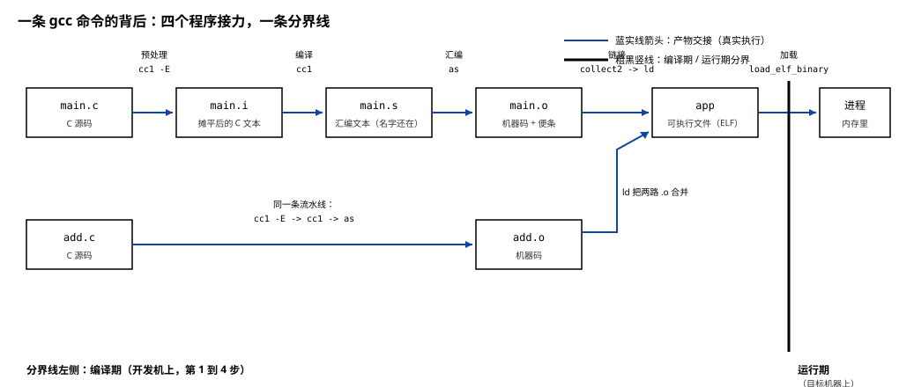
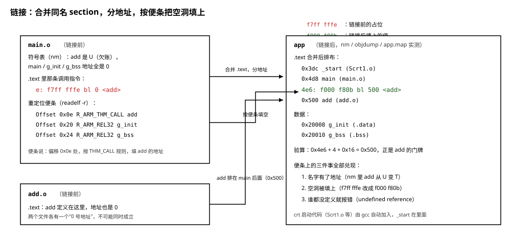

# 00 从源码到运行：四个程序和它们的交接

    实验    Knowledge/labs/00_basics/01_link_and_load/（与 fundamentals 01 篇共用一套判据）
    电脑    WSL Ubuntu 26.04（内核 6.6.114），gcc 15.2.0，
            arm-linux-gnueabihf-gcc 15.2.0，binutils 2.46
            （本篇"本机实测"均为 2026-10-20 实跑）
    判据    bash Knowledge/labs/00_basics/01_link_and_load/check.sh
            2026-10-20 复核：79 PASS / 0 FAIL / 0 SKIP（与 fundamentals 01 篇合并计数）

---

**你会在哪里撞见它**：教程 01 篇第 1.1 节，你敲下

```bash
gcc -O2 -Wall -Wextra hello.c -o hello_x86
```

一个 `.c` 文件进去，一个能运行的文件出来。教程 01 篇关心的是产物能不能在板子上
跑，这条命令本身被当成了一步。但只要错误落进这条命令的内部，黑盒就必须拆开：

```text
/usr/bin/arm-linux-gnueabihf-ld.bfd: main.o: in function `main':
main.c:(.text+0xe): undefined reference to `add'
collect2: error: ld returned 1 exit status
```

这段报错里没有一行是 gcc 自己说的。`ld.bfd` 是谁？`collect2` 又是谁？
`(.text+0xe)` 这个地址它怎么知道的？看懂这篇之后，这类报错你能逐字读出来
是谁在说话、它手里有什么依据。

**这篇要回答的问题**：

1. 一条 `gcc main.c add.c -o app` 背后，到底有几个程序在干活？各自吃什么、
   吐什么？
2. 分开编译出的 `.o` 里，那条调用指令的目标地址填的是什么？谁、在哪一步、
   凭什么把它填上？
3. 磁盘上的文件和"正在运行的程序"之间差着哪一步？这一步是谁走的？

正文读完回头看这三个问题，应该都能不翻书答出来。

---

## 0 先动手看一眼

不用懂原理，先让 gcc 自己交代它干了什么。`-v`（verbose）让它把内部动作
打印出来：

```bash
cd Knowledge/labs/00_basics/01_link_and_load
gcc -v main.c add.c -o /tmp/hello 2>&1 | awk '/^ \// && NF>1 {print $1}'
```

- `2>&1`：gcc 把这些内部信息打印在标准错误上，先并进标准输出才能被管道
  接住。
- `awk '/^ \// && NF>1 {print $1}'`：gcc 每启动一个内部程序，就打印一行
  以空格开头、以程序完整路径开头的命令行。头文件搜索路径也以空格开头，
  但那些行只有一个字段，`NF>1` 把它们滤掉。

本机实测：

```text
/usr/libexec/gcc/x86_64-linux-gnu/15/cc1
/usr/bin/x86_64-linux-gnu-as
/usr/libexec/gcc/x86_64-linux-gnu/15/collect2
```

一行命令，冒出来三个程序的名字。再换一个更硬的办法验证：用 `strace` 盯住
系统调用，看 gcc 到底启动了几个子进程：

```bash
strace -f -qq -e trace=execve -e signal=none gcc main.c add.c -o /tmp/hello 2>&1 \
    | sed -E 's/^(\[pid +[0-9]+\] )?execve\("([^"]+)".*/\2/'
```

- `strace 命令...`：运行后面的命令，打印它发出的系统调用。
- `-f`：连子进程一起跟踪；没有它只能看到 gcc 自己。
- `-qq`：压掉进程退出时的附加信息。
- `-e trace=execve`：只看 `execve`（启动新程序的系统调用）这一种。
- `-e signal=none`：不打印信号事件。
- `sed` 那一段把每行裁到只剩程序路径。

本机实测：

```text
/usr/bin/gcc
/usr/libexec/gcc/x86_64-linux-gnu/15/cc1
/usr/bin/x86_64-linux-gnu-as
/usr/libexec/gcc/x86_64-linux-gnu/15/collect2
/usr/bin/ld
```

五次 `execve`：gcc 自己被启动一次，然后它依次启动了 `cc1`、`as`、
`collect2`，`collect2` 又启动了 `ld`。这不是 gcc 打印出来的宣传，是内核
记录的事实。**"gcc 编译"这四个字背后，是四个程序在接力。**

这一篇剩下的内容，就是把这条链一节一节拆开，看清每个程序接手时手里有
什么、交出去什么。

---

## 1 gcc 自己不翻译：它是调度员

### 1.1 四个程序，各管一步

先把名字和分工摆出来，后面每一节亲手验证：

| 步骤 | 输入 | 谁干 | 输出 | 干了什么 |
|---|---|---|---|---|
| 预处理 | `main.c` | `cc1`（带 `-E`） | `main.i` | 展开 `#include`、`#define`，仍是 C 文本 |
| 编译 | `main.i` | `cc1` | `main.s` | C 文本翻译成汇编文本 |
| 汇编 | `main.s` | `as` | `main.o` | 汇编翻译成机器码，装进 ELF |
| 链接 | 一个或多个 `.o` | `ld`（由 `collect2` 启动） | `app` | 合并、分地址、填空洞 |

gcc 自己不在这个表里。它做的事情是：按顺序启动这四个程序，把上一步的
产物交给下一步，把命令行上你写的选项翻译成每个程序各自的参数。这样的
程序有个名字，叫驱动器（driver）。

第 0 节的 strace 输出里，`collect2` 和 `ld` 分成两行，说明链接这一步还有
一层：gcc 启动的是 `collect2`，真正干活的链接器是 `ld`。`collect2` 是
gcc 包在 `ld` 外面的一层封装，负责在链接前后安排一些 gcc 自己关心的辅助
动作（比如 C++ 全局构造函数的收集），对我们的 C 程序它基本是个传话的。
让 gcc 把这一层也揭开：

```bash
gcc -v -Wl,-v main.c add.c -o /tmp/hello 2>&1 | grep -E '^collect2 version|^GNU ld'
```

- `-Wl,-v`：`-Wl,某某` 表示"把某某这个选项转交给链接器"。gcc 自己不认识
  链接器的选项，必须借 `-Wl,` 转交，逗号后面不能有空格。这里的 `-v` 于是
  传给了链接器。

本机实测：

```text
collect2 version 15.2.0
GNU ld (GNU Binutils for Ubuntu) 2.46
```

第一行是 `collect2` 自报的，第二行是它启动的 `ld` 自报的。两条流水线
的称呼至此全部对上：gcc → collect2 → ld。

### 1.2 为什么表里没有预处理器

老资料常把这条链说成"四个程序 cpp、cc1、as、ld"。`cpp` 是 C 预处理器的
名字，它曾经是一个独立程序。现在的 gcc 把预处理并进了 `cc1`：`cc1` 带上
`-E` 选项就只预处理不编译。验证一下，看 `gcc -E` 启动的是谁：

```bash
arm-linux-gnueabihf-gcc -E -v main.c -o /tmp/main.i 2>&1 | awk '/^ \// && NF>1' | cut -c1-90
```

本机实测：

```text
 /usr/libexec/gcc-cross/arm-linux-gnueabihf/15/cc1 -E -quiet -v -imultilib . ...
```

启动的是 `cc1`，参数里带着 `-E`。所以四步只有三个程序：第 0 节看到的
`cc1`、`as`、`collect2`（进而是 `ld`），预处理和编译两步由 `cc1` 一个
程序干完。`cpp` 命令今天还在，但它自己也只是 gcc 驱动器的另一种叫法。

### 1.3 为什么要拆成这么多步

一句命令能做完的事，为什么要拆成四个程序？因为拆开后，每一步的产物都能
留下、复用：

- 改动一个文件，只重编这一个文件成 `.o`，其余 `.o` 原样留用，最后重新
  链接一次就行。不拆的话，改一行就要把整个工程从头翻译一遍。03 篇讲的
  Makefile，管的就是"哪些 `.o` 要重编、链接什么时候重做"这笔账。
- 不同语言（C、C++、Fortran）各自有自己的 `cc1`，但汇编器、链接器是同一
  个。拆开后，gcc 这套架子可以被每种语言复用。

整条链的样子：

```text
  main.c --cc1--> main.s --as--> main.o --+
                                           +--ld--> app
  add.c  --cc1--> add.s  --as--> add.o  --+
```

两个 `.c` 各自独立走完前三步，只有最后一步把两路并在一起。这张图是
本篇剩下六节的地图；文末有一张更完整的 SVG 版本（第 7 节）。

**这一节搭好的积木**：gcc 是调度员，干活的是 `cc1`（预处理和编译）、
`as`（汇编）、`ld`（链接，由 `collect2` 启动）；`gcc -v` 和 `strace -f`
都能把这条链抓出来。接下来的问题：每一步的产物到底长什么样。从第一步
开始看。

---

## 2 预处理：-E，第一步的产物还是 C 文本

### 2.1 让 gcc 停在预处理后

gcc 有三个开关，分别让它在流水线的前三站停车：

```bash
arm-linux-gnueabihf-gcc -E main.c -o main.i
arm-linux-gnueabihf-gcc -S main.c -o main.s
arm-linux-gnueabihf-gcc -c main.c -o main.o
```

记法：`-E` 停在预处理后（prEprocessing），`-S` 停在编译后（aSsembly），
`-c` 停在汇编后（compile only，不链接）。三个开关是"越来越往后停"。
大小写不能换：小写 `-s` 是另一个选项，第 5.4 节会拿它注错一次。

实验用的两个源文件，完整内容如下。`main.c`：

```c
int add(int a, int b);

int g_init = 1;
int g_bss;

int main(void)
{
	return add(g_init, 2) + g_bss;
}
```

`add.c`：

```c
int add(int a, int b)
{
	return a + b;
}
```

故意拆成两个文件：一个文件看不出链接器在干什么，`main.c` 用了 `add` 却
不定义它，这个"欠账"正是第 4、5 节的主角。

看三个产物的行数（本机实测）：

```text
$ wc -l main.c main.i main.s
   9 main.c
  15 main.i
  63 main.s
```

### 2.2 main.i 里多了什么

`main.i` 的完整内容：

```text
# 0 "main.c"
# 0 "<built-in>"
# 0 "<command-line>"
# 1 "/usr/arm-linux-gnueabihf/include/stdc-predef.h" 1 3
# 0 "<command-line>" 2
# 1 "main.c"
int add(int a, int b);

int g_init = 1;
int g_bss;

int main(void)
{
 return add(g_init, 2) + g_bss;
}
```

下半部分是 `main.c` 原样抄过来的，一个字符没改。上半部分多出来的 6 行以
`#` 开头，是**行号标记**：`# 1 "main.c"` 表示"下面这行来自 main.c 的第 1
行"。预处理器把多个文件的内容拼成一串之后，靠这些标记记住每行的来历，
后面编译报错时才能报出正确的文件名和行号。`main.c` 里没有 `#include`
和 `#define`，所以预处理几乎无事可做。

`file` 命令确认它的身份（本机实测）：

```text
main.c:  C source, ASCII text
main.i:  C source, ASCII text
```

预处理的产物还是 C 文本。它不是一种新的中间格式，只是"把头文件和宏全部
摊平之后的 C"。

### 2.3 一行 #include 会拉进来多少

`main.c` 没有 `#include`，看不出预处理的真正工作量。加一行试试：

```bash
printf '#include <stdio.h>\n' > t.c && cat main.c >> t.c
arm-linux-gnueabihf-gcc -E t.c -o t.i
wc -l t.c t.i
```

- `printf '...' > t.c`：造一个只有一行的文件。
- `cat main.c >> t.c`：把 `main.c` 追加到它后面，`t.c` 一共 10 行。

本机实测：

```text
  10 t.c
 842 t.i
```

10 行进去，842 行出来。多出来的 832 行是 `stdio.h` 以及它自己 include 的
一串头文件摊平后的内容。数一下这 832 行来自多少个不同的文件：

```bash
grep -E '^# [0-9]+ "' t.i | awk '{print $3}' | sort -u | wc -l
```

本机实测是 29（含 `"t.c"` 自身和两个伪文件名 `<built-in>`、
`<command-line>`）。一行 `#include <stdio.h>`，实际拉进来二十多个头文件。

`t.i` 里能直接找到 `printf` 的声明（第 489 行）：

```text
extern int printf (const char *__restrict __format, ...);
```

这正是教程 01 篇第 1.4 节说的"声明让编译器能核对调用"的实体：它不是凭空来的，
是预处理从 `stdio.h` 里抄进来的。**你写的一个字符都没进 `t.i`，但编译器
接下来要处理的 842 行全部因那一行而起。** 这就是"少 include 一个头文件"
能实打实缩短编译时间的原因。

**这一节搭好的积木**：预处理把 `#include`、`#define` 摊平，产物是仍是 C
文本的 `.i`，外加一批行号标记；一行 `#include` 可能摊出几百行。接下来的
问题：这 842 行 C 文本，是怎么变成另一种文本（汇编）的。

---

## 3 编译：-S，汇编还是文本，名字还在

`main.s` 是 `cc1` 的真正产物。完整内容 63 行，分段读：

```text
	.arch armv7-a
	.fpu vfpv3-d16
	.eabi_attribute 28, 1
	...（共 10 行 .eabi_attribute，声明这份代码遵循的 ARM 二进制约定）
	.file	"main.c"
	.text
	.global	g_init
	.data
	.align	2
	.type	g_init, %object
	.size	g_init, 4
g_init:
	.word	1
	.global	g_bss
	.bss
	.align	2
	.type	g_bss, %object
	.size	g_bss, 4
g_bss:
	.space	4
	.text
	.align	1
	.global	main
	.syntax unified
	.thumb
	.thumb_func
	.type	main, %function
main:
	push	{r7, lr}
	add	r7, sp, #0
	ldr	r3, .L3
.LPIC0:
	add	r3, pc
	ldr	r3, [r3]
	movs	r1, #2
	mov	r0, r3
	bl	add(PLT)
	mov	r2, r0
	ldr	r3, .L3+4
.LPIC1:
	add	r3, pc
	ldr	r3, [r3]
	add	r3, r3, r2
	mov	r0, r3
	pop	{r7, pc}
.L4:
	.align	2
.L3:
	.word	g_init-(.LPIC0+4)
	.word	g_bss-(.LPIC1+4)
	.size	main, .-main
	.ident	"GCC: (Ubuntu 15.2.0-16ubuntu1) 15.2.0"
	.section	.note.GNU-stack,"",%progbits
```

不需要读懂每条指令，认四件事：

1. **变量和函数被分开放了。** `g_init` 前面有 `.data`，`g_bss` 前面有
   `.bss`，`main` 前面有 `.text`。以点开头的这些行是给汇编器的指示
   （伪指令），意思是"接下来的内容放进名叫某某的箱子"。箱子就是第 6 节
   要讲的 section，这里先记住：编译器在生成汇编时就已经按用途分好类了。
2. **`g_bss` 没有内容。** `g_init:` 下面是 `.word 1`（存一个字，值是 1），
   而 `g_bss:` 下面是 `.space 4`（留 4 个字节的空位，什么都不填）。
   "不给初值"在汇编里就是"只占位置"。[01 篇第 4 节](01_ELF与程序加载.md)会讲这个差别的全部后果。
3. **函数调用写的是名字。** 倒数第 15 行 `bl add(PLT)`：`bl` 是 ARM 的
   调用指令，它的操作数是 `add` 这三个字母，不是数字地址。
4. **末尾有一行出处。** `.ident` 把编译器的名字和版本写进了产物，
   它会一路跟到最终的 `.o` 里（`.comment` section）。

第 3 点是本篇后半段的钥匙。**汇编是文本，文本里可以写名字；但 CPU 执行
的机器码里没有名字这种东西，`bl` 指令只能编码一个数字偏移。**`add` 这个
名字必须在某一步被换成数字。换成什么数字？`add` 的代码在 `add.c` 里，
编译 `main.c` 的 `cc1` 从头到尾没见过 `add.c`，它不可能知道答案。

所以合理的猜测只剩一个：`cc1` 把这个"还不知道"原样写进了汇编，`as` 再
原样搬进机器码，留给后面的人去填。下一节验证这个猜测。

**这一节搭好的积木**：编译（`cc1`）把 C 文本翻译成汇编文本；变量按有无
初值被分进 `.data` 和 `.bss`，代码进 `.text`；函数调用在汇编里还是名字。
接下来的问题：`as` 把名字变成机器码时，那个名字怎么办。

---

## 4 汇编：-c，机器码里留空条，旁边贴张便条

### 4.1 先看名字，再看指令

`as` 的产物 `main.o` 已经是二进制：

```text
$ file main.o
main.o: ELF 32-bit LSB relocatable, ARM, EABI5 version 1 (SYSV), not stripped
```

ELF 格式的文件，类型是 relocatable（可重定位），也就是"还不能运行、等着
被链接"的中间产物。ELF 的完整故事在 [01 ELF 与程序加载](01_ELF与程序加载.md)，
本篇只需要用到它的两个零件：符号表和重定位表。

先看符号表。`nm`（name 的缩写）列出一个文件里登记的所有名字：

```bash
arm-linux-gnueabihf-nm main.o
arm-linux-gnueabihf-nm add.o
```

本机实测：

```text
$ arm-linux-gnueabihf-nm main.o
         U add
00000000 B g_bss
00000000 D g_init
00000000 T main
$ arm-linux-gnueabihf-nm add.o
00000000 T add
```

`nm` 的输出是三列：地址、类型字母、名字。逐行读：

- `U add`：`U` 是 Undefined，"本文件用到了它，但它不在这里定义"。
  `main.o` 明确记着一笔账：我欠一个叫 `add` 的东西。
- `T main`：`T` 是 Text，"本文件的代码里定义了它"。`add.o` 里的 `add`
  也是 `T`。
- `D g_init`：`D` 是 Data，定义在本文件的数据区，有初值。
- `B g_bss`：`B` 是 BSS，定义在本文件，无初值。
- 小写字母（`t`、`d`、`b`）表示 `static`，只在本文件可见；大写表示全局
  可见，别的文件可以引用。

再看地址列：`main`、`g_init`、`g_bss` 全是 `00000000`，`add.o` 里的 `add`
也是 `00000000`。三个不同的东西不可能都住在 0 号地址，两个文件里更不能
各有一个东西住在 0 号地址。**`.o` 里的地址不是真地址，只是"从本文件开头
算起的偏移"，每个文件都从自己算起。** 等会儿要有人重新排门牌号。

### 4.2 那条调用指令里填了什么

反汇编 `main.o`，直接看 `bl` 那条指令：

```bash
arm-linux-gnueabihf-objdump -d main.o
```

- `objdump -d`：`-d` 是 disassemble，把机器码翻译回人能读的指令文字。

本机实测（`main` 部分全文）：

```text
00000000 <main>:
   0:	b580      	push	{r7, lr}
   2:	af00      	add	r7, sp, #0
   4:	4b06      	ldr	r3, [pc, #24]	@ (20 <main+0x20>)
   6:	447b      	add	r3, pc
   8:	681b      	ldr	r3, [r3, #0]
   a:	2102      	movs	r1, #2
   c:	4618      	mov	r0, r3
   e:	f7ff fffe 	bl	0 <add>
  12:	4602      	mov	r2, r0
  14:	4b03      	ldr	r3, [pc, #12]	@ (24 <main+0x24>)
  16:	447b      	add	r3, pc
  18:	681b      	ldr	r3, [r3, #0]
  1a:	4413      	add	r3, r2
  1c:	4618      	mov	r0, r3
  1e:	bd80      	pop	{r7, pc}
  20:	00000016 	.word	0x00000016
  24:	0000000a 	.word	0x0000000a
```

每行三列：指令在本文件里的偏移、机器码字节、反汇编出来的指令文字。
看偏移 `e` 那一行：

- 机器码是 `f7ff fffe`，四个字节里有效载荷全是 `f`。
- objdump 拿这串字节里（几乎是空的）偏移字段去算目标地址，算出 0，
  所以显示成 `bl 0 <add>`。`0` 不是真地址，是"空"被当成数字 0 显示出来。

`f7ff fffe` 是汇编器留的占位模式，意思是"偏移字段我没填，等人来填"。
不需要去精确解码这四个字节的位域（那是芯片手册的事），这里只要认一个
事实：**这条指令的目标地址是空的。**

### 4.3 便条：重定位记录

汇编器不能留个空就走人，它得留张便条，写清"第几个字节需要填、填谁的
地址、按什么规则填"。这张便条叫重定位记录（relocation），存在 `.o` 的
另一张表里。`readelf -r` 读它：

```bash
arm-linux-gnueabihf-readelf -r main.o
```

- `readelf` 是读 ELF 文件的工具，`-r` 是 relocations。

本机实测：

```text
Relocation section '.rel.text' at offset 0x1e0 contains 3 entries:
 Offset     Info    Type            Sym.Value  Sym. Name
0000000e  00000f0a R_ARM_THM_CALL    00000000   add
00000020  00000c03 R_ARM_REL32       00000000   g_init
00000024  00000d03 R_ARM_REL32       00000000   g_bss
```

一共三张便条，逐列读：

- `Offset`：要修补的位置，从本文件的代码开头算起。
- `Type`：按什么规则修补。`R_ARM_THM_CALL` 是"Thumb 指令集的 `bl` 调用"
  的填法，`R_ARM_REL32` 是"32 位相对地址"的填法。填法不同是因为指令
  编码不同，链接器按它算出该写的数字。
- `Sym. Name`：填谁的地址。

三处对照，一处不差：

1. 第一张便条的 `Offset` 是 `0000000e`，上一节反汇编里 `bl` 指令正好在
   偏移 `e`。
2. 后两张便条在 `0x20` 和 `0x24`，正好是反汇编最后两行 `.word` 常量的
   位置。这两个常量是 `g_init`、`g_bss` 的地址占位（汇编里那两行
   `.word g_init-(.LPIC0+4)`），`ldr r3, [pc, #24]` 读的就是它们。
3. 便条上的名字，和 `nm` 里那个 `U add`、那两个 `D`/`B` 全对得上。

`objdump` 加 `-r` 可以把便条直接贴在指令旁边，省得来回对：

```bash
arm-linux-gnueabihf-objdump -dr main.o | sed -n '/<main>:/,$p'
```

本机实测（节选三行）：

```text
   e:	f7ff fffe 	bl	0 <add>
			e: R_ARM_THM_CALL	add
  20:	00000016 	.word	0x00000016
			20: R_ARM_REL32	g_init
```

指令下面紧跟的缩进行就是作用于这条指令的便条。

### 4.4 对照实验：把便条撕掉

"机器码是空的、信息在便条里"这个说法，可以反过来验证：把便条从文件里
删掉，机器码一个字节不动，看 objdump 怎么说。`objcopy` 是按 section
增删改文件内容的工具：

```bash
arm-linux-gnueabihf-objcopy -R .rel.text main.o main_norel.o
arm-linux-gnueabihf-objdump -d main_norel.o | grep 'bl'
```

- `-R .rel.text`：remove，把名叫 `.rel.text` 的 section（就是那张便条表）
  从副本里删掉。

本机实测：

```text
   e:	f7ff fffe 	bl	e <main+0xe>
```

机器码还是 `f7ff fffe`，一个字节没变。但 objdump 不再显示 `<add>` 了：
它算出目标地址是 0，文件里又没有任何记录说这个位置和 `add` 有关，于是
老老实实显示成"跳向偏移 e"，也就是跳向这条指令自己。**名字和位置之间
的联系只存在于便条里，便条没了，联系就断了。**

到这里，`.o` 的状态可以完整描述了：机器码是真的，地址是假的，欠别人的
东西记在便条上。把它变成能运行的文件，需要一个程序来做三件事：给所有
名字分真地址、按便条把空洞填上、发现某张便条的名字谁都没定义就报错。
这就是下一节。

**这一节搭好的积木**：`.o` 是 ELF；`nm` 读符号表（`U` 是欠账），
`readelf -r` 读重定位便条；`bl` 的机器码是占位 `f7ff fffe`。
接下来的问题：填空的现场。

---

## 5 链接：分地址、填空、找不到就报错

### 5.1 先让第 3 件事发生：undefined reference

链接器平时闷声干活，唯一主动开口就是找不到人的时候。故意只给一个 `.o`：

```bash
arm-linux-gnueabihf-gcc main.o -o app_bad
```

故意不给 `add.o`。本机实测：

```text
/usr/bin/arm-linux-gnueabihf-ld.bfd: main.o: in function `main':
main.c:(.text+0xe): undefined reference to `add'
collect2: error: ld returned 1 exit status
```

逐句读，这段报错把前面四节的内容全部印证了一遍：

- `/usr/bin/arm-linux-gnueabihf-ld.bfd:`：说话的是 `ld`，链接器，它的名字
  第一次直接出现在报错里。（`ld.bfd` 是 GNU 链接器的完整名字，用来和
  另一个变体 `ld.gold` 区分。）
- `main.o: in function 'main'`：出事的是 `main.o` 里的 `main`。
- `(.text+0xe)`：偏移 `0xe`，和第 4.3 节便条上的 `Offset` 一字不差。
  链接器就是拿着便条找到这个地方的。
- `undefined reference to 'add'`："未定义的引用"，正是 `nm` 里那个 `U`
  在链接这一步的下场。
- `collect2: error: ld returned 1 exit status`：gcc 的封装层 `collect2`
  看到 `ld` 失败，把失败转报出来。

容易以为 `undefined reference to 'add'` 是语法错误或者"编译没过"；
实际上语法完全正确，`cc1` 早就过了，是链接器拿着便条找不到提供 `add`
的人。这类错误的排查方向永远是"少链了一个 `.o`、少给了一个 `-l` 库、
或者顺序不对"，不是"代码写错了"。

### 5.2 补上 add.o：四个门牌号一次排好

```bash
arm-linux-gnueabihf-gcc main.o add.o -o app -Wl,-Map=app.map
```

- `-Wl,-Map=app.map`：转交 `-Map=app.map` 给 `ld`，让它把"谁被放到了
  哪个地址"写成一份报告（map 文件）。这份报告是第 6 节的主角。

先看名字（本机实测）：

```text
$ arm-linux-gnueabihf-nm app | grep -E ' (main|add|g_init|g_bss)$'
00000500 T add
00020010 B g_bss
00020008 D g_init
000004d8 T main
```

和第 4.1 节对照着看：

```text
           main.o / add.o 里     链接后
main       00000000           -> 000004d8
add        00000000 (U/T)     -> 00000500 （而且不再是 U，是 T）
g_init     00000000           -> 00020008
g_bss      00000000           -> 00020010
```

四个"都住 0 号地址"的东西，现在各有各的门牌。`add` 从 `U` 变成了 `T`：
账还上了。链接器干的第一件事（分地址）完成。

### 5.3 那条 bl 被填上了

```bash
arm-linux-gnueabihf-objdump -d app | sed -n '/<main>:/,/^$/p;/<add>:/,/^$/p'
```

本机实测（节选）：

```text
000004d8 <main>:
 4d8:	b580      	push	{r7, lr}
 ...
 4e6:	f000 f80b 	bl	500 <add>
 ...
 4f8:	0001fb26 	.word	0x0001fb26
 4fc:	0001fb1e 	.word	0x0001fb1e

00000500 <add>:
 500:	b480      	push	{r7}
 ...
```

链接前后摆在一起：

```text
链接前   e:   f7ff fffe   bl 0   <add>
链接后 4e6:   f000 f80b   bl 500 <add>
```

机器码真的被改写了，不是显示上的差别。`bl` 的目标从 0 变成了 `500`，
正是 `nm` 里 `add` 的门牌号。便条上另外两处也没落下：`.word` 常量从
`00000016`、`0000000a` 变成了 `0001fb26`、`0001fb1e`。

顺手验算一次，确认 `500` 这个数是算出来的不是巧合。ARM 的 `bl` 编码的是
相对偏移，基准是"当前指令地址 + 4"：

```text
当前指令地址 0x4e6，加 4 = 0x4ea
机器码 f000 f80b 里的偏移字段解出来是 0x16（22 字节）
0x4ea + 0x16 = 0x500 = add 的地址
```

对上了。**链接器就是把 0x16 这个数算出来、写进机器码的那个程序。**
`.o` 里的占位 `fffe` 对应偏移 0，链接后填的是真偏移。同样的账，两个
`.word` 常量也对得上：`g_init` 在 0x20008，`0x20008 + 0x16 - 0x4f8 =
0x1fb26`（0x16 是 `.o` 里就写好的半成品，0x4f8 是这条 `.word` 的新位置）。

**这一节搭好的积木**：链接器做三件事：合并所有 `.o` 并给每个名字分真
地址、按重定位便条填空洞、便条上的名字找不到定义就报
`undefined reference`。**接下来的问题：它按什么单位分地址？**

### 5.4 注错两处，确认报错真的来自链接器

注错一：把 `add.c` 里的函数名改成 `add2`，重新编 `add.o` 再链接：

```bash
sed 's/add(/add2(/' add.c > add2.c
arm-linux-gnueabihf-gcc -c add2.c -o add2.o
arm-linux-gnueabihf-gcc main.o add2.o -o app_add2
```

本机实测，同样的 `undefined reference to 'add'` 再次出现：提供一个名叫
`add2` 的函数，对便条上的 `add` 没有任何帮助。如果没报错，说明你链的是
上一次编出来的旧 `add.o`，这本身就是"为什么需要 Makefile 管依赖"的现场。

注错二：第 2.1 节说过 `-S` 大小写不能换。敲成小写 `-s`：

```bash
arm-linux-gnueabihf-gcc -s main.c -o main.s
```

本机实测：

```text
/usr/bin/arm-linux-gnueabihf-ld.bfd: /tmp/cce6WWON.o: in function `main':
main.c:(.text+0xe): undefined reference to `add'
collect2: error: ld returned 1 exit status
$ ls -l main.s
ls: cannot access 'main.s': No such file or directory
```

小写 `-s` 不是"停在汇编"，是转交给链接器的 strip 选项（删掉符号表，
[fundamentals 01 篇第 3 节](01_ELF与程序加载.md)细讲）。gcc 一路做到链接才倒下，
`main.s` 根本没生成。报错的还是 `ld.bfd`，便条上的偏移还是 `+0xe`。

---

## 6 section：链接器搬运的箱子

### 6.1 为什么按箱分地址

第 5 节说链接器"给所有东西分地址"。一个一个函数分吗？那太碎了，而且有
一个硬约束。程序跑起来以后，不同内容要的内存权限不同：

```text
代码        必须可读、可执行、不可写（可写就能被改写成别的东西）
只读数据    必须可读、不可写、不可执行
可写数据    必须可读、可写、不可执行
```

内存权限是按页设的，一页 4096 字节（`getconf PAGESIZE` 可查，本机实测
4096），不可能一个函数一种权限。**权限相同的内容必须挨着放**，凑成一整
块，才能用尽量少的页把权限设对。

所以编译器在生成 `.o` 的时候就已经按用途把内容分好类了，每一类叫一个
section（节）。链接器的工作方式随之确定：**把所有输入文件里同名的
section 首尾相接拼成一大块，再给这一大块分一个地址。**

常见的几个名字，现在认脸就够：

```text
.text      代码
.data      有初值的全局/静态变量
.bss       无初值的全局/静态变量
.rodata    只读数据，比如字符串字面量
.symtab    符号表，nm 读的那张
.rel.text  重定位便条，readelf -r 读的那张
```

### 6.2 看 .o 里的 section 表

```bash
arm-linux-gnueabihf-readelf -S main.o
```

- `-S` 是大写，看 section 表（Section headers）。小写 `-s` 是看符号表，
  别弄混。

本机实测：

```text
There are 11 section headers, starting at offset 0x254:

  [Nr] Name              Type            Addr     Off    Size   ES Flg Lk Inf Al
  [ 0]                   NULL            00000000 000000 000000 00      0   0  0
  [ 1] .text             PROGBITS        00000000 000034 000028 00  AX  0   0  4
  [ 2] .rel.text         REL             00000000 0001e0 000018 08   I  8   1  4
  [ 3] .data             PROGBITS        00000000 00005c 000004 00  WA  0   0  4
  [ 4] .bss              NOBITS          00000000 000060 000004 00  WA  0   0  4
  [ 5] .comment          PROGBITS        00000000 000060 000027 01  MS  0   0  1
  [ 6] .note.GNU-stack   PROGBITS        00000000 000087 000000 00      0   0  1
  [ 7] .ARM.attributes   ARM_ATTRIBUTES  00000000 000087 000033 00      0   0  1
  [ 8] .symtab           SYMTAB          00000000 0000bc 000100 10      9  12  4
  [ 9] .strtab           STRTAB          00000000 0001bc 000024 00      0   0  1
  [10] .shstrtab         STRTAB          00000000 0001f8 000059 00      0   0  1
```

该看哪几列（其余先无视）：

- `Name`：箱子名。
- `Type`：`PROGBITS` 表示文件里真的存着这些字节；`NOBITS` 表示文件里
  不存，只记一个大小（`.bss` 就是它，[01 篇第 4 节](01_ELF与程序加载.md)细讲）；
  `SYMTAB`/`STRTAB`/`REL` 是给工具看的元信息。
- `Addr`：全是 `00000000`，又一次印证 `.o` 里没有真地址。
- `Size`：大小，十六进制。
- `Flg`：权限旗标，`AX` 是可分配+可执行，`WA` 是可写+可分配。

从这张表直接读出三件事：

1. `.text` 大小 `0x28` = 40 字节。回头数第 4.2 节的反汇编：`main` 的指令
   从偏移 0 到 0x1e（共 30 字节，Thumb 指令每条 2 或 4 字节），加上末尾
   两个 `.word` 常量（0x20、0x24 各 4 字节），正好到 0x28。对得上。
2. `.data` 4 字节 = `int g_init`，`.bss` 4 字节 = `int g_bss`。两个变量
   按"有没有初值"被分进了不同的箱子，和第 3 节汇编里的 `.data`/`.bss`
   伪指令对应。
3. `.symtab`、`.strtab`、`.rel.text` 是给工具看的：第 4 节的 `nm` 和
   `readelf -r` 读的就是它们。

### 6.3 亲眼看链接器拼箱子：map 文件

第 5.2 节链接时给了 `-Wl,-Map=app.map`，现在打开这份报告，找 `.text`：

```bash
grep -n -A 12 '^\.text ' app.map
```

本机实测（`...` 处略去同目录的长路径前缀）：

```text
.text           0x000003dc      0x13e
 *(.text .stub .text.* .gnu.linkonce.t.*)
 .text          0x000003dc       0x34 .../Scrt1.o
                0x000003dc                _start
 .text          0x00000410       0x24 .../crti.o
 .text          0x00000434       0xa4 .../crtbeginS.o
 .text          0x000004d8       0x28 main.o
                0x000004d8                main
 .text          0x00000500       0x1a add.o
                0x00000500                add
```

逐行读：

- 第一行 `.text 0x3dc 0x13e`：合并后的 `.text` 整体从地址 0x3dc 开始，
  总长 0x13e。
- 下面每一行是一个输入文件贡献的一块：起始地址、长度、来自哪个 `.o`；
  再缩进一层的行是这块里的符号。

这张表值得亲手对三笔账：

1. `main.o` 那块长度 `0x28`，和第 6.2 节 `readelf -S main.o` 的 `.text`
   大小 `000028` 完全相等。链接器搬的就是那个箱子，一字节没变。
2. `0x4d8 + 0x28 = 0x500`，正好是 `add.o` 那块的起始地址。首尾相接，
   中间没有缝，这就是"合并"的字面意思。
3. `0x4d8` 和 `0x500` 正是第 5.2 节 `nm app` 查到的 `main` 和 `add`
   的地址。一条线从头对到尾。

`.data` 和 `.bss` 两段同理（本机实测节选）：

```text
.data           0x00020000        0xc
 .data          0x00020008        0x4 main.o
                0x00020008                g_init
.bss            0x0002000c        0x8
 .bss           0x00020010        0x4 main.o
                0x00020010                g_bss
```

`g_init` 在 0x20008，落在合并后 `.data` 里；`g_bss` 在 0x20010，落在
`.bss` 里。和第 5.2 节的 `nm` 输出一致。

### 6.4 Scrt1.o 是哪来的

map 文件里有个意外发现：`Scrt1.o`、`crti.o`、`crtbeginS.o` 这几个 `.o`
你没写过，也没在命令行上给过。是 gcc 链接时自己加进去的。它们在哪？问
gcc：

```bash
arm-linux-gnueabihf-gcc -print-file-name=Scrt1.o
```

- `-print-file-name=某某`：回答"如果要找某某这个文件，你会用哪个路径"。

本机实测：

```text
/usr/lib/gcc-cross/arm-linux-gnueabihf/15/../../../../arm-linux-gnueabihf/lib/Scrt1.o
```

`../../../..` 回退四层，实际指向 `/usr/arm-linux-gnueabihf/lib/Scrt1.o`，
和 ARM 版 C 库在同一个目录。这是交叉编译器自带的启动代码。crt 是
C RunTime 的缩写，这一小批 `.o` 的任务是在 `main` 跑起来之前做准备工作，
`main` 返回之后收尾。map 文件里能看到 `_start` 就在 `Scrt1.o` 贡献的那
块里（0x3dc），它才是整个程序真正的入口，`main` 是它调用的。

从 map 文件还能算一笔账：你写的两个文件贡献了 `0x28 + 0x1a = 66` 字节，
合并后的 `.text` 总共 0x13e = 318 字节。**最终可执行文件里，你的代码只
占很小一部分。** 入口和启动代码的故事在
[fundamentals 01 篇第 5 节](01_ELF与程序加载.md)展开，这里只要记住 `_start` 这个名字
和它住在 `Scrt1.o` 里。

### 6.5 注错：加长一个箱子，看它把后面推着走

在 `add.c` 里加一个函数，重新编译链接：

```c
int sub(int a, int b)
{
	return a - b;
}
```

本机实测，map 文件里对应那行从：

```text
 .text          0x00000500       0x1a add.o
```

变成：

```text
 .text          0x00000500       0x34 addsub.o
```

长度 0x1a 变成 0x34。注意 `main.o` 那行的地址 0x4d8 没变，因为它排在
前面；被推着走的是 `add.o` 之后的所有内容。如果长度没变，说明链接的还是
上一次编出来的旧 `.o`。

**这一节搭好的积木**：section 是链接器的操作单位，按权限需求分类；
链接器把同名 section 首尾相接拼成大块再分地址，map 文件是这份排布报告；
gcc 会自动塞进一批 crt 启动文件，`_start` 在里面。前六节讲完了"编译时"。
接下来的问题：过那条界线，到"运行时"。

---

## 7 加载：文件怎么变成进程

### 7.1 过了哪条线

前六节的一切都发生在编译的时候、开发的电脑上。`app` 现在是一个文件，
静静躺在磁盘上。你敲 `./app`，它开始执行。中间这一步发生在**运行的时候、
运行的机器上**，做这件事的程序叫加载器。

加载器不是磁盘上的一个独立程序，是内核里的一段代码：你敲 `./app`，shell
通过 `execve` 系统调用请内核来，内核里的 ELF 加载函数（源码里的
`load_elf_binary`）把文件搬进内存、设好权限、让 CPU 从入口开始执行。
它和链接器正好对称：

```text
链接器  在文件里安排布局    “main 放在 0x4d8”
加载器  照这个布局摆进内存  “让 main 的代码出现在内存 0x4d8”
```

布局是怎么记在文件里的、加载器一步步做什么，是
[01 篇](01_ELF与程序加载.md)的全部内容。本节只看结果：程序跑起来以后，
它的内存被摆成了什么样。

### 7.2 让程序自己报告它被摆成什么样

Linux 把每个进程的内存布局放在伪文件 `/proc/进程号/maps` 里，进程读
`/proc/self/maps` 就是读自己的。`maps.c`（完整文件在实验目录里）：

```c
#include <stdio.h>

int g_init = 1;   /* 有初值的全局变量，进 .data */
int g_bss;        /* 无初值的全局变量，进 .bss */

int main(void)
{
	char line[256];
	FILE *f = fopen("/proc/self/maps", "r");

	while (fgets(line, sizeof line, f))
		fputs(line, stdout);
	fclose(f);

	printf("&main  =%p\n", (void *)main);
	printf("&g_init=%p\n", (void *)&g_init);
	printf("&g_bss =%p\n", (void *)&g_bss);
	printf("g_bss  =%d\n", g_bss);
	return 0;
}
```

逐行读：

- `FILE *f = fopen(...)`：打开这个伪文件，拿到一个可以一行行读的句柄。
- `while (fgets(line, sizeof line, f))`：每次读一行进 `line`，读到文件
  结束 `fgets` 返回空，循环停。`sizeof line` 是缓冲区大小 256，防止一行
  太长撑爆数组。
- `fputs(line, stdout)`：把刚读到的一行原样打印出来。
- 后面四句：打印 `main`、`g_init`、`g_bss` 三个地址（`%p` 是打印指针的
  占位符），以及 `g_bss` 的值。

编译运行。这里换本机 gcc 编 x86 版，因为要真的跑起来，ARM 程序在 x86
上跑不了（教程 01 篇第 3 节讲为什么）。布局规则两个架构一样，结论不受影响：

```bash
gcc maps.c -o maps
./maps
```

本机实测（只留和本程序有关的前 5 行和末尾 4 行）：

```text
56765a7ca000-56765a7cb000 r--p 00000000 08:20 24090    /home/glorinz/el-f0001/w/maps
56765a7cb000-56765a7cc000 r-xp 00001000 08:20 24090    /home/glorinz/el-f0001/w/maps
56765a7cc000-56765a7cd000 r--p 00002000 08:20 24090    /home/glorinz/el-f0001/w/maps
56765a7cd000-56765a7ce000 r--p 00002000 08:20 24090    /home/glorinz/el-f0001/w/maps
56765a7ce000-56765a7cf000 rw-p 00003000 08:20 24090    /home/glorinz/el-f0001/w/maps
...
&main  =0x56765a7cb1e9
&g_init=0x56765a7ce010
&g_bss =0x56765a7ce024
g_bss  =0
```

### 7.3 逐行读 maps

每行的格式：

```text
起始地址-结束地址  权限  文件内偏移  设备  节点  这段内存对应哪个文件
```

权限四个字符：`r` 可读、`w` 可写、`x` 可执行、`p` 私有（这份进程自己的
副本，改了不影响别人）。

5 行都指向本程序的文件，是加载器把这个文件摆进内存的痕迹。和 `readelf`
查到的静态布局对一下（本机实测，`readelf -SW maps` 节选）：

```text
[14] .text    PROGBITS  0000000000001100 001100 000202 ... AX
[25] .data    PROGBITS  0000000000004000 003000 000014 ... WA
[26] .bss     NOBITS    0000000000004018 003014 000010 ... WA
```

`nm maps` 查到 `main` 在 0x11e9、`g_init` 在 0x4010、`g_bss` 在 0x4024。
现在把两边拼起来：

```text
文件里的布局（链接器排的）      运行时的布局（加载器摆的，基址 0x56765a7ca000）
.text  从 0x1100 起            r-xp 行从 ...cb000 起；0x1100 & 0xfff = 0x100，
main   在 0x11e9               页内偏移 0x1e9 不变 -> &main = ...cb1e9
.data  从 0x4000 起            rw-p 行从 ...ce000 起；0x4000 & 0xfff = 0，
g_init 在 0x4010               页内偏移 0x010 不变 -> &g_init = ...ce010
```

三笔账全部对上：

1. `&main = 0x56765a7cb1e9`，落在第 2 行 `[...cb000, ...cc000)` 区间内，
   那一行权限 `r-xp`，可执行。代码确实被放进了可执行的那块。
2. `&g_init = 0x56765a7ce010`，落在第 5 行 `[...ce000, ...cf000)`，
   权限 `rw-p`，可写。全局变量确实在可写的那块。
3. 文件里的地址和运行时地址，低 12 位（一页以内的偏移）完全相同，
   只差一个整体基址。加载器是"整页整页地搬"，页内布局原样保留。

第 6.1 节那句"权限相同的东西必须挨着放"在这里兑现：编译器分 section、
链接器合并 section、加载器按权限成块映射，是同一条链上的三步。

细心的地方还有一处：这个程序的 `readelf -lW` 输出里 `LOAD` 只有 4 条，
maps 里却有 5 行指向本文件。多出来的一行来自 `GNU_RELRO`：动态链接器在
启动的最后会把数据块里"重定位完成后不该再写"的那部分改成只读，一个
`rw` 的块于是被拆成 `r--` 和 `rw-` 两行。这个细节不影响主线，[01 篇第 3 节](01_ELF与程序加载.md)讲 program
header 类型时还会见到 `GNU_RELRO`。

最后一行 `g_bss = 0`：你从没给它赋过值，它是 0。谁清的零？是加载器，
依据写在文件的 program header 里。这是 [01 篇第 4 节](01_ELF与程序加载.md)的主题。

### 7.4 再跑一次，地址全变了

```bash
./maps | tail -2
./maps | tail -2
```

本机实测：

```text
第一次  &main  =0x56765a7cb1e9
第二次  &main  =0x5da4e1edc1e9
```

两次运行，同一个文件，地址完全不同。这叫 ASLR（地址空间布局随机化），
内核每次给 PIE 程序（[01 篇第 1 节](01_ELF与程序加载.md)讲 `Type: DYN` 的由来）随机挑一个加载
基址，让攻击者猜不到代码在哪里。

注意末三位没变：两次都是 `1e9`。随机的是"整块搬到哪"，块内部的相对
位置是链接器定死的，不会动。这和第 7.3 节"低 12 位不变"是同一个事实
的两种看法。

可以把随机化关掉再验证一次。`setarch -R` 让后面的程序在关闭 ASLR 的
模式下运行：

```bash
setarch -R ./maps | tail -4 | head -1
setarch -R ./maps | tail -4 | head -1
```

本机实测，两次一模一样：

```text
&main  =0x5555555551e9
&main  =0x5555555551e9
```

关掉随机化后，PIE 程序每次都装在同一个基址（0x555555554000），地址变成
完全确定的。这同时说明：**运行时地址不同不是程序或文件变了，是加载器
每次的选择变了。**

### 7.5 注错：让硬件替你判卷

`maps` 里那行 `r-xp` 是只读可执行，没有 `w`。往 `main` 的代码里写一个字
会怎样？`wtext.c`：

```c
int main(void)
{
	*(volatile int *)main = 0;
	return 0;
}
```

把 `main` 的地址硬当成一个整数变量的地址，往里面写 0。`volatile` 是告诉
编译器"这块内存不许优化掉这次写"。编译能过（类型不符只是一个警告别扭，
不是错误），运行（本机实测）：

```text
Segmentation fault
$ echo $?
139
```

段错误。崩的原因不是"指针写错了"这种模糊的说法：`main` 落在 `r-xp` 那块
内存，没有写权限，CPU 的内存管理单元（MMU）在执行这条写指令时直接拒绝，
内核给进程发 11 号信号 `SIGSEGV` 把它终止；139 = 128 + 11，是 bash 对
"被信号杀死"的编码。**这是权限位真正在起作用的现场，判卷的是硬件。**

**这一节搭好的积木**：加载器是内核里的一段代码，按文件里记好的布局把
程序成块映射进内存、按块设权限；`/proc/self/maps` 能看到结果；ASLR 让
基址每次不同、块内相对位置不变；权限位由硬件执行。

至此，从 `main.c` 到运行中的进程，每一环都亲手看过证据。整链的图：



图里每个箭头上的名字都是本机 `/usr` 下真实存在的程序；红线上方是编译期
（开发机上），下方是运行期（目标机器上）。

---

## 8 速查清单

每条标依据。本机实测均为 2026-10-20，WSL Ubuntu 26.04，gcc 15.2.0。

**让 gcc 停在哪一站（本机实测）**：

| 选项 | 停在哪一步 | 产物 | 产物是什么 |
|---|---|---|---|
| `-E` | 预处理后 | `.i` | C 文本（头文件、宏全部摊平） |
| `-S` | 编译后 | `.s` | 汇编文本 |
| `-c` | 汇编后 | `.o` | ELF relocatable，机器码 + 符号表 + 重定位便条 |
| 不加 | 链接后 | 可执行文件 | ELF，可直接运行 |

**四个程序（本机实测，strace 抓取）**：

| 程序 | 身份 | 干什么 |
|---|---|---|
| `cc1` | 真正的 C 编译器 | 预处理（带 `-E`）+ 编译成汇编 |
| `as` | 汇编器 | 汇编文本到机器码，留便条 |
| `collect2` | gcc 对链接器的封装 | 启动 `ld`，转达结果 |
| `ld`（`ld.bfd`） | 链接器 | 合并 section、分地址、填便条 |

**nm 的类型字母（本机实测）**：

| 字母 | 含义 |
|---|---|
| `T`/`t` | 在本文件代码里定义（小写 = static，只本文件可见） |
| `D`/`d` | 在本文件数据区定义，有初值 |
| `B`/`b` | 在本文件定义，无初值（.bss） |
| `U` | 本文件用到但没定义，等链接器解决 |

**本篇用到的工具，一句一个（本机实测）**：

| 命令 | 干什么 |
|---|---|
| `gcc -v ...` | 看 gcc 内部启动了谁 |
| `strace -f -e trace=execve gcc ...` | 从内核侧数 gcc 启动了几个程序 |
| `nm 文件` | 列符号表 |
| `objdump -d 文件` | 反汇编代码 |
| `objdump -dr 文件` | 反汇编并把重定位便条贴在指令旁 |
| `readelf -r 文件` | 看重定位便条表 |
| `readelf -S 文件` | 看 section 表（大写 S） |
| `objcopy -R 名字 入 出` | 从副本里删掉一个 section |
| `-Wl,-Map=app.map` | 让链接器写布局报告 |
| `gcc -print-file-name=X` | 问 gcc"你要用 X 时会用哪个路径" |

**常见报错先想到谁**（前两条与 139 均为 2026-10-20 本机实测，第三条为 cc1 报错的标准格式）：

| 报错 | 谁在说话 | 先查什么 |
|---|---|---|
| `undefined reference to 'x'` | `ld` | 定义 `x` 的 `.o` 或库有没有参与链接、顺序对不对 |
| `collect2: error: ld returned 1` | `collect2` 转报 | 看上一行 `ld` 的原话 |
| `main.c:10: error: ...` | `cc1` | 语法/声明问题，看行号 |
| `Segmentation fault`，退出码 139 | 内核发 SIGSEGV | 访问了没权限的内存（第 7.5 节） |

---

## 回看

整篇从"一条 gcc 命令背后是谁在干活"出发，每一步都被上一步逼出来：

| 问题 | 答案 | 证据在哪 |
|---|---|---|
| gcc 自己翻译代码吗 | 不，它调度 `cc1`、`as`、`collect2`/`ld` | 0、1 节，`-v` 与 strace |
| 预处理的产物是什么 | 摊平后的 C 文本加行号标记 | 2 节，`main.i`、842 行 |
| 编译的产物是什么 | 汇编文本，函数名还是名字 | 3 节，`bl add(PLT)` |
| `.o` 里调用指令填了什么 | 占位 `f7ff fffe`，信息在重定位便条上 | 4 节，`readelf -r`、撕便条实验 |
| 谁填的空 | 链接器，按便条算偏移改写机器码 | 5 节，`f000 f80b`、手算 0x4ea+0x16 |
| `undefined reference` 谁报的 | `ld`，拿便条找不到人时 | 5.1、5.4 节 |
| 链接器按什么单位搬 | section，按权限需求分箱 | 6 节，`readelf -S`、map 文件 |
| 文件怎么变成进程 | 内核加载器按布局映射、设权限 | 7 节，`/proc/self/maps` |
| 每次运行地址为什么不同 | ASLR，随机的只是基址 | 7.4 节，setarch -R 对照 |

链接这一步的放大图：



---

## 带走

开头三个问题的答案：

1. **一条 gcc 命令背后是四步、四个程序。** `cc1` 干预处理和编译，`as`
   干汇编，`ld` 干链接（由 `collect2` 启动），gcc 自己是调度员，一行
   代码都不翻译。`gcc -v` 和 `strace -f -e trace=execve` 都能把这条链
   抓出来。
2. **`.o` 里那条调用指令是空的，答案在重定位便条上。** 汇编器留下占位
   `f7ff fffe` 和一张写着"偏移 0xe、填 `add`、按 `R_ARM_THM_CALL` 规则"
   的便条；链接器给所有名字分好真地址后，按便条逐个填。便条上的名字
   谁都没定义，就是 `undefined reference`。
3. **文件和进程之间隔着内核的加载器。** 它按链接器写好的布局把文件成块
   映射进内存、按块设权限，然后让 CPU 从 `_start` 开始。`/proc/self/maps`
   是查看结果的窗口；基址每次不同是 ASLR。

### 看到什么，就先想到什么

| 看到的东西 | 第一反应 |
|---|---|
| `gcc -E` / `-S` / `-c` | 分别停在预处理文本、汇编文本、目标文件；大小写不能换 |
| `undefined reference to 'x'` | 走到链接这一步还没人提供 `x`；先查定义在不在、那个 `.o` 或库有没有参与链接，再查顺序 |
| `nm main.o` 里 `U add` | 正常，`main.c` 用了它但没定义它；这时候还没到该有的时候 |
| 反汇编里 `bl` 的目标是 0 或指向自己 | 没填的占位，或者便条被删了；要看真地址得看链接后的产物 |
| 改了 `add.c`，运行结果没变 | 只重编了 `.o` 没重新链接，跑的还是旧产物 |
| 每次运行打印的地址都不同 | ASLR，正常现象；低 12 位应该不变 |

---

## 接下来

- [01 ELF 与程序加载](01_ELF与程序加载.md)：链接器写进文件的"布局说明"
  长什么样，加载器一步步怎么读它；`.bss` 的零是谁清的。
- [05 静态库、动态库与符号](05_静态库动态库与符号.md)：很多个 `.o` 打成
  库以后，`U` 和重定位的规矩怎么变。
- 教程里的位置：教程 01 篇第 1、2 节把这条链的产物送上了板子；
  02 篇把 gcc 的选项逐个拆开；03 篇的 Makefile
  管的是本篇第 1.3 节那笔"谁要重编"的账。
