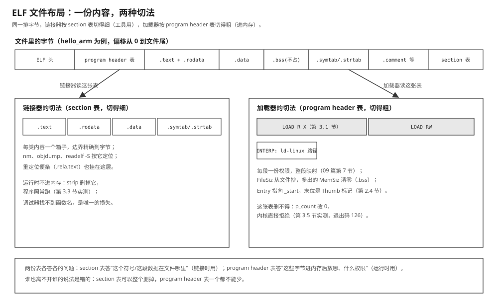

# 01 ELF 与程序加载

    实验    Knowledge/labs/00_basics/01_link_and_load/（与 00 篇共用一套判据）
    电脑    WSL Ubuntu 26.04（内核 6.6.114），gcc 15.2.0，
            arm-linux-gnueabihf-gcc 15.2.0，binutils 2.46
            （本篇"本机实测"均为 2026-10-20 实跑；内核行为另对照
            Linux v4.9 与 v6.6 的源码逐段核实）
    判据    bash Knowledge/labs/00_basics/01_link_and_load/check.sh
            2026-10-20 复核：79 PASS / 0 FAIL / 0 SKIP（与 00 篇合并计数）

---

**你会在哪里撞见它**：教程 01 篇第 3.1 节，ARM 版的程序在电脑上运行，得到

```text
bash: ./hello_arm_dynamic: cannot execute binary file: Exec format error
```

教程 01 篇讲清了"是内核在 `execve` 里检查文件头、发现架构不符后拒绝"，并看了
文件头前 20 个字节。但只要再往下走一步，问题就变密了：`file` 说的
`interpreter /lib/ld-linux-armhf.so.3` 存在文件哪里？`readelf -h` 那十几行
各自管什么？为什么程序跑起来后 `/proc/self/maps` 里代码段和数据段是分开的
两块？这些问题的答案都在 ELF 这份文件格式里。教程 01 篇讲的是"哪几个字节导致
拒绝"，本篇讲的是"整个文件按什么规矩组织"。

**这篇要回答的问题**：

1. 一个可执行文件里到底存了哪些东西，凭什么内核能把它变成一个进程？
2. section 和 segment 是同一份内容的两种切法，为什么两张表都必须存在？
3. `.bss` 不在文件里占字节，加载器怎么知道要清出多大一块零？
4. 从 `execve` 到 `main` 的第一行，中间每一步是谁在跑？

---

## 0 先动手看一眼

实验目录里的 `app` 是 00 篇链接出来的 ARM 程序（`main.c` + `add.c`）。
不用懂格式，先让 `readelf` 把它的文件头全部翻成文字：

```bash
cd Knowledge/labs/00_basics/01_link_and_load
arm-linux-gnueabihf-readelf -h app
```

- `readelf` 是读 ELF 文件的工具，`-h` 是文件头（ELF header）。

本机实测：

```text
ELF Header:
  Magic:   7f 45 4c 46 01 01 01 00 00 00 00 00 00 00 00 
  Class:                             ELF32
  Data:                              2's complement, little endian
  Version:                           1 (current)
  OS/ABI:                            UNIX - System V
  ABI Version:                       0
  Type:                              DYN (Position-Independent Executable file)
  Machine:                           ARM
  Version:                           0x1
  Entry point address:               0x3dd
  Start of program headers:          52 (bytes into file)
  Start of section headers:          68172 (bytes into file)
  Flags:                             0x5000400, Version5 EABI, hard-float ABI
  Size of this header:               52 (bytes)
  Size of program headers:           32 (bytes)
  Number of program headers:         10
  Size of section headers:           40 (bytes)
  Number of section headers:         29
  Section header string table index: 28
```

先只看两处：**`Number of program headers: 10` 和
`Number of section headers: 29`。一个文件里有两张表，一张 10 条，一张
29 条。** 它们描述的是同一份内容，只是切法不同、读者不同。这两张表是
本篇的骨架：第 2 节读文件头本身，第 3 节讲两张表的分工，第 4、5 节看
加载器怎么用其中一张。

---

## 1 一种格式，两个读者

00 篇第 4.1 节看过 `main.o` 的身份：

```text
main.o: ELF 32-bit LSB relocatable, ARM, EABI5 version 1 (SYSV), not stripped
```

而 `app` 是：

```text
app: ELF 32-bit LSB pie executable, ARM, EABI5 version 1 (SYSV), ...
```

目标文件和可执行文件是同一种格式。ELF 的全称 Executable and Linkable
Format 里有两个词：Executable（可执行，给运行时的加载器用）和 Linkable
（可链接，给编译时的链接器用）。**一个格式要同时服务两个完全不同的
读者**，这是本篇后面一切结构的总根源：

```text
链接器关心   这个文件由哪些块组成？哪块是代码、哪块是符号表、
             哪块是重定位便条？要按块合并
             --> 需要切得细的表：section 表（本例 29 条）

加载器关心   文件的哪些部分要进内存？放到哪个地址？什么权限？
             符号表这种运行时用不着的东西一眼都不想看
             --> 需要切得粗的表：program header 表（本例 10 条）
```

Linux 下三种常见的文件都是 ELF，区别只在文件头里一个叫 `e_type` 的字段：

```text
e_type = 1 (REL)   可重定位文件    .o，给链接器读
e_type = 2 (EXEC)  可执行文件      加载地址固定的程序
e_type = 3 (DYN)   共享库，或 PIE 程序（教程 01 篇第 3.7 节讲过 PIE 为什么标 DYN）
```

`app` 的 `Type: DYN` 就是第三种。三种文件共享同一套文件头、同一套表的
格式，所以 `readelf`、`nm`、`objdump` 这些工具对它们全都适用。

**这一节搭好的积木**：ELF 是同一份内容的两种切法：section 给链接器，
segment 给加载器；`e_type` 区分 `.o`、可执行文件和库。接下来的问题：
文件头那 52 个字节，每个都是什么。

---

## 2 文件头：52 个字节逐个读

### 2.1 原始字节和字段的对照

32 位 ELF 的文件头正好 52 字节（`Size of this header: 52`）。把 `app`
的前 52 个字节原样打出来：

```bash
hexdump -C app | head -4
```

- `hexdump -C`：左边偏移、中间十六进制、右边把字节当字符显示。

本机实测：

```text
00000000  7f 45 4c 46 01 01 01 00  00 00 00 00 00 00 00 00  |.ELF............|
00000010  03 00 28 00 01 00 00 00  dd 03 00 00 34 00 00 00  |..(.........4...|
00000020  4c 0a 01 00 00 04 00 05  34 00 20 00 0a 00 28 00  |L.......4. ...(.|
00000030  1d 00 1c 00 01 00 00 70  48 06 00 00 48 06 00 00  |.......pH...H...|
```

逐字段对照（全部小端，多字节字段要把字节倒过来读）：

```text
偏移   字节              字段名        值            含义
0x00   7f 45 4c 46       e_ident[0..3] 魔数          0x7f 后接 'E' 'L' 'F'
0x04   01                e_ident[4]    EI_CLASS     1 = 32 位（2 = 64 位）
0x05   01                e_ident[5]    EI_DATA      1 = 小端
0x06   01                e_ident[6]    EI_VERSION   1
0x07   00                e_ident[7]    EI_OSABI     0 = System V
0x08   00 * 8            e_ident[8..15]             填充，全 0
0x10   03 00             e_type        3            DYN（PIE 可执行）
0x12   28 00             e_machine     0x28 = 40    EM_ARM
0x14   01 00 00 00       e_version     1
0x18   dd 03 00 00       e_entry       0x3dd        入口地址
0x1c   34 00 00 00       e_phoff       52           program header 表的位置
0x20   4c 0a 01 00       e_shoff       68172        section 表的位置
0x24   00 04 00 05       e_flags       0x05000400   EABI5 + hard-float
0x28   34 00             e_ehsize      52           文件头自身大小
0x2a   20 00             e_phentsize   32           每条 program header 大小
0x2c   0a 00             e_phnum       10           program header 条数
0x2e   28 00             e_shentsize   40           每条 section header 大小
0x30   1d 00             e_shnum       29           section header 条数
0x32   1c 00             e_shstrndx    28           section 名字表的下标
```

读法和 教程 01 篇第 3.3 节相同：每两个十六进制数字是一个字节，多字节字段
小端存放。教程 01 篇只读了前 20 个字节里的四个字段（魔数、位宽、字节序、
`e_machine`），因为回答"为什么被拒绝"只需要它们。这里把 52 个字节读全。

和第 0 节 `readelf -h` 的逐行输出对一遍：每一行都能在这张表里找到对应
的字节。`readelf` 做的事就是按这张表把字节翻成文字，没有任何神秘之处。

### 2.2 内核真正检查的，只是其中几行

教程 01 篇第 3.4 节讲过：内核的 ELF 处理器（`fs/binfmt_elf.c` 的
`load_elf_binary`）先做几项一致性检查，不过就放弃。对照 v4.9 内核源码，
检查依次是：

```c
if (memcmp(loc->elf_ex.e_ident, ELFMAG, SELFMAG) != 0)   /* 魔数 */
	goto out;
if (loc->elf_ex.e_type != ET_EXEC && loc->elf_ex.e_type != ET_DYN)
	goto out;                                             /* e_type */
if (!elf_check_arch(&loc->elf_ex))
	goto out;                                             /* e_machine 等 */
```

`elf_check_arch` 是各架构自己实现的。ARM 版的在
`arch/arm/kernel/elf.c`，第一刀就是：

```c
/* Make sure it's an ARM executable */
if (x->e_machine != EM_ARM)
	return 0;
```

返回 0 表示"不归我管"，内核接着问下一个处理器；都不认领，`execve` 返回
`ENOEXEC`，就是 教程 01 篇第 3.1 节的退出码 126。这张 52 字节的表里，决定
"能不能在这台机器上跑"的只是 `e_ident` 前 4 字节、`e_type` 和
`e_machine` 三处；其余字段是"跑起来要怎么摆"的说明书。

顺带核一个数字：教程 01 篇第 3.4 节说"内核先把文件开头一小段读进来，较新的
内核读 256 字节，4.9 内核读 128 字节"。这个长度是
`include/uapi/linux/binfmts.h` 里的 `BINPRM_BUF_SIZE`：v4.9 里是 128，
v6.6 里是 256。52 字节的文件头在任何版本里都装得下。

### 2.3 e_machine 还有哪些值

`e_machine` 的编号是 ELF 标准统一分配的。改字节实验可以再造一个佐证：
把 x86 版程序（`e_machine` 是 `3e 00` = 62）的这两个字节改成
`f3 00`（0xf3 = 243，RISC-V）：

```bash
cp app_x86 app_rv
printf '\xf3\x00' | dd of=app_rv bs=1 seek=18 conv=notrunc status=none
readelf -h app_rv | grep Machine
./app_rv; echo "exit=$?"
```

- `printf '\xf3\x00' | dd ... seek=18 conv=notrunc`：教程 01 篇第 3.5 节的同一
  手法，把位置 18 起的两个字节改成 `f3 00`。`conv=notrunc` 不能省，否则
  `dd` 写完会把文件截断（第 3.6 节有这个教训的完整版）。

本机实测：

```text
  Machine:                           RISC-V
bash: ./app_rv: cannot execute binary file: Exec format error
exit=126
```

`readelf` 认出了 RISC-V，内核的 ARM/x86 检查都不认领，126。常见的编号：

```text
40    EM_ARM       板子的架构
62    EM_X86_64    电脑的架构
243   EM_RISCV
183   EM_AARCH64   64 位 ARM
```

### 2.4 入口地址 0x3dd 的末位为什么是个 1

`Entry point address: 0x3dd`，而 `nm` 查到的 `_start` 在 0x3dc：

```text
$ arm-linux-gnueabihf-nm app | grep -E ' (_start|main)$'
000003dc T _start
000004d8 T main
```

差 1 不是打印错误。ARM 有两套指令编码（ARM 态和 Thumb 态），切换靠程序
状态寄存器里的 T 位；跳转到一个"末位为 1 的地址"就是"跳到那个地址并
进入 Thumb 态"的意思。`0x3dd` 的真实含义是"入口在 0x3dc，用 Thumb 态
执行"。内核里兑现这个约定的代码在 `arch/arm/include/asm/processor.h`
的 `start_thread`：

```c
if (elf_hwcap & HWCAP_THUMB && pc & 1)
	regs->ARM_cpsr |= PSR_T_BIT;
...
regs->ARM_pc = pc & ~1;		/* pc */
```

末位拿出来设进 T 位，地址本身清掉末位再交给 PC。容易以为入口地址必须
是偶数、0x3dd 是文件坏了；实测它和 `_start` 正好差 1；原因是 ARM 用
地址末位当指令集标记。

### 2.5 [判] 第 1、2 节

    [ ] hexdump 前 4 字节是 7f 45 4c 46
    [ ] ARM 版偏移 0x12 处是 28 00，x86 版是 3e 00
    [ ] readelf -h 的 Class 与手数的第 4 字节一致（ELF32 / ELF64）
    [ ] Entry point 不等于 main 的地址；等于 _start 的地址 + 1
    [ ] 说得出 e_phoff/e_phnum 和 e_shoff/e_shnum 各指向哪张表

    注错见红：把 e_machine 改成 f3 00（2.3 节的做法），readelf 必须
    改报 RISC-V，运行必须是 126。如果运行成功了，说明这台机器登记过
    别的格式处理器（教程 01 篇第 3.6 节的 binfmt_misc），先去看
    /proc/sys/fs/binfmt_misc/。

以上判据由 `check.sh` 自动核对。

**这一节搭好的积木**：文件头 52 字节逐个对得上；内核只检查其中三处决定
认不认；`e_entry` 指向 `_start`，末位是 Thumb 标记。接下来的问题：文件头
指着的两张表，各自长什么样、给谁用。

---

## 3 两张表：section 与 segment

### 3.1 先把 10 条 program header 读完

`readelf -l`（小写 L）读 program header 表：

```bash
arm-linux-gnueabihf-readelf -lW app
```

- `-W`：wide，允许输出超过 80 列不换行，保证每行是一条完整的记录。

本机实测：

```text
Elf file type is DYN (Position-Independent Executable file)
Entry point 0x3dd
There are 10 program headers, starting at offset 52

Program Headers:
  Type           Offset   VirtAddr   PhysAddr   FileSiz MemSiz  Flg Align
  ARM_EXIDX      0x000648 0x00000648 0x00000648 0x00008 0x00008 R   0x4
  PHDR           0x000034 0x00000034 0x00000034 0x00140 0x00140 R   0x4
  INTERP         0x000198 0x00000198 0x00000198 0x00019 0x00019 R   0x1
      [Requesting program interpreter: /lib/ld-linux-armhf.so.3]
  LOAD           0x000000 0x00000000 0x00000000 0x00674 0x00674 R E 0x10000
  LOAD           0x00fed0 0x0001fed0 0x0001fed0 0x0013c 0x00144 RW  0x10000
  DYNAMIC        0x00fed8 0x0001fed8 0x0001fed8 0x000f8 0x000f8 RW  0x4
  NOTE           0x000174 0x00000174 0x00000174 0x00024 0x00024 R   0x4
  NOTE           0x000654 0x00000654 0x00000654 0x00020 0x00020 R   0x4
  GNU_STACK      0x000000 0x00000000 0x00000000 0x00000 0x00000 RW  0x10
  GNU_RELRO      0x00fed0 0x0001fed0 0x0001fed0 0x00130 0x00130 R   0x1

 Section to Segment mapping:
  Segment Sections...
   00     .ARM.exidx 
   01     
   02     .interp 
   03     .note.gnu.build-id .interp .gnu.hash .dynsym .dynstr .gnu.version .gnu.version_r .rel.dyn .rel.plt .init .plt .text .fini .rodata .ARM.exidx .eh_frame .note.ABI-tag 
   04     .init_array .fini_array .dynamic .got .data .bss 
   05     .dynamic 
   06     .note.gnu.build-id 
   07     .note.ABI-tag 
   08     
   09     .init_array .fini_array .dynamic .got 
```

上半部分 10 条记录，每条 7 列。先认 `Type` 一列，10 条分两类：

- **`LOAD`（2 条）：真正要进内存的。** "把文件里 Offset 起、FileSiz 那么
  长的字节，映射到虚拟地址 VirtAddr，权限按 Flg"。第一条 `R E` 是代码
  加只读数据，第二条 `RW` 是可写数据。加载器真正搬的只有这两条。
- **其余 8 条：给加载器和动态链接器的附加指示，不搬运内容。**

  ```text
  INTERP      我需要一个解释器（动态链接器），路径在 Offset 指着的
              地方：/lib/ld-linux-armhf.so.3。教程 01 篇第 3.5 节那个
              退出码 127，就是内核去打开这个路径失败
  DYNAMIC     动态链接信息（要哪些库、符号怎么填）的位置，
              给 ld.so 用
  NOTE        附注，比如这个文件的构建 ID
  GNU_STACK   栈的权限声明。这里 Flg 是 RW，没有 E：
              栈不可执行，防一类注入攻击
  GNU_RELRO   这一块在重定位完成后要改成只读（00 篇第 7.3 节
              maps 里数据段被拆成两行，就是它干的）
  PHDR        program header 表自己在内存里的位置
  ARM_EXIDX   ARM 的异常处理索引，栈展开时用
  ```

  `INTERP` 那条的路径可以直接从文件里读出来：

  ```bash
  arm-linux-gnueabihf-readelf -p .interp app
  ```

  本机实测：

  ```text
  String dump of section '.interp':
    [     0]  /lib/ld-linux-armhf.so.3
  ```

  它就是文件 Offset 0x198 处存着的一串以 `\0` 结尾的字符。

再看 `VirtAddr` 和 `Offset` 两列的一个规律：第二条 LOAD 的 Offset 是
`0xfed0`，VirtAddr 是 `0x1fed0`，两者不等，但差值 `0x1f000` 正好是
Align（`0x10000`）的整数倍。第一条 LOAD 两个都是 0，也对得上。这不是
巧合：加载靠 `mmap` 按页映射，页对齐要求"文件偏移和虚拟地址对页面大小
同余"，链接器排布局时必须遵守，于是把同余关系直接写进了表里。验证：
两个地址分别对 0x10000 取余，都是 `0xed0`。

### 3.2 下半部分：两张表的对应关系

`Section to Segment mapping` 是 readelf 把两张表对照着列出来的结果，
也是本节的核心证据。逐行读：

- 编号 03 是第一条 LOAD（R E），一个段装了 16 个 section，包括 `.text`
  （代码）和 `.rodata`（只读数据）。共同点：运行时只需要读和执行。
- 编号 04 是第二条 LOAD（RW），装了 `.data`、`.bss`、`.got` 等 6 个。
  共同点：运行时要写。
- **一个 section 可以出现在多个段里**：`.interp` 在 02 和 03 都有，
  `.dynamic` 在 04、05、09 都有。同一批字节在不同视角下归属不同，
  这再次说明 section 和 segment 不是两批东西，是同一批字节的两种分组。
- 数一下映射表里出现过的 section 名，只有二十来个；而文件头说这个文件
  有 29 个 section。没出现的（`.symtab`、`.strtab`、`.comment`、
  `.shstrtab` 等）**不属于任何段，运行时根本不进内存**。它们是 00 篇
  第 4 节里 `nm`、`readelf -r` 读的那些工具用表。

一句话收拢：**section 是链接期的单位，编译器生成、链接器合并；
segment 是运行期的单位，链接器最后生成、加载器消费。**

### 3.3 实验：把不进内存的东西删掉

如果 ".symtab 不进内存" 是真的，把它从文件里删掉，程序应该照常运行。
`strip`（剥掉）就是干这个的工具。因为要真的运行看结果，这一组实验用
x86 版（`app_x86`，同一批源码用本机 gcc 编的）：

```bash
cp app_x86 app_strip
./app_x86; echo "退出码=$?"
strip app_strip
./app_strip; echo "退出码=$?"
```

本机实测：

```text
--- strip 前 ---
文件大小 15888，section 29 个，program header 14 条
退出码=3
--- strip 后 ---
文件大小 14328，section 27 个，program header 14 条
退出码=3
```

（退出码 3 是对的：程序是 `return add(g_init,2) + g_bss`，即
`add(1,2) + 0 = 3`。**退出码本身就是"程序真的正确跑完了"的判据。**）

文件小了 1560 字节，section 少了 2 个，段一条没少，行为完全不变。少的
是哪两个？对比两份 section 名单：

```text
< .strtab
< .symtab
```

正是第 3.2 节推断"不属于任何段"的那两个。推断被实验证实。

### 3.4 更极端：把整张 section 表删掉

```bash
cp app_x86 app_nosh
strip --strip-section-headers app_nosh
readelf -h app_nosh | grep -E 'Number of section|Start of section'
./app_nosh; echo "退出码=$?"
```

本机实测：

```text
  Start of section headers:          0 (bytes into file)
  Number of section headers:         0
退出码=3
```

29 条 section header 全没了，文件从 15888 缩到 12308 字节，程序照跑，
退出码还是 3。这时候 `readelf -S app_nosh` 什么都读不出来，`nm` 也废了，
所有链接期工具全瞎；内核毫不在意，因为它从头到尾没看过那张表。

### 3.5 反过来：只改 segment 表的条数

不动任何内容，只把文件头里"program header 有几条"（x86-64 的 `e_phnum`
在偏移 56 处）改成 0，一共 2 个字节：

```bash
cp app_x86 app_noph
printf '\x00\x00' | dd of=app_noph bs=1 seek=56 conv=notrunc status=none
./app_noph; echo "退出码=$?"
stat -c %s app_noph
```

本机实测：

```text
bash: ./app_noph: cannot execute binary file: Exec format error
退出码=126
15888
```

文件一个字节没少（还是 15888），只是声明"我有 0 条 program header"，
内核就不认了。对照 v4.9 源码，ELF 处理器在 `load_elf_phdrs` 里检查
`e_phnum < 1` 就直接放弃。

三组实验并排放：

```text
改动                              文件变化       能跑吗
strip 掉 .symtab/.strtab          -1560 字节     能，退出码 3
删掉整张 section 表               -3580 字节     能，退出码 3
只改 2 个字节让 e_phnum = 0       0 字节         不能，126
```

删掉三千多字节照样跑，改两个字节直接死。**section 是给编译工具看的，
运行时不需要；segment 是给内核看的，少一条都装不起来。** 这也解释了
两件常见的事：发布固件前要 `strip`，白省空间零代价；`strip` 之后 gdb
看不到函数名，因为 gdb 是链接期视角的工具，读的正是被删掉的那张表。

### 3.6 注错：同一个报错，两种死因

3.5 节那条 `dd` 如果漏了 `conv=notrunc`：

```bash
cp app_x86 app_trunc
printf '\x00\x00' | dd of=app_trunc bs=1 seek=56 status=none
```

`dd` 默认把输出文件截断到写入位置，15888 字节的程序只剩 58 字节。
本机实测：

```text
$ stat -c %s app_trunc
58
$ readelf -h app_trunc
readelf: Error: app_trunc: Failed to read file header
$ ./app_trunc
bash: ./app_trunc: cannot execute binary file: Exec format error
```

运行时报错和 3.5 节一模一样，退出码都是 126，但死因完全不同：一个是
文件完好、内核读完了不认；另一个是文件被截得只剩头都凑不齐。分辨靠
`ls -l` 的大小和 `readelf` 能不能读，不是看报错文字。**同一个报错可以
来自完全不同的原因，光看报错文字会误判。**

### 3.7 顺带：剥成裸 bin 还剩什么

裸机开发里常见一步 `objcopy -O binary`，把 ELF 剥成纯字节流再烧进
flash。它扔掉的正是本篇讲的全部东西：

```bash
objcopy -O binary app_x86 app.bin
chmod +x app.bin
ls -l app.bin
./app.bin; echo "exit=$?"
```

本机实测：

```text
-rwxrwxrwx 1 glorinz glorinz 15556 ... app.bin
bash: ./app.bin: cannot execute binary file: Exec format error
exit=126
```

15556 字节，只剩 LOAD 段里的原始字节；文件头、两张表全部不在了。内核
第一步就比不出魔数，126。裸机上这种文件能跑，是因为那边没有加载器：
烧写工具把整个文件放到链接时写死的地址，CPU 上电直接跳过去，"放哪、
什么权限"这些问题根本不存在。有了操作系统和多进程，这些问题必须回答，
答案就写在 program header 里。这是"裸机用 .bin、Linux 用 ELF"的根本原因。

### 3.8 [判] 第 3 节

    [ ] readelf -lW 的 Section to Segment mapping 里，能指出 .text
        属于 R E 的那条 LOAD，.data 属于 RW 的那条
    [ ] 两条 LOAD 的 VirtAddr 与 Offset 对 Align 同余
    [ ] 找得出不属于任何段的 section（.symtab / .strtab）
    [ ] strip 后文件变小、section 变少、段数不变、退出码不变
    [ ] --strip-section-headers 后 section 数为 0，程序照跑
    [ ] e_phnum 改成 0 后必须 126，且文件大小不变
    [ ] objcopy -O binary 的产物执行必须 126

    注错见红：3.5 节的 dd 漏掉 conv=notrunc，得到的必须是 58 字节
    的残件，readelf 报错，而不是一个"能跑到别处的程序"。

**这一节搭好的积木**：section 给链接器、segment 给加载器，10 条
program header 里只有 LOAD 真正搬运；INTERP 写着动态链接器的路径；
内核不看 section 表。接下来的问题：LOAD 那行里 FileSiz 和 MemSiz 两个
数不一样大，差出来的是什么。

---

## 4 .bss：文件里不存，内存里要有

### 4.1 两个只差一点初值的程序

`big1.c`：

```c
int arr[1000000];

int main(void)
{
	return arr[0];
}
```

`big2.c`，只多了一个初值 `{1}`（第一个元素是 1，其余按 C 的规则补 0）：

```c
int arr[1000000] = {1};

int main(void)
{
	return arr[0];
}
```

编译并看大小：

```bash
arm-linux-gnueabihf-gcc -o big1 big1.c
arm-linux-gnueabihf-gcc -o big2 big2.c
ls -l big1 big2
```

本机实测：

```text
-rwxrwxrwx 1 glorinz glorinz   69236 ... big1
-rwxrwxrwx 1 glorinz glorinz 4069236 ... big2
```

4069236 - 69236 = 4000000，正好是 1000000 个 `int`（每个 4 字节），一个
字节不多不少。`g_init` 的那个 1 必须存在文件里，否则加载后不知道该填几；
`arr` 的一百万个 0 呢？一个没给初值、一个给了，文件差了整整 4 MB。

### 4.2 两个数组去了不同的箱子

```bash
arm-linux-gnueabihf-readelf -SW big1 | grep -E '\.(data|bss) '
arm-linux-gnueabihf-readelf -SW big2 | grep -E '\.(data|bss) '
```

本机实测：

```text
big1:  [22] .data   PROGBITS  00020000 010000 000008 00  WA
       [23] .bss    NOBITS    00020008 010008 3d0904 00  WA
big2:  [22] .data   PROGBITS  00020000 010000 3d0908 00  WA
       [23] .bss    NOBITS    003f0908 3e0908 000004 00  WA
```

对照 Size 列（第 6 个字段）：big1 的 `.bss` 是 0x3d0904 = 4000004 字节，
big2 的 `.data` 是 0x3d0908。**只因为多写了 `= {1}`，一百万项的数组整个
从 `.bss` 挪到了 `.data`。** 符号表能确认这一点（`readelf -s` 输出里
`arr` 那行的第 7 列是 section 下标，big1 里是 23 即 `.bss`，big2 里是
22 即 `.data`）。

Type 列的两个词是这里的钥匙：

```text
PROGBITS   文件里真的存着这些字节   -> 占文件空间
NOBITS     文件里不存，只记一个大小 -> 不占文件空间
```

00 篇第 3 节汇编里的 `.word 1` 对 `.space 4`，到这里收拢成文件格式层面
的两个类型。

### 4.3 加载器怎么知道要清多少零

`.bss` 不在文件里，加载器总得知道清多大一块。答案在 program header 里，
回到 RW 那条 LOAD 的两列：

```bash
arm-linux-gnueabihf-readelf -lW big1 | grep '^  LOAD'
arm-linux-gnueabihf-readelf -lW big2 | grep '^  LOAD'
```

本机实测：

```text
big1:  LOAD  0x000000 0x00000000 ... FileSiz 0x00648  MemSiz 0x00648  R E
       LOAD  0x00fed0 0x0001fed0 ... FileSiz 0x00138  MemSiz 0x3d0a3c RW
big2:  LOAD  0x000000 0x00000000 ... FileSiz 0x00648  MemSiz 0x00648  R E
       LOAD  0x00fed0 0x0001fed0 ... FileSiz 0x3d0a38 MemSiz 0x3d0a3c RW
```

盯住 RW 那行的 FileSiz 和 MemSiz：

```text
       FileSiz     MemSiz      差值
big1   0x00138     0x3d0a3c    0x3d0904 = 4000004
big2   0x3d0a38    0x3d0a3c    0x000004 = 4
```

`FileSiz` 是这个段在文件里占多少字节，`MemSiz` 是装进内存后要占多少
字节。加载器的规则只有一条：**把文件里 FileSiz 那么多字节映射进内存，
FileSiz 到 MemSiz 之间的部分全部填 0。** 内核 v4.9 源码里这个动作就是
`fs/binfmt_elf.c` 里一个叫 `padzero` 的函数，名字直白。

两个对照必须看出来：

1. **big1 和 big2 的 MemSiz 完全相等，都是 0x3d0a3c。** 把数组从 `.bss`
   挪到 `.data`，内存一个字节没省，省的只有文件大小。
2. big1 的差值 0x3d0904 正是第 4.2 节 `.bss` 的大小。`.bss` 的全部
   "魔法"就是这个减法，没有任何特殊机制。

00 篇第 7.3 节 `maps.c` 打印出 `g_bss = 0` 而你从没赋过值，清零的就是
这一步。容易以为"没赋初值的全局变量里是随机残留"；实测它恒为 0；原因
是 C 标准规定静态对象零初始化，而 ELF 用 `MemSiz - FileSiz` 把这个约定
变成了加载器的一次清零。

### 4.4 这条在嵌入式上意味着什么

```text
static char buf[4 * 1024 * 1024];            -> 进 .bss，固件不变大
static char buf[4 * 1024 * 1024] = {1};      -> 进 .data，固件立刻涨 4 MB
```

flash 空间紧张时这条能救命。但要同时记住 4.3 节的第 1 条对照：它省的是
flash，不是 RAM，内存该占多少还是多少。把这两件事搞混，是嵌入式新手
最常见的误判之一。

### 4.5 注错：初值全 0 会被放回去

把 `big2.c` 的 `= {1}` 改成 `= {0}`，重新编译：

本机实测，产物和 `big1` 一字节不差地大（都是 69236 字节）。编译器发现
初值全是 0，效果等同于不写初值，把数组放回 `.bss`。如果改成 `{0}` 后
文件还是 4 MB，说明你编的不是你改的那个文件。

（核对大小时要同名重编：`.symtab` 里记着源文件名，换成长短不同的文件名
再编，文件会差几个字节，那不是 `.bss` 的事。check.sh 里这条判据就是
同名重编的。）

### 4.6 [判] 第 4 节

    [ ] big2 - big1 == 4000000，一个字节不差
    [ ] readelf -s 里 arr 在 big1 属 .bss（NOBITS），在 big2 属
        .data（PROGBITS）
    [ ] big1 的 RW LOAD 段 MemSiz - FileSiz == 4000004
    [ ] big1 和 big2 的 MemSiz 完全相等
    [ ] big1 有 2 条 PT_LOAD，权限分别是 R E 和 RW
    [ ] 初值改 {0} 后文件回到 69236

**这一节搭好的积木**：`.bss` 是 NOBITS，文件里只记大小；加载器按
`MemSiz - FileSiz` 补零，清零的是内核不是硬件；省文件不省内存。
接下来的问题：把第 2、3、4 节的所有字段串起来，从 `execve` 到 `main`
的完整过程是什么样。

---

## 5 从 execve 到 main：加载的全过程

### 5.1 内核内部：谁认领、谁加载

教程 01 篇第 3.4 节讲过处理器链表：内核维护一张格式处理器列表，执行文件时
先读文件开头一小段（`BINPRM_BUF_SIZE`，4.9 内核 128 字节、较新内核
256 字节），再按列表顺序问每个处理器"归你管吗"，自定义规则处理器
binfmt_misc 排在最前。这里把链表的出处补齐，对照 v4.9 内核源码：

```text
fs/exec.c
  prepare_binprm        把文件头 BINPRM_BUF_SIZE 字节读进 bprm->buf
  search_binary_handler list_for_each_entry(fmt, &formats, lh)
                        依次调用每个处理器的 load_binary，
                        返回 -ENOEXEC 就问下一个
fs/binfmt_misc.c        init_misc_binfmt 用 insert_binfmt 登记，插在表头
fs/binfmt_script.c      register_binfmt 追加在表尾（处理 #! 脚本）
fs/binfmt_elf.c         register_binfmt 追加在表尾（处理 ELF）
```

`insert_binfmt` 插表头、`register_binfmt` 追加表尾，这就是 binfmt_misc
排在最前的原因，和 教程 01 篇第 3.4 节一致。

ELF 处理器认领之后，`load_elf_binary` 按固定顺序做事（v4.9 源码，
`fs/binfmt_elf.c`）：

```text
1. 比魔数、查 e_type 是不是 EXEC/DYN、elf_check_arch 查 e_machine
   （第 2.2 节引过这段；任一不过，返回 -ENOEXEC 让给下一个处理器）
2. 按 e_phoff/e_phnum 读入 program header 表；e_phnum < 1 直接放弃
   （第 3.5 节那个 126 就死在这里）
3. 找 PT_INTERP：有，就取出解释器路径，open_exec 打开它。
   打不开时错误原样返回：文件不存在是 -ENOENT，bash 翻成
   "required file not found"，退出码 127（教程 01 篇第 3.5 节实测过）
4. 逐条 PT_LOAD：按 VirtAddr/FileSiz/MemSiz/权限 mmap 进内存，
   然后 padzero 把 FileSiz 到 MemSiz 之间清零（第 4.3 节）
5. create_elf_tables：在新栈顶摆好 argc、argv、envp 和一批
   辅助信息（auxv）
6. 有解释器：先加载解释器（它自己也是个 ELF，同样按 LOAD 映射），
   把入口改成解释器的入口；没有解释器（静态链接）：入口就是
   本文件的 e_entry
7. start_thread(regs, elf_entry, bprm->p)：设好新进程的 PC 和 SP。
   ARM 版在这里处理 Thumb 标记位（第 2.4 节）
```

execve 返回成功的那一刻，当前进程原来的内存内容已经全部作废，CPU 回到
用户态时站在入口地址上。**从 bash 的角度看是"启动了一个新程序"，从内核
的角度看是"把当前进程改造成了另一个程序"，进程号都没变。**

### 5.2 把全过程录下来：strace

教程 01 篇第 3.2 节用 strace 看过一次失败的 `execve`。这次看一次成功的，
而且要盯到 `main` 之前发生的一切：

```bash
strace -e trace=execve,openat,mmap ./app_x86
```

本机实测（行长截断到 110 列）：

```text
execve("./app_x86", ["./app_x86"], 0x7ffe0ad268c0 /* 22 vars */) = 0
mmap(NULL, 8192, PROT_READ|PROT_WRITE, MAP_PRIVATE|MAP_ANONYMOUS, -1, 0) = 0x748a65ee5000
openat(AT_FDCWD, "/etc/ld.so.cache", O_RDONLY|O_CLOEXEC) = 3
mmap(NULL, 55735, PROT_READ, MAP_PRIVATE, 3, 0) = 0x748a65ed7000
openat(AT_FDCWD, "/usr/lib/x86_64-linux-gnu/libc.so.6", O_RDONLY|O_CLOEXEC) = 3
mmap(NULL, 2231696, PROT_READ, MAP_PRIVATE|MAP_DENYWRITE, 3, 0) = 0x748a65c00000
mmap(0x748a65c28000, 1671168, PROT_READ|PROT_EXEC, MAP_PRIVATE|MAP_FIXED|MAP_DENYWRITE, 3, 0x28000) = ...
mmap(0x748a65dc0000, 319488, PROT_READ, MAP_PRIVATE|MAP_FIXED|MAP_DENYWRITE, 3, 0x1c0000) = ...
mmap(0x748a65e0e000, 24576, PROT_READ|PROT_WRITE, MAP_PRIVATE|MAP_FIXED, 3, 0x20e000) = ...
mmap(0x748a65e14000, 52624, PROT_READ|PROT_WRITE, MAP_PRIVATE|MAP_FIXED|MAP_ANONYMOUS, -1, 0) = ...
mmap(NULL, 12288, PROT_READ|PROT_WRITE, MAP_PRIVATE|MAP_ANONYMOUS, -1, 0) = ...
+++ exited with 3 +++
```

逐行读：

- 第 1 行：`execve` 成功（`= 0`）。注意 `execve` 成功时不"返回"到原来的
  程序，原来的程序已经不存在了；这个 0 出现在记录里，是因为新程序共用
  同一段系统调用的返回路径。
- 第 2 行起的事，你的程序一行代码都还没跑：`main` 的第一条指令要等到
  这些 mmap 全部完成之后。**这些 openat 和 mmap 是动态链接器 ld.so 干
  的。**内核在第 5.1 节第 6 步把控制权交给了 INTERP 指定的解释器，这里
  就是它在工作。
- 第 3、4 行：打开 `/etc/ld.so.cache`，这是系统里"哪个库在哪个路径"的
  缓存，ld.so 靠它找库。
- 第 5 行起：打开 `libc.so.6`，然后 mmap 它四次。libc 自己也是 ELF，
  也有 LOAD 段；加载它用的规则和加载你的程序完全相同：只读的一段、
  可执行的一段（`PROT_READ|PROT_EXEC`）、可写的一段
  （`PROT_READ|PROT_WRITE`），和第 3.1 节 LOAD 行的 Flg 一一对应。
- 最后一行：`exited with 3`，和 `return add(g_init,2) + g_bss` 的结果
  一致，程序确实跑到了 `main` 并正常返回。

### 5.3 _start 到 main：最后一公里

入口 `_start` 住在 `Scrt1.o` 里（00 篇第 6.4 节查过它的来历），它的
源码在 glibc 的 `sysdeps/arm/start.S`。这段汇编做的事按注释写得很清楚：

```text
入口时栈上的布局：
    0(sp)            argc
    4(sp)            argv[0]
    ...
    (4*argc)(sp)     NULL
    (4*(argc+1))(sp) envp[0]
    ...
```

也就是说，教程 01 篇第 1.2 节"bash 切词交给 argc/argv"的最后一段路是：
内核的 `create_elf_tables` 把这些词摆在新栈顶，`_start` 从栈上把它们
取下来（`pop {a2}` 取出 argc，栈指针接着就是 argv），再调用
`__libc_start_main`。glibc 的 `csu/libc-start.c` 里，这个函数做完 C
库自身的初始化后，通过 `__libc_start_call_main(main, argc, argv)` 调到
你的 `main`；`main` 的返回值再交给 `exit` 变成进程的退出码。

一个呼应 教程 01 篇的细节：`libc-start.c` 里有一段注释说，glibc 2.34 改了
`__libc_start_main` 的接口，为了区分新旧，专门造了 `GLIBC_2.34` 这个
版本标签。教程 01 篇第 5.2 节板上那句 `version 'GLIBC_2.34' not found`，
缺的正是这个标签。

"程序从 main 开始"至此可以换成准确的版本：

```text
execve
  -> 内核：认格式、按 LOAD 映射、清 .bss、建栈
  -> ld.so（仅动态链接）：加载 libc、填函数地址
  -> _start（Scrt1.o）：从栈上取下 argc/argv
  -> __libc_start_main（libc）：初始化 C 库
  -> main（你写的）
  -> exit：main 的返回值变成退出码
```

整个过程的边界图：


实线是真实执行的通路；红线分开内核态和用户态；`main` 之前的一切都和你
写的代码无关。

### 5.4 静态链接：整条链短了一截

```bash
gcc -static main.c add.c -o app_static
readelf -lW app_static | grep -c INTERP
strace -e trace=openat ./app_static 2>&1 | grep -c 'libc.so.6'
ls -l app_x86 app_static
./app_static; echo "exit=$?"
```

本机实测：

```text
0            （INTERP 一条都没有）
0            （运行时一次都没打开 libc.so.6）
-rwxrwxrwx 1 glorinz glorinz  15888 ... app_x86
-rwxrwxrwx 1 glorinz glorinz 816920 ... app_static
exit=3
```

三个现象同时出现：没有 INTERP，内核在第 5.1 节第 6 步直接把入口设成
本文件的 `e_entry`；ld.so 不参与，libc 的代码在链接时已经拷进了文件
（所以大了五十多倍）；运行时不再找任何库，版本标签问题整个不存在。
这就是 教程 01 篇第 5.3 节"现阶段上板一律 `-static`"的全部原理。

静态版还有一个附带变化：`readelf -h` 的 Type 从 `DYN` 变回 `EXEC`，
LOAD 段的 VirtAddr 是写死的 0x400000 起。位置无关对静态程序没有意义，
链接器直接给了固定地址。

### 5.5 [判] 第 5 节

    [ ] strace 里第一行是 execve
    [ ] main 还没跑，libc.so.6 已被打开并被 mmap 至少一次带
        PROT_EXEC（动态链接器干的）
    [ ] strace 最后一行的退出码等于 main 里 return 的值
    [ ] 静态链接后 INTERP 为 0 条、strace 里不再打开 libc.so.6、
        文件明显变大、退出码不变
    [ ] 能指出是 PT_INTERP 这一条导致 ld.so 被加载

    注错见红：把 e_machine 改回本机架构（教程 01 篇第 3.5 节的手法），
    动态版必须报 127（找不到解释器），静态版必须报 139（真的开始
    执行了错指令）。两个数字分别对应第 5.1 节的第 3 步和第 7 步之后。

**这一节搭好的积木**：从 execve 到 main 的每一步都能指到内核源码或
strace 记录；动态链接多出的那一段是 ld.so 干的；静态链接把它整段省掉。

---

## 6 速查清单

每条标依据；本机实测均为 2026-10-20。

**ELF 文件头字段（32 位，共 52 字节；依据：本篇第 2.1 节实测字节 +
`readelf -h`）**：

| 偏移 | 字段 | 看什么 | 本篇 |
|---|---|---|---|
| 0x00 | `e_ident[0..3]` | 魔数 `7f 45 4c 46`，不对就不是 ELF | 2.1 |
| 0x04 | `e_ident[4]` | 01 = 32 位，02 = 64 位 | 2.1 |
| 0x05 | `e_ident[5]` | 01 = 小端，02 = 大端 | 2.1 |
| 0x10 | `e_type` | 1 = 可重定位（.o），2 = EXEC，3 = DYN（库/PIE） | 1、2.1 |
| 0x12 | `e_machine` | 40 = ARM，62 = x86-64，243 = RISC-V，183 = AArch64 | 2.3 |
| 0x18 | `e_entry` | 入口地址，不是 main；ARM 上末位是 Thumb 标记 | 2.4、5.3 |
| 0x1c | `e_phoff` | program header 表在文件里的位置 | 3.1 |
| 0x20 | `e_shoff` | section 表在文件里的位置 | 3.1 |
| 0x24 | `e_flags` | ARM 上是 EABI 版本和浮点约定 | 2.1 |
| 0x2c | `e_phnum` | program header 条数；为 0 内核直接拒绝 | 3.5 |

（64 位文件头 64 字节，字段相同、地址类字段变 8 字节，`e_phnum` 在偏移
56 处。依据：第 3.5 节实测。）

**program header 常见类型（依据：第 3.1 节 `readelf -lW` 实测）**：

| Type | 干什么 |
|---|---|
| `LOAD` | 装进内存：Offset/FileSiz 从文件读，VirtAddr/MemSiz/Flg 定位置与权限 |
| `INTERP` | 动态链接器的路径 |
| `DYNAMIC` | 动态链接信息的位置，给 ld.so |
| `NOTE` | 附注（构建 ID 等） |
| `GNU_STACK` | 栈权限声明（RW = 不可执行） |
| `GNU_RELRO` | 重定位完成后改只读的区域 |
| `PHDR` | program header 表自身的位置 |

**section 常见类型（依据：00 篇第 6.2 节、本篇第 4.2 节实测）**：

| Type | 含义 |
|---|---|
| `PROGBITS` | 文件里真存这些字节 |
| `NOBITS` | 文件里不存，只记大小（.bss） |
| `SYMTAB` / `STRTAB` | 符号表 / 字符串表，工具用，运行时不进内存 |
| `REL` / `RELA` | 重定位便条 |

**工具一句一个（本机实测）**：

| 命令 | 干什么 |
|---|---|
| `readelf -h` | 文件头 |
| `readelf -lW` | program header 表和 section-to-segment 对照 |
| `readelf -SW` | section 表 |
| `readelf -p .interp` | 看动态链接器路径那串字符 |
| `hexdump -C 文件` | 按字节看文件 |
| `strip 文件` | 删符号表等链接期信息 |
| `strip --strip-section-headers` | 连 section 表一起删 |
| `objcopy -O binary` | 剥成裸 bin（只剩 LOAD 段的字节） |

**退出码速查（依据：教程 01 篇第 3.5、5.2 节与本篇第 3.5 节实测）**：

| 退出码 | 含义 | 死在哪一步 |
|---|---|---|
| 126 | Exec format error | 内核处理器链表没人认领（魔数、架构、e_phnum） |
| 127 | required file not found | 过了架构检查，找不到 INTERP 写的动态链接器 |
| 139 | Segmentation fault | 真的开始执行了，访问了没权限的内存（128 + 11） |
| 1 | 动态链接器自己退出 | 库版本标签对不上等原因（教程 01 篇第 5.2 节） |

---

## 回看

整篇从"一个文件凭什么能变成进程"出发：

| 问题 | 答案 | 证据在哪 |
|---|---|---|
| 文件头里写了什么 | 52 个字节逐个对应 readelf -h 的每一行 | 2.1 |
| 内核凭什么拒绝 | 只查魔数、e_type、e_machine 三处 | 2.2，内核源码 |
| 为什么有两张表 | 链接器要切得细，加载器要切得粗 | 1、3.1、3.2 |
| section 和 segment 谁离不开谁 | section 删光照样跑，segment 数改 0 直接死 | 3.3～3.5 |
| FileSiz 和 MemSiz 的差是什么 | 要清零的 .bss | 4.3 |
| 入口是谁 | `_start`（Scrt1.o），末位是 Thumb 标记 | 2.4、5.3 |
| main 之前谁在跑 | 内核加载器，然后 ld.so（仅动态链接） | 5.1、5.2 |
| 静态链接少了什么 | ld.so 整段；INTERP 消失，libc 不打开 | 5.4 |

文件布局与两种视角的总图：



---

## 带走

开头四个问题的答案：

1. **文件里存的是"代码加数据"加"两份说明书"。** 文件头说明"我是谁、
   给谁跑、两张表在哪"；program header 表说明"哪段装进内存、装到哪、
   什么权限"；section 表说明"我由哪些块组成"，给工具看。内核凭前两者
   就能把它变成进程。
2. **两张表服务两个读者，谁也替代不了谁。** section 按用途切给链接器，
   运行时删掉整张表程序照跑；segment 按权限切给加载器，条数改 0 就
   无法执行。
3. **`.bss` 藏在 LOAD 段的减法里。** `MemSiz - FileSiz` 那一段由内核
   清零；大零数组不吃文件大小，但内存照占。
4. **从 execve 到 main 是一条六环的链**：内核认格式、映射、清零、建栈，
   ld.so 加载库（仅动态链接），`_start` 取下 argc/argv，
   `__libc_start_main` 初始化 C 库，然后才是 `main`。`main` 的返回值
   经 `exit` 变成退出码。

### 看到什么，就先想到什么

| 看到的东西 | 第一反应 |
|---|---|
| `Exec format error` | 内核没认出这个文件；`file` 和 `readelf -h` 看架构和类型，别急着重编 |
| 文件明明在却报"找不到"（127） | 找不到的多半不是它，是 `readelf -lW` 里 INTERP 写的那个路径 |
| `readelf -h` / `-SW` / `-lW` | 分别看文件头、section 表、program header 表 |
| 文件挺小，跑起来内存很大 | 有大的 `.bss`；查 LOAD 段的 MemSiz 减 FileSiz |
| strip 之后 gdb 看不到函数名 | 正常，gdb 读的符号表被删了；程序本身不受影响 |
| 入口地址是奇数（ARM） | 末位是 Thumb 标记，真实地址清掉末位 |

---

## 接下来

- [00 从源码到运行](00_从源码到运行.md)：section、重定位便条、map 文件
  是怎么产生这张布局说明书的。
- [05 静态库、动态库与符号](05_静态库动态库与符号.md)：ld.so 加载 libc
  之后"填函数地址"的具体做法，PLT/GOT 是什么。
- [09 虚拟内存与 mmap](09_虚拟内存与mmap.md)：LOAD 段"映射"为什么是
  映射而不是拷贝，页错误如何把内容真正读进来。
- 教程里的位置：教程 01 篇第 3 节用本篇的 `e_machine` 和 INTERP 解释了
  126 和 127；02 篇[02 GCC 编译器的使用](../tutorials/01_应用编程/02_GCC编译器的使用.md)第 6 节接着第 5.4 节的静态/动态
  之分往下讲；第 2 阶段的内核模块（.ko）也是 ELF，`e_type` 是 1，
  加载时由内核自己做重定位。
