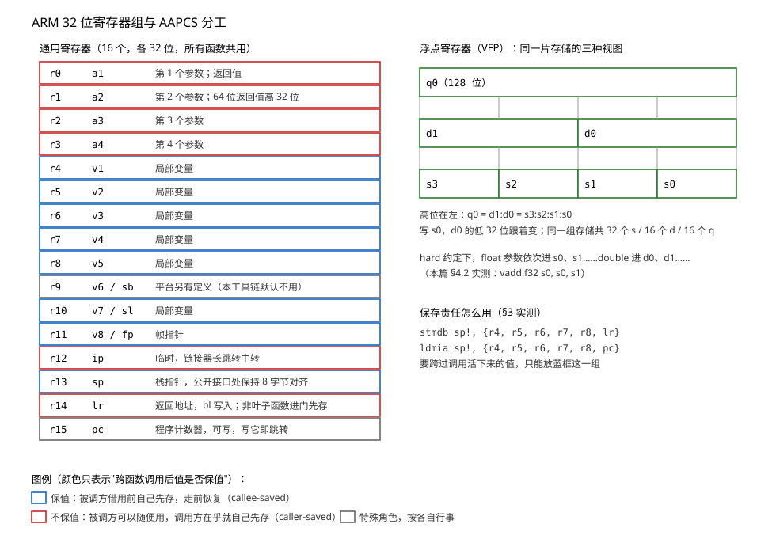
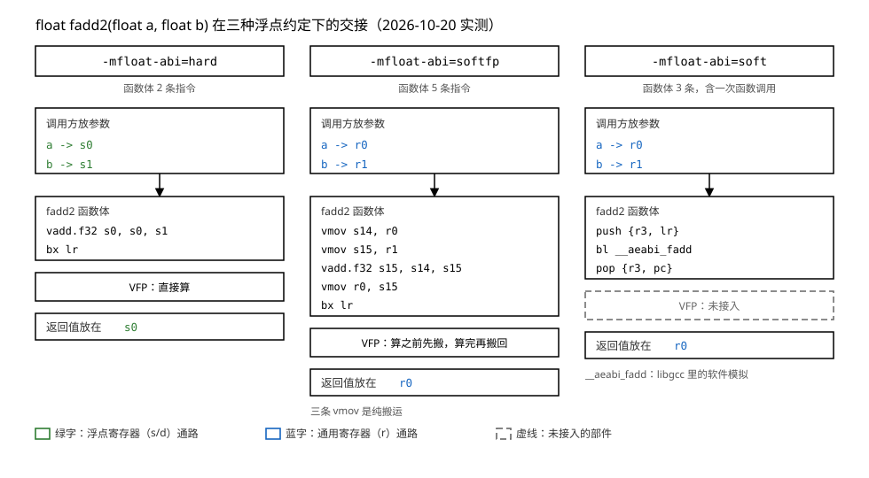

# 02 ARM 寄存器与调用约定

    实验    Knowledge/labs/00_basics/04_abi_and_regs/（与 03 篇共用一套判据）
    电脑    WSL Ubuntu 26.04，arm-linux-gnueabihf-gcc 15.2.0
            （本篇"本机实测"均为 2026-10-20 实跑）
    板子    本篇不需要板子；所有结论来自交叉编译产物在电脑上的静态检查

---

## 你会在哪里撞见它

教程 01 篇 §2.4 把同一份 `hello.c` 的两种机器码摆在一起，ARM 那半边长这样：

```text
 438:	2801      	cmp	r0, #1
 43e:	684a      	ldr	r2, [r1, #4]
 446:	f7ff efec 	blx	420 <__printf_chk@plt>
 44c:	bd08      	pop	{r3, pc}
```

每个单词都查得到意思，连起来却不知道在干什么：`main` 的参数为什么在 `r0` 里？
`pop {r3, pc}` 为什么就算"返回"？01 篇 §2.6 还留了一个更大的问号：工具链名字
末尾的 `hf` 是硬约束，两种浮点约定的代码拼在一起，链接器直接报：

```text
error: bad uses VFP register arguments, fadd_soft.o does not
```

这两件事是同一件事的两面：**函数与函数之间怎么交接**。交接的规矩写在哪、写了
什么、违反了会怎样，就是本篇的内容。

## 这篇要回答的问题

1. 调用一个函数时，参数、返回值、返回地址各放在哪里？
2. 哪些寄存器用完必须恢复原样？由调用方还是被调方负责？
3. 浮点参数为什么有 soft、softfp、hard 三种走法？`hf` 到底改了哪一条？

读完回头，这三个问题要能不翻笔记答出来。

## 0 先动手看一眼

写一个只做加法的函数，看编出来的机器码从哪儿取数：

```bash
cd Knowledge/labs/00_basics/04_abi_and_regs
arm-linux-gnueabihf-gcc -O1 -c args.c -o args.o
arm-linux-gnueabihf-objdump -d args.o | sed -n '/<use4>:/,/^$/p'
```

- `-O1`：开一点优化。不开的话，编译器会把每个参数先存进栈再读回来，满屏都是
  存取动作，看不清重点。`-c` 只编译不链接，`-d` 反汇编，`sed` 只留 `use4`
  这一个函数。

本机实测：

```text
00000000 <use4>:
   0:	4408      	add	r0, r1
   2:	4410      	add	r0, r2
   4:	4418      	add	r0, r3
   6:	4770      	bx	lr
```

四条指令，没有一条访问内存。`use4` 的四个参数直接在 `r0`、`r1`、`r2`、`r3`
里等着它，加完的结果留在 `r0`，最后跳到 `lr` 存的地址。参数放哪、返回值放哪、
返回地址放哪，四条指令里全有。本篇就把这三件事背后的规矩一条条问出来，问到
能解释 §5 那条链接报错为止。

---

## 1 硬件上根本没有"函数调用"

### 1.1 CPU 只会跳

上一节那个 `bx lr` 就是"返回"的全部。这件事值得停下来想清楚，因为 C 语言里的
"调用一个函数"，在硬件上不存在。

CPU 只会做一件事：按 `pc`（程序计数器，r15）指的地址取出一条指令执行，然后
`pc` 自动走到下一条。它不知道什么叫参数、什么叫返回值、什么叫函数。所谓
"调用"，拆开看只有两条指令：

    bl  目标        做两件事：lr <- 下一条指令的地址；pc <- 目标地址
    bx  lr          pc <- lr 里存的地址

`bl`（branch with link）跳走之前，先把"回来之后该从哪继续"写进 `lr`（link
register，r14）。被调用的函数干完活，`bx lr` 跳回去。01 篇 §2.4 的反汇编里
`blx 420 <__printf_chk@plt>` 就是这类指令（`blx` 多干一件事：顺便允许切换
指令集，§6 讲）。

参数、返回值、局部变量这些概念，全部是软件拿寄存器和栈**约定**出来的。约定
怎么定，就是本篇的正题。

### 1.2 寄存器：16 个公共格子

约定为什么绕不开寄存器，先看寄存器是什么。

寄存器是 CPU 内部的存储格子，读写不经过内存，比内存快几个数量级，代价是数量
极少：ARM 32 位一共 16 个通用寄存器，`r0` 到 `r15`，每个 32 位。内存里一个
变量要参与运算，得先用 `ldr` 搬进寄存器，算完用 `str` 搬回去。§0 的 `use4`
一条内存都没碰还能算完，正因为参数进来时就已经在寄存器里了。

16 个格子，机器上所有函数共用。你的 `main`、C 库的 `printf`、任何别的函数，
用的都是同一组 `r0` 到 `r15`。于是两个函数交接时，"哪个格子放什么、用完要不
要还原"必须事先说死，否则互相覆盖。



这张图先混个眼熟，不用现在记住。左半是 16 个通用寄存器的分工，颜色表示
"跨过一次函数调用后，里面的值还能不能算数"：红色是不能算数的一组，蓝色是
必须保持原值的一组，灰色是两个特殊角色。右半是浮点寄存器组，§4 才用到。
接下来三节实测，就是在给这张图的每一行找证据。

### 1.3 分别编译的两个文件，靠什么对上

[00 篇](00_从源码到运行.md) §2.2 讲过一个事实：多文件程序的每个 `.c` 是分别
编译的。编译 `main.c` 时，编译器看不见 `add.c` 的函数体；编译 `add.c` 时，
它也不知道谁会来调。

那么 `main.c` 里的 `add(3, 4)`，`3` 和 `4` 放在哪，`add` 那边才捞得到？
如果是同一个编译器一次编出来的，随便放，它自己记得住。但现实是你调的
`printf` 是很久以前别人用另一台机器编好的，你们从没商量过。你的代码和它的
代码要在同一组寄存器上交接，靠的只能是一份事先写死、所有编译器都照办的规矩。

这份规矩真实存在，是 ARM 发布的一份标准文档，正式名字叫 **AAPCS**
（Procedure Call Standard for the ARM Architecture，ARM 架构过程调用标准）。
它规定了参数放哪、返回值放哪、哪些寄存器可以随便用、栈怎么用。这种"编译
产物之间怎么对接"的约定统称 ABI（二进制接口约定），AAPCS 是 ABI 在 ARM 上的
那一部分；ABI 的其余部分（类型多大、结构体怎么排）是
[03 篇](03_ABI与sysroot.md)的内容。

约定的内容不用背。它是死的，编出来的机器码就是它照章办事的结果，所以用
`objdump` 就能把每一条读出来。下面三个实验就是这么读的。

**这一节搭好的积木**：函数调用由 `bl` 和 `bx lr` 两条指令拼成；16 个通用寄存器
是所有函数共用的稀缺资源；分别编译的代码靠 AAPCS 这份约定交接。接下来的问题
最具体：参数到底放在哪几个格子里。

---

## 2 实验 1：参数和返回值放在哪

### 2.1 先解决一个问题：别让编译器把调用优化掉

要观察"传参"，得让一次真实的调用发生在反汇编里。这有个陷阱：只要编译器看得
见被调函数的函数体，又知道参数是常数，它会自己把结果算出来。本机实测，让
`caller` 调用一个看得见的 `use6(1,2,3,4,5,6)`：

```text
00000010 <caller>:
  10:	2015      	movs	r0, #21
  12:	4770      	bx	lr
```

`1+2+3+4+5+6 = 21`，编译器算完了，整个调用消失，传参过程一点都没发生。
所以实验代码里安排了一个**只声明、不定义**的函数 `ext6`：编译器看不见它的
函数体，没法内联也没法提前算，只能老老实实按约定把参数摆好、发起调用。

容易以为"反汇编看到的就是 C 代码一步步的翻译"；实测优化会整个改变执行的路线，
上面那次连函数调用本身都没了。做这类观察实验，第一步永远是确认你要看的东西
没被优化掉。

### 2.2 动手

实验文件 `Knowledge/labs/00_basics/04_abi_and_regs/args.c` 全文：

```c
/* 参数到底放在哪：让反汇编告诉你 */

/* 只声明不定义：编译器无法内联，也无法把结果算出来 */
int ext6(int a, int b, int c, int d, int e, int f);

int use4(int a, int b, int c, int d)
{
	return a + b + c + d;
}

int use6(int a, int b, int c, int d, int e, int f)
{
	return a + b + c + d + e + f;
}

long long ret64(void)
{
	return 0x1122334455667788LL;
}

int caller(void)
{
	return ext6(1, 2, 3, 4, 5, 6);
}

/* 用满 4 个"要跨调用活下来"的值，逼编译器动用被调方保存的寄存器 */
int many(int a, int b, int c, int d)
{
	int v1 = ext6(a, 0, 0, 0, 0, 0);
	int v2 = ext6(b, 0, 0, 0, 0, 0);
	int v3 = ext6(c, 0, 0, 0, 0, 0);
	int v4 = ext6(d, 0, 0, 0, 0, 0);
	return v1 + v2 + v3 + v4;
}
```

五个函数各有分工：`use4` 看前四个参数，`use6` 看放不下的参数去哪，`ret64`
看 64 位返回值怎么放，`caller` 从调用方一侧看同一次交接，`many` 留给 §3。

编译并反汇编：

```bash
arm-linux-gnueabihf-gcc -O1 -c args.c -o args.o
arm-linux-gnueabihf-objdump -d args.o
```

### 2.3 四个参数：r0 到 r3

本机实测，`use4`：

```text
00000000 <use4>:
   0:	4408      	add	r0, r1
   2:	4410      	add	r0, r2
   4:	4418      	add	r0, r3
   6:	4770      	bx	lr
```

每行三列：指令在文件里的位置（十六进制）、机器码字节、指令文字。逐条读：

    add r0, r1      r0 = r0 + r1（两个操作数的写法，结果写回第一个）
    add r0, r2      r0 = r0 + r2
    add r0, r3      r0 = r0 + r3
    bx  lr          跳回 lr 存的地址，也就是返回

源码是 `a + b + c + d`。第一条把前两个参数加起来，说明 `a` 在 `r0`、`b` 在
`r1`；再各加一次，`c` 在 `r2`、`d` 在 `r3`。四条指令没有一条读内存，参数进来
时就已经在这四个寄存器里。加完没有别的搬运，结果就留在 `r0`，这就是返回值
的位置。结论：

    第 1～4 个 32 位整数参数   依次放在 r0、r1、r2、r3
    32 位返回值                放在 r0
    返回地址                   在 lr（调用时由 bl 写入）

这是被调方一侧的视角：它进门就在 `r0`～`r3` 里拿到了参数。谁放进去的，§2.5
看调用方。

### 2.4 第五、六个参数：栈

`use6` 有六个参数，寄存器线只有四条。本机实测：

```text
00000008 <use6>:
   8:	4408      	add	r0, r1
   a:	4410      	add	r0, r2
   c:	4418      	add	r0, r3
   e:	9b00      	ldr	r3, [sp, #0]
  10:	4418      	add	r0, r3
  12:	9b01      	ldr	r3, [sp, #4]
  14:	4418      	add	r0, r3
  16:	4770      	bx	lr
```

前三条和 `use4` 一样。第四条变了：

    ldr r3, [sp, #0]     从内存读 4 字节到 r3，地址是 sp + 0
    ldr r3, [sp, #4]     地址是 sp + 4

`ldr`（load register）是从内存读到寄存器；`sp` 是栈指针（r13），指向栈顶。
栈是一块所有函数共用的内存区域，向低地址方向生长，每个函数进门时把 `sp`
往下挪一段，圈出自己用的一小块，叫栈帧。

第五、六个参数不在寄存器里，在栈上，位置是调用方栈帧的开头两个格子。结论补上
一条：

    前 4 个 32 位整数参数走 r0～r3；第 5 个起，依次放到栈上

为什么是 4 条寄存器线？寄存器一共 16 个，还要留作局部变量、栈指针、返回地址，
分不出更多。所以参数多到一定程度就得走内存，这是寄存器数量逼出来的折中。

### 2.5 调用方一侧：caller 的十二条指令与栈帧的逐步变化

`caller` 调 `ext6(1, 2, 3, 4, 5, 6)`，是"把参数交出去"的那一方。本机实测：

```text
00000028 <caller>:
  28:	b500      	push	{lr}
  2a:	b083      	sub	sp, #12
  2c:	2306      	movs	r3, #6
  2e:	9301      	str	r3, [sp, #4]
  30:	2305      	movs	r3, #5
  32:	9300      	str	r3, [sp, #0]
  34:	2304      	movs	r3, #4
  36:	2203      	movs	r2, #3
  38:	2102      	movs	r1, #2
  3a:	2001      	movs	r0, #1
  3c:	f7ff fffe 	bl	0 <ext6>
  40:	b003      	add	sp, #12
  42:	bd00      	pop	{pc}
```

新出现的指令：`movs r3, #6` 把常数 6 放进 `r3`；`str r3, [sp, #4]` 是 `ldr`
的反向，把寄存器写进内存；`push {lr}` 把 `lr` 压上栈；`pop {pc}` 从栈上取回
一个值直接写进 `pc`。

先看栈上发生了什么。设 `caller` 进门时 `sp` 指的地址是 `S`，逐条跟踪：

    指令             执行后 sp    栈上的变化
    (进门)           S
    push {lr}        S-4          [S-4]  <- lr
    sub sp, #12      S-16         空出 12 字节
    str r3, [sp,#4]  S-16         [S-12] <- 6
    str r3, [sp,#0]  S-16         [S-16] <- 5
    bl 0 <ext6>      S-16         lr <- 返回地址 0x40，跳走
    add sp, #12      S-4          那 12 字节作废
    pop {pc}         S            pc <- [S-4]，回到调用者

`bl` 执行完、`ext6` 开始执行的那一刻，栈的完整样子：

      地址      内容
      S         (caller 的调用者留下的旧栈)
      S-4       lr      caller 存好的返回地址
      S-8       (没用到的 4 字节)
      S-12      6       第 6 个参数
      S-16      5       第 5 个参数，sp 指在这里

图从下往上看：地址向下减小，栈向低地址生长。对照 §2.4 的 `use6`：它进门后
`ldr r3, [sp, #0]` 读到的正是 `[S-16]` 的 5，`[sp, #4]` 读到 `[S-12]` 的 6。
`caller` 写 `[sp+0]=5`、`[sp+4]=6`，`use6` 从 `[sp+0]`、`[sp+4]` 读；`caller`
把 1～4 放进 `r0`～`r3`，`use6` 从 `r0`～`r3` 取。**两个函数分别编译，谁也没
看过谁的函数体，交接的位置严丝合缝。**这就是 §1.3 说的那份约定在生效。

三处细节各有一个讲究：

1. `push {lr}`：`caller` 自己也是被别人调用的，它进门时 `lr` 里存着它自己的
   返回地址。`bl ext6` 会把 `lr` 改写成新值，所以进门先把旧的 `lr` 存上栈，
   否则干完活回不去。§3.4 专门验证这件事。
2. `sub sp, #12` 挖了 12 字节，实际只用 8 字节（两个栈上传的参数）。多出来的
   4 字节是为了让 `sp` 在调用发生的时刻保持 8 字节对齐：进门时 `sp` 是 8 的
   倍数，`push {lr}` 减 4，再减 12 正好回到 8 的倍数。AAPCS 要求公开接口处
   `sp` 必须 8 字节对齐，编译器宁可浪费 4 字节也要满足它。
3. 最后一条是 `pop {pc}`：把栈上存的返回地址弹出来直接写进 `pc`。`pc` 是
   r15，在 ARM 32 位上是一个可以被普通指令写的寄存器，写它就等于跳转。恢复
   现场和返回合并成了一条指令。

`bl 0 <ext6>` 那个目标地址 `0` 也顺带说一句：`ext6` 不在这个文件里，它的地址
要到链接时才知道，编译器先填 0 占位，并留下一条重定位记录让链接器到时候改
（[00 篇](00_从源码到运行.md) §3.3 看过同一串占位字节 `f7ff fffe`）。

### 2.6 64 位返回值：r0:r1

`r0` 只有 32 位，`long long` 返回值有 64 位。看 `ret64`：

```text
00000018 <ret64>:
  18:	a101      	add	r1, pc, #4	@ (adr r1, 20 <ret64+0x8>)
  1a:	e9d1 0100 	ldrd	r0, r1, [r1]
  1e:	4770      	bx	lr
  20:	55667788 	.word	0x55667788
  24:	11223344 	.word	0x11223344
```

这个函数要返回常数 `0x1122334455667788`。常数太大塞不进指令里，编译器把它
拆成两个 32 位的字，存在代码后面（这叫常量池）：低半段 `0x55667788` 在
`0x20`，高半段 `0x11223344` 在 `0x24`。第一条 `add r1, pc, #4` 算出常量池的
地址放进 `r1`（行尾注释给出了算出的结果 `0x20`）；第二条 `ldrd r0, r1, [r1]`
一次从内存读 8 字节，装进 `r0` 和 `r1` 两个寄存器。

结论：

    64 位返回值用 r0 和 r1 一对，低 32 位在 r0，高 32 位在 r1

低半段在前、对应小编号寄存器，和小端序的方向一致。

### 2.7 [判] 参数与返回值

    [ ] use4 里出现且仅出现 r0、r1、r2、r3，没有任何内存访问
    [ ] use6 里第 5、6 个参数用 ldr 从 [sp,#0] 和 [sp,#4] 读
    [ ] caller 写进 [sp,#0] 的是 5、写进 [sp,#4] 的是 6，和 use6 读的位置对得上
    [ ] caller 用 movs 把 1、2、3、4 分别放进 r0、r1、r2、r3
    [ ] caller 里有 bl（调用真实发生了）
    [ ] ret64 用 ldrd 一次读两个寄存器，低半段 0x55667788 排在前面对应 r0

    自动核对：bash Knowledge/labs/00_basics/04_abi_and_regs/check.sh，
    "02 篇 2.7" 一节 11 条。

    注错见红：把 caller 里的 ext6 换成看得见的 use6 再跑，整个调用被优化成
    movs r0, #21，2.7 节里 caller 相关的四条判据全部变红。

**这一节搭好的积木**：前四个整数参数走 `r0`～`r3`，多出来的走栈；32 位返回值
在 `r0`，64 位用 `r0:r1`；栈帧在调用前后由 `sub sp` / `add sp` 圈出和归还。
接下来的问题：寄存器是所有函数共用的，被调函数要用寄存器，调用方正在用的值
怎么办。

---

## 3 实验 2：谁负责保存寄存器

### 3.1 一个必须跨调用活下来的值

设想 `many` 这个函数：它要连续调四次 `ext6`，把四次的结果都留着最后一起加。
每次 `bl` 之后，`ext6` 会把 `r0`～`r3` 当作自己的工作区随便用（§2.3 看到它
就是这么干的），返回值也放在 `r0`。等第二次调用返回，第一次的结果还在 `r0`
里吗？早就被覆盖了。

矛盾摆在这：

    many 手里有几个值，每一个都要跨过至少一次 bl 活到最后一行；
    r0～r3 里的值跨不过任何一次调用。

两个解决方向，各有代价：

    方向 A：调用方负责    调用之前把自己在乎的值存上栈，回来再取
                          代价：即使对方根本没碰那几个寄存器，也白存一趟
    方向 B：被调方负责    对方要用哪个寄存器，先自己存好，走之前还原
                          代价：即使调用方不在乎，也白存一趟

AAPCS 的做法是把寄存器分成两组，两个方向各管一组。哪组归哪种管法，不查文档，
看反汇编。

### 3.2 many 的进门与出门

本机实测：

```text
00000044 <many>:
  44:	e92d 41f0 	stmdb	sp!, {r4, r5, r6, r7, r8, lr}
  48:	b082      	sub	sp, #8
  4a:	460e      	mov	r6, r1
  4c:	4615      	mov	r5, r2
  4e:	4698      	mov	r8, r3
  50:	2400      	movs	r4, #0
  52:	9401      	str	r4, [sp, #4]
  54:	9400      	str	r4, [sp, #0]
  56:	4623      	mov	r3, r4
  58:	4622      	mov	r2, r4
  5a:	4621      	mov	r1, r4
  5c:	f7ff fffe 	bl	0 <ext6>
  60:	4607      	mov	r7, r0
  62:	9401      	str	r4, [sp, #4]
  64:	9400      	str	r4, [sp, #0]
  66:	4623      	mov	r3, r4
  68:	4622      	mov	r2, r4
  6a:	4621      	mov	r1, r4
  6c:	4630      	mov	r0, r6
  6e:	f7ff fffe 	bl	0 <ext6>
  72:	4606      	mov	r6, r0
  74:	9401      	str	r4, [sp, #4]
  76:	9400      	str	r4, [sp, #0]
  78:	4623      	mov	r3, r4
  7a:	4622      	mov	r2, r4
  7c:	4621      	mov	r1, r4
  7e:	4628      	mov	r0, r5
  80:	f7ff fffe 	bl	0 <ext6>
  84:	4605      	mov	r5, r0
  86:	9401      	str	r4, [sp, #4]
  88:	9400      	str	r4, [sp, #0]
  8a:	4623      	mov	r3, r4
  8c:	4622      	mov	r2, r4
  8e:	4621      	mov	r1, r4
  90:	4640      	mov	r0, r8
  92:	f7ff fffe 	bl	0 <ext6>
  96:	463b      	mov	r3, r7
  98:	4433      	add	r3, r6
  9a:	442b      	add	r3, r5
  9c:	4418      	add	r0, r3
  9e:	b002      	add	sp, #8
  a0:	e8bd 81f0 	ldmia.w	sp!, {r4, r5, r6, r7, r8, pc}
```

先看一头一尾：

    stmdb   sp!, {r4, r5, r6, r7, r8, lr}     进门第一条：把这 6 个寄存器压栈
    ldmia.w sp!, {r4, r5, r6, r7, r8, pc}     出门最后一条：弹回来

`stmdb sp!`（store multiple, decrement before）和 `ldmia sp!`（load multiple,
increment after）是 `push` / `pop` 的完整写法，一次操作一整组寄存器。进门存
的那批，出门原样恢复，一个不少。

中间的循环体每次调 `ext6` 前做同一件事：把下一轮的参数准备好（`mov r0, r6`
之类），把这一轮的结果从 `r0` 搬走。四次结果分别进了 `r7`、`r6`、`r5`，最后
`r3 + r6 + r5 + r7` 加总。每次调用前那一串 `str r4, [sp, #4]` / `mov r3, r4`
是在准备 `ext6` 的第 5、6 个参数（都是 0，`r4` 被拿来当常数 0 用）。

### 3.3 为什么偏偏是 r4 到 r8

注意编译器把哪些值放进了哪些寄存器：

    参数 b、c、d    一进门就被挪到 r6、r5、r8
    四次调用的结果  依次存进 r7、r6、r5

这些值全都要跨过 `bl ext6` 活下来。编译器不敢把它们放 `r0`～`r3`：那一组按
约定是"被调方随便用"的，`ext6` 有权把它们改得面目全非。能放的地方只剩
`r4`～`r8`，因为约定同时规定了另一句话：**这一组寄存器，被调方要用可以，但
走之前必须恢复原值。**

而 `many` 自己要用 `r4`～`r8`，它对它的调用者负有同样的义务，所以进门先
`stmdb` 存起来，出门 `ldmia` 还回去。它的调用者也因此敢把值放在这些寄存器
里跨过对 `many` 的调用。一层对一层的承诺，逐级传递。

给两组寄存器起名字（先看行为再看名字，行为上面已经看完了）：

    r0～r3、r12    调用方保存（caller-saved）。被调方可以随便用；
                   调用方在乎的话，调用前自己存。也叫"用完就扔"。
    r4～r11        被调方保存（callee-saved）。被调方要用先存好、用完恢复；
                   调用方可以放心让值跨过调用。也叫"借了要还"。

每个值只被保存一次，而且是真正在乎它的那一方保存，§3.1 的两个方向的浪费
都避免了。还要说一句：保存哪几个不是固定的，是编译器按需决定的。`many`
用到 `r4`～`r8` 就存这五个；如果它只用 `r4`，进门就只存 `r4`。对比 `use4`：
它不调任何人，也不动 `r4` 以后的寄存器，整个函数一条压栈都没有。

出门那条还有一个合并：压栈时存的是 `lr`，弹出时目标写的是 `pc` 而不是 `lr`。
恢复寄存器和返回又合成了一条指令，和 §2.5 的 `pop {pc}` 同一个手法。

### 3.4 非叶子函数为什么先存 lr：wrap1 与 leaf

§2.5 说过"`caller` 进门先存 `lr`，否则回不去"，现在把这个因果做实。再写
一对函数（`Knowledge/labs/00_basics/04_abi_and_regs/wrap1.c`）：

```c
/* 谁负责保存 lr：一个还要调用别人的函数，和一个不调用别人的函数 */
int ext1(int a);

int wrap1(int a)
{
	return ext1(a) + 1;
}

int leaf(int a)
{
	return a * 3;
}
```

`wrap1` 里有一次 `ext1(a)`，它还要调用别人；`leaf` 不调用任何人，是叶子。
本机实测：

```text
00000000 <wrap1>:
   0:	b508      	push	{r3, lr}
   2:	f7ff fffe 	bl	0 <ext1>
   6:	3001      	adds	r0, #1
   8:	bd08      	pop	{r3, pc}

0000000a <leaf>:
   a:	eb00 0040 	add.w	r0, r0, r0, lsl #1
   e:	4770      	bx	lr
```

对照着读：

- `leaf`：一条 `add.w r0, r0, r0, lsl #1`（`r0 + (r0 左移 1 位)`，即 `a*3`），
  然后 `bx lr` 直接返回。它不发 `bl`，`lr` 从头到尾没人动，所以什么也不用存。
- `wrap1`：进门第一件事 `push {r3, lr}`。因为它接下来的 `bl ext1` 会把 `lr`
  改写成 `0x6`（`bl` 的下一条指令的地址），自己原来的返回地址就被冲掉了。
  先把旧的 `lr` 存上栈，返回时 `pop {r3, pc}` 弹出来。

为什么 `push` 的列表里多带一个 `r3`？`wrap1` 根本没用 `r3`。原因是 §2.5 那
条对齐要求：公开接口处 `sp` 必须保持 8 字节对齐，进门时 `sp` 是 8 的倍数，
只压一个 `lr`（4 字节）会破坏对齐，多压一个用不到的 `r3` 凑成 8 字节。

规律收尾成一句：**叶子函数可以直接 `bx lr`；还要调用别人的函数，进门必须先
把 `lr` 存上栈。**反汇编里看到 `push {..., lr}`，就可以断定这个函数内部还有
调用。

### 3.5 [判] 保存责任

    [ ] many 进门第一条是 stmdb，出门最后一条是 ldmia，两组寄存器列表一致
        （除了压 lr、弹 pc 这个差别）
    [ ] 被保存的寄存器全部落在 r4～r11
    [ ] use4 里没有任何压栈，能说出为什么
    [ ] wrap1 进门 push {r3, lr}，出门 pop {r3, pc}
    [ ] leaf 没有任何压栈，bx lr 直接返回

    自动核对：check.sh 的 "02 篇 3.5" 一节，8 条。

    注错见红：把 leaf 改成也调用 ext1，再跑 check.sh，
    "leaf 没有任何压栈"和"leaf 直接 bx lr 返回"两条必须变红：
    一旦它也要调别人，编译器就会逼它先存 lr。

**这一节搭好的积木**：`r0`～`r3`、`r12` 是调用方保存，`r4`～`r11` 是被调方
保存；还要调别人的函数进门先存 `lr`。整数这一侧的分工齐了。接下来的问题：
浮点数的参数走哪条线。

---

## 4 实验 3：浮点参数走哪条寄存器线

### 4.1 浮点寄存器组：s、d、q 是同一片存储

整数参数走 `r0`～`r3` 已经实测过了。浮点数（`float`、`double`）呢？
Cortex-A7 里有一组专门做浮点运算的寄存器（VFP 单元），于是"浮点参数放哪"
成了一个有选择余地的问题。先看这组寄存器长什么样：

    s0 ～ s31     32 个 32 位格子，装单精度 float
    d0 ～ d15     16 个 64 位格子，装双精度 double
    q0 ～ q15     16 个 128 位格子，给 NEON 向量指令用

三种名字指的是同一片物理存储的三种切法。以第一组 128 位为例：

      q 视图    |<------------------- q0 ------------------->|
      d 视图    |<-------- d1 -------->|<-------- d0 -------->|
      s 视图    |<-- s3 -->|<-- s2 -->|<-- s1 -->|<-- s0 -->|

往 `s0` 写一个 float，`d0` 的低 32 位跟着变，`q0` 的最低 32 位也变了。读反汇编
时看到 `s`、`d`、`q` 三种写法不要当成三组寄存器。

### 4.2 同一个 fadd2 编三遍

早年的 ARM 芯片没有浮点单元，浮点加法只能靠软件拿整数指令模拟，参数自然也
只能走整数寄存器。后来芯片有了 FPU，参数可以直接走浮点寄存器，但老代码已经
按旧规矩编好了。历史留下三种做法，`gcc` 用 `-mfloat-abi=` 选：

    soft     不用 FPU，浮点运算编译成对软件模拟函数的调用；参数走整数寄存器
    softfp   用 FPU 算，但参数仍按老规矩走整数寄存器（为了能和 soft 的老库链接）
    hard     用 FPU 算，浮点参数直接走浮点寄存器（工具链名里的 hf 就是它）

注意"用什么算"和"参数走哪条线"是两件独立的事，`softfp` 正好卡在中间。
实验文件 `fadd.c`：

```c
float  fadd2(float a, float b)   { return a + b; }
double dadd2(double a, double b) { return a + b; }
int    iadd2(int a, int b)       { return a + b; }
```

同一个函数按三种约定各编一遍，只留 `fadd2` 的函数体：

```bash
for abi in hard softfp soft; do
    echo "===== -mfloat-abi=$abi ====="
    arm-linux-gnueabihf-gcc -O1 -S -mfloat-abi=$abi -o - fadd.c \
        | sed -n '/^fadd2:/,/\.size/p' | grep -vE '^[[:space:]]*[.@]'
done
```

- `-S`：停在汇编这一步，输出人能读的指令文本。
- `-o -`：写到屏幕，不落文件。
- `sed -n '/^fadd2:/,/\.size/p'`：每个函数在汇编里从 `fadd2:` 开始、到 `.size`
  伪指令结束，只留这一段。
- `grep -vE '^[[:space:]]*[.@]'`：去掉以 `@` 开头的注释行和以 `.` 开头的
  伪指令行（都在行首）。

本机实测：

```text
===== -mfloat-abi=hard =====
fadd2:
	vadd.f32	s0, s0, s1
	bx	lr
===== -mfloat-abi=softfp =====
fadd2:
	vmov	s14, r0
	vmov	s15, r1
	vadd.f32	s15, s14, s15
	vmov	r0, s15
	bx	lr
===== -mfloat-abi=soft =====
fadd2:
	push	{r3, lr}
	bl	__aeabi_fadd(PLT)
	pop	{r3, pc}
```



对着图逐种读：

**hard，2 条指令。** `vadd.f32 s0, s0, s1`：VFP 指令（`v` 开头），32 位浮点
加法，`s0 = s0 + s1`。它一条搬运都没有，说明参数 `a`、`b` 进门时就已经在
`s0`、`s1` 里，结果留在 `s0`。浮点参数走浮点寄存器，返回值也走浮点寄存器。
结构上这和整数版 `add r0, r0, r1` 一模一样，只是换了一组寄存器。

**softfp，5 条指令。** 参数按整数规矩来，在 `r0`、`r1`；函数体内先用 `vmov`
把它们搬进浮点寄存器 `s14`、`s15`，`vadd.f32` 算完，再 `vmov r0, s15` 把结果
搬回整数寄存器 `r0`。它用了 FPU，但接口按"没有 FPU"的老规矩办，三条 `vmov`
是纯粹的搬运开销。它存在的唯一理由：和按 soft 编的老库对得上接口。

**soft，3 条指令，但中间那条是一次函数调用。** `bl __aeabi_fadd` 跳进一个
用几十条整数指令模拟浮点加法的库函数（在编译器自带的 libgcc 里）。参数走
`r0`、`r1`，返回值也在 `r0`。另外注意它又出现了 `push {r3, lr}` /
`pop {r3, pc}`：`fadd2` 自己是个加法函数，但按 soft 编出来它要调用
`__aeabi_fadd`，成了 §3.4 说的非叶子函数，进门照样先存 `lr`。

Cortex-A7 有 FPU，给板子编程序用 soft 等于把浮点硬件扔着不用，还慢几个数量级。

### 4.3 double 与整数的对照

`double` 有 64 位，`float` 的规矩放大一倍。本机实测，`dadd2` 的 hard 版和
softfp 版：

```text
===== dadd2 -mfloat-abi=hard =====
dadd2:
	vadd.f64	d0, d0, d1
	bx	lr
===== dadd2 -mfloat-abi=softfp =====
dadd2:
	vmov	d6, r0, r1
	vmov	d7, r2, r3
	vadd.f64	d7, d6, d7
	vmov	r0, r1, d7
	bx	lr
```

hard 版用 `vadd.f64`，操作数是 `d0`、`d1`：两个 double 参数各占一个 64 位的
`d` 寄存器，对照 §4.1 的图，`d0` 就是 `s1:s0` 那 64 位。softfp 版里
`vmov d6, r0, r1` 一次从两个通用寄存器搬进一个 `d` 寄存器：double 走整数线时
占 `r0:r1` 一对，第二个 double 占 `r2:r3`。这个"64 位值用一对相邻寄存器"的
做法，和 §2.6 的 64 位返回值 `r0:r1` 是同一条规则。

整数版 `iadd2` 在三种 `-mfloat-abi` 下编出来完全相同，都是：

```text
iadd2:
	add	r0, r0, r1
	bx	lr
```

浮点约定只管浮点参数的交接，整数参数永远走 `r0`～`r3`，三个开关都碰不到它。

### 4.4 [判] 三种浮点 ABI

    [ ] hard 版是 2 条指令，出现 vadd.f32 s0, s0, s1
    [ ] softfp 版是 5 条，参数在 r0/r1，靠三条 vmov 搬运
    [ ] soft 版出现 bl __aeabi_fadd，且没有任何 vadd
    [ ] double 版 hard 用 vadd.f64 和 d0/d1
    [ ] 整数版 iadd2 三种约定下完全相同，能说出为什么

    自动核对：check.sh 的 "02 篇 4.4" 一节，7 条。

    注错见红：把 fadd2 的两个参数和返回值改成 double 再编 hard 版，
    判据里的 vadd.f32 s0, s0, s1 必须找不到而变红（实测会变成
    vadd.f64 d0, d0, d1）。

**这一节搭好的积木**：浮点参数有 soft、softfp、hard 三种走法，差别只在"参数
和返回值走哪组寄存器"，"用不用 FPU 算"是另一件事；64 位值无论在哪条线上都
占一对位置。接下来的问题：两个 `.o` 各按一种约定编，拼在一起会怎样。

---

## 5 实验 4：两种浮点约定拼在一起

### 5.1 先猜三种可能

`float fadd2(float a, float b)` 这一个函数，hard 约定下调用方把参数放进
`s0`、`s1`，soft 约定下放进 `r0`、`r1`。如果调用方按 hard 编、被调方按 soft
编，会发生什么？调用方写 `s0`，被调方读 `r0`，读到的是无关内容。结果不是慢，
是算错，而且没有任何报错。

先猜链接器（把多个 `.o` 拼成一个程序的工具）会怎么处理：

    A. 插一段转换代码，把 s0 的值搬到 r0      链接器只会合并与填地址，不会编新代码
    B. 照链不误，运行时任它算错              最坏的情况
    C. 发现两边约定不同，直接拒绝            前提是它得知道每个 .o 用的哪种约定

如果是 C，每个 `.o` 里必须记着"我按哪种约定编的"。记在哪？

### 5.2 实测：链接器拒绝，依据是 Tag_ABI_VFP_args

写一个 `main` 按 hard 编，`fadd.c` 按 soft 编，链在一起：

```bash
cat > m.c <<'EOF'
#include <stdio.h>
float fadd2(float a, float b);
int main(void) { printf("%f\n", fadd2(1.5f, 2.5f)); return 0; }
EOF

arm-linux-gnueabihf-gcc -c m.c    -o m_hard.o    -mfloat-abi=hard
arm-linux-gnueabihf-gcc -c fadd.c -o fadd_soft.o -mfloat-abi=soft
arm-linux-gnueabihf-gcc m_hard.o fadd_soft.o -o bad; echo "退出码=$?"
```

本机实测：

```text
/usr/bin/arm-linux-gnueabihf-ld.bfd: error: bad uses VFP register arguments, fadd_soft.o does not
/usr/bin/arm-linux-gnueabihf-ld.bfd: failed to merge target specific data of file fadd_soft.o
collect2: error: ld returned 1 exit status
退出码=1
```

答案是 C。报错第一行读法：`bad`（要生成的程序）用 VFP 寄存器传参数，
`fadd_soft.o` 不用。`ld.bfd` 是链接器本体，`collect2` 是 gcc 和链接器之间的
一层包装，01 篇没细讲，这里只要知道真正的判断是 `ld` 做的。

链接器凭什么知道？问 `readelf -A`（ARM 架构相关的属性）。三个文件各编一份，
只看两行：

```bash
arm-linux-gnueabihf-gcc -c fadd.c -o fadd_sfp.o  -mfloat-abi=softfp
arm-linux-gnueabihf-readelf -A m_hard.o    | grep -E 'FP_arch|VFP_args'
arm-linux-gnueabihf-readelf -A fadd_sfp.o  | grep -E 'FP_arch|VFP_args'
arm-linux-gnueabihf-readelf -A fadd_soft.o | grep -E 'FP_arch|VFP_args'
```

本机实测：

```text
--- m_hard.o（hard）---
  Tag_FP_arch: VFPv3-D16
  Tag_ABI_VFP_args: VFP registers
--- fadd_sfp.o（softfp）---
  Tag_FP_arch: VFPv3-D16
--- fadd_soft.o（soft）---
（两行都没有）
```

这三行把 §4.2 那句"两件事互相独立"变成了能查的证据：

- `Tag_FP_arch: VFPv3-D16` 记的是"我用了哪种浮点硬件"。hard 和 softfp 都有，
  因为两种都在用 VFPv3-D16 这个 FPU 算；soft 没有，因为它一条 FPU 指令都不用。
- `Tag_ABI_VFP_args: VFP registers` 记的是"浮点参数走 VFP 寄存器"。只有 hard
  有。**链接器检查的是这一条**，不是上一条。

容易以为"带 `Tag_FP_arch` 标记的就是 hard 版"；实测 softfp 版同样带这个标记。
原因：这两个标记一个管"算什么"，一个管"怎么传"，判断能不能链接的是后者。

这些标记存在 `.o` 里一个叫 `.ARM.attributes` 的 section 里。[00 篇](00_从源码到运行.md)
§4.1 用 `readelf -S` 看 section 表时，它排在第 7 行，当时跳过了，现在它对上
了用场。生成它们的源头在汇编文本里也能看到：`hard` 版的汇编里多一行
`.eabi_attribute 28, 1`（28 号属性就是 VFP_args），`.fpu vfpv3-d16` 那行三种
里只有 soft 版不同（它是 `.fpu softvfp`）。

为什么链接器必须拒绝而不是凑合：[00 篇](00_从源码到运行.md) §3.4 讲过，
链接器的全部工作是合并 section、分配地址、按重定位记录填空洞。它不会、也不
能在两个函数之间插入一段搬运参数的代码。所以两边对"参数放哪"的理解必须字面
一致，差一点就是运行时读到垃圾，而且没有任何报错。链接时拒绝是这个问题最后
一道能抓住它的关卡。这就是 01 篇 §2.6 那句"`hf` 是硬约束"的完整含义：它是
两个 `.o` 有没有资格拼在一起的问题。

### 5.3 soft 和 softfp 可以互链

按上面的推理，决定能不能拼的是"参数走哪条线"，而 soft 和 softfp 的参数都走
整数寄存器，那它们应该拼得上。直接用链接器验一下。写两个不同名的函数（同名
会报重复定义，干扰观察）：

```bash
cat > a1.c <<'EOF'
float af1(float a, float b){ return a + b; }
EOF
cat > a2.c <<'EOF'
float af2(float a, float b){ return a - b; }
EOF

arm-linux-gnueabihf-gcc -c a1.c -o a1_soft.o -mfloat-abi=soft
arm-linux-gnueabihf-gcc -c a2.c -o a2_sfp.o  -mfloat-abi=softfp
arm-linux-gnueabihf-ld -r a1_soft.o a2_sfp.o -o a12.o; echo "退出码=$?"
arm-linux-gnueabihf-readelf -A a12.o | grep -E 'FP_arch|VFP_args'
```

- `ld -r`：只做部分链接，把几个 `.o` 合并成一个 `.o`，不生成可执行文件。

本机实测：

```text
退出码=0
  Tag_FP_arch: VFPv3-D16
```

合并成功。产物继承了 `Tag_FP_arch`（其中一个输入用 FPU，合并后的文件里确实有
FPU 指令），依然没有 `Tag_ABI_VFP_args`，因为它还是不按 VFP 寄存器传参。

对照组，soft 和 hard 走 `ld -r`：

```text
/usr/bin/arm-linux-gnueabihf-ld.bfd: error: a2_hard.o uses VFP register arguments, a13.o does not
/usr/bin/arm-linux-gnueabihf-ld.bfd: failed to merge target specific data of file a2_hard.o
退出码=1
```

同一个报错，说明检查在链接器里做，和是不是最终链接无关。

### 5.4 [判] ABI 冲突

    [ ] hard + soft 链接报 uses VFP register arguments，退出码非 0
    [ ] hard + softfp 同样链不上
    [ ] hard + hard 链得上
    [ ] hard 版 .o 带 Tag_ABI_VFP_args: VFP registers，softfp 和 soft 版没有
    [ ] softfp 版带 Tag_FP_arch，能说出它和 VFP_args 各管什么
    [ ] soft + softfp 用 ld -r 合并成功，产物仍无 VFP_args 标记
    [ ] 这些标记存在 .ARM.attributes 这个 section 里

    自动核对：check.sh 的 "02 篇 5.4" 一节，11 条。

    注错见红：把判据里 hard 版那份 .o 换成 softfp 版再跑，
    "带 Tag_ABI_VFP_args" 那条必须变红。

**这一节搭好的积木**：浮点约定不一致的 `.o` 链接器拒绝合并，依据是
`.ARM.attributes` 里的 `Tag_ABI_VFP_args`；soft 与 softfp 可以互链。到这里，
图 1 左半边和 `hf` 的含义都有了实测依据。还剩一个读反汇编时躲不开的现象：
指令长度为什么参差不齐。

---

## 6 Thumb-2 与符号表里的奇数地址

### 6.1 指令为什么有 2 字节有 4 字节

回头看前面的反汇编，机器码那一列长短不一：

```text
   0:	4408      	add	r0, r1          2 字节
  1a:	e9d1 0100 	ldrd	r0, r1, [r1]    4 字节
```

同一颗 CPU，指令长度不一样。ARM 32 位有两套指令编码：

    ARM 状态      所有指令固定 4 字节，功能完整
    Thumb 状态    指令以 2 字节为主，代码省地方，早期功能受限
    Thumb-2       2 字节和 4 字节混合，常用指令用短的，复杂的用长的，
                  功能基本追平 ARM 状态

代码省地方在嵌入式上是实打实的收益：Flash 更小，同样一次取指能取到更多条，
指令缓存命中率更高。本仓的交叉编译器默认就编 Thumb-2，问它汇编输出里的伪
指令就知道：

```bash
arm-linux-gnueabihf-gcc -O1 -S -o - fadd.c | grep -E '^\s*\.(thumb|arm)' | sort -u
```

本机实测：

```text
	.thumb
	.thumb_func
```

对照组，加 `-marm` 强制用 ARM 状态编同一个 `use4`：

```text
00000000 <use4>:
   0:	e0800001 	add	r0, r0, r1
   4:	e0800002 	add	r0, r0, r2
   8:	e0800003 	add	r0, r0, r3
   c:	e12fff1e 	bx	lr
```

四条指令每条 4 字节，地址一个隔 4。功能一样，编码完全不同。CPU 靠一个状态位
区分当前按哪套编码译码，跳转指令（`bx`、`blx`、`pop {pc}` 这类）在跳转的
同时按目标地址的最低位切换这个状态。

### 6.2 符号表 Value 的最低位

上一句说"按目标地址的最低位切换状态"。地址最低位怎么敢拿来当标志？因为
Thumb 指令至少 2 字节且 2 字节对齐，ARM 指令 4 字节对齐，任何代码地址的最低
位一定是 0，这位空着没用，于是约定：函数地址的最低位为 1 表示"这是 Thumb
代码"。

证据在符号表里。`readelf -s` 看 `args.o` 的符号：

```bash
arm-linux-gnueabihf-readelf -s args.o | grep -E 'use4|caller|ext6'
```

本机实测，和 `-marm` 版并排：

```text
--- args.o（Thumb-2）---
    11: 00000001     8 FUNC    GLOBAL DEFAULT    1 use4
    14: 00000029    28 FUNC    GLOBAL DEFAULT    1 caller
    15: 00000000     0 NOTYPE  GLOBAL DEFAULT  UND ext6
--- args_arm.o（-marm）---
    11: 00000000    16 FUNC    GLOBAL DEFAULT    1 use4
    14: 00000048    52 FUNC    GLOBAL DEFAULT    1 caller
```

`use4` 在文件里的真实位置是 0（§2.3 的反汇编第一列就是 0），但 Thumb 版的
符号表把它的 Value 记成 `00000001`；换成 `-marm` 编，Value 回到 `00000000`。
`caller` 实际在 `0x28`，记成 `0x29`。多出来的 1 就是 Thumb 标记，不是地址差异。

[01 篇](01_ELF与程序加载.md) §5.1 遇到过同一个现象：可执行文件的入口地址是
`0x3dd`，而 `_start` 在 `0x3dc`。当时记了一笔"末位 1 是 Thumb 指令集标记位"，
现在能看到这个标记在符号表里的原始样子。

### 6.3 $t 和 $d：给工具留的路标

完整的 `readelf -s args.o` 里还有几个没有名字含义的符号：

```text
     5: 00000000     0 NOTYPE  LOCAL  DEFAULT    1 $t
     6: 00000020     0 NOTYPE  LOCAL  DEFAULT    1 $d
     7: 00000028     0 NOTYPE  LOCAL  DEFAULT    1 $t
```

`$t` 标记"从这里开始是 Thumb 代码"，`$d` 标记"从这里开始是数据"。对照
§2.6 的反汇编：`0x00` 起是代码（`$t`），`0x20` 起是 `ret64` 的常量池
（`$d`），`0x28` 起又是代码（`$t`）。汇编器自动生成这些路标，反汇编器靠
它们知道哪段字节该按指令译、哪段该按数据显示（所以常量池显示成 `.word`
而不是奇怪的指令），链接器在一些长跳转场景也要参考它们。看到它们不用慌，
它们不占代码空间，只是符号表里的记号。

### 6.4 [判] Thumb-2

    [ ] 默认汇编输出里有 .thumb 和 .thumb_func
    [ ] Thumb 版符号表里 use4 的 Value 是 00000001，-marm 版是 00000000
    [ ] 符号表里能看到 $t 和 $d，并能指出它们各自对着反汇编里的哪一段

    自动核对：check.sh 的 "02 篇 6.4" 一节，4 条。

    注错见红：把判据里 -marm 版的期望改成 00000001 再跑，必须变红。

**这一节搭好的积木**：Thumb-2 混合 2/4 字节指令，代码地址最低位空闲，被借
来当 Thumb 标记；符号表里的奇数 Value 和 `$t`/`$d` 都是这套机制的边角。
至此本篇的三个问题全部有了实测答案。

---

## 7 顺带：和 RISC-V 的对照

没学过 RISC-V 跳过这一节即可，本篇不依赖它。

同一套概念在 RISC-V 上的对应：

    概念              RISC-V                  ARM 32 位
    --------------    --------------------    ------------------------
    通用寄存器        32 个 x0-x31            16 个 r0-r15
    恒零寄存器        x0 / zero               没有
    返回地址          x1 / ra                 r14 / lr
    栈指针            x2 / sp                 r13 / sp
    参数寄存器        a0-a7，8 个             r0-r3，4 个
    返回值            a0（64 位用 a0:a1）      r0（64 位用 r0:r1）
    被调方保存        s0-s11                  r4-r11
    程序计数器        pc，不是通用寄存器       r15 / pc，是通用寄存器
    函数返回          ret                     bx lr 或 pop {pc}
    压缩指令          C 扩展，自由混排         Thumb-2，靠地址最低位切换状态
    浮点约定          ilp32 / ilp32f / ilp32d  soft / softfp / hard

两个最容易绊住人的差异：

1. ARM 的 `pc` 可以被普通指令读写，`pop {pc}` 就是返回（§2.5 实测过）。
   RISC-V 刻意不让 `pc` 参与通用运算，分支预测和乱序执行因此简单得多。
   ARM 自己在 64 位（AArch64）上也把 `pc` 从通用寄存器里拿了出去。
2. RISC-V 没有 softfp 这个中间态，要么参数走整数寄存器（ilp32），要么走浮点
   寄存器（ilp32f/ilp32d）。ARM 多出来这一档是兼容老库留下的历史。

---

## 8 速查清单

这一层的罗列内容集中在这里，查的时候用，不用背。依据列里"实测 §x.y"指本篇
对应小节的 2026-10-20 本机实测；"AAPCS32"指 ARM 的 Procedure Call Standard
for the ARM Architecture 文档。

### AAPCS32 的寄存器分工

| 寄存器 | 别名 | 用途 | 跨调用保值 | 依据 |
|---|---|---|---|---|
| r0 | a1 | 第 1 个参数；32 位返回值 | 否（调用方保存） | 实测 §2.3 |
| r1 | a2 | 第 2 个参数；64 位返回值高 32 位 | 否 | 实测 §2.3、§2.6 |
| r2、r3 | a3、a4 | 第 3、4 个参数 | 否 | 实测 §2.3 |
| r4～r8 | v1～v5 | 局部变量 | 是（被调方保存） | 实测 §3.3 |
| r9 | v6 / sb | 平台另有定义（某些系统用作静态基址）；本工具链默认不用 | 看平台 | AAPCS32 |
| r10 | v7 / sl | 局部变量 | 是 | AAPCS32 |
| r11 | v8 / fp | 帧指针（-O0 时常用） | 是 | AAPCS32 |
| r12 | ip | 链接器长跳转时的临时寄存器 | 否 | AAPCS32 |
| r13 | sp | 栈指针，公开接口处保持 8 字节对齐 | 是 | 实测 §2.5 |
| r14 | lr | 返回地址；非叶子函数进门自己存 | 否 | 实测 §3.4 |
| r15 | pc | 程序计数器，可写，写它即跳转 | — | 实测 §2.5 |

### 参数与返回值的边界

- 前 4 个 32 位整数参数走 r0～r3；第 5 个起依次放栈上（实测 §2.4、§2.5）。
- 32 位返回值在 r0；64 位用 r0:r1，低 32 位在 r0（实测 §2.6）。
- 64 位参数在整数线上占一对相邻寄存器（实测 §4.3 的 softfp 版）。
- 结构体参数、浮点与整数混合的参数列表，按 AAPCS32 的分类规则逐个归类，
  不能按"第几个参数"硬数（AAPCS32；本篇未展开）。
- 浮点返回值：hard 走 s0 / d0，soft 与 softfp 走 r0 / r0:r1（实测 §4.2、§4.3）。

### 三种浮点约定

| -mfloat-abi= | 用 FPU 算 | 浮点参数走 | 能互链的对象 | 工具链名后缀 |
|---|---|---|---|---|
| soft | 否，调 `__aeabi_fadd` 等 | 整数寄存器 | softfp | 无 hf |
| softfp | 是 | 整数寄存器 | soft | 无 hf |
| hard | 是 | 浮点寄存器 s0、s1…… | hard | hf |

- 混链表现：`ld` 报 `uses VFP register arguments`，退出码非 0（实测 §5.2）。
- 排查命令：`arm-linux-gnueabihf-readelf -A 文件.o | grep VFP_args`，
  有 `Tag_ABI_VFP_args: VFP registers` 的是 hard（实测 §5.2）。
  `Tag_FP_arch` 只说明用了 FPU，不能用来区分 hard 和 softfp。
- 标记存放位置：`.ARM.attributes` section，`readelf -S` 可见（实测 §5.2）。

### 本篇用到的指令小词典

| 指令 | 干什么 | 在哪节见过 |
|---|---|---|
| `movs r0, #1` | 常数放进寄存器 | §2.5 |
| `add r0, r1` / `add r0, r0, r1` | 加法，两操作数写法结果写回第一个 | §2.3、§4.3 |
| `ldr r3, [sp, #4]` | 内存读进寄存器 | §2.4 |
| `str r3, [sp, #4]` | 寄存器写进内存 | §2.5 |
| `ldrd r0, r1, [r1]` | 一次读 8 字节到一对寄存器 | §2.6 |
| `push {r4, lr}` / `pop {r4, pc}` | 一组寄存器压栈 / 弹出 | §2.5、§3.4 |
| `stmdb sp!` / `ldmia sp!` | push / pop 的完整写法 | §3.2 |
| `bl 目标` / `bx lr` | 调用（记下返回地址再跳）/ 返回 | §1.1 |
| `vadd.f32 s0, s0, s1` | FPU 单精度加法 | §4.2 |
| `vmov s14, r0` | 通用寄存器与浮点寄存器之间搬运 | §4.2 |

## 9 回看

整篇的问题链：

| 问题 | 答案 | 证据在哪 |
|---|---|---|
| 函数调用在硬件上是什么 | `bl` 写 `lr` 再跳，`bx lr` 跳回 | §1.1 |
| 交接为什么需要写死的约定 | 文件分别编译，寄存器全局共用 | §1.2、§1.3 |
| 参数和返回值放哪 | 前 4 个走 r0～r3，其余走栈；返回值 r0 / r0:r1 | §2.3～§2.6 |
| 跨调用的值怎么活 | 被调方保存组 r4～r11，进门 stmdb、出门 ldmia | §3.2、§3.3 |
| 为什么有的函数先存 lr | 它还要 `bl` 别人，`bl` 会改写 lr | §3.4 |
| 浮点参数走哪 | hard 走 s0/s1，soft 与 softfp 走 r0/r1 | §4.2 |
| 混起来会怎样 | 链接器按 Tag_ABI_VFP_args 拒绝 | §5.2、§5.3 |
| 指令长度为什么不一 | Thumb-2 混合编码，地址最低位是指令集标记 | §6.1、§6.2 |

## 10 带走

开头三个问题的答案：

1. **参数、返回值、返回地址的位置是 AAPCS 写死的**：前四个 32 位整数参数依次
   在 `r0`～`r3`，多出来的在栈上；32 位返回值在 `r0`，64 位在 `r0:r1`；返回
   地址由 `bl` 写进 `lr`。
2. **`r0`～`r3`、`r12` 用完就扔，`r4`～`r11` 借了要还。** 被调方用后一组之前
   必须先存，走之前恢复；调用方别把在乎的值留在前一组里跨过调用。还要调用
   别人的函数，进门先把 `lr` 存上栈。
3. **浮点 ABI 三选一：soft / softfp / hard，`hf` 就是 hard。** "用 FPU 算"和
   "浮点参数走 VFP 寄存器"是两条独立的属性，链接兼容性由后者决定，不一致时
   链接器报 `uses VFP register arguments` 拒绝合并。

外加两条读反汇编的实用结论：

4. 看到 `push {..., lr}` 进门、`pop {..., pc}` 出门，这个函数内部还有调用；
   叶子函数一条压栈都不用。
5. Thumb-2 下指令有 2 字节有 4 字节，符号表里的函数地址末位 1 是 Thumb 标记，
   不是地址算错了。

### 看到什么，就先想到什么

| 看到的东西 | 第一反应 |
|---|---|
| 调用前给 r0、r1 赋值，调用后读 r0 | 传前两个整数参数，取整数返回值 |
| `push {r4, lr}` | 这函数要用 r4（借了要还），而且还要再调用别人（得存 lr） |
| `stmdb sp!, {...}` 配 `ldmia sp!, {...}` | 进出的一对，被保存的都在 r4～r11 |
| `uses VFP register arguments` | 浮点约定不一致；用 `readelf -A` 逐个查 `.o` 和库的 `Tag_ABI_VFP_args`，别只看编译命令 |
| 工具链名里的 `hf` | 产物按 hard 传浮点参数，和 soft/softfp 的库拼不起来 |
| 符号表 Value 是奇数 | Thumb 标记位，真实地址偶数化即可 |
| 反汇编里夹着 `.word` | 常量池；前后的 `$t`、`$d` 记号标出了代码和数据的边界 |

## 11 接下来

- [03 ABI 与 sysroot](03_ABI与sysroot.md)：调用约定只是 ABI 的一部分；类型
  大小、结构体布局、以及交叉编译的材料从哪来，在那一篇。
- [05 静态库、动态库与符号](05_静态库动态库与符号.md)：跨文件调用怎么落到
  PLT/GOT，符号表接着本篇 §6.2 往下讲。
- 教程位置：01 篇 §2.4 的机器码对照和 §2.6 的 `hf` 硬约束，本篇是它们的
  完整版；[02 GCC 编译器的使用](../tutorials/01_应用编程/02_GCC编译器的使用.md)
  讲编译流程时会反复用到本篇的读法。
- 官方规则原文：AAPCS32，
  <https://github.com/ARM-software/abi-aa/blob/main/aapcs32/aapcs32.rst>
