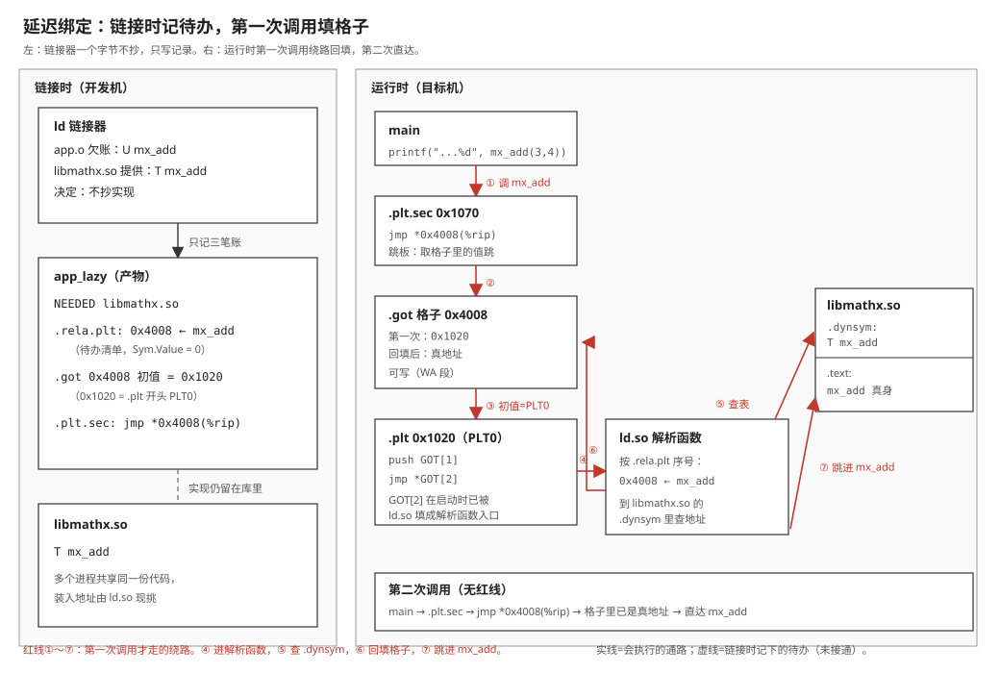

# 05 静态库、动态库与符号

    实验    Knowledge/labs/00_basics/05_libs_and_symbols/
    电脑    WSL Ubuntu 26.04（内核 6.6.114），gcc 15.2.0，
            arm-linux-gnueabihf-gcc 15.2.0，binutils 2.46，glibc 2.43，gdb
            （本篇"本机实测"为 2026-10-20、2026-10-21 实跑；ld.so 的
            搜索顺序另对照本机 man 8 ld.so 逐条核实）
    板子    100ASK_IMX6ULL Pro，Linux 4.9.88，glibc 2.30
            （板上输出沿用教程 01 篇第 5.2 节 2026-09-14 的归档实测）
    判据    bash Knowledge/labs/00_basics/05_libs_and_symbols/check.sh
            2026-10-21 复核：110 PASS / 0 FAIL / 0 SKIP

---

**你会在哪里撞见它**：第一次多半是这样。你在程序里算一个开方，写了
`sqrt(x)`，编译报

```text
sq.c:(.text+0x23): undefined reference to `sqrt'
collect2: error: ld returned 1 exit status
```

查一下，答案是"命令末尾加个 `-lm`"。加上，好了。可同一个程序里的 `printf`
从来不用加任何东西。为什么 `sqrt` 要加、`printf` 不用加？

第二次疼一点。教程 02 篇[02 GCC 编译器的使用](../tutorials/01_应用编程/02_GCC编译器的使用.md)第 6.3 节里，一个刚链接成功的
程序一运行就报：

```text
./test_shared: error while loading shared libraries: libsub.so:
cannot open shared object file: No such file or directory
```

文件明明就在当前目录，权限也对，它说打不开。再往后，教程 01 篇第 5.2 节把动态
链接的 ARM 程序传上板子，又换了一种说法：

```text
./hello_arm_dynamic: /lib/libc.so.6: version `GLIBC_2.34' not found
```

这三句报错问的是同一件事：**你调用的那个函数，它的实现此刻到底在哪里，
是谁、在什么时候把调用和实现接上的。** 本篇从符号表讲起，一路讲到运行时
那张被填写的地址表。

**这篇要回答的问题**：

1. `nm` 输出里 `T`、`D`、`B`、`R`、`U` 这些字母各说明什么？为什么一个链接完的
   程序里还会有 `U`？
2. 库里的实现在什么时候进到你的程序里？静态库和动态库的差别，能不能用一个实验
   一次说清？
3. 链接时找得到的库，运行时为什么会找不到？运行时是谁按什么顺序去找的？
4. 运行时才知道的地址，是怎么填进一段只读、而且被多个进程共享的代码里的？

---

## 0 先动手看一眼

实验目录里的 `syms.c` 故意把全局变量、`static` 变量、只读常量、函数、只声明
不实现的函数各写了一个（第 1.1 节逐行读）。先不管源码，只编译、不链接，然后
让 `nm` 把这个 `.o` 里登记的名字列出来：

```bash
cd Knowledge/labs/00_basics/05_libs_and_symbols
gcc -c syms.c -o syms.o
nm syms.o
```

- `gcc -c`：只编译成目标文件 `.o`，不链接（[00 篇第 4 节](00_从源码到运行.md)）。
- `nm`：列出一个目标文件、库或程序里登记的所有名字，每个名字一行。

本机实测：

```text
0000000000000000 B g_bss
0000000000000000 D g_init
0000000000000004 R g_ro
0000000000000000 D g_str
0000000000000000 T helper
000000000000002b T main
                 U nobody
                 U printf
0000000000000004 d s_local
0000000000000018 t shelp
```

每行三列：一个十六进制数、一个字母、一个名字。先只看两处：

- 中间那一列字母有大写也有小写，十行里出现了 `B D R T U d t` 七种。
- `U` 那两行前面是空白，没有数。`nobody` 是源码里瞎编的一个函数，`printf`
  是 C 库里的函数，在这张表上两者长得一模一样。

字母各是什么意思（第 1 节）、"欠着的"`U` 什么时候被谁还上（第 2、3 节是
链接时，第 4～6 节是运行时），就是这一篇的全部内容。

---
## 1 符号表：一个 .o 的两本账

[00 篇第 4.1 节](00_从源码到运行.md)第一次用 `nm` 时只出现过两个字母：`T`（本文件
里有这个函数的定义）和 `U`（用到了，本文件里没有）。真实的程序里还有全局变量、
`static` 变量、常量，它们在这张表上各是什么样，这一节一次看全。

### 1.1 syms.c：每种写法占一个符号

`Knowledge/labs/00_basics/05_libs_and_symbols/syms.c` 全文：

```c
/* fundamentals 05 第 1 节:各种写法在符号表里的样子
 * 编译: gcc -c syms.c -o syms.o && nm syms.o
 * 注意: 这个文件故意引用没有定义的 nobody, 只能 -c, 链接一定失败
 */
#include <stdio.h>

int         g_init = 1;            /* 有初值的全局变量 */
int         g_bss;                 /* 没有初值的全局变量 */
const char *g_str = "abc";         /* 指针本身可改, 指向的字符串只读 */
const int   g_ro = 42;             /* 只读全局常量 */
static int  s_local = 7;           /* static: 只在本文件内可见 */

int helper(int x) { return x + s_local; }
static int shelp(int x) { return x - 1; }

extern int nobody(void);           /* 只有声明, 哪里都没有定义 */

int main(void)
{
	printf("%d\n", helper(g_init) + shelp(g_ro) + nobody());
	return 0;
}
```

逐行读：

- 第 7 行 `int g_init = 1;`：在所有函数外面定义的变量叫全局变量，别的 `.c` 文件
  写一句 `extern int g_init;` 就能用它。它有初值 1。
- 第 8 行 `int g_bss;`：同样是全局变量，但没写初值。C 语言规定这种变量在程序
  开始时是 0。
- 第 9 行 `const char *g_str = "abc";`：这里有两样东西。`"abc"` 是一个字符串
  常量，4 个字节（`a b c` 加结尾的 0），只读；`g_str` 是一个指针变量，里面存着
  这 4 个字节的地址。`const` 修饰的是"指向的内容"，指针变量本身可以改。
- 第 10 行 `const int g_ro = 42;`：只读的全局整数。
- 第 11 行 `static int s_local = 7;`：`static` 写在函数外面时，意思是"这个名字
  只在本文件里能用"，别的文件就算写了 `extern int s_local;` 也找不到它。
- 第 13 行 `helper`：普通函数，别的文件能调用。
- 第 14 行 `shelp`：加了 `static` 的函数，只在本文件能调用。
- 第 16 行 `extern int nobody(void);`：只有声明，整个实验目录里没有任何文件
  定义它。`extern` 表示"定义在别处"。
- 第 18～22 行 `main`：把上面的东西都用一遍。只有被用到，`nobody` 和 `printf`
  才会进入符号表（没被用到的声明不留痕迹）。

**这一节搭好的积木**：一份源码，十种写法各占一个名字。接下来的问题：
`nm` 给每个名字配的字母怎么对上源码。

### 1.2 符号类型表：每个字母对照一行源码

把第 0 节的输出按字母重新排一下，每行对照源码：

```text
nm 输出          源码                             字母说明的事
------------     ------------------------------   ----------------------
T helper         int helper(...)                  代码，全局可见
t shelp          static int shelp(...)            代码，只在本文件可见
D g_init         int g_init = 1;                  有初值的数据
D g_str          const char *g_str = "abc";       有初值的数据（指针本身）
d s_local        static int s_local = 7;          有初值的数据，本文件可见
B g_bss          int g_bss;                       无初值的数据
R g_ro           const int g_ro = 42;             只读数据
U nobody         extern int nobody(void);         用到了，本文件没有
U printf         stdio.h 里的声明                 用到了，本文件没有
```

这张表里藏着两条规律，各管字母的一个方面：

- **字母是大写还是小写**：说明这个名字别的文件能不能用（第 1.3 节）。
- **字母是哪一个**：说明这个名字落在哪个 section（第 1.4 节）。

`U` 不属于任何 section，所以它单独占一类（第 1.5 节）。`syms.c` 没有占到的
几个字母（`W`、`w`、`C`、`r`、`b`）在第 1.6 节补齐；全部字母的总表在第 8 节
速查清单。

**这一节搭好的积木**：`nm` 的每个字母都能对上源码里的一种写法。接下来分别
看大小写和字母本身各由什么决定。

### 1.3 大写和小写：static 只改一个字母

`helper` 和 `shelp` 的源码只差一个 `static`，`nm` 里一个是 `T`、一个是 `t`；
`g_init` 和 `s_local` 也只差一个 `static`，一个 `D`、一个 `d`。规律是：

```text
大写   全局可见   别的 .o 可以引用它；链接器会拿它去满足别人的 U
小写   局部可见   只在本 .o 内部用；链接器不会拿它去满足别人的 U
```

`nm` 的字母是一个摘要。符号表本身记的内容更多，用 `readelf -s` 看原样：

```bash
readelf -s syms.o
```

- `readelf -s`：列出 `.symtab`（符号表）这一张表的全部条目。

本机实测：

```text
Symbol table '.symtab' contains 15 entries:
   Num:    Value          Size Type    Bind   Vis      Ndx Name
     0: 0000000000000000     0 NOTYPE  LOCAL  DEFAULT  UND 
     1: 0000000000000000     0 FILE    LOCAL  DEFAULT  ABS syms.c
     2: 0000000000000000     0 SECTION LOCAL  DEFAULT    1 .text
     3: 0000000000000000     0 SECTION LOCAL  DEFAULT    3 .data
     4: 0000000000000000     0 SECTION LOCAL  DEFAULT    5 .rodata
     5: 0000000000000004     4 OBJECT  LOCAL  DEFAULT    3 s_local
     6: 0000000000000018    19 FUNC    LOCAL  DEFAULT    1 shelp
     7: 0000000000000000     4 OBJECT  GLOBAL DEFAULT    3 g_init
     8: 0000000000000000     4 OBJECT  GLOBAL DEFAULT    4 g_bss
     9: 0000000000000000     8 OBJECT  GLOBAL DEFAULT    6 g_str
    10: 0000000000000004     4 OBJECT  GLOBAL DEFAULT    5 g_ro
    11: 0000000000000000    24 FUNC    GLOBAL DEFAULT    1 helper
    12: 000000000000002b    83 FUNC    GLOBAL DEFAULT    1 main
    13: 0000000000000000     0 NOTYPE  GLOBAL DEFAULT  UND nobody
    14: 0000000000000000     0 NOTYPE  GLOBAL DEFAULT  UND printf
```

逐列读：

- `Value`：符号在它所属 section 里的偏移。`.o` 还没被链接，没有真地址，
  所以这里只是"箱子里第几个字节"。
- `Size`：占多少字节。`helper` 24 字节、`shelp` 19 字节、`main` 83 字节。
- `Type`：`FUNC` 是函数，`OBJECT` 是数据，`NOTYPE` 是不知道（`U` 的那两个，
  编译器只知道名字）。
- `Bind`：**`nm` 的大小写就是从这一列来的。** `shelp`、`s_local` 是 `LOCAL`，
  其余是 `GLOBAL`。
- `Ndx`：落在第几号 section；`UND` 表示 undefined，本文件没有。

Value 和 Size 能互相印证：`helper` 从 0 开始占 24（0x18）字节，下一个函数
`shelp` 的 Value 正好是 0x18；`shelp` 占 19（0x13）字节，0x18 + 0x13 = 0x2b，
正好是 `main` 的 Value。三个函数在 `.text` 里首尾相接排着，总共
24 + 19 + 83 = 126 字节，也就是第 1.4 节 section 表里 `.text` 的大小 0x7e。

`static` 的全部作用，落到文件里就是把 `Bind` 从 `GLOBAL` 改成 `LOCAL`。
注错验证：生成一份去掉 `s_local` 前面 `static` 的副本，再看那一行。

```bash
sed 's/^static int  s_local/int         s_local/' syms.c > /tmp/syms_nostatic.c
gcc -c /tmp/syms_nostatic.c -o /tmp/syms_nostatic.o
nm /tmp/syms_nostatic.o | grep s_local
```

- `sed 's/旧/新/'`：把每行里第一处"旧"换成"新"，结果输出到 `>` 后面的文件。
  `^` 表示行首，保证只改第 11 行那一处。

本机实测：

```text
0000000000000004 D s_local
```

小写 `d` 变成了大写 `D`，其他行不变。

容易以为 `static` 变量"不进符号表"；实测它在符号表里，只是 `Bind` 是 `LOCAL`；
原因是调试器和 `nm` 都需要知道局部名字对应哪块内存，符号表照记不误，链接器只是
不拿它去和别的文件配对。

**这一节搭好的积木**：大写是 `GLOBAL`，小写是 `LOCAL`；`static` 只改这一位。
接下来看字母本身。

### 1.4 字母和 section：B 不占文件空间，g_str 为什么是 D

字母说明符号落在哪个 section（section 是 `.o` 里按用途分的箱子，
[00 篇第 6 节](00_从源码到运行.md)）：

```text
T / t  ->  .text      代码
D / d  ->  .data      有初值、可写的数据
B / b  ->  .bss       初值为 0、可写的数据
R / r  ->  .rodata    只读数据
```

用 section 表核对上一节 `Ndx` 那一列：

```bash
readelf -SW syms.o | grep -E 'Name|\.text|\.data|\.bss|\.rodata'
```

- `readelf -S`：section 表；`-W` 不折行。

本机实测：

```text
  [Nr] Name              Type            Address          Off    Size   ES Flg Lk Inf Al
  [ 1] .text             PROGBITS        0000000000000000 000040 00007e 00  AX  0   0  1
  [ 2] .rela.text        RELA            0000000000000000 000358 000090 18   I 13   1  8
  [ 3] .data             PROGBITS        0000000000000000 0000c0 000008 00  WA  0   0  4
  [ 4] .bss              NOBITS          0000000000000000 0000c8 000004 00  WA  0   0  4
  [ 5] .rodata           PROGBITS        0000000000000000 0000c8 00000c 00   A  0   0  4
  [ 6] .data.rel.local   PROGBITS        0000000000000000 0000d8 000008 00  WA  0   0  8
  [ 7] .rela.data.rel.local RELA            0000000000000000 0003e8 000018 18   I 13   6  8
```

逐个对：

- 1 号 `.text`：`helper`、`shelp`、`main` 的 `Ndx` 都是 1。大小 0x7e = 126，
  和上一节算的一样。`Flg` 是 `AX`：A（运行时要进内存）、X（可执行）。
- 3 号 `.data`：`g_init`（Value 0）和 `s_local`（Value 4），两个 4 字节整数，
  大小 8。`Flg` 是 `WA`，W 是可写。
- 4 号 `.bss`：`g_bss`。**类型是 `NOBITS`，`Off` 是 0xc8，和下一行 `.rodata`
  的 `Off` 一样。** 它在文件里一个字节都不占，只登记"运行时要 4 个字节的零"
  （[01 篇第 4 节](01_ELF与程序加载.md)从加载器一侧讲了这件事）。
- 5 号 `.rodata`：`g_ro`。`Flg` 只有 A，没有 W。

`.rodata` 里不止 `g_ro`。把它的内容按字符串打出来：

```bash
readelf -p .rodata syms.o
```

本机实测：

```text
String dump of section '.rodata':
  [     0]  abc
  [     4]  *
  [     8]  %d\n
```

12 个字节里装了三样东西：偏移 0 是 `"abc"`；偏移 4 是 `g_ro`，它的值 42 正好是
字符 `*` 的编码，所以被当成字符串打了出来，这也是 `nm` 里 `g_ro` 地址是 4 的
原因；偏移 8 是 `printf` 的格式串。字符串常量没有名字，`nm` 里看不到它们。

剩下 `g_str`：`nm` 说它是 `D`，`Ndx` 却是 6 号 `.data.rel.local`。这个 section
名里的 `rel` 说明了原因：`g_str` 的初值是 `"abc"` 的**地址**，而地址要等链接、
甚至加载之后才知道，所以这 8 个字节旁边配了一张重定位表
（7 号 `.rela.data.rel.local`，大小 0x18 正好一条记录）。编译器把"初值需要
重定位的数据"单独放一个箱子，`nm` 归类时仍把它算作有初值的可写数据 `D`。

容易以为 `const char *g_str` 是只读的、应该是 `R`；实测是 `D`；原因是 `const`
修饰的是指向的字符串（那 4 个字节在 `.rodata`），指针变量本身可写，要按初值
存进可写的数据区。

**这一节搭好的积木**：字母对应 section；`.bss` 在文件里不占空间；字符串常量
在 `.rodata` 里但没有名字。接下来是唯一一个不对应 section 的字母 `U`。

### 1.5 U：编译时一视同仁，链接时才分出来

`U nobody` 和 `U printf` 前面都没有地址，`Ndx` 都是 `UND`，`Type` 都是
`NOTYPE`。编译器对"C 库里的函数"和"随便编的名字"一视同仁：它只看见了一个
声明和一次调用，知道这个名字该怎么调用，不知道它在哪里，于是登记一笔
"我需要它"（[00 篇第 4.3 节](00_从源码到运行.md)那张重定位便条就是配合这一笔用的）。

区别到链接时才出现：

```bash
gcc syms.c -o syms
```

本机实测：

```text
/usr/bin/x86_64-linux-gnu-ld.bfd: /tmp/ccVM3tU9.o: in function `main':
syms.c:(.text+0x56): undefined reference to `nobody'
collect2: error: ld returned 1 exit status
```

只报了 `nobody`，没报 `printf`。链接器在默认带上的 C 库里找到了 `printf` 的
定义，`nobody` 谁都没有定义，于是报错（[00 篇第 5.1 节](00_从源码到运行.md)是同一个
报错的最小版本）。`(.text+0x56)` 说的是"`.text` 里偏移 0x56 那条指令要填
`nobody` 的地址"：`main` 从 0x2b 开始，0x56 在 `main` 里面。

由此得到排查 `undefined reference to 'xxx'` 的第一步：

```bash
nm 所有参与链接的 .o 和库 | grep xxx
```

看有没有谁在 `xxx` 那一行是 `T`（或 `D`、`B` 这类定义字母）。全是 `U`，就是
没有任何人提供它：库没链上，或者第 2.5 节要讲的顺序错了。

**这一节搭好的积木**：`U` 是"本文件欠着"；欠账在编译时不分来源，链接时才
去找人还。接下来补齐 `syms.c` 没占到的字母。

### 1.6 还有几个字母：W、w、C、r、b

`Knowledge/labs/00_basics/05_libs_and_symbols/syms_more.c`：

```c
/* fundamentals 05 第 1.6 节:syms.c 没占到的几种符号类型
 * 编译: gcc -c syms_more.c -o syms_more.o && nm syms_more.o
 *       gcc -fcommon -c syms_more.c -o syms_more_c.o && nm syms_more_c.o
 */
int weak_ref(void) __attribute__((weak));       /* 弱引用: 没人定义也能链接 */

int __attribute__((weak)) weak_def(void)        /* 弱定义: 别处有同名强定义时让位 */
{
	return 1;
}

static const int s_ro = 5;                      /* static 只读: 小写 r */
static int       s_zero;                        /* static 无初值: 小写 b */
int              g_tent;                        /* 无初值全局: 默认 B, -fcommon 时 C */

int use(void)
{
	return s_ro + s_zero + g_tent + weak_def() + (weak_ref ? weak_ref() : 0);
}
```

- `__attribute__((weak))`：gcc 的扩展写法，把一个符号标成"弱"的。写在声明上
  （第 5 行）是弱引用，写在定义上（第 7 行）是弱定义。
- 第 18 行 `weak_ref ? weak_ref() : 0`：弱引用没人定义时，链接器把它的地址填
  成 0，所以调用前先判断地址是不是 0。

```bash
gcc -c syms_more.c -o syms_more.o && nm syms_more.o
gcc -fcommon -c syms_more.c -o syms_more_c.o && nm syms_more_c.o | grep g_tent
```

- `-fcommon`：让"没有初值的全局变量"按旧的公共块规则处理（下面讲）。

本机实测：

```text
                 U _GLOBAL_OFFSET_TABLE_
0000000000000000 B g_tent
0000000000000000 r s_ro
0000000000000004 b s_zero
000000000000000f T use
0000000000000000 W weak_def
                 w weak_ref
0000000000000004 C g_tent
```

逐个读：

- `r s_ro`、`b s_zero`：第 1.3、1.4 节两条规律的组合，`static` 让字母变小写。
- `W weak_def`：弱定义。规则是：链接时别处有同名的普通（强）定义，就用强的；
  没有，就用这个。
- `w weak_ref`：弱引用，没有地址，和 `U` 一样是欠着的；区别是没人提供它时
  链接器不报错，把地址当 0。
- `g_tent` 默认是 `B`；加 `-fcommon` 后变成 `C`（common）。`C` 的意思是
  "多个文件都写了 `int g_tent;` 时，链接器把它们合并成一个"。gcc 10 起默认
  `-fno-common`，没有初值的全局变量直接进 `.bss`，两个文件各写一份就会报
  重复定义。
- 第一行多出来的 `U _GLOBAL_OFFSET_TABLE_`：判断 `weak_ref` 的地址是不是 0，
  需要从一张叫 GOT 的表里取地址。这张表是第 6 节的主角，这里先认个名字。

弱定义的"让位"可以亲手验证。准备一个只调用 `use()` 的 `main`，一次只链
`syms_more.c`，一次再加一个强定义 `weak_def` 返回 40：

```bash
printf 'int use(void);\nint main(void){return use();}\n' > /tmp/um.c
printf 'int weak_def(void){return 40;}\n' > /tmp/strong.c
gcc /tmp/um.c syms_more.c -o /tmp/um && /tmp/um; echo "exit=$?"
gcc /tmp/um.c syms_more.c /tmp/strong.c -o /tmp/um2 && /tmp/um2; echo "exit=$?"
```

- `printf '...' > 文件`：用 shell 的 `printf` 直接写出一个小源文件，`\n` 是换行。
- `echo "exit=$?"`：`main` 的返回值就是退出码，拿它当输出。

本机实测：

```text
exit=6
exit=45
```

第一次：5（`s_ro`）+ 0 + 0 + 1（弱定义）+ 0（弱引用没人定义）= 6。第二次：
5 + 40 = 45，弱定义让位给了 `strong.c` 里的强定义，而且链接器没报重复定义。
两个强定义放在一起才会报 `multiple definition of 'weak_def'`（本机实测）。

**这一节搭好的积木**：符号类型表补齐了；`W`/`w` 是弱符号，`C` 是公共块。
最后一件小事：这些工具认不认得 ARM 的文件。

### 1.7 交叉产物用带前缀的工具

板子上跑的是 ARM 程序。用交叉编译器编出 `syms_arm.o`，分别用交叉工具和本机
工具去读：

```bash
arm-linux-gnueabihf-gcc -c syms.c -o syms_arm.o
arm-linux-gnueabihf-nm syms_arm.o
nm syms_arm.o
objdump -d syms_arm.o
```

本机实测（第一段是 `arm-linux-gnueabihf-nm`，第二段是本机 `nm`）：

```text
00000000 B g_bss
00000000 D g_init
00000004 R g_ro
00000000 D g_str
00000000 T helper
00000036 T main
         U nobody
         U printf
00000004 d s_local
00000020 t shelp
```

```text
00000000 d $d
00000000 b $d
00000000 r $d
00000000 d $d
0000001c t $d
00000070 t $d
00000000 t $t
00000020 t $t
00000000 B g_bss
00000000 D g_init
00000004 R g_ro
00000000 D g_str
00000001 T helper
00000037 T main
         U nobody
         U printf
00000004 d s_local
00000021 t shelp
```

```text
syms_arm.o:     file format elf32-little

objdump: can't disassemble for architecture UNKNOWN!
```

三段对着看：

- 交叉版 `nm` 的输出和 x86 版的字母一一相同：符号类型是 ELF 的概念，和
  CPU 无关。地址是 32 位（8 个十六进制数字）。
- 本机 `nm` 也读得出来，但多出 8 行 `$d`、`$t`，而且 `helper` 是 1、`main` 是
  0x37、`shelp` 是 0x21，都比交叉版多 1。`$t`、`$d` 是 ARM 专门放在符号表里的
  路标（这一段是 Thumb 指令、这一段是数据），交叉版 `nm` 认得它们并隐去；
  末位的 1 是 Thumb 函数的标记位（[01 篇第 2.4 节](01_ELF与程序加载.md)），交叉版
  显示的是清掉标记后的地址。
- 本机 `objdump` 只认出"32 位小端 ELF"，不认得 ARM 指令，直接拒绝反汇编。

容易以为本机的 `nm`、`objdump` 能通吃；实测 `nm` 能读但混进 ARM 专用的路标、
地址带标记位，`objdump` 直接不认；原因是这些工具的"格式"部分是通用的，
"指令集"部分是按架构编译进去的。**交叉产物一律用带 `arm-linux-gnueabihf-`
前缀的那一套。**

**这一节搭好的积木**：读符号表的工具也分架构。

### 1.8 [判] 第 1 节

    [ ] helper 是 T、shelp 是 t；g_init 是 D、s_local 是 d，差别只在 static
    [ ] readelf -s 里 helper 是 GLOBAL、shelp 是 LOCAL
    [ ] g_init 是 D、g_bss 是 B、g_ro 是 R；g_str 是 D
    [ ] .bss 的类型是 NOBITS
    [ ] nobody 和 printf 都是 U 且没有地址；完整链接只报 nobody
    [ ] weak_def 是 W、weak_ref 是 w、s_ro 是 r、s_zero 是 b；
        g_tent 默认 B，-fcommon 时 C
    [ ] 弱定义单独链接退出码 6，加上强定义后退出码 45
    [ ] arm-linux-gnueabihf-nm 读 syms_arm.o 得到 T helper；
        本机 objdump 拒绝反汇编它

    注错见红：把 syms.c 第 11 行的 static 去掉再跑 check.sh，
    "s_local 是 d" 那一条变红（实得大写 D）。

---
## 2 静态库：一包 .o

第 1.5 节的结论是：`.o` 欠着的 `U`，链接时要有人还。[00 篇第 5.2 节](00_从源码到运行.md)
用的办法是把提供定义的 `add.o` 直接写在命令行上。真实工程里提供定义的往往是
一整个库：C 库、数学库、FreeType……这一节的问题：几十上百个 `.o` 怎么交给
别人用，链接器又怎么从里面挑。

### 2.1 一个库几千个函数，你只用三个

先把问题摆清楚。一个库里有几千个函数，你的程序只用其中三个，链接时有三种
想得到的做法：

```text
做法 A   全部塞进程序          每个程序都背着整个库
做法 B   只塞用到的那些         要有办法知道哪些用到了，再把它们挑出来
做法 C   一个都不塞，运行时再找   "找"这件事谁来做、什么时候做
```

做法 B 就是静态库，这一节讲；做法 C 就是动态库，第 3 节讲。做法 A 没有人用，
但第 2.4 节会看到，B 的"挑"有一个粒度，挑得粗了，就会滑向 A 的那一头。

这一节和下一节用同一组实验文件：

```c
/* mathx.h */
#ifndef MATHX_H
#define MATHX_H

int mx_add(int a, int b);
int mx_len(const char *s);

#endif
```

```c
/* mathx.c */
#include "mathx.h"

int mx_add(int a, int b)
{
	return a + b;
}
```

```c
/* strx.c */
#include "mathx.h"

int mx_len(const char *s)
{
	int n = 0;
	while (*s++)
		n++;
	return n;
}
```

```c
/* app.c */
#include <stdio.h>
#include "mathx.h"

int main(void)
{
	printf("mx_add(3,4) = %d\n", mx_add(3, 4));
	return 0;                  /* 故意不调用 mx_len */
}
```

（四个文件名写在注释里只是为了区分，实验目录里的文件没有这一行。）

- `mathx.h`：两个函数的声明。`#ifndef MATHX_H ... #endif` 防止同一个文件被
  include 两次时声明重复。
- `mathx.c` 和 `strx.c`：**两个函数故意放在两个文件里**，各编出一个 `.o`。
- `strx.c` 的 `while (*s++) n++;`：`*s++` 先取出 `s` 指向的字符再让 `s` 后移一格；
  取到结尾的 0 时条件为假，循环结束，`n` 就是字符数。
- `app.c`：只调用 `mx_add`，**故意不调用 `mx_len`**。

**这一节搭好的积木**：一个库、两个成员、只用其中一个。接下来把两个 `.o`
打成一个库。

### 2.2 ar：打包，文件头 !<arch>，符号索引

最朴素的打包办法就是打个包：把几个 `.o` 原样装进一个文件。工具是 `ar`
（archiver，归档器），产物按惯例叫 `lib名字.a`：

```bash
gcc -c mathx.c strx.c
ar rcs libmathx.a mathx.o strx.o
ar t libmathx.a
ls -l mathx.o strx.o libmathx.a
```

- `gcc -c mathx.c strx.c`：一次编两个，产出 `mathx.o`、`strx.o`。
- `ar rcs`：三个字母各管一件事。`r` 把文件插入归档，同名成员就替换；`c` 归档
  不存在时新建，而且不打印提示；`s` 给归档建一张符号索引（下面看）。
- `ar t`：t 是 table，列出归档里有哪些成员。

本机实测：

```text
mathx.o
strx.o
-rwxrwxrwx 1 glorinz glorinz 2686 Oct 20 ... libmathx.a
-rwxrwxrwx 1 glorinz glorinz 1224 Oct 20 ... mathx.o
-rwxrwxrwx 1 glorinz glorinz 1248 Oct 20 ... strx.o
```

两个成员原样在里面。1224 + 1248 = 2472，归档比两者之和多 214 字节，多出来的是
归档自己的头、每个成员的头和符号索引。归档格式本身很简单，看文件开头：

```bash
head -c 80 libmathx.a | xxd
```

- `head -c 80`：只取前 80 个字节；`xxd`：按十六进制和字符两栏显示字节。

本机实测：

```text
00000000: 213c 6172 6368 3e0a 2f20 2020 2020 2020  !<arch>./       
00000010: 2020 2020 2020 2020 3020 2020 2020 2020          0       
00000020: 2020 2020 3020 2020 2020 3020 2020 2020      0     0     
00000030: 3020 2020 2020 2020 3236 2020 2020 2020  0       26      
00000040: 2020 600a 0000 0002 0000 005e 0000 0562    `........^...b
```

```text
偏移 0x00   21 3c 61 72 63 68 3e 0a    "!<arch>\n"   归档的魔数
偏移 0x08   "/"  后面补空格             第一个成员的名字：/ 表示符号索引
偏移 0x30   "26"                        这个成员的大小：26 字节（十进制）
偏移 0x3e   60 0a                       "`\n"，成员头结束
偏移 0x44   00 00 00 02                 索引里有 2 个符号
```

`.a` 不是 ELF，它是一个按"成员头 + 成员内容"排下去的容器；里面的成员才是
ELF。第一个成员 `/` 就是 `s` 建的那张符号索引：2 个符号，各自记着在哪个
成员里。`nm` 能把它翻成文字：

```bash
nm --print-armap libmathx.a
```

本机实测：

```text
Archive index:
mx_add in mathx.o
mx_len in strx.o

mathx.o:
0000000000000000 T mx_add

strx.o:
0000000000000000 T mx_len
```

`Archive index` 那两行就是索引：链接器想找 `mx_add`，查一下索引就知道要的是
`mathx.o`，不用把每个成员都打开看一遍。索引是必需的，用大写 `S`（不建索引）
打一个包来证明：

```bash
ar rcS libnoidx.a mathx.o strx.o
gcc app.c -L. -lnoidx -o app_noidx
```

本机实测：

```text
/usr/bin/x86_64-linux-gnu-ld.bfd: ./libnoidx.a: error adding symbols: archive has no index; run ranlib to add one
collect2: error: ld returned 1 exit status
```

链接器直接拒收，并且提示用 `ranlib`（专门给归档补索引的工具，效果等于
`ar s`）。

**这一节搭好的积木**：静态库是一个装着 `.o` 的归档，开头是 `!<arch>`，
第一个成员是"符号在哪个成员里"的索引。接下来的问题：链接时它把整个包都塞进
程序，还是只塞用到的？

### 2.3 静态库只抄用得到的 .o

```bash
gcc app.c -o app_static -L. -lmathx
nm app_static | grep mx_
./app_static
```

- `-L.`：链接时找库的目录里加上当前目录（`.`）。只管链接时，运行时不管
  （第 4.1 节）。
- `-lmathx`：链接名叫 `mathx` 的库。链接器把它展开成文件名 `libmathx.so` 或
  `libmathx.a`，在 `-L` 给的目录和默认目录里找。名字的规则是"去掉 `lib` 前缀
  和后缀"，所以写 `-lmathx`，不写 `-llibmathx.a`。此刻目录里只有 `.a`；两种都
  在时选谁，第 3.4 节实测。如果你已经跑过 `check.sh`，目录里已经有
  `libmathx.so`，这一步改成直接写文件名：`gcc app.c -o app_static libmathx.a`。

本机实测：

```text
000000000000117f T mx_add
mx_add(3,4) = 7
```

`mx_add` 在程序里是 `T`，有了真地址 0x117f，它的代码被抄进来了。**`mx_len`
一行都没有**：`strx.o` 整个没进来。

"挑了哪个成员、为什么挑"，链接器自己可以写出来。`-Wl,-Map,文件` 让链接器
生成一张链接地图：

```bash
gcc app.c -o app_static -L. -lmathx -Wl,-Map,app_static.map
sed -n '1,8p' app_static.map
```

- `-Wl,选项`：把逗号后面的内容原样转交给链接器 ld，逗号换成空格；这里转交的
  是 `-Map app_static.map`（[04 篇第 6.5 节](04_GCC的选项.md)）。
- `sed -n '1,8p'`：只打印第 1 到 8 行。

本机实测：

```text
Archive member included to satisfy reference by file (symbol)

./libmathx.a(mathx.o)         /tmp/cclAvDQT.o (mx_add)

Merging object attributes


Merging program properties
```

地图第一段的标题就是答案："为了满足某个文件对某个符号的引用而拉进来的归档
成员"。只有一行：`libmathx.a` 里的 `mathx.o`，是因为 `/tmp/cclAvDQT.o`
（gcc 把 `app.c` 编成的临时 `.o`）引用了 `mx_add`。`strx.o` 不在表上。

挑拣的过程写成一张图：

```text
链接器手里的欠账表        归档索引                      动作
---------------------     ---------------------------   -----------------
app.o: U mx_add      -->  mx_add in mathx.o        -->  抄 mathx.o
       U printf           (不在这个库里)                留给后面的库
                          mx_len in strx.o              没人欠，不抄
```

左边是 `app.o` 的 `U`，中间是 2.2 节的索引，右边是结果。挑拣是按"现在还欠着
什么"驱动的，库里有什么不重要，欠什么才重要。

**这一节搭好的积木**：链接器拿欠账去查归档索引，只抄能还账的成员，其余成员
不进程序；`-Wl,-Map` 能让它把"为谁抄了谁"写出来。接下来的问题：抄的单位
到底是什么。

### 2.4 挑拣的单位是 .o，不是函数

2.3 节里 `mx_len` 没进来，是因为它单独在 `strx.o` 里。把两个函数挤进同一个
`.o` 再试：

```bash
{ echo '#include "mathx.h"'; grep -h -v '#include' mathx.c strx.c; } > both.c
gcc -c both.c -o both.o && ar rcs libboth.a both.o
gcc app.c -o app_both -L. -lboth
nm app_both | grep mx_
```

- `{ 命令1; 命令2; } > 文件`：把两条命令的输出合起来写进一个文件。
- `grep -h -v '#include' mathx.c strx.c`：输出两个文件里不含 `#include` 的
  行，`-h` 不在每行前面加文件名。合起来就是"一个 include 加两个函数体"。

本机实测：

```text
000000000000117f T mx_add
0000000000001197 T mx_len
```

`mx_len` 这次也进来了，可 `app.c` 一次都没调用它。链接器要 `mx_add`，
`mx_add` 在 `both.o` 里，于是整个 `both.o` 被抄进来，同一个 `.o` 里的
`mx_len` 跟着进来。**挑拣的单位是成员 `.o`，不是单个函数。** 这就是 C 库这类
库习惯把函数拆得很细、常常一个函数一个源文件的原因：拆得越细，使用者带进
程序的无用代码越少。

如果库已经是一个大 `.o`，还有一个办法：让编译器把每个函数放进单独的 section，
再让链接器把没人用的 section 扔掉。

```bash
gcc -c -ffunction-sections both.c -o both_fs.o
readelf -SW both_fs.o | grep text
ar rcs libbothfs.a both_fs.o
gcc app.c -o app_bothfs -L. -lbothfs -Wl,--gc-sections
nm app_bothfs | grep mx_
```

- `-ffunction-sections`：每个函数单独放进一个叫 `.text.函数名` 的 section。
- `-Wl,--gc-sections`：让链接器做"垃圾回收"：从入口出发，沿着引用关系走不到的
  section 一律不放进产物。

本机实测：

```text
  [ 1] .text             PROGBITS        0000000000000000 000040 000000 00  AX  0   0  1
  [ 4] .text.mx_add      PROGBITS        0000000000000000 000040 000018 00  AX  0   0  1
  [ 5] .text.mx_len      PROGBITS        0000000000000000 000058 000031 00  AX  0   0  1
000000000000117f T mx_add
```

`.text` 的大小变成 0，两个函数各占一个 section；链接后只剩 `mx_add`。两个选项
缺一不可：只加 `-ffunction-sections`、不加 `--gc-sections` 时，本机实测
`mx_add` 和 `mx_len` 都在（成员照样整个抄进来，只是分了箱）。

```text
              成员级挑拣（归档）      section 级回收（--gc-sections）
              ------------------      ------------------------------
mathx.o+strx.o  只抄 mathx.o           (不需要)
both.o          整个抄，mx_len 跟进     (未开启)
both_fs.o       整个抄                  扔掉 .text.mx_len
```

**这一节搭好的积木**：归档按成员挑，粒度是 `.o`；再细的粒度要靠
`-ffunction-sections` 加 `--gc-sections`。接下来的问题：挑的那一刻"还欠着
什么"是怎么确定的，这决定了库在命令行上该放哪。

### 2.5 从左往右扫一遍：-l 放在后面

把 `-lmathx` 挪到 `app.c` 前面：

```bash
gcc -L. -lmathx app.c -o app_bad
```

本机实测：

```text
/usr/bin/x86_64-linux-gnu-ld.bfd: /tmp/ccbJbxRG.o: in function `main':
app.c:(.text+0x13): undefined reference to `mx_add'
collect2: error: ld returned 1 exit status
```

库明明在命令行上，还是 `undefined reference`。原因在 2.3 节那张图的左边一栏：
链接器按命令行**从左往右**处理输入，遇到一个归档时，拿"到目前为止还欠着的
符号"去查它的索引，抄完就走，**之后不再回头**。

```text
顺序 A：app.c 在前                     顺序 B：-lmathx 在前
--------------------------------       --------------------------------
1. app.o      欠账: mx_add printf      1. libmathx.a  欠账: (空)
2. libmathx.a 查到 mx_add -> 抄          -> 什么都不抄，走
3. libc       查到 printf -> 记下      2. app.o       欠账: mx_add printf
   结果: 成功                          3. libc        查到 printf
                                          mx_add 没人还 -> 报错
```

顺序 B 里，处理到 `libmathx.a` 时还没有任何人欠 `mx_add`，库里一个成员都
没被挑走；等 `app.o` 提出这笔欠账，库已经过去了。所以规矩是：**用到它的
`.o` 在前，提供它的库在后**（[04 篇第 6.1 节](04_GCC的选项.md)从选项一侧讲过同一条
规矩）。这是 `undefined reference` 的第二种成因，比"忘了链库"更难查，因为
库确实写了。

两个库互相欠账时（`liba` 要用 `libb` 的函数，`libb` 又要用 `liba` 的），
"扫一遍"不够，要么把其中一个写两次（`-la -lb -la`），要么用
`-Wl,--start-group -la -lb -Wl,--end-group` 让链接器在这一组里反复扫到不再
有新成员被抄为止（依据：man ld 的 `--start-group` 条目）。

**这一节搭好的积木**：链接器从左往右只扫一遍归档；库要写在用它的 `.o` 后面。
接下来回到篇首的第一个问题：`printf` 和 `sqrt` 都在库里，为什么一个要写
`-lm`、一个不用写。

### 2.6 printf 不用加、sqrt 要加 -lm

`Knowledge/labs/00_basics/05_libs_and_symbols/sq.c`：

```c
/* fundamentals 05 第 2.5 节:sqrt 在 libm 里, 不在默认链接名单上
 * 编译: gcc -O0 sq.c        报 undefined reference to `sqrt'
 *       gcc -O0 sq.c -lm    正常
 * x 用 volatile 修饰, 是为了挡住编译期常量折叠, 逼它真的去调 sqrt;
 * 直接写 sqrt(2.0) 的话, 编译器在编译期就把结果算出来了, 不带 -lm 也能编过
 */
#include <math.h>
#include <stdio.h>

int main(void)
{
	volatile double x = 2.0;

	printf("%f\n", sqrt(x));
	return 0;
}
```

- `#include <math.h>`：`sqrt` 的声明在这里。
- `volatile double x = 2.0;`：`volatile` 告诉编译器"这个变量的值可能被你看不见
  的东西改掉，每次用都要真的去读"。效果是编译器不能在编译时就把 `sqrt(2.0)`
  算成常数，只能生成一次真正的函数调用。
- `%f`：按小数打印一个 `double`，默认 6 位小数。

```bash
gcc -O0 sq.c -o sq
gcc -O2 sq.c -o sq
arm-linux-gnueabihf-gcc -O2 sq.c -o sq_arm
gcc -O0 sq.c -o sq_lm -lm && ./sq_lm
readelf -d sq_lm | grep NEEDED
```

- `-lm`：链接名叫 `m` 的库，也就是 `libm`（数学库）。
- `readelf -d`：读程序的 `.dynamic`，动态链接要用的信息都记在这里；
  `NEEDED` 行是"运行时需要的库"（第 3.2 节细讲）。

本机实测：

```text
sq.c:(.text+0x23): undefined reference to `sqrt'
sq.c:(.text.startup+0x48): undefined reference to `sqrt'
sq.c:(.text.startup+0x34): undefined reference to `sqrt'
1.414214
 0x0000000000000001 (NEEDED)             Shared library: [libm.so.6]
 0x0000000000000001 (NEEDED)             Shared library: [libc.so.6]
```

（前三行各是一次失败链接里的关键行，每次后面都跟着 `collect2: error`。）
x86 的 `-O0`、`-O2`，ARM 的 `-O2`，三次都报 `sqrt` 未定义；加上 `-lm` 后
能算出 1.414214，`NEEDED` 里多了 `libm.so.6`。

两个库里各有什么，`nm -D` 直接查（`-D` 读动态符号表，第 8 节速查清单讲它和
不带 `-D` 的区别）：

```bash
nm -D /usr/lib/x86_64-linux-gnu/libm.so.6 | grep -w sqrt
nm -D /usr/lib/x86_64-linux-gnu/libc.so.6 | grep -cw sqrt
```

- `grep -w`：只匹配完整的单词，避免 `sqrtf`、`sqrtl` 混进来；`-c` 只输出
  匹配的行数。

本机实测：

```text
0000000000018590 W sqrt@@GLIBC_2.2.5
0
```

`sqrt` 在 `libm.so.6` 里（`W`，弱定义，第 1.6 节；`@@GLIBC_2.2.5` 是版本标签，
第 5 节），`libc.so.6` 里一个都没有。

`printf` 在 `libc` 里，而 `libc` 是 gcc **默认就替你带上的**。gcc 交给链接器
的完整命令行可以用 `-###` 打出来（只打印、不执行）：

```bash
gcc -### app.c -L. -lmathx -o app 2>&1 | grep collect2 | tr ' ' '\n' | grep -nE 'mathx|lc|lgcc|crt'
```

- `-###`：打印 gcc 要调用的每个程序及其参数，但不真的执行。
- `grep collect2`：只要调用链接器（经 `collect2`）的那一行。
- `tr ' ' '\n'`：把空格换成换行，一个参数一行；`grep -n` 带上行号。

本机实测：

```text
7:"-plugin-opt=-pass-through=-lgcc"
8:"-plugin-opt=-pass-through=-lgcc_s"
9:"-plugin-opt=-pass-through=-lc"
10:"-plugin-opt=-pass-through=-lgcc"
11:"-plugin-opt=-pass-through=-lgcc_s"
27:/usr/lib/gcc/x86_64-linux-gnu/15/../../../x86_64-linux-gnu/Scrt1.o
28:/usr/lib/gcc/x86_64-linux-gnu/15/../../../x86_64-linux-gnu/crti.o
29:/usr/lib/gcc/x86_64-linux-gnu/15/crtbeginS.o
42:-lmathx
43:-lgcc
46:-lgcc_s
48:-lc
49:-lgcc
52:-lgcc_s
54:/usr/lib/gcc/x86_64-linux-gnu/15/crtendS.o
55:/usr/lib/gcc/x86_64-linux-gnu/15/../../../x86_64-linux-gnu/crtn.o
```

第 7～11 行是转交给链接时优化插件的同一份名单，不用管。真正的顺序从第 27 行起：
启动文件 `Scrt1.o` 等（[00 篇第 6.4 节](00_从源码到运行.md)），然后是用户的输入
（第 42 行 `-lmathx`，`app.c` 编出的临时 `.o` 在它前面，被 grep 滤掉了），然后
是 gcc 自己加的 `-lgcc -lgcc_s -lc -lgcc -lgcc_s`，最后是收尾的启动文件。
**默认名单里有 `-lc`，没有 `-lm`。** 而且默认的库排在所有用户输入后面，正好
满足 2.5 节"库在后"的规矩。

`-lc` 找到的 `libc.so` 并不是 C 库本身：

```bash
ls -l /usr/lib/x86_64-linux-gnu/libc.so /usr/lib/x86_64-linux-gnu/libc.so.6
cat /usr/lib/x86_64-linux-gnu/libc.so
```

本机实测（`cat` 只摘最后两行，前面是注释）：

```text
-rw-r--r-- 1 root root     287 Sep  3 22:09 /usr/lib/x86_64-linux-gnu/libc.so
-rwxr-xr-x 1 root root 2190608 Sep  3 22:09 /usr/lib/x86_64-linux-gnu/libc.so.6
OUTPUT_FORMAT(elf64-x86-64)
GROUP ( /usr/lib/x86_64-linux-gnu/libc.so.6 /usr/lib/x86_64-linux-gnu/libc_nonshared.a  AS_NEEDED ( /lib64/ld-linux-x86-64.so.2 ) )
```

`libc.so` 只有 287 字节，是一段给链接器看的文字（链接脚本）：把 `-lc` 转成
"真正的 `libc.so.6`，加一个静态的 `libc_nonshared.a`，再按需加上动态链接器"。
链接器读到这种文本文件时会照着里面的指示继续找。

容易以为"`-lm` 早就不用写了"；实测在 glibc 2.43 上 x86 和 ARM、`-O0` 和
`-O2` 都还要写；原因是 `sqrt` 仍在 `libm.so.6` 里，而默认名单只有 `-lc`。
glibc 这些年把不少原本独立的库（如线程库）并进了 `libc.so.6`，数学库没有并，
换一个发行版或 glibc 版本时以自己机器上 `nm -D` 查到的为准。

还有一个更隐蔽的反例：去掉 `volatile`，直接写 `sqrt(2.0)`，不带 `-lm` 也能编过，
本机实测 `nm` 里一个 `sqrt` 都没有。编译器在编译时就把 `sqrt(2.0)` 算成了
常数 1.414214，调用根本没发生。这就是 `sq.c` 坚持用 `volatile` 的原因：
不加它，实验测不出想测的东西。

**这一节搭好的积木**：`printf` 在默认名单的 `-lc` 里，`sqrt` 在不默认的
`-lm` 里；`-lc` 背后是一段链接脚本。到这里，静态库讲完了：它在链接时把
用得到的成员抄进程序。

### 2.7 [判] 第 2 节

    [ ] libmathx.a 前 8 个字节是 !<arch>；ar t 列出 mathx.o、strx.o
    [ ] nm --print-armap 的索引里有 mx_add in mathx.o
    [ ] 用 ar rcS 打出的无索引归档，链接器报 archive has no index
    [ ] app_static 里有 T mx_add，没有 mx_len
    [ ] 链接地图第一段只有 libmathx.a(mathx.o)，没有 strx.o
    [ ] 两个函数在同一个 .o 里时，mx_len 跟着进来；
        -ffunction-sections 加 --gc-sections 后 mx_len 不进来
    [ ] -lmathx 写在 app.c 前面时报 undefined reference
    [ ] sq.c 不带 -lm 报 sqrt 未定义；带上后打印 1.414214，NEEDED 里有 libm.so.6
    [ ] sqrt 在 libm.so.6 的动态符号表里，不在 libc.so.6 里；gcc -### 里有 -lc

    注错见红：把 check.sh 里 "gcc -L. -lmathx app.c" 那一条改成
    "gcc app.c -L. -lmathx"，"把 -l 放在源文件前面会 undefined reference"
    那一条变红（链接成功了，输出里找不到 undefined reference）。

---
## 3 动态库：链接时只记账，不抄代码

§2 把做法 B 讲完了：静态库在链接时把用得到的成员抄进程序。本节走做法 C 这条
路：链接时一个字节都不抄，只把"运行时去找谁"记下来。找的过程本身是第 4 节的
内容，本节先看链接这一侧的账是怎么记的、记在哪。

（本节"本机实测"均为 2026-10-21 实跑，环境同篇首。）

### 3.1 把库编成 .so：mx_add 还是 U

还是 §2 那四个文件。把两个成员编成一个共享库，再把程序链上去：

```bash
gcc -shared -fPIC -o libmathx.so mathx.c strx.c
gcc app.c -o app_dyn -L. -lmathx -Wl,-rpath,'$ORIGIN'
```

- `-shared`：让 gcc 交出一个共享库（shared object），而不是可执行程序。
- `-fPIC`：位置无关代码，这一节先照写，它为什么是硬约束见第 3.3 节。
- `-Wl,-rpath,'$ORIGIN'`：先原样照抄，它让程序现在就能跑起来。这个词是什么、
  为什么值是 `$ORIGIN`，第 4.3 节拆。

先看库的身份：

```bash
file libmathx.so
```

本机实测：

```text
libmathx.so: ELF 64-bit LSB shared object, x86-64, version 1 (SYSV), dynamically linked, BuildID[sha1]=db279b4f6cfe5969cf02ac0f546d9c4f2c955ac4, not stripped
```

类型是 shared object。它和可执行程序一样是 ELF，区别记在文件头里（01 篇第 1 节
的 `Type` 字段），链接器和加载器各看一眼就分得清。

再链接程序。链接时发生了什么，链接后 `app_dyn` 手里有什么：

```bash
nm app_dyn | grep mx_add
readelf -d app_dyn
./app_dyn
```

- `readelf -d`：读 ELF 的动态段（`.dynamic`）。程序在运行时要用到的动态链接
  信息全部登记在这张表里。

本机实测（`readelf -d` 原样 29 条，这里先取前两条和程序自己的行为；其余的
第 4、6 节各取所需）：

```text
                 U mx_add
mx_add(3,4) = 7
 0x0000000000000001 (NEEDED)             Shared library: [libmathx.so]
 0x0000000000000001 (NEEDED)             Shared library: [libc.so.6]
```

逐行读：

- `U mx_add`：和 §0 里 `syms.o` 的 `U nobody` 一模一样。**链接器没有抄 `mx_add`
  的实现**，这笔欠账原样留在了程序里。
- `NEEDED libmathx.so`：链接器记下的第一笔账："运行时要找 libmathx.so"。
- `NEEDED libc.so.6`：第二笔。这一条不是你要求的，是 gcc 默认名单里的 `-lc`
  （§2.6）换算过来的。
- 程序能跑出 7：函数实现不在这个文件里，`printf` 和 `mx_add` 都是运行时从库
  里来的。

对照 §2.3 的静态版：那里 `mx_add` 是 `T`、带真地址；这里还是 `U`。两条路线
在链接这一侧的差别就一句话：**静态库按欠账抄代码，动态库按欠账记名字。**

**这一节搭好的积木**：`-shared -fPIC` 编出 `.so`；链接时 `U` 不填，只往
`.dynamic` 里写 `NEEDED`。接下来的问题：运行时按这份账单去找库，找不到会怎样。

### 3.2 NEEDED：写给运行时的欠账单

把库藏起来再跑，看运行时的第一反应：

```bash
mv libmathx.so .libmathx.so.hidden
./app_dyn; echo "exit=$?"
mv .libmathx.so.hidden libmathx.so
```

本机实测：

```text
./app_dyn: error while loading shared libraries: libmathx.so: cannot open shared object file: No such file or directory
exit=127
```

逐段读这句报错：

- `error while loading shared libraries`：说话的是动态链接器 `ld.so`。程序
  还没执行到 `main`，死在更前面的启动阶段。
- `libmathx.so: cannot open shared object file`：按 `NEEDED` 记的名字去找，
  找不到这个文件。注意它报的是 `NEEDED` 里记的名字，不是命令行上的 `-lmathx`；
  这个名字是谁定的，第 3.5 节讲。
- 退出码 127：教程 02 篇 6.3 节实测过同一个退出码。篇首第二句报错（链接成功、
  一跑就死）到这里完整复现了。

`NEEDED` 之外，`.dynamic` 里还记着一长串支持信息。把 `app_dyn` 的 29 条全摆开
没有意义，但有三条先混个脸熟，后面两节会各回来取一次：

```text
 0x000000000000001d (RUNPATH)            Library runpath: [$ORIGIN]
 0x000000000000001e (FLAGS)              BIND_NOW
 0x000000006ffffffb (FLAGS_1)            Flags: NOW PIE
```

`RUNPATH` 是给运行时找库指路的（第 4 节）；`BIND_NOW` 和符号绑定有关（第 6 节）。

**这一节搭好的积木**：`NEEDED` 是写给运行时的欠账单；运行时按名字找不到库，
报 `cannot open shared object file`，退出码 127。接下来的问题：编 `.so` 时
`-fPIC` 那个选项，不做会怎样。

### 3.3 -fPIC：什么情况下是硬约束

cnt.c 是一个最小库：一个 `static` 计数器加一个自增函数。

```c
/* labs/00_basics/05_libs_and_symbols/cnt.c */
static int counter = 100;

int bump(void)
{
	return ++counter;
}
```

故意关掉位置无关（`-fno-pic`）再编共享库。先在板子的工具链上试：

```bash
arm-linux-gnueabihf-gcc -O2 -fno-pic -c cnt.c -o cnt_nop_arm.o
arm-linux-gnueabihf-gcc -shared cnt_nop_arm.o -o libcnt_arm.so
```

本机实测：

```text
/usr/bin/arm-linux-gnueabihf-ld.bfd: cnt_nop_arm.o: relocation R_ARM_THM_MOVW_ABS_NC against `a local symbol' can not be used when making a shared object; recompile with -fPIC
collect2: error: ld returned 1 exit status
```

链接器直接拒绝，理由写在报错里：`R_ARM_THM_MOVW_ABS_NC` 这种重定位
（00 篇第 4.3 节的"便条"）"不能用于共享对象"。这个名字里 `ABS` 的意思是
绝对地址：`movw/movt` 这对指令把一个 32 位地址拆成两半编码进指令，编译时
谁也不知道共享库会被装到哪个地址，这个洞没人能填。

共享库为什么"装到哪个地址"是定不下来的：`.so` 的设计目标是多个进程共用
同一份物理内存。装在固定地址，两个进程对这个地址的安排可能冲突；让 `ld.so`
每个进程现挑一个空闲位置（教程 00 篇 7.4 节的 ASLR 同理），就总能放进去。
放的位置每次不同，代码里就不能有写死的地址。

那 x86 上关掉 PIC 呢。同一个文件：

```bash
gcc -O2 -fno-pic -c cnt.c -o cnt_nop.o
gcc -shared cnt_nop.o -o libcnt.so
objdump -d cnt_nop.o | sed -n '/<bump>:/,/^$/p'
```

本机实测，链接没有报错，反汇编看它访问 `counter` 用的寻址方式：

```text
0000000000000000 <bump>:
   0:	f3 0f 1e fa          	endbr64
   4:	8b 05 00 00 00 00    	mov    0x0(%rip),%eax        # a <bump+0xa>
   a:	83 c0 01             	add    $0x1,%eax
   d:	89 05 00 00 00 00    	mov    %eax,0x0(%rip)        # 13 <bump+0x13>
  13:	c3                   	ret
```

两条 `mov` 写的都是 `0x0(%rip)`：相对指令指针（rip）取地址，偏移 0 处留着
待填的重定位。**访问已经和位置无关了**，链接器能把它填好，所以 x86 上这个
文件不加 `-fPIC` 也编得出 `.so`。换一个全局数组下标用绝对地址寻址的写法，
x86 同样会被拒。所以规矩不按架构分：**编 `.so` 一律带 `-fPIC`**，让编译器
把所有访问都生成与位置无关的形态。

容易以为 `-fno-pic` 的失败是"编译器不让"；实测 x86 上编过了、ARM 上
链接器才拒；原因是两边的指令集不同：ARM 的 `movw/movt` 天然编绝对地址，
x86 访问内存的习惯写法本来就是相对 rip 的。

**这一节搭好的积木**：共享库的加载地址运行时才定，代码里不能有绝对地址；
`-fPIC` 让编译器全部用相对寻址生成，ARM 上缺了它链接器直接拒。接下来的
问题：目录里 `.a` 和 `.so` 都在，`-l` 拿哪一个。

### 3.4 两种库都在场时，-l 拿哪一个

把两种库放进同一个目录：

```bash
mkdir .pref && cp libmathx.a libmathx.so .pref/
gcc app.c -o app_pick -L.pref -lmathx -Wl,-rpath,'$ORIGIN/.pref'
readelf -d app_pick | grep NEEDED
```

本机实测：

```text
 0x0000000000000001 (NEEDED)             Shared library: [libmathx.so]
 0x0000000000000001 (NEEDED)             Shared library: [libc.so.6]
```

两种都在，`-lmathx` 选了 `.so`：`NEEDED` 里有它，程序里自然没有 `T mx_add`
（没抄）。这是默认行为的翻转：§2.2 的"成员名后缀"规则之外，**链接器对同一
个链接名先找 `lib名字.so`，找不到再找 `lib名字.a`**。动态优先的理由和 §3.6
的实验直接相关：库升级不用重编程序。

两个开关各能翻转一次这个选择：

```bash
gcc -static app.c -o app_pick_st -L.pref -lmathx
stat -c '%s %n' app_dyn app_pick_st
nm app_pick_st | grep ' T mx_add'
gcc app.c -o app_force_a -L.pref -l:libmathx.a
nm app_force_a | grep ' T mx_add'
readelf -d app_force_a | grep -c libmathx
```

- `-static`：全静态链接，连默认名单里的 `-lc` 也改为找静态版。
- `-l:文件名`：跳过"补 `lib` 前缀和后缀"的规则，点名要这个文件。

本机实测：

```text
15984 app_dyn
816944 app_pick_st
000000000040187b T mx_add
000000000000117f T mx_add
0
```

`-static` 后 `mx_add` 是 `T`（选了 `.a`，代码抄进来了）；体积从 15984 字节
涨到 816944 字节，51 倍：C 库的静态版整个进来了。`-l:libmathx.a` 不加
`-static` 也点到了 `.a`，而且 `readelf -d` 里 `libmathx` 相关的条目一条
都没有（`grep -c` 得 0）：**点名 `.a` 就走静态库的规矩，不记 `NEEDED`。**

`-static` 还有一个容易撞上的报错。目录里只放 `.so`：

```bash
mkdir .onlyso && cp libmathx.so .onlyso/
gcc -static app.c -o /dev/null -L.onlyso -lmathx
```

本机实测：

```text
/usr/bin/x86_64-linux-gnu-ld.bfd: have you installed the static version of the mathx library ?
collect2: error: ld returned 1 exit status
```

报错把话挑明了：`-static` 找的是静态版，`.so` 帮不上忙。很多发行版不装
C 库的静态版（`libc6-dev` 之外另一个人口），第一次做全静态的人撞的都是
这一句。

**这一节搭好的积木**：`-l` 默认 `.so` 优先；`-static` 整体翻转；`-l:文件名`
点名；两者体积差一个数量级。接下来的问题：`NEEDED` 里记的那个名字
`libmathx.so`，和磁盘上的文件是什么关系。

### 3.5 soname：NEEDED 里记的名字从哪来

库在磁盘上常常同时有三层名字。亲手搭一次：

```bash
mkdir .soname
gcc -shared -fPIC -o .soname/libmathx.so.1.2 mathx.c strx.c -Wl,-soname,libmathx.so.1
ln -sf libmathx.so.1.2 .soname/libmathx.so.1
ln -sf libmathx.so.1   .soname/libmathx.so
ls -l .soname/
readelf -d .soname/libmathx.so.1.2 | grep SONAME
gcc app.c -o app_soname -L.soname -lmathx
readelf -d app_soname | grep NEEDED
```

- `-Wl,-soname,名字`：把"共享库名"（soname，shared object name）写进 `.so`
  自己的 `.dynamic`。
- `ln -sf 目标 链接名`：建软链接，`-s` 是符号链接，`-f` 已存在就先删。

本机实测：

```text
lrwxrwxrwx 1 glorinz glorinz    13 Oct 21 04:17 libmathx.so -> libmathx.so.1
lrwxrwxrwx 1 glorinz glorinz    15 Oct 21 04:17 libmathx.so.1 -> libmathx.so.1.2
-rwxrwxrwx 1 glorinz glorinz 15168 Oct 21 04:17 libmathx.so.1.2
 0x000000000000000e (SONAME)             Library soname: [libmathx.so.1]
 0x0000000000000001 (NEEDED)             Shared library: [libmathx.so.1]
 0x0000000000000001 (NEEDED)             Shared library: [libc.so.6]
```

三层名字，三个角色：

```text
libmathx.so        开发用：链接器 -lmathx 找的就是它,只在这台开发机上有意义
libmathx.so.1      运行用：库自己声明的 soname,程序记的就是它
libmathx.so.1.2    真身：带完整版本号的具体文件,装着代码
```

链 `app_soname` 时链接器手里拿的是 `.soname/libmathx.so`，可它读完库发现
里面声明的 soname 是 `libmathx.so.1`，**`NEEDED` 记下的是 soname，不是链接
时给的路径**。真身不在了呢：

```bash
mv .soname/libmathx.so.1.2 .soname/libmathx.so.1.2.bak
LD_LIBRARY_PATH=.soname ./app_soname 2>&1; echo "exit=$?"
mv .soname/libmathx.so.1.2.bak .soname/libmathx.so.1.2
```

本机实测：

```text
./app_soname: error while loading shared libraries: libmathx.so.1: cannot open shared object file: No such file or directory
exit=127
```

报错里是 `libmathx.so.1`：运行时找的是 soname，两个软链接只是替它指路。

这套三层结构的用处是库升级：修一个 bug，发布 `libmathx.so.1.2` 的替代文件
（soname 不变，接口兼容），装上去，所有旧程序立刻用上新实现，一行都不用重
编。接口破坏性地变了，soname 才升位（`libmathx.so.2`），新旧两套并存各找各的。
你已经在真实的库上见过这套结构：交叉工具链目录里的 `libc.so.6` 就是 soname，
本机 `/usr/lib/x86_64-linux-gnu/` 下 `ls -l libc.so.6` 能看到它指向
`libc-2.43.so` 这样的真身。

不写 soname 会怎样：

```bash
mkdir .plain
gcc -shared -fPIC -o .plain/libplain.so mathx.c strx.c
gcc app.c -o app_plain .plain/libplain.so
readelf -d app_plain | grep NEEDED
```

本机实测：

```text
 0x0000000000000001 (NEEDED)             Shared library: [.plain/libplain.so]
 0x0000000000000001 (NEEDED)             Shared library: [libc.so.6]
```

没有 soname，`NEEDED` 退而记下链接时给的**路径**。这份账把程序和构建机器的
目录结构绑死了，换台机器路径不存在就 127。所以给外人用的库都写 soname。

**这一节搭好的积木**：库有三层名字；`NEEDED` 记 soname，升级库只换真身和
软链接，程序不动。接下来的问题：动态和静态这两条路，最后用一次改动把它们
的差别摆到台面上。

### 3.6 改库不重编程序：两条路线各自的反应

程序已经链好躺在那里，现在只改库：`mx_add` 从加法改成乘法，重编 `.so`
和 `.a`，**不碰任何程序**。用 md5 和输出对比两个程序的命运：

```bash
md5sum app_dyn app_static | cut -c1-12
sed -i 's|return a + b;|return a * b;|' mathx.c
gcc -shared -fPIC -o libmathx.so mathx.c strx.c
gcc -c mathx.c strx.c && ar rcs libmathx.a mathx.o strx.o
md5sum app_dyn app_static | cut -c1-12
./app_dyn
./app_static
```

- `md5sum 文件`：算内容的指纹，文件差一个字节指纹就不同。程序没被改写的话，
  指纹不动。
- 动手前备份 `mathx.c`，做完把加法改回来再重编一遍，恢复现场。

本机实测：

```text
de85b007c653  app_dyn
591733fd66a3  app_static
de85b007c653  app_dyn
591733fd66a3  app_static
mx_add(3,4) = 12
mx_add(3,4) = 7
```

两个文件的 md5 一个都没变：**谁都没有被重新链接**。动态版打印 12，静态版
还是 7。原因各自清楚：动态版每次运行都重新读库，库换了它就跟着换；静态版的
实现是链接那天抄进去的副本，库怎么变它都不知道。

§1.2 那个"mx_add(3,4) = 7 还是 12"的问题，这里是第三个出处：不是编译器或
链接器偏心，是两条路线对"实现在哪"的回答不同。动态路线的代价也在这张表里：
程序对库的依赖活到了运行时，库找不到（§3.2）、版本不对（第 5 节）、路径指错
（第 4 节），全都会让一个链接成功的程序死在启动路上。

**这一节搭好的积木**：改库不重编程序，动态版跟着变、静态版纹丝不动；代价是
运行时多了一整层"找库、验库"的环节。接下来的三节把这层环节拆开：先找（第 4 节），
再验（第 5 节），最后接（第 6 节）。

### 3.7 [判] 第 3 节

    [ ] nm app_dyn 里 mx_add 仍是 U；NEEDED 有 libmathx.so 和 libc.so.6
    [ ] 动态版跑出 7；库藏起来后退出码 127，报 cannot open shared object file
    [ ] ARM 上 -fno-pic 编 .so 被拒，报 recompile with -fPIC；
        x86 上同一个 cnt.c 关掉 PIC 仍能编成 .so
    [ ] .a 和 .so 同时在场，-l 选 .so（NEEDED 里有它）
    [ ] -static 时选 .a（T mx_add）；体积 15984 -> 816944（51 倍）
    [ ] -l:libmathx.a 点名要 .a：T mx_add，且没有 NEEDED
    [ ] -static 而目录里只有 .so：报 have you installed the static version
    [ ] soname 三层：-lmathx 链出的 NEEDED 是 libmathx.so.1；
        真身藏起后报错里也是 libmathx.so.1
    [ ] 不写 soname：NEEDED 记下链接时给的路径
    [ ] 改库只重编库：两个程序的 md5 都不变；动态版 12，静态版 7

    注错见红：把 check.sh 里 "-Wl,-soname,libmathx.so.1" 删掉再跑，
    "NEEDED 是 libmathx.so.1" 一条变红（NEEDED 退回记路径）。

---
## 4 运行时谁去找库：动态链接器的搜索顺序

§3.2 留下的问题：运行时拿着 `NEEDED` 里的名字去找文件，它翻哪些地方、按什么
顺序翻。这一节先把"不指路"的默认结局看一遍，再把 `ld.so` 的搜索过程打印出来
逐级实验。

（本节"本机实测"均为 2026-10-21 实跑。）

### 4.1 什么都不给：退出码 127

```bash
gcc app.c -o app_nopath -L. -lmathx          # 不给任何 rpath
mkdir .empty && cd .empty
LD_LIBRARY_PATH= ../app_nopath; echo "exit=$?"
```

- `LD_LIBRARY_PATH=`：显式把它清空，排除 shell 里碰巧有值的干扰。

本机实测：

```text
../app_nopath: error while loading shared libraries: libmathx.so: cannot open shared object file: No such file or directory
exit=127
```

库明明就在上一级目录，`ld.so` 不知道去找。教程 02 篇 6.3 节踩过的坑
（链接时 `-L.` 只管链接那一侧）在这里换了个方向再踩一次：**运行时的搜索
位置是另一套清单，链接时的任何参数对它都没有天然作用**。想让运行时多去
几个地方，得在程序里记（下一节的 RPATH/RUNPATH）或在环境里给
（`LD_LIBRARY_PATH`）。

### 4.2 LD_DEBUG=libs：把找的过程打印出来

`ld.so` 自带一套调试开关，`LD_DEBUG=libs` 让它把每个库的查找过程原样打印：

```bash
cd ..
LD_DEBUG=libs LD_LIBRARY_PATH=.onlyso ./app_dyn 2>&1 | sed -n '/find library=libmathx.so/,/calling init/p'
```

- `LD_DEBUG=libs`：打印库的加载与查找；输出走标准错误，`2>&1` 并进管道。
- `.onlyso` 是 §3.4 建的目录，里面只有 `libmathx.so`。
- `sed -n '/起点/,/终点/p'`：只打印两行模式之间的段落。

本机实测（节选，行首的 `449:` 是 ld.so 打的序号，可无视）：

```text
find library=libmathx.so [0]; searching
 search path=.onlyso/glibc-hwcaps/x86-64-v3:.onlyso/glibc-hwcaps/x86-64-v2:.onlyso		(LD_LIBRARY_PATH)
  trying file=.onlyso/glibc-hwcaps/x86-64-v3/libmathx.so
    (no such file)
  trying file=.onlyso/glibc-hwcaps/x86-64-v2/libmathx.so
    (no such file)
  trying file=.onlyso/libmathx.so
```

逐行读：

- `find library=libmathx.so`：按 `NEEDED` 记的名字开始找。方括号里的 0 是
  版本索引，第 5 节讲。
- `search path=...` 后面括号里的 `(LD_LIBRARY_PATH)`：这一段路径来自环境变量。
  每个目录 ld.so 都先试试它的 `glibc-hwcaps/x86-64-v3`、`.../x86-64-v2` 子目录
  （glibc 按 CPU 能力优先找优化编译的版本，没有就退回本体，依据 man 8 ld.so
  的 hwcap 一节），最后才是目录本身。
- `trying file`：一个一个真的去打开。`.onlyso` 里有 `libmathx.so`，第三下
  打开成功（输出里它后面没有 `(no such file)`）。

从这段输出能读出一个容易忽略的事实：接着找 `libc.so.6` 时，`ld.so` 一样先翻
`.onlyso`。**`LD_LIBRARY_PATH` 对所有库生效，包括 C 库**：往里面塞一个目录，
目录里放一个名字碰巧相同的文件，就能顶替任何库。它是调试工具，不是部署手段。

### 4.3 五级顺序，逐级实验

把 ld.so 找一个库的完整顺序先摆出来（依据本机 man 8 ld.so；前三条的相对
次序下面逐条实测）：

```text
 1  DT_RPATH         链接时记进程序的路径表(老式;仅当无 DT_RUNPATH 时用)
 2  LD_LIBRARY_PATH  环境变量,冒号分隔
 3  DT_RUNPATH       链接时记进程序的路径表(现行)
 4  /etc/ld.so.cache  ldconfig 建的全库索引文件
 5  默认目录          /lib /usr/lib(多架构再各分一层)
```

清单里的 1 和 3 是同一个选项 `-Wl,-rpath,路径` 的两种记法。binutils 较新的
版本默认把 `-rpath` 写成 `RUNPATH`；`--disable-new-dtags` 要它按老规矩写
`RPATH`。两个程序，两种记法：

```bash
mkdir .good .bad
gcc -shared -fPIC -o .good/libmathx.so mathx.c strx.c
sed 's|return a + b;|return a * b;|' mathx.c > .mul.c
gcc -shared -fPIC -o .bad/libmathx.so .mul.c strx.c
gcc app.c -o app_runpath -L.good -lmathx -Wl,-rpath,"$PWD/.good"
gcc app.c -o app_rpath   -L.good -lmathx -Wl,--disable-new-dtags,-rpath,"$PWD/.good"
readelf -d app_runpath | grep -E 'RUNPATH|RPATH'
readelf -d app_rpath   | grep -E 'RUNPATH|RPATH'
```

两个库故意同名不同货：`.good` 里是加法（输出 7），`.bad` 里是被改成乘法的
（输出 12）。程序找库找到哪个，输出就说明它用了哪一级路径。两个程序的
`readelf -d`：

```text
app_runpath:  0x000000000000001d (RUNPATH)  Library runpath: [.../labs/00_basics/05_libs_and_symbols/.good]
app_rpath:    0x000000000000000f (RPATH)    Library rpath:   [.../labs/00_basics/05_libs_and_symbols/.good]
```

（路径都是绝对路径，省略成 `.../labs` 前缀。）不带环境变量先各跑一次，再用
`LD_LIBRARY_PATH` 指向坏库：

```bash
./app_runpath
LD_LIBRARY_PATH=$PWD/.bad ./app_runpath
LD_LIBRARY_PATH=$PWD/.bad ./app_rpath
```

本机实测：

```text
mx_add(3,4) = 7
mx_add(3,4) = 12
mx_add(3,4) = 7
```

三行就是结论：

- `RUNPATH` 版被 `LD_LIBRARY_PATH` 盖过（12）：环境变量在它前面，`.bad` 的库
  先被找到。
- `RPATH` 版压住了环境变量（7）：它在 `LD_LIBRARY_PATH` 之前，程序自带的路
  说了算。

所以顺序表的 1、2、3 三级不是背出来的：RPATH 在环境变量前，RUNPATH 在环境
变量后，这一条在这个实验里是可直接复现的。两者并存时 glibc 只用 RPATH 当
没有 RUNPATH 时的兜底（man 8 ld.so），链接器一次也只写其中一种。为什么新版
binutils 默认改写 RUNPATH：RPATH 影响的不只是本程序还有整条依赖链，容易被
无意放大；RUNPATH 只管直接依赖，行为更局部。

第 1 级里还有一个写法要认识。路径里可以用 `$ORIGIN`，意思是"本程序所在的
目录"：

```bash
gcc app.c -o app_origin -L.good -lmathx -Wl,-rpath,'$ORIGIN/.good'
readelf -d app_origin | grep RUNPATH
./app_origin
```

本机实测：

```text
 0x000000000000001d (RUNPATH)            Library runpath: [$ORIGIN/.good]
mx_add(3,4) = 7
```

记进程序的就是字面量 `$ORIGIN/.good`，运行时由 ld.so 展开成"这个可执行文件
所在的目录再加 .good"。§3.1 的 `app_dyn` 用的就是它。它解决的是"程序目录
整体搬家"：`.good` 和程序放在一起，整个目录拷到哪，`$ORIGIN` 就跟到哪，
绝对路径写法就会断。

### 4.4 第 4、5 级：cache 与默认目录

前三级都没有时，ld.so 翻系统账本。把指路信息全部拿掉再看一次调试输出：

```bash
cd .empty
LD_DEBUG=libs LD_LIBRARY_PATH= ../app_nopath 2>&1 | sed -n '/find library=libmathx.so/,/trying file/p' | head -5
```

本机实测：

```text
find library=libmathx.so [0]; searching
 search cache=/etc/ld.so.cache
 search path=/lib/x86_64-linux-gnu/glibc-hwcaps/x86-64-v3:...:/lib:/usr/lib/...:/usr/lib		(system search path)
  trying file=/lib/x86_64-linux-gnu/glibc-hwcaps/x86-64-v3/libmathx.so
```

（`search path` 一行很长，中间用 `...` 截断。）逐行读：

- `search cache=/etc/ld.so.cache`：第 4 级。这是一份由 `ldconfig` 工具建好、
  排好序的"库名到路径"索引，本机 `ls -l /etc/ld.so.cache` 实测 55735 字节，
  `ldconfig -p` 打开头几行能看到 "829 libs found in cache"。装新库到系统
  目录后跑一次 `ldconfig`（板子上同样有这套），缓存里才有它。
- `search path=...(system search path)`：第 5 级，默认目录逐个试。多架构的
  系统里 `/lib/x86_64-linux-gnu` 这类带架构名的目录排在前面。
- 之后的 `trying file` 会把这两个地方逐个文件试完，全空才报 §4.1 那句
  `cannot open shared object file`。

顺序 4 在 5 之前也在这段输出里：cache 一行在 system search path 一行前面。

查"某个库实际会从哪来"最省事的工具是 `ldd`：它把 `LD_DEBUG` 那套查找跑一遍，
直接列出每个库的落点：

```bash
ldd ./app_dyn
ldd ./hi_arm
```

本机实测：

```text
	linux-vdso.so.1 (0x00007ffdb17b0000)
	libmathx.so => /mnt/e/Workspace/Embedded-linux/Knowledge/labs/00_basics/05_libs_and_symbols/libmathx.so (0x0000789587f8b000)
	libc.so.6 => /usr/lib/x86_64-linux-gnu/libc.so.6 (0x0000789587c00000)
	/lib64/ld-linux-x86-64.so.2 (0x0000789587f97000)
not a dynamic executable
```

前四行是 x86 版的账：`libmathx.so =>` 后面就是它实际落到的路径（`RUNPATH`
的 `$ORIGIN` 展开后的结果），最后附运行时地址。`ldd` 的原理就是请本机的
ld.so 把启动过程走一遍，所以对 ARM 程序它只答一句 `not a dynamic executable`：
它没法替 ARM 的 ld.so 跑。交叉产物的依赖清单用 `readelf -d` 看
（`hi_arm` 的 `NEEDED` 就是教程 01 篇第 5 节那几行）。

五级顺序合成一张图：

```text
 ld.so 找 libX 的次序(依据 man 8 ld.so,前三条次序本节实测)
 ---------------------------------------------------------------
 1  RPATH            程序自带(老式;无 RUNPATH 时才用)   --disable-new-dtags
 2  LD_LIBRARY_PATH  环境变量,对一切库生效,慎用
 3  RUNPATH          程序自带(现行,默认)                 -Wl,-rpath,...
 4  ld.so.cache      ldconfig 建的索引                   ldconfig 重建
 5  默认目录          /lib /usr/lib(各带 hwcaps 子目录)
```

**这一节搭好的积木**：`LD_DEBUG=libs` 能把查找过程逐行打出来；RPATH 在
`LD_LIBRARY_PATH` 前、RUNPATH 在其后是实测结论；`$ORIGIN` 让程序跟着目录
搬家；最后两级是 cache 和默认目录。接下来的问题：找到了库，怎么确认库里
那个符号就是程序要的、版本也对。

### 4.5 [判] 第 4 节

    [ ] 不指路时退出码 127，报 cannot open shared object file
    [ ] LD_DEBUG=libs 输出里有 search path=...(LD_LIBRARY_PATH)，
        逐个 trying file
    [ ] 默认 -rpath 记成 RUNPATH，--disable-new-dtags 记成 RPATH
    [ ] RUNPATH 版被 LD_LIBRARY_PATH 盖过（输出 12）；
        RPATH 版压住它（输出 7）
    [ ] $ORIGIN 原样记进 RUNPATH，且能跑出 7
    [ ] 找不到时输出里能看到 search cache 与 system search path 逐目录尝试
    [ ] ldd 列出 libmathx.so 的实际路径；ldd 对 ARM 程序答 not a dynamic executable

    注错见红：把 check.sh 里 app_rpath 的 --disable-new-dtags 删掉，
    "RPATH 压住环境变量"一条变红（两条程序都成了 RUNPATH，输出 12）。

---
## 5 符号版本：GLIBC_2.34 是怎么进到程序里的

篇首第三句报错（教程 01 篇第 5.2 节，2026-09-14 板上归档）：

```text
./hello_arm_dynamic: /lib/libc.so.6: version `GLIBC_2.34' not found (required by ./hello_arm_dynamic)
dynamic_exit=1
```

架构检查过了（不是 `Exec format error`），动态链接器也找到了（不是 127），
死在第三关：程序点名要 `GLIBC_2.34` 这个版本，板子的 C 库拿不出来。本节回答
三个问题：程序把这个要求记在哪、库里版本是怎么标的、ld.so 拿什么对账。

（本节"本机实测"均为 2026-10-21 实跑。）

### 5.1 程序一侧：每个符号都带版本标签

实验用 `hi_arm`（`h.c` 加 mathx 两个成员，ARM 交叉编译，O2）。先看它的动态
符号表：

```bash
arm-linux-gnueabihf-objdump -T hi_arm | grep -E '__libc_start_main|printf'
```

- `objdump -T`：读动态符号表 `.dynsym`（第 7 节讲它和 `.symtab` 的分工）。

本机实测：

```text
00000000      DF *UND*	00000000 (GLIBC_2.34) __libc_start_main
00000000      DF *UND*	00000000 (GLIBC_2.4)  __printf_chk
```

两行都是 `*UND*`（欠着的），但括号里各带一个版本：`__libc_start_main` 要
`GLIBC_2.34`，`__printf_chk` 要 `GLIBC_2.4`。**"程序要求 2.34"这句话的
载体就是符号表里这些括号**：不是全程序一个版本号，而是每个符号各记各的。
同机的 x86 程序一样有这层标注（`objdump -T app_dyn` 里 `__libc_start_main`
也是 `(GLIBC_2.34)`）：版本是 libc 的概念，跟 CPU 架构无关。

版本索引单独存两张表，`readelf -V` 一次看全：

```bash
arm-linux-gnueabihf-readelf -V hi_arm
```

本机实测（节选）：

```text
Version symbols section '.gnu.version' contains 11 entries:
 Addr: 0x000000000000031a  Offset: 0x0000031a  Link: 4 (.dynsym)
  000:   0 (*local*)       0 (*local*)       0 (*local*)       2 (GLIBC_2.34) 
  004:   3 (GLIBC_2.4)     0 (*local*)       3 (GLIBC_2.4)     0 (*local*)    
  008:   3 (GLIBC_2.4)     0 (*local*)       3 (GLIBC_2.4)  

Version needs section '.gnu.version_r' contains 1 entry:
 Addr: 0x0000000000000330  Offset: 0x00000330  Link: 5 (.dynstr)
  000000: Version: 1  File: libc.so.6  Cnt: 2
  0x0010:   Name: GLIBC_2.4  Flags: none  Version: 3
  0x0020:   Name: GLIBC_2.34  Flags: none  Version: 2
```

逐段读：

- `.gnu.version`：给 `.dynsym` 的每一条配一个版本索引（`Link: 4 (.dynsym)`
  说明了对应关系）。`2` 和 `3` 是版本索引号，0 是本地符号。
- `.gnu.version_r`：把索引号翻译成"哪个文件、哪个版本名"。这里一条记录：
  对 `libc.so.6`，要用它的 `GLIBC_2.34`（索引 2）和 `GLIBC_2.4`（索引 3）。

`.gnu.version_r` 就是篇首报错里 `version ... not found (required by ...)` 的
前半句和后半句：`required by` 的是这个程序，`version` 的名单在这里。重定位
表上也带着同一层信息：

```bash
arm-linux-gnueabihf-readelf -r h_arm | grep __libc_start_main
```

本机实测：

```text
0001ffd8  00000316 R_ARM_JUMP_SLOT   00000000   __libc_start_main@GLIBC_2.34
```

`@GLIBC_2.34` 跟在名字后面（第 6 节讲 `R_ARM_JUMP_SLOT` 和 `.rel.plt`）。

### 5.2 库一侧：一个名字，多个版本

程序要的这些版本，库里怎么提供的。看交叉工具链的 C 库（板子代码的同族，
比板子的 2.30 新）：

```bash
arm-linux-gnueabihf-objdump -T /usr/arm-linux-gnueabihf/lib/libc.so.6 | grep -w __libc_start_main
```

本机实测：

```text
0001f908 g    DF .text	000000f4  GLIBC_2.34  __libc_start_main
0001f908 g    DF .text	000000f4 (GLIBC_2.4)  __libc_start_main
```

两行，**同一个地址 `0001f908`、同一个大小 `0xf4`，两个版本名**。第一行
`GLIBC_2.34` 不带括号，是这个符号的默认版本；第二行 `(GLIBC_2.4)` 是保留的
兼容版本。也就是说这份 libc 里 `__libc_start_main` 这个名字同时响应两种
点单：老程序要 2.4 的，有；新程序要 2.34 的，也有，本例里两份标签指向同一份
实现。一个名字挂多个版本，是库应对接口演进的常规手段：接口演进时不删旧标签，
新旧程序各按各的标签继续找得到（依据：本机 man 8 ld.so 的符号版本一节）。

ld.so 启动时的对账流程随之清楚：读程序的 `.gnu.version_r`，得到
"libc.so.6：要 2.34 和 2.4"；到 libc 的版本定义表里逐个核对；都在，绑定
（第 6 节的流程）；差一个，报篇首那句 `version 'GLIBC_2.34' not found`，
以 1 退出。板子上的 libc 是 2.30 编的，`__libc_start_main` 最高只标到
2.30 及更早的版本，2.34 这个名字在它的版本定义表里不存在，对账失败。

同一节里板上的静态版活了下来（`static_exit=0`）：静态链接在链接那天就把
实现抄进程序，没有"到库里对版本"这一步。动态路线的三道关卡（找到、对版本、
绑定）它一道都没有。

**这一节搭好的积木**：程序按符号记版本要求（`.gnu.version`/`.gnu.version_r`，
`objdump -T` 的括号、重定位表的 `@版本` 是同一件事的三个视图）；库里一个
名字可挂多个版本；ld.so 拿两边对账，对不上就 `version not found`、退出码 1。
接下来的问题：程序里的 `U` 运行时到底怎么被填上，地址填到哪。

### 5.3 [判] 第 5 节

    [ ] objdump -T hi_arm：__libc_start_main 带 (GLIBC_2.34)
    [ ] readelf -V：.gnu.version_r 里 File: libc.so.6，含 GLIBC_2.34 与 GLIBC_2.4
    [ ] 交叉 libc 里 __libc_start_main 同一地址两条记录：
        默认 GLIBC_2.34 + (GLIBC_2.4) 兼容
    [ ] .rel.plt 条目写作 __libc_start_main@GLIBC_2.34
    [ ] x86 的 app_dyn 同样带 (GLIBC_2.34)

    注错见红：把 check.sh 里 hi_arm 的编译命令从 -O2 改成 -O0，
    "(GLIBC_2.34) __libc_start_main" 一条不变（版本标签与优化无关）；
    换成在本机 glibc 里查 2.4 的 __printf_chk 仍在，可作旁证。

---
## 6 PLT 与 GOT：运行时才填的地址表

还剩最后一件悬案。00 篇第 4、5 节讲过：`.o` 里调用指令的地址是空条，链接器
按便条填上。可动态链接的程序里，`printf` 这类库函数的地址要到运行时才知道
（装到哪、是哪个版本，都是那时候的事），链接器填不了。这一节拆开看它怎么
解决：一段可以提前写好的跳板（PLT），加一张留给运行时填写的表（GOT）。

（本节"本机实测"均为 2026-10-21 实跑。）

### 6.1 两种调用，两种跳法

`h_arm` 的 `main` 调了两个函数：`mx_add`（和它编在同一个程序里）和
`__printf_chk`（libc 的，gcc 把带格式串检查的 `printf` 换成了它，02 篇 3.3
节见过同类替换）。反汇编 `main`：

```bash
arm-linux-gnueabihf-objdump -d h_arm | sed -n '/<main>:/,/^$/p'
```

本机实测：

```text
00000510 <main>:
 510:	b508      	push	{r3, lr}
 512:	2104      	movs	r1, #4
 514:	2003      	movs	r0, #3
 516:	f000 f80b 	bl	530 <mx_add>
 51a:	1c42      	adds	r2, r0, #1
 51c:	4903      	ldr	r1, [pc, #12]	@ (52c <main+0x1c>)
 51e:	4479      	add	r1, pc
 520:	2002      	movs	r0, #2
 522:	f7ff ef6a 	blx	3f8 <__printf_chk@plt>
 526:	2000      	movs	r0, #0
 528:	bd08      	pop	{r3, pc}
 52a:	bf00      	nop
 52c:	000000c6 	.word	0x000000c6
```

两条调用指令长得不一样：

- `bl 530 <mx_add>`：直接跳到 `530`。`mx_add` 和 `main` 在同一次链接里，
  地址链接时就知道。
- `blx 3f8 <__printf_chk@plt>`：跳到 `3f8`，那个位置不是 `__printf_chk`
  本身，名字后面的 `@plt` 说明它是一段**跳板**（PLT，procedure linkage
  table，过程链接表）。

`3f8` 这个地址链接时就定死了，能定死是因为它只落在程序自己的地盘里。跳到
跳板之后怎么到达真正的函数，下面逐条读。

### 6.2 跳板三条指令逐条读

```bash
arm-linux-gnueabihf-objdump -d -j .plt h_arm | sed -n '/<__printf_chk@plt>:/,/^$/p'
```

- `-j .plt`：只反汇编名为 `.plt` 的 section。

本机实测：

```text
000003f8 <__printf_chk@plt>:
 3f8:	e28fc600 	add	ip, pc, #0, 12
 3fc:	e28cca1f 	add	ip, ip, #126976	@ 0x1f000
 400:	e5bcfbe4 	ldr	pc, [ip, #3044]!	@ 0xbe4
```

三条指令，一个目标：算出一个地址，从那里取值跳过去。`ip` 是 r12 寄存器的
别名，ARM 约定用它做中转不心疼。逐条算（ARM 读 `pc` 得到"本条指令地址
加 8"，这是流水线留下的固定偏移，01 篇 2.4 节的取指一对概念）：

```text
第 1 条  3f8: add ip, pc, #0, 12     ip = 0x3f8 + 8 + 0        = 0x400
第 2 条  3fc: add ip, ip, #0x1f000   ip = 0x400 + 0x1f000      = 0x1f400
第 3 条  400: ldr pc, [ip, #0xbe4]!  取 0x1f400 + 0xbe4 = 0x1ffe4 处的值
                                      跳过去;ip 也更新成 0x1ffe4
```

算出来的 `0x1ffe4` 是什么？拿 `.rel.plt`（`.rel.plt` 是重定位表里专管 PLT
的那一段）对一对：

```bash
arm-linux-gnueabihf-readelf -r h_arm | grep -A6 "rel.plt"
```

本机实测：

```text
Relocation section '.rel.plt' at offset 0x38c contains 5 entries:
 Offset     Info    Type            Sym. Value  Sym. Name
0001ffd8  00000316 R_ARM_JUMP_SLOT   00000000   __libc_start_main@GLIBC_2.34
0001ffdc  00000416 R_ARM_JUMP_SLOT   00000000   __cxa_finalize@GLIBC_2.4
0001ffe0  00000616 R_ARM_JUMP_SLOT   00000000   __gmon_start__
0001ffe4  00000716 R_ARM_JUMP_SLOT   00000000   __printf_chk@GLIBC_2.4
0001ffe8  00000916 R_ARM_JUMP_SLOT   00000000   abort@GLIBC_2.4
```

第四条的 `Offset` 正是 `0001ffe4`。跳板费这么大劲算出来的，是**一张表里的
一个格子**：每条 `R_ARM_JUMP_SLOT` 占一个格子，`__printf_chk` 的格子写在
`0x1ffe4`。这些格子住在 `.got`（global offset table，全局偏移表）里。

### 6.3 GOT 的布局：三格保留，五格待办

`.plt` 和 `.got` 的权限一眼就能看出分工：

```bash
arm-linux-gnueabihf-readelf -SW h_arm | grep -E ' \.plt | \.got | \.dynamic '
```

本机实测：

```text
  [11] .plt              PROGBITS        000003c0 0003c0 000050 04  AX  0   0  4
  [20] .dynamic          DYNAMIC         0001fed4 00fed4 0000f8 08  WA  5   0  4
  [21] .got              PROGBITS        0001ffcc 00ffcc 000034 04  WA  0   0  4
```

`.plt` 是 `AX`（可执行），`.got` 是 `WA`（可写）：**跳板是代码，谁都不改；
格子是数据，运行时ld.so 要往里写。**00 篇 6.1 节"权限相同的内容挨着放"的
又一处落地。

格子的初值直接看文件：

```bash
arm-linux-gnueabihf-objdump -s -j .got h_arm | head -6
```

本机实测：

```text
Contents of section .got:
 1ffcc d4fe0100 00000000 00000000 c0030000  ................
 1ffdc c0030000 c0030000 c0030000 c0030000  ................
```

（`d4fe0100` 是小端序，值是 `0x0001fed4`；`c0030000` 是 `0x000003c0`。
字节序见 [13 数据表示](13_数据表示_字节序位序与定点数.md)。）逐格读：

```text
 地址      值          角色
 0x1ffcc   0x1fed4    GOT[0]: .dynamic 的地址,链接时写好,给 ld.so 用
 0x1ffd0   0          GOT[1]: ld.so 启动时填(本程序在它链表里的位置)
 0x1ffd4   0          GOT[2]: ld.so 启动时填(它的解析函数入口)
 0x1ffd8   0x3c0      .rel.plt 第 1 条的格子: 初值=0x3c0=.plt 的开头
 0x1ffdc   0x3c0      第 2 条: 同上
 0x1ffe0   0x3c0      第 3 条: 同上
 0x1ffe4   0x3c0      第 4 条(__printf_chk): 同上
 0x1ffe8   0x3c0      第 5 条: 同上
```

五个 `R_ARM_JUMP_SLOT` 格子初值清一色是 `0x3c0`：`.plt` 的开头。`.rel.plt`
里每条 `Sym.Value` 都是 0：链接器填不了，全部记成待办。

`.plt` 开头那一段（PLT0）是所有格子的公共后路，四条指令：

```bash
arm-linux-gnueabihf-objdump -d -j .plt h_arm | head -8
```

本机实测：

```text
000003c0 <.plt>:
 3c0:	e52de004 	push	{lr}		@ (str lr, [sp, #-4]!)
 3c4:	e59fe004 	ldr	lr, [pc, #4]	@ 3d0 <.plt+0x10>
 3c8:	e08fe00e 	add	lr, pc, lr
 3cc:	e5bef008 	ldr	pc, [lr, #8]!
 3d0:	0001fbfc 	.word	0x0001fbfc
```

逐条算：第 2 条取出的常量是 `0x1fbfc`；第 3 条 `lr = pc + 常量 = 0x3d0 +
0x1fbfc = 0x1ffcc`，正好是 `.got` 的开头；第 4 条跳到 `0x1ffcc + 8 =
0x1ffd4`，即 **GOT[2]**。串起来：任何格子第一次被跳到时，里面的初值把执行
流送回 `.plt` 开头，PLT0 存好现场（`push {lr}`，返回地址先放栈上），再跳进
GOT[2]，那里此刻已经被 ld.so 填上了它自己的解析函数。解析函数按 `.rel.plt`
的序号找到"这格该填谁"，到目标库里查符号（版本对账见第 5 节），把真地址写进
格子，然后跳到函数本体。第二次调用同一函数时，格子里已经是真地址，`ldr pc,
[...]` 直接命中，不再绕路。

x86 的同一套机制长这样（`app_lazy`，x86-64）：

```bash
objdump -d -j .plt app_lazy | head -8
objdump -d -j .plt.sec app_lazy | sed -n '/<mx_add@plt.sec>:/,/^$/p'
```

本机实测：

```text
0000000000001020 <.plt>:
    1020:	ff 35 ca 2f 00 00    	push   0x2fca(%rip)        # 3ff0 <_GLOBAL_OFFSET_TABLE_+0x8>
    1026:	ff 25 cc 2f 00 00    	jmp    *0x2fcc(%rip)        # 3ff8 <_GLOBAL_OFFSET_TABLE_+0x10>

0000000000001070 <mx_add@plt.sec>:
    1070:	f3 0f 1e fa          	endbr64
    1074:	ff 25 8e 2f 00 00    	jmp    *0x2f8e(%rip)        # 4008 <mx_add>
```

同一套两段式：`jmp *0x2f8e(%rip)` 间接跳"rip 加偏移处那个格子里的值"，格子
`0x4008` 就是 `mx_add` 的 JUMP_SLOT；PLT0 先 `push` GOT[1]（x86 把程序的
身份显式压栈），再 `jmp *GOT[2]` 进解析函数。新版工具链把每条跳板的取格
指令单独放进 `.plt.sec`，原来的 `.plt` 里留的是半截跳板，分工没变。

整个机制画成一张图：



图里红线只标注一件事：第一次调用多走的三步（回 PLT0、进解析函数、回填格子）。
从第二次起，这条红线不存在。

### 6.4 亲眼看它填：延迟绑定与 BIND_NOW

格子是什么时候填的？`LD_DEBUG=bindings` 把每次符号绑定打出来。先看默认
（lazy，拖延到第一次调用）模式：

```bash
gcc app.c -o app_lazy -L. -lmathx -Wl,-rpath,'$ORIGIN' -Wl,-z,lazy
LD_DEBUG=bindings ./app_lazy 2>&1 | grep -nE 'calling init: .*libmathx|normal symbol .mx_add'
```

- `-Wl,-z,lazy`：显式要延迟绑定（本机默认其实是 BIND_NOW，下面马上对照）。

本机实测（行号是 grep -n 加的）：

```text
101:       444:	calling init: /mnt/e/.../05_libs_and_symbols/libmathx.so
109:       444:	binding file ./app_lazy [0] to /mnt/e/.../05_libs_and_symbols/libmathx.so [0]: normal symbol `mx_add'
```

`calling init`（ld.so 跑库的初始化函数）在第 101 行，`mx_add` 的绑定在
第 109 行：**绑定发生在初始化之后**；更准确地说，在 `main` 已经开始跑、
第一行真正调用 `mx_add` 的代码执行到的那一刻。这就是"延迟"二字。

而 `app_dyn`（§3.1 链接的，`readelf -d` 里有 `FLAGS BIND_NOW`）相反：

```bash
LD_DEBUG=bindings ./app_dyn 2>&1 | grep -nE 'calling init: .*libmathx|normal symbol .mx_add'
```

本机实测：

```text
90:       446:	binding file ./app_dyn [0] to /mnt/e/.../05_libs_and_symbols/libmathx.so [0]: normal symbol `mx_add'
103:       446:	calling init: /mnt/e/.../05_libs_and_symbols/libmathx.so
```

绑定（第 90 行）抢在初始化（第 103 行）之前：启动时一次把所有 JUMP_SLOT
全绑完。本机 gcc 默认给程序加 BIND_NOW，代价是启动多做一点，收益是格子
填完就能锁起来：

```bash
readelf -lW app_dyn | grep RELRO
```

本机实测：

```text
  GNU_RELRO      0x002d90 0x0000000000003d90 0x0000000000003d90 0x000270 0x000270 R   0x1
```

程序头里预留的 `GNU_RELRO` 段（0x3d90 起 0x270 字节）正是含 GOT 的那片
区域：BIND_NOW 版启动时绑定完成，ld.so 把它改成只读；延迟绑定的格子必须
保持可写等第一次调用。00 篇 7.5 节 `maps` 里那行 `r--p` 的来历之一就在这。

最后用 gdb 盯住一个格子在两次 `info` 之间的变化。`mx_add` 的格子是
`0x4008`（`.plt.sec` 注释里写的那个）：

```bash
readelf -r app_lazy | awk '/JUMP_SLO.*mx_add/{print $1}'    # 000000004008
gdb -q -batch -x .gdb_lazy ./app_lazy
```

gdb 脚本 `.gdb_lazy` 全文（本机基址 0x555555554000，`setarch -R` 关 ASLR
后每次运行都一样，00 篇 7.4 节）：

```text
set pagination off
break main
run
info symbol *(long*)(0x555555554000 + 0x000000004008)
next
info symbol *(long*)(0x555555554000 + 0x000000004008)
kill
```

- `break main` / `run`：停在 main 的第一行（还没执行）。
- `info symbol 地址`：问 gdb"这个地址落在哪个符号里"。
- `next`：执行一行源码。`app.c` 的 main 只有一行有效语句，里面同时调了
  `mx_add` 和 `printf`，这一步走完，`mx_add` 的格子必被填过。

本机实测（节选）：

```text
Breakpoint 1, 0x0000555555555171 in main ()
No symbol matches *(long*)(0x555555554000 + 0x000000004008).
mx_add in section .text of /mnt/e/.../05_libs_and_symbols/libmathx.so
```

进 `main` 时，`0x4008` 里是一个 gdb 说不出名字的地址（就是回 PLT0 的那个
初值）；`next` 执行完那一行，同一个格子指向了 `libmathx.so` 的 `.text` 里的
`mx_add`。**一张只读代码段外面的可写小表，把"运行时才知道地址"和"代码不许
改"两个要求同时满足了。** 待办清单的长度也和外部函数个数挂钩：`app_dyn`
的 `.rela.plt` 两条（`mx_add`、`printf`），一个只调 `printf` 的程序只有一条
（check.sh 里有这条对照判据）。

**这一节搭好的积木**：库函数调用先进 PLT 跳板，跳板按固定算术落到 GOT 格子；
格子初值统一指向 PLT0，第一次调用经 ld.so 解析并回填，第二次直达；lazy 把
回填拖到第一次调用，BIND_NOW 在启动时全填完并配合 RELRO 锁只读。至此，
`.o` 的 `U` 从编译、链接到运行的全过程都有了着落。

### 6.5 [判] 第 6 节

    [ ] main 里调同文件函数是 bl <mx_add>，调库函数是 blx <...@plt>
    [ ] ARM 跳板末条是 ldr pc, [...]；手算 0x3f8+8+0x1f000+0xbe4
        等于 .rel.plt 里 __printf_chk 的 Offset 0x1ffe4
    [ ] .plt 在 AX 段、.got 在 WA 段
    [ ] .got 的 5 个 JUMP_SLOT 格子初值都是 .plt 开头（0x3c0）；
        .rel.plt 每条 Sym.Value 都是 0
    [ ] ARM PLT0 四条指令算出的落点是 GOT[2]（0x1ffd4）
    [ ] x86 的 .plt.sec 跳板是 jmp *0x...(%rip)
    [ ] lazy 版绑定发生在 calling init 之后；BIND_NOW 版在之前
    [ ] gdb：进 main 时格子 No symbol matches，next 之后指向 libmathx.so
    [ ] app_dyn 有 GNU_RELRO 段

    注错见红：把 app_lazy 的链接命令去掉 -Wl,-z,lazy，
    "绑定在 init 之后"一条变红（默认 BIND_NOW，绑定跑到 init 前面）。

---
## 7 动态符号表：库的公开名单

第 1 节读的符号表是 `.symtab`。库和程序里还并存着另一张表 `.dynsym`，
`nm` 不带参数读前一张，`-D` 读后一张。这张表的来历就是第 6 节：ld.so 运行时
要按名字找符号，它手里只有被映射进内存的那部分文件，名单必须瘦身到"够运行
时用"。

### 7.1 nm 与 nm -D：两张表，两批读者

```bash
nm libmathx.so
nm -D libmathx.so
```

本机实测：

```text
0000000000001109 T mx_add
0000000000001121 T mx_len

0000000000001109 T mx_add
0000000000001121 T mx_len
```

这个库两张表内容相同（它没有 static 符号，也没有调试信息）。区别要在 strip
之后才显出来。`strip` 把 `.symtab` 从文件里删掉：

```bash
cp libmathx.so .stripped.so
strip .stripped.so
nm .stripped.so
nm -D .stripped.so
```

本机实测：

```text
nm: .stripped.so: no symbols
0000000000001109 T mx_add
0000000000001121 T mx_len
```

`.symtab` 没了（`nm` 答 no symbols），`.dynsym` 原封不动（`nm -D` 照常列）。
程序的运行不受影响：ld.so 找符号只查 `.dynsym`。受影响的是调试器和排查工具：
没有 `.symtab`，gdb 看不到函数名、`nm` 列不出局部符号。发布时 strip 省的是
体积，丢的是可调试性；库的对外接口（`.dynsym`）永远不能删，删了它
`undefined reference`（§1.5）在运行时重现。

### 7.2 nm 的几个变体

本篇零散用过的几个 `nm` 选项收拢在此：

```bash
nm -u syms.o
nm -A libmathx.a
```

- `-u`：只列 `U` 的行。
- `-A`：每行前面加上"来自哪个文件"。对归档，格式是 `库:成员:`。

本机实测：

```text
                 U nobody
                 U printf
libmathx.a:mathx.o:0000000000000000 T mx_add
libmathx.a:strx.o:0000000000000000 T mx_len
```

排查 `undefined reference` 时的两条常用组合拳都在这：`nm -A *.a | grep 名字`
在一堆归档里找谁定义了它；`nm -u 程序` 把它临走前还欠的账一次列全。
`nm --print-armap`（§2.2）是第五个：把归档的符号索引翻成文字。

**这一节搭好的积木**：`.dynsym` 是库的公开名单，运行时绑定的唯一依据，
strip 动不得；`.symtab` 服务调试，可删。`nm` 的 `-D`/`-u`/`-A` 各查一边。

### 7.3 [判] 第 7 节

    [ ] nm -D 列出 libmathx.so 的 T mx_add 与 T mx_len
    [ ] strip 后 nm 报 no symbols，nm -D 照常工作
    [ ] nm -u syms.o 恰好两行
    [ ] nm -A libmathx.a 每行带 库:成员: 前缀

    注错见红：把 check.sh 里 strip 那段改成 strip --strip-all 之外
    的保守选项（如 --strip-debug），"nm 报 no symbols"一条变红
    （.symtab 的符号还在）。

---
## 8 速查清单

每条标依据。本机实测均为 2026-10-20 或 2026-10-21（WSL Ubuntu 26.04，
gcc 15.2.0，binutils 2.46，glibc 2.43）；板上结论沿教程 01 篇 2026-09-14
归档。

**nm 的字母**（本机实测；大写=GLOBAL 可被别的文件引用，小写=LOCAL 只在本
文件，static 只改大小写）：

| 字母 | 落在哪 | 对应写法 |
|---|---|---|
| `T`/`t` | .text | 函数定义（`t` 加了 static） |
| `D`/`d` | .data | 有初值的全局变量 |
| `B`/`b` | .bss | 无初值的全局变量 |
| `R`/`r` | .rodata | const 常量（`r` 加了 static） |
| `U` | 无 | 只声明没定义；链接时补，运行时绑定 |
| `W`/`w` | 弱定义/弱引用 | `__attribute__((weak))`；强定义在场时让位 |
| `C` | 公共块 | 无初值全局的旧规则，`-fcommon` 时出现 |

**nm 与它的变体**（本机实测）：

| 命令 | 读哪张表/干什么 |
|---|---|
| `nm 文件` | .symtab（strip 后 no symbols） |
| `nm -D 文件` | .dynsym（动态名单，strip 删不掉） |
| `nm -u 文件` | 只列 U |
| `nm -A 归档` | 每行带 库:成员: 前缀 |
| `nm --print-armap 归档` | 列出归档的符号索引 |

**静态库与动态库**（本机实测）：

| | 静态库 libX.a | 动态库 libX.so |
|---|---|---|
| 本体 | `!<arch>` 归档，装着成员 .o | ELF shared object |
| 链接时 | 按欠账整成员抄进程序 | 只记 NEEDED，U 留着 |
| 挑拣粒度 | 成员 .o（再细要 --gc-sections） | 不挑，符号级绑定在运行时 |
| 改库之后 | 程序必须重链 | 换库文件即可 |
| 体积 | 大（全静态 51 倍实例） | 小 |
| 运行时风险 | 无 | 找不到/版本不对都死在启动（127/1） |

**库的三个名字**（本机实测）：

| 名字 | 谁用 | 例 |
|---|---|---|
| 链接名 | 开发机 `lmathx` 补前缀后缀 | libmathx.so |
| soname | 程序 NEEDED 记它 | libmathx.so.1 |
| 真身 | 磁盘上的文件 | libmathx.so.1.2 |

**ld.so 找库的次序**（前三条次序本节实测；全表依据 man 8 ld.so）：

```text
 1  RPATH            程序自带,老式,无 RUNPATH 才用  -Wl,--disable-new-dtags,-rpath
 2  LD_LIBRARY_PATH  环境变量,对一切库生效,调试用
 3  RUNPATH          程序自带,现行默认              -Wl,-rpath,$ORIGIN/...
 4  /etc/ld.so.cache ldconfig 建的索引              装完新库跑 ldconfig
 5  默认目录          /lib /usr/lib(含 hwcaps 子目录)
```

**链接期的库选项**（本机实测）：

| 选项 | 干什么 | 依据节 |
|---|---|---|
| `-L目录` | 链接时找库的目录（只管链接） | 2.3 |
| `-l名` | 找 lib名.so，退而 lib名.a | 3.4 |
| `-l:文件名` | 点名要这个文件 | 3.4 |
| `-static` | 全静态，.a 优先 | 3.4 |
| `-shared -fPIC` | 编共享库的两件套 | 3.1 3.3 |
| `-Wl,-soname,名` | 写 soname | 3.5 |
| `-Wl,-rpath,路径` | 记运行时路径（默认 RUNPATH） | 4.3 |
| `-Wl,-Map,文件` | 链接地图（谁为谁抄了谁） | 2.3 |
| `-Wl,--gc-sections` | 按回收没用 section | 2.4 |
| `-ffunction-sections` | 每函数一 section，配合上行 | 2.4 |

**运行时排查**（本机实测）：

| 命令 | 回答什么 |
|---|---|
| `ldd 程序` | 每个库实际从哪来（只限本机架构） |
| `readelf -d 程序` | NEEDED/RUNPATH/FLAGS 全表 |
| `LD_DEBUG=libs 程序` | 逐目录的查找过程 |
| `LD_DEBUG=bindings 程序` | 每个符号何时绑定到谁 |
| `objdump -T 库/程序` | 动态符号表（版本标签在括号里） |
| `readelf -V 程序` | .gnu.version 与 .gnu.version_r |
| `readelf -r 文件` | 重定位表（.rel.plt 是待办清单） |
| `objdump -d -j .plt 文件` | 跳板反汇编 |

**报错对照**（除注明外均本机实测）：

| 报错 | 谁说的 | 先查什么 |
|---|---|---|
| `undefined reference to 'x'` | ld | 定义在不在、库链没链、顺序反没反（2.5） |
| `archive has no index` | ld | `ar s` 或 `ranlib` 补索引（2.2） |
| `multiple definition of 'x'` | ld | wildcard 收多了（教程 03 篇 4.4） |
| `cannot open shared object file`，127 | ld.so | 五级路径逐级查（4.1～4.4） |
| ``version `X' not found``，1 | ld.so | 目标库版本（5.2） |
| `have you installed the static version` | ld | `-static` 需要 .a（3.4） |
| `recompile with -fPIC` | ld | 编 .so 漏 -fPIC（3.3） |
| `file format not recognized` | ld | 架构混了，用配套工具链（交叉工具） |

---

## 回看

整篇从一句 `undefined reference to 'sqrt'` 出发，每一步都被上一步逼出来：

| 问题 | 答案 | 证据在哪 |
|---|---|---|
| nm 的字母谁定 | Bind 定大小写，section 定字母 | 1.3、1.4，readelf -s 对表 |
| U 是什么 | 本文件欠着，编译时不分来源 | 1.5，nobody 与 printf 同样是 U |
| .a 是什么 | 成员 .o 加符号索引的归档 | 2.2，!<arch> 与 armap |
| 链接器从库抄什么 | 只抄能还账的成员，粒度 .o | 2.3、2.4，map 文件、both.o |
| 库的顺序为什么重要 | 从左往右扫一遍不回头 | 2.5，-l 前置报错 |
| sqrt 为什么加 -lm | 它在 libm，默认名单只有 -lc | 2.6，nm -D 与 -### |
| 链接成功为什么跑不了 | NEEDED 运行时才兑付 | 3.2，藏库 127 |
| .so 为什么必须 -fPIC | 加载地址运行时才定 | 3.3，ARM 拒绝与 rip 相对 |
| NEEDED 记哪个名 | soname，三层名字各司其职 | 3.5，libmathx.so.1 |
| 改库要重编程序吗 | 动态不用，静态必须 | 3.6，md5 与 12/7 |
| 运行时按什么找库 | 五级：RPATH/环境/RUNPATH/cache/默认 | 4.3、4.4，LD_DEBUG |
| 版本要求记在哪 | .gnu.version(_r)，@标签 | 5.1，readelf -V |
| 版本对不上会怎样 | version not found，退出码 1 | 5.2，01 篇板上归档 |
| 库函数地址怎么填 | PLT 跳板加 GOT 格子，运行时回填 | 6.2～6.4，gdb 前后对照 |
| 两张符号表差在哪 | .dynsym 供运行时，.symtab 供调试 | 7.1，strip 对照 |

---

## 带走

开头四个问题的答案：

1. **字母说明"能不能被别人用"和"落在哪个 section"。** 大写 GLOBAL、小写
   LOCAL（static 只改这个）；T/D/B/R 对应 .text/.data/.bss/.rodata；U 是
   欠着，W/w 是弱符号，C 是公共块。链接完成的程序里还有 U，因为动态链接把
   还账推迟到了运行时。
2. **静态库链接时按欠账抄成员（粒度 .o），动态库只记 NEEDED。** 改库不用重
   链程序是动态路线的核心收益，代价是运行时多了找库、验版本、绑符号三关。
3. **运行时找库按五级次序。** RPATH（老式，压过环境变量）、LD_LIBRARY_PATH、
   RUNPATH（现行，被环境变量盖过）、ld.so.cache、默认目录；`LD_DEBUG=libs`
   能把全程打出来；`$ORIGIN` 让程序跟着目录搬家。
4. **运行时的地址填进 GOT，代码本身不改。** PLT 跳板按固定算术落到格子；
   格子初值指向 PLT0，第一次调用经 ld.so 解析回填（延迟绑定），第二次直达；
   BIND_NOW 在启动时全填并配合 RELRO 锁只读。符号版本是绑定时对账的
   一部分，对不上就是 `version not found`。

### 看到什么，就先想到什么

| 看到的东西 | 第一反应 |
|---|---|
| `undefined reference`，库明明链了 | 顺序反了：库要在用它的 .o 后面（2.5） |
| 退出码 127 | NEEDED 没兑付：五级路径里没有它（4.1） |
| 退出码 1 加 `version not found` | 交叉编的程序上了旧 glibc 的机器（5.2） |
| `-lm` 要不要写 | `nm -D libm.so.6 \| grep 函数` 一查便知（2.6） |
| 程序在别的机器"库找不到" | 链接时没记 RUNPATH 或没用 $ORIGIN（4.3） |
| 改了库行为没变 | 程序是静态链的，或链的是另一份库（3.6） |
| 反汇编里 `func@plt` | 跳板，真地址在 GOT 格子里，运行时填（6.1） |
| `nm` 报 no symbols | 被 strip 了；`nm -D` 还能看接口（7.1） |

---

## 接下来

- [14 第三方库的交叉构建与部署](14_第三方库的交叉构建与部署.md)：库怎么从
  源码包变成板子上的文件；三个时刻的搜索路径与本篇第 2、4 节的两套如何对接。
- [00 从源码到运行](00_从源码到运行.md)：链接器与加载器的全貌，本篇是它
  第 4～7 节在"库"这个维度上的放大。
- [01 ELF 与程序加载](01_ELF与程序加载.md)：`.dynamic`、`.interp`、
  `NEEDED` 在文件里的原始形态。
- 教程里的位置：02 篇把 `-L`/`-l`/`-static` 用了一遍（[02 GCC 编译器的使用](../tutorials/01_应用编程/02_GCC编译器的使用.md)第 6.3 节）；01 篇第 5.2 节的三关卡（架构、动态链接器、版本）在
  本篇对应第 4、5 节；06 篇交叉构建 FreeType 时，静态还是动态两条交付路线
  的取舍依据就是 §3.6 的对照。


