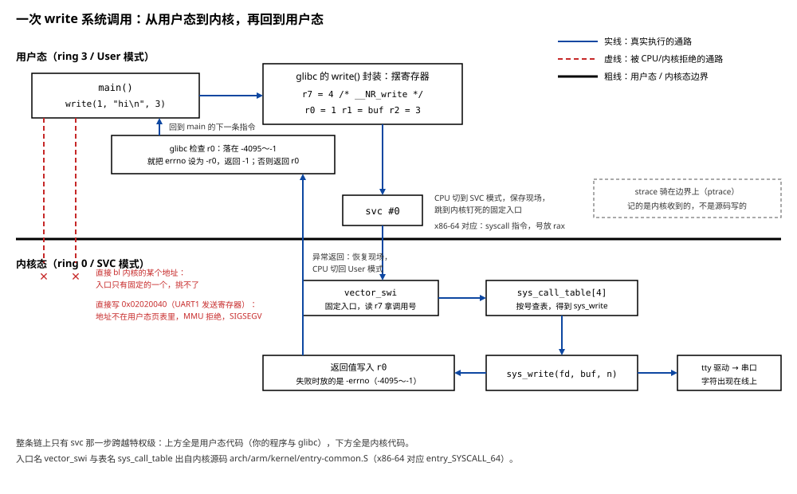

# 07 系统调用与用户态/内核态

    实验    Knowledge/labs/00_basics/06_syscall/
    电脑    WSL Ubuntu 26.04（内核 6.6.114），gcc 15.2.0，
            arm-linux-gnueabihf-gcc 15.2.0，qemu-arm 10.2.1
            （本篇"本机实测"均为 2026-10-20 实跑）
    板子    100ASK_IMX6ULL Pro，Linux 4.9.88，glibc 2.30
            （本篇没有新的板上实验；涉及板子的事实引自芯片手册
            与 01 篇已归档的板上实测）

---

**你会在哪里撞见它**：[01 篇](../tutorials/01_应用编程/01_HelloWorld背后没那么简单.md)
1.5 节说过一句话：程序不能自己碰硬件，`printf` 拼好字符串之后要调用 `write`
这个系统调用请内核把字送出去。同一篇 3.2 节用 `strace` 盯着
`./hello_arm_dynamic` 跑了一次，看到 `execve(...) = -1 ENOEXEC`，那是我们第一次
亲眼看见一个系统调用的去和回。到 04 篇，文件 IO 全部建在 `open`/`read`/`write`
上，还要用 `strace` 数 `write` 发了几次（[04 文件IO](../tutorials/01_应用编程/04_文件IO.md)第 5.2 节）。

这些场景里都站着同一组问题：凭什么程序自己碰不了硬件？`write` 三个字写在 C
代码里，到了机器层面到底执行了什么？`strace` 看到的那一行是在哪里看见的？

还有一个更常见的现场：程序崩了，崩溃之前那几行 `printf` 一个字都没打出来。
代码里明明写着，单步也明明执行到了，输出就是没有。

**这篇要回答的问题**：

1. 用户态程序为什么不能直接碰硬件？硬要碰，会发生什么，是谁、在哪一步拦住它的？
2. 进内核的那道门长什么样：哪条指令、调用号和参数放在哪个寄存器、返回值和
   错误又怎么回来？
3. 不经过 C 库，程序能不能自己发系统调用？C 库在系统调用这件事上到底做了多少事？
4. 从 `printf` 到硬件之间隔着几层缓冲？崩溃、掉电各丢哪一层？

读完回头，这四个问题要能不翻书答出来。

---

## 0 先动手看一眼

先让"缓冲"这件事现形，后面的节再一层一层解释它。

实验源码 `Knowledge/labs/00_basics/06_syscall/order.c`，整个程序就两行有效代码，
先 `printf` 一句，再 `write` 一句：

```c
/* printf 和 write，谁先到达内核 */
#include <stdio.h>
#include <unistd.h>

int main(void)
{
	printf("A_printf\n");            /* 先写的 */
	write(1, "B_write\n", 8);        /* 后写的 */
	return 0;
}
```

`write(1, "B_write\n", 8)` 的三个参数：往 1 号文件描述符（标准输出）写，写的
内容从 `"B_write\n"` 开始，共 8 个字节（7 个字符加 1 个换行）。

要回答的问题：源码里 A 在前 B 在后，内核收到的顺序也是这样吗？

```bash
cd Knowledge/labs/00_basics/06_syscall
gcc -Wall order.c -o order
strace -e trace=write -o st.txt ./order | cat
cat st.txt
```

- `strace`：跟踪一个进程发出的系统调用，逐个打印。
- `-e trace=write`：只看 `write` 这一种。不过滤的话，一个程序启动到退出要发
  几十次系统调用，输出会很长。
- `-o st.txt`：把 strace 自己的日志写进文件。不写的话日志走 stderr，和程序的
  stdout 搅在一起（3.3 节会看到这个坑长什么样）。
- `./order | cat`：程序的 stdout 接管道。`cat` 在这里只是充当一个管道对端。

2026-10-20 本机实测，程序打印的是：

```text
B_write
A_printf
```

`st.txt` 里 strace 记下的内核收到的是：

```text
write(1, "B_write\n", 8)                = 8
write(1, "A_printf\n", 9)               = 9
+++ exited with 0 +++
```

两处的顺序一致，都和源码相反：后写的 `B_write` 先到，先写的 `A_printf` 后到。
strace 那两行证明这不是显示顺序的问题，是**内核实际收到的顺序**就是 B 在前。

`A_printf` 那 9 个字节在 `write(1, "B_write\n", 8)` 进内核的时候，还躺在 C 库的
一块内存里没交出去。谁在攒、什么时候交、进程死掉时没交出去的会怎样，是第 4 节
的事。要把那一节讲明白，得先回答更底层的问题：`write` 进内核这一步本身是怎么
迈过去的。这就是第 1、2 节。

---

## 1 用户态凭什么碰不了硬件

### 1.1 两个动作，同一个下场

先摆一个事实：**你的程序直接碰硬件，碰不了。**这不是操作系统定下的规矩那种
"不让"，是 CPU 在硬件上就不执行。眼见为实，做两个动作。

实验源码 `Knowledge/labs/00_basics/06_syscall/priv.c`：

```c
/* 用户态直接碰硬件会怎样。
 * 用法：./priv none   什么都不碰，对照组
 *       ./priv insn   执行一条特权指令（x86-64: cli；ARM: 读 CP15 的 SCTLR）
 *       ./priv mmio   往 i.MX6ULL UART1 发送寄存器的物理地址写一个字节
 */
#include <stdio.h>
#include <string.h>

int main(int argc, char **argv)
{
	const char *what = argc > 1 ? argv[1] : "none";

	fprintf(stderr, "try %s\n", what);
	if (strcmp(what, "insn") == 0) {
#if defined(__x86_64__)
		__asm__ volatile ("cli");                       /* 关中断 */
#elif defined(__arm__)
		unsigned long sctlr;
		__asm__ volatile ("mrc p15, 0, %0, c1, c0, 0" : "=r"(sctlr));
#endif
	} else if (strcmp(what, "mmio") == 0) {
		*(volatile unsigned char *)0x02020040 = 'a';    /* UART1 基址 + UTXD */
	}
	fprintf(stderr, "survived %s\n", what);
	return 0;
}
```

逐处说清：

- `argc > 1 ? argv[1] : "none"`：命令行给了词就用它，没给就用 `"none"`。
- `fprintf(stderr, "try %s\n", what)`：动手之前先留一句话。用 `stderr` 是因为
  它无缓冲，下一行就算把进程弄死，这句话也已经出去了（缓冲的事第 4 节讲）。
- `__asm__ volatile ("cli")`：在 C 里直接嵌一条汇编指令。`cli` 是 x86 上"关闭
  可屏蔽中断"的指令，它要改变 CPU 的中断使能状态，属于特权指令。
  `volatile` 告诉编译器：这条指令有实际效果，不许优化掉。
- `mrc p15, 0, %0, c1, c0, 0`：ARM 上对应的动作，读协处理器 CP15 的系统控制
  寄存器 SCTLR（管 MMU 开关、缓存开关的那一个），读出的值放进 `%0` 绑定的变量
  `sctlr`。这也是特权操作。
- `*(volatile unsigned char *)0x02020040 = 'a'`：直接往一个物理地址写字节。
  0x02020040 是 i.MX6ULL 芯片手册里 UART1 的发送寄存器地址（UART1 基址
  0x02020000 加上 UTXD 的偏移 0x40；01 篇 4.6 节在板子上读
  `/proc/tty/driver/IMX-uart` 时见过 `mmio:0x02020000`）。真往这里写成功的话，
  板子的串口会打出字符 `a`。

编译，三个模式各跑一遍，每条后面立刻接退出码：

```bash
gcc -O2 -Wall priv.c -o priv
./priv none;   echo "exit=$?"
./priv insn;   echo "exit=$?"
./priv mmio;   echo "exit=$?"
```

2026-10-20 本机实测：

```text
try none
survived none
exit=0
try insn
Segmentation fault (core dumped)
exit=139
try mmio
Segmentation fault (core dumped)
exit=139
```

对照组 `none` 走完全程，打到了 `survived` 那一行。`insn` 和 `mmio` 都只打到
`try`，`survived` 没出来，进程被 SIGSEGV 打死，退出码 139（被信号打死的进程，
bash 报 128 加信号编号；SIGSEGV 是 11 号，128 + 11 = 139，01 篇 3.5 节算过
这笔账）。

注意 `insn` 这一组：程序只是执行了一条**指令**，没有访问任何内存地址，照样被
打死。用 gdb 看它死在哪：

```bash
gdb -batch -ex run -ex 'info registers rip' -ex 'x/1i $rip' --args ./priv insn
```

- `gdb -batch`：非交互模式，把后面 `-ex` 指定的命令逐条执行完就退出。
- `-ex run`：运行程序。`-ex 'info registers rip'`：打印指令指针寄存器 `rip`
  （正在执行到哪）。`-ex 'x/1i $rip'`：把 `rip` 指着的那条指令反汇编出来看。

2026-10-20 本机实测（末尾几行）：

```text
Program received signal SIGSEGV, Segmentation fault.
0x00005555555550be in main ()
rip            0x5555555550be      0x5555555550be <main+62>
=> 0x5555555550be <main+62>:	cli
```

`rip` 正指着 `cli` 这一条指令。CPU 执行到它，发现当前运行级别无权执行，当场
拒绝，程序死在这一条上。

### 1.2 动手的是谁：CPU 发现，内核执行

把 1.1 的两个下场拆开，里面有两个角色。

**第一个角色是 CPU。** CPU 内部有一个"当前处于什么运行级别"的状态。x86-64 上
这个级别叫 ring，程序平时在 ring 3，内核在 ring 0；ARM 上叫处理器模式，程序
在 User 模式，内核在 SVC 等特权模式（ARMv8 的 64 位世界里对应的名字是 EL0 和
EL1）。CPU 每执行一条指令、每访问一次内存，都拿当前级别去对：

- 执行 `cli` 这种特权指令，要求级别够高；级别不够，CPU 产生一次**异常**
  （x86 上叫 general protection fault），拒绝执行这条指令。
- 访问一个地址，要过 MMU（内存管理单元）的页表。页表是内核配的，用户程序的
  页表里只有它自己的虚拟地址。0x02020040 这个物理地址根本不在用户程序的页表
  里，MMU 翻译失败，CPU 产生一次缺页/访问异常。

所以"用户态碰不了硬件"是**电路层面的拒绝**：你写的指令就在那里，CPU 看了
一眼，不执行。

**第二个角色是内核。** CPU 产生异常后不会自己拿主意，它跳到内核事先登记好的
异常处理代码。内核查出"这个进程在用户态干了一件越权的事"，给这个进程发一个
信号把它终止：访问非法内存对应 SIGSEGV，执行非法指令对应 SIGILL（x86 上特权
指令违反走的也是内存错误那条异常通道，所以报的是 SIGSEGV；ARM 上读 CP15 走的是
"未定义指令"通道，报 SIGILL，1.4 节会看到）。信号、退出码这套机制见
[12 进程与信号](12_进程与信号.md)，这里只要记住分工：**CPU 负责发现，内核
负责处置。**

### 1.3 为什么 CPU 要把程序分两等

如果没有这个分工会怎样？反推一下。一台机器上同时跑着几十个程序。假如任何
程序都能直接执行任何指令、直接读写任何物理地址，那么随便一个程序都能：把
中断关掉让别人的驱动停摆，改写 MMU 的页表去读所有人的内存，把磁盘控制器指向
别人的文件，把串口占死。一个程序的一个野指针，死的会是整台机器。

所以 CPU 把运行级别分成（至少）两等，把"配 MMU、开关中断、读写外设寄存器"
这一类动作划给高等级的内核，普通程序关在低等级里跑，只能访问内核划给它的
那块虚拟地址空间。这两等在 Linux 里的称呼是：

    用户态（user mode）        内核态（kernel mode）
    只能访问自己的虚拟地址空间    能访问所有物理内存
    不能执行特权指令              能配 MMU、开关中断、驱动外设

身份上，这不是两个程序，是**同一颗 CPU 的两种执行模式**。你的进程和为它服务的
内核代码，在同一颗 CPU 上轮流跑，只是跑的时候模式位不同。

那用户程序想读文件、想往串口打字，怎么办？只有一条路：请内核代劳。这个"请"
的动作必须能让 CPU 从用户态切到内核态，它就是**系统调用**。第 2 节把它拆开。

### 1.4 ARM 上同一个实验

我们的目标是板子，上面是 ARM Cortex-A7（ARMv7-A 架构）。同一个 `priv.c` 交叉
编译成 ARM 版，看它在 ARM 上是什么下场。

ARM 程序在 x86 电脑上跑不起来（01 篇第 3 节），这里用 `qemu-arm` 跑。它是一个
用户态模拟器：自己是个普通的 x86 程序，逐条解释执行 ARM 指令，把 ARM 程序发的
系统调用翻译给电脑的内核。电脑上不装它，现取一个：

```bash
mkdir -p /tmp/qemu-pkg && cd /tmp/qemu-pkg
apt-get download qemu-user
dpkg-deb -x qemu-user_*_amd64.deb root
./root/usr/bin/qemu-arm --version
```

- `apt-get download qemu-user`：只把软件包下载到当前目录，不安装。
- `dpkg-deb -x 包文件 root`：把包解开到 `root/` 目录下，同样不安装。
- 为什么不直接 `apt install`：安装会顺带往内核的 binfmt_misc 里登记一条规则，
  之后 `./ARM程序` 会被内核悄悄转交给 qemu，直接跑成功。01 篇 3.6 节讲过这条
  规则，也讲过为什么本仓要留着"ARM 程序在电脑上必须报 Exec format error"这个
  现象。下载加解包不碰 binfmt_misc，用完删掉目录即可。

2026-10-20 本机实测：

```text
qemu-arm version 10.2.1 (Debian 1:10.2.1+ds-1ubuntu3.2)
```

编译 ARM 版（静态链接，免得 qemu 还要找 ARM 的动态链接器），跑三种模式：

```bash
arm-linux-gnueabihf-gcc -O2 -Wall -static priv.c -o priv_arm
Q=/tmp/qemu-pkg/root/usr/bin/qemu-arm
$Q ./priv_arm none; echo "exit=$?"
$Q ./priv_arm insn; echo "exit=$?"
$Q ./priv_arm mmio; echo "exit=$?"
```

2026-10-20 本机实测：

```text
try none
survived none
exit=0
try insn
qemu: uncaught target signal 4 (Illegal instruction) - core dumped
Illegal instruction
exit=132
try mmio
qemu: uncaught target signal 11 (Segmentation fault) - core dumped
Segmentation fault
exit=139
```

逐行读：

- `none` 组正常走完，和 x86 上一样。
- `insn` 组：ARM 上读 CP15 的那条 `mrc` 被 CPU 拒绝，走的是"未定义指令"异常
  通道，对应的信号是 SIGILL（4 号），退出码 128 + 4 = 132。qemu 先把模拟出来
  的异常说清楚（`uncaught target signal 4`），再让自己以同样的方式死掉，所以
  bash 报的也是 `Illegal instruction`。
- `mmio` 组：写 0x02020040，MMU 翻译失败，SIGSEGV，139，和 x86 上一样。

写串口寄存器这一条在 qemu 里被拦，原因和在真板子上一样：用户态进程的页表里
只有自己的虚拟地址，物理地址 0x02020040 不在其中。qemu 模拟的是 ARM 的特权级
和页表这两样硬件行为，拦它的机制和真机是同一个。

两种 CPU，三个实验，结论一致：**用户态直接碰硬件，CPU 当场拒绝，内核随后把
进程打死。**板子上跑 Linux 之后，你的程序面对的就是这堵墙。

**这一节搭好的积木**：CPU 分用户态和内核态，特权指令和硬件地址在内核态才够得着；
越权会被 CPU 拒绝、被内核用信号终止。下一个问题：既然墙这么高，用户程序想干正事
（读文件、打字），跨墙的正式通道长什么样。

### 1.5 [判] 第 1 节

    [ ] ./priv none 打印 try none 和 survived none，退出码 0
    [ ] ./priv insn 死在 cli 上（gdb 看 rip 正指着 cli），退出码 139
    [ ] ./priv mmio 同样 139；能说出两个 139 背后分别是哪次检查
    [ ] qemu-arm 跑 ARM 版：insn 组 132（SIGILL），mmio 组 139（SIGSEGV）
    [ ] 能说出 x86 上特权指令违反报 SIGSEGV、ARM 上报 SIGILL 是
        因为走了不同的异常通道

    注错见红：把 priv.c 里 __asm__ volatile ("cli"); 删掉重新编译，
    insn 组必须变成 exit=0，判据"139"必须 FAIL（check.sh 第 1 节）。

---

## 2 进内核的那道门

### 2.1 为什么门只能有一个固定入口

用户程序请内核干活，本质上是"去执行内核里的一段代码"。为什么不能像调用普通
函数那样，直接 `bl` 跳到内核函数的地址？

想一步就明白：如果能跳到内核代码的**任意**地址，那调用方挑一个"关中断"的地址
跳过去就行，1.3 节建起来的墙立刻失效。所以这条通路必须满足两个条件：入口只有
一个，而且是内核事先钉死的固定地址；进去之后CPU 自动切到特权模式。这样用户
程序能说的只有"我要办几号业务"，够不着内核的代码布局。

CPU 为这件事提供的机制叫**异常**。用户态执行一条专门的指令，CPU 做三件事：
切到特权模式、保存现场（回来时要用的地址和状态）、跳到内核钉在异常向量表里的
固定入口。ARM 上这条指令叫 `svc`（supervisor call，旧名 `swi`），x86-64 上叫
`syscall`。内核在启动时把自己的入口地址写进向量表，用户程序改不了它。

"办几号业务"靠一个**系统调用号**约定：双方说好几号是读文件、几号是写文件。
调用方把号放进一个约定好的寄存器，内核入口代码读这个寄存器，按号查表分派。
下面是 ARM EABI 的约定（man 2 syscall 里有各架构的完整约定表）：

    用户态                                内核侧
    r7 = 4        调用号(__NR_write)
    r0 = 1        参数 1:fd           ┐
    r1 = buf      参数 2:字符串地址    │  svc #0 之后,
    r2 = 13       参数 3:长度         ┘  内核读同一批寄存器
        |
        | svc #0   CPU 切到 SVC 模式, 跳到固定入口
        v
                            vector_swi            汇编入口
                                |
                                v
                            sys_call_table[r7]    按号查表
                                |
                                v
                            sys_write(r0, r1, r2) 干活的函数
                                |
                                v
                            返回值写回 r0
        |
        | 异常返回   CPU 切回 User 模式, 回到 svc 的下一条指令
        v
    r0 = 13       实际写出去的字节数

图从左看：左边四行是用户态在动手前摆好的寄存器；中间一竖是 `svc` 跨越的边界；
右边三行在内核态；最后沿左边回来，r0 里装着结果。入口名字 `vector_swi` 和表名
`sys_call_table` 是内核源码里的真实名字（`arch/arm/kernel/entry-common.S`）。
x86-64 上同一张图的入口叫 `entry_SYSCALL_64`（`arch/x86/entry/entry_64.S`），
指令是 `syscall`，号放 `rax`。

下一个问题：这套说法对不对，到真实的程序里把 `svc` 找出来看。

### 2.2 找到那条 svc

`write(1, "hi\n", 3)` 这行 C 代码，最终必然要执行到一条 `svc`。它藏在哪？
你写的是 `write(...)`，一个函数调用，所以它在 C 库的 `write` 函数体里。动态
链接的程序里看不到它：C 库的代码在 `libc.so.6` 里，没被链进程序文件（
[05 静态库动态库与符号](05_静态库动态库与符号.md)）。**静态链接**把 C 库整个
抄进程序文件，就能反汇编看到了。

这本身就给出一条可检验的推论：静态链接的 ARM 程序里能数出 `svc`，动态链接的
数不出来。

实验源码 `Knowledge/labs/00_basics/06_syscall/w.c`：

```c
/* 源码里写 open 和 write，看静态链接的 ARM 程序里实际装进 r7 的是几号。 */
#include <fcntl.h>
#include <unistd.h>

int main(void)
{
	int fd = open("/etc/hostname", O_RDONLY);

	write(1, "hi\n", 3);
	if (fd >= 0)
		close(fd);
	return 0;
}
```

编译两个版本，分别数 `svc`：

```bash
arm-linux-gnueabihf-gcc -static -O1 w.c -o w_static
arm-linux-gnueabihf-gcc         -O1 w.c -o w_dyn

arm-linux-gnueabihf-objdump -d w_static | grep -c '\bsvc\b'
arm-linux-gnueabihf-objdump -d w_dyn    | grep -c '\bsvc\b'
```

- `-static`：静态链接，把用到的 C 库代码抄进程序文件。
- `objdump -d`：反汇编。ARM 的文件要用 ARM 版 objdump（01 篇 2.4 节）。
- `grep -c '\bsvc\b'`：数有多少行含独立的 `svc` 这个词。`\b` 是词边界，防止把
  别的恰好含这三个字母的名字数进来。

2026-10-20 本机实测：

```text
15
0
```

静态版 15 条，动态版 0 条，推论成立。动态版不是不发系统调用，是它的封装都在
`libc.so.6` 里，没进这个文件。

**容易以为：这 15 条就是"我的程序发的系统调用数"。实测不是：把 w.c 里的
`open` 和 `write` 都删掉再数，还有十几条。原因是程序启动和退出本身就要用
系统调用（`brk`、`exit_group` 等），这些封装随 C 库一起被链了进来。数出来的是
"链进来的封装条数"，不是"运行时发的次数"。运行时的次数要用 strace 数
（第 4 节）。**

### 2.3 把最短的那个封装拆开

15 条里挑最短的一个看。`getpid`（取自己的进程号）不需要参数，封装最短：

```bash
arm-linux-gnueabihf-objdump -d w_static | sed -n '/<__getpid>:/,+5p'
```

- `sed -n '/<__getpid>:/,+5p'`：只打印从 `<__getpid>:` 那行开始的 6 行。

2026-10-20 本机实测：

```text
000169d0 <__getpid>:
   169d0:	b480      	push	{r7}
   169d2:	f04f 0714 	mov.w	r7, #20
   169d6:	df00      	svc	0
   169d8:	bc80      	pop	{r7}
   169da:	4770      	bx	lr
```

五条指令逐个读：

- `push {r7}`：`r7` 在 ARM 调用约定里是 callee-saved 寄存器（谁要用谁先存、
  用完恢复，见 [02 ARM 寄存器与调用约定](02_ARM寄存器与调用约定.md) 3.4 节），
  要用它装调用号，先保住调用方放在里面的值。
- `mov.w r7, #20`：把 20 装进 r7。20 就是 `getpid` 的系统调用号。
- `svc 0`：进内核的那条指令。机器码是 `df00` 两个字节。
- `pop {r7}`、`bx lr`：恢复 r7，返回调用方。

整个 `getpid` 就干了一件事：把"20 号"这个约定翻译成一条指令。C 库在这里几乎
没有做任何事。

带参数的调用走一个通用封装，号由调用方先放进 `ip`（r12）再转交：

```bash
arm-linux-gnueabihf-objdump -d w_static | sed -n '/<__libc_do_syscall>:/,+4p'
```

```text
000107a0 <__libc_do_syscall>:
   107a0:	b580      	push	{r7, lr}
   107a2:	4667      	mov	r7, ip
   107a4:	df00      	svc	0
   107a6:	bd80      	pop	{r7, pc}
```

同样的形状：装号、`svc`、返回。两种封装共用一条 `svc`，区别只在号从哪来。

顺带说一个历史细节：`svc 0` 里的立即数 0，在 EABI 约定下内核根本不看，号只认
r7。更早的 OABI 约定是把号编在这条指令的立即数里，内核进异常后还要回用户空间
把指令读出来抠号。两种约定的对照和内核必须配套的原因，见 04 篇
[04 文件IO](../tutorials/01_应用编程/04_文件IO.md)第 6.1 节；工具链名字里的 `eabi` 一段说的就是它。

### 2.4 调用号是哪来的：open 其实是 openat

调用号是内核定的，每个架构一份，写在头文件里。ARM EABI 的这份在交叉工具链里
就能直接读：

```bash
grep -E '__NR_(write|openat|getpid|exit)\b' /usr/arm-linux-gnueabihf/include/asm/unistd-eabi.h
```

2026-10-20 本机实测：

```text
#define __NR_exit (__NR_SYSCALL_BASE + 1)
#define __NR_write (__NR_SYSCALL_BASE + 4)
#define __NR_getpid (__NR_SYSCALL_BASE + 20)
#define __NR_openat (__NR_SYSCALL_BASE + 322)
```

`__NR_SYSCALL_BASE` 是 0，所以 write 是 4 号、getpid 是 20 号、openat 是 322 号。
和 2.3 节反汇编里 `mov.w r7, #20` 对得上。

这里有一个容易栽的地方。这张表里 `open` 也有自己的号（5 号），但你**源码里写
`open`，glibc 实际发的是 `openat`**（322 号）。两条证据。

证据一，电脑上直接跑 x86 版，用 strace 看它发了什么：

```bash
gcc -O1 -Wall w.c -o w_x86
strace -e trace=open,openat ./w_x86 2>&1 >/dev/null
```

- `-e trace=open,openat`：只看 open 和 openat 两种，逗号分隔。
- `2>&1 >/dev/null`：把 strace 的日志留在屏幕上，把程序自己的输出丢掉。
  为什么这么写的道理在 3.3 节专门讲。

2026-10-20 本机实测：

```text
openat(AT_FDCWD, "/etc/ld.so.cache", O_RDONLY|O_CLOEXEC) = 3
openat(AT_FDCWD, "/usr/lib/x86_64-linux-gnu/libc.so.6", O_RDONLY|O_CLOEXEC) = 3
openat(AT_FDCWD, "/etc/hostname", O_RDONLY) = 3
+++ exited with 0 +++
```

三行全是 `openat`，没有一行 `open(`。前两行是动态链接器在加载 C 库，第三行
`"/etc/hostname"` 才是我们源码里那个 `open` 变成的。

证据二，看 ARM 静态版里 `open` 的封装本体：

```bash
arm-linux-gnueabihf-objdump -d w_static | sed -n '/<__open_nocancel>:/,+8p' | head -6
```

2026-10-20 本机实测（截到关键三行）：

```text
   16ac8:	f06f 0063 	mvn.w	r0, #99	@ 0x63
   16acc:	f44f 7ca1 	mov.w	ip, #322	@ 0x142
   16ad0:	f7f9 fe66 	bl	107a0 <__libc_do_syscall>
```

`mov.w ip, #322` 把 322 放进 ip，紧接 `bl __libc_do_syscall`，正是 2.3 节那个
通用封装的用法：号经 ip 进 r7，然后 `svc`。

**容易以为：头文件里 `__NR_open` 是 5 号，程序就发 5 号。实测是：glibc
很多年前就把 `open` 映射到 `openat` 了（ARM 上发 322 号，x86-64 上发 257 号），
5 号留在表里只是给老程序用。要知道实际发的是几号，用 strace 看，别背表。**

### 2.5 从用户态到内核再回来的一整圈

把 1 到 2.4 节拼起来，一次 `write` 的完整路径是这样：



图分上下两半，中间的红线就是用户态和内核态的边界（1.3 节）。实线是一次
`write` 真实走通的路线：C 库封装摆好寄存器，`svc` 过界，内核按号查表、执行
`sys_write`、把结果写回 r0，异常返回后 C 库检查 r0 再交还给 `main`。红色的
虚线箭头是被拒绝的两条通路：直接从 main 跳到内核地址（入口只有固定的一个），
直接读写硬件物理地址（1.1 节的实验）。strace 的位置画在边界上：它用 `ptrace`
在内核侧拦住每一次进出，所以它看到的是"内核收到了什么"，不是"你的代码写了
什么"。第 4 节会看到这两种视角真的能不一样。

**这一节搭好的积木**：进内核只有一道固定的门；ARM 上是 `svc` 指令加 r7 里的
调用号，x86-64 上是 `syscall` 指令加 rax；内核按号查 `sys_call_table` 分派；
C 库的封装薄得只剩"装号、svc、返回"。下一个问题：既然封装这么薄，能不能不要
C 库，自己摆寄存器、自己 `svc`？

### 2.6 [判] 第 2 节

    [ ] 静态链接的 ARM 程序里 svc 条数大于 0，动态链接的是 0，
        并说得出动态版为什么是 0
    [ ] __getpid 反汇编里找得到 mov.w r7, #20 紧跟 svc 0
    [ ] 通用封装 __libc_do_syscall 里，号经 ip 进 r7 再 svc
    [ ] 说出 r7、r0、r1、r2 在一次 write 里各装了什么
    [ ] strace 看 w_x86：只有 openat 没有 open(；ARM 静态版里
        __open_nocancel 装的是 322 号

    注错见红一：把 w.c 里的 open 那行删掉重新编译再 strace，
    "实际发 openat"这条判据必须 FAIL（check.sh 已自动做此核对）。
    注错见红二：删掉 open 和 write 后静态版的 svc 条数仍然是十几条，
    不是 0；想清楚为什么，再决定"svc 条数"能当什么证据用。

---

## 3 不经过 C 库，自己发系统调用

### 3.1 目标与约定

第 2 节的结论是：一次系统调用的全部内容，就是"按约定摆好几个寄存器，执行一条
指令"。那就绕开 C 库，自己摆一次。这是看清"C 库到底做了什么"最直接的办法。

先在电脑上（x86-64）做，因为程序要能真的跑起来看结果。x86-64 的约定和 ARM
形状一样、寄存器名不同（man 2 syscall 的约定表，2026-10-20 本机核对）：

    约定项        x86-64            ARM 32 位 EABI
    ----------    --------------    --------------
    进内核指令    syscall           svc #0
    调用号        rax               r7
    参数 1~3      rdi  rsi  rdx     r0   r1   r2
    参数 4~6      r10  r8   r9      r3   r4   r5
    返回值        rax               r0
    write 的号    1                 4

### 3.2 x86-64 版：rawsys.c 与 raw.h

实验把两条架构的封装收在一个头文件里，`Knowledge/labs/00_basics/06_syscall/raw.h`
（x86-64 那一半）：

```c
/* 不经过 C 库，用一条指令直接发系统调用。x86-64 与 32 位 ARM（EABI）各一套。 */
#ifndef RAW_H
#define RAW_H

#if defined(__x86_64__)

#define NR_write 1
#define NR_exit  60

static inline long raw_syscall3(long nr, long a1, long a2, long a3)
{
	long ret;

	__asm__ volatile ("syscall"
		: "=a"(ret)                     /* 返回值从 rax 出来 */
		: "a"(nr),                      /* rax = 调用号 */
		  "D"(a1), "S"(a2), "d"(a3)     /* rdi、rsi、rdx = 参数 1～3 */
		: "rcx", "r11", "memory");      /* syscall 指令会改写 rcx 和 r11 */
	return ret;
}
```

逐行读 `__asm__` 这一块（gcc 内嵌汇编的写法）：

- `"syscall"`：要嵌进去的指令本身。
- 第一个冒号后面是**输出**：`"=a"(ret)`。`=` 表示这个操作数是写出来用的；
  `a` 是 gcc 的寄存器代号，指 rax；`(ret)` 表示指令执行完后，把 rax 的值写回
  C 变量 `ret`。合起来：rax 既装调用号（见下行），出来时又装着返回值。
- 第二个冒号后面是**输入**：`"a"(nr)` 把 `nr` 放进 rax；`"D"`、`"S"`、`"d"`
  分别是 rdi、rsi、rdx 的代号，把三个参数放进去。
- 第三个冒号后面是**破坏清单**：`syscall` 这条指令本身会改写 rcx 和 r11（CPU
  用它俩保存返回地址和标志位），也读写了内存。提前告诉编译器，免得它把有用的
  值存在这两个寄存器里，或者以为内存没变。
- `volatile`：这条汇编的产出（打印字符）不体现在 C 变量的数据流里，不加
  `volatile` 编译器可能把它整条删掉。

调用它的程序 `Knowledge/labs/00_basics/06_syscall/rawsys.c`：

```c
/* 不经过 C 库的 write：没有 include 任何 C 库头文件，照样把一行字送到 fd 1。 */
#include "raw.h"

int main(void)
{
	static const char msg[] = "hello from raw syscall\n";

	raw_syscall3(NR_write, 1, (long)msg, sizeof msg - 1);
	return 0;
}
```

注意这个文件没有 `#include <stdio.h>`，没有 include 任何 C 库头文件。
`sizeof msg - 1`：字符串字面量自带一个结尾的 `'\0'`，减 1 不算它，长度是 23。

编译、运行、用 strace 核对：

```bash
gcc -O2 -Wall rawsys.c -o rawsys
./rawsys
strace -e trace=write ./rawsys 2>&1 >/dev/null
```

2026-10-20 本机实测：

```text
hello from raw syscall
```

```text
write(1, "hello from raw syscall\n", 23) = 23
+++ exited with 0 +++
```

一个没碰 C 库输出函数的程序，把 23 个字节送到了屏幕上；strace 证明那是一次真
的 `write` 系统调用，内核收到了全部 23 个字节。

**这一节搭好的积木**：系统调用可以徒手发，C 库不是必经之路。C 库在系统调用上
做的事只剩两类：把参数按架构约定摆好（刚才我们替它做了），处理返回值和错误
（3.4 节拆），以及在系统调用之外提供一些纯粹用户态的便利（第 4 节的缓冲）。

### 3.3 strace 的输出要和程序的输出分流

3.2 节 strace 命令尾巴上的 `2>&1 >/dev/null` 不是顺手写的。不加它，本机实测
长这样：

```text
write(1, "hello from raw syscall\n", 23hello from raw syscall
) = 23
```

程序自己的输出插进了 strace 那一行的中间，把它断成两截。原因是两股输出写的
是同一个终端：strace 的日志走 stderr，程序的字符走 stdout，谁先谁后没有保证。

`2>&1 >/dev/null` 按从左到右的顺序起作用：先把 stderr 指向当前 stdout 去的
地方（终端），再把 stdout 改指到 /dev/null 丢掉。结果：strace 的日志留在终端，
程序的输出被丢掉，两股分开。顺序不能反：写成 `>/dev/null 2>&1`，stdout 先丢，
然后 stderr 被指到"stdout 当前的去处"，也就是 /dev/null，两股一起没了。

更省事的写法是 0 节用过的 `strace -o 文件`，日志直接进文件。调试一个话多的
程序时，分流是基本功。

### 3.4 失败怎么回来：返回值与 errno

3.2 节挑了一次成功的调用。失败的时候呢？内核不能"报错"，它只能往寄存器里
放一个值。约定的内容是：**成功时返回值就是结果本身；失败时返回值是 `-errno`
（错误号的相反数），落在 -4095 到 -1 之间**（内核源码 `include/linux/err.h`
里 `MAX_ERRNO` 是 4095；目前的错误号最大只编到 133，见
`include/uapi/asm-generic/errno.h` 与 `errno-base.h`，2026-10-20 本机核对）。

C 库在封装里替你做一步转换：发现返回值落在 -4095～-1 区间，就把它取负存进
`errno` 这个每线程一份的变量，然后统一返回 -1。所以"C 库函数失败返回 -1、
原因看 errno"这套用法，根子在寄存器里那个负值。

亲手发一次失败的调用，把两层都看见。实验源码
`Knowledge/labs/00_basics/06_syscall/errno_trip.c`：

```c
/* 失败原因怎么从内核回到 errno：同一个坏 fd，直接发和经 C 库发各一次。 */
#include <errno.h>
#include <stdio.h>
#include <string.h>
#include <unistd.h>
#include "raw.h"

int main(void)
{
	long r;
	ssize_t w;
	int e;

	r = raw_syscall3(NR_write, 99, (long)"x", 1);   /* fd 99 没有打开 */
	printf("raw  write(99) = %ld\n", r);

	errno = 0;
	w = write(99, "x", 1);
	e = errno;                                      /* 先存下，printf 可能改它 */
	printf("libc write(99) = %zd, errno = %d (%s)\n", w, e, strerror(e));
	return 0;
}
```

逐处说清：

- fd 99 在这个进程里没有打开过，往它写一定失败，失败原因该是"坏文件描述符"。
- 直接发的那次，返回值收在 `r` 里，原样打印。
- 经 C 库的那次，返回前先把 `errno` 清 0，返回后立刻把 `errno` 存进局部变量
  `e`。先存是因为后面调用的任何 C 库函数（包括 `printf`）都可能再改 `errno`。
- `strerror(e)` 把错误号翻成人能读的文字。

2026-10-20 本机实测：

```text
raw  write(99) = -9
libc write(99) = -1, errno = 9 (Bad file descriptor)
```

strace 看到的是内核那一侧的真实情况：

```text
write(99, "x", 1)                       = -1 EBADF (Bad file descriptor)
```

对着读：直接发，寄存器里回来的是 `-9`；经 C 库，外面看到 `-1` 加 `errno = 9`。
9 就是 `EBADF`。strace 打印的 `= -1 EBADF` 是把内核返回的 -9 按约定翻译过的
写法。两次之间唯一多出来的事，就是 C 库那一步转换。

### 3.5 装错号会发生什么：注错一发

把 `raw.h` 里的 `#define NR_write 1` 改成 `2`（2 号在 x86-64 上是 `open`），
重新编译运行。2026-10-20 本机实测：

```text
（什么都没打印）
exit=0
```

```text
open(0x1, O_RDONLY|__O_SYNC|O_DIRECT|O_NOATIME|O_PATH|0xc4000010) = -1 EFAULT (Bad address)
```

程序安静结束，退出码还是 0，一行字没打。strace 里能看到内核真的按 `open` 的
规矩解释了那三个寄存器：1 被当成路径的内存地址（地址 1 不可读，所以 `EFAULT`），
字符串指针被当成打开标志位，23 被当成权限参数。**号装错了没有任何提示，内核
只是按另一个号的约定做另一件事，然后失败；你不检查返回值，连失败都不知道。**
这就是"该用 C 库就用 C 库"的全部理由：它替你装对号、替你处理返回值。亲手发
的价值在于看清边界在哪，不在于取代它。

### 3.6 同一份源码，ARM 版

`raw.h` 里还有 ARM 那一半，同一个 `rawsys.c` 交叉编译就能上 ARM：

```c
#elif defined(__arm__)

#define NR_write 4
#define NR_exit  1

static inline long raw_syscall3(long nr, long a1, long a2, long a3)
{
	register long r7 __asm__("r7") = nr;    /* r7 = 调用号 */
	register long r0 __asm__("r0") = a1;    /* r0～r2 = 参数 1～3 */
	register long r1 __asm__("r1") = a2;
	register long r2 __asm__("r2") = a3;

	__asm__ volatile ("svc #0"
		: "+r"(r0)                      /* 返回值写回 r0 */
		: "r"(r7), "r"(r1), "r"(r2)
		: "memory");
	return r0;
}
```

和 x86 版的差别只在两处：指定寄存器的方式从代号字母换成
`register long r7 __asm__("r7")` 这种"绑定到具名寄存器"的写法（ARM 上 gcc 用
这种写法更稳）；输出约束 `"+r"(r0)` 的 `+` 表示 r0 既是输入（参数 1）又被改写
（返回值）。

交叉编译，反汇编看它变成了什么，再用 1.4 节那个 qemu-arm 跑：

```bash
arm-linux-gnueabihf-gcc -O2 -static -Wall rawsys.c -o rawsys_arm
arm-linux-gnueabihf-objdump -d rawsys_arm | grep -B6 'svc' | head -8
/tmp/qemu-pkg/root/usr/bin/qemu-arm ./rawsys_arm
```

2026-10-20 本机实测，反汇编（main 里内联展开后的形状）：

```text
   1023a:	2001      	movs	r0, #1
   1023c:	b480      	push	{r7}
   1023e:	2217      	movs	r2, #23
   10240:	2704      	movs	r7, #4
   10242:	4479      	add	r1, pc
   10244:	df00      	svc	0
```

运行结果：

```text
hello from raw syscall
```

反汇编逐行对上约定：r0 = 1（fd），r2 = 23（长度，0x17），r7 = 4（write 的号），
r1 是字符串地址（`add r1, pc` 是相对当前位置算出来的），然后 `svc 0`。
和 2.3 节 C 库自己写的封装一模一样的形状。qemu-arm 还能用 `-strace` 把它转发
给电脑内核的系统调用打出来：

```text
write(1,0x48d54,23) = 23
exit_group(0)
```

一句题外话：strace 只能跟踪本机架构的程序。要看 ARM 程序的系统调用，要么像
这样用 `qemu-arm -strace`，要么在板子上跑 ARM 版的 strace。

### 3.7 连 C 库都不链接：tiny

3.2 节的程序虽然没调 C 库的函数，但还是链着 C 库启动的（`main` 之前的准备、
`main` 返回后的退出都是 C 库做的）。再彻底一点：连 C 库都不链，程序从第一条
指令到退出全自己写。这要把入口从 `main` 换成 `_start`（内核加载完程序后真正
跳过去的地方），退出也不能 `return`（没地方可回），要用 `exit` 系统调用。

`Knowledge/labs/00_basics/06_syscall/tiny_arm.S`：

```asm
/* 不链接 C 库的最小程序（32 位 ARM EABI）：write(1, msg, len)，再 exit(7)。
 * 编译：arm-linux-gnueabihf-gcc -nostdlib -static tiny_arm.S -o tiny_arm
 */
	.syntax	unified
	.arm

	.section .rodata
msg:	.ascii	"hi from svc\n"
	len = . - msg

	.text
	.globl	_start
_start:
	mov	r0, #1			@ 参数 1：fd = 1
	ldr	r1, =msg		@ 参数 2：buf = msg 的地址
	mov	r2, #len		@ 参数 3：count = 12
	mov	r7, #4			@ 调用号 4 = write
	svc	#0
	mov	r0, #7			@ 参数 1：退出码 7
	mov	r7, #1			@ 调用号 1 = exit
	svc	#0
```

逐行读：

- `.section .rodata`：下面是只读数据。`msg:` 是一个标号（地址的名字），
  `.ascii` 把这串字符的字节排在这里。`len = . - msg`：`.` 表示当前位置，
  减去 `msg` 的位置就是字符串长度，12。
- `.text`：下面是代码。`.globl _start` 把 `_start` 声明成全局的，链接器认它
  当入口。
- ARM 汇编里 `@` 是行注释。
- `ldr r1, =msg`：把 `msg` 的地址装进 r1。
- 第一个 `svc #0` 发 write（4 号），第二个发 exit（1 号，参数退出码 7）。
  exit 不会返回，所以最后没有别的指令。

x86-64 版同一个程序在 `tiny_x86.S`，两条 `syscall`，write 是 1 号，exit 是
60 号，退出码同样给 7。

编译两个版本，运行，再反汇编核对（ARM 程序的运行用 qemu-arm）：

```bash
gcc -nostdlib -static tiny_x86.S -o tiny_x86
arm-linux-gnueabihf-gcc -nostdlib -static tiny_arm.S -o tiny_arm
./tiny_x86; echo "exit=$?"
/tmp/qemu-pkg/root/usr/bin/qemu-arm ./tiny_arm; echo "exit=$?"
arm-linux-gnueabihf-objdump -d tiny_arm | sed -n '/<_start>:/,$p'
```

- `-nostdlib`：不链接 C 库和启动文件。没有它，链接器会去找 C 库的 `_start`。

2026-10-20 本机实测：

```text
hi from syscall
exit=7
hi from svc
exit=7
```

```text
00010098 <_start>:
   10098:	e3a00001 	mov	r0, #1
   1009c:	e59f1014 	ldr	r1, [pc, #20]	@ 100b8 <_start+0x20>
   100a0:	e3a0200c	mov	r2, #12
   100a4:	e3a07004	mov	r7, #4
   100a8:	ef000000 	svc	0x00000000
   100ac:	e3a00007	mov	r0, #7
   100b0:	e3a07001	mov	r7, #1
   100b4:	ef000000 	svc	0x00000000
   100b8:	000100bc 	.word	0x000100bc
```

整个程序的机器码就是屏幕上这九条，两条 `svc`（`ef000000`）是全部的内核往来。
退出码 7 从内核回到 bash 的 `$?`，说明 `exit` 的参数也按约定走通了。
（`ldr r1, =msg` 被汇编器拆成了"从旁边一个数据格子取地址"，最后那个 `.word`
就是那个格子，里面是 msg 的地址 0x100bc。）

**这一节搭好的积木**：一个程序最少可以只有两条系统调用；C 库的全部光环（
启动、退出、错误处理、缓冲）都是用户态代码，不是进入内核的前提。下一节看其中
最贵的一件：缓冲。

### 3.8 [判] 第 3 节

    [ ] rawsys.c 和 raw.h 都没有 include stdio.h，程序照样打印
    [ ] strace 显示它发的是 write(1, ..., 23) = 23
    [ ] 说出 rax/rdi/rsi/rdx（或 ARM 的 r7/r0/r1/r2）各装了什么
    [ ] errno_trip：raw 版拿到 -9，libc 版拿到 -1 且 errno = 9，
        说得出-9 到 -1 + errno 之间那一步转换是谁做的
    [ ] tiny_x86 打印 hi from syscall、退出码 7；tiny_arm 经 qemu-arm
        同样；tiny_arm 反汇编里恰好两条 svc，r7 分别装 4 和 1

    注错见红：把 raw.h 里的 NR_write 从 1 改成 2 重新编译，程序
    什么都不打、退出码仍是 0，"打出字符串"这条判据必须 FAIL。
    这正是 3.5 节讲的事故：号错了没人提醒你。

---

## 4 C 库在系统调用之外做的事：缓冲

### 4.1 为什么攒着发

第 3 节证明了：`printf` 完全可以每个字符都发一次 `write`。它为什么不这么干？

过一次系统调用不是免费的。第 2 节那张图里的每一步都要花 CPU：保存现场、切
模式、查表、走内核的写路径、恢复现场。5.1 节会实测一次真实的价格（同一件事
进内核与不进内核，差几倍）。打一行日志如果逐字节进内核，开销大半在路上。

所以 C 库在**用户态**准备了一块内存当缓冲区：`printf` 把格式化好的字符复制进
缓冲区就立刻返回，攒够一批或者遇到特定条件，才一次性 `write` 进内核。这一层
叫**标准 IO 缓冲**。注意它的位置：缓冲区在你的进程的内存里，归 C 库管，内核
不知道它的存在。

什么时候把缓冲交出去，有三种规矩：

    行缓冲    遇到换行符 \n 就交。stdout 接终端时默认是这个
    全缓冲    攒满缓冲区才交；程序正常退出时 C 库收尾也会交。
              stdout 接管道或文件时默认是这个
    无缓冲    立刻交。stderr 永远是这个

### 4.2 三种缓冲模式，一个程序全看见

实验源码 `Knowledge/labs/00_basics/06_syscall/lines.c`：打印 N 行、每行 10 字节，
可以用参数强制换缓冲方式，也可以改从 stderr 出：

```c
/* 打印 N 行、每行 10 字节，数 C 库一共发了几次 write。
 * 用法：./lines N [full|line|none|err]
 *       不给第二个参数：stdout 用 C 库按目标自动选的缓冲方式
 *       full/line/none：先用 setvbuf 把 stdout 改成全缓冲/行缓冲/无缓冲
 *       err：改往 stderr 打印，缓冲方式用 stderr 的默认值
 */
#include <stdio.h>
#include <stdlib.h>
#include <string.h>

int main(int argc, char **argv)
{
	int n = argc > 1 ? atoi(argv[1]) : 1000;
	const char *mode = argc > 2 ? argv[2] : "";
	FILE *out = stdout;
	int i;

	if (strcmp(mode, "full") == 0)
		setvbuf(stdout, NULL, _IOFBF, 0);
	else if (strcmp(mode, "line") == 0)
		setvbuf(stdout, NULL, _IOLBF, 0);
	else if (strcmp(mode, "none") == 0)
		setvbuf(stdout, NULL, _IONBF, 0);
	else if (strcmp(mode, "err") == 0)
		out = stderr;

	for (i = 0; i < n; i++)
		fprintf(out, "line %04d\n", i);
	return 0;
}
```

`setvbuf(stdout, NULL, _IOFBF, 0)` 的三个关键参数：改哪个流（`stdout`）、缓冲
区（`NULL` 表示让 C 库自己分配）、模式（`_IOFBF` 全缓冲、`_IOLBF` 行缓冲、
`_IONBF` 无缓冲）。

要回答的问题：1000 个 `fprintf`，内核收到几次 `write`？

```bash
gcc -O2 -Wall lines.c -o lines
strace -e trace=write -o /tmp/lf.txt ./lines 1000 > /tmp/out.txt      # 接文件
strace -e trace=write -o /tmp/lp.txt ./lines 1000 | cat > /dev/null    # 接管道
script -qc "strace -e trace=write -o /tmp/lt.txt ./lines 1000" /dev/null   # 接终端
strace -e trace=write -o /tmp/le.txt ./lines 1000 err >/dev/null       # 走 stderr
strace -e trace=write -o /tmp/ll.txt ./lines 1000 line > /tmp/out2.txt # 强制行缓冲
grep -c '^write(' /tmp/lf.txt /tmp/lp.txt /tmp/lt.txt /tmp/le.txt /tmp/ll.txt
```

- `script -qc '命令' /dev/null`：给命令造一个伪终端再跑。直接 `./lines` 时 stdout
  已经被外层管道接走了，测不到"接终端"这一档。`-q` 安静模式，`/dev/null` 表示
  不保存录像。
- `grep -c '^write('`：数日志里 `write(` 开头的行数。

2026-10-20 本机实测：

```text
/tmp/lf.txt:3
/tmp/lp.txt:3
/tmp/lt.txt:1000
/tmp/le.txt:1000
/tmp/ll.txt:1000
```

对着 4.1 节的表读：接文件和接管道都是全缓冲，1000 次 `fprintf` 只发了 **3 次**
`write`；接终端是行缓冲，每行一次，1000 次；stderr 无缓冲，也是 1000 次；强制
行缓冲后接文件也变成 1000 次。源码一个字没改，次数差三百多倍。

全缓冲那 3 次还能和总字节数对账。看每次 write 的实际写出长度：

```bash
grep '^write(' /tmp/lf.txt | sed 's/.* = //'
stat -c %s /tmp/out.txt
```

```text
4096
4096
1808
```

```text
10000
```

4096 + 4096 + 1808 = 10000，正好是 1000 行 × 10 字节。前两次缓冲区攒满 4096
各发一次，剩下的 1808 在程序正常退出、C 库收尾时发掉。账平了。

### 4.3 4096 是哪来的

4.2 节的 4096 容易让人以为是个写死的常数。它不是。**容易以为：全缓冲就是
4096 字节。实测是：缓冲区大小是 C 库打开流时问内核要的"块大小建议值"
（`stat` 的 `st_blksize` 字段），随目标文件所在的文件系统而变。**

同一个程序，输出重定向到不同文件系统上，缓冲区大小跟着变。本机的 home 目录
和 /tmp 是 ext4/tmpfs，`st_blksize` 是 4096；而 WSL 里 Windows 盘的挂载点
（/mnt/e 这类 DrvFs）上是 512：

```bash
stat -c '%n %o' /home/glorinz /tmp /mnt/e/Workspace
strace -e trace=write -o /tmp/lm.txt ./lines 1000 > /mnt/e/tmp_lines.txt
grep -c '^write(' /tmp/lm.txt; rm -f /mnt/e/tmp_lines.txt
```

- `stat -c '%n %o'`：打印文件名和它的 `st_blksize`。

2026-10-20 本机实测：

```text
/home/glorinz 4096
/tmp 4096
/mnt/e/Workspace 512
20
```

输出到 /mnt/e 上时，1000 行发了 20 次 write（19 次 512 加一次 272）。判据脚本
也是因为这个原因，把输出文件放在本机临时目录里再数次数（check.sh 开头的
注释写了这条）。**数 write 次数做性能判断时，先确认输出落在哪个文件系统上。**

### 4.4 回扣第 0 节：顺序为什么反过来

现在可以完整解释 0 节的现象了。`order` 接管道时 stdout 是全缓冲：

    时间  代码                    stdout 缓冲区          内核
    ----  ----------------------  ---------------------  ------------
    t1    printf("A_printf\n")    A_printf\n             （还没收到）
    t2    write(1, "B_write", 8)  A_printf\n             B_write\n
    t3    return 0, C 库收尾冲刷  （空）                  B_write\n A_printf\n

t2 那一行 `write` 不经过缓冲区，直接进内核，所以后到源码的先到内核。t3 程序
退出，C 库把攒着的 `A_printf\n` 交出去。strace 记下的 B 先 A 后，就是这么来的。
接终端时 stdout 是行缓冲，`printf` 遇到 `\n` 在 t1 就交了，顺序和源码一致。

同一个程序，输出目标不同，顺序不同。调试时**看到的输出顺序不一定是代码执行
顺序**，`printf` 和 `write`（或别的绕过缓冲的输出）混用时最容易被骗。

### 4.5 崩溃时丢的是哪一层

4.1 节说全缓冲等"程序正常退出"才交。那不正常退出呢？

实验源码 `Knowledge/labs/00_basics/06_syscall/crash.c`：

```c
/* 崩溃时 printf 的内容还在不在 */
#include <stdio.h>

int main(void)
{
	printf("before crash\n");
	*(int *)0 = 1;                   /* 故意触发 SIGSEGV */
	return 0;
}
```

`*(int *)0 = 1` 往地址 0 写，MMU 检查不过，SIGSEGV（和第 1 节 `mmio` 同一个
下场，只是地址更典型）。进程被信号打死，不会走 C 库的退出收尾，缓冲区连同
整个地址空间一起消失。

```bash
gcc -Wall crash.c -o crash
./crash > out.txt; echo "exit=$?"
stat -c %s out.txt
```

2026-10-20 本机实测：

```text
exit=139
0
```

0 字节。`printf` 执行了，字符串拼好了，但它还躺在用户态缓冲区里，随进程一起
没了。用 strace 复核会更直观：崩溃前没有任何一次 `write` 到达内核。

**注意这里的陷阱**：直接在终端跑 `./crash`（不重定向），`before crash` 能正常
显示，因为终端是行缓冲，`\n` 当场就交了。只有重定向到文件或管道（全缓冲）才
丢。板子上跑日志，stdout 往往正是重定向到文件或串口日志服务，恰好是会丢的
那种接法。这就是"程序跑飞了，加的 printf 一个字没出来"的完整原因。

四个解法，按可靠性排：

    write(2, "msg\n", 4)                  直接进内核，绕过所有缓冲
    fprintf(stderr, ...)                  stderr 永远无缓冲
    printf(...); fflush(stdout);          手动冲刷
    setvbuf(stdout, NULL, _IONBF, 0);     main 开头设一次，全程无缓冲

板子上调串口时第四条最常用：在 `main` 第一行设一次，后面所有 `printf` 立刻
可见，代价是每条日志都过一次内核，慢一些。

### 4.6 内核那一侧还有一层

到这里只讲了两层：C 库缓冲、硬件。中间还隔着内核自己的一层。

`write` 返回成功，意思是内核把数据收下了，收在**内核的内存**里（写普通文件时
是页缓存，写串口时是驱动和硬件的发送缓冲）。它什么时候真正落到 eMMC、什么
时候真正从串口线上发出去，是内核之后的事。断电发生在`write` 返回之后、落盘
之前，数据照样丢。要保证落盘，用 `fsync` 明确要求内核把这一层也推到底。

短写、同一个 `write` 写不同东西的下场，是 [04 文件IO](../tutorials/01_应用编程/04_文件IO.md)第 2 节的主线；`fsync` 的代价在它的第 5.4 节量过。本篇只要立住一句话：
**`fflush` 只把数据从第一层推给第二层；`write` 返回只说明进了第二层；要过
第二层，得 `fsync`。**

### 4.7 [判] 第 4 节

    [ ] order 接管道和接文件都是 B_write 先出，接终端是 A_printf 先出
    [ ] strace 看到内核收到的顺序确实是 B 在前
    [ ] lines 1000 行接文件只有 3 次 write，长度 4096+4096+1808，
        和总字节数 10000 对得上账
    [ ] 强制行缓冲后 1000 次；走 stderr 1000 次
    [ ] crash 重定向到文件是 0 字节，退出码 139
    [ ] 说得出 4096 不是定值：它随 st_blksize 变

    注错见红一：crash.c 的 printf 后面加一行 fflush(stdout);，
    文件必须变成 13 字节，"0 字节"这条判据必须 FAIL。一行 fflush
    就是有和没有的差别。
    注错见红二：order.c 里把 printf 和 write 两行对调，接终端时
    必须是 B 先出，"A_printf 先出"这条判据必须 FAIL。

---

## 5 例外：取时间不进内核，vDSO

### 5.1 现象：两种取时间的方式差几倍

第 2 节说系统调用要过那道门，4.1 节说过门不便宜。有没有"名义上是系统调用，
实际不用过门"的？有，`clock_gettime`（取当前时间）就是最常见的一个。

实验源码 `Knowledge/labs/00_basics/06_syscall/vdso.c` 的关键部分：同一件事做
两遍，一遍走正常的 C 库 `clock_gettime`，一遍用 `syscall(SYS_clock_gettime, ...)`
强制真的发系统调用，各循环一百万次计时：

```c
	n = argc > 1 ? atol(argv[1]) : 1000000;
	sys = argc > 2 && strcmp(argv[2], "sys") == 0;
	clock_gettime(CLOCK_MONOTONIC, &t0);
	for (i = 0; i < n; i++) {
		if (sys)
			syscall(SYS_clock_gettime, CLOCK_MONOTONIC, &ts);
		else
			clock_gettime(CLOCK_MONOTONIC, &ts);
	}
	clock_gettime(CLOCK_MONOTONIC, &t1);
```

- `syscall(号, ...)` 是 C 库提供的"任意系统调用"封装，它不做任何映射，号码
  是什么就发什么。用它发 `SYS_clock_gettime`，保证一定过那道门。
- `CLOCK_MONOTONIC`：单调时钟，只往前走的开机计时，不受改系统时间影响。
- 完整源码见实验目录，编译运行：

```bash
gcc -O2 -Wall vdso.c -o vdso
./vdso 1000000 libc
./vdso 1000000 sys
```

2026-10-20 本机实测（跑了两轮）：

```text
libc: 1000000 calls, 16.9 ns/call
sys: 1000000 calls, 99.8 ns/call
libc: 1000000 calls, 15.1 ns/call
sys: 1000000 calls, 104.1 ns/call
```

同一件事，走 C 库约 16 纳秒一次，真发系统调用约 100 纳秒一次，差 6 倍左右。
这 100 纳秒就是 4.1 节说的"过一次门"的实测价格。

再用 strace 看两个版本各发了几次系统调用：

```bash
strace -c -e trace=clock_gettime ./vdso 50000      2>&1 >/dev/null | tail -3
strace -c -e trace=clock_gettime ./vdso 50000 sys  2>&1 >/dev/null | tail -3
```

- `-c`：不逐条打印，跑完统计每种系统调用的次数和耗时。

2026-10-20 本机实测：

```text
（libc 版：没有任何 clock_gettime 行，只有表头）
```

```text
100.00    1.088322          10    100000           clock_gettime
100.00    1.088322          10    100000           total
```

libc 版循环了 50000 次 `clock_gettime`，strace 一次都没看见；sys 版 50000 次
次次都在。**C 库的 `clock_gettime` 根本没进内核。**

### 5.2 身份：内核映射进来的一页代码

没进内核，时间从哪来的？问进程的地址空间。`/proc/self/maps` 是进程自己内存
布局的花名册，里面有一段不属于任何文件：

```bash
grep vdso /proc/self/maps
```

2026-10-20 本机实测：

```text
7ffc72fa2000-7ffc72fa4000 r-xp 00000000 00:00 0                          [vdso]
```

`[vdso]`，两页，权限 `r-xp`（可读、可执行）。vdso(7) 的说法：vDSO 是内核在
每个进程启动时自动映射进其地址空间的一小段**共享库形式的代码**，由内核提供，
给所有用户程序用。它的位置通过辅助向量交给进程（`AT_SYSINFO_EHDR`，C 库启动
时从这里找到它）。

它不是虚无的概念，可以原样从内存里抠出来看。`vdso.c` 里带一个 `dump` 子命令
做这个事（原理：从 `/proc/self/maps` 读出 `[vdso]` 的起止地址，把那一段内存
写成文件）：

```bash
./vdso dump /tmp/vdso.so
file /tmp/vdso.so
nm -D /tmp/vdso.so | head -6
```

2026-10-20 本机实测：

```text
maps: [vdso] 0x7ffd743ea000-0x7ffd743ec000 (8192 bytes)
auxv: AT_SYSINFO_EHDR = 0x7ffd743ea000
/tmp/vdso.so: ELF 64-bit LSB shared object, x86-64, version 1 (SYSV), dynamically linked, ...
```

```text
0000000000000d70 T __vdso_clock_getres@@LINUX_2.6
0000000000000a40 T __vdso_clock_gettime@@LINUX_2.6
0000000000000de0 T __vdso_getcpu@@LINUX_2.6
00000000000007a0 T __vdso_gettimeofday@@LINUX_2.6
```

抠出来的就是一个 ELF 共享库，里面导出的函数打头就是 `__vdso_clock_gettime`。
C 库的 `clock_gettime` 做的就是这个：如果 vDSO 里有 `__vdso_clock_gettime`，
就当普通函数一样调用它，一次系统调用都不发。maps 里的地址和
`AT_SYSINFO_EHDR` 指向的地址相同，两边对上了。

### 5.3 它为什么可以不入内核

读时间为什么敢不进内核？因为这一读不需要内核做任何事情：当前时间是内核的
时钟中断处理程序在**内核自己的一块内存**里持续维护的，内核把这块只读数据和
操作它的那一小段代码一起映射给了所有进程。进程读的是"内核写、大家读"的共享
页，纯用户态的一次函数调用，不碰硬件、不改状态，也就不需要特权。

对照第 2 节那张图：vDSO 是"门"旁边开的一扇**只读橱窗**，橱窗里的东西内核
随时更新，但不放行任何写操作，也不放行"读"以外的业务。所以 strace 看不见它
（strace 在门上看，它根本没走门），所以 5.1 节它快几倍。

x86-64 上进了 vDSO 的系统调用主要是 `clock_gettime`、`gettimeofday`、`time`、
`getcpu` 这几个读时间/读 CPU 号的；ARM 32 位上也有同样的机制。write、open
这类要动真格的，永远走门。

**这一节搭好的积木**：大多数系统调用过门，少数纯读内核维护的只读数据的调用
由 vDSO 在用户态直接完成；strace 看不到后者。至此，第 2 节那张图有了唯一的
例外，而且这个例外能被 `strace -c` 亲手数出来。

### 5.4 [判] 第 5 节

    [ ] vdso 1000000 libc 与 vdso 1000000 sys 都跑通，libc 版单次
        耗时不到 sys 版的一半
    [ ] strace -c：libc 版 50000 次取时间，clock_gettime 出现 0 次；
        sys 版出现 50000 次
    [ ] /proc/self/maps 里有 [vdso] 段，AT_SYSINFO_EHDR 指着它的开头
    [ ] dump 出来的 vdso.so 是 ELF 共享库，nm -D 里有 __vdso_clock_gettime

    注错见红：vdso 50000 sys 走的是真系统调用，strace 计数必须
    正好 50000；若显示 0，说明数错进程了（命令写成了 libc 版）。

---

## 6 速查清单

查的，不是背的。每条标依据。

### 两套调用约定

依据：man 2 syscall（2026-10-20 本机核对）；ARM 侧另经反汇编实测（本篇 2.3、
3.6、3.7 节）。

| | ARM 32 位 EABI | x86-64 |
|---|---|---|
| 进内核指令 | `svc #0` | `syscall` |
| 调用号放哪 | `r7` | `rax` |
| 参数 1～6 | `r0`～`r5` | `rdi`、`rsi`、`rdx`、`r10`、`r8`、`r9` |
| 第 7 个参数 | `r6` | 栈上 |
| 返回值 | `r0`（负值表示 -errno） | `rax`（负值表示 -errno） |
| 内核入口 | `vector_swi`（arch/arm/kernel/entry-common.S） | `entry_SYSCALL_64`（arch/x86/entry/entry_64.S） |
| 会被指令改写的 | 无额外 | `rcx`、`r11`（内嵌汇编要写进破坏清单） |

旁注：aarch64 是 `svc #0` + `x8` + `x0`～`x5`；RISC-V 是 `ecall` + `a7` +
`a0`～`a5`（均出自 man 2 syscall 的约定表，本篇未实测）。

### ARM EABI 常用调用号

依据：交叉工具链头文件 `asm/unistd-eabi.h`（2026-10-20 本机核对，节选）；
write/getpid/openat 另经静态版反汇编实测对上。

| 名字 | 号 | 名字 | 号 |
|---|---|---|---|
| `exit` | 1 | `close` | 6 |
| `read` | 3 | `getpid` | 20 |
| `write` | 4 | `clock_gettime` | 263 |
| `open` | 5 | `openat` | 322 |
| `exit_group` | 248 | | |

`open` 的 5 号还在表里，但 glibc 的 `open` 实际发 `openat`（322 号），本篇
2.4 节实测。x86-64 对应几个：`read` 0、`write` 1、`open` 2、`close` 3、
`getpid` 39、`exit` 60、`exit_group` 231、`openat` 257、`clock_gettime` 228
（依据 `/usr/include/x86_64-linux-gnu/asm/unistd_64.h`，2026-10-20 本机核对）。

### 返回值与 errno 的对应

依据：本篇 3.4 节实测；内核源码 `include/linux/err.h`（MAX_ERRNO 4095）与
`include/uapi/asm-generic/errno.h`、`errno-base.h`（错误号目前编到 133）。

| 层 | 失败时长什么样 | 成功时 |
|---|---|---|
| 内核放进寄存器 | -4095～-1 之间的一个负值，即 -errno | 结果本身（非负） |
| C 库封装返回 | 一律 -1，错误号存进 `errno` | 结果本身 |
| strace 打印 | `= -1 EBADF (Bad file descriptor)` | `= 结果` |
| 号本身不存在 | `-ENOSYS`（man 2 syscall） | |

### strace 常用法

依据：本篇 0、3、4、5 节全部实测；man strace。

    strace ./prog                       跟踪全部系统调用（很长）
    strace -e trace=write,openat ./prog 只看某几种，逗号分隔
    strace -c ./prog                    不逐条打印，跑完统计次数与耗时
    strace -f ./prog                    连子进程一起跟（行首会多一个 pid）
    strace -o 文件 ./prog               日志进文件，和程序输出分流
    strace -e trace=write ./p 2>&1 >/dev/null   只看 strace 日志、丢程序输出
    qemu-arm -strace ./arm_prog         跟踪 ARM 程序（qemu 转发，本篇 3.6 实测）

注意：strace 只能跟本机架构的程序；加了 `-f` 之后数行数的正则要写
`(^|[0-9]+ +)write\(`，写 `^write(` 会数成 0。

### 缓冲三态

依据：本篇 4.2 节实测；man setvbuf。

| 模式 | 默认用在哪 | 什么时候把缓冲交给内核 |
|---|---|---|
| 行缓冲 | stdout 接终端 | 遇到 `\n`、缓冲区满、`fflush` |
| 全缓冲 | stdout 接管道或文件 | 缓冲区满、`fflush`、正常退出 |
| 无缓冲 | stderr | 立刻 |

全缓冲的缓冲区大小取自目标文件的 `st_blksize`：ext4/tmpfs 上 4096，WSL 的
DrvFs（/mnt/*）上 512（本篇 4.3 节实测）。改模式用
`setvbuf(流, NULL, _IOFBF/_IOLBF/_IONBF, 0)`。

### 输出要穿的三层

依据：本篇 4.4、4.5 节实测；落盘这一层的行为见 04 篇第 5.4 节。

| 层 | 数据在哪里 | 什么时候会丢 | 谁把数据推到下一层 |
|---|---|---|---|
| 1. C 库缓冲区 | 你的进程内存 | 进程异常结束（崩溃、被信号杀） | `fflush`、缓冲策略自动刷、正常退出 |
| 2. 内核（页缓存/驱动缓冲） | 内核内存 | 断电、内核崩溃 | `fsync`，或内核稍后回写 |
| 3. 持久存储 | eMMC / SD / 磁盘 | 介质损坏 | 已经真正存住 |

`printf` 返回：数据还在第 1 层。`write` 返回：数据进了第 2 层。`fsync` 返回：
数据过了第 2 层。

---

## 7 回看

整篇的问题链：

| 问题 | 答案 | 证据在哪 |
|---|---|---|
| printf 和 write 谁先交到内核 | 不一定按源码顺序，printf 那层有缓冲 | 0 |
| 用户态碰硬件会怎样 | CPU 拒绝执行，内核用信号杀进程（139/132） | 1.1、1.4 |
| 是谁拦的 | CPU 的特权级与 MMU 负责发现，内核负责处置 | 1.2 |
| 为什么要有特权级 | 多程序共存，谁都能碰硬件就谁都保不住 | 1.3 |
| 进内核的门长什么样 | svc/syscall 一条指令，固定入口，按号查表 | 2.1、2.5 |
| C 库的封装有多厚 | 装号、svc、返回，__getpid 一共五条指令 | 2.2、2.3 |
| 调用号以什么为准 | 内核头文件；实际发什么用 strace 看（open→openat） | 2.4 |
| 不经过 C 库能不能发 | 能，亲手摆寄存器；两条架构都跑通 | 3.2、3.6、3.7 |
| 失败怎么回来 | 寄存器里的 -errno，C 库转成 -1 + errno | 3.4 |
| C 库还做了什么 | 缓冲：1000 次 fprintf 只发 3 次 write | 4.2 |
| 崩溃为什么丢日志 | 全缓冲的内容没交给内核，随进程消失 | 4.5 |
| write 返回就落盘了吗 | 没有，内核那层还要 fsync 才到底 | 4.6 |
| 有没有不过门的系统调用 | 有，vDSO：clock_gettime 在用户态完成 | 5 |

---

## 8 带走

逐条回答开头的问题：

1. **用户态碰不了硬件是 CPU 在硬件上强制的。**特权指令和未映射的物理地址，
   执行到的那一条指令当场被拒绝；随后内核用信号终止进程（SIGSEGV 139，
   ARM 的非法指令是 SIGILL 132）。这不是操作系统的规矩，绕不过去。
2. **进内核只有一道钉死的门。**ARM 上是 `svc #0`（号在 r7，参数 r0 起，
   返回值回 r0），x86-64 上是 `syscall`（号在 rax，参数 rdi 起，返回值回 rax）。
   内核入口读号、查 `sys_call_table`、分派、把结果放回寄存器，原路返回。
3. **C 库不是必经之路。**亲手摆寄存器发系统调用，两条架构都能跑通，连 C 库
   都不链的最小程序一共两条 svc。C 库做的是：摆参数、把 -errno 翻译成
   -1 + errno、处理架构差异，以及缓冲。
4. **`printf` 到硬件隔着三层：C 库缓冲、内核（页缓存/驱动缓冲）、设备。**
   崩溃丢第一层，掉电丢第二层。`fflush` 只推第一层，`fsync` 才要求第二层
   落盘。看到输出顺序和源码不一样，先看 stdout 接的是什么。

### 看到什么，就先想到什么

| 看到的东西 | 第一反应 |
|---|---|
| 崩溃前的 `printf` 一个字没出来 | 它还在 C 库缓冲区里，随进程一起没了 |
| 终端上有输出，重定向到文件就迟迟不出现 | 行缓冲变成了全缓冲，在攒 |
| `printf` 写在前，`write` 的字却先出现 | 两条路：write 直接进内核，printf 还在攒 |
| 想确认到底发了几次系统调用 | strace 数，别用"我调了几次 printf"去推 |
| strace 数 write 次数前先想 | 输出落在哪个文件系统？st_blksize 决定攒多大 |
| 调 `open` 却看到 `openat` | glibc 换的，正常；以 strace 为准，别背号表 |
| `clock_gettime` 在 strace 里看不到 | vDSO，没进内核，正常现象 |
| 掉电后日志缺最后一截 | 只 fflush 过第一层；要活过掉电得 fsync |
| 板子上 `*(char*)物理地址 = x` 段错误 | 用户态页表里没有物理地址；要 mmap /dev/mem 或写驱动（09 篇） |

## 9 接下来

- [08 文件描述符与VFS](08_文件描述符与VFS.md)：write 过了门之后，内核按 fd
  找到那个文件的全过程；同一个 write 写不同东西为什么下场不同；页缓存与
  fsync。
- [09 虚拟内存与mmap](09_虚拟内存与mmap.md)：为什么程序里的地址全是假的；
  想在用户态合法地碰硬件地址（framebuffer、寄存器），靠 mmap 把物理地址
  映射进来。
- [12 进程与信号](12_进程与信号.md)：本篇用到的 SIGSEGV/SIGILL 是怎么生成、
  怎么投递的。
- 教程里的位置：01 篇 3.2 节第一次用 strace 看 execve；04 篇用本篇解释短读
  短写与缓冲（[04 文件IO](../tutorials/01_应用编程/04_文件IO.md)第 5.2 节、[04 文件IO](../tutorials/01_应用编程/04_文件IO.md)第 6.1 节）。
