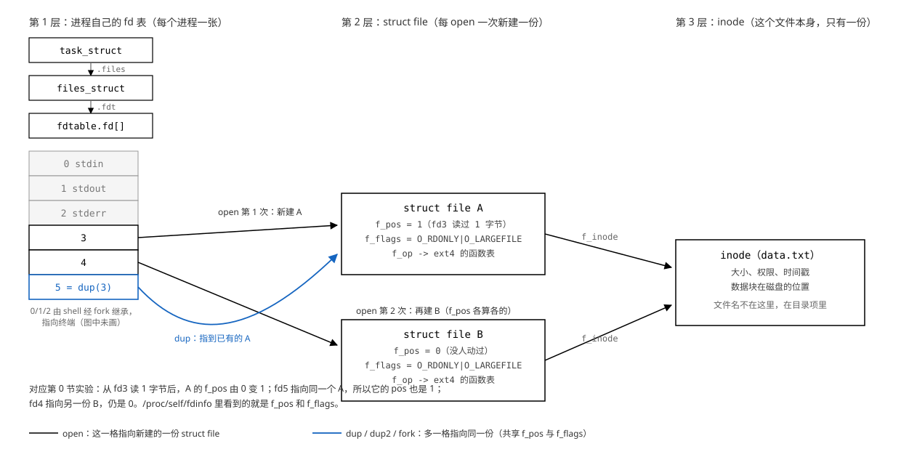
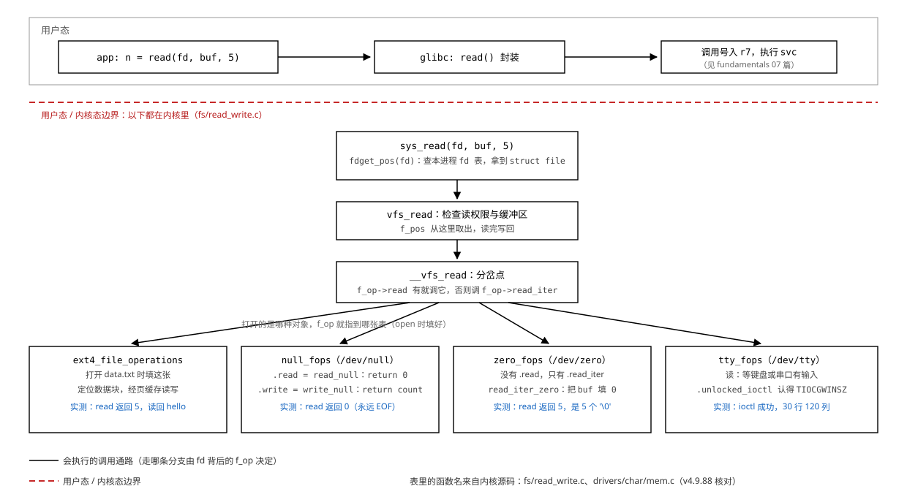

# 08 文件描述符与 VFS

    实验    Knowledge/labs/00_basics/02_fd_and_vfs/
    电脑    WSL Ubuntu 26.04，内核 6.6.114.1，gcc 15.2.0
            （本篇"本机实测"均为 2026-10-20 实跑）
    板子    100ASK_IMX6ULL Pro，Linux 4.9.88
            （板上引用为 2026-09-14 实测归档；内核源码引用按 v4.9.88 核对）

---

## 你会在哪里撞见它

在板子上点亮一个 LED，写法是打开一个文件、往里写一个字符：

```c
int fd = open("/sys/class/leds/<灯的名字>/brightness", O_WRONLY);
write(fd, "1", 1);
```

灯亮了。心里大概过两个念头：点个灯为什么要"打开文件"？`open` 返回的那个
`3` 到底是个什么东西，为什么不是 `0`，为什么不是指针？

把 `fd` 当成"文件的编号"也能写出能跑的代码。但只要遇到"两个进程写同一个
文件互相盖掉"、"shell 重定向为什么改了 2 号就全变了"、"`fork` 之后日志错乱"、
"同一个 `read` 换个 fd 行为完全不同"，这个理解就不够用了。本篇把这一个
整数背后的东西全部拆开。

## 这篇要回答的问题

1. `fd` 到底是什么？为什么第一个 `open` 拿到的是 3？
2. 一次 `open` 在内核里建起了哪几层？`dup`、`dup2`、`fork` 分别复制哪一层、
   共享哪一层？
3. `O_APPEND`、`O_CLOEXEC` 这些标志记在哪一层？凭什么说 `O_APPEND` 的
   "定位加写"是原子的？
4. 同一句 `read(fd, buf, n)`，为什么普通文件、`/dev/null`、`/dev/tty`、
   `/proc` 里的文件，下场各不相同？

读完回头，这四个问题都要能不看书答出来。

## 0 先动手看一眼

先看见现象，再讲原理。实验程序 `fdshow.c`（完整在实验目录）做三件事：用 `open` 打开同一个
文件两次，再 `dup` 一次复制出第三个 fd；从第一个 fd 读一个字节；然后把自己
进程里每个 fd 的内部状态打印出来。状态从 `/proc/self/fdinfo/` 读，这是内核
把自己管的 fd 状态以文件形式公开出来的地方，`self` 表示"当前进程自己"。

```c
#include <stdio.h>
#include <stdlib.h>
#include <unistd.h>
#include <fcntl.h>
#include <string.h>

/* 把 /proc/self/fdinfo/<fd> 的 pos 和 flags 打出来 */
static void show(int fd, const char *tag)
{
	char path[64], line[128];
	FILE *f;

	snprintf(path, sizeof path, "/proc/self/fdinfo/%d", fd);
	f = fopen(path, "r");
	if (!f) { printf("  fd %d (%s): 打不开 %s\n", fd, tag, path); return; }

	printf("  fd %-2d (%-10s)", fd, tag);
	while (fgets(line, sizeof line, f)) {
		line[strcspn(line, "\n")] = 0;
		if (!strncmp(line, "pos:", 4) || !strncmp(line, "flags:", 6))
			printf("  %s", line);
	}
	printf("\n");
	fclose(f);
}

int main(void)
{
	int fd1, fd2, fd3;
	char c;

	fd1 = open("data.txt", O_RDONLY);
	fd2 = open("data.txt", O_RDONLY);   /* 同一个文件，第二次 open */
	fd3 = dup(fd1);                     /* 复制 fd1 */

	printf("open 返回的编号: fd1=%d fd2=%d fd3=%d\n\n", fd1, fd2, fd3);

	printf("[读之前] 三个 fd 的位置：\n");
	show(fd1, "open 1"); show(fd2, "open 2"); show(fd3, "dup fd1");

	read(fd1, &c, 1);                   /* 只从 fd1 读一个字节 */
	printf("\n从 fd1 读了 1 个字节（读到 '%c'）\n\n", c);

	printf("[读之后] 三个 fd 的位置：\n");
	show(fd1, "open 1"); show(fd2, "open 2"); show(fd3, "dup fd1");

	return 0;
}
```

`show()` 里每一行都值得看：`snprintf` 拼出 `/proc/self/fdinfo/3` 这样的
路径；`fopen` 加 `fgets` 像读普通文件一样读它（这个文件为什么能读，第 6.4
节讲）；`strncmp` 挑出 `pos:` 和 `flags:` 开头的两行。`main` 里三个
动作对应本节开头说的三件事，`dup(fd1)` 就是"复制 fd1 这一格"。

```bash
cd Knowledge/labs/00_basics/02_fd_and_vfs
printf 'abcdefghij' > data.txt      # 造一个 10 字节的文件
gcc fdshow.c -o fdshow
./fdshow
```

本机实测：

```text
open 返回的编号: fd1=3 fd2=4 fd3=5

[读之前] 三个 fd 的位置：
  fd 3  (open 1    )  pos:	0  flags:	0100000
  fd 4  (open 2    )  pos:	0  flags:	0100000
  fd 5  (dup fd1   )  pos:	0  flags:	0100000

从 fd1 读了 1 个字节（读到 'a'）

[读之后] 三个 fd 的位置：
  fd 3  (open 1    )  pos:	1  flags:	0100000
  fd 4  (open 2    )  pos:	0  flags:	0100000
  fd 5  (dup fd1   )  pos:	1  flags:	0100000
```

三个 fd 指向同一个文件。从 fd 3 读了一个字节之后，fd 5 的 `pos` 跟着变成
1，fd 4 纹丝不动。三个 fd 分成了两组。

顺带看清 `flags` 这一列：八进制 `0100000` 正是 `O_LARGEFILE`，而
`O_RDONLY` 的值是 0，所以看不见它。这一列就是 `struct file` 的 `f_flags`，
第 5 节会用到它。

为什么 dup 出来的会跟着动，第二次 open 的不会？"读到哪了"这个状态到底存在
哪里？这一篇就从这三个数字往下拆。

---

## 1 fd 是一个整数，这个整数是什么

### 1.1 内核不肯给你指针，只好给你下标

上一节看到 `open` 返回 3、4、5。先问一个更根本的问题：为什么返回的是个
小整数？

`open` 一个文件，内核那边要记一堆东西：文件在磁盘哪里、读到第几个字节了、
这次打开是只读还是读写。这些东西必然存在内核的某个数据结构里。那为什么不
直接把这个结构的地址返回给你，让你 `read(ptr, ...)`？内核还省一次查表。

因为交出去就收不回了。用户态拿到一个内核地址，就可以：

    随便改它      写坏内核的数据结构，整个系统崩
    伪造一个      传个假地址进来，让内核访问不该访问的内存
    偷看旁边      内核里挨着放的可能是别的进程的数据

CPU 在硬件上强制了用户态和内核态的边界（这是 [07 系统调用与用户态/内核态](07_系统调用与用户内核态.md)
的主题），用户态程序根本摸不到内核内存；如果内核主动把一个内核地址交出来，
等于自己在这道墙上开了个洞，而且内核没有任何办法验证"你传回来的这个指针
是不是当初我给你的那个"。

换成下标就全解决了：

    fd = 3 传进来，内核检查 0 <= 3 < 表的长度，越界或空格就返回 EBADF
    表是内核自己的，用户改不了
    每个进程一张表，你的 3 和我的 3 互不相干

> **文件描述符（file descriptor，fd）**：进程内一张数组的下标。数组的每一格
> 装着指向内核结构的指针。`open` 返回下标，`read`/`write`/`close` 拿下标
> 回来查表。

这不是 `open` 一家的特殊设计，是内核向用户态交出资源的通用做法：凡是
"内核里有个东西、用户要反复引用它"的场合，给的都是号码，不是地址。

几个直接推论，都是实测能看到的：

- 判断 `open` 成败只能写 `fd < 0`。0 是合法 fd（下一节讲它为什么平时轮不到），
  写 `!fd` 或 `fd <= 0` 会把合法的 0 号误判成失败。
- fd 的上限受 `ulimit -n` 限制，本机实测（2026-10-20）是 10240，这个值随
  系统配置变。号码本身不占什么，占的是每一格背后内核结构的开销。
- fd 只在它自己的进程里有意义。1.3 节做实验看这一条。

### 1.2 第一个 fd 为什么是 3

因为 0、1、2 已经被占了：

    fd 0   标准输入   stdin
    fd 1   标准输出   stdout
    fd 2   标准错误   stderr

这三格不是 C 语言规定的，是 shell 填的。shell 启动你的程序时先 `fork` 出
子进程，子进程继承 shell 的整张 fd 表，这三格装的是终端；然后子进程才
`execve` 变成你的程序。你的程序一上来就有三格是满的，所以 `open` 只能从
3 开始发。

内核发号的规则是"当前未使用的最小编号"，0 节里 3、4、5 连号发出就是这条
规则的直接表现。这条规则在 2.4 节能看到它的内核代码。

`printf` 往 1 号写、`fprintf(stderr, ...)` 往 2 号写，就是这么回事。第 4 节
会利用"格子里的指向可以改"这一点，做一件很有用的事。

### 1.3 [做 L1] fd 只在它自己的进程里有意义

要回答的问题：两个进程各自 `open` 各自不同的文件，拿到的 fd 各是多少？

实验程序 `fdproc.c`（完整在实验目录）：

```c
#include <stdio.h>
#include <stdlib.h>
#include <unistd.h>
#include <fcntl.h>

int main(int argc, char **argv)
{
	const char *path = argc > 1 ? argv[1] : "data.txt";
	char from[64], to[256];
	int fd, i;
	ssize_t n;

	fd = open(path, O_RDONLY);
	if (fd < 0) { perror("open"); return 1; }
	printf("pid=%d open(\"%s\") 得到 fd=%d\n", getpid(), path, fd);

	for (i = 0; i <= fd; i++) {
		snprintf(from, sizeof from, "/proc/self/fd/%d", i);
		n = readlink(from, to, sizeof to - 1);
		if (n < 0) { printf("  fd %d -> (读不出)\n", i); continue; }
		to[n] = 0;
		printf("  fd %d -> %s\n", i, to);
	}

	if (argc > 2) sleep(atoi(argv[2]));   /* 给个窗口, 好让两个进程同时活着 */
	return 0;
}
```

逐行读关键处：

- `getpid()`：当前进程的进程号。打印它是为了分清两个进程的输出。
- `/proc/self/fd/<n>`：`/proc/self/fd/` 是一个目录，里面当前进程每打开一个
  fd 就有一项，每一项是个符号链接，链接文字是这一格指向的东西。
  `readlink` 读出链接文字，也就是"这一格到底通向哪"。
- `argc > 2` 时 `sleep` 几秒：让两个实例有时间同时活着，排除"第一个退出后
  号码被回收"的干扰。

同时跑两个实例，各开各的文件：

```bash
./fdproc one.txt 2 & ./fdproc two.txt 2 & wait
```

行尾的 `&` 是"放到后台执行"，两个进程并行；`wait` 等它们都结束。

本机实测：

```text
pid=629 open("two.txt") 得到 fd=3
  fd 0 -> /dev/null
  fd 1 -> /dev/pts/0
  fd 2 -> /dev/pts/0
  fd 3 -> /mnt/e/.../02_fd_and_vfs/two.txt   <-- 路径较长, 中间一段省略
pid=628 open("one.txt") 得到 fd=3
  fd 0 -> /dev/null
  fd 1 -> /dev/pts/0
  fd 2 -> /dev/pts/0
  fd 3 -> /mnt/e/.../02_fd_and_vfs/one.txt
```

逐行读：

- 两个进程（pid 628 和 629）拿到的都是 fd 3。编号在不同的进程里重复使用。
- 同一个编号 3，一个指向 `one.txt`，另一个指向 `two.txt`。
- fd 1、2 指向 `/dev/pts/0`，就是当前这个终端，印证了 1.2 节"0/1/2 是 shell
  填好的终端"。fd 0 显示 `/dev/null`，是因为 bash 对后台任务的输入做了改接，
  与这里要说明的事无关。

所以"fd 等于 3 的那个文件"这句话不完整，必须说"某进程里 fd 等于 3 的那个
文件"。`/proc/<pid>/fd/` 这个路径本身就写着这件事：先有 pid，才有 fd。

**[判]**

    [ ] 两个进程得到同一个编号 3，pid 不同，指向的文件不同
    [ ] fd 0/1/2 指向终端（或 shell 改接后的目标），说出它们是谁填的
    [ ] 能说出 fd 是"进程 fd 表的下标"，而不是全局编号

    注错见红：把 fdproc.c 里的 open(path, ...) 改成无条件 open("data.txt", ...)，
    再按上面方式跑两个实例。本机实测两个进程的 fd 3 指向同一个文件，
    "各指各的"这条判据变红。

**这一节搭好的积木**：fd 是进程内一张表的下标；0/1/2 被 shell 占了；号码
只在进程内有意义。接下来的问题：这张表的每一格里装的是什么？0 节那个
"跟着动"的现象，答案就藏在这一格指向的东西里。

---

## 2 中间那层是什么：三张表

### 2.1 从 1/0/1 推出中间层

上一节说 fd 表每一格装着指针。指针指向什么？先用 0 节的现象把范围逼出来。

"读到哪了"（`pos`）这个状态，它只能住在三个候选地点之一：

    住在 fd 里（格子里）     则 dup 出来的 fd5 是独立的一格, 读 fd3 不该影响它
    住在文件里               则第二次 open 的 fd4 指向同一个文件, 也该跟着动
    住在中间的某一层         fd3 和 fd5 指向同一处, fd4 指向另一处

实测是 `1 / 0 / 1`：fd5 跟着动，fd4 不动。前两个候选都被排除。"位置"这个
状态既不在 fd 里，也不在文件里，它在中间某一层；fd3、fd5 共享它，fd4 有
另一份。

这一层是什么，下一节摆出它的真实身份。

### 2.2 三张表的真实身份

内核里管这件事的是三层结构，每一层都有真实的结构体名字（字段名来自内核
源码 `include/linux/fdtable.h` 与 `include/linux/fs.h`，v4.9.88，与板子
内核同版本）：

    第 1 层  task_struct -> files_struct -> fdtable 里的 fd[]
             每个进程一张。每一格是一个 struct file 指针。
             fdtable 里还挂着两张位图: open_fds(哪格在用)、
             close_on_exec(哪格打了 close-on-exec 标记), 第 5.4 节会用到。

    第 2 层  struct file        每 open 一次, 通常新建一份
             关键字段:
               f_pos     当前读写位置 (fdinfo 里的 pos 就是它)
               f_flags   这次打开的状态标志 (O_APPEND 等, 第 5 节)
               f_op      指向一张函数指针表 (第 6 节)
               f_inode   指向第 3 层
               f_count   引用计数: 有几格 fd 指着它 (2.5 节)

    第 3 层  struct inode        这个文件本身, 系统里只有一份
             大小、权限、时间戳、数据块在磁盘上的位置。
             文件名不在这里, 在目录项里; inode 只描述文件本身。



图的读法：左边是本进程的 fd 表，0/1/2 是 shell 继承来的终端；fd 3 和 fd 5
指向同一个 `struct file A`（fd 5 是 `dup(3)` 来的），fd 4 是第二次 `open`，
有自己独立的 `struct file B`；A 和 B 的 `f_inode` 都指向同一个 inode。

0 节的 `1 / 0 / 1` 现在一眼能解释：

    fd3、fd5 -> struct file A -> 共享 f_pos -> 读 fd3 一个字节, A.f_pos 变 1,
                 从 fd5 看 pos 也是 1
    fd4      -> struct file B -> 独立的 f_pos -> 还是 0
    A.f_inode == B.f_inode     -> 确实是同一个文件

`/proc/self/fdinfo/<fd>` 里的 `pos` 和 `flags` 两行，就是内核把这一格背后
`struct file` 的 `f_pos` 和 `f_flags` 打印出来（`fs/proc/fd.c` 里的
`seq_show`）。内核自己把"中间这层存在"这件事报了出来。

### 2.3 一个属性该放哪张表

假设没有中间层，把 `f_pos` 直接塞进 inode（每个文件一个位置）：进程 A 打开
`1.txt` 读了 100 字节，位置是 100；进程 B 也打开 `1.txt` 想从头读，但位置
已经是 100 了。两个毫不相干的程序互相干扰，不能接受。

根本原因一句话：

    "读到哪了"是"这一次打开"的属性，不是"这个文件"的属性。

一个属性该放哪张表，就看它是"每次打开都不同"还是"文件本身就一份"：

    每次打开都不同 -> struct file   f_pos、f_flags(O_APPEND 等)、f_op
    文件本身一份   -> inode         大小、权限、时间戳、数据块位置
    每个进程一张   -> fd 表          下标到 struct file 的映射、close_on_exec 位

第 5 节会反复用到这张归属表：判断一个标志在哪一层，就能预判 `dup`、`fork`
之后它跟谁共享。

### 2.4 open 进内核后干了三件事

`open` 是系统调用。用户态怎么穿过边界进内核（调用号放 r7、一条 `svc`
指令、查 `sys_call_table`）是 07 篇的事，这里从进了内核之后讲起。内核里
`open`/`openat` 都汇到 `do_sys_open`（`fs/open.c`），它的主体是三步：

```c
long do_sys_open(int dfd, const char __user *filename, int flags, umode_t mode)
{
	...
	fd = get_unused_fd_flags(flags);              /* 1. 在本进程 fd 表找最小空格 */
	if (fd >= 0) {
		struct file *f = do_filp_open(dfd, tmp, &op); /* 2. 真正打开, 新建 struct file */
		if (IS_ERR(f)) {
			put_unused_fd(fd);
			fd = PTR_ERR(f);
		} else {
			fsnotify_open(f);
			fd_install(fd, f);                      /* 3. 把指针填进第 fd 格 */
		}
	}
	...
	return fd;
}
```

对着三层结构看这三步：

    第 1 步  get_unused_fd_flags   只管第 1 层: 找最小空闲下标
             （1.2 节"最小未使用编号"就是 fs/file.c 里这个函数实现的）
    第 2 步  do_filp_open          只管第 2、3 层: 解析路径, 找到或建立
             inode, 新建 struct file, 把 f_op 按"打开的是什么东西"填好
             （第 6 节的关键伏笔）
    第 3 步  fd_install            把两层挂上钩: fdtable.fd[fd] = file

这三步的分法本身能解释很多事。比如 `dup` 干的就是跳过第 2 步：拿现成的
`struct file`，只做第 1 步和第 3 步（`fs/file.c` 里 `SYSCALL_DEFINE1(dup)`
的正文正是 `fget_raw` + `get_unused_fd_flags` + `fd_install` 三行）。不新建
`struct file`，所以共享 `f_pos`。

这里要更正一个凭名字想当然的地方。容易以为 C 库里的 `open()` 发给内核的
就是 `open` 这个系统调用；实测不是。用 `strace` 盯着 `fdproc` 看它真正发出
了什么（`strace` 的用法：`-e trace=` 后面跟要盯的系统调用，`-o` 把记录写到
文件）：

```bash
strace -f -e trace=open,openat -o st.txt ./fdproc data.txt >/dev/null
cat st.txt
```

本机实测：

```text
635   openat(AT_FDCWD, "/etc/ld.so.cache", O_RDONLY|O_CLOEXEC) = 3
635   openat(AT_FDCWD, "/usr/lib/x86_64-linux-gnu/libc.so.6", O_RDONLY) = 3
635   openat(AT_FDCWD, "data.txt", O_RDONLY) = 3
```

一个裸 `open(` 都没有（本机实测计数：open 0 次，openat 3 次）。glibc 把
`open(path, flags)` 统统翻译成 `openat(AT_FDCWD, path, flags)`。原因：
`openat` 能表达 `open` 表达不了的东西（相对于某个已打开目录的 fd 解析路径），
`open` 只是 `dfd = AT_FDCWD` 的特例，内核让两套共用后面的路径解析，2.4 节
开头那段 `do_sys_open` 的第一个参数 `dfd` 就是它。板上归档（2026-09-14，
ARM 侧反汇编加 strace）同样是 open 0 次、openat 8 次，glibc 装进 r7 的调用
号是 322（openat）不是 5（open）。实际影响：用 strace 抓文件打开要
`grep openat`；在内核里找入口别只背 `sys_open`。

### 2.5 close 关的是哪一层

`struct file` 里有个引用计数 `f_count`：有几格 fd 指向它，它就是几。
`close(fd)` 做两件事：把本进程 fd 表里那一格摘掉，`f_count` 减一。减到 0，
这份 `struct file` 才真正释放（文件系统层的关闭动作在这时发生）。

所以"关掉一个 fd"不等于"关掉那个文件"：

    fd3、fd5 指向同一份 struct file
    close(3): 摘掉 fd3 那一格, f_count 2 -> 1, struct file 还在
    从 fd5 读写照常, pos 也还是原来共享的那个

第 4 节的实验会用到这条：`dup2` 之后紧跟一句 `close(fd)`，关掉多余的格子，
文件照样能写。

**这一节搭好的积木**：三层结构（fd 表、struct file、inode）各自存什么；
`open` 三步各建哪一层；`close` 按引用计数释放。接下来的问题：`dup`、`fork`、
"再 open 一次"这三种"复制"，分别落在哪一层上。

---

## 3 三种"复制"：open 两次、dup、fork

### 3.1 差别在哪一层

上一节的三层结构直接决定了三种操作的语义：

| 操作 | fd 表发生什么 | struct file | 读写位置 |
|---|---|---|---|
| 同一文件 `open` 两次 | 增加两格 | 新建两份，最终指向同一个 inode | 两个 `f_pos` 互不影响 |
| `dup` / `dup2` | 增加一格 | 新旧 fd 指向同一份 | 共享同一个 `f_pos` |
| `fork` | 子进程复制整张 fd 表 | 父子各格仍指向原来的同一份 | 跨进程共享 `f_pos` |

第三行需要一点内核细节：`fork` 时子进程拿到一张新的 fd 表（`fs/file.c`
的 `dup_fd` 把父进程的 fd 数组复制一份），但每一格里的指针原样照抄，指向
的还是父进程那一批 `struct file`，每抄一格对应 `f_count` 加一。表是两份，
指向的东西是同一份。

0 节的实验验证了前两行（open 两次独立、dup 共享）。这一节把第三行也测出来。

### 3.2 [做 L1] fork：父子共享 f_pos

要回答的问题：`fork` 之后，父子进程写同一个 fd，会不会互相覆盖？

如果 3.1 表第三行是真的，那么父进程写一段、子进程写一段，两段不会互相
覆盖：共享 `f_pos`，子进程写完位置前进了，父进程接着往后写。反过来，如果
`fork` 给子进程另建了 `struct file`（各自独立的 `f_pos`），子进程会从父进程
`fork` 那一刻的位置开始写，盖掉一部分内容。两种结果在文件内容上一眼能
分辨。

实验程序 `forkfd.c`（完整在实验目录）：

```c
int main(void)
{
	int fd = open("shared.txt", O_WRONLY | O_CREAT | O_TRUNC, 0644);
	pid_t pid;

	write(fd, "AAAAA", 5);        /* fork 前先写 5 字节，f_pos = 5 */

	pid = fork();
	if (pid == 0) {
		write(fd, "child", 5);    /* 子进程写 */
		exit(0);
	}
	wait(NULL);                   /* 等子进程写完 */
	write(fd, "PAREN", 5);        /* 父进程再写 */
	close(fd);
	...
}
```

```bash
gcc forkfd.c -o forkfd
./forkfd
```

本机实测（板上 2026-09-14 归档同构复跑，结果相同）：

```text
文件内容: AAAAAchildPAREN
```

15 个字节，三段完整，谁也没盖谁：

    文件:  AAAAA child PAREN
    位置:  0     5     10    15
           |     |     |
           |     |     父进程 write, 从 10 开始
           |     子进程 write, 从 5 开始
           fork 之前 write, 位置到 5

父进程从来没执行过任何"把位置挪到 10"的代码。它能从 10 开始写，只可能是
它和子进程用的是同一个 `f_pos`。

容易以为 `fork` 之后父子各管各的文件位置；实测是共享；原因是 `fork` 复制
的是 fd 表（第 1 层），不是 `struct file`（第 2 层）。

**注错见红**：让子进程不用继承来的 fd，自己 `open` 一次（拿到独立的
`struct file`，`f_pos` 从 0 开始）：

```c
	if (fork() == 0) {
		int f2 = open("shared.txt", O_WRONLY);   /* 不要带 O_TRUNC */
		write(f2, "child", 5);
		exit(0);
	}
```

本机实测内容变成 `childPAREN`，10 字节：子进程从 0 写，把 `AAAAA` 盖掉了；
父进程的 `f_pos` 仍是 5，`PAREN` 还落在第 5 字节处。少了 5 个字节，而且
没有任何报错。

这条在工程里的意义：父子进程往同一个日志文件写，`fork` 前打开的 fd 不会
互相覆盖；`fork` 后各自 `open`（两个独立 `struct file`）就会打架，那时要靠
第 5.2 节的 `O_APPEND`。

**[判]**

    [ ] 文件内容是 AAAAAchildPAREN，共 15 字节
    [ ] 能说清三段各自从哪个位置开始写（0 / 5 / 10）
    [ ] 注错后内容是 childPAREN，能说出盖掉的是哪一段

**这一节搭好的积木**：三种复制的差别在第 2 层：`open` 新建、`dup` 共享、
`fork` 跨进程共享。下一个问题：`dup` 只能让内核挑号码，想把某个指定号码
（比如 2 号 stderr）改指到别处，该怎么办。

---

## 4 [做 L2] 不改日志语句，把 stderr 引到文件

### 4.1 问题

程序里到处是 `fprintf(stderr, ...)`，还有别人写的库也往 stderr 写。现在想
把所有这些输出落到一个文件里，但不许改任何一行 `fprintf`。

`stderr` 就是 fd 表的第 2 格（1.2 节）。写日志的代码只认"2 号"这个下标，
它不知道 2 号格子指向哪里。那就改这一格的指向：让 2 号从指向终端改成指向
日志文件。干这件事的函数是 `dup2(oldfd, newfd)`：让 `newfd` 这一格改指向
`oldfd` 所指的东西。方向记法：来源在前，要被改掉的格子在后。

### 4.2 动手

实验程序 `logredir.c`（完整在实验目录）：

```c
static void worker(void)          /* 假装这是别人写的库，只认 stderr */
{
	fprintf(stderr, "worker: 干活中\n");
}

int main(void)
{
	int fd;

	fprintf(stderr, "1. 重定向之前，这行去终端\n");
	worker();

	fd = open("log.txt", O_WRONLY | O_CREAT | O_TRUNC, 0644);
	printf("2. 日志文件拿到的 fd = %d\n", fd);

	dup2(fd, STDERR_FILENO);      /* 让 stderr 以后写进 log.txt */
	close(fd);                    /* fd 已经多余；关掉它不影响 stderr */

	fprintf(stderr, "3. 重定向之后，这行去文件\n");
	worker();                     /* 同一个函数，一个字没改 */

	return 0;
}
```

```bash
gcc logredir.c -o logredir
./logredir
cat log.txt
```

本机实测：

```text
$ ./logredir
1. 重定向之前，这行去终端
worker: 干活中
2. 日志文件拿到的 fd = 3

$ cat log.txt
3. 重定向之后，这行去文件
worker: 干活中
```

### 4.3 逐行读

`worker()` 被调了两次，代码一模一样，第一次去终端、第二次进文件。
`fprintf(stderr, ...)` 全程只把文字交给"2 号格"，它不知道格子的指向已经
换了。

`dup2` 在内核里做了两件事（`fs/file.c`）：先把 `newfd`（2 号）原来指向的
那份关掉，再让 2 号格指向 `oldfd`（3 号）那份 `struct file`，那份的
`f_count` 加一。用 strace 能看到它就一句话（本机实测）：

```text
dup2(3, 2)                              = 2
```

fd 表前后对照：

    dup2 前    fd[2] -> 终端的 struct file     fd[3] -> log.txt 的 struct file
    dup2(3,2)  先关 fd[2] 原来那格的指向, 再让 fd[2] 指向 fd[3] 那份
    dup2 后    fd[2] -> log.txt 的 struct file  fd[3] -> 同一份 (f_count = 2)

再看 `close(fd)` 那一行，它是本实验最容易被误解的一行。按 2.5 节的引用
计数：`dup2` 之后 3 号格已经多余，close 它只摘掉 3 号格、`f_count` 由 2
变 1，`struct file` 还在，2 号格照常能写。日志不受影响，所以 `dup2` 之后
紧跟 `close(fd)` 是固定搭配：不保留没有用途的格子。

### 4.4 这就是 shell 重定向的实现

你敲的 `./prog > out.txt 2>&1`，shell 干的正是这件事：

    fork 出子进程
    子进程里 open("out.txt") 拿到一个 fd, dup2 把它装到 1 号格
    2>&1: 再 dup2 把 2 号格装成 1 号格当前指向的同一份
    execve 变成你的程序

数字 1 是标准输出，数字 2 是标准错误。`2>&1` 的含义是"让 2 号格跟随 1 号
格当前的指向"。两路最终通向同一份 `struct file`，所以共用同一个 `f_pos`，
交替写不互相覆盖。反过来 `./prog > out.txt 2>err2.txt` 是两次独立打开，
两份 `struct file`，各记各的位置。

`Project/` 里的 `log_redirect()` 用的就是这一招，见教程 04 篇
[04 文件IO](../tutorials/01_应用编程/04_文件IO.md)第 8 节。

### 4.5 [判]

    [ ] 前两行出现在终端，后两行出现在 log.txt 里
    [ ] worker() 的代码一个字没改，但两次输出去了不同地方
    [ ] open 拿到的 fd 是 3
    [ ] close(fd) 之后，往 stderr 写仍然有效

    注错见红：把 dup2(fd, STDERR_FILENO) 改成 dup2(fd, STDOUT_FILENO)。
    本机实测结果反过来："2. 日志文件拿到的 fd = 3" 这行 printf 进了文件，
    两行 stderr 全部留在终端。改错格子，输出就去错地方。

**这一节搭好的积木**：`dup2(old, new)` 改的是 fd 表里指定的一格；shell 的
`>` 和 `2>&1` 就是它。下一个问题：`open` 时那一串 `O_` 标志，分别记在
哪一层，又各自被谁继承。

---

## 5 标志落在哪一层

### 5.1 先分清：两类标志加一个陷阱

`open(path, flags)` 的 `flags` 里其实混着两类东西（`man 2 open` 把它们分
成 file creation flags 与 file status flags 两组）：

    一次性动作    O_CREAT、O_EXCL、O_TRUNC、O_DIRECTORY、O_NOFOLLOW
                  只在 open 这一刻起作用, 不存进任何一层
    状态标志      O_APPEND、O_NONBLOCK、O_SYNC、O_DIRECT、访问方式
                  存进 struct file 的 f_flags, 跟着"这一次打开"走

还有第三个位置，不在 `open` 的 `flags` 里也能设：`close_on_exec` 标记存在
fd 表那一格上（2.2 节 fdtable 里的 `close_on_exec` 位图），用
`fcntl(fd, F_SETFD, FD_CLOEXEC)` 设置，5.4 节做实验。

这里有一个看 fdinfo 时一定会踩的陷阱。容易以为 `/proc/self/fdinfo/<fd>`
里的 `flags` 列就是 `struct file` 的 `f_flags`；实测不全是。给 fd1 打上
close-on-exec 标记之后，本机实测（5.4 节 `cloexec` 的输出）：

```text
fdinfo: fd 3 的 flags:	02100000
fdinfo: fd 4 的 flags:	0100000
```

fd 3 多出来的 `02000000`（八进制）正是 `O_CLOEXEC`。原因是 `fs/proc/fd.c`
的 `seq_show` 打印时把格子上的 close_on_exec 位合并进了 flags 列：

```c
	f_flags = file->f_flags;
	if (close_on_exec(fd, fdt))
		f_flags |= O_CLOEXEC;
```

所以 fdinfo 的 flags 列是"两层标志的合并显示"。要分清两层，用 `fcntl`：
`F_GETFL` 读的是 `struct file` 的 `f_flags`，`F_GETFD` 读的是格子上的
close_on_exec。速查清单里有完整的归属对照表。

### 5.2 [做 L2] O_APPEND：两个进程同时追加，怎么不互相覆盖

要回答的问题：两个进程同时往一个日志文件追加，怎么保证不互相覆盖？

朴素做法：先跳到末尾，再写。

```c
lseek(fd, 0, SEEK_END);      /* 第 1 次系统调用: 找末尾 */
write(fd, line, n);          /* 第 2 次系统调用: 写 */
```

问题在这是两次独立的系统调用，两次之间内核可能把 CPU 交给别人。另一个
进程在这个缝隙里也写了一条，你手里那个"末尾"就过期了，你会写到别人刚写
的位置上，把它盖掉：

    进程 A                    进程 B
    lseek -> 末尾 100
                              lseek -> 末尾 100
                              write 写到 100..116, 末尾变 117
    write 写到 100..116       <-- A 手里的 100 已过期, 盖掉 B 刚写的

`O_APPEND` 的做法是把"定位"和"写"合成一步，在内核里拿着 inode 的锁做完。
内核源码的位置在 `mm/filemap.c` 的写路径上（v4.9.88）：

```c
	/* FIXME: this is for backwards compatibility with 2.4 */
	if (iocb->ki_flags & IOCB_APPEND)
		iocb->ki_pos = i_size_read(inode);
```

`iocb_flags()` 在动笔之前把 `f_flags` 里的 `O_APPEND` 翻译成 `IOCB_APPEND`
（`include/linux/fs.h`）；走到 `generic_write_checks` 时锁已经拿着，
"取当前大小当写入位置"和随后的写之间插不进别人。

注意 `O_APPEND` 是 `struct file` 的 `f_flags` 里的一位（5.1 节的归属表），
是"这一次打开"的属性：同一个文件，你用 `O_APPEND` 打开，我不用，互不影响。

这个差别能不能量出来？能，而且非常明显。实验程序 `append.c`：父子两个进程
各往 `out.txt` 写 2000 条固定 17 字节的记录，命令行参数切换两种模式：

```c
	for (i = 0; i < N; i++) {
		if (!use_append)
			lseek(fd, 0, SEEK_END);   /* 自己找末尾：这是第 1 次系统调用 */
		write(fd, LINE, strlen(LINE));    /* 写：这是第 2 次 */
	}
```

```bash
gcc append.c -o append
for i in 1 2 3; do ./append append; done
for i in 1 2 3; do ./append lseek;  done
```

为什么要各跑三轮：这是竞态，单次结果可能碰巧正确，竞态的判据必须是多轮的。

本机实测：

```text
append   模式：期望 68000 字节，实际 68000 字节
append   模式：期望 68000 字节，实际 68000 字节
append   模式：期望 68000 字节，实际 68000 字节
lseek    模式：期望 68000 字节，实际 34255 字节
lseek    模式：期望 68000 字节，实际 34323 字节
lseek    模式：期望 68000 字节，实际 34544 字节
```

逐条读：

- 期望 68000 = 2 个进程 x 2000 条 x 17 字节。
- `O_APPEND` 版三轮全部精确 68000，一字节不差。
- `lseek` 版 34255 / 34323 / 34544：三轮三个数，都只有一半左右。两个进程有
  一多半时间在互相覆盖。更要命的是每轮数字都不一样，这是竞态的典型特征：
  这种 bug 不能靠"我跑了一遍没问题"来排除。
- 错误的形态：没有任何一次 `write` 返回失败，没有报错，退出码是 0。数据
  悄无声息地少了一半。并发写文件不用 `O_APPEND`，就是这种"全绿但结果错"
  的 bug。

板上归档（2026-09-14）：tmpfs 与 eMMC 各跑 5 轮，append 版全部 68000；
lseek 版 67898~67983 不等。板子上丢得少是因为单核调度缝隙小，不是不丢。

也要说清 `O_APPEND` 的边界：它保证的是单次 `write` 的"定位加写"不被打断。
一条业务记录如果由多次 `write` 拼成，两条记录之间仍然可能插入别人的写。

**注错见红**：把 `N` 从 2000 改成 5（每个进程只写 5 条）。本机实测 lseek 版
三轮是 85 / 170 / 85：有一轮碰巧是满的。压力太小，竞态窗口撞不上，判据会
假绿。并发 bug 的判据必须把压力加到足够大。改完记得改回 2000。

### 5.3 [做 L1] O_APPEND 记在 struct file 上：设一次，dup 的另一个也跟着变

5.1 节说 `O_APPEND` 存在 `struct file` 的 `f_flags` 里。如果是真的，那么
对 dup 出来的两个 fd 中的任何一个做 `fcntl(F_SETFL)`，另一个的 fdinfo 也
应该跟着变，因为它们共享同一份 `struct file`。

实验程序 `flagshare.c`（完整在实验目录）：

```c
	fd1 = open("flag.txt", O_WRONLY | O_CREAT | O_TRUNC, 0644);
	fd2 = dup(fd1);
	write(fd1, "AAAAA", 5);          /* 先写 5 字节, f_pos = 5 */
	/* ...打印两格的 pos 和 flags... */

	fcntl(fd1, F_SETFL, O_APPEND);     /* 只对 fd1 说这一句话 */
	/* ...再打印... */

	lseek(fd2, 0, SEEK_SET);           /* 用 fd2 把位置拨回 0 */
	write(fd2, "Z", 1);                /* 再经 fd2 写 1 字节 */
	/* ...再打印... */
```

本机实测：

```text
[F_SETFL 之前]
  fd 3 (open):  pos:	5  flags:	0100001
  fd 4 (dup ):  pos:	5  flags:	0100001

[只对 fd1 做 F_SETFL O_APPEND 之后]
  fd 3 (open):  pos:	5  flags:	0102001
  fd 4 (dup ):  pos:	5  flags:	0102001

[fd2 拨回 0 后写 'Z' 之后]
  fd 3 (open):  pos:	6  flags:	0102001
  fd 4 (dup ):  pos:	6  flags:	0102001
```

```text
flag.txt: AAAAAZ (6 字节)
```

逐条读，三个结论：

1. 只对 fd1 说了一句 `F_SETFL, O_APPEND`，fd2 的 flags 也变成 `0102001`
   （`0100000` 是 `O_LARGEFILE`，`02000` 是 `O_APPEND`，`01` 是 `O_WRONLY`）。
   改动发生在两个 fd 共享的那份 `struct file` 上，所以两边都看得见。
2. `lseek(fd2, 0, SEEK_SET)` 明明把位置拨回了 0，写进去的 `Z` 却落在文件
   末尾，文件是 `AAAAAZ` 不是 `ZAAAA`。`O_APPEND` 下写入位置不看你的
   `f_pos`，动笔那一刻才取文件末尾。这就是 5.2 节"定位与写合一"在单进程
   里的直接观测。
3. 写完之后 `pos` 是 6：fdinfo 里的 `pos` 跟随实际写入位置，不是 0 也不是
   1。

**注错见红**：把 `fd2 = dup(fd1)` 改成 `fd2 = open("flag.txt", O_WRONLY)`。
本机实测：`F_SETFL` 只影响 fd 3，fd 4 的 flags 始终是 `0100001`；拨回 0
后写 `Z` 盖掉开头，文件变成 `ZAAAA`。两组判据一起变红。

### 5.4 [做 L1] O_CLOEXEC 记在 fd 格子上

`close-on-exec` 的语义：这个进程一旦 `execve` 变成另一个程序，打了标记的
fd 自动关闭。它防的是 fd 泄漏：程序打开了一堆文件，中途 `execve` 起一个
不相干的程序，那个程序不该继承这些 fd。

这个标记该记在哪一层？它描述的是"这一格 fd 在 exec 时要不要关"，同一份
`struct file` 的另一个 fd 可能不想关。所以它记在第 1 层（fd 表那一格），
不在第 2 层。2.2 节的 fdtable 里那张 `close_on_exec` 位图就是它住的地方。
实验验证。`cloexec.c`：`open` 加 `dup` 造出两个指向同一 `struct file` 的
fd，只给 fd1 打标记，然后 `execl("/proc/self/exe", ...)` 让自己 exec 成
一个新程序，新程序报告 3 号、4 号还在不在：

```c
	fd1 = open("data.txt", O_RDONLY);
	fd2 = dup(fd1);
	printf("fd1=%d fd2=%d, 两个 fd 指向同一个 struct file\n", fd1, fd2);

	fcntl(fd1, F_SETFD, FD_CLOEXEC);   /* 只给 fd1 这一格打 close-on-exec 标记 */
	printf("fcntl F_GETFD: fd1=%d fd2=%d (1 = 打了标记)\n",
	       fcntl(fd1, F_GETFD), fcntl(fd2, F_GETFD));
	showflags(fd1);
	showflags(fd2);

	fflush(stdout);           /* 缓冲是用户态的, exec 不替我们交出去 */
	execl("/proc/self/exe", argv[0], "dump", NULL);
```

`execl` 之前那句 `fflush` 不能省：`printf` 的内容压在 C 库的用户态缓冲里，
`execve` 把整个程序镜像换掉，没冲出去的缓冲就丢了（缓冲这个话题是
[07 篇](07_系统调用与用户内核态.md) 的事）。旧版本少了这句，exec 之前的
两行打印全丢，本机实测过这个坑。

本机实测：

```text
fd1=3 fd2=4, 两个 fd 指向同一个 struct file
fcntl F_GETFD: fd1=1 fd2=0 (1 = 打了标记)
fdinfo: fd 3 的 flags:	02100000
fdinfo: fd 4 的 flags:	0100000
exec 之后: fd 3 已关闭, fd 4 还在
```

逐条读：

- `F_GETFD`：fd1 是 1，fd2 是 0。标记只打在 fd1 那一格上，尽管两个 fd
  指向同一个 `struct file`。
- fdinfo 两行就是 5.1 节那个陷阱的来源：格子上的标记被合并显示进 flags。
- exec 之后：fd 3 关了，fd 4 还在。exec 关的是"打了标记的格子"，不是
  "那份 struct file"。

`dup` 家族里有个变体 `dup3(oldfd, newfd, flags)`，`flags` 只能取 0 或
`O_CLOEXEC`，作用就是复制的同时把新格子打上标记（`man 2 dup`）。`open` 的
`flags` 里直接带 `O_CLOEXEC` 也是同一个效果，省去一次 `fcntl`，还能关掉
"open 返回和 fcntl 之间被 exec 撞上"的窗口。

### 5.5 [判]

    [ ] append 模式三轮都精确 68000；lseek 模式三轮都少，且互不相同
    [ ] 能说出 lseek 版丢数据的缝隙在哪两行代码之间
    [ ] flagshare：只对 fd1 设 O_APPEND，fd2 的 flags 跟着变 0102001
    [ ] flagshare：fd2 拨回 0 写 Z 后文件是 AAAAAZ，pos 是 6
    [ ] cloexec：F_GETFD 是 fd1=1 fd2=0；exec 后 fd 3 关、fd 4 在
    [ ] 能说出 fdinfo 的 flags 列为什么混进了 O_CLOEXEC

    注错见红（每条都实测过）：fdshow 的 dup 改 open（pos 变 1/0/0）；
    flagshare 的 dup 改 open（文件变 ZAAAA）；cloexec 给 fd2 也打标记
    （exec 后两个都关）；append 的 N 改成 5（lseek 版出现满分假绿）。

**这一节搭好的积木**：标志分两层，`f_flags` 跟着 `struct file` 走，
`close_on_exec` 跟着 fd 格子走；`O_APPEND` 的原子性来自"锁里定位加写"。
到这里，fd 到文件这条路走完了。最后一个问题：同一个 `read`，怎么分给
不同的实现。

---

## 6 VFS：同一句 read，四种下场

### 6.1 struct file 里的 f_op

Linux 里普通文件、`/dev/null`、终端、管道，全都用 `open`/`read`/`write`
操作。但它们的行为不可能一样：写进 `/dev/null` 的数据会消失，写进磁盘文件
的会留下。同一个 `read` 系统调用，怎么会有不同的下场？

答案在 2.2 节留下的那个字段：`f_op`。

> **`f_op`（file_operations）**：一张函数指针表，里面是 `read`、`write`、
> `mmap`、`ioctl` 等一组函数指针。`open` 的时候（2.4 节的第 2 步），内核看
> 你打开的是什么东西，往 `f_op` 里填不同的表。

`read(fd, buf, n)` 进内核之后的路径（`fs/read_write.c`）：

```c
SYSCALL_DEFINE3(read, unsigned int, fd, char __user *, buf, size_t, count)
{
	struct fd f = fdget_pos(fd);          /* 拿 fd 查出 struct file, 盯住它的位置 */
	ssize_t ret = -EBADF;

	if (f.file) {
		loff_t pos = file_pos_read(f.file);   /* 取出 f_pos */
		ret = vfs_read(f.file, buf, count, &pos);
		if (ret >= 0)
			file_pos_write(f.file, pos);      /* 读了多少, f_pos 前进多少 */
		fdput_pos(f);
	}
	return ret;
}
```

`vfs_read` 做权限和缓冲区检查，真正的分岔在 `__vfs_read`：

```c
ssize_t __vfs_read(struct file *file, char __user *buf, size_t count, loff_t *pos)
{
	if (file->f_op->read)
		return file->f_op->read(file, buf, count, pos);
	else if (file->f_op->read_iter)
		return new_sync_read(file, buf, count, pos);
	else
		return -EINVAL;
}
```

分岔就在 `f_op->read` 这一个指针上。这张表是 `open` 时按对象填好的，所以
"行为跟着 fd 背后的对象走，不跟着代码走"。整个分派画成一张图：



图的读法：红虚线上方是用户态，下方是内核；中间主干是每个 `read` 都走的
统一路径；四条分支由 `f_op` 决定走哪条。四个分支框里的行为都是 6.2 节
实测出来的。

这层间接有个名字叫 VFS（virtual filesystem switch，虚拟文件系统层）：
内核给所有"文件样的东西"套的统一接口。磁盘文件、设备、`/proc` 里的伪文件，
对上都长一个样，对下各接各的实现。所谓"一切皆文件"，实现上就是这张函数
指针表的替换。

### 6.2 [做 L1] 只换路径，其余一个字不改

要回答的问题：同一段 `write`/`read`/`ioctl` 代码，只换打开的路径，下场差
多少？

实验程序 `vfs.c` 对四个路径做完全相同的三件事：`write(fd,"hello",5)`、
`lseek` 回头再 `read` 5 字节、`ioctl(fd, TIOCGWINSZ, ...)`（问"你的窗口
多大"，一个只有终端才懂的问题）。核心部分（完整在实验目录）：

```c
static void try_path(const char *path)
{
	char buf[8];
	int fd, n;
	struct stat st;
	struct winsize ws;

	fd = open(path, O_RDWR);
	if (fd < 0) { printf("  open 失败: %s\n\n", strerror(errno)); return; }

	fstat(fd, &st);                       /* 先问问这是什么类型 */
	...

	n = write(fd, "hello", 5);            /* 完全相同的 write */
	printf("  write 5 字节 -> 返回 %d\n", n);

	if (isatty(fd)) {                     /* 终端的 read 会一直等键盘, 跳过 */
		printf("  read      -> 跳过（终端会一直等你敲键盘）\n");
	} else {
		lseek(fd, 0, SEEK_SET);
		memset(buf, '.', sizeof buf);
		n = read(fd, buf, 5);             /* 完全相同的 read */
		printf("  read  5 字节 -> 返回 %d, 内容 \"%.5s\"\n", n, buf);
	}

	/* 问一个只有终端才懂的问题: 你的窗口多大 */
	if (ioctl(fd, TIOCGWINSZ, &ws) == 0)
		printf("  ioctl(TIOCGWINSZ) -> 成功，%d 行 %d 列\n", ws.ws_row, ws.ws_col);
	else
		printf("  ioctl(TIOCGWINSZ) -> 失败: %s\n", strerror(errno));

	close(fd);
}

int main(void)
{
	try_path("data.txt");
	try_path("/dev/null");
	try_path("/dev/zero");
	try_path("/dev/tty");
	return 0;
}
```

`memset(buf, '.', sizeof buf)` 是伏笔：先把 buf 填满点号，`read` 之后看
它动不动，就知道 `read` 到底碰没碰这块内存。

```bash
gcc vfs.c -o vfs
./vfs
```

本机实测（在终端里跑，`/dev/tty` 才能打开）：

```text
--- data.txt ---
  类型      : 普通文件
  write 5 字节 -> 返回 5
  read  5 字节 -> 返回 5, 内容 "hello"
  ioctl(TIOCGWINSZ) -> 失败: Inappropriate ioctl for device

--- /dev/null ---
  类型      : 字符设备
  write 5 字节 -> 返回 5
  read  5 字节 -> 返回 0, 内容 "....."
  ioctl(TIOCGWINSZ) -> 失败: Inappropriate ioctl for device

--- /dev/zero ---
  类型      : 字符设备
  write 5 字节 -> 返回 5
  read  5 字节 -> 返回 5, 内容 ""
  ioctl(TIOCGWINSZ) -> 失败: Inappropriate ioctl for device

--- /dev/tty ---
  类型      : 字符设备
hello  write 5 字节 -> 返回 5
  read      -> 跳过（终端会一直等你敲键盘）
  ioctl(TIOCGWINSZ) -> 成功，30 行 120 列
```

逐条读：

- 四次 `write` 都返回 5，都"成功"了，发生的事完全不同：data.txt 落盘，
  随后能读回；`/dev/null` 和 `/dev/zero` 丢弃；`/dev/tty` 直接显示在屏幕
  上，输出里 `/dev/tty` 一节行首多出来的 `hello` 就是写进终端的那 5 个
  字节。
- `read` 三种结果：data.txt 返回 5 读回 `hello`；`/dev/null` 返回 0（EOF，
  buf 里预填的 5 个点一个没动）；`/dev/zero` 返回 5 但打印出来是空的。
- `/dev/zero` 那个空字符串最容易误读。返回 5 说明确实读了 5 个字节，内容
  全是 `'\0'`，`printf` 的 `%s` 遇到第一个 `'\0'` 就停。用 `%s` 打二进制
  数据会骗你，要看清楚得打十六进制。
- `ioctl` 是最干净的证据：`TIOCGWINSZ` 只有终端驱动能回答。同一个调用，
  三个路径报 `Inappropriate ioctl for device`（errno `ENOTTY`），一个给出
  了答案。这个报错的字面意思就是"那张 `f_op` 表里没有能处理它的函数"。

**注错见红**：把 `try_path("/dev/tty")` 改成 `try_path("/dev/null")`，跑
两遍。本机实测两行输出完全相同，ioctl 都失败。路径一样行为就一样，路径变
了行为就变。

### 6.3 /dev/null 和 /dev/zero 的表是谁填的

`/dev/null`、`/dev/zero` 是字符设备。它们的 `f_op` 表在内核
`drivers/char/mem.c` 里，源码直接能看到 6.2 节每个行为的出处：

```c
static ssize_t read_null(struct file *file, char __user *buf,
			 size_t count, loff_t *ppos)
{
	return 0;                      /* /dev/null 的 read 永远 EOF */
}

static ssize_t write_null(struct file *file, const char __user *buf,
			  size_t count, loff_t *ppos)
{
	return count;                  /* /dev/null 的 write 报"全写完了", 实际丢弃 */
}

static const struct file_operations zero_fops = {
	.llseek		= zero_lseek,
	.write		= write_zero,
	.read_iter	= read_iter_zero,      /* 只有 read_iter, 没有 read */
	.write_iter	= write_iter_zero,
	.mmap		= mmap_zero,
	...
};
```

两个细节值得停下：

- `/dev/zero` 的表里没有 `.read`，只有 `.read_iter = read_iter_zero`（往
  用户缓冲区填 0）。6.1 节 `__vfs_read` 的 `else if` 分支就是为这种表
  准备的：`.read` 空就走 `.read_iter`。源码里的分支结构和我们实测的行为
  一一对应。另外 `mem.c` 里有一行 `#define write_zero write_null`，
  所以 `/dev/zero` 的写和 `/dev/null` 一样报"全写完了"然后丢弃。
- 这两张表是按设备号挂上去的：`mem.c` 里有一张登记表，次设备号 3 是
  `null`、5 是 `zero`，`open("/dev/null")` 时内核按设备号查到 `null_fops`
  填进 `f_op`。设备号怎么从 `/dev` 下的文件名查到驱动，是
  [10 驱动与设备文件](10_驱动与设备文件.md)第 1 节 的事。

### 6.4 /proc 为什么也能 read

本篇所有实验都在读 `/proc/self/fdinfo/<fd>`。这些文件不在磁盘上，为什么
也能 `open`、`read`？

因为 `/proc` 整个目录树也是一个文件系统（procfs），它给每个伪文件也填了
一张 `f_op`。`fdinfo` 的那张就在 `fs/proc/fd.c` 里：

```c
static const struct file_operations proc_fdinfo_file_operations = {
	.open		= seq_fdinfo_open,
	.read		= seq_read,
	.llseek		= seq_lseek,
	.release	= single_release,
};
```

`read` 最终调到 2.2 节引用的那段 `seq_show`：读出目标 fd 的 `f_pos`、
`f_flags`，按 `pos:\t%lli\nflags:\t0%o\n` 的格式现场拼成文本。每次 `read`
都是现场拼的，所以你看到的是那一刻的最新值。

到这里第 4 个问题的答案齐了：`/proc`、`/dev`、磁盘文件、终端能共用一套
`open`/`read`/`write`，是因为它们对上都挂进了同一套接口（三层结构加
`f_op`），对下各接各的实现。打开时填表，读时按表分派。

### 6.5 [判]

    [ ] 四个路径的 write 全部返回 5
    [ ] data.txt 的 read 返回 5 且内容是 hello
    [ ] /dev/null 的 read 返回 0，且 buf 保持原样（还是那些点）
    [ ] /dev/zero 的 read 返回 5，但内容全是 '\0'
    [ ] 只有 /dev/tty 的 ioctl(TIOCGWINSZ) 成功，另外三个报 ENOTTY
    [ ] 能说出这四种差异来自 struct file 的哪一个字段
    [ ] 能说出 __vfs_read 里 .read 为空时走哪条分支，/dev/zero 就是这样

    注错见红：把 /dev/tty 改成 /dev/null 跑两遍，两行输出完全相同。

**这一节搭好的积木**：`f_op` 是打开时按对象填好的函数指针表，`__vfs_read`
按它分派；`/dev` 的表来自驱动，`/proc` 的表来自 procfs。整篇的机制到此
走完，下一节把罗列性的内容收在一起。

---

## 7 速查清单

这一节是查的，不是背的。每条标了依据。

### 7.1 内核里的三层

| 层 | 归谁所有 | 存什么 | 关键点 |
|---|---|---|---|
| 进程的 fd 表 | 每个进程一张 | 下标到 `struct file` 的指针；`open_fds`、`close_on_exec` 位图 | fd 只是进程私有的号码 |
| `struct file` | 每次 `open` 通常新建一份 | `f_pos`、`f_flags`、`f_op`、`f_inode`、`f_count` | 状态在这里，不在 fd 数字上 |
| `struct inode` | 文件本身一份 | 大小、权限、时间戳、数据块位置 | 文件名不在这里，在目录项里 |

依据：内核源码 `include/linux/fdtable.h`、`include/linux/fs.h`（v4.9.88
核对）；本篇 0、1.3、3.2 节实测。

    open 两次    两份 struct file    各读各的, 位置互不影响
    dup / dup2   共享一份            位置共享, 一个读了另一个跟着动
    fork 继承    共享一份            父子各有一张 fd 表, 格子指到同一处

### 7.2 open 的标志

依据：`man 2 open`。标"实测"的在本篇有实验：O_APPEND（5.2、5.3）、
O_CLOEXEC（5.4）、O_LARGEFILE（0 节 fdinfo）、O_TRUNC（3.2、4.2）、
O_CREAT（4.2）。其余为 man 手册登记，未逐条实测。

| 标志 | 作用 | 落在哪 / 备注 |
|---|---|---|
| `O_RDONLY` / `O_WRONLY` / `O_RDWR` | 访问方式 | 三选一，占低两位，不是位标志；值是 0/1/2，检测要用 `O_ACCMODE` 掩码 |
| `O_CREAT` | 不存在则创建 | 一次性动作；要带第三个 `mode` 参数 |
| `O_EXCL` | 与 `O_CREAT` 合用：已存在则失败（`EEXIST`） | 一次性动作；原子创建 |
| `O_TRUNC` | 已存在则截断为 0 | 一次性动作；写打开时（实测） |
| `O_APPEND` | 每次写都在文件末尾 | `f_flags`；定位加写原子（实测） |
| `O_NONBLOCK` | 非阻塞 IO | `f_flags`；管道、设备、网络常用 |
| `O_NOCTTY` | 不把终端设为控制终端 | 一次性动作；串口常用 |
| `O_CLOEXEC` | exec 时自动关闭这一格 | fd 格子的位图（实测） |
| `O_DIRECT` | 绕过页缓存 | `f_flags`；有对齐要求 |
| `O_SYNC` / `O_DSYNC` | 每次写等落盘 | `f_flags`；有性能代价 |
| `O_DIRECTORY` | 路径必须是目录 | 一次性动作；否则 `ENOTDIR` |
| `O_NOFOLLOW` | 不跟随符号链接 | 一次性动作；否则 `ELOOP` |
| `O_LARGEFILE` | 允许大文件 | 64 位系统 glibc 自动带上（实测：fdinfo 里的 0100000 就是它） |

`flags` 的确切取值以本机 `fcntl.h` 为准；速查的是名字与作用，不是数值。

`F_SETFL` 运行时可改的只有一小撮（`man 2 fcntl`）：`O_APPEND`、`O_NONBLOCK`、
`O_DIRECT`、`O_NOATIME`、`O_ASYNC`。访问方式（`O_RDONLY` 等）改不了。

### 7.3 标志落在哪一层

依据：`man 2 open` 的分组、`fs/proc/fd.c`（fdinfo 合并显示）、本篇 5.3、
5.4 节实测。

| 位置 | 装什么 | 谁跟它共享 |
|---|---|---|
| fd 表那一格 | `close_on_exec` 一位 | 谁也不共享；`dup` 出的新格默认不带 |
| `struct file` 的 `f_flags` | 访问方式、`O_APPEND`、`O_NONBLOCK`、`O_SYNC`、`O_DIRECT` 等 | `dup`/`dup2`/`fork` 的全部格子 |
| 不落盘（open 时用完即弃） | `O_CREAT`、`O_EXCL`、`O_TRUNC`、`O_DIRECTORY`、`O_NOFOLLOW` | 不存在共享问题 |

fdinfo 的 `flags` 列 = `f_flags` 再并入格子上的 `O_CLOEXEC`（实测，
`fs/proc/fd.c` 的 `seq_show`）。想分开看：`fcntl` 的 `F_GETFL` 读
`f_flags`，`F_GETFD` 读格子。

fdinfo 各字段（依据 `man 5 proc` 与 `fs/proc/fd.c`，本篇实测）：

| 字段 | 含义 |
|---|---|
| `pos` | `f_pos`，十进制 |
| `flags` | 见上，八进制 |
| `mnt_id` | 所在挂载点的 id |

### 7.4 lseek 的基准

依据：`man 2 lseek`。

| `whence` | 含义 |
|---|---|
| `SEEK_SET` | 从文件头数 |
| `SEEK_CUR` | 从当前位置数 |
| `SEEK_END` | 从文件尾数 |

返回值是新位置。不是每个 fd 都支持：管道、socket、终端这类没有"位置"可
言的对象返回 `ESPIPE`。`lseek` 只挪 `f_pos`，不搬数据；挪过文件尾再写会
造出空洞文件，那是 09 篇 mmap 与稀疏文件的话题。

### 7.5 标准 IO 的 mode 与 open 标志的对应

依据：本机实测（2026-10-20，strace 抓 `fopen` 实际发出的 `openat`）。

| `fopen` 的 mode | 实际发出的 openat 标志 |
|---|---|
| `r` | `O_RDONLY` |
| `w` | `O_WRONLY\|O_CREAT\|O_TRUNC, 0666` |
| `a` | `O_WRONLY\|O_CREAT\|O_APPEND, 0666` |
| `r+` | `O_RDWR` |
| `w+` | `O_RDWR\|O_CREAT\|O_TRUNC, 0666` |
| `a+` | `O_RDWR\|O_CREAT\|O_APPEND, 0666` |

`0666` 还要再被 umask 过滤一次才落地，那是教程 04 篇 [04 文件IO](../tutorials/01_应用编程/04_文件IO.md)第 1.6 节
的事。标准 IO 与系统调用 IO 之间隔着一层用户态缓冲，什么时候该用哪套，
见 [07 篇](07_系统调用与用户内核态.md) 与教程 04 篇。

### 7.6 dup 家族

依据：`man 2 dup`；dup2 见 4.3 节 strace 实测。

| 调用 | 新 fd 由谁挑 | 多出来的能力 |
|---|---|---|
| `dup(oldfd)` | 内核挑最小空闲号 | 无 |
| `dup2(oldfd, newfd)` | 你指定 `newfd`，原来开着先被关掉 | 能覆盖 0/1/2；oldfd == newfd 时什么都不做 |
| `dup3(oldfd, newfd, flags)` | 同上 | `flags` 只能是 0 或 `O_CLOEXEC`，复制同时打标记 |

三个的共同语义：新 fd 与旧 fd 指向同一份 `struct file`，共享 `f_pos` 与
`f_flags`；新格子默认不带 `close_on_exec`（`dup3` 可用 flags 指定）。

### 7.7 同一段 write / read / ioctl，四种对象

依据：本篇 6.2 节实测（2026-10-20）。

| fd 后面是 | `write("hello", 5)` | `read(5)` | `ioctl(TIOCGWINSZ)` |
|---|---|---|---|
| 普通文件 | 落盘，随后能读回 | 返回 5，内容 `hello` | `ENOTTY` |
| `/dev/null` | 返回 5，数据丢弃 | 返回 0（EOF） | `ENOTTY` |
| `/dev/zero` | 返回 5，数据丢弃 | 返回 5 个 `'\0'` | `ENOTTY` |
| `/dev/tty` | 显示到终端 | 等输入（按行） | 成功，30 行 120 列 |

---

## 8 回看

整篇的问题链：

| 问题 | 答案 | 证据在哪 |
|---|---|---|
| fd 为什么不给指针给下标 | 指针交出去没法验证；下标能查表校验 | 1.1 |
| 第一个 fd 为什么是 3 | 0/1/2 被 shell 经 fork 填了终端；发号取最小空闲 | 1.2、0 |
| fd 编号能不能跨进程用 | 不能；每个进程一张表，同一个 3 各指各的 | 1.3 实测 |
| "读到哪了"存在哪 | 中间层 `struct file` 的 `f_pos`；dup 共享、open 两次独立 | 0、2.1、2.2 |
| open 进内核干了什么 | 找格子、开文件建 struct file、填格子三步 | 2.4（fs/open.c） |
| close 之后文件还在吗 | 格子摘掉、`f_count` 减一，归零才释放 | 2.5、4.3 |
| fork 后父子写同一个 fd 会怎样 | 共享 `f_pos`，不互相覆盖 | 3.2 实测 |
| 怎么把 stderr 引到文件 | `dup2(logfd, 2)` 改格子指向 | 4.2 实测 |
| O_APPEND 凭什么不互相盖 | 定位加写拿着 inode 锁一次做完 | 5.2（mm/filemap.c） |
| O_APPEND、O_CLOEXEC 各记在哪 | 前者在 `struct file`，后者在 fd 格子 | 5.3、5.4 实测 |
| 同一个 read 为什么四种下场 | `f_op` 打开时按对象填表，`__vfs_read` 按表分派 | 6.1、6.2 |
| /proc、/dev 为什么也能 read | 它们也是挂了 `f_op` 的文件：procfs 现场拼，mem.c 按设备号发表 | 6.3、6.4 |

## 9 带走

开头的四个问题，现在应该能直接回答：

1. **fd 是进程 fd 表的下标，不是指针。** `open` 返回当前最小的空闲下标，
   失败返回 -1，判断成败只能写 `fd < 0`。0/1/2 被 shell 占了，所以第一个
   是 3。编号只在进程内有意义。
2. **一次 `open` 建三层：**fd 表里占一格（最小空格），新建一份
   `struct file`（`f_pos`、`f_flags`、`f_op`），挂到文件的 inode 上。
   `open` 两次是两层各一份；`dup`/`dup2` 加一格指向同一份；`fork` 复制
   整张表但指向同一批。共享与否全看第 2 层是不是同一份。
3. **状态标志在 `struct file` 的 `f_flags`，`close_on_exec` 在 fd 格子的
   位图上**，创建类标志不落盘。`O_APPEND` 的"定位加写"拿着 inode 锁一次
   做完，所以多进程追加不互相覆盖；它只保单次 `write`。fdinfo 的 flags
   列把两层的位合并显示，要分清用 `F_GETFL`/`F_GETFD`。
4. **同一个 `read` 的下场由 `f_op` 决定。** 打开时内核按对象填表：
   磁盘文件填文件系统的表，`/dev/null` 填 `null_fops`，终端填 tty 的表，
   `/proc` 填 procfs 的表。`__vfs_read` 里一句 `f_op->read(...)` 完成分派。

### 看到什么，就先想到什么

| 看到的东西 | 第一反应 |
|---|---|
| 判断 `open` 成败 | 只能 `fd < 0`；0 是合法 fd |
| 两个 fd 的位置一起动 | 它们指向同一份 `struct file`：`dup`/`dup2` 或 `fork` 继承；别看文件名 |
| 关掉一个 fd，另一个还能写 | 关的是自己的格子；`f_count` 没归零，文件就没关 |
| 多进程往同一个文件追加日志 | 用 `O_APPEND`，别用 `lseek` + `write` |
| `lseek` 报 `ESPIPE` | 这个 fd 后面挂的不是普通文件，多半是管道或某种设备 |
| fdinfo 的 flags 里冒出 `02000000` | 那是格子上的 `O_CLOEXEC` 被合并显示进来了 |
| strace 抓不到 `open(` | glibc 发的是 `openat`，抓 `openat` |
| 报错 `Inappropriate ioctl for device` | 这张 `f_op` 表里没有处理这个请求的函数 |
| `read` 只返回了一部分 | 正常，不是错误；用返回值，别用传进去的长度 |
| 想看某个 fd 的状态 | 读 `/proc/self/fdinfo/<fd>`，`pos`、`flags` 直接写着 |

## 10 接下来

- [07 系统调用与用户态/内核态](07_系统调用与用户内核态.md)：`open`/`read`
  进内核那道门（svc、调用号、sys_call_table），以及 printf 的用户态缓冲
- [09 虚拟内存与 mmap](09_虚拟内存与mmap.md)：`f_op` 里的 `mmap` 那一格，
  以及空洞文件
- [10 驱动与设备文件](10_驱动与设备文件.md)：设备号怎么找到驱动，自己写
  驱动就是填一张 `file_operations`
- 教程位置：本篇是 04 篇文件 IO 的地基（fd、dup2、O_APPEND、两套 IO 的
  分野都在那里直接用）；Project 的日志落文件靠第 4 节这一招
