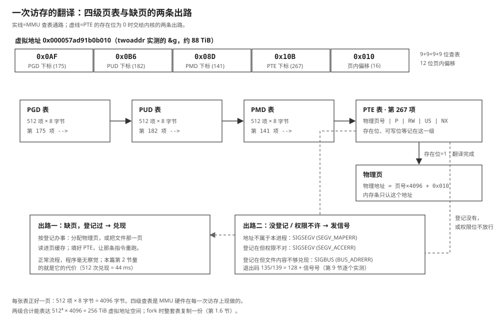

# 09 虚拟内存与 mmap

    实验    Knowledge/labs/00_basics/03_vm_and_mmap/
    电脑    WSL Ubuntu 26.04（内核 6.6.114），gcc 15.2.0
            （本篇"本机实测"均为 2026-10-21 实跑；实验数据文件写在 WSL 的
            ext4 上（$LAB，默认 ~/vmlab），为什么不能放仓库目录，第 10 节）
    板子    100ASK_IMX6ULL Pro，Linux 4.9.88
            （fb 相关结论沿用教程 05 篇 2026-09-14 的归档实测）
    判据    bash Knowledge/labs/00_basics/03_vm_and_mmap/check.sh
            2026-10-21 复核：40 PASS / 0 FAIL / 1 SKIP
            （SKIP 的一条要上板，在第 8 节）

---

**你会在哪里撞见它**：教程 04 篇第 7 节你第一次把 `mmap` 用起来：用它改写
文件拷贝，数了系统调用、量了时间，也撞上了 `SIGBUS`。当时有几件事被按住了
没讲。第一，`mallocsz` 里 `malloc` 了两兆，`strace` 里冒出来的却是一条
`mmap`。第二，下一章把 `/dev/fb0` 映射进程序，往内存里写字，屏幕就变了，
内存和显存隔着一层驱动，一个指针怎么都够得着？第三，教程 00 篇第 7.4 节见过
ASLR，每次运行地址都不同；可两个进程打印同一个变量地址，打出来的数字竟能
一模一样。

这三件事指向同一个根源：**程序里的地址是假的。** 本篇把这个"假"拆开：
它假在哪、谁在翻译、翻译表什么时候建、`mmap` 在其中记了哪一笔，以及越过
边界时硬件和内核各做什么。

**这篇要回答的问题**：

1. 两个进程打出同一个地址，内容却各是各的。这个地址是什么，为什么踩不到
   对方？
2. `mmap` 返回成功时，文件读进来了吗？"映射了 64 MiB"和"占了 64 MiB
   内存"差在哪？
3. 往映射区写，改动去了哪里？`MAP_SHARED` 与 `MAP_PRIVATE` 背后各是什么
   机制？
4. 越过映射的边界，为什么有时挨 `SIGBUS`、有时挨 `SIGSEGV`？

---

## 0 先动手看一眼

实验程序 `lazymap` 映射一个 64 MiB 的文件，在三个时刻各量一次缺页次数和
真实占用的物理内存。编译运行（数据文件要放在 ext4 上，原因见第 10 节）：

```bash
cd Knowledge/labs/00_basics/03_vm_and_mmap
mkdir -p ~/vmlab
gcc -Wall -Wextra lazymap.c -o lazymap
./lazymap ~/vmlab/big.bin
```

本机实测（2026-10-21，WSL，下同）：

```text
文件 64 MiB，页大小 4096 字节，共 16384 页

[1] mmap 之前     次缺页 87       主缺页 2      物理内存 1792 KB
[2] mmap 之后     次缺页 91       主缺页 2      物理内存 1916 KB   （mmap 本身耗时 0.003 ms）
    -> 多了 4 次次缺页、0 次主缺页，124 KB 物理内存

[3] 每页摸一下后  次缺页 603      主缺页 515    物理内存 67452 KB   （摸完耗时 44.293 ms）
    -> 多了 512 次次缺页、513 次主缺页，65536 KB 物理内存
    -> 摸了 16384 页，缺页涨了 1025 次
```

三行各说一句话：`mmap` 64 MiB 花了 0.003 毫秒，文件没读进来；映射完物理
内存只涨了 124 KB；把每一页摸一遍之后，物理内存精确涨了 65536 KB，正好
64 MiB。**"登记"和"兑现"是分开的两步**，这一篇就是把它们拆开讲清。

（"缺页"这个词第一次出现，第 2.1 节正面定义。实验里另有两条纪律：`check.sh`
的判据数值都有容差区间，缺页次数每次运行会差几次，属于正常波动；数据文件
所在目录必须是 ext4，`stat -f -c %T ~/vmlab` 应报 `ext2/ext3` 或 `ext4`。）

---

## 1 地址是假的：虚拟地址与页表

### 1.1 三行输出，一个矛盾

`twoaddr.c` 用 `fork` 造出两个进程，父子各自打印同一个全局变量和同一块堆
内存的地址与内容：

```bash
gcc -Wall -Wextra twoaddr.c -o twoaddr
./twoaddr
```

本机实测：

```text
fork 之前   &g=0x57ad91b0b010  g=111   h=0x57adc39dc010  *h=333
子进程      &g=0x57ad91b0b010  g=222   h=0x57adc39dc010  *h=444
父进程      &g=0x57ad91b0b010  g=111   h=0x57adc39dc010  *h=333
```

三行的 `&g` 一模一样。子进程把它改成 222，父进程读到的还是 111：**同一个
地址数字，两份互不干扰的数据。** 存放数据的内存条只有一套，同一个位置不可
能同时存 222 和 111。矛盾只有一个出口：这个地址不是内存条上的位置。

还有一层更朴素的算术。`0x57ad91b0b010` 折成十进制约 88 TB（87.7 TiB），
而这台机器 `MemTotal` 不到 6 GB（`bigmalloc` 会把它打出来）。程序里随手指
出一个地址，数值就比物理内存大了一万倍。**这个数根本表达不了内存条上的
位置。**

### 1.2 身份：虚拟地址、物理地址、MMU

按真实构造说清这三个名字：

> **虚拟地址**：程序里出现的一切地址（指针的值、`&x` 取到的、跳转目标）。
> 它是一个 48 位的数，只在本进程的"账本"里有意义。
> **物理地址**：内存条上真实的位置，由内存控制器编址。
> **MMU**（memory management unit）：CPU 里负责翻译的硬件。每条访存指令
> 给出虚拟地址，MMU 当场查表翻成物理地址，内存条只收物理地址。
> **页表**：那张账本。内核为每个进程维护一套，MMU 按它翻译。

翻译发生在每一次访存上：程序执行 `mov rax, [0x57ad91b0b010]`，MMU 查这个
进程的页表，得到某个物理地址，访问才发生。表里查不到这一项，CPU 触发一次
异常，控制权交给内核，这就是第 2.1 节的缺页。

**这一节搭好的积木**：程序看到的是虚拟地址，内存条只认物理地址，中间隔着
一套每个进程各一份的页表，翻译由 MMU 硬件每次现做。接下来的问题：多这一层
换来了什么。

### 1.3 必要性：这三个理由，每个单独都成立

如果没有这层翻译，每个程序直接用物理地址，会同时失去三样东西：

```text
 1  隔离        每个进程一套自己的页表。twoaddr 里父子进程的同一个
                虚拟地址,经过各自的表,翻到不同的物理页。A 进程写坏
                自己的内存,碰不到 B：它连能表达 B 那个位置的地址都
                没有
 2  不必连续    程序看到一段连续地址,背后可以是内存条上东一块西一
                块的碎片。页表把不连续的物理页拼成连续的虚拟区间
 3  先记账      表里可以先登记一笔"这段地址将来对应什么",物理内存
                等真用到了再给。mmap 与 malloc 的"秒成功"全靠这一条,
                本篇第 2 节起的主线
```

三条里第三条最反直觉，也最有用：它把"地址空间的大小"和"占用物理内存的
多少"变成了两笔账。第一节的 88 TB 地址、`malloc` 6 GiB 成功、64 MiB 映射
不占内存，全是这一条的推论。

**这一节搭好的积木**：翻译层买来隔离、连续的假象和先记账三个能力。接下来的
问题：这张表长什么样，一个 48 位地址怎么在里面走。

### 1.4 页与页表：48 位地址拆成五段

MMU 不按字节管账，按**页**管：一页 4096 字节（`getconf PAGESIZE` 本机实测
4096）。虚拟地址的低 12 位是**页内偏移**（4096 = 2¹²，一页之内的位置原样
带过去），高 36 位是**页号**，页号才是要翻译的部分。

x86-64 把 36 位页号再切成四段，每段 9 位，分别作四级页表的查表下标。拿
1.1 节那个真实地址拆（每段算出来一个 0～511 的数）：

```text
 VA 0x000057ad91b0b010
    = 0x0AF | 0x0B6 | 0x08D | 0x10B | 0x010
      PGD    PUD    PMD    PTE    页内偏移
      (175)  (182)  (141)  (267)  (16)

 0x0AF:  175  175 = 0x57ad91b0b010 >> 39 & 511   第一级表的下标
 0x0B6:  182  182 = ... >> 30 & 511            第二级
 0x08D:  141  141 = ... >> 21 & 511            第三级
 0x10B:  267  267 = ... >> 12 & 511            第四级
 0x010:   16  一页之内的第 16 个字节
```

四级表是套着的：第一级 PGD 表里第 175 项，指向一张第二级 PUD 表；PUD 表的
第 182 项指向 PMD 表；PMD 的第 141 项指向 PTE 表；PTE 表的第 267 项里才是
这次的答案：**物理页号加权限位**。物理地址 = 物理页号 × 4096 + 页内偏移。

两个数字可以互相印证：每级表 512 项，每项 8 字节，512 × 8 = 4096，
**每张表正好一页**。全套能表达的地址空间 = 512⁴ × 4096 字节 = 256 TiB，
1.1 节那个 88 TB 的地址落在其中。

PTE 里除了物理页号还有几个关键位：**存在位**（这个映射建没建，缺页就是它
报的警）、**可写位**（第 9 节 `PROT_READ` 映射写一下就崩，硬件依据就是它）、
用户/内核位与不可执行位（00 篇 7.5 节往代码里写字挨 `SIGSEGV`，判卷的正是
这几位）。第 9 节会看到每种越界对应哪一位缺。

**这一节搭好的积木**：地址按 12 + 9 + 9 + 9 + 9 拆段，四级表逐级查下去得到
物理页号，权限位记在最末一级。接下来的问题：查不到表项时发生什么。

### 1.5 缺页：查不到表项的那一刻

MMU 查表发现 PTE 的存在位是 0（或者表根本没建），执行这条指令的核当场停下，
发一次异常，跳进内核。内核接手：

```text
 MMU:这一项查不到
   |
   v
 内核:查这段虚拟地址登记的是什么事(第 6 节的 vm_area_struct)
   |
   +-- 登记过:该兑现了。分配物理页 / 把文件那一页读进页缓存,
   |   填好 PTE,让那条访存指令重新执行。程序毫无察觉,
   |   只是这一次访问多花了些时间
   |
   +-- 没登记过:这个地址不属于本进程。发 11 号信号 SIGSEGV,
       进程死,退出码 139 = 128 + 11(第 9 节)
```

注意两头：缺页**不是错误**，登记过的地址第一次访问都要缺一次页，这是正常
流程；只有"根本没登记"才升级成 `SIGSEGV`。第 2 节量到的 512 次缺页、
44 毫秒，就是"兑现"发生了 512 次的总价。

翻译的全程：



图里实线是查表通路，虚线是查不到时的两条出路：左边兑现（正常缺页），右边
发信号。这张图是全篇的地图：第 2 节量"兑现"的价，第 6 节讲登记的两种
归属，第 9 节讲右路怎么走。

**这一节搭好的积木**：缺页是"表项没建"的正常入口，内核按登记兑现或发
`SIGSEGV`。接下来的问题：1.1 节父子进程同一个地址，页表上是怎么各自翻译的。

### 1.6 fork：地址相同，表是两套

`fork` 复制进程时，把父进程的**页表整套抄了一份**给子进程（机制见第 6.4
节的写时复制：两套表先指向同一批物理页，都标成只读）。于是：

```text
 父进程页表:  0x57ad91b0b000 -> 物理页 X
 子进程页表:  0x57ad91b0b000 -> 物理页 X   (fork 那一刻,同一份)
 子进程写 g   -> 写时复制,内核另给一页 Y,把 0x57ad91b0b000 -> Y 记进
                子进程的表(只改子进程这一边)
 此后父子     同一个虚拟地址,各自翻到 X 和 Y,数据分道
```

1.1 节的现象到机制层面就通了：**地址相同是因为两边页表抄自同一份；数据
分道是因为写的时候只改了其中一边的表。** 两套表从 fork 起就是两个独立的
翻译机构，谁也管不着谁。

**这一节搭好的积木**：fork 抄表不抄数据，写时各改各的表。接下来把 1.7 节
的实验做掉，然后进本篇主线：登记与兑现怎么分开量。

### 1.7 实验：同一个地址，两份数据

1.1 节的输出现在每个字都能解释：`&g` 三行相同，因为父子页表在 fork 时抄自
同一份，虚拟地址的翻译路径形状相同；`g` 一边 222 一边 111，因为子进程那次
写触发了写时复制，只把它自己的表改到了新物理页。判据：

    [ ] 三行打印的 &g 是同一个地址
    [ ] 同一个地址，子进程读到 222、父进程读到 111

    注错见红：把子进程里的 g = 222 删掉再跑，"两份数据"一条变红
    （两边都读 111，fork 后没人写就不分裂）。

**第 1 节搭好的积木**：程序里的地址是虚拟地址，MMU 按每进程一套的四级页表
翻译；fork 抄表，写时分裂。回答了开头第一个问题。接下来是本篇主线：
`mmap` 在这套机制里记的是哪一笔，兑现发生在何时。

---

## 2 懒分配：mmap 到底读没读文件

### 2.1 缺页有两种，都能数

第 0 节的三行输出要立住，先得有能量的东西。缺页次数就是：**内核被迫兑现
的次数**，`getrusage(RUSAGE_SELF, &ru)` 的 `ru_minflt`、`ru_majflt` 两个
字段直接给数。缺页分两种：

> **次缺页**（minor fault）：兑现不需要读磁盘。比如物理页已在页缓存里，
> 只差把表项填上。
> **主缺页**（major fault）：兑现要读磁盘。数据还躺在文件里。

另一个数是真实占用：读 `/proc/self/status` 的 `VmRSS` 行（RSS = resident
set size，驻留集），单位 KB。`lazymap.c` 里两个小函数各取一样，三个时刻各
打一次。

### 2.2 mmap 的六个参数

`lazymap.c` 的主线一行（六个参数一个都不能瞎填）：

```c
p = mmap(NULL, SIZE, PROT_READ, MAP_SHARED, fd, 0);
```

    NULL          起始虚拟地址让内核挑。给 NULL 是常规做法
    SIZE          映射多长。64 MiB = 16384 页
    PROT_READ     这段地址的权限:只读。要写就 | PROT_WRITE
    MAP_SHARED    改动与文件的关系:共享,写可见且可写回(第 6 节)
    fd            挂哪个文件
    0             从文件第几个字节开始。必须按页大小对齐

造文件的 `ftruncate(fd, SIZE)` 同样关键：它只把文件长度登记成 64 MiB，
一个数据字节都不写。不撑的话文件是 0 字节，一碰就 `SIGBUS`（第 9 节）。

### 2.3 三时刻实测

第 0 节的输出抄过来对着读：

```text
[1] mmap 之前     次缺页 87       主缺页 2      物理内存 1792 KB
[2] mmap 之后     次缺页 91       主缺页 2      物理内存 1916 KB   （mmap 本身耗时 0.003 ms）
    -> 多了 4 次次缺页、0 次主缺页，124 KB 物理内存

[3] 每页摸一下后  次缺页 603      主缺页 515    物理内存 67452 KB   （摸完耗时 44.293 ms）
    -> 多了 512 次次缺页、513 次主缺页，65536 KB 物理内存
    -> 摸了 16384 页，缺页涨了 1025 次
```

三个结论：

1. **mmap 花了 0.003 毫秒。** 真从盘上读 64 MiB 不可能三微秒完成。它没读。
2. **映射完物理内存只涨 124 KB**，那是程序自己打印输出用的，与映射无关。
   64 MiB 的映射，占用约等于零。
3. **摸完每页，物理内存精确涨 65536 KB = 64 MiB。** 每页只摸了一个字节，
   内核兑现的是整页。**内存的最小交易单位是页，不是字节。**

这就是**懒分配**：`mmap` 只往内核的登记表里加一笔"这段虚拟地址对应那个
文件的这一段"，PTE 一个都不建；第一次访问才缺页、才兑现。好处直接：映射
8 GB 的文件照样瞬间返回，摸过的页才花钱。`read` 做不到：`read(fd, buf,
8G)` 必须老老实实搬完 8 GB。

### 2.4 那个意外：16384 页，缺页只有 1025 次

按第 1.5 节的机制，16384 页第一次访问各缺一次，应该是 16384 次。实测 1025
次（次 512 + 主 513）。差 16 倍，连跑三轮纹丝不动。

这不是测错，是两个内核优化叠在一起。`faults.c` 把它们拆开量，它还能用
`/proc/self/pagemap` 直接看每一页在不在物理内存：

```bash
gcc -Wall -Wextra faults.c -o faults
./faults ~/vmlab/warm.bin 1 16384      # 模式 1:先把每页都写过,数据全在页缓存
./faults ~/vmlab/cold.bin 0 16384      # 模式 0:新造的稀疏文件,数据只在盘上
./faults ~/vmlap/pm.bin  2 256         # 模式 2:摸第 0 页后用 pagemap 看表项
```

本机实测，三段输出：

```text
（模式 1,数据全在页缓存）
摸第 0 页：次缺页
之后缺页发生在页: 16(m) 32(m) 48(m) 64(m) 80(m) 96(m) 112(m) 128(m) 144(m) 160(m) 176(m) 192(m) ...
共 16384 页：次缺页 1024，主缺页 0

（模式 0,冷文件）
摸第 0 页：主缺页
之后缺页发生在页: 16(m) 24(M) 32(M) 48(m) 64(M) 80(m) 96(M) 112(m) 128(M) 144(m) 160(M) 176(m) ...
共 16384 页：次缺页 512，主缺页 513

（模式 2,pagemap）
摸第 0 页：次缺页
摸过第 0 页后，已在内存的页: 0 1 2 3 4 5 6 7 8 9 10 11 12 13 14 15 
（一次缺页顺手建好了 16 页的表项）
之后缺页发生在页: 16(m) 29(m) 45(m) 61(m) 77(m) 93(m) 109(m) 125(m) 141(m) 157(m) 173(m) 189(m) ...
共 256 页：次缺页 17，主缺页 0
```

逐段读：

- **表项一侧，窗口是 16。** 模式 2 的 pagemap 实测：摸第 0 页，内核顺手把
  第 0～15 共 **16 页**的 PTE 全建好了（`fault-around`）。所以热文件每 16 页
  才缺一次：16384 / 16 = **1024 次次缺页**，与模式 1 分毫不差。
- **磁盘一侧，预读窗口是 32。** 冷文件第一次兑现要读盘，内核既然都启动了
  一次读，顺手把相邻的页一起读进来（文件页缓存预读，窗口 32 页）。16384 /
  32 = **512 次主缺页**，模式 0 实测 513（多的一次是摸第 0 页本身）。
- 模式 0 输出里 `m`/`M` 交替，是这两个窗口（表项 16 页、预读 32 页）错位
  叠加的痕迹：到某些页时数据已被上一次预读带进缓存（`m`），到另一些页时
  还在盘上（`M`）。逐页的交替不必背，两个总数各自对得上就行。

**容易以为"每页第一次访问缺一次页"是精确规律；实测要除以 16（表项）甚至
除以 32（含磁盘预读）；原因是进一次内核很贵，内核把相邻页的活一次干完。**
第 7 节还会看到匿名内存没有这个待遇：没有文件可预读，一页就是一页。

**这一节搭好的积木**：`mmap` 不读文件（0.003 ms），兑现发生在缺页（每页
整页给），表项按 16 页一批建、磁盘按 32 页一批读。接下来的问题：能不能
命令内核别懒。

### 2.5 [判] 第 2 节

    [ ] mmap 64 MiB 耗时不到 1 毫秒
    [ ] mmap 之后物理内存增量不到 1 MB
    [ ] 摸完每页后物理内存精确涨 65536 KB
    [ ] 冷文件主缺页 ≈ 页数/32（预读窗口 32 页）
    [ ] 总缺页远小于页数
    [ ] 数据全在页缓存时：次缺页 = 页数/16，主缺页 0
    [ ] pagemap 实测摸第 0 页后 0..15 共 16 页已在内存

    注错见红：把 lazymap.c 的循环改成只摸前四分之一的页
    （i < npages / 4），"物理内存精确涨 65536 KB"一条变红
    （实得 16384 KB；缺页也按 1/4 缩，4384/16 = 274 上下）。

---

## 3 把懒关掉：MAP_POPULATE

### 3.1 先预测，再动手

懒是默认，但内核留了开关：`MAP_POPULATE`，"现在就把表项全建好、页全兑现"。
按第 2 节的机制先预测四个数：mmap 耗时应从微秒涨到毫秒级（活提前干了）；
mmap 后物理内存应直接涨满 64 MiB；摸的时候缺页应为 0；摸的耗时应大幅下降。

只改一个标志：

```bash
sed 's|MAP_SHARED, fd, 0)|MAP_SHARED \| MAP_POPULATE, fd, 0)|' lazymap.c > .pop.c
gcc -Wall -Wextra .pop.c -o .pop
./.pop ~/vmlab/big2.bin
```

### 3.2 实测与并排对照

本机实测：

```text
[1] mmap 之前     次缺页 87       主缺页 2      物理内存 1796 KB
[2] mmap 之后     次缺页 1116     主缺页 2      物理内存 67456 KB   （mmap 本身耗时 12.299 ms）
    -> 多了 1029 次次缺页、0 次主缺页，65660 KB 物理内存

[3] 每页摸一下后  次缺页 1116     主缺页 2      物理内存 67456 KB   （摸完耗时 0.261 ms）
    -> 多了 0 次次缺页、0 次主缺页，0 KB 物理内存
    -> 摸了 16384 页，缺页涨了 0 次
```

| | 默认（懒） | MAP_POPULATE |
|---|---|---|
| mmap 耗时 | 0.003 ms | 12.299 ms |
| mmap 后物理内存增量 | +124 KB | +65660 KB |
| 摸 16384 页的缺页 | 1025 次 | 0 次 |
| 摸的耗时 | 44.293 ms | 0.261 ms |
| **总耗时** | **44.30 ms** | **12.56 ms** |

四条预测全中，还多送一条：**总时间上不懒的反而快了三倍多**（12.56 对
44.30）。批量把 16384 个表项一次建完，比分 1025 次陷进内核便宜得多。

所以懒分配省的不是时间，是**"你可能根本用不到的那部分"的物理内存**：

    确定全部用到        MAP_POPULATE 又快又免缺页
    只用一小部分        默认的懒,没摸过的页一分钱不花
    映射远大于内存的文件 必须懒,不懒物理内存直接不够

### 3.3 [判] 第 3 节

    [ ] POPULATE 版 mmap 比默认版慢三个数量级上下
    [ ] POPULATE 版 mmap 之后物理内存就已涨满 64 MiB
    [ ] POPULATE 版摸页时缺页增量为 0
    [ ] 两版总耗时相比 POPULATE 更小

    注错见红：把 MAP_POPULATE 用到 8 GiB 的映射上（把 lazymap.c 的
    MB 改成 8192），本机物理内存不够，mmap 会失败或长时间交换；
    默认的懒版本映射 8 GiB 仍是微秒返回。懒为什么是默认，这一条就是答案。

---

## 4 地址空间的样子：/proc/self/maps 逐列读

### 4.1 全景

内核把每个进程的登记表（准确名字是 `vm_area_struct` 链表，第 6 节还会见到）
的摘要开在 `/proc/<pid>/maps` 里，读自己的就是 `/proc/self/maps`。教程 00
篇第 7.3 节读过一次纯程序的；`mapshow.c` 映射一个 8 MiB 文件之后把全文打
出来：

```bash
gcc -Wall -Wextra mapshow.c -o mapshow
./mapshow ~/vmlab/map8.bin
```

本机实测（`mapshow` 的路径前缀略去；这篇关心的行加粗说明写在下面）：

```text
mmap 返回的地址: 0x7db59e600000（在下面的 maps 里找包含它的那一行）

589905285000-589905286000 r--p 00000000 00:48 5066549580793153  .../labs/.../mapshow
589905286000-589905287000 r-xp 00001000 00:48 5066549580793153  .../labs/.../mapshow
589905287000-589905288000 r--p 00002000 00:48 5066549580793153  .../labs/.../mapshow
589905288000-589905289000 r--p 00002000 00:48 5066549580793153  .../labs/.../mapshow
589905289000-58990528a000 rw-p 00003000 00:48 5066549580793153  .../labs/.../mapshow
58993d856000-58993d878000 rw-p 00000000 00:00 0                 [heap]
7db59e600000-7db59ee00000 r--s 00000000 08:20 344119            /home/glorinz/vmlab/map8.bin
7db59f000000-7db59f028000 r--p 00000000 08:20 41605             /usr/lib/x86_64-linux-gnu/libc.so.6
7db59f028000-7db59f1c0000 r-xp 00028000 08:20 41605             /usr/lib/x86_64-linux-gnu/libc.so.6
...（libc 还有四行；后面是 ld.so、[stack]、[vvar]、[vdso]）
```

第一行先对一笔账：mmap 返回 `0x7db59e600000`，和 `map8.bin` 那行的起点
一字不差；终点减起点 = `0x7db59ee00000 - 0x7db59e600000` = `0x800000` =
8388608 字节 = 8 MiB，一个字节不差。

### 4.2 八列逐列读

每行的格式：

```text
起地址-止地址 权限 偏移   设备  inode     路径
7db59e600000-7db59ee00000 r--s 00000000 08:20 344119 /home/glorinz/vmlab/map8.bin
```

- **起-止**：这段虚拟地址的范围。止地址是开区间（不含），差值即长度。
- **权限**：`r` 可读、`w` 可写、`x` 可执行；第四位 `s`/`p` 是共享/私有，
  本篇第 6 节的主角。权限是按段给的：程序自己的五行里 `r-xp` 是代码
  （可执行不可写），`rw-p` 是数据；00 篇 7.5 节往代码段写一个字就挨
  `SIGSEGV`，判卷的就是这一列在 PTE 里的投影（第 1.4 节）。
- **偏移**：这段对应文件内的起始偏移。`map8.bin` 是 0；libc 的代码段是
  `00028000`，即从文件 0x28000 处开始那一段被映射进来（01 篇讲的
  LOAD segment 在这里现形）。
- **设备与 inode**：这段背后是哪个文件系统上的哪个文件。`00:00 0` 表示
  不挂文件（`[heap]`、`[stack]`、匿名区，第 7 节）。
- **路径**：挂的文件；方括号里的名字（`[heap]`、`[stack]`、`[vdso]`）是
  内核给特殊区间起的代号。

再看三件正事：

1. **程序自己就是被映射进来的。** 前五行 `mapshow` 是 `execve` 建的映射，
   和你手写 `mmap` 是同一机制，只是执行者是内核的加载器（00 篇第 7 节）。
   所以程序启动也懒：`exerss` 程序读 `/proc/self/smaps`，把自己的映射
   Size 与 Rss 加起来对照文件本身（本机实测）：

   ```text
   程序文件 16528 字节（17 KB）
   它的几段映射合计 Size 20 KB，Rss 20 KB
   ```

   换成静态链接版（`gcc -static exerss.c -o exerss_static`，文件 999080
   字节）：

   ```text
   程序文件 999080 字节（976 KB）
   它的几段映射合计 Size 884 KB，Rss 688 KB
   ```

   976 KB 的程序，真正进物理内存的只有 688 KB：**execve 同样只登记，代码
   被执行到哪一页才读哪一页。** 一个 800 KB 的静态程序，没走过的分支可能
   一个字节都没进过内存。

2. **libc 的行是 `p`（私有）。** 全系统上百个进程共用同一份 libc 的物理页
   （第 6.4 节讲 `p` 怎么做到"平时共享、写时分裂"）。

3. **`map8.bin` 的行是 `r--s`。** 我们 `mmap` 时给的就是 `PROT_READ` 加
   `MAP_SHARED`，maps 忠实记下了这两个选择。

### 4.3 [判] 第 4 节

    [ ] maps 里找得到映射文件那一行
    [ ] 该行权限是 r--s（PROT_READ + MAP_SHARED）
    [ ] 该行起止差值精确等于映射长度（8388608 字节）
    [ ] 静态程序 Size 884 KB、Rss 688 KB，说得出差在哪（没执行到的页）

    注错见红：把 mapshow.c 的 PROT_READ 改成 PROT_READ|PROT_WRITE 再跑，
    "权限是 r--s"一条变红（实得 rw-s）。

---

## 5 页缓存：mmap 的指针为什么能直接指到文件

第 2 节说兑现时"把文件那一页读进来"。读到了哪里？

> **页缓存（page cache）**：内核在内存里给磁盘文件留的缓存，组织单位是页。
> `read` 一个文件，数据先从盘进页缓存，再从页缓存拷进你的缓冲区；第二次读
> 同一文件就不碰盘了。`mmap` 的兑现走的也是页缓存：缺页时内核把文件那一页
> 读进页缓存，然后**把这同一个物理页填进你的页表**。

于是两条路线的差别只剩一句话：`read` 多一次"页缓存到用户缓冲区"的拷贝，
`mmap` 的指针直接就是页缓存那页的虚拟地址。图：

```text
 read:  磁盘 --> 页缓存 --> 你的 buf        (两次搬运,系统调用一次一截)
 mmap:  磁盘 --> 页缓存 = 你的映射页        (页缓存直接映射给你)
```

（原理归原理，快慢要量。04 篇 7.2 节已经量过：8 MiB 文件，`read` 版
4096 次系统调用，`mmap` 版 1 次，耗时在本机多轮测试中互有胜负。系统调用
次数少三千倍不等于快三千倍；报性能必须报时间。）

页缓存同时回答了第 2.4 节一个现象：热文件的缺页全是次缺页：数据早就在
页缓存里，缺的只是表项；冷文件才有主缺页，才谈得上磁盘预读。

**这一节搭好的积木**：兑现的去处是页缓存，mmap 的映射页与页缓存是同一批
物理页。接下来的问题：写这批页，改动算谁的。

---

## 6 MAP_SHARED 与 MAP_PRIVATE：写进去的东西去了哪

### 6.1 问题

第 5 节的结论往前推一步就出事：如果"写映射就是写页缓存"，那 libc 的数据
段也是映射进来的，一个进程改自己的全局变量就改了页缓存，全系统的进程跟着
变，还会写回 libc 文件。所以登记表里必须有一个字段区分两种归属，`mmap`
第四个参数就是它：

    MAP_SHARED    改动写进共享的那份。别的进程看得见,最终可写回文件
    MAP_PRIVATE   写的时候内核复制一份私有的给你。别人看不见,文件不变

### 6.2 三方对质的实验

`shared_private.c` 让一个进程往映射区写 5 个 B（文件原本 10 个 A），然后
另一个进程映射同一文件来读，最后用普通 `read` 看文件里到底存了什么：

```bash
gcc -Wall -Wextra shared_private.c -o shared_private
./shared_private ~/vmlab
```

本机实测：

```text
往映射区写 5 个 B（文件原本是 10 个 A）：

  MAP_SHARED   另一个进程映射同一文件看到: BBBBBAAAAA
  MAP_SHARED   文件里最终存的是          : BBBBBAAAAA

  MAP_PRIVATE  另一个进程映射同一文件看到: AAAAAAAAAA
  MAP_PRIVATE  文件里最终存的是          : AAAAAAAAAA
```

同一段 `memcpy(p, "BBBBB", 5)`，两种标志下另外两方的答案完全相反。注意
`MAP_PRIVATE` 那次**没有任何报错**，`msync` 也返回成功：数据只是无声地
留在私有副本里，进程退出就没了。这是最难查的一类 bug：没有错误提示，只是
你写的东西"不见了"。

### 6.3 机制：写时复制

`MAP_PRIVATE` 的实现就是第 1.6 节 fork 用的那招：

> **写时复制（copy-on-write，COW）**：映射刚建立时不复制，所有进程的页表
> 指向页缓存里同一批物理页，但 PTE 全标成只读。谁第一次往某页写，MMU 发现
> 不可写，缺页（第 1.5 节那条右路的一种）；内核查登记发现是 PRIVATE，
> 于是复制**这一页**、把新页填进**这个进程**的页表并恢复可写，指令重跑。
> 没写过的页永远共用同一份物理内存。

复制粒度是页（4096 字节），不是整个映射。libc 一兆的数据段被某个进程改了
一页，只有那一页分裂出副本，其余照旧共享。这也是 maps 里 libc 那几行 `p`
的含义：平时共享，写了才分裂。

`MAP_SHARED` 则不走这套：PTE 本来就可写（权限允许时），写就是写页缓存里
那一份。别的进程映射同一文件，读到的是改后的；要不要落盘由内核择机
（或 `msync` 催），第 10 节的探针会验证"确实落了"。

### 6.4 什么时候用哪个

    进程间共享内存              MAP_SHARED,写进去对方立刻看得见
    加载动态库的数据段           MAP_PRIVATE,各进程改各的
    framebuffer(第 8 节)        必须 MAP_SHARED:你要的就是写内存=写显存,
                                写进私有副本屏幕不会有任何反应
    只读一个大文件              PROT_READ 加哪个标志都行,反正不写

**这一节搭好的积木**：SHARED 写页缓存，PRIVATE 走 COW 按页复制；fork 的
"同地址两份数据"和 PRIVATE 的"写不见"是同一机制的两面。回答了开头第三个
问题。接下来的问题：不挂文件的映射长什么样，malloc 的地盘就是它。

### 6.5 [判] 第 6 节

    [ ] MAP_SHARED：另一个进程看到 BBBBBAAAAA，文件里也是 BBBBBAAAAA
    [ ] MAP_PRIVATE：另一个进程看到 AAAAAAAAAA，文件里还是 AAAAAAAAAA
    [ ] MAP_PRIVATE 那次写没有任何报错

    注错见红：把 shared_private.c 里 MAP_PRIVATE 那次调用改成
    MAP_SHARED 再跑，两组输出应当变得完全相同；改回后再次相反。
    这是全篇唯一"只改一个常量、行为彻底反转"的地方，值得亲手来回切两次。

---

## 7 匿名映射：不挂文件的 mmap

### 7.1 malloc 的地盘从哪来

malloc 大块内存时没有文件可挂，但它要的同样是"登记一段虚拟地址、用的时候
再给物理页"。内核提供的写法是 `MAP_ANONYMOUS`：不挂文件，`fd` 传 -1、
偏移传 0，登记表里记"这段地址对应一片刚清零的内存"。

```bash
gcc -Wall -Wextra anon.c -o anon
./anon
```

`anon.c` 映射 1 GiB 匿名内存，四个时刻各量一次。本机实测：

```text
匿名映射 1024 MiB，页大小 4096 字节，共 262144 页

[1 mmap 之前    ] 次缺页 87       主缺页 2      物理内存 1792 KB
    -> 多了 0 次次缺页、0 次主缺页，0 KB 物理内存
[2 mmap 之后    ] 次缺页 90       主缺页 2      物理内存 1916 KB
    -> 多了 3 次次缺页、0 次主缺页，124 KB 物理内存
[3 每页读一下后 ] 次缺页 262234   主缺页 2      物理内存 1916 KB
    -> 多了 262144 次次缺页、0 次主缺页，0 KB 物理内存
[4 每页写一下后 ] 次缺页 524378   主缺页 2      物理内存 1050492 KB
    -> 多了 262144 次次缺页、0 次主缺页，1048576 KB 物理内存
```

### 7.2 逐行读：读不涨、写涨满

三行是三个结论：

1. **映射 1 GiB，物理内存纹丝不动**（[2]，+124 KB 是程序自己的）。
2. **每页读一下，262144 次缺页，物理内存涨 0。** 每页都缺（注意：匿名页
   **没有**第 2.4 节的 16 页优惠：没有文件就没有预读和 fault-around 可搭，
   一页就是一页），缺页后内核给的是**同一个清零页**（零页，全系统共享的
   只读物理页）。读零不需要每人一份零。
3. **每页写一下，又是 262144 次缺页，物理内存精确涨 1048576 KB = 1 GiB。**
   写零页触发 COW（第 6.3 节同一机制）：内核才给每个页分配真正的物理页。
   匿名内存是"第一次写才算数"。

### 7.3 malloc 就走这条道

`mallocsz` 两次申请，`strace` 盯住看各走哪条道：

```bash
strace -e trace=mmap,brk ./mallocsz
```

本机实测（关键两行）：

```text
brk(0x5d2a2fxxx000)                     = 0x5d2a2fxxx000     （64 KiB 那次,小申请从堆里切）
mmap(NULL, 2101248, PROT_READ|PROT_WRITE, MAP_PRIVATE|MAP_ANONYMOUS, -1, 0) = 0x7119649ff000
                                                             （2 MiB 那次,单独 mmap 一段匿名区）
```

小于阈值的申请由 malloc 在堆（`[heap]`，`brk` 撑大的那块）里切；大于阈值
的申请，malloc 自己向内核要一段匿名映射。第 4.2 节 maps 里 `[heap]` 行
`00:00 0` 不挂文件的原因也在这：堆的底层增长靠 `brk`，本质也是匿名内存。

`bigmalloc` 把这条道推到极限：

```bash
./bigmalloc 2 4
```

本机实测：

```text
MemTotal 6069380 KB，SwapTotal 0 KB，overcommit_memory = 0
malloc(2 GiB) = 成功     累计持有 2 GiB   VmRSS 1856 KB
malloc(4 GiB) = 成功     累计持有 6 GiB   VmRSS 1860 KB
```

物理内存不到 6 GB，`malloc` 累计拿到 6 GiB 仍报告成功，`VmRSS` 只有
1860 KB：登记与兑现分离到这个程度，**申请成功只说明登记表里多了一笔**。
代价也在这：真的把 6 GiB 全写满，这台机器拿不出那么多物理页，内核要么换页
要么按 overcommit 的规则杀进程（本机 `overcommit_memory = 0`，启发式
应答；这也是为什么有时"malloc 成功的程序"死于 `SIGSEGV`，第 12 篇的
话题）。

**这一节搭好的积木**：匿名映射登记"一段清零的内存"，读共享零页、写才分配；
malloc 大申请就是它；申请成功不等于内存够用。回答了开头第二问的另一半。

### 7.4 [判] 第 7 节

    [ ] 匿名 mmap 1 GiB 之后物理内存增量不到 1 MB
    [ ] 读匿名内存：每页都缺页（262144 次，没有 fault-around）
    [ ] 读匿名内存：物理内存不涨（零页是共享的）
    [ ] 写匿名内存：物理内存精确涨 1 GiB（1048576 KB）
    [ ] 写匿名内存：又是逐页一次缺页（262144 次）
    [ ] strace 可见 2 MiB 的 malloc 走 mmap(MAP_ANONYMOUS)

    注错见红：把 anon.c 读循环里 p[i*pagesz] 改成 p[i]（都在第一页里摸），
    "每页都缺页"一条变红（缺页跌到个位数）。

---

## 8 映射设备内存：/dev/fb0 的三个差别

### 8.1 显存也是 mmap 进来的

教程 05 篇第 1.4 节把 framebuffer 映射进程序：

```c
unsigned char *fb_base = mmap(NULL, size, PROT_READ | PROT_WRITE, MAP_SHARED, fd, 0);
```

这里的 `fd` 打开的是 `/dev/fb0`，设备文件（10 篇讲它怎么找到驱动）。映射
设备内存和映射普通文件是同一个 `mmap`、同一套登记与缺页流程，但有三个差别，
每个都能在 maps 和归档输出里看到。

### 8.2 三个差别

**差别一：offset 不是文件偏移，是设备的物理地址。** 教程 05 篇 2026-09-14
板上归档的 `fbset -i` 输出里有：

```text
[fix] id=mxs-lcdif smem_start=0x8c100000 smem_len=33554432 line_length=4096
```

`smem_start` 是显存在物理地址空间里的起点。映射设备时 offset 参数给的就是
它（05 篇 1.4 节：驱动侧 `mxsfb_mmap` 把从 `smem_start` 起的物理页填进
你的页表）。普通文件的 offset 必须按页对齐，设备的 offset 是驱动解释的。

**差别二：必须 MAP_SHARED。** 你要的就是"写内存等于写显存"：写必须落到
设备那一份上。用 `MAP_PRIVATE` 的话 COW 给你一份普通内存副本，程序不报错、
逻辑全对、屏幕一片漆黑。05 篇的实验在电脑上的假显存（一个普通文件）上做，
栽过这一跤；上真设备只有 SHARED 一条路。

**差别三：没有页缓存这一层。** 第 5 节的页缓存是给磁盘文件的；设备内存的
兑现不走它，改动的去向由驱动决定（fb 的显存一写，LCD 控制器下一帧就扫出去）。
maps 里的痕迹是权限位第四个字母：板上 `/dev/fb0` 的映射行是 `rw-s`，和
本机 `map8.bin` 的 `r--s` 同一个 `s`，但背后已不是页缓存而是设备
（2026-09-14 归档；check.sh 里这条判据标 SKIP，等下一次上板复测）。

### 8.3 [判] 第 8 节

    [ ]（板上）maps 里 /dev/fb0 那一行权限是 rw-s
    [ ]（板上）该行偏移列等于 fb_fix_screeninfo 的 smem_start
    [ ] 说得出设备映射与文件映射的三个差别

    注错见红（电脑侧可做）：把 05 篇假显存实验的 MAP_SHARED 改成
    MAP_PRIVATE，"关掉程序后文件内容变了"那条判据变红（写进私有副本，
    文件不变）。

---

## 9 映射的边界：SIGBUS 与 SIGSEGV

### 9.1 先看三段：文件内、页内补零、页外

04 篇 7.3 节已经量过使用规则（空文件不能映射、长度按页取整、越界挨
SIGBUS）。这一节把"越界那一刻硬件和内核各做了什么"拆开。`sigbus.c` 造一个
3 字节的文件，却映射 8192 字节（两页）：

```bash
gcc -Wall -Wextra sigbus.c -o sigbus
./sigbus ~/vmlab/tiny.bin 0
./sigbus ~/vmlab/tiny.bin 1
```

本机实测：

```text
（模式 0:安全范围）
p[0]    = 'a'   （文件里真有这个字节）
p[100]  = 0     （第一页里、文件外：读到 0，不报错）
p[4095] = 0     （第一页最后一个字节，仍然安全）

（模式 1:第二页）
正要读 p[5000]（第二页，完全在文件之外）...
Bus error
exit=135
```

三段边界，一段一个行为：

```text
 p[0..2]      文件内容,正常
 p[3..4095]   第一页内、文件外:读到 0。mmap 按页兑现,内核把这一页
              兑出来时,文件没有的部分补零
 p[5000]      第二页,文件连一页都凑不齐:SIGBUS,退出码 135 = 128 + 7
```

### 9.2 五种出界情形，各挨各的信号

`oob.c` 把"越界"细分成五种，装了信号处理函数把内核递来的细节
（`si_code`、出错地址相对映射起点的偏移）打印出来再按默认动作死：

```bash
gcc -Wall -Wextra oob.c -o oob
./oob ~/vmlab eof
./oob ~/vmlab trunc
./oob ~/vmlab unmap
./oob ~/vmlab prot
./oob ~/vmlab close
```

本机实测，五段：

```text
（eof:文件 3 字节,映射 8192,读 p[5000]）
收到 SIGBUS  si_code=2(BUS_ADRERR)  出错地址 = 映射起点 + 5000

（trunc:文件 8192,读完 p[5000] 后把文件截成 3 字节再读）
文件 8192 字节，读 p[5000] = 0
把文件截成 3 字节，再读 p[5000] ...
收到 SIGBUS  si_code=2(BUS_ADRERR)  出错地址 = 映射起点 + 5000

（unmap:munmap 掉第二页后再读 p[5000]）
文件 8192 字节，读 p[5000] = 0
munmap 掉第二页，再读 p[5000] ...
收到 SIGSEGV  si_code=1(SEGV_MAPERR)  出错地址 = 映射起点 + 5000

（prot:PROT_READ 映射,往 p[0] 写）
PROT_READ 映射，读 p[0] = 'a'
往 p[0] 写 'X' ...
收到 SIGSEGV  si_code=2(SEGV_ACCERR)  出错地址 = 映射起点 + 0

（close:mmap 之后 close(fd),照常读写）
close(fd) 之后读 p[0] = 'a'
close(fd) 之后写 p[1]，再读回 = 'B'
```

五段合成一张表，对应第 1.5 节缺页两条出路的细化：

| 情形 | 信号 | si_code | 内核的判定 |
|---|---|---|---|
| 映射长度超过文件（eof） | SIGBUS | BUS_ADRERR | 登记在，但底下没有文件内容可兑现 |
| 映射后文件被截短（trunc） | SIGBUS | BUS_ADRERR | 同上：曾经常见 bug，别的进程 truncate 了你正映射的文件 |
| munmap 掉那页（unmap） | SIGSEGV | SEGV_MAPERR | 登记没了，地址不属于本进程 |
| 权限不许（prot） | SIGSEGV | SEGV_ACCERR | 登记在，PTE 权限位不放行（第 1.4 节那几位） |
| close(fd) 之后（close） | 不崩 | 无 | fd 和映射是两笔独立的账；映射只有 munmap 能取消 |

**SIGBUS 与 SIGSEGV 的分界**：SIGSEGV 是"这个虚拟地址没有合法登记或权限
不对"（野指针、use-after-free、`munmap` 之后、只读映射去写）；SIGBUS 是
"登记在，但底下没有东西可兑现"（映射长度超过文件当前长度、文件被截短）。
排查口径随之：

    看到 SIGSEGV -> 查指针:越界、free 后又用、munmap 后又用、权限
    看到 SIGBUS  -> 查映射:长度算过头没有?文件是不是被别人截短了?

第二种尤其阴险：程序跑得好好的，别人 truncate 了文件，你下次访问那页才崩，
崩的位置离事故现场很远。

还有一个注错时的反例值得记：把映射长度从 8192 改成 4096，指望 `p[5000]`
变成 `SIGSEGV`。本机实测它没崩，读出 0。映射区之外那块地址未必空着，可能
被别的映射占着。"越界必崩"是错误直觉，越界的后果是未定义，不崩比崩更
常见，也更难查。

### 9.3 [判] 第 9 节

    [ ] p[0] 是文件里真有的 'a'；p[100]、p[4095] 读到 0 且不崩
    [ ] 读 p[5000] 挨 SIGBUS（退出码 135 = 128+7）
    [ ] 空指针解引用是 SIGSEGV（退出码 139 = 128+11）
    [ ] 空文件（length=0）映射失败，返回 MAP_FAILED
    [ ] 说得出 SIGBUS 与 SIGSEGV 的分界，五种情形各归各的信号

    注错见红：造文件时加一行 ftruncate(fd, 8192) 把文件撑到两页，
    "读 p[5000] 挨 SIGBUS"一条变红（读出 0，退出码 0）。崩不崩取决于
    底下有没有东西可兑现，这正是 SIGBUS 的定义。

---

## 10 稀疏文件：同一条原理在文件系统上

### 10.1 问题

懒分配是"先记账、用到才兑现"。文件系统按块记账，那么跳过一大段不写，那段
占不占磁盘？`lseek` 到 1 MiB 处写 4 个字节，文件的逻辑大小是 1048580 字节，
中间 1 MiB 从没写过：

```bash
mkdir -p ~/vmlab && cd ~/vmlab
dd if=/dev/zero of=sp.bin bs=1 count=4 seek=1048576 status=none
stat -c %s sp.bin        # 逻辑大小
du -h sp.bin             # 实际占盘
stat -c %b sp.bin        # 占了几个 512 字节块
dd if=sp.bin bs=1 skip=500000 count=4 status=none | od -An -tu1   # 空洞里是什么
```

- `seek=1048576`：先跳过 1 MiB 再写，中间没写过的地方就是洞。
- `stat -c %b`：占用的 512 字节块数。

本机实测（ext4 上）：

```text
1048580        逻辑大小
4.0K           实际占盘
8              占了 8 个 512 字节块 = 4096 字节
   0   0   0   0   空洞里读出来全是 0
```

逻辑一兆，实占四千字节。从没写过的区间，文件系统不给磁盘块，只在元数据里
记一句"这段是空的"；读它返回 0。带洞的文件叫**稀疏文件**。`lazymap` 造
64 MiB 文件用的 `ftruncate` 也一样：只登记长度，不占盘（所以第 2 节的
实验在盘上没花 64 MiB）。和页表先记账是同一条原理，一个在内存（页），
一个在盘（块）。

### 10.2 换个目录，结论翻转

同一条 `dd`，在仓库所在的 Windows 盘上跑（WSL 把它挂成 v9fs）：

```bash
cd /mnt/e/Workspace/Embeded/Embedded-linux/Knowledge/labs/00_basics/03_vm_and_mmap
dd if=/dev/zero of=.sp.bin bs=1 count=4 seek=1048576 status=none
stat -c %b .sp.bin
rm .sp.bin
```

本机实测：

```text
2056            占了 2056 个块,空洞被老老实实写成了真的 0
```

8 块对 2056 块，结论完全相反，而两边的命令一字不差、报错一个都没有。
`stat -f -c %T` 查文件系统类型：`~/vmlab` 是 `ext2/ext3`，仓库目录是
`v9fs`（WSL 到 Windows 盘的转换层，不支持稀疏文件）。这也是本篇 check.sh
坚持把数据文件写在 `$LAB`（默认 `~/vmlab`）的原因。

**"在我机器上跑出来是这样"，必须带上是在哪个文件系统上。** 换个目录结论
就可能翻转，而且不报错。

### 10.3 [判] 第 10 节

    [ ] ext4 上：逻辑大小 1048580 字节，实际占 8 个块
    [ ] 空洞里读出来全是 0
    [ ] 同一条命令在 v9fs 上占 2000 块以上
    [ ] 能用 stat -f 查出两个目录文件系统类型不同
    [ ] probe：这个目录上 MAP_SHARED 写回有效（第 6 节的落盘验证）

    注错见红：把实验目录改到 /mnt/e 再核对"占 8 个块"那条，它必须失败。
    如果它没失败，说明你的 ~ 也在 Windows 盘上，本节所有数据要重新跑。

---

## 速查清单

每条标依据。本机实测均为 2026-10-21（WSL Ubuntu 26.04，内核 6.6.114，
页 4096 字节）；板上结论沿教程 05 篇 2026-09-14 归档。

**登记的三个时刻**（第 2、6、9 节实测）：

| 时刻 | 进程看到什么 | 内核做了什么 | 物理内存 |
|---|---|---|---|
| mmap 返回时 | 一段虚拟地址 | vm_area_struct 里登记一笔 | 通常没动 |
| 第一次访问某页 | 正常读写 | 缺页兑现：读文件进页缓存/分配页，填 PTE | 这时才花 |
| munmap 之后 | 地址失效 | 撤销登记 | 再用就是 SEGV_MAPERR |

**保护标志 prot**（man 2 mmap；第 9.2 节实测 ACCERR）：

| 标志 | 含义 |
|---|---|
| `PROT_NONE` | 不可访问 |
| `PROT_READ` / `PROT_WRITE` / `PROT_EXEC` | 可读 / 可写 / 可执行 |

**映射标志 flags**（第 3、6、7 节实测）：

| 标志 | 含义 |
|---|---|
| `MAP_SHARED` | 改动写共享份，可见、可写回（设备映射必用） |
| `MAP_PRIVATE` | 写时复制，改动私有、不写回 |
| `MAP_ANONYMOUS` | 不挂文件，fd 传 -1（malloc 大块的地盘） |
| `MAP_POPULATE` | 登记时就把表项全建好（总耗时常常反而省） |
| `MAP_FIXED` | 强制用给定地址，危险，可覆盖已有映射 |

**两个信号与 si_code**（第 9 节实测）：

| 信号 | si_code | 含义 | 退出码 |
|---|---|---|---|
| SIGBUS | BUS_ADRERR | 登记在，文件内容不够兑现 | 135 = 128+7 |
| SIGSEGV | SEGV_MAPERR | 地址没有登记 | 139 = 128+11 |
| SIGSEGV | SEGV_ACCERR | 登记在，权限位不放行 | 139 = 128+11 |

**数字表**（本机实测，随内核版本会变，以自己机器为准）：

| 数 | 值 | 出处 |
|---|---|---|
| 页大小 | 4096 字节 | getconf PAGESIZE |
| fault-around 窗口 | 16 页（PTE） | pagemap 实测（2.4 节） |
| 文件预读窗口 | 32 页（冷文件主缺页 = 页数/32） | 2.4 节 |
| 匿名页 fault-around | 无，一页一次 | 7.2 节 |
| malloc 大块阈值 | 2 MiB 走 mmap，64 KiB 走 brk | strace 实测（7.3 节） |
| 页表 | 每级 512 项 × 8 字节 = 一页；四级共 256 TiB | 1.4 节 |

**排查工具**（本机实测）：

| 命令 | 回答什么 |
|---|---|
| `getrusage` 的 ru_minflt/ru_majflt | 缺页计数（程序内） |
| `/proc/self/status` 的 VmRSS | 真实占用 |
| `/proc/self/maps`、`/proc/self/smaps` | 登记表摘要/明细（含每段 Rss） |
| `/proc/self/pagemap` | 每一页在不在物理内存 |
| `stat -f -c %T 目录` | 文件系统类型（稀疏文件判据的前提） |
| `stat -c %s / %b`、`du -h` | 逻辑大小 / 实占块 |
| `strace -e trace=mmap,brk` | malloc 到底调了什么 |

---

## 回看

整篇从"两个进程同一个地址"出发，每一步都被上一步逼出来：

| 问题 | 答案 | 证据在哪 |
|---|---|---|
| 同一个地址为什么两份数据 | 地址是虚拟的，fork 抄表、写时各改各的 | 1.1、1.6、1.7 |
| 谁在翻译 | MMU 按每进程四级页表现场翻，48 位拆 9+9+9+9+12 | 1.2、1.4 |
| 查不到表项会怎样 | 缺页：登记过就兑现，没登记发 SIGSEGV | 1.5 |
| mmap 读文件了吗 | 没有，0.003 ms 只登记；兑现按页在缺页时 | 2.3 |
| 16384 页为什么只缺 1025 次 | 表项按 16 页一批（fault-around），盘按 32 页预读 | 2.4，pagemap 实测 |
| 关掉懒会怎样 | mmap 慢三个数量级，摸页零缺页，总耗时反而省 | 3.2 |
| 程序自己怎么进内存的 | execve 同一套映射，同样懒（976 KB 只进 688 KB） | 4.2，exerss |
| mmap 快在哪 | 指针直接指页缓存，省一次拷贝（不必然省时间） | 5，t04 7.2 |
| 写映射改动去哪 | SHARED 写页缓存；PRIVATE COW 按页复制 | 6.2、6.3 |
| malloc 的地盘 | 匿名映射：读共享零页，写才分配；申请成功≠内存够 | 7.2、7.3 |
| 显存怎么映的 | 同一 mmap：offset=物理地址、必须 SHARED、无页缓存 | 8，t05 1.4 |
| 越界挨什么 | 有登记没兑现=SIGBUS；没登记或权限不许=SIGSEGV | 9.2，si_code 实测 |
| 一兆的文件为什么只占 4 KB | 稀疏文件：没写过的不给块；换文件系统会翻转 | 10.1、10.2 |

---

## 带走

开头四个问题的答案：

1. **地址是虚拟的。** 每个进程一套四级页表，MMU 逐级翻译；fork 抄表，写时
   复制让同一地址在两边翻到不同物理页。隔离、连续假象、先记账，全从这层
   翻译来。
2. **mmap 只登记，不读文件。** 64 MiB 映射 0.003 ms、物理内存不动；访问到
   哪页才兑现哪页（整页给，表项按 16 页顺手建，磁盘按 32 页预读）。
   "映射多大"和"占多少内存"是两笔账，看占用要读 VmRSS。
3. **写映射的去向由登记决定。** SHARED 写页缓存，别人看得见、可写回；
   PRIVATE 触发 COW，按页复制私有副本，不报错也不落盘。fork 的分裂与
   PRIVATE 的"写丢了"是同一机制。
4. **越界的信号分两种。** SIGSEGV 是没登记（SEGV_MAPERR）或权限不许
   （SEGV_ACCERR）；SIGBUS 是登记在但文件内容不够兑现（BUS_ADRERR），
   包括映射后文件被别人截短。close(fd) 不取消映射。

### 看到什么，就先想到什么

| 看到的东西 | 第一反应 |
|---|---|
| 映射很大、VmRSS 很小 | 正常，登记 ≠ 兑现；看真正摸过多少页 |
| 写了 PRIVATE 映射，文件没变还无报错 | 标志用错；msync 救不回私有副本 |
| SIGBUS，退出码 135 | 映射长度超文件，或文件被截短；核对当前文件长度 |
| SIGSEGV，退出码 139 | 没登记或权限不许：野指针 / munmap 后又用 / 只读映射去写 |
| 读大块 malloc 来的内存，一读全是 0 | 零页共享；第一次写才真正分配 |
| 逻辑大小和 du 差几个数量级 | 稀疏文件；先 stat -f 看文件系统 |
| malloc 巨块成功随后离奇死 | overcommit：登记成功不等于物理内存够 |

---

## 接下来

- [12 进程与信号](12_进程与信号.md)：`SIGBUS`/`SIGSEGV` 都是信号；它们怎么
  递、默认动作是什么、能不能接住。
- [08 文件描述符与 VFS](08_文件描述符与VFS.md)：`mmap` 落到驱动侧是
  `f_op->mmap` 这个函数指针；设备映射（第 8 节）就是它分岔出去的。
- 教程里的位置：04 篇第 7 节是本篇的使用面（read 对照、边界规则、两个
  标志的实测都在那里）；05 篇第 1.4 节把 `/dev/fb0` 映射进程序写屏幕，
  是第 8 节的实操现场。
