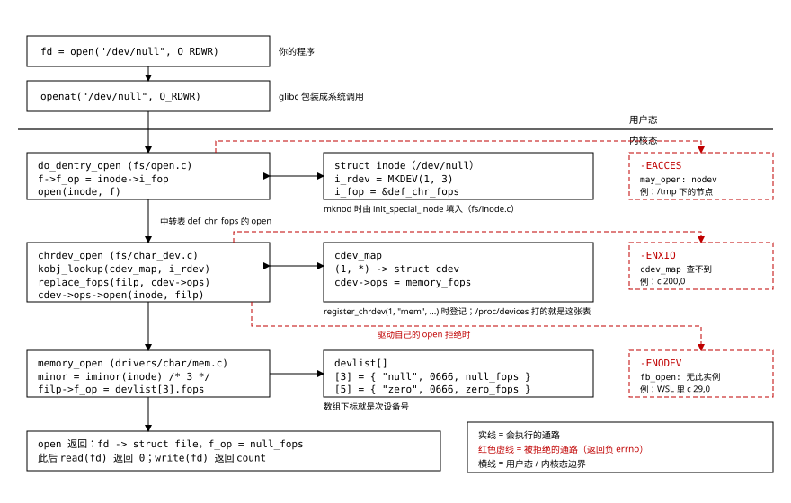

# 10 驱动与设备文件：/dev 里的文件怎么找到驱动

    实验    Knowledge/labs/00_basics/08_driver_devfile/
    电脑    WSL Ubuntu 26.04，内核 6.6.114.1，gcc 15.2.0，
            arm-linux-gnueabihf-gcc 15.2.0（本篇"本机实测"均为 2026-10-20 实跑）
    板子    100ASK_IMX6ULL Pro，Linux 4.9.88（板上输出均为 2026-09-14 实测归档）

    本篇约一半实验要在 WSL 里自己建设备节点，需要 root。WSL 里 sudo 要密码，
    从 Windows PowerShell 执行 `wsl -u root` 进入即可，节点建在 root 的
    ~/devlab 下。

## 你会在哪里撞见它

教程 05 篇一上来就在板子上敲 `ls -l /dev/fb0`（[05 Framebuffer 应用编程](../tutorials/01_应用编程/05_Framebuffer应用编程.md)第 1.2 节，
2026-09-14 板上归档）：

```text
crw-rw---- 1 root video 29, 0 Jan  1 00:00 /dev/fb0
```

普通文件在 `ls -l` 的这个位置显示的是大小，这里却是两个数 `29, 0`。紧接着程序里
`open("/dev/fb0", O_RDWR)`，再用 `ioctl(fd, FBIOGET_VSCREENINFO, &var)` 问分辨率
（[05 Framebuffer 应用编程](../tutorials/01_应用编程/05_Framebuffer应用编程.md)第 1.3 节）。open 凭这两个数找到谁？`FBIOGET_VSCREENINFO`
又是个什么数？

同一节还有一个对照：在 WSL 里照着 `29, 0` 造一个一模一样的节点，open 报
`No such device`；对着一个普通文件发同一个 ioctl，报的却是另一句
`Inappropriate ioctl for device`。号码相同、报错不同，说明"找驱动"这件事
不止一步，每一步有自己的一句报错。

板子上还有两处相关的痕迹（2026-09-14 归档）。开机日志里：

```text
[    1.169617] 100ask, drivers/video/fbdev/mxsfb.c mxsfb_probe 2341
[    1.194368] mxsfb 21c8000.lcdif: initialized
```

以及一个目录 `/sys/class/graphics/fb0/`，里面的 `device` 是个链接，指向
`21c8000.lcdif`。

`29, 0` 是什么、`mxsfb` 是谁、节点是谁建的、两句报错各是哪一层回的，
这一篇逐个讲清楚。04 篇练习 open/read/write/ioctl 时遇到的设备文件
（[04 文件IO](../tutorials/01_应用编程/04_文件IO.md)第 1.7 节），到这里也能全部对上号。

## 这篇要回答的问题

1. `/dev` 下的文件为什么大小栏是两个数？从 `open("/dev/xxx")` 到驱动的那张
   `file_operations`，中间经过哪几步？
2. 打不开设备时 `ENXIO`、`ENODEV`、`EACCES` 各是哪一层回的？程序里的 `errno`
   这个数是谁放进去的？
3. `/dev` 下的节点是谁建的？`ioctl` 的请求码里编了什么？

## 0 先动手看一眼

先看见现象。造一个 8 字节的普通文件做对照，再看三个设备文件和一个块设备：

```bash
printf 'ABCDEFGH' > data.txt
ls -l /dev/null /dev/zero /dev/full /dev/sda data.txt
stat -c '%-10n %F  大小=%s  设备号(十六进制)=%t,%T' /dev/null /dev/sda data.txt
sed -n '/^Character/,/^$/p' /proc/devices | head -4
sed -n '/^Block/,$p' /proc/devices | head -4
```

- `stat -c '格式'`：按格式打印文件的元信息。`%F` 是类型，`%s` 是大小，
  `%t`、`%T` 是设备号的两个部分（十六进制）。
- `sed -n '/^Character/,/^$/p'`：`-n` 不自动打印，`/A/,/B/p` 打印从匹配 A
  到匹配 B 的行。这里取出 `/proc/devices` 里"字符设备"那一段；下一条取
  "块设备"那一段直到文件末尾（`$`）。
- `/proc/devices` 是内核里"号码 → 名字"的登记表，字符设备和块设备各一张。

本机实测：

```text
crw-rw-rw- 1 root    root    1, 7 Oct 20 19:06 /dev/full
crw-rw-rw- 1 root    root    1, 3 Oct 20 19:06 /dev/null
brw-rw---- 1 root    disk    8, 0 Oct 20 19:06 /dev/sda
crw-rw-rw- 1 root    root    1, 5 Oct 20 19:06 /dev/zero
-rw-r--r-- 1 glorinz glorinz    8 Oct 20 19:09 data.txt
/dev/null  character special file  大小=0  设备号(十六进制)=1,3
/dev/sda   block special file  大小=0  设备号(十六进制)=8,0
data.txt   regular file  大小=8  设备号(十六进制)=0,0
Character devices:
  1 mem
  4 /dev/vc/0
  4 tty
Block devices:
  1 ramdisk
  7 loop
  8 sd
```

第一眼能看到三件事：第一列的第一个字符把文件分成 `c`（字符设备）、`b`
（块设备）、`-`（普通文件）；设备文件的大小栏是两个数；同一个 1 号，
字符设备段叫 `mem`，块设备段叫 `ramdisk`，是两码事。本篇从这两个数开始。

## 1 设备文件里存的是什么

### 1.1 目标：弄清大小栏的两个数存在哪

普通文件 `ls -l` 的第 5 列是大小。设备文件那一列却是 `1, 3` 这样的两个数。
这两个数存在哪：文件内容里，还是别的地方？

### 1.2 逐行读 0 节的输出

**`stat` 那三行把话说明白了。** `/dev/null` 的大小是 `0`，设备号是 `1,3`；
`/dev/sda` 大小 `0`，设备号 `8,0`；`data.txt` 大小 8，设备号 `0,0`。
普通文件没有设备号，设备文件没有内容。**那两个数不在文件内容里，而是和权限、
属主一样，记在文件的元信息里。**

> **主设备号（major）/ 次设备号（minor）**：设备文件元信息里的两个数。
> `open` 时内核先按"类型 + 主设备号"找到驱动，再把次设备号交给驱动，
> 由驱动决定这是它管的哪个实例。

**`/proc/devices` 的字符设备段：`1 mem`。** `/dev/null`、`/dev/zero`、
`/dev/full` 的主设备号都是 1，所以它们都归 `mem` 这个驱动管；次设备号
3、5、7 区分它管的三个实例。块设备段也有一个 1 号，叫 `ramdisk`。
同一个数字在字符设备和块设备两边各有一张登记表，互不相关。
**所以说号码的时候要连类型一起说：`c 1,3` 才是 `/dev/null`。**

`4` 号在字符设备段出现了不止一次（`/dev/vc/0` 和 `tty`）。同一个主设备号
可以按次设备号的范围分给不同的登记者，第 3 节会看到登记表里记的就是
"主设备号 + 次设备号范围"。

这里先摆出三个名词，后面每节都在用：

> **驱动（driver）**：内核里负责操作某一种硬件的一段代码。它知道这种硬件的
> 寄存器在哪、怎么初始化、怎么收发数据，并把这些本事包装成一张
> `file_operations` 函数表（[08 文件描述符与VFS](08_文件描述符与VFS.md)第 6.1 节）交给内核。

> **设备实例**：驱动管着的一个具体的东西。板子上有两个串口，就是串口驱动的
> 两个实例；同一份驱动代码，每个实例各有自己的一份状态。

> **字符设备 / 块设备**：设备文件的两种类型。字符设备按字节流读写，串口、
> 显示、`/dev/null` 都是；块设备按固定大小的块读写，磁盘、eMMC 是。
> 块设备多一层缓存和调度，本篇只讲字符设备，块设备的查找链完全同构。

`/dev/null`（写进去的都扔掉）、`/dev/zero`（读出来全是 0）这类设备背后
没有任何硬件，驱动里什么寄存器都不碰。这正好拿来做实验：不用板子，WSL 里
就有，行为又好认。

### 1.3 内核里这两个数怎么存

两个号在内核里拼成一个 32 位整数，类型叫 `dev_t`（include/linux/kdev_t.h）：

```c
#define MINORBITS	20
#define MINORMASK	((1U << MINORBITS) - 1)

#define MAJOR(dev)	((unsigned int) ((dev) >> MINORBITS))
#define MINOR(dev)	((unsigned int) ((dev) & MINORMASK))
#define MKDEV(ma,mi)	(((ma) << MINORBITS) | (mi))
```

位段排布：

```text
 位   31                    20 19                     0
     [      主设备号 12 位    ][      次设备号 20 位     ]

 MKDEV(1, 3) = (1 << 20) | 3 = 0x00100003
```

`ls -l` 显示的 `1, 3` 就是把这个整数按上面两条宏拆开打印的。主设备号 12 位
（最大 4095），次设备号 20 位，对现在的设备数量都够用；老的 16 位时代
"主 8 位 + 次 8 位"的紧张局面已经是历史。

### 1.4 [判]

    [ ] /dev/null 是 character special file，大小 0，设备号 1,3
    [ ] data.txt 的设备号是 0,0（普通文件没有设备号）
    [ ] /proc/devices 字符设备段 1 号叫 mem，块设备段 1 号叫 ramdisk
    [ ] 算得出 MKDEV(1,3) = 0x00100003

    注错见红见第 2 节：号码一换，行为就跟着换。

**这一节搭好的积木**：设备文件没有内容，只有类型和两个号；主设备号选驱动，
次设备号选实例，号码要带类型一起说。接下来的问题：文件名起什么有关系吗。

## 2 名字无所谓，号码说了算

### 2.1 目标：换个名字，行为只看号码

既然设备文件只有类型和两个号，那自己造一个**号码相同、名字不同**的文件，
它的行为应该和原来那个一模一样。反过来，**名字不变、号码换掉**，行为就该变。

怎么判断"行为一样"？挑三个行为很好认的：

```text
/dev/null   读：马上返回 0（没有数据）  写：全部吞掉，报告写成功
/dev/zero   读：要多少给多少个 0 字节    写：同样吞掉
/dev/full   读：和 zero 一样            写：永远报"磁盘满了"
```

建设备文件的命令是 `mknod`，参数是：名字、类型、主设备号、次设备号。
这一步要 root，从 Windows PowerShell 用 `wsl -u root` 进 WSL。

### 2.2 动手

实验目录里的 `devopen.c` 对每个路径做四件事，各打一段结果：`stat` 看类型和
设备号、`open`、`read` 最多 8 个字节打成十六进制、`write` 1 个字节。
核心就是三句（[08 文件描述符与VFS](08_文件描述符与VFS.md)第 6.1 节里"只换路径，代码一个字不改"的同一个写法）：

```c
fd = open(p, O_RDWR);                      /* 同一个 open */
n = read(fd, buf, sizeof buf);             /* 同一个 read，最多读 8 字节 */
n = write(fd, "A", 1);                     /* 同一个 write，写 1 字节 */
```

编译，然后造三个设备文件：

```bash
mkdir -p ~/devlab && cd ~/devlab
printf 'ABCDEFGH' > data.txt
D=/mnt/e/Workspace/Embedded-linux/Knowledge/labs/00_basics/08_driver_devfile
gcc -Wall -O2 -o $D/devopen $D/devopen.c
mknod mynull c 1 3
mknod myzero c 1 5
mknod myfull c 1 7
ls -l mynull myzero myfull
$D/devopen data.txt /dev/null mynull myzero myfull
```

- `mknod mynull c 1 3`：在当前目录建一个叫 `mynull` 的文件，类型 `c`
  （字符设备），主设备号 1，次设备号 3。它不会去问内核"1,3 存不存在"，
  只是把这几个数写进文件元信息。
- `$D`：程序在 Windows 盘上（WSL 里挂成 `/mnt/e`），设备文件建在 root 的
  家目录，所以用变量拼出程序的完整路径。

### 2.3 本机实测

```text
crw-r--r-- 1 root root 1, 7 Oct 20 02:26 myfull
crw-r--r-- 1 root root 1, 3 Oct 20 02:26 mynull
crw-r--r-- 1 root root 1, 5 Oct 20 02:26 myzero
data.txt   普通文件    8字节  read=8 [4142434445464748]  write=1
/dev/null  字符设备   1,3    read=0 []  write=1
mynull     字符设备   1,3    read=0 []  write=1
myzero     字符设备   1,5    read=8 [0000000000000000]  write=1
myfull     字符设备   1,7    read=8 [0000000000000000]  write 失败 ENOSPC
```

### 2.4 逐行读

**`data.txt`**：读到 8 个字节，`41 42 ... 48` 就是 `A` 到 `H` 的 ASCII 码。
写 1 字节成功。这是普通文件的对照组。

**`/dev/null` 和 `mynull` 两行，除了名字一个字都不差**：读返回 0，写返回 1。
`mynull` 是几秒钟前随手造的，内核照样把它当 `/dev/null` 办。

**`myzero`**：读到 8 个 `00`。**`myfull`**：读也是 8 个 0，但写报
`ENOSPC`（No space left on device）。写的动作一模一样，结果不同，
因为次设备号 7 让请求落到了 `full` 那个实例的函数上。

**`ls -l` 那三行的权限是 `crw-r--r--`**，而 `/dev/null` 是 `crw-rw-rw-`。
权限和号码是分开存的，`mknod` 用的是默认权限。所以普通用户能写 `/dev/null`，
却写不了你造的 `mynull`（本节是 root 在跑，看不出来）。

号码到行为的对应关系写在 mem 驱动的源码里（drivers/char/mem.c，Linux 4.9）：

```c
static const struct memdev {
	const char *name;
	umode_t mode;
	const struct file_operations *fops;
	fmode_t fmode;
} devlist[] = {
	 [1] = { "mem", 0, &mem_fops, FMODE_UNSIGNED_OFFSET },
	 [3] = { "null", 0666, &null_fops, 0 },
	 [5] = { "zero", 0666, &zero_fops, 0 },
	 [7] = { "full", 0666, &full_fops, 0 },
	 [8] = { "random", 0666, &random_fops, 0 },
	 [9] = { "urandom", 0666, &urandom_fops, 0 },
	[11] = { "kmsg", 0644, &kmsg_fops, 0 },
};
```

数组的下标就是次设备号：3 号是 `null`、5 号是 `zero`、7 号是 `full`，
各挂一张自己的 `file_operations`。你 mknod 的号码落进哪一行，行为就是哪一行。
这张表第 3 节还会回来。

### 2.5 注错见红

名字不变，只把号码换成 1,5：

```bash
rm mynull; mknod mynull c 1 5; $D/devopen mynull
```

```text
mynull     字符设备   1,5    read=8 [0000000000000000]  write=1
```

同一个名字，读出来从"0 字节"变成了"8 个 0"。**它现在就是 `/dev/zero`。**

### 2.6 [判]

    [ ] mynull(c 1,3) 和 /dev/null 两行 read/write 结果完全相同
    [ ] myzero(c 1,5) 读出 8 个 00
    [ ] myfull(c 1,7) 写报 ENOSPC
    [ ] 注错见红：名字不变、号码改成 1,5 后，mynull 读出 8 个 00
    [ ] 说得出 devlist 数组的下标是次设备号

> **结论**：设备文件的名字只是给人看的门牌。`/dev/fb0` 叫 `fb0` 是约定，
> 改叫 `abc` 照样能用；内核认的只有 `c 29,0` 这几个数。

**这一节搭好的积木**：行为完全由"类型 + 主、次设备号"决定，与名字无关。
接下来的问题：open 一个路径，内核凭这两个数，具体走哪几步摸到驱动的那张表。

## 3 从 open 到驱动：查找链

### 3.1 目标：一个路径怎么变成一张函数表

先用 strace 看系统调用层面能观察到多少（strace 能把程序发出的系统调用逐个
打印出来）：

```bash
cd $D
strace -e trace=openat,read,write ./devopen /dev/null 2>&1 | grep -E '"/dev/null"|read\(3, ""|write\(3, "A"'
```

- `-e trace=openat,read,write`：只看这三种系统调用。
- grep 留下三行：打开 /dev/null 那一行，以及对它 read、write 的那两行
  （中间夹着动态加载器读库的 read，滤掉了）。

本机实测：

```text
openat(AT_FDCWD, "/dev/null", O_RDWR)   = 3
read(3, "", 8)                          = 0
write(3, "A", 1)                        = 1
```

openat 把路径交进内核，拿回一个 fd；之后的 read、write 只带 fd，不带任何
设备名。所以"这次读写归哪个驱动管"这个决定，全部发生在 openat 这一次里。
读完之后的路径你已经知道了：read 进内核后按 fd 找到 `struct file`，调
`f_op->read`（[08 文件描述符与VFS](08_文件描述符与VFS.md)第 6.1 节）。剩下的问题是：open 这一次，怎么把
`f_op` 填成 mem 驱动的表。

答案分三步，每一步都对应内核源码里的一段（下面引用 Linux 4.9 的源码，
板上内核 NXP 4.9.88 在这几处与主线相同；`chrdev_open` 一段在 6.6 里逐行
一致，WSL 上的实测也对得上）。

### 3.2 第一步：mknod 时，inode 里先填一张中转表

mknod 建节点时，内核调 `init_special_inode`（fs/inode.c）初始化这个新文件的
档案：

```c
void init_special_inode(struct inode *inode, umode_t mode, dev_t rdev)
{
	inode->i_mode = mode;
	if (S_ISCHR(mode)) {
		inode->i_fop = &def_chr_fops;   /* 字符设备统一先给这张表 */
		inode->i_rdev = rdev;           /* 两个号记在这里 */
	} else if (S_ISBLK(mode)) {
		inode->i_fop = &def_blk_fops;
		inode->i_rdev = rdev;
	} ...
}
```

inode 是内核给每个文件建的档案（[08 文件描述符与VFS](08_文件描述符与VFS.md)第 2 节）。对设备文件，档案里和设备
有关的是两格：`i_rdev` 装设备号，`i_fop` 先装一张**所有字符设备共用的表**
`def_chr_fops`（fs/char_dev.c）：

```c
const struct file_operations def_chr_fops = {
	.open = chrdev_open,
	.llseek = noop_llseek,
};
```

这张表上有一段注释："唯一做的事，就是根据特殊文件把正确的操作表填进来。"
它是个中转站，真正的分派在它的 open 里。

### 3.3 第二步：chrdev_open 按号查登记表

open 的流程走到 `do_dentry_open`（fs/open.c）时，先后做两件事：

```c
	f->f_op = fops_get(inode->i_fop);   /* struct file 先拿到中转表 */
	...
	error = open(inode, f);             /* open 就是中转表里的 chrdev_open */
```

`chrdev_open`（fs/char_dev.c）的主干：

```c
static int chrdev_open(struct inode *inode, struct file *filp)
{
	...
	p = inode->i_cdev;                            /* 上次查到的结果有缓存 */
	if (!p) {
		kobj = kobj_lookup(cdev_map, inode->i_rdev, &idx);
		if (!kobj)
			return -ENXIO;                /* 这个号没人登记 */
		new = container_of(kobj, struct cdev, kobj);
		...
		inode->i_cdev = p = new;              /* 查到的结果缓存回 inode */
	}
	...
	fops = fops_get(p->ops);                      /* cdev 里存着驱动登记的表 */
	...
	replace_fops(filp, fops);                     /* 中转表换成驱动的表 */
	if (filp->f_op->open) {
		ret = filp->f_op->open(inode, filp);  /* 接着调驱动的 open */
		if (ret)
			goto out_cdev_put;
	}
	return 0;
}
```

这里面有三个关键物：

- `cdev_map`：内核里"设备号 → struct cdev"的登记表。驱动加载时用
  `register_chrdev(主设备号, 名字, &操作表)` 登记自己，这个函数一路调到
  `cdev_add` 把 cdev 挂进 cdev_map（同在 fs/char_dev.c）。`/proc/devices`
  打印的就是这张表（`chrdev_show` 逐行打印登记表里的号码和名字）。
- `struct cdev`：一次登记的记录，成员 `ops` 指向驱动给的那张
  `file_operations`。
- `replace_fops`：执行到这里，`struct file` 的 `f_op` 从中转表换成了驱动的
  表。对 1 号来说，就是 mem 驱动的 `memory_fops`。

/dev/fb0 走的是同一条路：fb 核心用 `register_chrdev(FB_MAJOR, "fb", &fb_fops)`
登记（drivers/video/fbdev/core/fbmem.c），`FB_MAJOR` 是 29，对应
`/proc/devices` 里的 `29 fb`。

### 3.4 第三步：驱动的 open 按次设备号再分一次

主设备号只选到驱动。一个驱动管多个实例（第 2 节 devlist 有 7 行），轮到驱动
的 open 按次设备号分。mem 驱动的写法（drivers/char/mem.c）：

```c
static int memory_open(struct inode *inode, struct file *filp)
{
	int minor = iminor(inode);           /* 从 i_rdev 里取次设备号 */
	const struct memdev *dev;
	...
	dev = &devlist[minor];
	if (!dev->fops)
		return -ENXIO;

	filp->f_op = dev->fops;              /* 再换一次：换成这个实例自己的表 */
	...
}
```

`iminor` 从 inode 的 `i_rdev`（3.2 节填进去的那两个数）里取次设备号，
用它做 devlist 的下标，把 `f_op` 换成 `null_fops`、`zero_fops`、
`full_fops` 中的某一张。这是第二次换表。

到这里 open 结束。3.1 节 strace 里那两行 `read(3, ...)`、`write(3, ...)`
发生时，fd 3 的 `f_op` 已经是 `null_fops`：它的读函数直接返回 0，
写函数原样返回 count。整条链画成一张图：



看图的方法：从左上的 `open` 往下走，跨过中间那条横线就进了内核；右边一列
三个红框是三条走不通的岔路，各带回一个负的 errno，第 4 节逐个对到实测。

### 3.5 fb 的走法：不再换表，但多一次实例检查

fb 核心那张 `fb_fops` 里，open 是 `fb_open`（drivers/video/fbdev/core/fbmem.c）：

```c
static int
fb_open(struct inode *inode, struct file *file)
{
	int fbidx = iminor(inode);
	struct fb_info *info;
	int res = 0;

	info = get_fb_info(fbidx);            /* registered_fb[次设备号] */
	if (!info) {
		request_module("fb%d", fbidx);
		info = get_fb_info(fbidx);
		if (!info)
			return -ENODEV;           /* 号登记了，实例不存在 */
	}
	...
	file->private_data = info;
	if (info->fbops->fb_open)
		res = info->fbops->fb_open(info,1);
	...
}
```

`registered_fb[]` 是 fb 核心的一张实例表，硬件驱动探测到显示控制器时往里
登记一项（板子上是 mxsfb 驱动登记了 fb0，第 5、7 节会看到它的痕迹）。
fb_open 不再换表，所有 fb 实例共用 `fb_fops`，实例指针存在
`file->private_data` 里，以后每次 read/ioctl 再从这里取回。但它多了一次
"实例在不在"的检查：不在就先试着自动加载名为 `fb0` 的模块，还没有就回
`-ENODEV`。这一个返回值第 4 节马上用到。

> 容易以为：open 报 "No such device" 说明 /dev 下的节点没建对。实测是：
> 节点完全正常，是驱动那一层回了 `ENODEV`。原因是号码、节点、驱动登记、
> 设备实例是四层东西，各层有各层的一句报错。

### 3.6 [判]

    [ ] 说得出 init_special_inode 给字符设备的 inode 填了哪两格
        （i_rdev 装设备号，i_fop 先装 def_chr_fops）
    [ ] 说得出 chrdev_open 查的是 cdev_map，查不到返回 -ENXIO，
        查到后 replace_fops 换成 cdev->ops
    [ ] 说得出 memory_open 用 iminor 做 devlist 下标，第二次换 f_op
    [ ] strace 看到 openat("/dev/null") = 3，后续 read/write 只带 fd
    [ ] 说得出 fb_open 里 -ENODEV 的来源（registered_fb[minor] 为空）

    注错见红就是第 2 节那次：名字不变、号码换成 1,5 后，kobj_lookup
    查到的还是 mem 的 cdev，但 iminor 变成 5，devlist[5] 是 zero_fops，
    行为跟着变成 /dev/zero。每一环都能用实验点出来。

**这一节搭好的积木**：设备号记在 inode 的 `i_rdev`；open 时
`chrdev_open` 拿它在 `cdev_map` 里查到驱动的 cdev，把 `f_op` 换成驱动的表，
再调驱动的 open 按次设备号分实例。接下来的问题：这条链上每一环失败时，
程序看到的 errno 是谁、在哪一步放进去的。

## 4 errno 从哪来，打不开的几种下场

### 4.1 目标：追一个 errno 的出生证

第 2 节 devopen 打印过一行 `write 失败 ENOSPC`。用 strace 看同一次调用：

```bash
strace -e trace=write ./devopen /dev/full 2>&1 | grep 'write(3'
```

本机实测：

```text
write(3, "A", 1)                        = -1 ENOSPC (No space left on device)
```

`-1 ENOSPC` 是这个系统调用在内核边界上的结果；程序里看到的 `errno = 28`
和它是什么关系？这个数是哪来的？

### 4.2 内核侧：驱动返回一个负数

full 这个实例的写函数（drivers/char/mem.c）：

```c
static ssize_t write_full(struct file *file, const char __user *buf,
			  size_t count, loff_t *ppos)
{
	return -ENOSPC;
}
```

内核里的约定：这类函数返回 0 或正数表示成功（写了几个字节），返回**负的
errno** 表示失败。负 errno 被限制在 -1 到 -4095 之间（include/linux/err.h
里的 `MAX_ERRNO` 是 4095），于是"返回值落在 -4095..-1 区间"就是失败的判据，
和成功的返回值不会混淆。

### 4.3 用户态侧：C 库检查返回值、置 errno

系统调用的返回值原样带回用户态，之后是 C 库的事。ARM 上 glibc 2.30 的
包装宏（sysdeps/unix/sysv/linux/arm/sysdep.h）：

```c
#define INTERNAL_SYSCALL_ERROR_P(val, err) \
  ((unsigned int) (val) >= 0xfffff001u)

#define INTERNAL_SYSCALL_ERRNO(val, err)	(-(val))

#define INLINE_SYSCALL(name, nr, args...)				\
  ({ unsigned int _sys_result = INTERNAL_SYSCALL (name, , nr, args);	\
     if (__builtin_expect (INTERNAL_SYSCALL_ERROR_P (_sys_result, ), 0))	\
       {								\
	 __set_errno (INTERNAL_SYSCALL_ERRNO (_sys_result, ));		\
	 _sys_result = (unsigned int) -1;				\
       }								\
     (int) _sys_result; })
```

跟着 -ENOSPC 走一遍：-28 按无符号解释是 0xFFFFFFE4，大于等于 0xFFFFF001
（也就是 -4095），判定为失败；`__set_errno(-(-28))` 把 errno 置成 28；
函数返回 -1。strace 打印的 `= -1 ENOSPC`，是按同一套规则把返回值翻译成人
能读的名字。x86-64 的 glibc 是同一段逻辑。

所以 **errno 不是内核设置的**：内核只在返回值里带回一个负数，置 errno、
返回 -1 是 C 库做的（[07 系统调用与用户态/内核态](07_系统调用与用户内核态.md)第 3.4 节里在指令层面验证过同一段
代码）。由此也解释了 04 篇那个坑（[04 文件IO](../tutorials/01_应用编程/04_文件IO.md)第 1.7 节）：
成功的调用不会动 errno，看 errno 之前必须先看返回值是不是 -1。

errno 的名字和数字可以直接问编译器（2026-10-20 本机实测，
`echo '#include <errno.h>' | gcc -E -dM -x c -`）：

```text
#define EPERM 1
#define ENXIO 6
#define EACCES 13
#define ENODEV 19
#define ENOTTY 25
#define ENOSPC 28
```

### 4.4 实验：打不开的几种下场，各是哪一层

第 3 节的链上有三处会拒绝 open。把三种都造出来（要 root，`wsl -u root`）：

```bash
cd ~/devlab
mknod nobody c 200 0
mknod fbfake c 29 0
$D/devopen nobody fbfake
echo "200 号在 /proc/devices 里出现的次数: $(sed -n '/^Character/,/^$/p' /proc/devices | grep -cE '^ *200 ')"
echo "29 号: $(sed -n '/^Character/,/^$/p' /proc/devices | grep -E '^ *29 ')"
echo "/sys/class/graphics: $(ls /sys/class/graphics)"
mknod /tmp/mynull c 1 3; $D/devopen /tmp/mynull; rm -f /tmp/mynull
findmnt -no TARGET,FSTYPE,OPTIONS /tmp
mknod /mnt/e/Workspace/Embedded-linux/.devtest c 1 3; echo "mknod rc=$?"
findmnt -no TARGET,FSTYPE /mnt/e
```

- `grep -cE '^ *200 '`：`-c` 只数行数，`^ *200 ` 是"行首若干空格、然后 200、
  然后空格"。
- `/sys/class/graphics`：内核按类整理的设备档案目录，显示类的都在这里
  （第 5 节细讲）。
- `findmnt -no TARGET,FSTYPE,OPTIONS /tmp`：查 /tmp 这个挂载点。`-n` 不打
  表头，`-o` 选列。

本机实测：

```text
nobody     字符设备 200,0    open 失败 ENXIO (No such device or address)
fbfake     字符设备  29,0    open 失败 ENODEV (No such device)
200 号在 /proc/devices 里出现的次数: 0
29 号:  29 fb
/sys/class/graphics: fbcon
/tmp/mynull 字符设备   1,3    open 失败 EACCES (Permission denied)
/tmp tmpfs rw,nosuid,nodev,nr_inodes=1048576
mknod: Operation not supported (os error 95)
mknod rc=255
/mnt/e 9p
```

### 4.5 逐行读，把四种下场挂到链上

**`nobody`（200,0）报 `ENXIO`**，而 `/proc/devices` 里 200 号一次都没出现。
这就是 3.3 节 `kobj_lookup` 查不到的那一条：`cdev_map` 里没人登记 200 号，
**连驱动这一层都没走到**。

**`fbfake`（29,0）报 `ENODEV`。** 29 号是登记了的（`29 fb`），所以
`chrdev_open` 顺利找到了 fb 核心的 cdev、换上了 `fb_fops`，是 3.5 节
`fb_open` 里的实例检查没通过：WSL 里 `/sys/class/graphics` 下只有 `fbcon`，
没有任何 fb 实例，于是由驱动那一层回了"没有这个设备"。

> **fbcon**：framebuffer console，内核用 framebuffer 画文字终端的那部分
> 代码。它只是 fb 类下面的一个功能模块，不是显示设备，有它不代表有 `fb0`。

**`/tmp/mynull` 报 `EACCES`，而且是 root 在跑。** 号码和第 2 节一模一样，
区别只在它建在 /tmp 下。`findmnt` 那行的选项里有 `nodev`，它在内核里对应
的检查比驱动更靠前（fs/namei.c 的 `may_open`）：

```c
	case S_IFBLK:
	case S_IFCHR:
		if (!may_open_dev(path))
			return -EACCES;
		/*FALLTHRU*/
```

`may_open_dev` 看的就是挂载选项里的 `nodev`。这个检查在权限检查之前，
所以 root 也躲不掉。

> **nodev**：挂载选项，意思是"这个文件系统上的设备文件一律不认"。常用在
> /tmp 这种谁都能写的目录上，防止有人在里面造一个指向磁盘的设备文件
> 绕过权限。

**`/mnt/e` 上连 `mknod` 都失败了**（`Operation not supported`，95 号
errno）。`/mnt/e` 的类型是 `9p`，是 WSL 用来访问 Windows 盘的网络式文件
系统，Windows 那边没有设备文件这个概念，文件系统根本建不了这种节点。

四种下场排在一起：

```text
open("/dev/xxx") 被谁拦下     对应源码          errno        例子
挂载点带 nodev     may_open      fs/namei.c     EACCES(13)   /tmp 下的节点,root 也一样
号没人登记         chrdev_open    fs/char_dev.c  ENXIO(6)     c 200,0,/proc/devices 查无
驱动在,实例不在    驱动的 open    如 fb_open     ENODEV(19)   WSL 里 c 29,0
一切正常                                       0            f_op 已是驱动的表
```

这也是 05 篇在 WSL 里造 fb 节点时要求"建在 home 目录下"的原因
（[05 Framebuffer 应用编程](../tutorials/01_应用编程/05_Framebuffer应用编程.md)第 1.2 节）：/tmp 带 nodev，/mnt/e 建不了节点。

### 4.6 [判]

    [ ] 200,0 报 ENXIO，且 /proc/devices 里没有 200
    [ ] 29,0 报 ENODEV，且 /proc/devices 里有 29 fb、/sys/class/graphics
        下没有 fb0
    [ ] 同样的 1,3 建在 /tmp 下：root 也报 EACCES，/tmp 的挂载选项里有 nodev
    [ ] /mnt/e 上 mknod 失败（Operation not supported）
    [ ] strace 看到 write 返回 -1 ENOSPC，说得出 errno=28 是 C 库置的
    [ ] 背不出也能查出：ENXIO=6 ENODEV=19 ENOTTY=25 ENOSPC=28

    注错见红：第 2 节建在 ~/devlab 的 mynull 能用，同样的号码搬到 /tmp
    就打不开。行为跟着挂载点变，号码没变。

**这一节搭好的积木**：驱动返回负 errno，C 库置 errno 并返回 -1；
ENXIO、ENODEV、EACCES 分别挂在查找链的三个位置上。接下来的问题：
/dev 下这些节点平时是谁建的，反正不是人用 mknod 建的。

## 5 /dev 的节点是谁建的

### 5.1 目标：从 /sys 读出一个设备的档案

前面每次都是自己 `mknod`。但 `/dev/null`、板子上的 `/dev/fb0` 不是谁手工
建的。**是谁建的？它怎么知道该用什么名字、什么号码、什么权限？**

线索：

```text
/sys/class/<类>/<设备>/dev       一个文本文件
/sys/class/<类>/<设备>/uevent    一个文本文件
mount 看 /dev 挂的是什么文件系统
```

### 5.2 动手

```bash
ls /sys/class/mem/
for d in /sys/class/mem/*; do
	n=${d##*/}; s=$(cat "$d/dev"); t=$(stat -c '%t %T' "/dev/$n")
	printf '%-8s sysfs dev=%-5s  /dev/%-8s %d:%d\n' "$n" "$s" "$n" "0x${t% *}" "0x${t#* }"
done
cat /sys/class/mem/null/uevent
stat -c '/dev/null 权限位 %a' /dev/null
readlink /sys/class/mem/null/device || echo "(mem/null 没有 device 链接)"
mount | grep -E ' on /dev | on /sys '
```

- `${d##*/}`：bash 的字符串截取，去掉最后一个 `/` 及之前的部分，剩下目录名。
- `stat -c '%t %T'`：两个号，十六进制。`${t% *}` 取空格前那段，`${t#* }` 取
  空格后那段。
- `printf '%d' 0x1b` 这种写法：`printf` 认 `0x` 前缀，按十六进制转成十进制。
- `readlink ... || echo`：链接不存在时 readlink 失败，`||` 后面那句才执行。

再看两个背后有硬件的设备：

```bash
for c in net/eth0 rtc/rtc0; do
	echo "$c: device -> $(readlink /sys/class/$c/device)"
	echo "$c: driver -> $(readlink /sys/class/$c/device/driver)"
done
echo "hv_netvsc 驱动目录: $(ls /sys/bus/vmbus/drivers/hv_netvsc/ | tr '\n' ' ')"
echo "rtc_cmos  驱动目录: $(ls /sys/bus/pnp/drivers/rtc_cmos/ 2>/dev/null | tr '\n' ' ')"
echo "rtc0 dev=$(cat /sys/class/rtc/rtc0/dev)"; ls -l /dev/rtc0
```

- `eth0` 是 WSL 的网卡，`rtc0` 是实时时钟（断电也走时的那颗小钟）。
- `tr '\n' ' '`：把换行换成空格，让列表挤在一行里。

### 5.3 本机实测

```text
full
kmsg
mem
null
random
urandom
zero
full     sysfs dev=1:7    /dev/full     1:7
kmsg     sysfs dev=1:11   /dev/kmsg     1:11
mem      sysfs dev=1:1    /dev/mem      1:1
null     sysfs dev=1:3    /dev/null     1:3
random   sysfs dev=1:8    /dev/random   1:8
urandom  sysfs dev=1:9    /dev/urandom  1:9
zero     sysfs dev=1:5    /dev/zero     1:5
MAJOR=1
MINOR=3
DEVNAME=null
DEVMODE=0666
/dev/null 权限位 666
(mem/null 没有 device 链接)
none on /dev type devtmpfs (rw,nosuid,relatime,size=3029676k,nr_inodes=757419,mode=755)
sysfs on /sys type sysfs (rw,nosuid,nodev,noexec,noatime)
```

```text
net/eth0: device -> ../../../cb75a79a-f369-4e1e-a8a7-08609206e0f3
net/eth0: driver -> ../../../../../../bus/vmbus/drivers/hv_netvsc
rtc/rtc0: device -> ../../../00:00
rtc/rtc0: driver -> ../../../bus/pnp/drivers/rtc_cmos
hv_netvsc 驱动目录: bind cb75a79a-f369-4e1e-a8a7-08609206e0f3 module new_id remove_id uevent unbind 
rtc_cmos  驱动目录: 00:00 bind uevent unbind 
rtc0 dev=249:0
crw-rw---- 1 root clock 249, 0 Oct 20 02:26 /dev/rtc0
```

### 5.4 逐行读

**`/sys/class/mem/` 下的 7 个名字，正好是 mem 驱动管的 7 个实例。** 每个
实例的 `dev` 文件里写着它的号码，和 `/dev` 下同名节点的号码 7 个全部相等。

**`uevent` 文件四行**：`MAJOR=1`、`MINOR=3`、`DEVNAME=null`、`DEVMODE=0666`。
而 `/dev/null` 的权限位正好是 `666`。**节点的名字、号码、权限，全都写在这
四行里。**

**`/dev` 挂的是 `devtmpfs`。** 把这几条连起来，就是节点的来历。驱动登记一个
设备实例时，内核做两件事（drivers/base/core.c 的 `device_add`）：

```c
	devtmpfs_create_node(dev);                /* 内核自己建 /dev 节点 */
	...
	kobject_uevent(&dev->kobj, KOBJ_ADD);     /* 通知用户态 */
```

第一件：`devtmpfs_create_node`（drivers/base/devtmpfs.c）取出设备的名字、
号码、权限，经 `handle_create` → `vfs_mknod` 在 devtmpfs 里把节点建好。
mem 驱动那张 devlist 里的 `0666` 就是在这条路上变成 `/dev/null` 的权限的
（`mem_devnode` 按次设备号回权限）。

第二件：`kobject_uevent` 把"新增了一个设备"这件事连同一批键值对广播给用户
态，`uevent` 文件里看到的就是这批键值对。用户态收到后可以再做善后：

- 桌面和发行版用 **udev**（本机实测进程列表里有 `systemd-udevd`）：按规则改
  权限、改属组、起别名链接。/dev/fb0 的属组 `video` 就是规则改出来的
  （板上归档 `crw-rw---- 1 root video 29, 0`；板上启动脚本里有 udev 的
  启动项 `S10udev`，2026-09-14 归档）。
- 精简系统常用 busybox 的 **mdev** 干同一件事：扫 `/sys/class` 下每个设备的
  `dev` 文件，按里面的号码建节点。这和 5.2 节那个 for 循环是同一个做法，
  只是做成了工具（本仓没装 busybox，这一条未实测）。

> **devtmpfs**：内核维护的一个内存文件系统，挂在 /dev。驱动登记设备时内核
> 直接往里建节点，开机后 /dev 下就是现成的，不需要谁手工 mknod。
> **sysfs**：挂在 /sys 的内核文件系统。内核把设备、驱动、总线的关系摆成
> 目录和链接给你看，文件内容是读的那一刻现生成的。

**`mem/null` 没有 `device` 链接**：/dev/null 背后没有任何硬件。

**`eth0` 和 `rtc0` 都有，而且各有两层：**

```text
rtc0 -> device -> 00:00               背后的硬件：总线上编号 00:00 的时钟芯片
     -> device/driver -> rtc_cmos     管这颗芯片的驱动叫 rtc_cmos
```

反过来看驱动目录 `rtc_cmos/` 里，有一个名叫 `00:00` 的链接指回这个硬件；
`hv_netvsc/` 里那串 `cb75a79a-...` 也正是 `eth0` 的 `device` 链接的名字。
**设备指向驱动，驱动也指回设备，两边对得上。** 一个驱动管几个实例，它的
目录里就有几个这样的链接。

**`rtc0 dev=249:0`，`/dev/rtc0` 也是 `249, 0`**，和 mem 类一样对得上。
它的属组是 `clock`、权限 `rw-rw----`，普通用户读不了，第 6 节要 root。

**回到板子**，开头那行链接现在能读懂了：

```text
lrwxrwxrwx 1 root root 0 Jan  1 00:04 /sys/class/graphics/fb0/device -> ../../../21c8000.lcdif
```

`fb0` 这个实例背后的硬件叫 `21c8000.lcdif`：物理地址 `0x021c8000` 处的
LCDIF 显示控制器（它怎么把内存变成光，是
[11 显示原理](11_显示原理.md)的事）。管它的驱动，开机日志里已经自报过
家门，就是 `mxsfb`。

### 5.5 [判]

    [ ] /sys/class/mem 下每个设备的 dev 文件，和 /dev 同名节点的号码逐个相等
    [ ] null 的 uevent 里 DEVMODE=0666，和 /dev/null 的权限位 666 相等
    [ ] /dev 挂的是 devtmpfs
    [ ] mem/null 没有 device 链接；eth0、rtc0 有 device 和 driver 两层
    [ ] 驱动目录里有一个链接，名字和设备的 device 链接指向的名字相同

    注错见红：拿 /sys/class/mem/zero/dev 去和 /dev/null 比，必须对不上
    （1:5 不等于 1:3）。

**这一节搭好的积木**：节点是内核在 devtmpfs 里自动建的，名字、号码、权限
来自驱动登记设备时填的信息；/sys 是同一批信息给你看的那一面。接下来的
问题：open 通了之后，read/write 装不下的那些操作（比如"告诉我分辨率"）
走哪条路。

## 6 ioctl 与它的请求码

### 6.1 目标：拆开一个请求码，看里面编了什么

04 篇用 `TIOCGWINSZ` 问终端窗口有几行几列，05 篇用 `FBIOGET_VSCREENINFO`
问显示分辨率（[05 Framebuffer 应用编程](../tutorials/01_应用编程/05_Framebuffer应用编程.md)第 1.3 节）。这两个名字都是宏，展开以后是
一个整数，叫**请求码**。

> **ioctl**：`ioctl(fd, 请求码, 指针)`。给驱动一个编号和一块内存，驱动按
> 编号决定干什么：往这块内存里填数据，或者从里面取参数。它是 read/write
> 这对接口装不下的所有操作的公共出口。

问题是：**驱动怎么确定你给的那块内存有多大？** 你给的结构体要是比驱动以为
的小，它往里填的时候就写出界了。

线索：请求码不只是一个序号。内核头文件 include/uapi/asm-generic/ioctl.h
里有一组宏 `_IOC_DIR`、`_IOC_TYPE`、`_IOC_NR`、`_IOC_SIZE`，能把请求码
拆成四段。本机头文件里查到的位宽：

```text
_IOC_NRBITS    8     序号
_IOC_TYPEBITS  8     类型（通常是一个字母，代表哪一类驱动）
_IOC_SIZEBITS  14    那块内存的大小
_IOC_DIRBITS   2     方向：0 不传数据，1 用户写给驱动，2 驱动读给用户
```

### 6.2 动手

`ioctlcode.c` 把四个请求码拆开，再和 `sizeof` 真实结构体的大小并排打印：

```c
show("RTC_RD_TIME", RTC_RD_TIME, sizeof(struct rtc_time));
show("TIOCGWINSZ", TIOCGWINSZ, sizeof(struct winsize));
show("FBIOGET_VSCREENINFO", FBIOGET_VSCREENINFO, sizeof(struct fb_var_screeninfo));
show("FBIOGET_FSCREENINFO", FBIOGET_FSCREENINFO, sizeof(struct fb_fix_screeninfo));
```

给了路径的话，再对那个文件真发两次：一次 `RTC_RD_TIME`（读实时时钟），
一次 `FBIOGET_VSCREENINFO`。

```bash
gcc -Wall -O2 -o $D/ioctlcode $D/ioctlcode.c
$D/ioctlcode /dev/rtc0
$D/ioctlcode data.txt | tail -2
date -u '+系统时间(UTC) %F %T'
```

- 读 /dev/rtc0 要 root（第 5 节看过它的权限是 `crw-rw---- root clock`）。
- `tail -2`：只看最后两行，也就是真发 ioctl 的结果。
- `date -u`：按 UTC 打印系统时间，和实时时钟对照。

### 6.3 本机实测

```text
RTC_RD_TIME          0x80247009  方向=2  类型=0x70'p'  序号=9    大小=36   sizeof=36
TIOCGWINSZ           0x00005413  方向=0  类型=0x54'T'  序号=19   大小=0    sizeof=8
FBIOGET_VSCREENINFO  0x00004600  方向=0  类型=0x46'F'  序号=0    大小=0    sizeof=160
FBIOGET_FSCREENINFO  0x00004602  方向=0  类型=0x46'F'  序号=2    大小=0    sizeof=80
ioctl(RTC_RD_TIME)         成功: 2026-10-19 18:26:44 (UTC)
ioctl(FBIOGET_VSCREENINFO) 失败: Inappropriate ioctl for device
ioctl(RTC_RD_TIME)         失败: Inappropriate ioctl for device
ioctl(FBIOGET_VSCREENINFO) 失败: Inappropriate ioctl for device
系统时间(UTC) 2026-10-19 18:26:44
```

### 6.4 逐位拆开两个请求码

请求码是 32 位整数，四段的排布（_IOC_NRSHIFT 0、_IOC_TYPESHIFT 8、
_IOC_SIZESHIFT 16、_IOC_DIRSHIFT 30）：

```text
 位   31 30 29              16 15       8 7        0
     [ dir ][     size       ][  type  ][   nr   ]
      2 位       14 位           8 位      8 位
```

先看 `FBIOGET_VSCREENINFO = 0x00004600`，逐位拆：

```text
0x00004600 = 00 00000000000000 01000110 00000000
             ^^ ^^^^^^^^^^^^^^ ^^^^^^^^ ^^^^^^^^
             方向  大小=0        类型     序号
             =0                  0x46='F' =0
```

方向 0、大小 0，真正携带的信息只有两样：类型字节是字母 `F`（fb 类驱动），
序号是 0。"FBIOGET_VSCREENINFO"这个长名字，编译之后只剩 `0x4600`。

再对照一个新式的，`RTC_RD_TIME = 0x80247009`：

```text
0x80247009 = 10 00000000100100 01110000 00001001
             ^^ ^^^^^^^^^^^^^^ ^^^^^^^^ ^^^^^^^^
             方向  大小=0x24=36  类型'p'   序号 9
             2=驱动读给用户
```

大小 36，而 `sizeof(struct rtc_time)` 也是 36。**请求码自己就带着"我要一块
36 字节的内存"。** 头文件里它的定义是 `_IOR('p', 0x09, struct rtc_time)`，
宏展开时 `sizeof(struct rtc_time)` 被编进了请求码（`_IOC_TYPECHECK` 就是
`sizeof`）。驱动收到请求码，有能力核对"你用的结构体和我认为的一样大"。

四个造码宏（同一个头文件）：

```c
#define _IO(type,nr)		_IOC(_IOC_NONE,(type),(nr),0)
#define _IOR(type,nr,size)	_IOC(_IOC_READ,(type),(nr),(_IOC_TYPECHECK(size)))
#define _IOW(type,nr,size)	_IOC(_IOC_WRITE,(type),(nr),(_IOC_TYPECHECK(size)))
#define _IOWR(type,nr,size)	_IOC(_IOC_READ|_IOC_WRITE,(type),(nr),(_IOC_TYPECHECK(size)))
```

方向位的读法：站在用户态看数据的流向。`_IOR` 是驱动读完填给你（read 进
用户内存），`_IOW` 是你写给驱动。

**`TIOCGWINSZ` 和两个 `FBIOGET_*` 的方向、大小全是 0。** 它们是这套编码
出现之前就定下来的老请求码，只有类型和序号：`0x46` 是字母 `F`，`0x4600`
就是"F 类第 0 号"。**请求码里没有大小，结构体用错了，内核核对不出来。**

这个隐患是真实存在的。`fb_fix_screeninfo` 这个结构体在 x86-64 和 ARM 上
大小不同（指数字段位宽不同）。不用运行程序，编两个目标文件看符号大小就
能确认：

```bash
printf '#include <linux/fb.h>\nchar fix_sz[sizeof(struct fb_fix_screeninfo)];\nchar var_sz[sizeof(struct fb_var_screeninfo)];\n' > /tmp/fbsize.c
gcc -Wall -c /tmp/fbsize.c -o /tmp/fbsize_x86.o
arm-linux-gnueabihf-gcc -Wall -c /tmp/fbsize.c -o /tmp/fbsize_arm.o
nm --print-size /tmp/fbsize_x86.o | grep -E 'fix_sz|var_sz'
nm --print-size /tmp/fbsize_arm.o | grep -E 'fix_sz|var_sz'
```

- 数组的长度直接取 `sizeof` 两个结构体，编进目标文件。
- `nm --print-size`：列出符号的大小（十六进制）。

本机实测：

```text
0000000000000000 0000000000000050 B fix_sz
0000000000000060 00000000000000a0 B var_sz
00000000 00000044 B fix_sz
00000044 000000a0 B var_sz
```

x86-64 上 `fix_sz` 是 0x50 = 80 字节，ARM 上是 0x44 = 68 字节；而
`FBIOGET_FSCREENINFO` 在两个平台上都是 `0x4602`（6.3 节输出里的 0x50
就是 x86 编出来的 sizeof）。用错平台的头文件，程序不会报任何错，只会读到
错位的数据。05 篇要求"两个平台分别编"，原因就在这里。

### 6.5 ENOTTY：驱动不认这个请求码

6.3 节后四行是真发 ioctl 的结果：

```text
/dev/rtc0 + RTC_RD_TIME           成功，18:26:44，和 date -u 同一秒
/dev/rtc0 + FBIOGET_VSCREENINFO   失败 ENOTTY
data.txt  + RTC_RD_TIME           失败 ENOTTY
data.txt  + FBIOGET_VSCREENINFO   失败 ENOTTY
```

**实时时钟驱动不认 fb 的请求码，普通文件两个都不认，报的是同一个
`ENOTTY`。** 名字里的 TTY 是历史遗留：ioctl 最早是给终端用的，它的意思
其实是"这个对象不适用这个请求"。

ENOTTY 的出处同样能指到代码。`vfs_ioctl`（fs/ioctl.c）：

```c
long vfs_ioctl(struct file *filp, unsigned int cmd, unsigned long arg)
{
	int error = -ENOTTY;

	if (!filp->f_op->unlocked_ioctl)
		goto out;

	error = filp->f_op->unlocked_ioctl(filp, cmd, arg);
	if (error == -ENOIOCTLCMD)
		error = -ENOTTY;
 out:
	return error;
}
```

- 普通文件（ext4）：它的 ioctl 分支只认文件系统自己的几个请求码，
  `default:` 直接 `return -ENOTTY`（fs/ext4/ioctl.c）。
- rtc 驱动：认不了的请求码转给具体芯片的驱动，芯片驱动回
  `-ENOIOCTLCMD` 的话，这里统一翻成 `-ENOTTY`（drivers/rtc/rtc-dev.c）。
- fb 核心：`do_fb_ioctl` 的 switch 里列着 `FBIOGET_VSCREENINFO` 等一组
  标准请求码，查到就处理；查不到再问具体硬件驱动的 `fb_ioctl`，
  驱动也没有这张表，回 `-ENOTTY`（drivers/video/fbdev/core/fbmem.c）。

三条路殊途同归，所以报错文字一模一样。反过来说，**在真有 fb0 的机器上
这条路是通的**：05 篇的 fbinfo 在板上用同一个请求码拿到了
`xres=1024 yres=600 bpp=32`（2026-09-14 板上归档）。

### 6.6 [判]

    [ ] RTC_RD_TIME 请求码 0x80247009，拆出的大小 36 == sizeof(struct rtc_time)
    [ ] FBIOGET_VSCREENINFO = 0x00004600，类型 0x46 是 'F'，大小段是 0
    [ ] TIOCGWINSZ 请求码 0x00005413
    [ ] 对普通文件发两个请求码，都报 ENOTTY
    [ ] 对 /dev/rtc0 发 RTC_RD_TIME 成功，时刻和 date -u 一致
    [ ] 说得出 fb_fix_screeninfo 在 x86-64/ARM 上是 80/68 字节，
        以及为什么请求码核对不出来

    注错见红：对 /dev/rtc0 发 fb 的请求码，报 ENOTTY。同一个 fd，
    换一个请求码就失败：认不认由驱动决定。

**这一节搭好的积木**：ioctl 是"一个请求码加一块内存"；新式请求码把方向、
大小、类型、序号编进 32 位，fb 用的是只有类型和序号的老式编码；驱动不认
的请求码一律 ENOTTY。下一节看驱动自己说话的地方：内核日志。

## 7 dmesg：驱动写的日志

### 7.1 目标：从 dmesg 里读出驱动启动的那几行

板上开机日志里那两行 `mxsfb ...`，行首的 `[    1.194368]` 是什么？驱动
什么时候往里写？应用程序能不能往里写？

线索：第 5 节 `/sys/class/mem/` 下有一个 `kmsg`，号码 `1:11`。

### 7.2 动手

写 /dev/kmsg 要 root（`wsl -u root`）：

```bash
dmesg | head -2
echo "dmesg 行数: $(dmesg | wc -l)"
echo "devlab: marker-$$" > /dev/kmsg
dmesg | grep "marker-$$"
echo "uptime: $(cut -d' ' -f1 /proc/uptime)"
dmesg | grep -iE 'rtc_cmos|hv_netvsc' | head -4
su glorinz -c 'echo hi > /dev/kmsg'; echo "rc=$?"
```

- `echo ... > /dev/kmsg`：往内核日志里写一行。`$$` 是当前 shell 的 PID，
  拿来当不会重复的记号。
- `/proc/uptime`：第一个数是开机到现在的秒数。`cut -d' ' -f1` 按空格切，
  取第 1 段。
- `su glorinz -c '...'`：换成普通用户（这里的用户名是本机的，换成你自己
  的）执行一条命令。

### 7.3 本机实测

```text
[    0.000000] Linux version 6.6.114.1-microsoft-standard-WSL2 (root@507f3e43091d) (gcc (GCC) 13.2.0, GNU ld (GNU Binutils) 2.41) #1 SMP PREEMPT_DYNAMIC Mon Dec  1 20:46:23 UTC 2025
[    0.000000] Command line: initrd=\initrd.img WSL_ROOT_INIT=1 panic=-1 nr_cpus=4 hv_utils.timesync_implicit=1 console=hvc0 debug pty.legacy_count=0 WSL_ENABLE_CRASH_DUMP=1
dmesg 行数: 749
[  472.365653] devlab: marker-464
uptime: 472.36
[    0.143607] hv_vmbus: registering driver hv_netvsc
[    0.145425] rtc_cmos 00:00: RTC can wake from S4
[    0.146591] rtc_cmos 00:00: registered as rtc0
[    0.146950] rtc_cmos 00:00: setting system clock to 2026-10-19T18:18:51 UTC (1792433931)
bash: line 1: /dev/kmsg: Permission denied
rc=1
```

### 7.4 逐行读

**前两行时间戳是 `0.000000`**：内核刚开始跑，第一件事就是报版本号和启动
参数。

**我们写进去的那一行，时间戳 `472.365653`，`/proc/uptime` 是 `472.36`。**
**时间戳就是开机后的秒数。** 所以板子上
`[    1.194368] mxsfb 21c8000.lcdif: initialized` 的意思是：开机 1.19 秒时，
`mxsfb` 驱动把 `21c8000.lcdif` 这个设备初始化好了。

> **dmesg**：读内核日志缓冲区的命令。内核和驱动用 `printk` 往这块缓冲区里
> 写，用户态也可以通过 `/dev/kmsg` 写一行进去（要 root）。缓冲区大小有限，
> 老日志会被新日志挤掉。

**`rtc_cmos` 那三行**是驱动启动时的自我介绍，格式是"驱动名 设备名: 说了
什么"：

```text
rtc_cmos 00:00: registered as rtc0
```

和第 5 节对上了：驱动 `rtc_cmos`、硬件 `00:00`、登记成 `rtc0`。板子上那行
`mxsfb 21c8000.lcdif: initialized` 是同一个格式。它前面那行
`100ask, drivers/video/fbdev/mxsfb.c mxsfb_probe 2341` 则是作者留的调试
打印，连源码文件和行号都带上了。

**`hv_vmbus: registering driver hv_netvsc`**：这一行是驱动在登记自己，
比设备出现得早。

**普通用户写 `/dev/kmsg` 被拒绝。** 第 5 节看过它的权限：devlist 里
`[11] = { "kmsg", 0644, &kmsg_fops, 0 }`，只有 root 能写。

**反过来要记住一点：日志里有什么，全看驱动写没写。** 05 篇在板上插 HDMI
显示器，驱动把分辨率从 1024x600 改成了 1280x720，`dmesg` 里一行都没多
（2026-09-14 归档）。**查现状要去 /sys 或者用 ioctl 问，不能靠日志。**

### 7.5 [判]

    [ ] 往 /dev/kmsg 写一行，dmesg 里能读到
    [ ] 那一行的时间戳 == /proc/uptime（精确到 0.01 秒）
    [ ] rtc_cmos 的日志里写着 registered as rtc0，和 /sys/class/rtc/rtc0
        对得上

    注错见红：普通用户写 /dev/kmsg，Permission denied。

**这一节搭好的积木**：dmesg 是内核日志，时间戳是开机秒数，驱动启动、
出错时往里写；没写的事日志里没有。到这里，开头板子上的几样东西
（`29, 0`、`mxsfb`、`21c8000.lcdif`）全部对上了号。

## 8 顺带一提：和你在 ysyx、龙芯 SoC 那边做过的对照

**没做过这两个项目也不影响，跳过即可，本篇不依赖这一节。**

如果你在 ysyx 里写过 AM 的 IOE（`io_read(AM_GPU_CONFIG)` 这类）：那是
"一个编号 + 一块结构体"，和 `ioctl` 是同一个形状。区别在于 AM 里调用方和
设备代码在同一个特权级，编号用错了顶多读到错数据；Linux 里中间隔着内核，
驱动至少能用 `ENOTTY` 拒绝不认识的编号。

如果你在 NEMU 里给设备做过 `add_mmio_map`：那是"一段地址对应一个设备的
回调函数"。Linux 驱动里操作寄存器，最终也是往某个物理地址读写，只是那段
地址先被内核映射好，而且只有驱动能碰。`21c8000.lcdif` 里的 `21c8000`，
就是你在 SoC 地址空间表里会写的那种基地址。

如果你在龙芯 SoC 上挂过外设：设备树（第 2 阶段会讲）告诉内核
"`0x021c8000` 有一个 LCDIF"，内核据此创建设备，再去找能管它的驱动。
第 5 节 `device -> ../21c8000.lcdif` 这个名字就是从那里来的。

## 速查清单

### 文件类型的第一列

`ls -l` 第一个字符（依据：本机实测 2026-10-20，stat 的 %F 对照）：

| 字符 | 类型 | 有没有设备号 |
|---|---|---|
| `-` | 普通文件 | 无（0,0） |
| `c` | 字符设备 | 有，主/次 |
| `b` | 块设备 | 有，主/次 |
| `p` | 管道 | 无 |
| `s` | socket | 无 |
| `l` | 符号链接 | 无 |

### 设备号与设备层

| 层 | 能看到什么 | 它告诉下一层什么 |
|---|---|---|
| 用户态设备节点 | `/dev/fb0` 是字符设备，号码 `29:0` | 主设备号 29 选 fb 核心；次设备号 0 选第 0 个实例 |
| 内核实例 | 由 `mxsfb` 驱动创建，提供 `f_op` | `open` 后把操作表放进 `struct file` |
| 系统调用入口 | `ioctl`/`read`/`write`/`mmap` | 分派到 `f_op` 里对应的驱动函数 |
| 硬件 | `0x021c8000` 处的 LCDIF | 真正执行操作 |

`dev_t` 的拼法：主 12 位（高）+ 次 20 位（低），`MKDEV(ma,mi)`、
`MAJOR(dev)`、`MINOR(dev)`（依据：内核源码 include/linux/kdev_t.h）。

`/proc/devices` 列"主设备号 → 驱动名"，字符和块两张表分开看，由内核的
登记表直接打印（依据：内核源码 fs/char_dev.c `chrdev_show`；本机实测
2026-10-20：字符段 1 号是 `mem`，块段 1 号是 `ramdisk`）。

常见主设备号（本机 /proc/devices 实测 2026-10-20；板上 2026-09-14 归档）：

| 主设备号 | 类型 | 名字 | 管什么 |
|---|---|---|---|
| 1 | c | mem | null/zero/full/random/kmsg 等 |
| 1 | b | ramdisk | 内存盘（和左边那个 1 无关） |
| 4 | c | tty | 终端 |
| 7 | b | loop | 回环块设备 |
| 8 | b | sd | SCSI/SATA/USB 磁盘 |
| 29 | c | fb | framebuffer（板上 /dev/fb0） |
| 249 | c | rtc | 实时时钟（本机 /dev/rtc0） |

### 打不开时看 errno

errno 数值（依据：本机 `gcc -E -dM` 实测 2026-10-20）；出处（依据：内核
源码，Linux 4.9）：

| errno | 数值 | 含义 | 出处 | 先查什么 |
|---|---|---|---|---|
| `ENXIO` | 6 | 这个主设备号没有驱动登记 | `chrdev_open`（fs/char_dev.c） | 驱动没编进内核、没加载 |
| `ENODEV` | 19 | 驱动在，这个次设备号的实例不存在 | 驱动的 open（如 `fb_open`） | 硬件探测、次设备号 |
| `EACCES` | 13 | 权限不够；root 也报，多半是挂载点带 `nodev` | `may_open`（fs/namei.c） | `findmnt -T <路径>` |
| `ENOTTY` | 25 | 驱动不认这个 `ioctl` 请求码 | `vfs_ioctl`（fs/ioctl.c）及驱动 default 分支 | 文件、请求码 |
| `EPERM` | 1 | 操作被权限模型禁止 | 各检查点 | 能力/挂载选项 |
| `ENOSPC` | 28 | 设备满了 | 如 `write_full`（drivers/char/mem.c） | 是不是写到 /dev/full 这类 |

### ioctl 请求码里有什么

新式请求码把四样东西编进一个 32 位整数（依据：内核源码
include/uapi/asm-generic/ioctl.h；本机实测 2026-10-20）：

| 段 | 位 | 含义 |
|---|---|---|
| dir | 31..30 | 数据方向：0 无，1 `_IOW` 用户写给驱动，2 `_IOR` 驱动读给用户，3 `_IOWR` 双向 |
| size | 29..16 | 那块内存有多大（14 位） |
| type | 15..8 | 设备类型（通常一个字母，如 `'F'`=fb、`'p'`=rtc、`'T'`=终端） |
| nr | 7..0 | 命令序号 |

framebuffer 用的是老式请求码，size 段是 0，结构体用错了内核也发现不了；
`fb_fix_screeninfo` x86-64 上 80 字节、ARM 上 68 字节（本机 nm 实测
2026-10-20）。

### sysfs 里看什么

依据：本机实测 2026-10-20，板上归档 2026-09-14。

| 路径 | 内容 |
|---|---|
| `/sys/class/<类>/<设备>/dev` | 设备号，如 `29:0` |
| `.../uevent` | 建 /dev 节点用的名字、号码、权限（MAJOR/MINOR/DEVNAME/DEVMODE） |
| `.../device` | 指向背后硬件的链接（虚拟设备没有） |
| `.../device/driver` | 指向管它的驱动 |
| `/sys/bus/<总线>/drivers/<驱动>/` | 驱动目录，里面有指回各实例的链接 |

### dmesg

内核日志，每行开头是开机后的秒数；驱动启动、出错时往里写，用户态可写
`/dev/kmsg`（要 root，本机实测 2026-10-20）。驱动没写的事 `dmesg` 里就没
有：板上插 HDMI 后驱动改了分辨率，日志一行都没多（板上归档 2026-09-14）。

## 回看

整篇的问题链：

| 问题 | 答案 | 证据在哪 |
|---|---|---|
| 大小栏为什么是两个数 | 设备文件没有内容，主次设备号记在元信息里 | 0、1 |
| 内核里怎么存这两个数 | `dev_t`：主 12 位 + 次 20 位 | 1.3 |
| 换个名字行为变吗 | 不变，内核只认"类型 + 号码" | 2 |
| open 怎么找到驱动的表 | `i_rdev` → `cdev_map` → `cdev` → `replace_fops` → 驱动 open 按次设备号分实例 | 3 |
| errno 是谁放进去的 | 驱动返回负数，C 库置 errno、返回 -1 | 4.1～4.3 |
| ENXIO/ENODEV/EACCES 各是哪层 | 登记表没人 / 实例不在 / 挂载点 nodev | 4.4、4.5 |
| /dev 的节点谁建的 | 内核经 devtmpfs 自动建，udev/mdev 善后 | 5 |
| 请求码里编了什么 | dir/size/type/nr 四段；fb 是老式，size 为 0 | 6 |
| ENOTTY 是哪来的 | `vfs_ioctl` 与驱动的 default 分支 | 6.5 |
| dmesg 行首是什么 | 开机后的秒数；/dev/kmsg 可写（要 root） | 7 |

## 带走

开头的三个问题，现在应该能直接回答：

1. **`/dev` 下的设备文件只存类型和两个号**（`c` 字符、`b` 块；内核里拼成
   一个 `dev_t`，主 12 位、次 20 位）。主设备号选驱动，次设备号选实例；
   文件名随便起，行为只看号码。
2. **open 的查找链**：mknod 时 `init_special_inode` 把号码写进 `i_rdev`、
   把中转表 `def_chr_fops` 写进 `i_fop`；open 时 `chrdev_open` 拿 `i_rdev`
   查 `cdev_map`，找到驱动的 `cdev` 后 `replace_fops` 换上驱动的表，再调
   驱动的 open 按次设备号分实例（mem 第二次换表，fb 用
   `file->private_data` 记实例）。
3. **errno 不是内核设置的**：驱动函数返回负 errno（-1..-4095），C 库发现
   返回值落在这个区间就 `__set_errno` 并返回 -1。
4. **打不开设备，三种 errno 各指一层**：`ENXIO` 是这个号没有驱动登记；
   `ENODEV` 是驱动在但实例不在；root 也报 `EACCES`，先查挂载点是不是带
   `nodev`。节点只能建在允许它的本地文件系统上：WSL 的 /tmp 带 nodev，
   建了也打不开；/mnt/e（Windows 盘）连 mknod 都失败。
5. **/dev 下的节点不是人手工建的**：驱动登记设备时内核在 devtmpfs 里自动
   建好，名字、号码、权限就是 `/sys` 里 `uevent` 写的那几项；udev（或精简
   系统里的 mdev）再按规则改权限、起别名。
6. **`/sys/class/<类>/<设备>/` 是这个设备的档案**：`dev` 是号码，`device`
   指向硬件，`device/driver` 指向驱动；背后没有硬件的虚拟设备没有
   `device` 链接。
7. **ioctl 装的是 read/write 表达不了的操作**：一个请求码加一块内存。新式
   请求码把方向、大小、类型、序号都编进去；framebuffer 用老式请求码，
   大小段是 0，结构体大小跨平台不同时内核核对不出来
   （`fb_fix_screeninfo` 80 对 68 字节）。
8. **驱动不认识的请求码一律返回 `ENOTTY`**，报错文字是
   `Inappropriate ioctl for device`。
9. **dmesg 是内核日志**，驱动启动、出错时往里写，每行开头是开机秒数；
   驱动没写的事 dmesg 里就没有，查现状去 /sys 或用 ioctl。

### 看到什么，就先想到什么

| 看到的东西 | 第一反应 |
|---|---|
| `ls -l` 大小栏是 `29, 0` 这种 | 设备文件：主 29、次 0 |
| `open` 报 `No such device or address` | `ENXIO`：主设备号没有驱动登记 |
| `open` 报 `No such device` | `ENODEV`：驱动在，实例不在 |
| root 打开设备也 `Permission denied` | `findmnt -T <路径>` 看有没有 `nodev` |
| `mknod` 报 `Operation not supported` | 换到 ext4 这类本地文件系统 |
| `ioctl` 报 `Inappropriate ioctl for device` | 驱动不认这个请求码 |
| 想知道设备归哪个驱动管 | `readlink /sys/class/<类>/<设备>/device/driver` |
| 想知道驱动启动有没有报错 | `dmesg \| grep <驱动名或地址>` |
| 驱动做了一件事，`dmesg` 里查不到 | 正常，驱动不是什么都写日志；去 /sys 或 ioctl 查 |
| 想确认节点该不该存在 | `cat /sys/class/<类>/<设备>/dev`，和 /dev 节点对号码 |

## 接下来

- [11 显示原理](11_显示原理.md)：`/dev/fb0` 背后那块内存怎么变成光
- [08 文件描述符与 VFS](08_文件描述符与VFS.md)：`f_op` 这张表在普通文件、
  管道、socket 上的另外几种填法
- [07 系统调用与用户态/内核态](07_系统调用与用户内核态.md)：open 进内核的
  那条 `svc`，以及 C 库包装的一般形态
- 教程位置：05 篇用本篇讲 `/dev/fb0` 怎么找到驱动（[05 Framebuffer 应用编程](../tutorials/01_应用编程/05_Framebuffer应用编程.md)第 1.2 节）；
  第 2 阶段的字符设备驱动反过来要自己 `register_chrdev` 登记号码、让 /dev
  下出现节点
