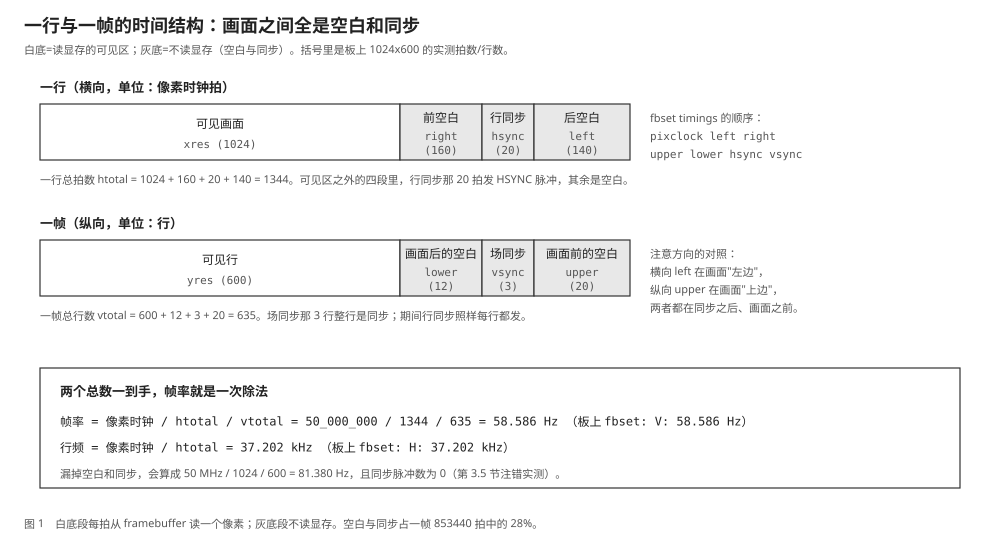
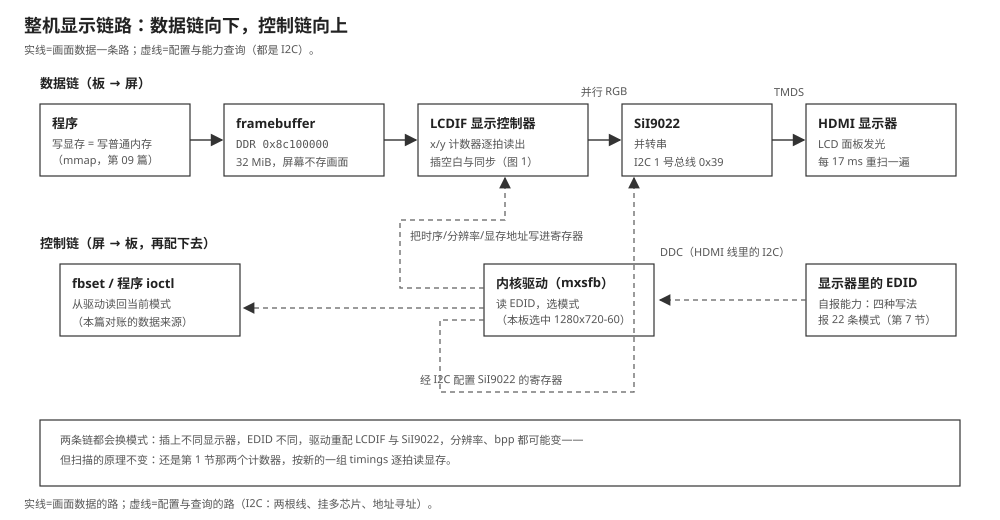

# 11 显示原理：从一块内存到屏幕上的光

    实验    Knowledge/labs/00_basics/09_display_scan/
    电脑    WSL Ubuntu 26.04，gcc 15.2.0
            （本机实测 2026-09-15 首跑，2026-10-21 判据复核 35 PASS，
            本篇输出原样沿用；scan/edid/pixfmt 三个程序都是纯计算，
            不碰任何硬件）
    板子    100ASK_IMX6ULL Pro，Linux 4.9.88
            （fbset、dmesg、/sys/class/graphics/fb0/modes 沿用
             2026-09-14 板上归档实测，保留原日期）
    判据    bash Knowledge/labs/00_basics/09_display_scan/check.sh
            2026-10-21 复核：35 PASS / 0 FAIL / 0 SKIP

---

**你会在哪里撞见它**：教程 05 篇第 1.3 节在板子上跑 `fbset -i`，得到这样
几行（2026-09-14 板上归档）：

```text
mode "1024x600-59"
    # D: 50.000 MHz, H: 37.202 kHz, V: 58.586 Hz
    geometry 1024 600 1024 600 32
    timings 20000 140 160 20 12 20 3
```

一块 1024 x 600 的屏，为什么要一个 50 MHz 的时钟？刷新率为什么是 58.586
这种不整齐的数？`timings` 后面那 7 个数又是什么？

后来插上 HDMI 显示器，这几个数全变了：

```text
mode "1280x720-60"
    # D: 74.250 MHz, H: 45.000 kHz, V: 60.000 Hz
    geometry 1280 720 1280 720 16
    timings 13468 220 110 20 5 40 5
```

显示器是怎么告诉板子"我能显示 1280x720"的？

**这篇要回答的问题**：

1. 一块 1024x600 的屏为什么要 50 MHz 时钟，刷新率为什么是 58.586 Hz？
2. `timings` 那 7 个数各是什么，帧率怎么算？
3. 程序一边写显存、控制器一边扫，屏幕会不会看到半新半旧的画面？
4. 插上 HDMI 后分辨率、bpp 全变了，板子怎么知道显示器支持什么？

---

## 0 先动手看一眼

用像素时钟和每行、每帧的总格数把帧率算出来，和板上 `fbset` 对账。实验
程序 `scan` 在电脑上模拟控制器的扫描（第 1 节讲它模拟的是什么），真的一拍
一拍走 10 秒（本机实测，2026-09-15 首跑；2026-10-21 判据复核数值不变）：

```text
像素时钟 50.000 MHz，模拟 10 秒 = 500000000 拍
一行 1344 拍，一帧 635 行
行同步脉冲 372023 个 -> 行频 37.202 kHz
场同步脉冲 585 个，扫完 585.864 帧 -> 帧率 58.586 Hz
扫完的 585 个整帧里读显存 359424000 次，每帧 614400 次（xres*yres=614400）
公式 1e12/pixclock/htotal/vtotal = 58.586 Hz
```

`50 MHz / 1344 / 635 = 58.586 Hz`，和板上 `fbset` 报的一模一样。注意两个
数都不是 1024 和 600：**一行不只有画面，一帧也不只有画面行。** 多出来的
拍数和行数是什么，就是本篇的前三节。

---

## 1 屏幕记不住东西：显示控制器与两个计数器

### 1.1 三个词定下来

> **像素**：屏幕上最小的一个发光点。每个像素某一时刻只有一个颜色。
> **帧**：一整屏像素。1024 x 600 的屏，一帧就是 614400 个像素。
> **刷新率 / 帧率**：每秒把一整屏重新送一遍的次数，单位 Hz。

**屏幕自己记不住东西**：你看到画面稳定，是因为它被一刻不停地重新送了一遍
又一遍。送画面的是 SoC 里一块专门的硬件：

> **显示控制器**：专门负责"不停地往外送像素"的硬件。它自己去内存里读
> 像素，不需要 CPU 帮忙；读到哪、读多宽多高、每秒多少遍，由驱动写进它的
> 寄存器。i.MX6ULL 上它叫 **LCDIF**，教程 05 篇 `21c8000.lcdif` 就是它。

> **framebuffer（帧缓冲）**：控制器读的那块内存。本板在物理地址
> `0x8c100000` 开始的 32 MiB（05 篇归档的 `smem_start=0x8c100000`）。

控制器干的事用两个计数器就能说完：

```text
    x = 0, y = 0                                  （从左上角开始）
    每来一拍像素时钟:
        如果 (x, y) 在可见区里:  从 framebuffer 读这个位置的像素，送出去
        否则:                    送空白或同步信号
        x = x + 1
        如果 x 走到一行的末尾:   x = 0,  y = y + 1
        如果 y 走到一帧的末尾:   y = 0             （回到左上角，下一帧）
```

**它不管是谁往内存里写的，也不管写没写。** 读到什么就送什么。所以程序改了
framebuffer，控制器下一次扫到那里（最多一帧之后）屏幕就变了：这是 05 篇
"显示就是写内存"的全部含义。第 4 节会看到这个"不管"的另一面：你写到一半
它扫到一半，屏幕上就会出现两个时刻的画面拼缝。

还有一点要紧的：这两个计数器的上限、读写地址，都是驱动按当前模式写进
LCDIF 寄存器的，不是硬件焊死的。所以同一块板，插上不同的显示器能换不同的
模式（第 7 节）。

**这一节搭好的积木**：屏幕不存画面，LCDIF 用 x、y 两个计数器逐拍读显存
往外送；参数在寄存器里，由驱动写。接下来的问题：一行、一帧的"末尾"到底
在哪，为什么不是 1024 和 600。

---

## 2 一帧里不只有画面：行场时序与 fbset 七个数

### 2.1 一行按时间展开是四段

第 0 节的对账已经说明一行的总拍数不是 `xres`。多出来的是这些：一行画完要
插一个**行同步**，同步前后还要留**空白**，这些拍子同样由像素时钟一拍一拍
走出来，只是不读显存：

> **行同步（HSYNC）/ 场同步（VSYNC）**：告诉接收端"一行开始了""一帧
> 开始了"的信号，各占若干拍 / 若干行。
> **空白（blanking）**：同步前后不读显存、不送画面的拍子。同步**之后**
> 到画面之前那段叫**后空白**（back porch），画面**之后**到同步那段叫
> **前空白**（front porch）。

一行按时间先后是四段：

| 顺序 | 区段 | 对应字段 | 拍数 |
|---|---|---|---|
| 1 | 可见画面 | `xres` | `xres` |
| 2 | 前空白（picture to sync） | `right_margin` | `right` |
| 3 | 行同步 | `hsync_len` | `hsync` |
| 4 | 后空白（sync to picture） | `left_margin` | `left` |

`htotal = xres + right + hsync + left`。纵向同理，单位换成行：
`vtotal = yres + lower + vsync + upper`。

一帧的时序结构：



图里横着看是一行的四段，竖着看是一帧的行序列；灰色段不读显存。**这张图
就是行场时序的全部形状**，后面对账的每个数都能在图上找到位置。

### 2.2 fb.h 的七个字段与 fbset 的七个数

Linux 的 `fb_var_screeninfo` 用的名字和上面不一样。本机头文件
`/usr/include/linux/fb.h` 的原注释：

```c
	__u32 pixclock;			/* pixel clock in ps (pico seconds) */
	__u32 left_margin;		/* time from sync to picture	*/
	__u32 right_margin;		/* time from picture to sync	*/
	__u32 upper_margin;		/* time from sync to picture	*/
	__u32 lower_margin;
	__u32 hsync_len;		/* length of horizontal sync	*/
	__u32 vsync_len;		/* length of vertical sync	*/
```

- `pixclock`：一拍有多长，单位**皮秒**。注意是周期不是频率，50 MHz 写成
  20000（1e12 / 5e7）。
- `left_margin`：从同步到画面，即**后空白**；叫 left 是因为它落在画面
  左边。`right_margin`：从画面到同步，即**前空白**。
- `upper_margin` / `lower_margin`：纵向两段，同理。
- `hsync_len` / `vsync_len`：同步本身占多长。

**`fbset` 那行 `timings` 的 7 个数，就是按
`pixclock left right upper lower hsync vsync` 排的。**
板上 `timings 20000 140 160 20 12 20 3` 翻回来：后空白 140、前空白 160、
上 20、下 12、行同步 20、场同步 3。

### 2.3 动手：把一帧每一格印出来

画一个小到能印在终端里的"屏"：可见区 8 x 4，横向后空白 2、行同步 2、
前空白 1，纵向后空白 1、场同步 1、前空白 1。`scan draw` 按每格打印：

    #   可见区，这一拍要读显存
    H   行同步
    V   场同步
    .   空白

```bash
cd Knowledge/labs/00_basics/09_display_scan
gcc -Wall -Wextra -O2 -o scan scan.c
./scan draw 8 4 0 2 1 1 1 2 1
```

参数顺序照抄 `fbset`：先 `xres yres`，再 `timings` 的 7 个数（`pixclock`
给 0，画图用不到）。

本机实测：

```text
########.HH..
########.HH..
########.HH..
########.HH..
.........HH..
VVVVVVVVVVVVV
.........HH..
一行 13 拍，一帧 7 行，一帧 91 格；读显存的格子 32 个（xres*yres=32），空白和同步占 64.8%
```

### 2.4 逐行读

- **每行 13 格**：8 个 `#` + 1 个 `.`（前空白）+ 2 个 `H`（行同步）+
  2 个 `.`（后空白），8 + 1 + 2 + 2 = 13 = `htotal`。
- **共 7 行**：4 行画面 + 1 行空白（下空白）+ 1 行整行 `V`（场同步）+
  1 行空白（上空白），4 + 1 + 1 + 1 = 7 = `vtotal`。
- **`#` 共 32 个，正好 8 x 4**：控制器每帧走了 91 拍，只有 32 拍读显存。
- **除场同步那行外每行都有 `HH`**：行同步每行都有，场同步期间行照样在走。

这个玩具屏空白占 64.8%，因为画面太小。真实的 1024x600 屏：853440 拍里
614400 拍读显存，空白和同步占 28%（第 3 节算）。

**这一节搭好的积木**：一行四段、一帧四段，`timings` 七个数就是六段空白
同步加一个像素周期。接下来的问题：这串数怎么变成帧率。

### 2.5 [判] 第 2 节

    [ ] 一帧 7 行：4 行画面 + 1 空白 + 1 场同步 + 1 空白
    [ ] 每行 13 格：8 画面 + 1 空白 + 2 行同步 + 2 空白
    [ ] 读显存的 # 一共 32 个 = 8 x 4
    [ ] 场同步只有 1 行且整行是 V；其余 6 行每行恰好 2 格 H

    注错见红：把空白和同步全部去掉（-DBUG_NO_BLANK 重编），帧率对不上
    板子（第 3.5 节实测 81.380 Hz），行同步脉冲归零。

---

## 3 帧率是算出来的：三组对账

### 3.1 公式

像素时钟一秒走的拍数，除以一帧的拍数，就是每秒的帧数：

```text
    像素时钟频率 = 1e12 / pixclock          （pixclock 单位皮秒）
    htotal = xres + right + hsync + left
    vtotal = yres + lower + vsync + upper
    帧率   = 像素时钟 / htotal / vtotal
    行频   = 像素时钟 / htotal
```

光背公式容易自己骗自己。`scan count` 让模拟器真走 10 秒，数它发了多少个
同步脉冲、扫完多少帧，再和板上 `fbset` 对账。

### 3.2 动手

```bash
./scan count 1024 600 20000 140 160 20 12 20 3 10     # 板上第一组时序
./scan count 1280 720 13468 220 110 20 5 40 5 10      # 板上第二组（插了 HDMI）
./scan count 1280 720 13468 220 440 20 5 40 5 10      # 只改 right: 110 -> 440
```

第三组和第二条只差一个数，为什么改它，3.4 节说。

### 3.3 实测

```text
像素时钟 50.000 MHz，模拟 10 秒 = 500000000 拍
一行 1344 拍，一帧 635 行
行同步脉冲 372023 个 -> 行频 37.202 kHz
场同步脉冲 585 个，扫完 585.864 帧 -> 帧率 58.586 Hz
扫完的 585 个整帧里读显存 359424000 次，每帧 614400 次（xres*yres=614400）
公式 1e12/pixclock/htotal/vtotal = 58.586 Hz
```

```text
像素时钟 74.250 MHz，模拟 10 秒 = 742500743 拍
一行 1650 拍，一帧 750 行
行同步脉冲 450000 个 -> 行频 45.000 kHz
场同步脉冲 600 个，扫完 600.001 帧 -> 帧率 60.000 Hz
扫完的 600 个整帧里读显存 552960000 次，每帧 921600 次（xres*yres=921600）
公式 1e12/pixclock/htotal/vtotal = 60.000 Hz
```

```text
像素时钟 74.250 MHz，模拟 10 秒 = 742500743 拍
一行 1980 拍，一帧 750 行
行同步脉冲 375000 个 -> 行频 37.500 kHz
场同步脉冲 500 个，扫完 500.001 帧 -> 帧率 50.000 Hz
扫完的 500 个整帧里读显存 460800000 次，每帧 921600 次（xres*yres=921600）
公式 1e12/pixclock/htotal/vtotal = 50.000 Hz
```

### 3.4 逐段对账

**第一组（板载屏，2026-09-14 板上归档 `D: 50.000 MHz, H: 37.202 kHz,
V: 58.586 Hz`）：**

```text
一行 1344 拍 = 1024 + 160 + 20 + 140
一帧 635 行  =  600 +  12 +  3 +  20
50 MHz / 1344 / 635 = 58.586 Hz
```

像素时钟、行频、帧率三个数与板上逐个相等。每帧读显存 614400 次 =
1024 x 600；一帧总拍 1344 x 635 = 853440，**28% 的拍子在空白和同步上**。
1024x600 在内核标准模式表里查不到（4.9 的 `modedb.c`、`drm_edid.c` 都没有
这一项）：它是屏厂自己的时序，所以帧率是 58.586 这种数。

**第二组（插上 HDMI 后）。** 模拟 74.250 MHz、45.000 kHz、60.000 Hz，
与板上逐个相等。这组时序**是公开标准表里的一行**。Linux 4.9
`drivers/gpu/drm/drm_edid.c` 第 667-671 行：

```c
	/* 4 - 1280x720@60Hz */
	{ DRM_MODE("1280x720", DRM_MODE_TYPE_DRIVER, 74250, 1280, 1390,
		   1430, 1650, 0, 720, 725, 730, 750, 0,
		   DRM_MODE_FLAG_PHSYNC | DRM_MODE_FLAG_PVSYNC),
	  .vrefresh = 60, .picture_aspect_ratio = HDMI_PICTURE_ASPECT_16_9, },
```

`4` 是 CEA-861 标准的编号（叫 VIC，第 7 节 EDID 里就是它）。`DRM_MODE`
的参数记的是**位置**（同步开始、同步结束、一行总数），`fbset` 记的是
**长度**，换算：

```text
横向  前空白 = 1390 - 1280 = 110   行同步 = 1430 - 1390 = 40   后空白 = 1650 - 1430 = 220
纵向  前空白 =  725 -  720 =   5   场同步 =  730 -  725 =  5    后空白 =  750 -  730 =  20
```

对照 `fbset` 的 `timings 13468 220 110 20 5 40 5`（pixclock left right
upper lower hsync vsync）：left=220、right=110、upper=20、lower=5、
hsync=40、vsync=5，**六个数一个不差**；74250 kHz 的周期 1e12/74250000 =
13468 皮秒也对上。`PHSYNC|PVSYNC` 是同步高电平有效，板上 `fbset` 那两行
`hsync high`、`vsync high` 同样对上。

**第三组：只改一个数就是 50 Hz。** 同文件第 749-751 行，CEA 第 19 号
模式：像素时钟还是 74250，同步开始从 1390 变 1720、一行总数 1650 变
1980：**前空白从 110 加到 440，其余不动**。模拟正好 50.000 Hz、行频
37.500 kHz。旧 fbdev 的表里也有同一行（`drivers/video/fbdev/core/
modedb.c` 第 326 行）：

```c
		NULL, 50, 1280, 720, 13468, 220, 440, 20, 5, 40, 5,
```

`440` 就在 `right` 的位置上。这样设计的原因：720p 的 50Hz 和 60Hz 共用
同一个 74.25 MHz 时钟，硬件只做一个时钟频率，改一个计数器上限就能切换
两种电视制式。

### 3.5 注错：不要空白和同步会怎样

```bash
gcc -Wall -Wextra -O2 -DBUG_NO_BLANK -o scan_bug scan.c
./scan_bug count 1024 600 20000 140 160 20 12 20 3 10
```

```text
像素时钟 50.000 MHz，模拟 10 秒 = 500000000 拍
一行 1024 拍，一帧 600 行
行同步脉冲 0 个 -> 行频 0.000 kHz
场同步脉冲 0 个，扫完 813.802 帧 -> 帧率 81.380 Hz
扫完的 813 个整帧里读显存 499507200 次，每帧 614400 次（xres*yres=614400）
公式 1e12/pixclock/htotal/vtotal = 81.380 Hz
```

帧率 81.380 Hz，和板上 58.586 对不上；05 篇第 1.3 节 `fbinfo` 故意只拿
分辨率算帧率，报的也是 81.380。更要紧的是**同步脉冲变成 0**：画面数据一个
不少，接收端却再也找不到一行从哪开始，真实硬件上就是"无信号"。

**这一节搭好的积木**：帧率 = 像素时钟 / htotal / vtotal；标准模式的七个
数是公开表里查来的，不是驱动编的。回答了开头第一、二问。接下来的问题：
程序写显存的速度和扫描的速度差不多，会发生什么。

### 3.6 [判] 第 3 节

    [ ] 第一组：58.586 Hz、37.202 kHz，与 fbset 相等；每帧读显存 614400 次
    [ ] 第二组：60.000 Hz、45.000 kHz，一行 1650 拍一帧 750 行（CEA VIC 4）
    [ ] 第三组：right=440 时 50.000 Hz、一行 1980 拍（CEA VIC 19）
    [ ] 注错：不走空白同步，81.380 Hz，行同步脉冲 0

---

## 4 边写边扫：撕裂与双缓冲

### 4.1 问题

第 1 节说控制器"不管谁在写"。板上写一帧显存要多久？控制器扫一帧又要多久？
1024x600 的屏：一帧 853440 拍，像素周期 20000 皮秒，一帧 = 853440 x 20000 /
1e9 = **17.069 ms**。程序在电脑上写 2.4 MB 显存（05 篇量过这类 memcpy），
本板量级约 **2.5 ms**，只占一帧的 0.146。听起来写远快于扫，但"写的那
2.5 ms"和"扫到哪"是同时发生的：**写入扫过显存的进度追上了扫描的进度吗？**
追上的那一刻，屏幕上半是新画面、下半是旧画面，那条分界叫**撕裂线**。

`scan tear` 模拟这件事：扫描走到第 300 行（yres/2）行首那一刻开始，从显存
左上角线性写一帧新画面（写一帧 2.5 ms），逐拍比较写指针和扫描位置，数每
一帧每一行读到的是新是旧：

```bash
./scan tear 1024 600 20000 140 160 20 12 20 3 2.50
```

### 4.2 实测

```text
一帧 853440 拍 = 17.069 ms；写一帧 2.50 ms = 125000 拍（占 0.146 帧）
写入开始的那一刻，扫描在第 300 行行首；写完时扫描又走了 93 行
直接写（写到哪算哪）:
  帧 0: 第 0..354 行旧画面，第 355..599 行新画面（撕裂线在第 355 行）
  帧 1: 整帧新画面
  帧 2: 整帧新画面
  => 直接写: 1 帧带撕裂线
双缓冲（先写背面缓冲，写完等下一个场同步换指针）:
  帧 0: 整帧旧画面
  帧 1: 整帧新画面
  帧 2: 整帧新画面
  => 双缓冲: 0 帧带撕裂线
```

### 4.3 逐行读

- **撕裂线在第 355 行，不在第 300 行。** 写入从第 300 行行首开始，但写是
  一拍一拍推进的（125000 拍写完），扫描也是。扫描走到第 y 行中点那一拍，
  写指针恰好越过"这一行中点对应的像素数"，这一行起显示的就是新画面。
  两个进度相除：撕裂线落在 355。**写入开始的位置和撕裂出现的位置不是
  同一行，这正是"边写边扫"的几何。**
- **写完时扫描又走了 93 行**（125000 拍 / 1344 拍每行）：写追得很快，
  只 torn 了一帧；写越慢（比如 17 ms 以上写一帧），撕裂帧越多。
- **双缓冲的换法**：程序写的是另一块背面缓冲，写完之后等下一个场同步，
  把控制器的读地址换成背面，那一刻屏幕上任何一行都不会是半新半旧，
  因为整帧整体切换。实测 0 帧带撕裂线。

撕裂不是每次都能看出来：静态画面写进去的内容和旧的一样，撕了也看不出。
它在"画面在动"的时候现形（横条纹错位、上下两半坐标对不齐）。05 篇的
板级演示没做双缓冲，理由也在这：单层画面整帧重写、写完离下一次扫描还远，
实际撕不到；但机制要知道，第 2 阶段做动画时它是第一课。

**这一节搭好的积木**：撕裂线位置 = 写入进度与扫描进度的交点；双缓冲用
"写背面、场同步换指针"把整帧切换对齐到场同步。回答了开头第三问。

### 4.4 [判] 第 4 节

    [ ] 一帧 853440 拍 = 17.069 ms
    [ ] 写一帧 2.50 ms = 125000 拍（占 0.146 帧）
    [ ] 直接写：帧 0 撕裂线在第 355 行，随后整帧新画面
    [ ] 双缓冲：0 帧带撕裂线

    注错见红：-DBUG_WR_INSTANT 重编（假设写显存不花时间），撕裂线挪到
    写入开始的那一行（第 300 行），与实测 355 对不上：撕裂线的位置
    来自"写的进度"，不是"开始写的位置"。

---

## 5 像素格式：显存里与线上

### 5.1 问题：一个像素在显存里长什么样

05 篇归档的 `fbset -i` 里有一行（2026-09-14 板上）：

```text
    rgba 8/16,8/8,8/0,0/0
```

这是 length/offset 写法：红色 8 位、在偏移 16；绿 8 位在 8；蓝 8 位在 0；
第四个 0/0 是"透明度位段，长度 0"，即不存。这就是 32bpp 的 **XRGB8888**：
最高 8 位空着。16bpp 模式对应 **RGB565**：红 5 位在 11、绿 6 位在 5、
蓝 5 位在 0。`pixfmt` 程序把"写代码的人手里的 0xFF0000"一路变到显存
字节：

```bash
./pixfmt 32 0xFF0000
./pixfmt 16 0xFF0000
```

### 5.2 实测与逐行读

```text
（32bpp）
像素 0xFF0000，32bpp 位段 red=16/8 green=8/8 blue=0/8（偏移/长度）
拼成 32 位的值 0x00FF0000
显存字节（地址从低到高）: 00 00 FF 00
控制器一个 32 位字装 1 个像素（打包掩码 0x7，一个字的低 3 字节有效）
一行 1024 像素：显存 4096 字节 = 1024 个 32 位字
```

```text
（16bpp）
像素 0xFF0000，16bpp 位段 red=11/5 green=5/6 blue=0/5（偏移/长度）
拼成 16 位的值 0xF800
显存字节（地址从低到高）: 00 F8
控制器一个 32 位字装 2 个像素（打包掩码 0xF，一个字的 4 个字节全有效）
一行 1024 像素：显存 2048 字节 = 512 个 32 位字
```

四笔账逐个对：

1. **位段拼装**：红色 8 位的 0xFF 砍到 5 位剩 0x1F，挪到偏移 11，得
   0xF800。每个分量两步：先右移砍掉低位，再左移挪进自己的位段。
2. **显存字节序**：0x00FF0000 按小端排是 `00 00 FF 00`，即**显存里从低
   地址到高地址是 B、G、R、X**。第 13 篇专门讲字节序；这里先记住：调试
   显存时 `xxd` 看到的第一个字节是蓝。
3. **线上的位宽**：控制器一次从内存读 32 位。32bpp 时驱动告诉它"一个
   32 位字 1 个像素（低 3 字节有效）"；16bpp 时"一个字 2 个像素"。所以
   一行 1024 像素，32bpp 是 4096 字节 = 1024 个读拍，16bpp 是 2048 字节
   = 512 个读拍。**bpp 减半，读显存的带宽需求减半**，这就是板子插上
   HDMI 后把 32 降到 16 的直接收益之一。
4. **注错（字节序假设错了会怎样）**：`-DBUG_BE` 按大端排字节，同样的
   0x00FF0000 排成 `00 FF 00 00`。控制器若真按这个排布读，红绿蓝整个
   错位，屏幕上红色变青色一类。本板小端，`pixfmt_be` 的输出就是
   "错误答案"长什么样：

```text
显存字节（地址从低到高）: 00 FF 00 00
```

**这一节搭好的积木**：`rgba` 行给出了位段表；显存字节是小端 B G R X；
bpp 决定控制器一个读拍取几个像素。像素从显存到线上，还差最后一段路，
下一节把它走完。

### 5.3 [判] 第 5 节

    [ ] 32bpp 红色 0xFF0000 拼成 0x00FF0000，字节是 00 00 FF 00（B G R X）
    [ ] 32bpp 一行 1024 像素 = 4096 字节 = 1024 个 32 位字
    [ ] 16bpp 红色拼成 0xF800，字节是 00 F8
    [ ] 16bpp 一行 1024 像素 = 2048 字节 = 512 个 32 位字（一字两像素）
    [ ] 注错：按大端假设排出 00 FF 00 00，颜色整个错位

---

## 6 从控制器到显示器：并行 RGB、TMDS 与 SiI9022

这一节没有新实验，把板上看到的东西串成两条链。

i.MX6ULL 的 LCDIF 输出的是**并行 RGB**：红绿蓝每一位颜色各占一根线，再加
像素时钟、行同步、场同步、"现在是可见区"几根控制线，每一拍把一个像素的
所有位同时放上线上。适合在板上几厘米内直接接液晶屏。

HDMI 线要传一两米还要少用线，换了一种形式：**TMDS**，红绿蓝各一对差分线
加一对时钟线，每对线上把颜色一位一位串行地送。并转串由一颗专门芯片完成，
本板是 **SiI9022**（05 篇归档 dmesg：`sii902x 1-0039: No reset pin found`）。
`1-0039` 的意思是 **I2C 第 1 号总线、地址 0x39**：

> **I2C**：两根线（时钟、数据）的慢速总线，一条总线挂很多芯片，每个芯片
> 有一个地址。板上的小芯片配置、传感器读数大多走它。

驱动通过 I2C 往 SiI9022 的寄存器写配置，告诉它输入是什么分辨率、什么时序。
HDMI 线里还藏着一条 I2C，叫 **DDC**，专门用来读显示器里的 EDID（第 7 节）。

```text
 数据链（方向:板 -> 屏）
   程序写显存 --> LCDIF 逐拍读出(第 2 节的节拍)
     --> 并行 RGB --> SiI9022 转 TMDS --> HDMI 线 --> 显示器

 控制链（方向:屏 -> 板）
   显示器 EDID --DDC(I2C)--> 驱动读走,选模式(第 7 节)
     --> 驱动把时序/分辨率/显存地址写进 LCDIF 寄存器
     --> 驱动经 I2C(1 号总线 0x39)配置 SiI9022
```

**这一节搭好的积木**：数据走"显存到并行 RGB 到 TMDS"，配置走"I2C 两条
链"。第 2 节的时序参数就写在控制链终点的那几个寄存器里，插不同显示器
能换模式的原因。

---

## 7 EDID：显示器自报的能力表

### 7.1 目标

05 篇第 5 节记录了插上显示器后板上 `/sys/class/graphics/fb0/modes` 从
1 行变成 18 行（2026-09-14 板上归档，节选首尾）：

```text
D:1920x1080p-179
D:1920x1080p-165
D:1920x1080p-144
...(中间 12 行)...
V:640x480p-60
D:1920x1080p-60
```

这 18 行是显示器告诉板子的。**能不能不用板子，把显示器说的原话拿到手，
自己解一遍，和这 18 行对账？**

> **EDID**：显示器里一小块只读数据，前 128 字节是基本块，之后每 128 字节
> 一个扩展块。里面写着厂商、型号、名字，以及好几种写法的"我支持哪些
> 模式"。

这台显示器平时也插在 Windows 电脑上，Windows 把接过的每台显示器的 EDID
原样存在注册表里。导出（PowerShell）：

```powershell
Get-ChildItem 'HKLM:\SYSTEM\CurrentControlSet\Enum\DISPLAY' | ForEach-Object { $_.PSChildName }
# AUO3CA2 / Default_Monitor / SAC2563  （SAC2563 就是插在板上的那台 N50PRO V+）
$k = Get-ChildItem 'HKLM:\SYSTEM\CurrentControlSet\Enum\DISPLAY\SAC2563' | Select-Object -First 1
$e = (Get-ItemProperty -LiteralPath ($k.PSPath + '\Device Parameters') -Name EDID).EDID
[IO.File]::WriteAllBytes('E:\Workspace\Embeded\Embedded-linux\Knowledge\labs\00_basics\09_display_scan\edid.bin', $e)
```

- `Get-ChildItem`：列注册表某键下的子键，同列目录。`Default_Monitor` 是
  Windows 给没报型号的设备留的默认项，它下面没有 EDID。
- `Select-Object -First 1`：同一台显示器可能有多个实例（换过接口），取
  第一个。
- `WriteAllBytes`：把字节数组原样落盘。

### 7.2 解 EDID

`edid.c` 按 Linux 4.9 内核 `fbmon.c` 的顺序解：先基本块四个描述符，再老式
固定模式表，再标准模式，最后扩展块：

```bash
gcc -Wall -Wextra -O2 -o edid edid.c
./edid edid.bin
```

本机实测（2026-09-15；完整输出较长，节为三段）：

```text
块 0 校验和: 128 个字节加起来模 256 = 0 （正确）
块 1 校验和: 128 个字节加起来模 256 = 0 （正确）
厂商 SAC  产品号 0x2563  EDID 版本 1.3  扩展块 1 个
四个描述符（字节 54-125）:
  详细时序 1920x1080p  像素时钟 148.50 MHz  一行 2200 拍 一帧 1125 行  帧率 60.000 Hz
    按 fbset 的写法: timings 6734 148 88 37 3 44 5
  显示器名字: N50PRO V+
  范围限制: 场频 48-200 Hz, 行频 30-255 kHz, 最高像素时钟 600 MHz
老式固定模式表（字节 35-36 的位）:
  640x480@60
  800x600@60
  1024x768@60
标准模式（字节 38-53）:
  1920x1080@60
```

```text
扩展块: 标签 0x02（CEA-861） 版本 3
 视频数据块，14 个 VIC:
  VIC 16  1920x1080p@60  (标了 native)
  VIC 1   640x480p@60
  VIC 2   720x480p@60
  VIC 3   720x480p@60
  VIC 4   1280x720p@60
  VIC 19  1280x720p@50
  VIC 31  1920x1080p@50
  VIC 32  1920x1080p@24
  VIC 33  1920x1080p@25
  VIC 34  1920x1080p@30
  VIC 60  1280x720p@24
  VIC 61  1280x720p@25
  VIC 62  1280x720p@30
  VIC 63  1920x1080p@120
 详细时序:
  详细时序 1920x1080p  像素时钟 333.72 MHz  一行 2060 拍 一帧 1125 行  帧率 144.000 Hz
    按 fbset 的写法: timings 2997 60 48 32 3 32 10
  详细时序 1920x1080p  像素时钟 386.10 MHz  一行 2080 拍 一帧 1125 行  帧率 165.000 Hz
    按 fbset 的写法: timings 2590 80 48 37 3 32 5
  详细时序 1920x1080p  像素时钟 415.58 MHz  一行 2080 拍 一帧 1110 行  帧率 179.998 Hz
    按 fbset 的写法: timings 2406 80 48 22 3 32 5
```

```text
模式清单（22 条，最后解出来的排第一）:
  D:1920x1080p-179
  D:1920x1080p-165
  D:1920x1080p-144
  S:1920x1080p-120
  S:1280x720p-30
  ...(共 22 条)...
  V:640x480p-60
  D:1920x1080p-60
```

### 7.3 逐段读

**校验和**：每个 128 字节块，所有字节求和模 256 必须为 0，末字节就是为凑
这个 0 存在的。两块都对，文件没坏。

**同一台显示器用了四种写法报模式**：

```text
 详细时序     18 字节写全一个模式的全部时序参数,最精确
 老式固定表   字节 35-36 里每一位对应一个早年定死的模式,这台置了 3 位
 标准模式     每 2 字节写宽/宽高比/刷新率,时序要按公式或查表补全
 CEA 编号     扩展块里只写一个 VIC 号,时序去查 CEA-861 的表
```

**VIC 4（1280x720p@60）**就是第 3.4 节对过账的那个 CEA 第 4 号模式，
板上最终选中的也是它。三条高刷新率详细时序（144/165/180）里，第三条
415.58 MHz / 2080 / 1110 = **179.998 Hz**，不是整 180。

165 Hz 那条换算验一遍：一行 = 1920 + 48 + 32 + 80 = 2080，一帧 =
1080 + 3 + 5 + 37 = 1125，386.10 MHz / 2080 / 1125 = 165.000 Hz。

### 7.4 和板子的 18 行对账：三处加工

我们解出 22 条，板上 18 条。并排比出三处加工，全在驱动一侧：

**第一，驱动表过滤。** 板上没有 `S:1920x1080p-120`、`S:1280x720p-30/25/24`
这 4 条（VIC 63、62、61、60）；其余 18 条内容、顺序全同。原因在驱动的
模式表：本板内核基于 NXP 4.9.88，`drivers/video/fbdev/mxc/mxc_edid.c`
第 41 行的 `mxc_cea_mode[64]` 里填了内容的只有 VIC 1-9、14-20、23、24、
29-34、41、47，**没有 60-63**；解扩展块的代码（第 320-327 行）遇到表里
空的编号直接跳过：

```c
						cea_idx = edid[index] & 0x7f;
						if (cea_idx < ARRAY_SIZE(mxc_cea_mode) &&
						        (mxc_cea_mode[cea_idx].xres)) {
							mode[num] = mxc_cea_mode[cea_idx];
							mode[num].flag |= FB_MODE_IS_STANDARD;
							num++;
						}
```

**显示器支持，不代表板子能用：驱动的表里没有，这个模式就不存在。**

**第二，倒序。** EDID 里最先解出的 `D:1920x1080p-60` 排在板上清单最后一行：
`modedb.c` 第 1112 行每加一个模式用 `list_add` 插在链表最前面。

**第三，行首字母与 179。** `fbsysfs.c` 的 `mode_string`：带详细时序标志打
`D`，VESA 表来的打 `V`，CEA 编号打 `S`，都没有打 `U`。179 是 179.998 被
整数除法截掉小数。**宣传 180 Hz 的显示器在清单里写 179，不是能力不够**。

（05 篇第 5 节还记了一个实测结果：18 个模式里有 1080p，驱动却选了 1280x720
并把 bpp 从 32 降到 16。挑选逻辑在厂商改动过的驱动里，本篇没有那份源码，
只记现象；bpp 减半的带宽账见第 5 节。）

### 7.5 注错见红

```bash
cp edid.bin edid_bad.bin
printf '\x81' | dd of=edid_bad.bin bs=1 seek=20 conv=notrunc status=none
./edid edid_bad.bin | head -1
```

- `dd ... seek=20 conv=notrunc`：跳到第 20 字节改写 1 字节，不截断文件。

本机实测（第 20 字节原值 0x80，`od -An -tx1 -j20 -N1 edid.bin` 可验）：

```text
块 0 校验和: 128 个字节加起来模 256 = 1 （坏了）
```

**哪怕改坏一位，校验和也报坏。** 另一条对账判据：不解掉 VIC 60-63 就和
板子对不上（22 对 18）；解掉后 18 条逐行相同。

### 7.6 [判] 第 7 节

    [ ] 两块校验和正确；厂商 SAC、产品号 0x2563、名字 N50PRO V+
    [ ] 解出 22 条模式
    [ ] 去掉 VIC 60-63 后，18 条与板上 modes 逐行相同、顺序相同
    [ ] 180Hz 那条算出 179.998，清单里是 179
    [ ] 注错：改坏 1 字节，块 0 校验和报坏

**第 7 节搭好的积木**：EDID 是显示器的自述，四种写法报能力；板上的清单
= EDID 过一遍驱动的表，再被截断小数、倒序。回答了开头第四问。整机两条链
合一张图：



---

## 速查清单

每条标依据。板上数据 2026-09-14 归档；本机模拟与 EDID 解析 2026-09-15
首跑、2026-10-21 复核。

**三种模式的时序（板上实测与 CEA 标准表对账）**：

| 模式 | 像素时钟 | 一行 | 一帧 | 帧率 | 来源 |
|---|---|---|---|---|---|
| 1024x600 | 50.000 MHz | 1344 | 635 | 58.586 Hz | 本板出厂屏 |
| 1280x720p60 | 74.250 MHz | 1650 | 750 | 60.000 Hz | CEA VIC 4 |
| 1280x720p50 | 74.250 MHz | 1980 | 750 | 50.000 Hz | CEA VIC 19（前空白 440） |

公式：`帧率 = 像素时钟 / htotal / vtotal`；1024x600 不走空白同步会算成
81.380 Hz。

**fbset `timings` 七个数**（顺序）：

| 位 | 含义 |
|---|---|
| 1 | 像素时钟周期（皮秒）；50 MHz 写 20000 |
| 2 | left：行同步之后、画面之前（后空白） |
| 3 | right：画面之后、行同步之前（前空白） |
| 4 | upper：场同步之后、画面之前 |
| 5 | lower：画面之后、场同步之前 |
| 6 | hsync：行同步宽度 |
| 7 | vsync：场同步宽度 |

**一行/一帧的段序**（第 2 节）：

```text
 行: xres 画面 -> right 前空白 -> hsync 行同步 -> left 后空白
 帧: yres 画面 -> lower 空白 -> vsync 场同步 -> upper 空白
```

**撕裂账**（第 4 节模拟实测）：1024x600 一帧 17.069 ms；写一帧 2.5 ms
占 0.146 帧；直接写出现撕裂线（实测第 355 行），双缓冲（写背面、场同步
换指针）0 帧撕裂。

**像素格式**（板上 rgba 归档 + pixfmt 实测）：

| 模式 | 位段 red/green/blue（偏移/长度） | 红色 0xFF0000 在显存 | 一行 1024 像素 |
|---|---|---|---|
| 32bpp XRGB8888 | 16/8, 8/8, 0/8（高 8 位空） | 00 00 FF 00 | 4096 字节，一字 1 像素 |
| 16bpp RGB565 | 11/5, 5/6, 0/5 | 00 F8 | 2048 字节，一字 2 像素 |

字节序小端，显存从低地址起是 B G R(X)。

**显示链路**（第 6 节）：

| 环节 | 干什么 |
|---|---|
| framebuffer（DDR 0x8c100000 起 32 MiB） | 程序写像素，LCDIF 读像素 |
| LCDIF（SoC 内） | 逐拍读显存，插空白与同步，出并行 RGB |
| SiI9022（I2C 1 号总线 0x39） | 并行 RGB 转 TMDS |
| HDMI 线（含 DDC 这条 I2C） | 传画面；反向传 EDID |

**EDID 结构**（第 7 节解过）：

| 部分 | 内容 |
|---|---|
| 头 8 字节 | 固定 `00 ff ff ff ff ff ff 00` |
| 厂商/产品 | 厂商代号 3 字母压 2 字节、产品码、序号、周/年 |
| 四个描述符 | 首选详细时序、名字、序号、范围限制 |
| 老式固定表 / 标准模式 | 位表 / 每 2 字节一条 |
| 扩展块（CEA-861） | VIC 清单 + 更多详细时序 |
| 每 128 字节末字节 | 校验和：全块求和模 256 = 0 |

**板上清单的三处加工**：驱动表没有的 VIC 丢弃（本板丢 60-63 四条）；
帧率小数截断（179.998 → 179）；`list_add` 插表头所以倒序。

---

## 回看

| 问题 | 答案 | 证据在哪 |
|---|---|---|
| 屏幕为什么不闪断 | 控制器在不停重扫，屏幕不存画面 | 1.1，两个计数器 |
| 一行为什么不是 1024 拍 | 加前空白、行同步、后空白 | 2.3，13 格玩具屏 |
| 帧率怎么算、为什么 58.586 | 像素时钟/htotal/vtotal；屏厂自定时序 | 3.4，三组对账 |
| 720p 的七个数哪来的 | CEA-861 公开标准表，VIC 4/19 | 3.4，drm_edid.c 原文 |
| 忘了空白会算成什么 | 81.380 Hz，且同步脉冲为 0 | 3.5，注错 |
| 边写边扫会看到什么 | 撕裂线：写入进度追上扫描进度的那一行 | 4.2，第 355 行 |
| 怎么不撕 | 双缓冲：写背面，场同步整体换指针 | 4.2，0 帧撕裂 |
| 一个像素在显存里怎么排 | 位段表 + 小端 B G R X | 5.2，pixfmt |
| bpp 降到 16 赚了什么 | 带宽减半：一字两像素 | 5.2，512 个读拍 |
| 板子怎么知道显示器能力 | DDC 读 EDID，四种写法报模式 | 7.1-7.3 |
| 板上清单为什么 18 条 | EDID 22 条过驱动表丢 4 条，截断、倒序 | 7.4，mxc_edid.c |

---

## 带走

开头四个问题的答案：

1. **50 MHz 是像素时钟：一拍送一个像素（或空白）。** 58.586 Hz 是它除以
   一行 1344 拍、一帧 635 行的结果；屏的时序是厂家定的，所以不是整数。
2. **`timings` 七个数** = 像素周期（皮秒）+ 横向三段（后空白/前空白/
   行同步）+ 纵向三段。一行四段、一帧四段，帧率 =
   像素时钟 / htotal / vtotal；漏掉空白同步会算成 81.380 Hz。
3. **边写边扫会撕**：撕裂线在写入进度追上扫描进度的地方（实测第 355 行，
   不是写入开始的那行）。解法是双缓冲：写背面缓冲，写完等场同步整体换
   指针。
4. **板子读 EDID 知道显示器能力。** EDID 用四种写法报模式；板上清单 =
   EDID 过驱动表（丢 4 条）+ 小数截断（179）+ 倒序。显示链路数据走
   LCDIF 到 SiI9022 到 TMDS，配置走 I2C 两条链。

### 看到什么，就先想到什么

| 看到的东西 | 第一反应 |
|---|---|
| 帧率不是整数 | 屏厂自定时序，正常（58.586） |
| 自算帧率比 fbset 高一截 | 空白和同步没算进总数 |
| 显存回读对、屏幕黑 | 问题在控制器之后：时序/转换芯片/线/屏 |
| 插显示器后分辨率或 bpp 变了 | 驱动读 EDID 重选了模式；程序要 ioctl 现问 |
| 清单刷新率比宣传少 1 | 整数除法截断 |
| 显示器支持的模式板上没有 | 驱动模式表没收（VIC 60-63） |
| 画面横向错位、上下两半对不齐 | 撕裂；写太密或没双缓冲 |
| `xxd` 显存第一个字节不是红 | 小端：B G R X |

---

## 接下来

- [10 驱动与设备文件](10_驱动与设备文件.md)：`/dev/fb0` 这个节点怎么找到
  LCDIF，`FBIOGET_VSCREENINFO` 那两个结构体从哪来。
- [09 虚拟内存与 mmap](09_虚拟内存与mmap.md)：显存为什么要 `MAP_SHARED`
  映射，写显存与写普通文件差在哪。
- 教程里的位置：05 篇第 1.3 节用本篇对帧率、第 1.4 节映射显存、第 5 节
  用本篇讲 EDID 与 HDMI 切模式；06 篇的文字也画在这个扫描节拍上。
