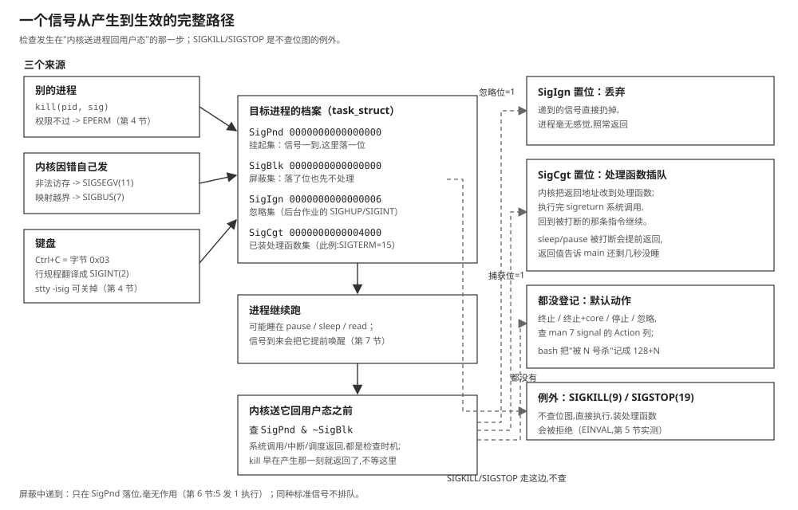

# 12 进程与信号

    实验    Knowledge/labs/00_basics/07_process_signal/
    电脑    WSL Ubuntu 26.04（内核 6.6.114），gcc 15.2.0，
            arm-linux-gnueabihf-gcc 15.2.0，strace，script
            （本篇"本机实测"为 2026-10-21 实跑；第 1.4 节名字截断一组
             输出沿用 2026-09-15 首跑，判据 2026-10-21 复核全过）
    板子    100ASK_IMX6ULL Pro，Linux 4.9.88
            （出厂启动脚本与 GUI 现象沿用教程 05 篇的板上归档）
    判据    bash Knowledge/labs/00_basics/07_process_signal/check.sh
            2026-10-21 复核：74 PASS / 0 FAIL / 0 SKIP

---

**你会在哪里撞见它**：教程 05 篇在板子上做显示实验前，要停掉出厂系统的
图形界面程序 `mxapp2`。照着它的启动脚本停掉，隔 1 秒查一下还在不在，做了
两次结果不一样：

```text
第一次:  GUI pid after stop: []
第二次:  after stop: [5512]
```

同一条停止命令，第二次停完它还在，再过几秒查，又没了。再早一点，09 篇里
程序崩了，终端打出 `Segmentation fault`，退出码 139。翻遍代码，没有哪一行
写着 139。这两件事是同一套机制在起作用：**信号**。本篇把"进程档案"和
"信号通知"分开讲清。

**这篇要回答的问题**：

1. 同一个程序跑两次，为什么是两个不同的东西？怎么精确地找到它们？
2. `$?` 里的 139 是谁编的？它和程序自己 `exit(139)` 怎么区分？
3. `killall` 返回了，进程为什么还在？信号从产生到生效，中间走了哪几步？

---

## 0 先动手看一眼

同一个程序跑两次，看内核给它们什么（本机实测，2026-10-21，下同）：

```text
pid=953 ppid=309
pid=954 ppid=309
shell 自己的 PID: 309
    PID    PPID STAT COMMAND
    309     308 Ss+  bash
    953     309 S+   hold
    954     309 S+   hold
Name:	hold
State:	S (sleeping)
PPid:	309
SigIgn:	0000000000000006
pidof hold: 954 953
```

两个 PID、同一个可执行文件、同一个父进程。这一篇就是把"档案"和"通知"
讲清。

---

## 1 程序和进程不是一回事：两份档案

### 1.1 定义与来路

> **程序**：磁盘上的一个可执行文件，静止的，不占 CPU。
> **进程**：程序被加载起来、正在运行的一个实例。内核为每个进程维护一份
> 档案（源码里叫 `task_struct`），记着它跑到哪、用着什么资源。
> **PID / PPID**：进程的编号 / 它父进程的编号。

进程都由别的进程"生"出来：父进程调 `fork` 复制一个几乎一样的自己（09 篇
第 1.6 节见过 fork 抄页表），子进程再调 `execve` 把自己整个换成另一个程序。
你在 shell 里敲 `./hold`，shell 就是这么做的，所以 `hold` 的父进程是这个
shell。

磁盘上只有一个 `hold` 文件，跑两次就是两份独立档案，各有各的 PID：
`/proc/<PID>/` 就是档案公开出来的样子（07 篇讲过 `/proc/self` 的用法，
那里 `/proc/<PID>/` 是看别人的同一套东西）。

### 1.2 实验：跑两次，从 /proc 里对档案

`hold.c` 打印自己的 PID 和父进程 PID，然后 `pause()` 睡到有信号来。跑两个：

```bash
cd Knowledge/labs/00_basics/07_process_signal
gcc -Wall -o hold hold.c
./hold > .h1.log & P1=$!
./hold > .h2.log & P2=$!
sleep 0.3
cat .h1.log .h2.log
ps -o pid,ppid,stat,comm -p $$,$P1,$P2
grep -E '^(Name|State|PPid)' /proc/$P1/status
cat /proc/$P1/wchan
echo "pidof hold: $(pidof hold)"
kill $P1; sleep 0.1
echo "杀掉一个之后 pidof hold: $(pidof hold)"
kill $P2; wait 2>/dev/null
```

- `./hold &`：`&` 放到后台，shell 不等它就往下走；`P1=$!` 马上记下它的 PID。
- `ps -o ... -p ...`：自己挑列，只看这几个 PID。
- `/proc/<PID>/status`：档案的文本版；`wchan`：它睡在内核的哪个函数里。
- `pidof hold`：按名字找 PID。
- `kill $P1`：发一个默认信号（第 5 节讲它递了什么）。

本机实测：

```text
pid=953 ppid=309
pid=954 ppid=309
    PID    PPID STAT COMMAND
    309     308 Ss+  bash
    953     309 S+   hold
    954     309 S+   hold
Name:	hold
State:	S (sleeping)
PPid:	309
__do_sys_pause
pidof hold: 954 953
杀掉一个之后 pidof hold: 954
```

逐行读：两个 `hold` 的 PID 不同（953、954），父进程都是 shell（309）；
`status` 里 `State: S`、`wchan` 是 `__do_sys_pause`，对上"睡在 pause 里"；
`/proc/953/exe` 与 `/proc/954/exe` 指向同一个文件；`pidof` 找到两个，杀掉
一个剩一个；两个都收走之后，`/proc/<pid>` 整个消失。

### 1.3 名字不是身份证

名字有两个毛病：不唯一（两个 hold），还有长度。档案里给进程名（`comm`）
只留了 16 个字节，含结尾 0，所以最多 15 个字符。拿一个长名字的拷贝试：

```bash
cp hold a_very_long_program_name
./a_very_long_program_name & P=$!
sleep 0.2
echo "comm: $(cat /proc/$P/comm)"
echo "pidof 全名  : [$(pidof a_very_long_program_name)]"
echo "pidof 前15个: [$(pidof a_very_long_pro)]"
echo "pgrep 全名  : [$(pgrep a_very_long_program_name 2>&1)]"
echo "pgrep -f    : [$(pgrep -f a_very_long_program_name)]"
echo "sh -c 里 pgrep -f: [$(sh -c 'pgrep -f a_very_long_program_name' | tr '\n' ' ')]"
kill $P; wait $P 2>/dev/null
```

本机实测（2026-09-15 首跑；2026-10-21 判据复核逐条通过）：

```text
comm: a_very_long_pro
pidof 全名  : [466]
pidof 前15个: []
pgrep 全名  : [pgrep: pattern that searches for process name longer than 15 characters will result in zero matches
Try `pgrep -f' option to match against the complete command line.]
pgrep 前15个: [466]
pgrep -f    : [466]
sh -c 里 pgrep -f: [466 476 ]
```

- `comm` 被截成 15 个字符 `a_very_long_pro`。
- **`pidof` 认全名不认截断名，`pgrep` 正好相反**，还专门提示改用 `-f`。
- `pgrep -f` 按完整命令行匹配，找得到；但放进程名的命令自己也会被算进去：
  `sh -c` 里跑出了两个 PID，多的是那个 `sh` 自己。**用 `pgrep -f` 去 kill，
  小心把自己杀掉。**

结论：**名字是给人看的，PID 才是身份证。** 启停脚本要在启动时记下 PID
（第 9 节就这么做）。

### 1.4 后台进程自带的两条忽略

第 0 节的输出里有一行没讲：`SigIgn: 0000000000000006`。它是档案里的
**忽略位图**（第 6 节正面讲四张位图），0x6 = 第 1、2 位为 1，即
`SIGHUP`（1）和 `SIGINT`（2）被忽略。`hold` 自己没设置过任何忽略：这是
shell 在把一个进程放到后台（`&`）时替它设置的：后台作业不该被终端的
Ctrl+C 顺手带走。这个忽略状态记录在档案里，`execve` 换程序时**保留**，
所以 `hold` 一出生就带着它。

**这一节搭好的积木**：程序是文件，进程是档案，一个文件可以多份档案；
名字会截断会重名，精确查找靠 PID；档案里连"忽略哪些信号"都有专位记录。
接下来的问题：档案从哪来：把 fork、execve、waitpid 这条链完整看一遍。

### 1.5 [判] 第 1 节

    [ ] 跑两次得到两个不同 PID；/proc/<pid>/exe 指向同一个文件
    [ ] status 的 PPid 就是启动它的 shell 的 $$
    [ ] State 是 S；wchan 显示睡在 pause
    [ ] 后台启动的进程 SigIgn=0x6（SIGHUP、SIGINT 被忽略）
    [ ] comm 被截成 15 字符；pidof 认全名、pgrep 认截断名、pgrep -f 认全名
    [ ] sh -c 里跑 pgrep -f 多出一个
    [ ] 注错见红：杀掉一个后 pidof 只剩 1 个

---
## 2 fork、execve、waitpid：一条链的实测

第 1.1 节说进程"生"出来就三步：fork 复制、execve 换程序、父进程 waitpid
收结果。`waiter` 程序正是按这三步写的：它 fork 出子进程，子进程 execve
命令行上给的程序，然后 waitpid 拿状态字。用 strace 盯住全过程（第 07 篇
第一次用过 strace，那里盯的是系统调用本身，这里盯的是这三个）：

```bash
strace -f -e trace=clone,execve,wait4 ./waiter ./child exit 42
```

本机实测（`-f` 连子进程一起盯；节选）：

```text
execve("./waiter", ["./waiter", "./child", "exit", "42"], ...) = 0
clone(child_stack=NULL, flags=CLONE_CHILD_CLEARTID|CLONE_CHILD_SETTID|SIGCHLD) = 966
[pid   966] execve("./child", ["./child", "exit", "42"], ...) = 0
[pid   965] wait4(966 <unfinished ...>
<... wait4 resumed>, [{WIFEXITED(s) && WEXITSTATUS(s) == 42}], 0, NULL) = 966
--- SIGCHLD {si_signo=SIGCHLD, si_code=CLD_EXITED, si_pid=966, si_status=42, ...} ---
```

逐行读：

- 第一行：`waiter` 自己被 execve 加载（它的父进程是 shell）。
- `clone(...)`：**fork 的真身是 clone 系统调用**，返回值 966 是子进程 PID；
  flags 里带着 `SIGCHLD`，意思是"它结束时给我发 SIGCHLD"（下面最后一行
  兑现了）。
- `[pid 966] execve("./child", ...)`：子进程把自己换成 `child` 程序。
- `wait4(966 ...)`：父进程停在这里等；恢复时方括号里就是状态字的宏展开
  `WIFEXITED(s) && WEXITSTATUS(s) == 42`；第 3 节拆这个状态字。
- `--- SIGCHLD {si_code=CLD_EXITED, si_status=42} ---`：子进程一死，内核
  立刻给父进程发了 17 号信号 SIGCHLD，附件里带着结果。父进程哪怕没在
  wait，这个信号也已经递到了（挂起，第 6 节）。

**这一节搭好的积木**：fork=clone、换程序=execve、收结果=wait4，外加一条
"子进程死了通知父进程"的 SIGCHLD。接下来的问题：wait4 拿回的那个状态字
怎么读，`$?` 的 139 又是谁编的。

---

## 3 退出码与状态字：139 是谁编的

### 3.1 问题

09 篇段错误之后 `$?` 是 139，被 kill 掉是 143，程序里都没写这些数。两条
线索。第一，本机 `man bash` 的 EXIT STATUS 一节原话：

```text
When a command terminates on a fatal signal N, bash uses the value of 128+N as the exit status.
```

第二，父进程拿结果用的是 `waitpid`，它往一个 `int` 里填一个**状态字**，
C 库给了一组宏来拆。那么：**一个程序自己 `exit(139)`，和一个程序段错误，
`$?` 分得开吗？waitpid 呢？**

### 3.2 动手

`child.c` 按参数选一种死法（`exit`/`segv`/`term`），`waiter.c` 当父进程拆
状态字：

```bash
gcc -Wall -o child child.c && gcc -Wall -o waiter waiter.c
./child exit 3;   echo "\$?=$?"
./child exit 139; echo "\$?=$?"
bash -c './child segv; exit $?' >/dev/null 2>&1; echo "segv \$?=$?"
bash -c './child term; exit $?' >/dev/null 2>&1; echo "term \$?=$?"
./waiter ./child exit 3
./waiter ./child exit 139
./waiter ./child segv
./waiter ./child term
```

（`bash -c` 多套一层是为了把崩溃提示收走只看退出码。）

本机实测：

```text
$?=3
$?=139
segv $?=139
term $?=143
状态字=0x0300  正常退出，退出码 3
状态字=0x8b00  正常退出，退出码 139
状态字=0x000b  被信号 11 (Segmentation fault) 杀死
状态字=0x000f  被信号 15 (Terminated) 杀死
```

### 3.3 状态字按位拆

等待状态字（低 16 位）的位段：

```text
 15                    8  7  6                0
 +-----------------------+----+-----------------+
 |  正常退出时的退出码     | c  |  信号编号         |
 +-----------------------+----+-----------------+
   WEXITSTATUS 取这 8 位    |    WTERMSIG 取这 7 位
                            core 标志
```

| 结束方式 | 状态字 | 高 8 位 | 低 7 位 | 结论 |
|---|---|---|---|---|
| `exit(3)` | `0x0300` | 3 | 0 | 正常退出 |
| `exit(139)` | `0x8b00` | 139 | 0 | 正常退出 |
| 段错误 | `0x000b` | 0 | 11 | 被 11 号信号杀死 |
| `SIGTERM` | `0x000f` | 0 | 15 | 被 15 号信号杀死 |

（本机 `ulimit -c` 为 0，不生成 core 文件，`c` 位都是 0。）

**`0x8b00` 和 `0x000b` 是完全不同的两个数**：内核交给父进程的信息是全的。
**是 bash 为了把结果塞进 0~255 的 `$?`，才把"被 N 号信号杀死"压成 128+N。**
所以 `$?` 只看 3 与 139 那两行：第二、第三行一模一样，分不出"自己
exit(139)"和"段错误"；要分清，看 waitpid 的状态字。

### 3.4 注错见红

把 `waiter` 编成只取退出码的版本（`-DBUG_ONLY_EXITSTATUS`）：

```text
状态字=0x8b00  退出码 139
状态字=0x000b  退出码 0
```

**段错误被报成"退出码 0"**，看起来像成功。写守护进程、测试框架时只看
退出码不看信号位，崩溃就会被当成成功。

**这一节搭好的积木**：`$?` 是 bash 编的数（128+N），状态字才是内核交出的
原始信息，两位段一高一低。回答了开头第二问。接下来的问题：信号从哪来。

### 3.5 [判] 第 3 节

    [ ] exit(3) 后 $? 是 3；exit(139) 后 $? 是 139
    [ ] 段错误后 $? 是 139（128+11）；SIGTERM 杀掉后 $? 是 143（128+15）
    [ ] 只看 $?，分不出 exit(139) 和段错误
    [ ] 状态字：exit(139) 是 0x8b00 认成正常退出；段错误是 0x000b 认成信号 11
    [ ] 注错见红：只取退出码，段错误被报成"退出码 0"

---
## 4 信号从哪来：kill、内核和键盘

### 4.1 定义

> **信号（signal）**：内核记在进程档案上的一个编号，表示发生了某件事，
> 要这个进程处理。**默认动作**：进程没专门处理时内核替它做的事，多数是
> 结束进程。**处理函数**：进程用 `sigaction` 事先登记的函数，信号来了先
> 执行它。

信号的来源有三类，逐类实测。

### 4.2 来源一：别的进程调 kill

`kill -l` 能把编号和名字对上；`kill -信号 PID` 就是"给那个进程递一张
通知"（第 5 节）。编号是可以亲手核对的：把常用信号做成数组长度，
用 `nm -S` 读出来，x86 和 ARM（板子的架构）各编一遍：

```text
--- x86 ---                --- arm ---
s_bus 7                    s_bus 7
s_chld 17                  s_chld 17
s_int 2                    s_int 2
s_kill 9                   s_kill 9
s_segv 11                  s_segv 11
s_stop 19                  s_stop 19
s_term 15                  s_term 15
```

**七个常用信号的编号两边完全相同**（手段与 fundamentals 03 篇量结构体
大小同源：信号编号成了数组长度，`nm -S` 读尺寸）。所以同一套信号处理
代码在板子和电脑上行为一致。

kill 还有权限这道闸：普通用户给 1 号进程发信号：

```bash
kill -TERM 1; echo "rc=$?"
```

本机实测：

```text
kill: (1) - Operation not permitted
rc=1
```

内核拒绝（EPERM），`kill` 返回非 0：**发信号也要过权限检查**，不是想发给
谁就发给谁。

### 4.3 来源二：内核因为出错自己发

09 篇已经见过两个：往没映射的地址写，CPU 异常，内核发 11 号 `SIGSEGV`；
映射越界发 7 号 `SIGBUS`。这两个不需要任何人调 kill：**出错的那条指令
就是发件人**，内核替硬件把信号记上。

### 4.4 来源三：键盘。Ctrl+C 到达程序的不是字符

在终端里按 Ctrl+C，程序收到的是 2 号 `SIGINT`，不是字节 0x03。中间是
**行规程**（终端设备处理输入的一层）在做翻译。`ctrlc.c` 装好 SIGINT 处理
函数、收满两次自己退出。不靠手按，用 `script` 开一个伪终端，把 0x03 这个
字节喂进去，等效复现：

```bash
{ sleep 0.5; printf '\003'; sleep 0.4; printf '\003'; sleep 0.8; } | \
    timeout 10 script -qec ./ctrlc /dev/null
```

本机实测：

```text
ctrlc: 装好了 SIGINT 处理函数，等 2 次
^Cctrlc: 收到第 1 次 SIGINT
^Cctrlc: 收到第 2 次 SIGINT
ctrlc: 两次都收到，正常退出
```

字节 0x03 进了行规程，出来的是两次 SIGINT（`^C` 是终端回显）。把行规程的
信号功能关掉（`stty -isig`）再喂同一字节，它就退回成普通数据：

```text
^C
ctrlc raw: 读到 2 个字节: 03 0a
```

**Ctrl+C 是行规程的行为，不是内核对所有终端输入的固定翻译**；串口板上
有些接线库要 `stty raw`，防的就是这个翻译。

**这一节搭好的积木**：信号三个来源：kill（要过权限）、内核出错（SIGSEGV
/SIGBUS）、键盘经行规程（SIGINT）；编号 x86 与 ARM 相同。接下来的问题：
kill 把通知递出去之后，进程什么时候处理它。

### 4.5 [判] 第 4 节

    [ ] kill -l：11 号 SEGV、15 号 TERM
    [ ] 七个常用信号编号 x86 与 ARM 头文件相同（nm -S 数组长度法）
    [ ] 普通用户 kill 1 号被 EPERM 拒绝，kill 返回非 0
    [ ] 伪终端喂 0x03 变成两次 SIGINT；stty -isig 后退回普通字节 03 0a

---
## 5 kill 只是递了一张通知

### 5.1 问题

`killall` 的手册写明不带参数发 `SIGTERM`。问题是：**killall 返回的时刻，
进程结束了没有？** 要是程序装了 SIGTERM 处理函数、要花 2 秒收拾呢？

`slowstop.c` 模拟一个 GUI：收到 SIGTERM 只在处理函数里记一个标志，主循环
发现标志后花 2 秒收拾再退出。量"发出信号到进程消失"的间隔：

```bash
./slowstop > .s.log & P=$!
sleep 0.5
t0=$(date +%s%N); kill -TERM $P
while [ -e /proc/$P ]; do sleep 0.01; done
t1=$(date +%s%N); wait $P
echo "又活了 $(( (t1-t0)/1000000 )) ms，退出码 $?"
```

对同一个程序做三次：装处理函数发 TERM、发 KILL、不装处理函数发 TERM
（`-DNO_HANDLER` 重编）。

### 5.2 实测

```text
slowstop 发 SIGTERM 后又活了 2008 ms, 退出码 0
    | 给 SIGKILL 装处理函数: 失败 (Invalid argument)
    | pid=410 开始干活
    | 收到 SIGTERM，开始收拾（2 秒）
    | 收拾完，退出

slowstop 发 SIGKILL 后又活了 25 ms, 退出码 137
    | 给 SIGKILL 装处理函数: 失败 (Invalid argument)
    | pid=1190 开始干活

slowstop_nh 发 SIGTERM 后又活了 15 ms, 退出码 143
    | 给 SIGKILL 装处理函数: 失败 (Invalid argument)
    | pid=1202 开始干活
```

### 5.3 逐行读，三种下场

- **装了处理函数 + TERM：又活 2008 ms，退出码 0。** `kill` 那一下瞬间就
  返回了，后面的 2 秒是进程自己在收拾；最后它从 main 正常返回，**在 `$?`
  看来这是一次正常退出**（状态字高 8 位 0）。
- **KILL：25 ms 消失，退出码 137 = 128+9。** 日志里没有"收到"那行：处理
  函数根本没机会执行。第一行日志还证明了一件事：**程序启动时试过给
  SIGKILL 装处理函数，内核直接拒绝（Invalid argument）**。SIGKILL 和
  SIGSTOP 是设计来不可抗拒的。
- **不装处理函数 + TERM：15 ms，143 = 128+15。** 同一个信号，装没装处理
  函数，下场完全不同。

（毫秒数里有测量循环 10 ms 轮询的零头，量级是重点，两次运行差几毫秒正常。）

**回到 05 篇**：出厂脚本 `stop()` 就是一句 `killall mxapp2`，发的是
SIGTERM；GUI 完全可能在信号后先收拾一阵。所以停完 1 秒去查，有时它还在：**那不是没停掉，是停止还没完成**。

**这一节搭好的积木**：kill 只递通知不等人；接不接、接了做什么由进程的
登记决定，SIGKILL/SIGSTOP 例外。回答了开头第三问的前半。接下来的问题：
"递到了但还没处理"的信号在进程身上是什么状态。

### 5.4 [判] 第 5 节

    [ ] 装处理函数发 TERM：又活 1800 ms 以上，退出码 0，日志有"收拾完，退出"
    [ ] 给 SIGKILL 装处理函数失败（Invalid argument）
    [ ] SIGKILL：200 ms 内消失，退出码 137
    [ ] 注错见红：不装处理函数，TERM 后 200 ms 内消失，退出码 143

---
## 6 挂起与屏蔽：档案里的四张位图

### 6.1 挂起的信号是一位，不是一个数

信号递到但进程还没处理时，它叫**挂起**（pending）。挂起在档案里是**位图里
的一位**，不是计数器。`sigcount.c` 屏蔽 SIGUSR1 后连发 5 个：

```bash
./sigcount
```

本机实测：

```text
连续发了 5 个 SIGUSR1，处理函数已执行 0 次
sigpending 里 SIGUSR1: 挂着
解蔽之后，处理函数共执行 1 次
```

发 5 个、执行 1 次：5 个同种信号压成了位图里的同一位。**标准信号不排队**。
注错版（`-DNO_BLOCK` 不屏蔽）5 次 raise 各执行一次，共 5 次。

### 6.2 四张位图，/proc 里看得见

`/proc/<PID>/status` 把信号相关的账全亮出来，`sigmask.c` 每走一步打一次：

```bash
./sigmask
```

本机实测（十六进制一位对应一个信号，最低位是 1 号信号）：

```text
1) 装好 SIGTERM 处理函数之后:
    SigPnd:	0000000000000000
    SigBlk:	0000000000000000
    SigIgn:	0000000000000000
    SigCgt:	0000000000004000
2) 屏蔽 SIGTERM 之后:
    SigPnd:	0000000000000000
    SigBlk:	0000000000004000
    SigIgn:	0000000000000000
    SigCgt:	0000000000004000
3) raise(SIGTERM) 返回了，处理函数执行次数: 0
   sigpending 里 SIGTERM: 挂着
    SigPnd:	0000000000004000
    SigBlk:	0000000000004000
    SigIgn:	0000000000000000
    SigCgt:	0000000000004000
4) 解蔽之后，处理函数执行次数: 1
    SigPnd:	0000000000000000
    SigBlk:	0000000000000000
    SigIgn:	0000000000000000
    SigCgt:	0000000000004000
```

四张位图各管一件事：

| 位图 | 含义 | 谁写 |
|---|---|---|
| `SigBlk` | 屏蔽集：这些信号暂时不处理，递到就挂着 | 程序 `sigprocmask` |
| `SigPnd` | 挂起集：递到了还没兑现的 | 内核 |
| `SigIgn` | 忽略集：递到就丢弃 | 程序或 shell（1.4 节的 0x6） |
| `SigCgt` | 已装处理函数集 | 程序 `sigaction` |

0x4000 是第 15 位（SIGTERM）。对照读：装处理函数 → SigCgt 落一位；屏蔽 →
SigBlk 落一位；raise 之后处理函数**没执行**（返回了），SigPnd 落一位；解蔽
的一瞬间处理函数执行，SigPnd 清零。**SIGTERM 在屏蔽期间对进程毫无影响，
只欠着。** 注错版（`-DNO_MASK`）raise 当场执行，执行次数直接是 1。

**这一节搭好的积木**：挂起是一位不是队列；屏蔽、挂起、忽略、捕获是档案里
四张可查的位图。第 1.4 节那个 SigIgn=0x6 现在有了完整的读法。

### 6.3 [判] 第 6 节

    [ ] 屏蔽中连发 5 个 SIGUSR1，处理函数 0 次；sigpending 里挂着；
        解蔽后只执行 1 次
    [ ] 注错见红：不屏蔽，5 次执行 5 次
    [ ] 每步的 SigBlk/SigPnd 与 0x4000 对位；解蔽后 SigPnd 清零
    [ ] 注错见红：不屏蔽时 raise(SIGTERM) 当场执行

---
## 7 处理函数是插进来的执行流

### 7.1 什么时候执行：返回用户态之前

信号从递到到生效的完整路径（SVG 末尾给全图）：

```text
 产生(kill/内核/键盘)
   |
   v
 目标进程档案:SigPnd 里落一位          <-- kill 立即返回,不等
   |
   (进程继续跑,可能睡在 pause/sleep/read 里)
   |
   v
 内核准备把它送回用户态执行的那一步
   |
   +-- 查 SigPnd & ~SigBlk:没有 --> 照常返回
   |
   +-- 有,且 SigIgn 置位    --> 丢掉,照常返回
   +-- 有,且 SigCgt 置位    --> 改返回地址到处理函数,执行完 sigreturn 回到打断处
   +-- 有,没装也没忽略      --> 默认动作:终止/终止+core/停止/忽略
        (SIGKILL/SIGSTOP 不查任何位图,直接执行)
```

要点：**检查发生在"从内核返回用户态"这一步**。所以：信号只在系统调用
返回、中断返回、调度回来这些时机兑现；睡在 `pause`/`sleep`/`read` 里的
进程会在信号到来时被提前唤醒（`pause` 干脆就是"睡到有信号来"）；处理函数
是在 main 执行到的任意两条指令之间**插进来**跑的。

### 7.2 实测：main 被打断

`safefunc.c` 每轮先 `alarm(1)`（1 秒后内核发 SIGALRM）再 `sleep(3)`：

```bash
./safefunc
```

本机实测：

```text
main: 第 1 轮，调用 sleep(3)
  [handler] 闹钟响了第 1 次，从 main 手里抢过 CPU
main: sleep(3) 返回，还剩 1 秒没睡
main: 第 2 轮，调用 sleep(3)
  [handler] 闹钟响了第 2 次，从 main 手里抢过 CPU
main: sleep(3) 返回，还剩 1 秒没睡
main: 第 3 轮，调用 sleep(3)
  [handler] 闹钟响了第 3 次，从 main 手里抢过 CPU
main: sleep(3) 返回，还剩 1 秒没睡
main: 结束，处理函数共执行 3 次
```

三件事每轮都现形：处理函数抢在 `printf` 和 `sleep` 返回打印**之间**插进来
（`write` 直接写终端所以先出现）；`sleep(3)` 只睡了 1 秒就被信号打断提前
返回，返回值 1 告诉你"还剩 1 秒没睡"；main 走完时统计 3 次。注错版
（`-DNO_HANDLER`）第一个 SIGALRM 就按默认动作把进程杀了，退出码
142 = 128+14，main 走不到收尾。

### 7.3 处理函数里能干什么

处理函数可能在 main 的**任意**两条指令之间插入：main 可能正做着一半的
事（比如 printf 正拼一个缓冲区），处理函数再去碰它就叫**重入**。所以
处理函数里只用异步信号安全名单上的函数（`man 7 signal-safety`，`write`
在名单上，`printf` 不在），或者像第 5 节那样只设一个
`volatile sig_atomic_t` 标志，活回到主循环再干。

**这一节搭好的积木**：信号在返回用户态前兑现；处理函数是插进来的执行流，
会打断 sleep、要防重入。整条路径画成图：



### 7.4 [判] 第 7 节

    [ ] 闹钟响 3 次，处理函数执行 3 次；每次 sleep(3) 被提前打断，剩 1 秒
    [ ] main 正常走完，收尾统计 3 次
    [ ] 注错见红：不装处理函数，第一个 SIGALRM 杀死进程（142=128+14）

---
## 8 僵尸与孤儿

### 8.1 僵尸：结果没人取

`zombie.c`：子进程立刻结束，父进程睡 3 秒才 waitpid。这 3 秒里看孩子：

```text
    PID    PPID STAT COMMAND
   1234    1232 Z+   zombie
pidof zombie: [1232]
```

子进程 1234 早就结束了，档案还在，状态 **`Z`**。

> **僵尸（zombie）**：进程已结束，内存、文件都还了，只剩档案里那份
> "它是怎么结束的"（那个状态字），等父进程 `waitpid` 来取。取走之前
> 它就是 `Z`。

两个细节：`pidof zombie` 只找到父进程 1232：**`ps` 看得到的僵尸，`pidof`
不算**；注错版（`-DREAP_NOW`，父进程马上 waitpid）第 1 秒就没有任何孩子。
**僵尸存在多久，完全取决于父进程什么时候来取。** 父进程永不取、自己又不
退，僵尸就一直挂着，每个占一个 PID。

### 8.2 孤儿：父进程先走

`orphan.c`：父进程 0.2 秒后退出，子进程在前后各查一次自己的父进程：

```text
子 1243 父进程退出前: 父进程 1242 (orphan)
父 1242 退出
子 1243 父进程退出后: 父进程 1014 (Relay(1019))
1 号进程: systemd
```

> **孤儿与过继**：父进程先结束，子进程成了孤儿，被过继给**最近的声明过
> 收养的活祖先**（subreaper）；一路都没有，才交给 1 号进程。新父进程负责
> 替它 waitpid，所以孤儿不会变成永久僵尸。

出处是本机 `man 2const PR_SET_CHILD_SUBREAPER`。本机接手的是 `Relay`
（WSL 安排的收养者），不是 1 号 systemd：**"孤儿一定归 1 号"在 WSL 里
不成立**，换环境要实测。05 篇板上的 GUI 正是这样被启动脚本 `&` 出去变成
孤儿的（第 9 节实测它的 PPID）。

### 8.3 [判] 第 8 节

    [ ] 僵尸状态 Z；pidof 不算僵尸
    [ ] 父进程 waitpid 之后僵尸消失
    [ ] 注错见红：马上 waitpid，1 秒时没有僵尸
    [ ] 孤儿被过继：父进程退出后 ppid 换人；本机接手的是 Relay

---
## 9 启停脚本：stop 要等到进程真的消失

### 9.1 出厂脚本的形状

05 篇板上的 GUI 由 `/etc/init.d/S99myirhmi2` 管理，关键几行（板上归档）：

```sh
/usr/bin/mxapp2 --plugin tslib:$TSLIB_TSDEVICE &
...
stop() {
	killall mxapp2
}
```

`start` 用 `&` 放后台，脚本马上结束，GUI 成了孤儿被过继（第 8.2 节）；
`stop` 只有一句 killall。按第 5 节：**这个 stop 返回时 GUI 结束了吗？**
`demo_service.sh` 仿照它管理 slowstop，提供两种 stop 对比：

```sh
stop_naive() {
	killall slowstop				# 出厂写法：只发 SIGTERM
	echo "stop-naive 返回时: pidof=[$(pidof slowstop)]"
}
stop() {
	pid=$(cat "$PIDFILE" 2>/dev/null) || return 1
	kill "$pid" 2>/dev/null
	n=0
	while [ -d /proc/"$pid" ] && [ "$n" -lt 50 ]; do
		sleep 0.1; n=$((n + 1))			# 最多等 5 秒
	done
	if [ -d /proc/"$pid" ]; then
		kill -9 "$pid"				# 还没退，才动 SIGKILL
	fi
	rm -f "$PIDFILE"
	echo "stop 返回时: 等了约 $((n * 100)) ms, pidof=[$(pidof slowstop)]"
}
```

三处修正对着前文的教训：**启动时记 PID 到文件**（第 1.3 节，名字不可靠）；
**发 TERM 后轮询 `/proc/<pid>`** 等它真消失；**超时才 `kill -9`**（给收拾
留机会，但不被卡死程序拖住）。

### 9.2 实测

```text
start: pid=1249
slowstop pid=1249 ppid=1014 (Relay(1019))
stop-naive 返回时: pidof=[1249]
3 秒后: pidof=[]
start: pid=1267
stop 返回时: 等了约 2000 ms, pidof=[]
```

- `slowstop` 的 PPID 是 1014（Relay），不是启动它的 sh：`&` 出去就成了
  孤儿，和板上 GUI 一个命。
- **naive 版返回那一刻 `pidof` 还有值**，3 秒后才空。这就是 05 篇
  "停完 1 秒还在"的现场复现。
- **等待版等了约 2000 ms**（slowstop 收拾的时间）才返回，返回时 pidof
  已经空了：**stop 返回 = 进程确实没了**，后面的步骤可以放心做。

**这一节搭好的积木**：可靠的 stop = 记 PID + TERM + 轮询 + 超时 KILL。
05 篇做显示实验前停 GUI，要么用这种写法，要么停完轮询 `pidof` 为空再走。

### 9.3 [判] 第 9 节

    [ ] slowstop 的 PPID 不是启动它的 sh（已被过继）
    [ ] stop-naive 返回时 pidof 非空；3 秒后为空
    [ ] 等待型 stop 返回时 pidof 为空，等了 1800 ms 以上

---

## 速查清单

每条标依据。本机实测 2026-10-21（WSL，内核 6.6.114）；编号 x86 与 ARM
头文件核对相同。

**常用信号**（默认动作依据本机 `man 7 signal`）：

| 号 | 名字 | 默认动作 | 典型来源 |
|---|---|---|---|
| 1 | SIGHUP | 终止 | 终端挂断 |
| 2 | SIGINT | 终止 | Ctrl+C（行规程翻译 0x03） |
| 3 | SIGQUIT | 终止 + core | Ctrl+\ |
| 6 | SIGABRT | 终止 + core | abort() |
| 7 | SIGBUS | 终止 + core | mmap 越界（09 篇） |
| 9 | SIGKILL | 终止 | kill -9；**不可捕获不可忽略** |
| 11 | SIGSEGV | 终止 + core | 访问没映射的地址（09 篇） |
| 14 | SIGALRM | 终止 | alarm() 到点 |
| 15 | SIGTERM | 终止 | kill/killall 默认 |
| 17 | SIGCHLD | 忽略 | 子进程结束通知父进程 |
| 19 | SIGSTOP | 停止 | **不可捕获不可忽略** |
| 20 | SIGTSTP | 停止 | Ctrl+Z |

**`$?` 与状态字**（第 3 节实测）：

| 情况 | `$?` | 状态字 |
|---|---|---|
| 正常退出 n | n（0~255） | 高 8 位 = n，低 7 位 = 0 |
| 被 N 号信号杀 | 128 + N | 低 7 位 = N |

分清 `exit(139)` 和段错误只能看 waitpid 的状态字（0x8b00 对 0x000b）。

**waitpid 的宏**：`WIFEXITED`/`WEXITSTATUS`（正常退出/码）、
`WIFSIGNALED`/`WTERMSIG`（被杀/哪个信号）、`WIFSTOPPED`/`WSTOPSIG`、
`WIFCONTINUED`。

**四张位图**（`/proc/<PID>/status`，第 6 节实测 0x4000 对位）：

| 行 | 含义 | 写入者 |
|---|---|---|
| SigBlk | 屏蔽集，递到就挂起 | sigprocmask |
| SigPnd | 挂起集，等兑现 | 内核 |
| SigIgn | 忽略集，递到就丢 | 程序/shell（后台作业 0x6） |
| SigCgt | 已装处理函数集 | sigaction |

**进程档案在哪**：`/proc/<PID>/{comm(≤15 字符), status, stat, exe, fd/,
cmdline, wchan}`；僵尸 `pidof` 不算；`ps` 本来就是读这些文件拼表。

**信号生效路径**（第 7.1 节）：产生 → SigPnd 落位（kill 立即返回）→
返回用户态前查 `SigPnd & ~SigBlk` → 忽略丢弃 / 处理函数插队（sigreturn
回打断处）/ 默认动作；SIGKILL、SIGSTOP 直达。

**可靠的 stop 四件套**（第 9 节）：启动记 PID；TERM；轮询 `/proc/<pid>`；
超时 `kill -9`。

---

## 回看

| 问题 | 答案 | 证据在哪 |
|---|---|---|
| 跑两次为什么是两个东西 | 程序是文件，进程是档案，一次 execve 一份 | 1.2，两个 PID 一个 exe |
| 精确找进程靠什么 | PID；名字截断 15 字符且 pgrep/pidof 行为相反 | 1.3 |
| 后台进程为什么不怕 Ctrl+C | shell 给它置了 SigIgn=0x6，随 execve 保留 | 1.4 |
| fork/execve/wait 真身 | clone / execve / wait4 + SIGCHLD 通知 | 2，strace |
| 139 谁编的 | bash 的 128+N；状态字 0x000b 才是原始信息 | 3.3，0x8b00 对照 |
| 信号从哪来 | kill（过权限）、内核出错、键盘经行规程 | 4，EPERM 与 03 0a |
| killall 返回时进程死了吗 | 没有：通知递到即返回，处理要等返回用户态 | 5.2，2008 ms |
| 信号能攒着吗 | 挂起是位图一位，同种不排队；屏蔽就挂着 | 6.1，5 发 1 执行 |
| 处理函数何时跑 | 内核返回用户态前插进来，会打断 sleep | 7.2，剩 1 秒 |
| 结束了档案为什么还在 | 僵尸 Z：等父进程 waitpid 取结果 | 8.1 |
| 父进程先走孩子归谁 | 过继给 subreaper 或 1 号；本机是 Relay | 8.2 |
| 靠谱的 stop 怎么写 | 记 PID + TERM + 轮询 + 超时 KILL | 9.2，2000 ms |

---

## 带走

开头三个问题的答案：

1. **程序是文件，进程是档案。** 同一程序跑两次就是两个 PID、两份 `/proc`
   档案；名字会截断会重名，精确查找靠 PID（启动时记下来）。
2. **`$?` 是 bash 编的数**：正常退出是退出码，被 N 号信号杀写成 128+N，
   所以 `exit(139)` 和段错误在 `$?` 上分不开；内核交给父进程的状态字
   （0x8b00 对 0x000b）才是原始信息。
3. **信号是递到档案上的通知。** kill 立即返回；挂起是一位不是队列；在
   返回用户态前兑现：装了处理函数就插队执行（可被打断的 sleep 提前
   返回），没装走默认动作，SIGKILL/SIGSTOP 不可抗拒。所以 killall 完
   进程可能还在收拾：可靠的 stop 要轮询 `/proc/<pid>` 到消失。

### 看到什么，就先想到什么

| 看到的东西 | 第一反应 |
|---|---|
| `$?` 大于 128 | 被信号杀，减 128 是信号号；要确证用 waitpid 状态字 |
| killall 后 pidof 还有值 | 递到了、在收拾；轮询等消失，超时再 -9 |
| `ps` 里状态 Z | 僵尸：等父进程 waitpid；长期不消说明父进程漏了 |
| pidof 找不到明明在跑的程序 | 名字超 15 字符被截断；看 /proc/<PID>/comm |
| pgrep -f 多出一个 PID | 发起它的 sh -c 自己；别把自己 kill 了 |
| sleep 提前返回、返回值非 0 | 被信号打断，返回值是没睡够的秒数 |
| 处理函数里 printf 偶发卡死/输出乱 | 重入；改 write 或只设 sig_atomic_t 标志 |
| 程序装了处理函数还是立刻死 | 发的是 SIGKILL（装都装不上，EINVAL） |

---

## 接下来

- [09 虚拟内存与 mmap](09_虚拟内存与mmap.md)：SIGBUS/SIGSEGV 的来处与
  si_code 的分法
- [10 驱动与设备文件](10_驱动与设备文件.md)：/dev 节点怎么找到驱动
- 教程里的位置：05 篇停 GUI 等 `pidof` 为空就是第 9 节的写法；装了处理
  函数的程序收到 SIGTERM 又活了一阵（05 篇引用的场景）出自第 5 节的
  slowstop。
