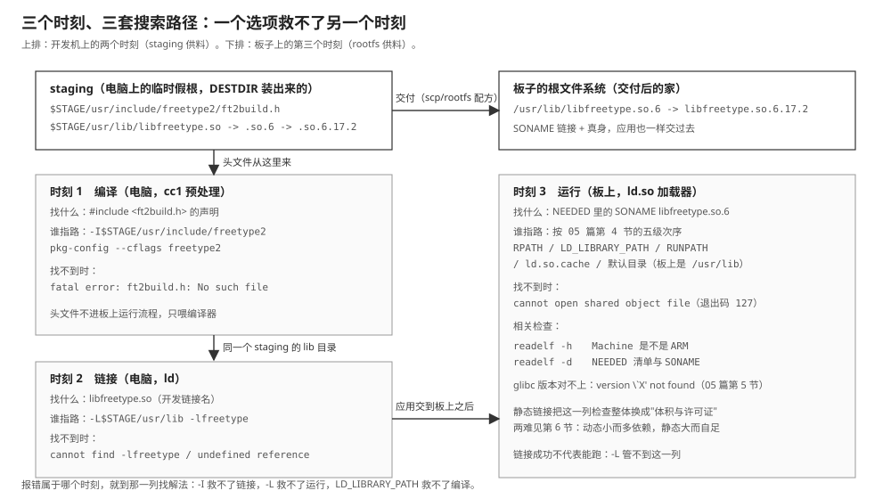

# 14 第三方库的交叉构建与部署

    实验    Knowledge/labs/00_basics/11_cross_library/
    电脑    WSL Ubuntu 26.04，gcc 15.2.0，arm-linux-gnueabihf-gcc 15.2.0，
            pkg-config，FreeType 源码包 2.10.2（$DEPS，默认 ~/deps/）
            （本篇"本机实测"均为 2026-10-21 实跑，FreeType 为完整交叉构建）
    判据    bash Knowledge/labs/00_basics/11_cross_library/check.sh
            2026-10-21 复核：26 PASS / 0 FAIL / 0 SKIP

---

**你会在哪里撞见它**：教程 06 篇要调用 FreeType。源码里只写一行
`#include <ft2build.h>`，从这里开始会连续撞上三种完全不同的报错：

```text
fatal error: ft2build.h: No such file or directory       编译时没找到头文件
ld: cannot find -lfreetype                               链接时没找到开发库
error while loading shared libraries: libfreetype.so.6   板上运行时没找到目标库
```

一个立刻见效的快招是把新头文件、库直接复制进交叉工具链的系统目录。眼前
的命令确实都过了，但"哪次安装放进来的、给哪块板、依赖哪个版本"全部被抹掉；
以后升级工具链、换板或清理依赖时，没有办法完整撤回。本篇按时间顺序把三次
查找拆开，给出有边界的做法。

**这篇要回答的问题**：

1. 编译、链接、运行三个时刻各去哪找库？为什么一个选项救不了另一个时刻？
2. `--build` / `--host` / `--prefix` / `DESTDIR` 各管什么？
3. 把库直接拷进工具链为什么是坏做法？交付到板子有几条路线？

---

## 0 先动手看一眼

实验提供一个最小第三方库（`upstream/`：`answer.h`、`answer.c` 返回 42、
`Makefile` 造出 SONAME 链），安装到临时 staging，然后把三次"找不到"依次
逼出来。`bash check.sh` 的关键几行（本机实测，2026-10-21）：

```text
=== 三次找东西发生在三个时刻 ===
  PASS  不加 -I，编译期先报 answer.h 找不到
  PASS  只有 -I 没有 -L，链接期报 -lanswer 找不到
  PASS  ELF 记录的是 SONAME，不是构建机绝对路径
  PASS  运行时没指路，加载器报 libanswer.so.1 找不到
  PASS  LD_LIBRARY_PATH 只解决运行时找库
```

三条报错各占一个时刻。这一篇按时间排，不按文件类型排。

---

## 1 先按时间排：一行 gcc 命令里有三次查找

一行 `gcc app.c -lfoo -o app` 看起来一次做完，实际至少三次查找：

```text
时刻 1  预处理/编译     #include <foo.h>       在哪里找声明？
时刻 2  链接            -lfoo                  在哪里找实现？
时刻 3  板上启动        ELF NEEDED libfoo.so.1 加载器在哪里找运行库？
```

> **头文件**：给编译器看的声明和类型布局，不进入板上运行流程。
> **链接库**：链接器用来解析符号的 `.a` 或 `.so`，必须是目标架构。
> **运行库**：动态程序启动时由目标机加载器映射的 `.so`，头文件此时完全
> 没用。

选项按时刻一一对应：

```text
-I/path/include        只增加编译器头文件搜索目录
-L/path/lib            只增加链接器库目录
-lfoo                  请求 libfoo.so 或 libfoo.a
LD_LIBRARY_PATH=/path  只增加运行时动态加载器目录
```

这解释了一个常见误区：程序在电脑上链接成功，复制到板上仍报缺库，并不
矛盾。**链接器完成的是"把库名记进 ELF"，板端加载器才负责"按这个名字
找到文件"。**三套路径的全图：



**这一节搭好的积木**：三次查找三个时刻，报错属于哪一列就到哪一列找解法。
接下来的问题：把三次失败按顺序亲手逼出来。

---

## 2 实验：把三个时刻的错误依次逼出来

### 2.1 安装树先立起来

`make install` 之后，staging 里一个可用共享库长这样（check.sh 前四条判据
逐项验证过）：

```text
$STAGE/usr/include/answer.h                      头文件
$STAGE/usr/lib/libanswer.so       -> libanswer.so.1     开发链接名，-lanswer 找它
$STAGE/usr/lib/libanswer.so.1     -> libanswer.so.1.0   SONAME，运行时加载器找它
$STAGE/usr/lib/libanswer.so.1.0                         真正的 ELF 文件
```

复制这棵树要用 `cp -a`（保留符号链接）：`cp -L` 会把链接全部解引用成三份
真文件；只拷真身又会让 `-lanswer` 和运行时 SONAME 都扑空。

### 2.2 三步，三处失败

```bash
gcc app.c                                        # 1) 没 -I：编译期就停
gcc -I$STAGE/usr/include app.c -lanswer          # 2) 没 -L：链接期停
gcc -I$STAGE/usr/include -L$STAGE/usr/lib \
    app.c -lanswer -o app                        # 3) 链接成功
./app                                            # 4) 运行时仍找不到库
LD_LIBRARY_PATH=$STAGE/usr/lib ./app             # 5) 三处都接通，answer=42
```

各步的报错（check.sh 用模式匹配逐条抓住过）：

```text
1) fatal error: answer.h: No such file or directory
2) /usr/bin/ld: cannot find -lanswer
4) ./app: error while loading shared libraries: libanswer.so.1:
   cannot open shared object file: No such file or directory
5) answer=42
```

### 2.3 链接成功后，ELF 里记的是什么

```bash
readelf -d app | grep Shared
```

```text
Shared library: [libanswer.so.1]
```

里面**没有**构建机的临时目录。05 篇讲过这一行叫 NEEDED，记的是 SONAME
（3.5 节的名字链）。把应用复制到板上后，加载器按板端路径重新找一遍：
这是"链接成功 ≠ 能跑"的机制根源。

**运行时还有第二条路：把路径烙进 ELF。** 链接时加
`-Wl,-rpath,"$STAGE/usr/lib"`，动态段里就多一行 RUNPATH，不设
LD_LIBRARY_PATH 也能跑（本机实测两条判据：RUNPATH 在 `readelf -d` 里
可见；裸跑输出 answer=42）。它的适用边界见 05 篇第 4.3 节：路径写死了，
staging 挪窝就失效；量产部署应把库放进板子的常规库目录，而不是永久依赖
RUNPATH 或环境变量。

### 2.4 架构跟 CC 走，链接器会拦

同一套 upstream 换成交叉编译器构建安装，产物就成了 ARM 的：

```bash
make -C $W/arm clean all CC=arm-linux-gnueabihf-
make -C $W/arm DESTDIR=$W/arm-stage PREFIX=/usr install
readelf -h $W/arm-stage/usr/lib/libanswer.so.1.0 | grep Machine
```

```text
Machine:                           ARM
```

注错：故意用本机 x86 链接器去吃这个 ARM 库，实测两行独立证据：

```text
skipping incompatible .../libanswer.so when searching for -lanswer
cannot find -lanswer
```

第一行才是真相（架构不兼容，跳过），第二行是后果（找不到）。**如果判据
只查"目录里有没有 libanswer.so"，这次会假绿**；查架构要看 `readelf -h`
的 Machine，或者真的链接一次。判断产物归属，不看文件名，看 Machine。

**这一节搭好的积木**：三次失败按时序复现；ELF 只记 SONAME；RUNPATH 是
第二选项；架构不匹配会以 skipping incompatible 现形。接下来的问题：
configure 那串参数各管什么。

### 2.5 [判] 第 2 节

    [ ] staging 里头文件、真库、两级符号链接齐备（链接是链接）
    [ ] 三次失败按 编译 -> 链接 -> 运行 的次序出现
    [ ] ELF 的 NEEDED 是 libanswer.so.1，没有构建机路径
    [ ] LD_LIBRARY_PATH 与 -Wl,-rpath 各自能让它跑起来
    [ ] ARM 库与 ARM 应用的 Machine 都是 ARM
    [ ] 注错见红：x86 链接器吃 ARM 库，skipping incompatible 现形

---

## 3 build、host、target 到底是谁

Autoconf 的三个名字有点反直觉：

> **build**：正在执行 configure 和编译的机器。
> **host**：这次产物将来运行的机器。
> **target**：产物将来还要为谁生成代码；编编译器才有这一层，普通库不填。

本仓 FreeType 的取值：

```text
build   x86_64-pc-linux-gnu       WSL，configure/make 在这里跑
host    arm-linux-gnueabihf       libfreetype.so 在 i.MX6ULL 上跑
target  不填                       FreeType 不会再去生成另一种机器码
```

**普通库的 --host 指产物运行的平台，不是眼前跑 configure 的电脑。**
配置正确的标志在输出里（第 5 节实测会再见到）：

```text
checking build system type... x86_64-pc-linux-gnu
checking host system type... arm-unknown-linux-gnueabihf
checking whether we are cross compiling... yes
```

最后一行是判据：只看命令行写了 `--host` 不够，configure 找不到对应工具时
会悄悄退回本机编译器，输出 `cross compiling... no`（第 5.4 节注错当场演示）。

---

## 4 prefix 与 DESTDIR：目标路径与临时假根

这两个最容易被写成一个：

```text
--prefix=/usr          库到了板子上以后，逻辑上属于 /usr
DESTDIR=$STAGE         这一次安装先把整个目标根套在电脑上的 $STAGE 前面
```

所以 `make DESTDIR="$STAGE" install` 实际写入：

```text
$STAGE/usr/include/freetype2/ft2build.h
$STAGE/usr/lib/libfreetype.so.6.17.2
$STAGE/usr/lib/pkgconfig/freetype2.pc
```

而 `.pc` 文件里记录的 prefix 仍是 `/usr`（目标机视角）。部署时把 `$STAGE`
整个看成板子的 `/` 即可。

反过来，`--prefix=$STAGE/usr` 会把电脑上的临时路径**烙进** `.pc` 和配置
文件，换台机器就失效。这不是推测，check.sh 有注错判据：故意用临时 prefix
配置一遍，`freetype2.pc` 里实测出现 `prefix=$W/badp/usr` 这样的行（`$W`
是 mktemp 的随机目录）。**临时根用 DESTDIR，目标前缀用 prefix。**

**这一节搭好的积木**：prefix 回答"到了板上装在哪"，DESTDIR 回答"这次先
装在电脑上哪里"。两者各管一头，合起来才有干净可删的 staging。

---

## 5 实测：交叉构建 FreeType 2.10.2

### 5.1 为什么先关掉可选依赖

FreeType 会探测 libpng、bzip2、Brotli、HarfBuzz、zlib。第一次闭环只留
一个变量：本体能否为 ARM 构建、能否链接。所以 configure 全部 `--without-*`。
需要 PNG 字形或压缩字体时，再把依赖以同样方式装进**同一个** staging。

### 5.2 完整命令

源码包在本机依赖目录（`$DEPS`，默认 `~/deps/freetype-2.10.2.tar.xz`；
没有就先放一份进去，check.sh 检测不到会自动跳过这一组）：

```bash
WORK=/tmp/freetype-arm
STAGE=$WORK/stage
mkdir -p "$WORK/src" "$WORK/build" "$STAGE"
tar -xJf "$DEPS/freetype-2.10.2.tar.xz" -C "$WORK/src"
cd "$WORK/build"

../src/freetype-2.10.2/configure \
    --build=x86_64-pc-linux-gnu \
    --host=arm-linux-gnueabihf \
    --prefix=/usr \
    --without-zlib --without-bzip2 --without-png \
    --without-harfbuzz --without-brotli

make -j2
make DESTDIR="$STAGE" install
```

- `tar -xJf`：解 xz 包。
- 单独 `build/`：out-of-tree 构建，生成物不混进源码树。
- `-j2`：并行两个任务，WSL 只有 4 核，别占满。
- `DESTDIR`：只写 staging，不碰本机 `/usr`，也不碰交叉工具链目录。

### 5.3 实测

check.sh 完整跑一遍这条流水线，逐项核过（2026-10-21）：

- configure 输出含 `checking whether we are cross compiling... yes`；
- GCC 15.2.0 编 2.10.2 的全部输出里，`-Wdangling-pointer` 恰好 **2 条**
  （`ttgload.c`、`ftgrays.c`），没有当成错误，构建照常完成；
- 产物 `libfreetype.so.6.17.2` 的 `readelf -h`：`Machine: ARM`，类型
  shared object；
- 安装树里有 `ft2build.h`；`.pc` 文件的 `prefix=` 是 `/usr`（目标视角，
  第 4 节的规则落地）；
- `pkg-config` 从 staging 取参数：

```bash
PKG_CONFIG_LIBDIR="$STAGE/usr/lib/pkgconfig" \
PKG_CONFIG_SYSROOT_DIR="$STAGE" \
pkg-config --cflags --libs freetype2
```

```text
-I.../stage/usr/include/freetype2 -L.../stage/usr/lib -lfreetype
```

`PKG_CONFIG_LIBDIR` 让它只看目标库的 `.pc`，防止误拿宿主机的 x86-64
FreeType；`PKG_CONFIG_SYSROOT_DIR` 给 `.pc` 里 `/usr/include`、`/usr/lib`
这类目标绝对路径统一套上 staging 假根。

### 5.4 两条注错，各验一个参数

- **不带 --host**：configure 照跑，输出却是
  `checking whether we are cross compiling... no`：退回本机编译器，
  编出来的"ARM 库"其实是 x86 的。**看输出，别看命令行。**
- **prefix 写临时路径**：`.pc` 里 `prefix=` 变成 `$W/badp/usr`（第 4 节）。

### 5.5 为什么不把库拷进工具链

把头文件和库复制进交叉工具链自带的 include/lib 能让眼前的命令通过，两种
做法的可验证差别：

```text
直接拷进工具链                  staging
来源边界      混进系统文件        一个目录就是一套版本
删除          不知道该删哪些      整棵目录可丢弃
多板并存      容易串 ABI          每块板各一棵
升级工具链    手工文件丢失        重新给新工具链指 staging
权限          可能要 root         普通用户即可
```

"缺啥补啥"可以作为**定位问题**的思路，不等价于"往公共目录复制"。

**这一节搭好的积木**：configure/make/install 三段各看什么输出；staging
加上 pkg-config 两个环境变量，构成一条可删除、可多板并存的构建边界。
回答了开头第二、三问的前半。接下来的问题：库怎么交到板子上。

---

## 6 静态还是动态：两条可交付路线

### 6.1 先各链一个探针

`ftmini.c` 只做一件事：初始化 FreeType、打印版本号。用 staging 各链一个：

```bash
arm-linux-gnueabihf-gcc -I"$STAGE/usr/include/freetype2" \
    -o ft-dyn ftmini.c -L"$STAGE/usr/lib" -lfreetype
arm-linux-gnueabihf-gcc -static -I"$STAGE/usr/include/freetype2" \
    -o ft-sta ftmini.c "$STAGE/usr/lib/libfreetype.a" -lm
```

本机实测（readelf 各查一条）：

```text
ft-dyn:  Shared library: [libfreetype.so.6]      NEEDED 记 SONAME
ft-sta:  There is no dynamic section in this file.   静态版没有动态段
两者 Machine 都是 ARM
```

### 6.2 两条路线的账

**路线 A：动态部署。** 板上要有 `/usr/lib/libfreetype.so.6`（SONAME 链接
加真身），应用才能启动。优点是多程序共用一份库、应用小；代价是库及其全部
NEEDED 依赖都要交过去，且 glibc 版本要兼容（05 篇第 5 节的 128+N 之
`version not found` 就是这条路上的坑）。临时测试可以
`LD_LIBRARY_PATH=/tmp/lib ./app`，量产系统应把库放进 rootfs 配方。

**路线 B：静态链接。** 库的 `.a` 抄进程序，板上什么都不用带。本仓真机
实验（06 篇 §7）选它，有一个可验证的理由：板上 glibc 是 2.30，电脑交叉
工具链的动态 glibc 更高，动态程序上板会死在版本对账；静态链接切断了这个
变量。代价照单全收：程序变大（05 篇量过全静态 51 倍的极端例）、库更新
要重链所有程序、要核对库的许可证（FreeType 许可允许静态链接，逐库确认）。

**这一节搭好的积木**：动态小而多依赖，静态大而自足；选型前先量三样：
NEEDED 清单、目标 glibc、许可证。

### 6.3 [判] 第 6 节

    [ ] 动态探针 NEEDED 是 libfreetype.so.6（SONAME）
    [ ] 静态探针没有动态段，Machine 仍是 ARM
    [ ] 说得出两条路线各自的代价与选型依据

---

## 速查清单

每条标依据。本机实测 2026-10-21（check.sh 26 PASS）。

**三个时刻、三套路径**：

| 时刻 | 谁在找 | 找什么 | 用什么指定 | 典型报错 |
|---|---|---|---|---|
| 编译 | cc1 预处理 | 头文件 | `-I`、`pkg-config --cflags` | `xxx.h: No such file` |
| 链接 | ld | `libfoo.so`/`.a` | `-L`、`-l`、`pkg-config --libs` | `cannot find -lfoo`、`undefined reference` |
| 运行 | 板上 ld.so | SONAME | 五级路径（05 篇 4.3） | `cannot open shared object file`（127） |

**configure 的平台参数**：

| 参数 | 指什么 | 本仓取值 |
|---|---|---|
| `--build` | 执行构建的机器 | `x86_64-pc-linux-gnu` |
| `--host` | 产物运行的机器 | `arm-linux-gnueabihf` |
| `--target` | 产物再为谁生成代码（编编译器才用） | 不填 |

判据：输出里 `cross compiling... yes`；`no` 就是 --host 没生效。

**prefix 与 DESTDIR**：`--prefix` 目标机最终前缀（`/usr`）；
`DESTDIR` 本次安装的临时假根（`$STAGE`）。`.pc` 里记的是 prefix；
临时路径写进 prefix 会烙进 `.pc`（注错实测）。

**pkg-config 的两个环境变量**：

```text
PKG_CONFIG_LIBDIR=$STAGE/usr/lib/pkgconfig   只看目标库的 .pc
PKG_CONFIG_SYSROOT_DIR=$STAGE                给目标绝对路径套假根
```

**共享库的名字链**（05 篇 3.5 同源）：`libfoo.so.1.2.3` 真身 /
`libfoo.so.1` SONAME（NEEDED 记它）/ `libfoo.so` 开发名（-l 找它）；
安装用 `cp -a` 保留链接。

**交付路线**：动态 = 小而共用，需带全 NEEDED 且 glibc 兼容；静态 = 大而
自足，切断版本变量，付体积与许可证。判卷三件套：`readelf -h`（Machine）、
`readelf -d`（NEEDED/SONAME）、板上实际跑。

---

## 回看

| 问题 | 答案 | 证据在哪 |
|---|---|---|
| 三种报错为什么三种解法 | 三次查找三个时刻，选项互不管 | 1、2.2，依次逼出 |
| 链接成功为什么板上跑不了 | ELF 只记 SONAME，板端加载器重新找 | 2.3，NEEDED 无路径 |
| 运行时除了环境变量还有什么路 | `-Wl,-rpath` 烙进 ELF，路径写死 | 2.3，RUNPATH 实测 |
| --host 是谁的名字 | 产物运行的机器；build 才是眼前这台 | 3，cross compiling 行 |
| prefix 和 DESTDIR 差在哪 | 目标视角 / 本次假根；烙进 .pc 的是 prefix | 4，badpfx 注错 |
| 编出来的库是哪个架构的 | 看 readelf -h 的 Machine；链接器会拦错架 | 2.4，skipping incompatible |
| 老源码的新编译器警告要紧吗 | 不挡构建就不是失败（2 条 dangling-pointer） | 5.3 |
| 拷进工具链为什么坏 | 边界消失：删不了、多板串、换链丢 | 5.5 对照表 |
| 交到板上选哪条路 | 量 NEEDED、glibc、许可证三样再定 | 6.2，两条探针 |

---

## 带走

开头三个问题的答案：

1. **三个时刻三套路径。** `-I` 管头文件，`-L/-l` 管链接，运行时是板上
   ld.so 按 SONAME 走五级路径；一个选项救不了另一个时刻。链接成功只说明
   名字记进了 ELF。
2. **`--host` 是产物运行的平台**（build 才是眼前这台，target 编编译器才
   用）；`--prefix` 是目标机前缀、`DESTDIR` 是本次临时假根，两者合出干净
   的 staging；判真伪看 `cross compiling... yes`，不命令行。
3. **拷进工具链抹掉边界；staging 保留边界。** 交付两条路：动态带全 NEEDED
   且 glibc 兼容，静态自足但付体积与许可证；判卷看 Machine、NEEDED、板上
   实跑。

### 看到什么，就先想到什么

| 报错或现象 | 第一反应 |
|---|---|
| `xxx.h: No such file` | 时刻 1；查 -I / pkg-config --cflags |
| `cannot find -lfoo` | 时刻 2；-L 下有没有 libfoo.so/.a |
| `undefined reference` | 库链上了但符号没对上：顺序、传递依赖 |
| `skipping incompatible` | 架构不匹配；readelf -h 验 Machine |
| `cannot open shared object file`（127） | 时刻 3；板端库、SONAME、五级路径 |
| ``version \`X' not found``（1） | glibc 版本对账失败（05 篇 5.2） |
| `cross compiling... no` | --host 没生效，退回了本机编译器 |
| `.pc` 里出现电脑路径 | prefix 写成了临时目录；换 DESTDIR |
| 安装后说不清哪些文件哪来的 | 没有 staging，边界已丢 |

---

## 接下来

- [05 静态库、动态库与符号](05_静态库动态库与符号.md)：SONAME、NEEDED、
  运行时五级搜索路径的完整机制
- [03 ABI 与 sysroot](03_ABI与sysroot.md)：staging 与 sysroot 的关系
- 教程里的位置：06 篇第 4.3 节用本篇交叉构建 FreeType、第 4.4 节的
  staging 四参数、第 7 节静态探针上板，都是本篇路线的实操现场。
