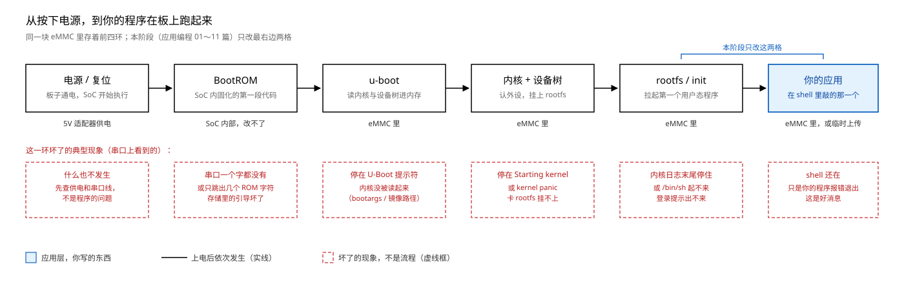
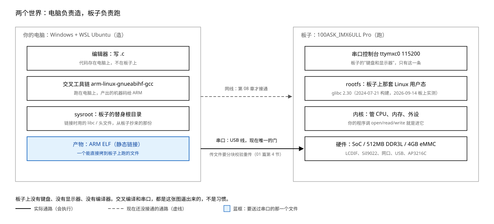
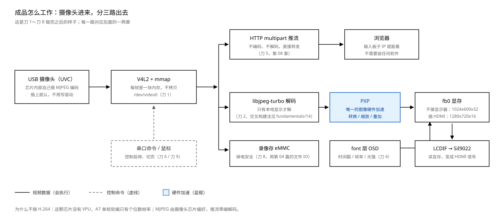
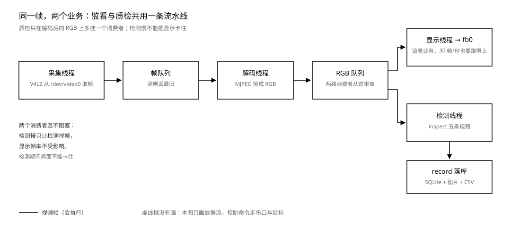

# 00 这台机器与我们要造的东西

    定位    全书入口。不写一行代码，先把"我在干什么"说清楚
    时长    慢慢读 40~60 分钟；第 6 节要上板，第一次约 3 小时
    前置    无。不需要先学任何一章
    素材    根 README 第三节的板载清单；第 01、05 篇的板上实测归档；
            Engineering/Todo/学习与项目路线.md（来源、阶段、刀 0～11、Q1～Q7）

---

**前置基础**：无。这一章就是给"不知道从哪开始"的人写的，不假设你学过任何东西。

后面每篇开头的「前置基础」块里，标了"用到再读"的都不用现在补：正文指到哪一篇，
再翻哪一篇。

## 0 这一章解决什么问题

你现在手里有一块板子、一台电脑、一根 USB 线。板子上印着 `100ASK_IMX6ULL Pro`，
除此之外它对你是一块塑料板：没有屏幕、没有键盘，插上电也没有任何反应。

这本教程后面有 11 章应用编程、一章驱动开发，每一章都在讲一个技术点：交叉编译、
文件 IO、framebuffer、FreeType、socket、pthread。如果不知道这些零件最终拼成
什么，学到第三章就会开始问"我为什么要学这个"，然后停下来。

这一章不写代码，只回答四个问题：

    这台机器是什么？          一台被砍到最小的计算机，但能跑完整的 Linux
    上面跑着什么？            四层东西，你的程序在最上面一层
    我们要让它干什么？        一台能拍、能显示、能被浏览器看的设备
    每一章在整台设备的哪里？  11 章在整机里的位置

读完这一章，你应该能指着这块板子说出：它通电以后谁先跑、我的程序在哪一层、
为什么要在电脑上编、为什么上板只能走串口。

**怎么读这本教程**：第一遍只看图、表和每节的结论，代码和命令可以跳；第二遍
跟着做实验；第三遍再抠细节。看不懂的词去第 7 节的词典查，那里每个词都标了
"正式学在哪"。

**先用你已有的东西搭桥**：你在 ysyx 里自己搭过一个 CPU（NPC）。这块板子的
SoC，就是"你搭过的那个 CPU"加一堆外设；Linux 是跑在它上面的那层软件，负责
把外设分给你的程序用。你缺的不是硬件概念，是"一台真机器上，软件分几层、
各归谁管、我写的在哪一层"。

## 1 拆开来看：嵌入式、Linux、应用开发

"嵌入式 Linux 应用开发"这个说法，其实是三件事：嵌入式、Linux、应用开发。
分开看，每件都有明确的边界。

### 1.1 嵌入式：专用设备，资源刚好够用

嵌入式不是"小电脑"，是两个约束：**这台机器只为一件（或几件）事存在**，
而且**资源按这件事给，一点不多**。

对比你熟悉的三个东西：

| | 你的笔记本 | 服务器 | 这块板子 |
|---|---|---|---|
| CPU | 多核，几 GHz | 几十核 | 单核 Cortex-A7 |
| 内存 | 16GB 起 | 上百 GB | 512MB DDR3L |
| 存储 | 512GB SSD | 几 TB | 4GB eMMC |
| 显示 | 自带屏幕 | 通常没有 | 只有 HDMI 输出口，没屏 |
| 键盘 | 自带 | 没有 | 没有，只有串口 |
| 操作系统 | Windows | Linux | Linux（裁剪过的） |
| 用途 | 什么都能干 | 同时服务很多人 | 只干我们让它干的那件事 |

这块板子的完整账本（根 README 第三节的板载清单）：

| 有什么 | 型号 / 规格 | 后面哪一章用 |
|---|---|---|
| SoC | i.MX6ULL，Cortex-A7 单核 | 全部 |
| 内存 | 512MB DDR3L | 全部 |
| 存储 | 4GB eMMC | 全部；录像（刀 8） |
| 显示 | LCDIF 控制器 + SiI9022 转 HDMI | 第 05、06 篇 |
| 网络 | 2 个百兆网口 + RTL8723 WiFi | 第 08 篇；推流（刀 5） |
| USB | 2 路 HOST + 1 路 OTG | 第 07 篇；UVC 摄像头（刀 1） |
| 串口 | CH9102 USB 转串口 | 全部（上板唯一链路） |
| 传感器 | AP3216C 光感（I2C）、ICM-20608 六轴 | 第 10 篇；刀 7 |
| 按键 | KEY1 / KEY2 | 第 07 篇 |
| 显示接口 | 板载 HDMI 口（显示器自备） | 第 05、06 篇 |

它没有的东西，同样决定后面所有选择：

    没有 GPU          画面只能 CPU 拼，所以第 05 篇教你按位段拼色
    没有 VPU          H.264 实时编码封死，所以成品走 MJPEG（第 4 节）
    没有 IPU          摄像头走 CSI + PXP，不是别的 6 系列那套
    没有触摸屏        人机交互用 USB 鼠标，所以第 07 篇写 evdev 不写 tslib
    没有键盘和显示器   唯一的"门"是串口，所以第 2 节整节讲两个世界

**这就是"为什么"的第一层**：后面每一条看着别扭的规定，几乎都是这块板子的
资源账本逼出来的。看到一条规则想不通，先回来查这张表。

### 1.2 Linux：不是"一个系统"，是四层东西

"装个 Linux"这句话在 PC 上成立，在板子上会误导人。板子上的 Linux 是四层，
各自独立，各自会坏：

| 层 | 是什么 | 存在哪 | 坏了的现象 |
|---|---|---|---|
| bootloader（u-boot） | 上电后第一段"会干活"的代码，把内核读进内存并启动它 | eMMC | 串口停在 U-Boot 提示符 |
| 内核（kernel）+ 设备树（dtb） | 管 CPU、内存、中断、外设；你的程序要通过它才能碰硬件 | eMMC | 停在 Starting kernel 或 kernel panic |
| rootfs（根文件系统） | 用户态那一整套：/bin、/lib、/dev、/proc、/etc，以及 C 库 | eMMC | 内核日志打完就停，登录提示出不来 |
| 应用 | 你要写的程序 | rootfs 里，或临时上传 | shell 还在，只是程序报错退出 |

四层的关系，以及上电后谁先跑：

读图：实线是上电后依次发生的事，最右边蓝框是你的程序。下面一排红色虚线框
不是流程，是"这一环坏了，串口上会看到什么"。**这是你以后定位问题的第一张表**。
程序没反应时，先看串口停在哪一格，再决定查哪一层。

三个必须现在就知道的细节：

- **BootROM 在 SoC 内部，改不了**。它只认固定的几个启动位置。所以"板子变砖"
  通常不是它坏，是它后面那几层坏了。
- **内核不是"操作系统"的全部**。内核只提供机制（系统调用），命令、shell、
  库全在 rootfs 里。换 rootfs 能换掉整个用户态，内核可以不动。
- **设备树是一份硬件清单**，告诉内核这块板子上有什么、接在哪。同一份内核配
  不同设备树，能跑不同板子。第 2 阶段写驱动时天天碰它。

本板出厂镜像还带了一个 Qt 图形界面 `mxapp2`，由 `/etc/init.d/S99myirhmi2`
启动。所以不接显示器时你什么都看不见，接上 HDMI 会看到它。第 05 篇要停掉它才能
独占屏幕，这个坑先记着。

### 1.3 应用开发：你写最上面一层

这一阶段（第 01～11 篇）你只改最右边两格：rootfs 里的程序和你的应用。
内核、u-boot、设备树一行不动。

但"只改上面"不等于"只需要懂上面"。程序跑不起来时，原因可能在任何一层：

    报 Exec format error      内核在 e_machine 那一关拒绝（第 01 篇第 3 节）
    报 GLIBC_2.34 not found   动态链接时板上 C 库太旧（第 01 篇第 4 节）
    报 No such device         驱动在，但这个设备实例不在（第 05 篇）
    什么反应都没有             先查串口停在哪一层（图 1）

所以这一阶段的定位是：**站在应用层，但看得见下面三层**。第 2 阶段
（驱动开发）才下到内核里。

## 2 两个世界：电脑负责造，板子负责跑

### 2.1 板子上没有的东西

你习惯的开发方式，在板子上不成立：

| 你习惯的 | 板子上 |
|---|---|
| 打开终端敲命令 | 没有显示器给你开终端；HDMI 只出画面，不出命令行 |
| 用键盘打字 | 没有键盘 |
| 装 gcc、`apt install` | 没有可用的编译器，也没有 apt 这类包管理器 |
| 双击运行 | 出厂只有一个固定的 Qt 界面，不是给你装软件的桌面 |
| 编译完直接跑 | 产物是 ARM 的，电脑跑不了；要传到板子上 |

板子上只有一样东西是"通用入口"：**串口**。它从板子引出一根 USB 线接到电脑，
电脑上开一个串口终端，就能看到板子的 shell。

### 2.2 一张图说清分工

左边是电脑上的 WSL Ubuntu：写代码、用交叉工具链编译、链 sysroot 里的库。
右边是板子：串口控制台、rootfs、内核、硬件。中间只有两条通路，现在能用的
只有串口。

### 2.3 交叉编译不是"高级技巧"，是这张图逼出来的

如果板子上有编译器和足够的内存，你完全可以在板子上编。但板上没有编译器，
内存和存储也不富余（512MB / 4GB，还要留给 rootfs 和你的数据）。所以流程
只能是：

    在电脑上（x86-64）用交叉工具链 → 生成 ARM 的机器码 → 通过串口送到板子 → 在板子上运行

"交叉"两个字指的就是：**编译发生在一种机器上，运行发生在另一种机器上**。
第 01 篇会用三条产物（x86、ARM 动态、ARM 静态）让你亲眼看到三种下场，这里
先记住一句：

**同一份 C 源码，给谁编，就只能给谁跑。**

### 2.4 一条必须现在记住的规则：上板一律静态链接

板上 rootfs 的 C 库是 glibc 2.30（2024-07-21 构建，2026-09-14 板上实测）；
电脑上交叉工具链带的是 glibc 2.41。**用新库编出来的动态程序，在旧库的板子上
启动就失败**：

    ./hello_arm_dynamic: /lib/libc.so.6: version `GLIBC_2.34' not found
    退出码 1

所以这一阶段的上板程序一律加 `-static`：把 C 库整个塞进可执行文件，板上
不需要匹配的库。代价是体积从 69KB 变成 487KB（第 01 篇实测），串口传的时候
多花十几秒，能接受。

第 2 阶段换成板子 BSP 配套的工具链后，动态版应当能过；届时这条规则随实测
更新（规则记录在 [Project/doc/开发环境.md](../../../Project/doc/开发环境.md)）。

## 3 为什么要这样做：常见疑问一次答完

学到第三章，下面这些问题一定会冒出来。先给答案，正式推导在各章。

| 疑问 | 答案 | 正式学在哪 |
|---|---|---|
| 为什么要在板子上做，电脑上不行吗 | 产品要脱离电脑：体积、功耗、成本、现场部署。做完是一个上电就能自己工作的盒子 | 本章第 4 节 |
| 为什么用 Linux，不用裸机/RTOS | 网络协议栈、文件系统、驱动生态都是现成的；这块板子要接摄像头、网卡、HDMI，从零写这些不现实 | 第 1 节 |
| 为什么用 C | 内核接口是 C；512MB 内存和单核 CPU 养不起重运行时 | 全部 |
| 为什么要交叉编译 | 板子上没有编译器，也不该有 | 第 2.3 节 |
| 为什么必须 `-static` | 板上 glibc 2.30 比工具链旧，动态版起不来 | 第 2.4 节 |
| 为什么上板只能走串口 | 板子没有键盘显示器；网口出厂没配 IP，WSL 又是 NAT，连不进来 | 第 2 节、第 08 篇 |
| 为什么写 `/dev/fb0` 而不是调 GUI 库 | 先看清"显示就是写内存"；GUI 层（ui/page）是后面自己搭的，底层仍是它 | 第 05 篇 |
| 为什么要自己写 Makefile | 工程几十个文件、多层目录，手敲 gcc 必漏；内核和 u-boot 用的就是 make | 第 03 篇 |
| 为什么先学应用再学驱动 | 应用层改一次就能看见结果；驱动要 BSP 工具链和内核源码，门槛高，放到第 2 阶段 | 全书结构 |
| 为什么终点是这台视觉终端（监看 + 质检） | 它一条线打穿用户态、网络、总线、驱动；换成一个"跑测试项"的程序，下面三层一行碰不到 | 第 4 节、[路线](../../../Engineering/Todo/学习与项目路线.md) |

## 4 我们最终要造的东西

### 4.1 一句话

**一台接在显示器上、上电自启的视觉终端，干两个业务。**

监看业务：摄像头采集，显示器实时显示，浏览器输入它的 IP 也能看；画面上叠
时间、帧率、光强；触发性录像；串口下发命令；鼠标点屏上的按钮切页；所有参数
走配置文件。

质检业务：触发采图，五条规则判 OK / NG，结果落库可查；NG 触发设备联动与告警；
配方决定这一款产品检查什么；OTA、看门狗、崩溃恢复保证它能长期开机跑着。

两个业务**共用一条采集-解码流水线**，质检只在解码后的 RGB 上多挂一个消费者。
产品原型是可视门铃、网络摄像机、工业巡检终端、产线质检台。

### 4.2 它怎么工作

读图：摄像头出 MJPEG 帧 → V4L2 拿到的是一块内存（不拷贝）→ 分三路：

- 上：套 HTTP multipart 头直接推给浏览器，**零编解码**
- 中：本地显示才解码（libjpeg-turbo）→ PXP 转换/缩放 → 写 fb0 显存 →
  LCDIF 读出来变成 HDMI 信号
- 下：按帧存 eMMC，掉电安全

控制命令（串口、鼠标）是虚线：它不搬运视频，只改状态。

图 3 只画了监看业务的三条路。质检业务从解码后的 RGB 队列再分一路进 inspect，
见 4.6。

### 4.3 为什么是 MJPEG，不是 H.264

这颗 SoC 没有 VPU。x264 软编在 A7 单核上只有个位数帧率，CPU 打满，做出来
是反面教材。而 USB 摄像头芯片内部自带 JPEG 编码器，出来的就是 MJPEG：
**编码在摄像头里已经做完了**，板子只负责转发或解码。

这就是"绕开平台短板"的做法：不是硬碰，是把不需要板子做的事交给别人做。
完整推导在[路线](../../../Engineering/Todo/学习与项目路线.md) 5.4 节。

### 4.4 十一层骨架

Project/ 里现成的框架是"结构体 + 函数指针 + 链表注册"，和内核的
`file_operations`、`platform_driver` 同形。前七层是一台带屏交互设备都要有的基础分层，后四层是视频监看与
质检业务专门要的：

| 层 | 在成品里干什么 | 现在状态 | 对应刀 / Q |
|---|---|---|---|
| display | 视频帧输出、OSD 合成 | 已落地并上板 | 直接用 |
| font | OSD 文字 | 已落地（x86/ARM/真 fb 验过） | 刀 4 |
| input | USB 鼠标事件 | 已落地（待接真鼠标补一次） | 刀 9 |
| ui | 按钮与控件 | 已落地（按钮两态） | 刀 9 |
| page | 页面切换、资源释放 | 已落地（切换即销毁重建） | 刀 9 |
| business | 业务调度 | 监看已重写；质检调度待加 | 刀 9 / Q7 |
| config | 配置文件驱动 | 已落地（INI 极简子集） | 刀 9 / Q3 |
| video | V4L2 采集，UVC 与 CSI 两个后端 | 未开工 | 刀 0/1 |
| net | HTTP server、推流、OTA 客户端 | 未开工 | 刀 5 / Q6 |
| inspect | 规则注册链表与五条规则 | 未开工 | Q1、Q2 |
| record | 追溯记录、图片目录、CSV | 未开工 | Q4 |

**注册链表在这个终点里第一次有真实理由**：UVC 摄像头和 CSI 摄像头是两个
完全不同的底层实现，挂同一条链表，上层一行不改（刀 10c 的判据就是"切后端
时上层 diff 为空"）。

### 4.5 11 章在整机里的位置

这是全书最重要的一张表，建议打印出来贴在手边。

| 章 | 补上哪块能力 | 进到整机的哪个位置 | 不学它，会在哪一步卡住 |
|---|---|---|---|
| 01 HelloWorld | 交叉编译与上板部署 | 所有刀的地基 | 后面每个程序都上不了板：Exec format error 或 GLIBC not found；串口传文件也不会 |
| 02 GCC | 四步、库、静态/动态的代价 | 刀 0～2 | 第三方库（libjpeg-turbo）交叉编不出来；不知道为什么必须静态 |
| 03 Makefile | 多文件与递归构建 | Project 的构建系统 | 每加一层、每加一个文件都要手敲 gcc；check.sh 跑不起来 |
| 04 文件 IO | fd、read/write 语义、mmap | 刀 1、刀 8，所有设备访问 | V4L2 的帧缓冲是 mmap；录像写盘、串口都靠它 |
| 05 Framebuffer | 显存映射、像素格式、行宽 | 刀 2、4、9 | 画面写不上去；OSD 无从谈起 |
| 06 文字显示 | 点阵/FreeType、灰度合成 | 刀 4、9 | OSD 只有数字没有字；GUI 页面没有文字 |
| 07 输入系统 | evdev 事件、poll | 刀 9 | 鼠标点不了按钮，设备没法交互 |
| 08 网络通信 | socket、HTTP | 刀 5 | 浏览器看不到画面；串口之外没有第二条通道 |
| 09 多线程 | pthread、环形队列、锁 | 刀 3、5 | 采集/解码/显示串行，帧率掉一半；多客户端扛不住 |
| 10 I2C | i2c-dev、传感器 | 刀 7、10a | 光感和六轴读不到，报警与触发录像做不了 |
| 11 串口 | termios、协议帧 | 刀 6 | 设备没有命令通道，只能靠串口 shell 手动敲 |
| （第 2 阶段）驱动开发 | 设备树、platform_driver、cdev | 刀 10 | 只会"用"驱动，不会"写"驱动 |
| （刀 11）Buildroot | 打包 rootfs | 刀 11 | 做出来是一堆散装程序，不是一台能烧录的设备 |

读法：**竖着看是能力，横着看是整机**。每学完一章就在表里点亮一格；一格没
点亮，对应的刀就做不下去。

这张表只覆盖第一段（应用编程）。后面还有两段：

    第 2 阶段 驱动开发   设备树、platform_driver、cdev、中断、poll
                         → 刀 10a；学完才谈"写驱动"
    第 3 阶段 视觉终端   V4L2、JPEG/PXP、流水线、推流、录像、规则、配方、
                         追溯、OTA、GUI、Buildroot
                         → 刀 0～9、11 与 Q1～Q7

三段对应[路线](../../../Engineering/Todo/学习与项目路线.md)里的 P1～P5（视觉终端在
施工上拆成 P3～P5）。

### 4.6 两个业务怎么共存

读图：采集、解码各一个线程，中间队列满时丢最旧帧；RGB 队列后面挂两个消费者：
显示线程和检测线程。检测慢只让检测掉帧，显示帧率不受影响（质检业务的
硬要求之一就是"检测执行期间不能阻塞界面响应"）。

为什么不做成两个程序：两个业务用的是同一份采集、同一份解码、同一条显存和
同一份配置。拆开就要抢摄像头、抢 `/dev/fb0`。这就是本项目坚持做在一副骨架
上的原因，也是 `inspect`、`record` 只需要加两层、不改上层的原因。

## 5 学完这 11 章，你能独立做什么

能做的（前六章已有教程与 labs；后五章对应的层已在 Project 落地、实测在
TechReports，教程还在写）：

- 写一个 C 程序，交叉编译成 ARM 静态产物，通过串口分块校验传上板跑起来
- 用 open/read/write/mmap/lseek 处理文件和设备，说得清 fd 在哪一层
- 直接操作 framebuffer：算坐标、按位段拼色、处理 16/32bpp 与行宽填充
- 用 FreeType 把任意字体渲染成灰度覆盖图，沿基线排版（中英文都行）
- 读 `/dev/input/eventX` 的 evdev 事件，处理 SYN 帧、坐标与按键
- 写 TCP 客户端/服务端，自己实现一个 HTTP server 推 MJPEG
- 用 pthread + 环形队列搭采集/解码/显示流水线，三本账闭合（收/发/丢）
- 用 termios 配串口、设计带校验的协议帧；用 i2c-dev 读传感器
- 看懂一个七层、注册链表的工程，并按同一形状加一层

还不能做的（第 2 阶段与后续）：

- 写内核驱动、改设备树（第 2 阶段；刀 10）
- 重编内核、换 BSP 工具链（第 2 阶段）
- 做可烧录的 rootfs 镜像（刀 11）
- H.264 编解码（这颗芯片没有 VPU，见第 4.3 节）

这几条对应什么活：嵌入式 Linux 应用开发岗位的日常，就是"在别人做好的板子上
写程序、调外设、做网络和界面"；驱动岗才要求第 2 阶段那套。这个分法是
2026-09 检索在招信息时逐条核过的。

**一天的工作长什么样**：拿到需求（例"把摄像头画面显示到屏幕上"）→ 查板子上
有什么接口、内核里认不认 → 在电脑上写、交叉编译 → 串口传上去跑 → 现象不对，
回四层里定位（驱动没加载？设备节点没有？分辨率不对？）→ 改一版再传。这一行
大多数时间花在最后两步：判断问题在哪一层。图 1 的四层和后面 11 章，都是
为了让你定位得动。

## 6 最短路径：先上板看三样东西

不急着一章一章读。第一次上板，先看见三样东西，就知道后面在干什么了：

    第一样  板子的 shell        串口连上，能敲命令
    第二样  你的程序在板上跑     第 01 篇第 4 节，三种产物的三种下场
    第三样  你写的像素在屏上     第 05 篇第 4 节，彩条

本节只讲第一样（认机器），后两样到对应章节做。

### 6.1 连串口

硬件：板子左侧**下面**那个 micro-USB（6 号口，USB 转串口 CH9102），不是上面
那个 OTG（5 号口）。插错口只会出现 `USB\VID_1D6B&PID_0104\100ASK_IMX6ULL`，
不会有 COM 口。

先在电脑上确认串口在：

~~~powershell
Get-PnpDevice -PresentOnly -Class Ports | Where-Object Name -match 'CH9102'
# 期望看到 Status=OK、名字里有 CH9102 和 COMx。本机常驻的 COM3/COM4 是蓝牙，
# 易灵思板子是 FTDI，都不是这块板子。没有这一行就回去检查插的是哪个口。
~~~

连上后用仓里的脚本发命令（脚本里写死 115200 8N1、无流控）：

~~~powershell
.\Tools\serial-board.ps1 'echo hello-from-board; uname -a'
# 位置参数就是要发给板子的一整行命令；外层必须用单引号，
# 否则 PowerShell 会先把板子那边的 $? 展开成 True。
~~~

脚本会自动登录 root、关掉回显、只回命令本身的结果，并把退出码传回来。
参数与实现见 [Tools/serial-board.ps1](../../../Tools/serial-board.ps1) 文件头。

### 6.2 认机器：九条命令

板子在线时按顺序敲。每条"它在告诉你什么"比输出本身重要：

| 命令 | 它在告诉你什么 | 本仓归档值（板上已有记录的） |
|---|---|---|
| `uname -a` | 内核版本与 CPU 架构 | 含 `armv7l` |
| `cat /proc/cmdline` | 内核启动参数：控制台走哪、rootfs 在哪 | 含 `console=ttymxc0,115200` |
| `cat /proc/cpuinfo` | CPU 型号与核数 | 待补（2026-10-18 板子未连） |
| `cat /proc/meminfo \| head -3` | 实际可用内存 | 待补 |
| `df -h` | rootfs 挂在哪块设备、还剩多少 | 待补 |
| `ls -l /lib/libc.so.6` | 板上 C 库版本（决定能不能用动态链接） | `libc-2.30.so`，2024-07-21 |
| `ip -4 addr` | 有没有 IP（决定现在能不能走网线） | 只有 `lo` |
| `date` | 系统时间（出厂没对过时） | 1970 年 |
| `cat /sys/class/graphics/fb0/modes` | 显示控制器支持哪些模式 | 待补 |

**如实说明**：标"待补"的四条，写这一章时板子没连（2026-10-18），没有现场
输出；连上后按表补录，不拿记忆里的数充实测。标了归档值的五条来自第 01、
05 篇的板上记录。

### 6.3 看完这些，你会知道三件事

    1  这台机器是 ARMv7，跑的是 Linux，rootfs 在 eMMC 上
    2  它现在没有网络地址，所以串口是唯一的路
    3  它的 C 库比你的工具链旧，所以上板程序必须静态链接

这三件事就是第 01 篇全部内容的地基。先有它们，01 篇的"三个下场"才不会
变成背结论。

### 6.4 判据

这一节不设 PASS/FAIL，它是认机器，不是验收。做完能把下面五条说清楚就算过：

    [ ] 板子插的是 6 号口，电脑上能看到 CH9102 对应的 COM 口
    [ ] 能说出串口参数是 115200 8N1、控制台是 ttymxc0
    [ ] 能说出 rootfs 在 eMMC 上、板上 C 库是 2.30
    [ ] 能解释为什么上板程序要 -static
    [ ] 能解释为什么现在只能走串口

本章唯一能"注错见红"的地方是静态链接：把第 01 篇的 hello 编成动态版传上板，
它会在启动时报 `GLIBC_2.34 not found`。亲眼看到那行报错，2.4 节就不用背了。

## 7 环境词典：后面会反复出现的词

| 词 | 一句话 | 正式学在 |
|---|---|---|
| 交叉编译 | 在 x86 电脑上编出 ARM 能跑的机器码 | 第 01 篇 |
| 工具链 | 编译器 + 链接器 + 头文件 + 库的一整套 | 第 01、02 篇 |
| sysroot | 开发机上给板子准备的"替身根目录"，链接时用 | 第 01 篇、[fundamentals/03](../../fundamentals/03_ABI与sysroot.md) |
| bootloader / u-boot | 上电后第一段干活的代码，负责把内核读起来 | 本章 1.2；第 2 阶段 |
| 内核 | 管 CPU、内存、外设的那层软件；你的程序通过系统调用求它 | 本章 1.2、[fundamentals/07](../../fundamentals/07_系统调用与用户内核态.md) |
| 设备树（dtb） | 告诉内核"这块板子上有什么、接在哪"的硬件清单 | 第 2 阶段 |
| rootfs | 用户态那一整套：命令、库、/dev、/proc、/etc | 本章 1.2 |
| 串口控制台 | 板子唯一的命令行入口，ttymxc0 115200 | 本章第 2 节、第 11 篇 |
| 设备文件 | /dev 下的文件，只存主次设备号，告诉内核找哪个驱动 | [fundamentals/10](../../fundamentals/10_驱动与设备文件.md) |
| fb0 | framebuffer 设备节点，写它就是写屏幕 | 第 05 篇 |
| init | 内核起来后拉起的第一个用户态程序，再按脚本拉起别人 | 本章 1.2 |
| 静态链接 | 把库整个塞进可执行文件，不依赖板上库版本 | 第 01、02 篇 |
| V4L2 | Linux 的视频采集接口，`/dev/video0` 后面那套 | 刀 1 |
| PXP | 这颗 SoC 唯一的图像硬件加速：转换、缩放、叠加 | 刀 2 |

## 8 自检问题

每题都能用命令或图回答，不靠印象：

1. 这块板子的 CPU 架构是什么？内核启动参数里控制台走哪个设备？
2. u-boot、内核、rootfs、应用四层里，哪一层坏了会让串口停在 U-Boot 提示符？
3. 为什么板子上不能直接编 ARM 程序？如果硬要编，缺的是什么？
4. `-static` 解决了什么问题？代价是什么？
5. 板上 `ip -4 addr` 只有 `lo`，这意味着什么？
6. 成品的三条视频路径分别是什么？哪一条不解码？
7. 为什么选 MJPEG 不选 H.264？
8. 第 04 篇的文件 IO 在成品的哪两刀里被用到？
9. 第 09 篇的多线程解决的是哪条路径上的什么问题？
10. 第 2 阶段学的东西，在整机里对应哪一刀？

## 9 已知的坑

    坑 1  板子左侧两个 micro-USB，上 5 下 6。5 号是 OTG，插它只有 WinUSB
          设备，没有 COM 口。上板一律插 6 号。                          (6.1)
    坑 2  串口会静默丢字节，所以传文件必须分块、每块校验、失败重传。
          不用脚本、自己一口气发，大文件很容易坏。                        (6.1)
    坑 3  动态链接的 ARM 程序在板上起不来，报 GLIBC_2.34 not found。
          上板一律 -static。                                            (2.4)
    坑 4  板子出厂没对过时，系统时间从 1970 起算。写日志、做录像时间戳时
          要知道，别以为系统坏了。                                      (6.2)
    坑 5  上板命令里带中文，板子的 readline 会把它当 Meta 键改写，报错
          莫名其妙。脚本直接拒绝非 ASCII 的命令；要看中文用程序输出。      (6.1)
    坑 6  出厂 GUI（mxapp2）一直占着屏幕，直接画会被它覆盖。第 05 篇
          第 4 节教怎么停它、怎么确认真的停了。                          (1.2)

## 10 这一章交出了什么

四句话，背走：

    这台机器是"专用的计算机"：单核 A7、512MB 内存、4GB eMMC，没有 GPU/VPU，
    唯一的门是串口。

    板子上的 Linux 是四层：bootloader → 内核 → rootfs → 应用。这一阶段只改
    最右边两格，但出错时四层都要会看。

    电脑负责造，板子负责跑。交叉编译、串口控制台、静态链接，都是这条分工
    逼出来的，不是习惯。

    成品是一台视觉终端：摄像头 → 三路（推流 / 显示 / 录像）+ 质检一路，
    两个业务共用一条流水线。应用编程 11 章打地基，驱动篇下到内核，视觉
    终端专题把它们拼成一台设备。

下一章从 [01 HelloWorld 背后没那么简单](01_HelloWorld背后没那么简单.md)
开始。读 01 篇时记住它只干一件事：让你亲眼看到"同一份源码，三种机器码，
三种下场"。
