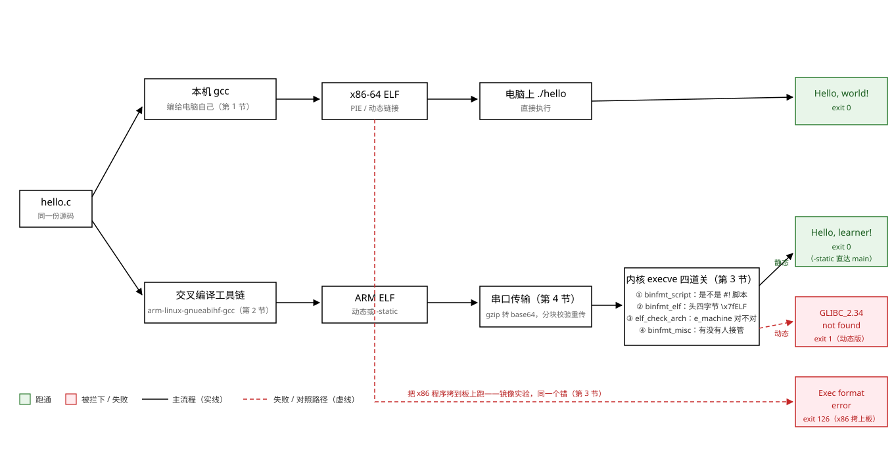
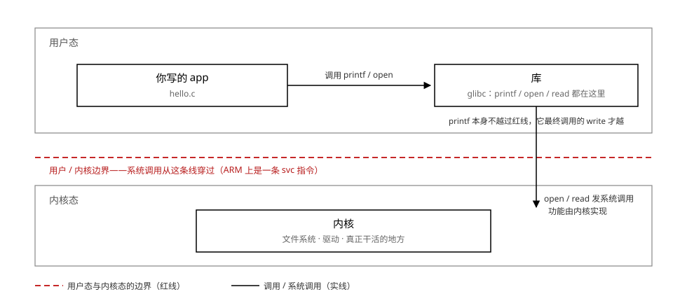

# 01 HelloWorld 背后没那么简单

    原书    第四篇 第 1 章，PDF 141-142 页
    视频    4_1-1（15 分）、4_1-2（7 分）——知识已全部融入本篇，不必再看
    源码    $Q\04_嵌入式Linux应用开发基础知识\source\01_hello\
    实验    Knowledge/labs/01_hello/（本篇所有"本机实测"均为 2026-10-16 在
            WSL Ubuntu 26.04 / gcc 15.2.0 真跑；上板输出为 2026-09-14 实测归档）

---

## 0 这一章解决什么问题

一句话：**编译器不是一个通用的翻译机，它是一台专门给某一个平台生产机器码的
机器。**

整章都从这句话推出来。既然产物是"给某个平台的"，那么"给谁"这件事就必须在
编译时说清楚；编出来的文件拿到另一类机器上，必须有人拦住它；拦住它的不是
CPU 而是内核里的一段 if；要把文件送去板子，中间还隔着一条会吃字节的串口。
走通这条链，你在第 2 阶段编内核模块时才不会死在工具链选错上。

本章的链路，以及它在哪一节被走：



读法：实线是会发生的流程；绿框是跑通的下场，红框是被拦下的下场；虚线是失败
与对照路径。三条产品线在图的右缘分出三个下场，就是第 4 节上板要亲眼看到的：

| 产物 | 板上下场 | 退出码 |
|---|---|---|
| x86-64 ELF | 内核在 e_machine 处拒绝：Exec format error | 126 |
| ARM 动态 ELF | 架构通过，glibc 版本关卡住：GLIBC_2.34 not found | 1 |
| ARM 静态 ELF | 一路放行，进入 main | 0 |

---

## 1 先把程序跑起来：argc、argv 与第一条编译命令

### 1.1 hello.c，逐行看

原书第 1 章的 hello.c 比课本上的多两个参数。完整源码在
`Knowledge/labs/01_hello/hello.c`，与资料仓 `source/01_hello/` 的一致：

```c
#include <stdio.h>                  /* 声明了 printf 的形状,见 1.3 */

/* 执行命令: ./hello weidongshan
 * argc = 2
 * argv[0] = ./hello
 * argv[1] = weidongshan
 */
int main(int argc, char **argv)
{
    if (argc >= 2)
        printf("Hello, %s!\n", argv[1]);    /* 有参数就问候第一个参数 */
    else
        printf("Hello, world!\n");
    return 0;
}
```

逐行说清：

- `int main(int argc, char **argv)`：main 也可以有参数，是**程序被启动时**
  别人塞给它的。
  - `argc` = argument count，参数**个数**。
  - `argv` = argument value，参数**内容**。它是"指向字符指针的指针"，
    用起来就是一个字符串数组：`argv[0]` 固定是程序自己的名字（准确说是
    你敲的命令），`argv[1]` 起才是你附加的参数。
- `if (argc >= 2)`：数一下来了几个参数，决定走哪个分支。
- `return 0;`：main 的返回值就是**进程的退出码**，给启动它的程序（这里是
  bash）看。0 惯例上表示成功。本章后面所有 `echo $?` 看到的数字都源于此。

### 1.2 [做 L1] 数一数参数

实验代码 `Knowledge/labs/01_hello/argv_dump.c`，把每个参数原样打出来：

```c
#include <stdio.h>

int main(int argc, char **argv)
{
    int i;

    printf("argc = %d\n", argc);
    for (i = 0; i < argc; i++)
        printf("argv[%d] = %s\n", i, argv[i]);
    return 0;
}
```

编译并跑四种形态：

```bash
cd /mnt/e/Workspace/embedded-linux/Knowledge/labs/01_hello
gcc -Wall argv_dump.c -o argv_dump
#    ^^^^ 打开告警。它不改变产物,只把"编译器觉得你可能有错"的地方说出来

./argv_dump
./argv_dump weidongshan
./argv_dump "wei dong shan"
./argv_dump wei dong shan
```

本机实测：

```text
$ ./argv_dump
argc = 1
argv[0] = ./argv_dump

$ ./argv_dump weidongshan
argc = 2
argv[0] = ./argv_dump
argv[1] = weidongshan

$ ./argv_dump "wei dong shan"
argc = 2
argv[0] = ./argv_dump
argv[1] = wei dong shan          <-- 引号让带空格的内容并成一个参数

$ ./argv_dump wei dong shan
argc = 4
argv[0] = ./argv_dump
argv[1] = wei
argv[2] = dong
argv[3] = shan
```

三条结论：

1. **shell 按空格切词**，切完才交给程序；`argc` 数的是切完之后的份数。
2. 引号把空格封在里面，整体算**一个**参数（`argc = 2` 那一组）。
3. `argv[0]` 不是"第一个参数"，是命令本身。`argc >= 2` 才说明你真的附加了东西。

### 1.3 声明与定义：.h 和 .c 的分工

hello.c 第一行 `#include <stdio.h>` 塞进来的是一个**头文件**。视频 4_1-2
用加法函数讲透了 .h 和 .c 的分工：

- **声明**（declare）：只说明"这个函数长什么样"——叫什么、要几个什么类型的
  参数、返回什么。头文件里写的全是声明。
- **定义**（define / 实现）：给出函数体本身。`.c` 文件里写的定义。

声明存在的意义，是让编译器**检查别人用得对不对**。做个实验，故意少传一个
参数：

```c
#include <stdio.h>

int add(int a, int b);            /* 声明:只说形状 */

int main(void)
{
    printf("1+2=%d\n", add(1));   /* 故意只传一个参数 */
    return 0;
}

int add(int a, int b)             /* 定义:给实现 */
{
    return a + b;
}
```

本机实测（2026-10-16，实验文件 `Knowledge/labs/01_hello/decl_demo.c`）：

```text
$ gcc -Wall decl_demo.c
decl_demo.c: In function 'main':
decl_demo.c:10:24: error: too few arguments to function 'add'; expected 2, have 1
   10 |     printf("1+2=%d\n", add(1));   /* 故意只传一个参数 */
      |                        ^~~
decl_demo.c:6:5: note: declared here
    6 | int add(int a, int b);            /* 声明:只说形状 */
      | ^~~~~~~~~~~~~~~~~~~
```

编译器指着**声明**说"你答应过要两个参数"。把第 2 行的声明删掉再编，
这个错就变成警告甚至直接编过（C 语言老规则允许隐式声明）——这就是
"调用别人函数之前先 include 它的头文件"的全部理由。

### 1.4 头文件与库在哪里：原书第 1 章的四个问题

原书 141 页图 1.1 问了四个问题，本节逐个用这台机器回答（2026-10-16 实测）。

**问 1：.c 文件有什么用？** 定义/实现，见 1.3。
**问 2：头文件有什么用？** 声明，见 1.3。

**问 3：头文件在哪里？** 两层答案：

```bash
# 默认路径:直接问工具链它在哪些目录找头文件。
# 技巧:不写 .c 文件也能问——从管道喂一个最小的程序,-E 只做预处理,-v 打印内部动作
echo 'int main(){}' | arm-linux-gnueabihf-gcc -E -v - 2>&1 \
    | sed -n '/search starts here/,/End of search/p'
#    ^^^^^^^^^^^^^^^^^^^^^^^^ sed -n '/起/,/止/p' 只打印从匹配"起"的行
#                             到匹配"止"的行之间的内容
```

本机实测：

```text
#include "..." search starts here:
#include <...> search starts here:
 /usr/lib/gcc-cross/arm-linux-gnueabihf/15/include
 /usr/lib/gcc-cross/arm-linux-gnueabihf/15/../../../../arm-linux-gnueabihf/include
 /usr/include
End of search list.
```

原书给的法子更直接：去交叉编译器的目录里 `find -name "stdio.h"`：

```bash
find /usr/arm-linux-gnueabihf -name stdio.h
```

```text
/usr/arm-linux-gnueabihf/include/stdio.h
/usr/arm-linux-gnueabihf/include/bits/stdio.h
```

`#include <...>` 尖括号：只搜上面的默认目录；`#include "..."` 引号：先搜
当前目录再搜默认目录。都不在时自己指定——编译时加 `-I 目录`（第 2 章细讲）。

**问 4：printf 在哪里？** 在**库**里。这个程序的 printf 来自 glibc（C 库）。
库文件的头文件用 `find` 问，库本身用 gcc 问：

```bash
arm-linux-gnueabihf-gcc -print-file-name=libc.so
#                       问它"我要链接 libc.so 时,你实际会用哪个文件"
file -L /usr/arm-linux-gnueabihf/lib/libc.so.6
#       ^^^ 跟随符号链接看真身
```

```text
/usr/lib/gcc-cross/arm-linux-gnueabihf/15/../../../../arm-linux-gnueabihf/lib/libc.so
/usr/arm-linux-gnueabihf/lib/libc.so.6: ELF 32-bit LSB shared object, ARM, EABI5
version 1 (GNU/Linux), dynamically linked, ...
```

注意 `file` 的回答：**给 ARM 的 glibc，在你电脑上就有一份**（它是交叉工具链
sysroot 带来的，见 2.5）。库的目录也可以自己指定：`-L 目录` 指目录、
`-l名字` 指定链哪个库（同样第 2 章细讲）。

把这条程序世界的主干画出来（视频 4_1-2 的收尾图）：



以后你写 open、read、write，调用会穿过那条红线进内核；printf 只在库里，
不进内核（但最终 write 会）。这个分层是整门课的地图。

---

## 2 同一份代码，两种机器码：交叉编译

### 2.1 "给谁"是三件独立的事

2.1 节开头那句话展开来：给某个平台生产机器码，"平台"至少包含三件事：

    1. 指令集    生成 ARM 机器码还是 x86-64 机器码
    2. 调用约定  参数放哪个寄存器、结构体怎么对齐、栈帧怎么排
    3. 配套的头文件和库在哪   编译时 include 的 stdio.h、链接时用的 libc.so

三件事互相独立：指令集相同、调用约定不同的两个产物不能互相调用；前两者都
相同、配套库版本不同的产物拷过去会在启动时失败（第 4 节的 GLIBC 报错就是
第三件出的事）。

它们被塞进编译器名字里。拆 `arm-linux-gnueabihf-gcc`：

| 名称片段 | 表示什么 | 影响 |
|---|---|---|
| `arm` | 目标架构 ISA | 生成 ARMv7-A，而不是 x86-64 机器码 |
| `linux` | 目标 OS | 选择 Linux 系统调用约定及配套 C 库 |
| `gnu` + `eabi` | ABI 与 C 库体系 | `gnu` 表示 glibc；`eabi` 规定参数、结构体、栈帧等二进制约定 |
| `hf` | hard-float ABI | 浮点参数走 `s0/s1/d0` 等 VFP 寄存器；soft/softfp 则走 `r0-r3` |
| `gcc` | 工具名 | 编译驱动程序 |

板子 BSP 里的 `arm-buildroot-linux-gnueabihf-gcc`（原书用的就是它）多一段
`buildroot`，是构建者标识；apt 装的工具链没有这一段。这串名字叫
target triplet，实际常常是四段。

三件事分别落在产物的不同位置：

| 产物中的位置 | 内容示例 | 由三件事中的谁决定 |
|---|---|---|
| ELF header 的 `e_machine` | `EM_ARM` | 指令集 |
| `.text` | ARM 机器码 | 指令集 |
| 调用指令及约定 | 参数放 `r0-r3` 或 `s0-s7` | 调用约定 |
| `.interp` | `/lib/ld-linux-armhf.so.3` | 配套库（动态链接器也是库的一部分） |
| `.dynamic` | `NEEDED libc.so.6` | 配套库 |

### 2.2 hf 是硬约束，不是性能选项

同一个函数 `float f(float a, float b)`，两种 ABI 的调用现场完全不同：

| 项目 | hard-float | soft / softfp |
|---|---|---|
| 参数 `a` | `s0` | `r0`，保留 float 的 32 位原样 |
| 参数 `b` | `s1` | `r1` |
| 返回值 | `s0` | `r0` |
| 计算 | 直接发 `vadd.f32` | 调 `__aeabi_fadd`，或先搬进 VFP |

调用方按 hard-float 把参数放进 `s0/s1`，被调方却按 soft-float 去 `r0/r1` 取，
拿到的是无关内容。所以链接器干脆不让这两种 `.o` 链到一起：

```text
xxx.o uses VFP register arguments, yyy.o does not
```

IMX6ULL 的 Cortex-A7 带 VFPv4 和 NEON，所以用 hf。这段只需要记住结论；
`s0`、`r0` 是什么，以及三种浮点 ABI 编出来的汇编对照，
见 [fundamentals/02](../../fundamentals/02_ARM寄存器与调用约定.md) 第三、四节。

### 2.3 sysroot：给板子准备的替身根目录

sysroot 是"目标系统的根目录"：编译时用的 `stdio.h`、链接时用的 `libc.so`，
必须是给 ARM 的那一份，不能是你 Ubuntu x86 上那一份。两种常见布局：

| 项目 | Debian/Ubuntu multiarch（本仓 apt 工具链） | Buildroot / BSP 独立 sysroot（原书、第 2 阶段） |
|---|---|---|
| 头文件 | `/usr/arm-linux-gnueabihf/include/` | `<sysroot>/usr/include/` |
| ARM 库 | `/usr/arm-linux-gnueabihf/lib/` | `<sysroot>/usr/lib/` |
| `-print-sysroot` 的回答 | `/`（多架构混居在一个根里） | 一个真实目录 |

本机实测 `-print-sysroot` 回一个光秃秃的 `/`，看起来和"替身根目录"矛盾——
那就是左边这种 multiarch 布局：ARM 的头文件和库按目录前缀区分，不单独圈地。
第 2 阶段换 BSP 工具链时会看到右边那种布局。

### 2.4 [做 L1] 让工具链自报家门

```bash
# 1) 它给谁编？ISA 和默认 ABI
arm-linux-gnueabihf-gcc -v 2>&1 | grep -E 'Target:|--with-(arch|fpu|float)'
#   ^^ -v 让它把配置和内部动作全打出来
#                    ^^^^ 这些信息走 stderr,2>&1 并到 stdout 才能进管道
#                            -E 用扩展正则,| 是"或",(a|b) 是分组

# 2) 头文件搜索路径(1.4 问 3 同款)
echo 'int main(){}' | arm-linux-gnueabihf-gcc -E -v - 2>&1 \
    | sed -n '/search starts here/,/End of search/p'

# 3) sysroot 和库的实际位置
arm-linux-gnueabihf-gcc -print-sysroot
arm-linux-gnueabihf-gcc -print-file-name=libc.so

# 4) 库的真身是什么架构
file -L /usr/arm-linux-gnueabihf/lib/libc.so.6
```

本机实测，第 1 条从一长串 configure 参数里挑出来的关键项（2026-10-16）：

```text
Target: arm-linux-gnueabihf
--with-arch=armv7-a+fp          ISA:ARMv7-A 带浮点单元
--with-float=hard               ABI:hf,对应 2.2 那张寄存器表
--with-mode=thumb               默认生成 Thumb-2 指令,16/32 位混合,代码更小
--with-sysroot=/                对应 2.3 的 multiarch 布局
--enable-default-pie            对应 3.3 讲的 e_type 为什么是 DYN
--includedir=/usr/arm-linux-gnueabihf/include
```

一条 `-v` 把本章后面要讲的几件事全预告了。`--build/--host=x86_64`、
`--target=arm-linux-gnueabihf` 这三个词就是"交叉"的定义：**编译器自己在
x86 上跑（build/host），产物给 ARM（target）**。

**[判]**

    [ ] Target: 一行完整是什么,四段各管什么
    [ ] --with-float= 是 hard 还是 soft,为什么这台机器上是这个值
    [ ] ARM 编译器的头文件搜索路径里,哪几条是它专属的
        (特征:路径里带 arm-linux-gnueabihf 或 gcc-cross)
    [ ] /usr/arm-linux-gnueabihf/lib/libc.so.6 存在,file 一下是 ARM 的

    注错见红:把第 1 条命令里的 arm-linux-gnueabihf-gcc 换成 gcc 再跑,
    两次输出必须不同。如果一样,说明命令敲错了或者装了个假的。

### 2.5 [做 L1] 同一份源码，两种机器码

```bash
cd /mnt/e/Workspace/embedded-linux/Knowledge/labs/01_hello
gcc                     -O2 -Wall -Wextra hello.c -o hello_x86
arm-linux-gnueabihf-gcc -O2 -Wall -Wextra hello.c -o hello_arm_dynamic
#                       ^^ 指定输出文件名。不加 -o 产物一律叫 a.out
file hello_x86 hello_arm_dynamic
./hello_x86 weidongshan
./hello_arm_dynamic weidongshan          # 这一句会失败,失败方式才是重点
echo $?
```

本机实测（2026-10-16）：

```text
hello_x86:          ELF 64-bit LSB pie executable, x86-64, ...
                    dynamically linked, interpreter /lib64/ld-linux-x86-64.so.2
hello_arm_dynamic:  ELF 32-bit LSB pie executable, ARM, EABI5, ...
                    dynamically linked, interpreter /lib/ld-linux-armhf.so.3

Hello, weidongshan!
bash: ./hello_arm_dynamic: cannot execute binary file: Exec format error
exit=126
```

视频 4_1-1 的 12:25 处在**板子上**做了这件事的镜像版本：把 x86 编的 hello
拷到 ARM 板上跑，报的是同一句话。两个方向报同一个错——说明拦它的东西
两边都有。它是什么，下一节回答。

### 2.6 那两个被检查的字节

内核检查的是 ELF header 里的 `e_machine` 字段，在文件开头第 18、19 字节：

```bash
xxd -l 20 hello_arm_dynamic
xxd -l 20 hello_x86
```

本机实测（最左是文件偏移）：

```text
hello_arm_dynamic
00000000: 7f45 4c46 0101 0100 0000 0000 0000 0000  .ELF............
00000010: 0300 2800                                ..(.

hello_x86
00000000: 7f45 4c46 0201 0100 0000 0000 0000 0000  .ELF............
00000010: 0300 3e00                                ..>.
```

拆开读：

    偏移   字节          含义
    ----   -----------   ----------------------------------------------------
    0x00   7f 45 4c 46   magic,即 '\x7f' 'E' 'L' 'F'。全世界的 ELF 都一样
    0x04   01 / 02       EI_CLASS   01 = 32 位,02 = 64 位
    0x05   01            EI_DATA    01 = 小端
    0x06   01            EI_VERSION
    0x10   03 00         e_type     0x0003 = ET_DYN,为什么不是 EXEC 见 3.3
    0x12   28 00         e_machine  小端 0x0028 = 40 = EM_ARM      <== 就是它
           3e 00                    小端 0x003e = 62 = EM_X86_64

和 `readelf -h hello_arm_dynamic | grep -E 'Class|Machine|Type:'` 对账：

```text
  Class:     ELF32
  Type:      DYN (Position-Independent Executable file)
  Machine:   ARM
```

字节、readelf、file 三方一致。ELF 头还有什么、section 和 segment 的区别，
见 [fundamentals/01](../../fundamentals/01_ELF与程序加载.md)。

---

## 3 内核怎么拒绝它：execve 的四道关

### 3.1 完整的拒绝路径

敲下 `./hello_arm_dynamic` 之后，到那行报错之间发生的事：

1. bash 在用户态执行 `fork()`，随后调用 `execve("./hello_arm_dynamic", argv, envp)`。
2. 内核进入 `do_execveat_common()`；`bprm_execve()` 把文件头 256 字节读进
   `bprm->buf`。
3. `search_binary_handler()` 依次询问已注册的格式处理器：

| 处理器 | 检查 | 本例结果 |
|---|---|---|
| `binfmt_script` | 头两字节是否为 `#!` | 不是，拒绝 |
| `binfmt_elf` | 头四字节是否为 `\x7fELF` | 是，进入 `load_elf_binary()` |
| `elf_check_arch` | `e_machine` 是否匹配本机 | 文件是 `EM_ARM (40)`，本机是 `EM_X86_64 (62)`，返回 `-ENOEXEC` |
| `binfmt_misc` | 有没有已注册规则能接管 | 没有，返回 `-ENOEXEC` |

4. 所有处理器都拒绝后，`execve` 返回 `-ENOEXEC`。
5. bash 把它翻译成 `cannot execute binary file: Exec format error`。

**拦下它的不是 CPU，是内核里一段普通的 if 判断。** CPU 根本没机会看到那些
ARM 指令。这也是两个方向报同一个错的原因：板子和电脑都是 Linux，跑的是
同一段 `elf_check_arch`。

### 3.2 binfmt_misc：为什么 WSL 里能直接敲 notepad.exe

流程图里 `binfmt_misc` 那支不是摆设。它允许往内核注册规则：

    看到文件头是这几个字节 -> 别自己加载,交给我指定的解释器去跑

你这台机器上就有活的例子（2026-10-16 实测）：

```text
$ ls /proc/sys/fs/binfmt_misc/
WSLInterop  python3.14  register  status

$ cat /proc/sys/fs/binfmt_misc/WSLInterop
enabled
interpreter /init
flags: P
offset 0
magic 4d5a           <-- 'M' 'Z',Windows PE 文件的头两个字节
```

`notepad.exe` 的接管过程：内核读到文件头两字节 `4d 5a`（MZ）→ 匹配
`WSLInterop` 规则 → 交给规则指定的 `/init` → 转到 Windows 侧执行。

同一个机制，把 magic 换成"ELF 头里 e_machine 等于 EM_ARM 的那几个字节"、
解释器换成 `qemu-arm-static`，ARM 程序就能在 x86 上直接跑。Docker 在 x86
机器上跑 arm64 镜像，靠的就是它。

**本仓故意不装 `qemu-user-static`**：装了之后 `./hello_arm_dynamic` 会真的
打印 `Hello, weidongshan!`，2.8 那条"必须报 Exec format error"的判据就失效。
等你吃透这一节，可以装上再看现象反转，那本身就是最好的验证。

### 3.3 顺便：为什么 e_type 是 DYN 不是 EXEC

老书说"可执行文件是 ET_EXEC，共享库是 ET_DYN"，但 2.6 实测出的可执行文件
是 ET_DYN。因为现代 gcc 默认开 PIE（position independent executable）：
程序编成位置无关的，内核每次加载时随机选基址，这叫 ASLR，防溢出攻击用的。
2.4 里 `-v` 打出的 `--enable-default-pie` 就是它。

```bash
gcc -no-pie -o hello_nopie hello.c
readelf -h hello_nopie | grep 'Type:'
```

本机实测：`Type: EXEC (Executable file)`。传统 `ET_EXEC` 链接时地址定死；
PIE/`ET_DYN` 运行时才定，`file` 的措辞也从 `executable` 变成
`pie executable`。嵌入式上这一位有实际影响：3.4 的注错实验会看到，
PIE 产物被改字节后卡在"找动态链接器"这一步。

### 3.4 [做 L2] 注错两连：把 e_machine 改掉，看内核走到哪

故意把 ARM 产物的 `e_machine` 从 40 改成 62（x86-64），骗过 arch 检查，
看内核接下来走到哪。**做两次：动态版和静态版。**

```bash
# 第一次,动态版:它有 .interp,还要找动态链接器
cp hello_arm_dynamic hello_fake
printf '>' | dd of=hello_fake bs=1 seek=18 conv=notrunc 2>/dev/null
#   ^  '>' 的 ASCII 是 0x3e,正好是 EM_X86_64 的低字节
#              bs=1 一次一字节  seek=18 跳过前 18 字节(写第 19 个)
#                        conv=notrunc 只覆盖这一字节,不把文件截断
xxd -s 16 -l 4 hello_fake            # -s 16 从偏移 16 起,看 4 字节
./hello_fake; echo "exit=$?"

# 第二次,静态版:它没有 .interp,没有下一关
arm-linux-gnueabihf-gcc -static -O2 -Wall -Wextra hello.c -o hello_arm_static
cp hello_arm_static hello_sta_fake
printf '>' | dd of=hello_sta_fake bs=1 seek=18 conv=notrunc 2>/dev/null
./hello_sta_fake; echo "exit=$?"
```

本机实测（2026-10-16）：

```text
# 动态版:0x12 处已变成 3e 00
00000010: 0300 3e00                                ..>.
bash: ./hello_fake: cannot execute: required file not found
exit=127

# 静态版:
Segmentation fault
exit=139                     # 139 = 128 + 11,11 号信号是 SIGSEGV
```

第一次不是段错误而是"找不到文件"——文件明明就在眼前。找不到的是 `.interp`
里写的 `/lib/ld-linux-armhf.so.3`：你确实骗过了 arch 检查，内核往下走了一步，
卡在下一关。第二次连下一关都没有：CPU 真的开始执行 ARM 机器码了，x86 的
解码器拿 ARM 字节当 x86 指令啃，几条之内必然踩坏内存。

两次对照，把 3.1 的流程验活：

| e_machine | 动态版 | 静态版 |
|---|---|---|
| 原样 (40) | Exec format error，exit=126（`elf_check_arch` 拦下） | 同左 |
| 改成 62 | required file not found，exit=127（过了 arch，卡在找 ld.so） | Segmentation fault，exit=139（没有 .interp，直接跳进 ARM 代码） |

126 是内核不认格式；127 是内核认了但配套解释器找不到；139 是放行之后 CPU
自己崩的。三个退出码正好对应流程上三个位置。

**[判] 第 2、3 节的判据**

    [ ] file 两行输出里架构字段不同(x86-64 与 ARM),位宽也不同(64 与 32)
    [ ] xxd 看到偏移 0x12 处两字节:一个 28 00,一个 3e 00
    [ ] readelf -h 的 Machine 字段与上面字节对得上
    [ ] 运行 hello_arm_dynamic 报 Exec format error,不是 Permission denied
        (后者是权限问题,chmod +x 就好,跟架构无关)
    [ ] 说得出 e_type 为什么是 DYN,-no-pie 编出来会变成 EXEC
    [ ] 注错两连的三个退出码 126/127/139,各自对应流程上哪一步,说得出来
    [ ] /proc/sys/fs/binfmt_misc/WSLInterop 的 magic 是 4d5a,说得出是什么

---

## 4 上板：串口跑三种 hello

视频 4_1-1 用"串口登录 + NFS 挂载"。本仓只用串口：一根 USB 线同时负责登录、
敲命令、看输出、传文件。NFS 放到 4.7 当保留知识。

    以下 4.1~4.6 的板上输出均为 2026-09-14 实测归档(板子在线时按步骤可复现,
    判据见 4.6;不在线时不要凭记忆改数字)。

| 顺序 | 所在系统 | 动作 |
|---|---|---|
| 1 | WSL Ubuntu（x86-64） | gcc / 交叉 gcc 从 hello.c 生成 `Knowledge/labs/01_hello/hello_*` |
| 2 | WSL ↔ Windows | `/mnt/e` 和 `E:\` 是同一块盘，PowerShell 脚本可直接读产物 |
| 3 | Windows PowerShell | `Tools/serial-board.ps1` 把文件 gzip 后编成 base64 文本 |
| 4 | Windows → 开发板 | 经 CH9102 的 COM 口，UART `115200 8N1` 送到 ttymxc0 |
| 5 | ARM 板（Buildroot） | bash 收下 base64，解码还原到 `/tmp/`，再执行 |
| 6 | 开发板 → Windows | 同一根串口线把命令输出送回 |

两条边界：

- **WSL 看不见 COM 口。** 编译在 WSL 里敲，串口命令在 Windows PowerShell 里敲，
  两边通过同一块 E 盘交换文件。
- **板上的 `/tmp` 在板子自己的内存里**（tmpfs），断电就没。

### 4.1 先找对口、对好参数

板子左侧两个 micro-USB（PDF 第 93 页图 3.1 的 5 号、6 号，上下挨着）：

    5 号（上）  USB OTG      插上后只多出一个叫 100ASK_IMX6ULL 的 USB 设备,
                             没有 COM 口。本仓不用这个口。
    6 号（下）  USB 转串口   板载 CH9102 芯片,插上后多出一个 COM 口。

踩过的坑：线插 5 号口，USB 接入提示音照样响，COM 口一个没多——提示音只证明
"有设备接进来"，证明不了接的是哪个口。在 PowerShell 里只列现在插着的端口类
设备：

~~~powershell
Get-PnpDevice -PresentOnly -Class Ports
#             ^^^^^^^^^^^^ 只列现在插着的(不加会列出很久以前拔掉的记录)
#                           ^^^^^ 只看"端口(COM 和 LPT)"这一类
~~~

2026-09-14 实测（`InstanceId` 列截短）：

~~~text
Status Class FriendlyName                      InstanceId
------ ----- ------------                      ----------
OK     Ports 蓝牙链接上的标准串行 (COM3)       BTHENUM\{00001101-...}...
OK     Ports USB-Enhanced-SERIAL CH9102 (COM8) USB\VID_1A86&PID_55D4\5B8E648930
OK     Ports 蓝牙链接上的标准串行 (COM4)       BTHENUM\{00001101-...}...
~~~

COM3/COM4 是笔记本蓝牙串口，与板子无关；认准 `CH9102`。COM 号是 Windows 分配
的，换插孔可能变；不一样就在脚本命令后加 `-Port COM实际编号`。

串口没有"协商"这一步，两端各自按自己的设置切比特，一项不同就对不上：

    参数      本板取值   填错的现象
    -------   --------   ------------------------------------------------
    波特率    115200     乱码(每一位的宽度对不上,比特切错位置)
    数据位    8          乱码
    校验      无(N)      乱码或丢字
    停止位    1          偶发错字
    流控      无         一个字不显示、敲什么都没反应(6 节坑 1)

合起来写 `115200 8N1`。视频 4_1-1 的 7:29 处特别强调 MobaXterm 里要把
Flow control 去掉。板子那一端的参数不用猜，让它自己念出来：

~~~powershell
Set-Location E:\Workspace\embedded-linux
.\Tools\serial-board.ps1 'uname -a; cat /proc/cmdline; ls /dev/ttymxc*'
# 单引号里的整串是板上 shell 的命令。PowerShell 单引号不做任何替换,
# ; * $? 都原样发过去,由板上的 bash 解释。
# 脚本把最后一条命令的退出码作为自己的退出码(PowerShell 里 $LASTEXITCODE 查看)。
~~~

2026-09-14 实测：

~~~text
Linux 100ask 4.9.88 #1 SMP PREEMPT Sun Jul 21 03:42:00 EDT 2024 armv7l GNU/Linux
console=ttymxc0,115200 root=/dev/mmcblk1p2 rootwait rw
/dev/ttymxc0  /dev/ttymxc2  /dev/ttymxc5
~~~

`console=ttymxc0,115200` 就是板子那一端：内核把控制台放在 0 号 UART
（i.MX 的串口驱动叫 mxc，节点叫 `ttymxc*`），115200 波特。电脑这端必须一样。

再看 tty 这一层怎么对待字节（下面要用）：

~~~powershell
.\Tools\serial-board.ps1 'stty -a'
~~~

~~~text
speed 115200 baud; rows 0; columns 0; line = 0;
intr = ^C; quit = ^\; erase = ^?; kill = ^U; eof = ^D; ...
-parenb -parodd -cmspar cs8 hupcl -cstopb cread clocal -crtscts
... icrnl ixon ixoff ...
~~~

对着上表读：`speed 115200`、`-parenb` 无校验、`cs8` 8 数据位、`-cstopb`
1 停止位、`-crtscts` 无硬件流控。`intr = ^C`、`eof = ^D`、`icrnl`、`ixon`
这几项是 4.3 的伏笔。

### 4.2 为什么不能把 ELF 直接灌进串口

串口收到的字节不是直接交给程序的。中间隔着 **tty 行规程**（line discipline），
它的本职是把"人敲的键"翻译成程序看到的输入：

| 层 | 特殊字节 | 处理 |
|---|---|---|
| tty 行规程 | `0x03`（`^C`） | 不交给程序，向前台进程发 `SIGINT`（`intr = ^C`） |
| tty 行规程 | `0x04`（`^D`） | 当作输入结束（`eof = ^D`） |
| tty 行规程 | `0x0d`（CR） | 改写成 `0x0a`（`icrnl`） |
| tty 行规程 | `0x13 / 0x11` | 暂停/恢复发送并吞掉（`ixon`） |
| tty 行规程 | `0x7f`（DEL） | 当退格，删前一字节（`erase = ^?`） |
| bash readline | `>= 0x80` 的字节 | 当作 Meta 组合键，整行被悄悄改写（6 节坑 4） |

二进制文件里这类字节有多少？在 WSL 里数一数：

```bash
cd /mnt/e/Workspace/embedded-linux/Knowledge/labs/01_hello
od -An -tu1 -v hello_arm_static | tr -s ' ' '\n' | awk 'NF { c[$1]++; n++ } END {
    printf "0x03=%d 0x04=%d 0x0d=%d 0x11=%d 0x13=%d 0x7f=%d\n", c[3], c[4], c[13], c[17], c[19], c[127]
    for (k in c) if (k+0 >= 128 || k+0 < 32 || k+0 == 127) bad += c[k]
    printf "%d of %d bytes (%.1f%%)\n", bad, n, 100 * bad / n }'
#  ^^^ -An 不打地址列;-tu1 每字节按无符号十进制打;-v 连续相同的行也照打
#                (默认折叠成一个 *,计数就少了)
```

本机实测（2026-10-16，产物 487028 字节）：

```text
0x03=5600 0x04=5926 0x0d=870 0x11=1155 0x13=1415 0x7f=903
345819 of 487028 bytes (71.0%)
```

七成的字节会被 tty 或 readline 截走、改写、当成命令。所以电脑这端先把文件转成
**只含 `A-Z a-z 0-9 + / =`** 的 base64 文本，板上再解回来。

### 4.3 串口会丢字节，而且不报错

光转文本还不够。本仓第一版脚本把整个文件一口气发完、只在最后比一次哈希，
用它传 02 章那个 4.4 MB 测试包（2026-09-14 事故原样输出）：

~~~text
board.tar -> /tmp/ch02-board-repro/board.tar: 4433920 bytes, gzip 2246265, base64 2995020 chars, 324.6 s, sha256 MISMATCH
  local 315310eff3bf450f8c6437f043e3f5eaa02179aff9844d652f9eddd4120a9991
  board cd251c1fabeafe4e4170dd7bba610307ece169f80ca32fde7352a85b25fcaa6a
~~~

丢在哪一层，内核记着账：

~~~powershell
.\Tools\serial-board.ps1 'cat /sys/class/tty/ttymxc0/xmit_fifo_size; grep "^0:" /proc/tty/driver/IMX-uart'
#                        ^^^^^^ 驱动登记的这个 UART 的硬件 FIFO 深度
#                                              ^^^^^^^^^ 0 号串口那行统计
~~~

~~~text
32
0: uart:IMX mmio:0x02020000 irq:20 tx:25656 rx:3652181 oe:2 RTS|DTR|DSR|CD
~~~

`oe`（overrun error）是**接收溢出**次数，那次事故后它是 2。溢出这样发生：

```text
电脑连续发送 -> 32 字节 UART FIFO -> CPU 中断搬入 tty 缓冲 -> 行规程 -> bash
115200 波特 8N1 ≈ 每秒 11520 字节,32 字节 ≈ 2.8 ms 的缓冲
```

CPU 只要有一次超过 2.8 ms 没来搬，FIFO 装满，后续字节直接丢，`oe` 加 1。
发送端放慢节奏挡不住（一行字符在线上是紧挨着到达的）。**只能检测，然后重传。**
现行脚本按这个协议传：

1. gzip 压缩（487028 -> 239471 字节）；
2. 每块 30000 字节切块，逐块转 base64；
3. 每行发出去后等板子回 `> `（here-document 续行提示符）才发下一行；
4. 板上逐块 `base64 -d` + SHA-256，对上才追加；对不上或等不到 `> `，
   电脑发 Ctrl+C 放弃本块、整块重传；
5. 最后整文件再比一次 SHA-256，输出 `sha256 OK / MISMATCH`。

- base64 是**编码不是压缩**，体积变大 1/3；gzip 才是压缩。
- 等不到 `> ` 本身也是损坏信号：丢的正好是行尾回车时两行粘成一行，
  丢在结束标记里时 here-document 永远不结束，两种都等不到预期提示符。
- 每块单独校验，丢一个字节只重传这 30000 字节；整文件再比一次，
  防的是"每块都对、拼起来不对"。

### 4.4 [做 L1] 三个控制变量，上板连跑

**第一步，WSL 里编三个版本**（第 2、3 节已做过，这里是同一批产物）：

```bash
cd /mnt/e/Workspace/embedded-linux/Knowledge/labs/01_hello
ls -l hello_x86 hello_arm_dynamic hello_arm_static
sha256sum hello_x86 hello_arm_dynamic hello_arm_static
```

2026-10-16 本机实测：

```text
-rwxrwxrwx 1 glorinz glorinz  16000 Oct 16 17:38 hello_x86
-rwxrwxrwx 1 glorinz glorinz  69284 Oct 16 17:38 hello_arm_dynamic
-rwxrwxrwx 1 glorinz glorinz 487028 Oct 16 17:38 hello_arm_static
```

（sha256 各随编译器版本变化，记录当次的即可；上传前后必须逐项一致。）

**第二步，PowerShell 传三个文件**（2026-09-14 板测命令，产物路径已按现行
目录更新）：

~~~powershell
Set-Location E:\Workspace\embedded-linux
.\Tools\serial-board.ps1 'rm -rf /tmp/ch01-board-repro'
foreach ($n in 'hello_x86', 'hello_arm_dynamic', 'hello_arm_static') {
    .\Tools\serial-board.ps1 -Upload ".\Knowledge\labs\01_hello\$n" -Destination "/tmp/ch01-board-repro/$n"
}
# -Upload 电脑上的源文件;-Destination 板上目标路径。脚本只允许写 /tmp/ 底下。
# foreach 是 PowerShell 循环,这里用双引号是要让 PowerShell 把 $n 替换掉。
~~~

2026-09-14 实测：

~~~text
hello_x86 -> /tmp/ch01-board-repro/hello_x86: 16000 bytes, gzip 2312, 1 blocks, 0 resent, 0.7 s, sha256 OK
hello_arm_dynamic -> /tmp/ch01-board-repro/hello_arm_dynamic: 69284 bytes, gzip 2713, 1 blocks, 0 resent, 0.7 s, sha256 OK
hello_arm_static -> /tmp/ch01-board-repro/hello_arm_static: 487028 bytes, gzip 239471, 8 blocks, 0 resent, 32.9 s, sha256 OK
~~~

**算一下串口到底多快**：静态版 gzip 后 239471 字节 -> base64 319296 字符，
32.9 秒，约 9700 字符/秒。115200 波特 8N1 每字符 10 位（1 起始 + 8 数据 +
1 停止），理论上限 11520 字符/秒，跑到了约 84%，其余花在逐行等 `> ` 和逐块
校验上。**串口传文件只适合几百 KB 级别**；几 MB 的产物要换网线（scp/NFS）。

**第三步，板上验文件再运行**：

~~~powershell
.\Tools\serial-board.ps1 'cd /tmp/ch01-board-repro; chmod +x hello_*; ls -l; file hello_*; sha256sum hello_*'
#                                        ^^^^^^ 文件是重定向新建的,没有执行位;
#                                               不加它运行时报 Permission denied
~~~

2026-09-14 实测（关键字段）：

~~~text
-rwxr-xr-x 1 root root  69284 hello_arm_dynamic
-rwxr-xr-x 1 root root 487028 hello_arm_static
-rwxr-xr-x 1 root root  16000 hello_x86
hello_arm_dynamic: ELF 32-bit LSB shared object, ARM, EABI5 ..., dynamically linked, interpreter /lib/ld-linux-armhf.so.3
hello_arm_static:  ELF 32-bit LSB executable, ARM, EABI5 ..., statically linked
hello_x86:         ELF 64-bit LSB shared object, x86-64, ...
~~~

三项 sha256 与 WSL 端逐项相同（判据之一）。

时间戳显示 `Jan 1`：板子没对过时，系统时间从 1970 年起算，不影响判据。

**第四步，连跑三个版本，当场接住退出码**：

~~~powershell
.\Tools\serial-board.ps1 'cd /tmp/ch01-board-repro; ./hello_x86 learner; echo x86_exit=$?; ./hello_arm_dynamic learner; echo dynamic_exit=$?; ./hello_arm_static learner; echo static_exit=$?'
# $?(板上 bash 的)是紧挨着的上一条命令的退出码,所以每个程序后面立刻 echo。
# 外层必须单引号:换成双引号,PowerShell 会先把 $? 换成 True,板上收到的
# 就是 echo x86_exit=True。
~~~

2026-09-14 板上原样输出：

~~~text
-bash: ./hello_x86: cannot execute binary file: Exec format error
x86_exit=126
./hello_arm_dynamic: /lib/libc.so.6: version `GLIBC_2.34' not found (required by ./hello_arm_dynamic)
dynamic_exit=1
Hello, learner!
static_exit=0
~~~

三个下场，正好是本章开头预告的三个：

```text
x86 ELF       内核检查 e_machine 时拒绝                    exit 126
ARM 动态 ELF  架构通过,动态链接时发现板上 glibc 2.30 太旧    exit 1
ARM 静态 ELF  架构通过,又不依赖板上 glibc,进入 main         exit 0
```

板上 glibc 的版本号直接写在库文件名里：

~~~powershell
.\Tools\serial-board.ps1 'ls -l /lib/libc.so.6 /lib/libc-2*.so'
~~~

~~~text
-rwxr-xr-x 1 root root 1241860 Jul 21  2024 /lib/libc-2.30.so
lrwxrwxrwx 1 root root      12 Jul 21  2024 /lib/libc.so.6 -> libc-2.30.so
~~~

这就是"上板产物一律 `-static`"的由来（Project/doc/开发环境.md 第 3 节）。
第 2 阶段换 BSP 配套工具链后，动态版应当能过；届时这条判据随实测更新。

### 4.5 [做 L2] 上板判据与注错

    [ ] Get-PnpDevice -PresentOnly -Class Ports 里有状态为 OK 的 CH9102
    [ ] 板上 uname -a 含 armv7l;/proc/cmdline 含 console=ttymxc0,115200
    [ ] 三次上传都打印 sha256 OK;板上 sha256sum 与 WSL 的逐项相同
    [ ] hello_x86 报 Exec format error,退出码 126
    [ ] hello_arm_dynamic 报 GLIBC_2.34 not found,退出码 1
    [ ] hello_arm_static 打印 Hello, learner!,退出码 0

**注错一：传输校验必须真能抓住损坏。** 趁板上文件还在，改坏一个字节看哈希：

~~~powershell
.\Tools\serial-board.ps1 'cd /tmp/ch01-board-repro; cp hello_arm_static bad; printf X | dd of=bad bs=1 seek=1000 conv=notrunc 2>/dev/null; sha256sum hello_arm_static bad; cmp -l hello_arm_static bad'
#                                              seek=1000 跳过前 1000 字节写第 1001 个
#                                              cmp -l 逐字节比较,列出不同的位置(从 1 数)
~~~

2026-09-14 实测：

~~~text
427c9468...da6b2a1d8d75822473a537915ae4f1cde8  hello_arm_static
0d833cb2...ee0e49df22b5970b5c9  bad
1001 143 130
~~~

只差第 1001 字节（八进制 `143`='c' 改成了 `130`='X'），哈希整串都变。
脚本退出码 1 来自最后那条 `cmp` 发现不同。

**注错二：重传这条路必须真的走过。** 串口平时很少丢字节，重传代码几十次
上传未必走到一次，没走到过的代码不算验过。脚本留了 `-CorruptBlock` 开关：

~~~powershell
.\Tools\serial-board.ps1 -Upload .\Knowledge\labs\01_hello\hello_arm_static -Destination /tmp/ch01-board-repro/hello_arm_static -CorruptBlock 2
# 块从 0 数,2 是第 3 块。换掉的是一个合法 base64 字符,base64 -d 不报错,
# 解出来的字节却是错的,只有哈希能发现。
~~~

2026-09-14 实测：

~~~text
block 3/8 arrived damaged (attempt 1), sending it again
hello_arm_static -> /tmp/ch01-board-repro/hello_arm_static: 487028 bytes, gzip 239471, 8 blocks, 1 resent, 37.3 s, sha256 OK
~~~

比正常多出的约 4 秒就是第 3 块重发的时间。最后清理板上临时产物：

~~~powershell
.\Tools\serial-board.ps1 'rm -rf /tmp/ch01-board-repro'
~~~

### 4.6 NFS：保留知识，暂不接通

视频 4_1-1 的 8:00-13:00 演示了 NFS：把电脑上一个目录挂到板子上，改完代码
不用再传文件。挂载命令长这样（**先看懂，不要现在执行**）：

```bash
mount -t nfs -o nolock,vers=3 192.168.1.137:/home/book/nfs_rootfs /mnt
#     ^^^^ 类型是网络文件系统          ^^^^^^^^^^^^^^^^ 服务器:导出目录
#          ^^^^^^^^^^ 选项。nolock 少了会卡死——视频 8:00 第一次就漏了它,
#                     整块板失去响应只能重启;vers=3 指定 NFS 协议版本
#                                                    ^^^^ 挂到板的哪个目录
```

mount 的通用形状：`mount -t 类型 -o 选项 设备 目录`。"设备"可以是 U 盘、SD 卡，
也可以是"别的服务器上的目录"——NFS 把后者也当成一种设备。

本仓没接通 NFS 的原因（2026-09-14 板上实测）：板上 `ip -4 addr` 只有回环口
`lo` 有 IPv4 地址，网口和 WiFi 都没起；且 WSL2 默认 NAT 网络，板子从外面
连不进 WSL 里的服务。所以串口是当前唯一上板链路。以后产物大到串口传不动了，
再配网线 + NFS，把实际 IP、导出目录和测速写回这一节；在那之前不要照抄一个
假 IP 去执行 mount。

---

## 5 自检问题

答不上来就回到对应小节重读。这些问题都能用命令验证，不要凭印象答。

    1. ./hello a "b c" 时 argc 是多少？argv[1]、argv[2] 各是什么？
       不加引号再数一遍。                                            (1.2)

    2. 声明和定义各管什么？为什么"调用前先 include 头文件"能帮编译器
       抓错？把 1.3 实验里的声明删掉，报错变成什么？                  (1.3)

    3. arm-linux-gnueabihf 四段各管什么？hf 换成 soft 会怎样？
       为什么这是硬约束而不是性能选项？                              (2.1 2.2)

    4. 头文件的默认搜索路径怎么问出来（不写 .c 文件）？自己指定用什么
       选项？库呢？                                                  (1.4)

    5. 内核在哪个环节、检查哪个字段，判定一个 ELF 不能在本机执行？
       拦下它的是 CPU 吗？                                           (3.1)

    6. 改坏 e_machine 之后，动态版报"required file not found"而静态版
       直接段错误，为什么？126 / 127 / 139 / 1 四个退出码各对应链路上
       哪个位置？                                                    (3.4 4.4)

    7. e_type 为什么是 DYN 不是 EXEC？-no-pie 编出来是什么？          (3.3)

    8. WSL 里 notepad.exe 能跑起来，靠的是哪个机制？它的 magic 是
       哪两个字节？本仓为什么故意不装 qemu-user-static？              (3.2)

    9. 为什么不能把 ELF 原样灌进串口？tty 行规程怎么对待 0x03、0x04、
       0x13？串口丢字节在内核哪里留下计数？                          (4.2 4.3)

   10. 串口连不上、屏幕一个字都不显示，哪三个参数最可能填错？
       其中哪一个的现象是"一个字不显示"而不是乱码？                  (4.1)

---

## 6 已知的坑

    坑 1  串口流控没关掉,屏幕一个字都不显示,敲什么都没反应。
          和"波特率填错导致乱码"是两个不同的现象,别混。               (4.1)

    坑 2  视频里 NFS 挂载漏掉 -o nolock 会当场卡死,只能重启;
          本仓未接通 NFS,上板只走串口。                               (4.6)

    坑 3  线插在 5 号 OTG 口,USB 提示音照样响,但不会有 COM 口;
          串口是 6 号口。判断靠 Get-PnpDevice,不靠提示音。             (4.1)

    坑 4  串口里敲的命令不能带中文。板上 bash 没有 UTF-8 locale,
          readline 把 >= 0x80 的字节当 Meta 组合键(M-d 是删一个词),
          整行被悄悄改写。实测发一行带中文的 printf,报 printf: --: invalid option;
          程序输出的中文能正常显示;命令里要用中文就写 printf 的八进制转义。(4.2)

    坑 5  装了 qemu-user-static 后,x86 上直接跑 ARM 程序会成功而不是报错。
          哪天发现 ./hello_arm_dynamic 居然跑起来了,先去看
          /proc/sys/fs/binfmt_misc/ 下多了什么。                      (3.2)

    坑 6  串口传文件必须带校验、丢了能重传。一次性整文件发送实测 4.4 MB
          哈希对不上,事后 /proc/tty/driver/IMX-uart 里 oe 计数是 2。
          怀疑丢字节,先看 oe 有没有涨。重传后记得 chmod +x。           (4.3 4.4)
