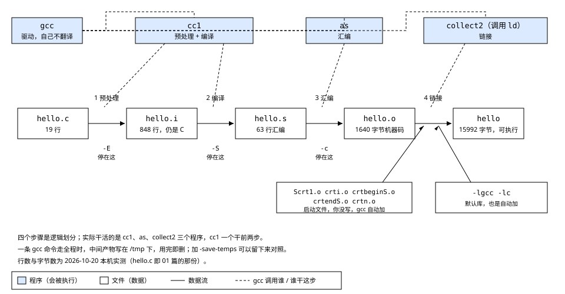
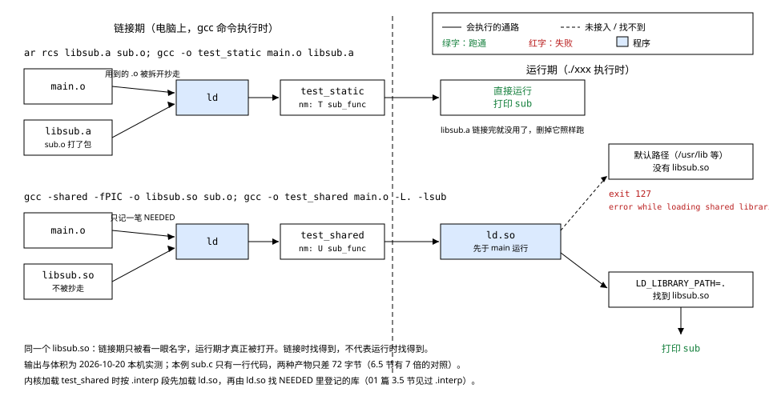

# 02 GCC 编译器的使用

    实验    Knowledge/labs/02_gcc/（第 1～5 节的素材沿用 01 篇的
            ../01_hello/hello.c，产物留在本目录）
    电脑    WSL Ubuntu 26.04，gcc 15.2.0，arm-linux-gnueabihf-gcc 15.2.0
            （本篇"本机实测"均为 2026-10-20 实跑）
    板子    本篇不上板；引用的板上输出是 01 篇 2026-09-14 归档的实测

---

**读前须知**：需要 [01 HelloWorld 背后没那么简单](./01_HelloWorld背后没那么简单.md)
的底子，具体是这几条：

- 头文件里放声明、库里放实现（01 篇 1.4、1.5 节）：本篇第 2 节展开
  `#include` 到底展开了什么，第 6 节展开库怎么被拼进来
- 退出码与 `$?`（01 篇 1.3 节）：本篇到处用它判断成败
- ELF 文件头、e_machine、`.interp`（01 篇 3.3、3.5 节）：第 4 节要看
  `.o` 的文件头，第 6 节要对照 `.interp` 的有无
- 交叉编译器与本地编译器只差名字（01 篇 2.3 节）：本篇的实验用电脑上的
  gcc 做，第 6 节起换成交叉编译器，选项一模一样

下面几篇 fundamentals 用到再翻，不读也能顺着正文走：

- [00 从源码到运行](../../fundamentals/00_从源码到运行.md)：四个程序的
  交接抓得比本篇更细
- [04 GCC 的选项](../../fundamentals/04_GCC的选项.md)：选项全表，本篇只
  就地讲主线用到的
- [05 静态库、动态库与符号](../../fundamentals/05_静态库动态库与符号.md)：
  PLT/GOT 的机制、符号类型全表
- [03 ABI 与 sysroot](../../fundamentals/03_ABI与sysroot.md)：交叉编译时
  头文件和库的那套目录

**这一章在整机里的位置**：上接 01 篇，下接 03 篇（Makefile）。01 篇一直把
`gcc hello.c -o hello` 当成一步来用；本章把这一步拆开。03 篇再把本章拆出来的
那几条命令交给 make 去判断"哪些需要重跑"。后面交叉编译第三方库（06 篇起），
每一次 configure、每一条编译命令，都是这四步加上参数。

**不学它会怎样**：交叉编第三方库时，三类报错会轮流出现：
`fatal error: xxx.h: No such file or directory`、
`undefined reference to 'xxx'`、
`error while loading shared libraries`。它们分别卡在四步里的不同步，分不清就
只能把 `-I`、`-L`、`LD_LIBRARY_PATH` 挨个瞎试。还有一个更安静的坑：
`-static` 写到 `-o` 后面，编译不报错，产物悄悄变回动态版，传上板才起不来
（第 6.5 节）。

## 0 起点

01 篇结尾留下了一句话：编译的内部过程，也就是预处理、编译、汇编、链接这四步
各产出什么，库是怎么被拼进来的，还没讲。本章就讲这个。

先把终点摆出来。同一份 19 行的 `hello.c`，一条 gcc 命令走完全程，中间能拦下
四个产物。本机实测：

```text
$ wc -l hello.c hello.i hello.s
   19 hello.c
  848 hello.i
   63 hello.s

$ ls -l hello.o hello
-rw-rw-r-- 1 glorinz glorinz  1640 Oct 20 02:20 hello.o
-rwxrwxrwx 1 glorinz glorinz 15992 Oct 20 02:20 hello
```

19 行变成 848 行，再变成 63 行，再变成 1640 字节，最后变成 15992 字节。
这四个数每一个都有原因，读完本章你应该能逐个解释它们，并且：

- 亲眼看到每一步的产物里装了什么（第 2 到 5 节）
- 说出每个产物是哪个程序做出来的（第 1 节）
- 把三类常见报错各归到某一步的某个动作上（第 2、5、6 节）
- 解释静态链接和动态链接的产物为什么差 7 倍（第 6 节）

---

## 1 一条命令的内部：四个步骤，三个程序

上一章我们敲了几十次 `gcc ... -o ...`，每次都当它是一步。这一节的问题：
这一步内部到底发生了几件事，分别是谁做的。

### 1.1 [做 L1] 让 gcc 把它做的事说出来

gcc 有一个选项专门回答这个问题：`-v`。它让 gcc 把内部调用的每一条命令都
原样打印出来。

```bash
cd Knowledge/labs/02_gcc
gcc -v -o hello ../01_hello/hello.c 2>&1 | grep -E 'cc1 |gnu-as |collect2 '
```

逐个参数说清：

- `-v`：verbose，打印配置信息与内部动作。
- `2>&1`：`-v` 的信息走在"标准错误"上，不加这个，管道只接到普通输出，
  grep 就什么也看不到。
- `grep -E 'cc1 |gnu-as |collect2 '`：满屏 36 行里只挑三条：三个干活的程序
  被调用的那一行。

本机实测：

```text
 /usr/libexec/gcc/x86_64-linux-gnu/15/cc1 -quiet -v -imultiarch x86_64-linux-gnu ../01_hello/hello.c ... -o /tmp/cc2RuZAc.s
 /usr/bin/x86_64-linux-gnu-as -v --64 -o /tmp/ccMZQkfT.o /tmp/cc2RuZAc.s
 /usr/libexec/gcc/x86_64-linux-gnu/15/collect2 -plugin ... -o hello ... /tmp/ccMZQkfT.o ...
```

（各行较长，省略号处是与本节无关的参数。）三行各读一件事：

1. `cc1` 读入 `../01_hello/hello.c`，产出 `/tmp/cc2RuZAc.s`。后缀 `.s` 是
   汇编文件。这一个程序干了两件事：预处理和编译。
2. `x86_64-linux-gnu-as` 读入刚才那个 `.s`，产出 `/tmp/ccMZQkfT.o`。
   `as` 是汇编器，它把汇编文本变成机器码，`.o` 是目标文件。
3. `collect2` 拿到 `.o`，产出最终的 `hello`。collect2 是链接器 `ld` 外面
   的一层包装，实际拼文件的是 ld。

所以"四个步骤"是逻辑划分，**实际干活的是三个程序**：`cc1`（预处理加编译）、
`as`（汇编）、`collect2` 调 `ld`（链接）。gcc 自己一个文件也不翻译，它只是
按顺序把这三个程序叫起来，把上一步的产物交给下一步。这种角色叫驱动程序。

两个附带的观察：

- 中间产物写在 `/tmp` 下，文件名带随机后缀，用完就删。这就是"一条命令编完
  看不到中间文件"的原因。
- 系统里其实有一个独立的 `/usr/bin/cpp`（预处理器），但这次的 `-v` 输出里
  没有它：这套 gcc 15 的预处理由 cc1 一并完成。

交叉编译器的内部结构完全一样，只是路径换了。同一台电脑上：

```bash
arm-linux-gnueabihf-gcc -v -o /tmp/hello_arm ../01_hello/hello.c 2>&1 | grep -E 'cc1 |bin/as |collect2 '
```

本机实测（各行较长，只留头尾）：

```text
 /usr/libexec/gcc-cross/arm-linux-gnueabihf/15/cc1 -quiet -v ... hello.c ... -o /tmp/ccEV1vr8.s
 /usr/lib/gcc-cross/arm-linux-gnueabihf/15/../../../../arm-linux-gnueabihf/bin/as -v -march=armv7-a+fp -mfloat-abi=hard -meabi=5 -o /tmp/cccs8eyn.o /tmp/ccEV1vr8.s
 /usr/libexec/gcc-cross/arm-linux-gnueabihf/15/collect2 -plugin ...
```

`cc1`、`as`、`collect2` 各有一个 ARM 版，装在带 `gcc-cross` 字样的目录里。
01 篇 2.2 节说过一个编译器只为一种目标架构生成机器码，这里看到的是更细的
分工：连汇编器都是一套一个。as 那一行的参数还认得出来：
`-march=armv7-a+fp` 是 01 篇 2.8 节看到过的默认架构，`-mfloat-abi=hard`
就是名字里 `hf` 那段（01 篇 2.6 节）。

### 1.2 collect2 那一行里多出来的东西

1.1 节的第三行被省略号截掉了。把它完整展开（一个参数一行，路径缩短）：

```text
collect2 ... -o hello
    --dynamic-linker /lib64/ld-linux-x86-64.so.2
    .../Scrt1.o
    .../crti.o
    .../crtbeginS.o
    -L/usr/lib/gcc/x86_64-linux-gnu/15
    -L/usr/lib/x86_64-linux-gnu
    -L/lib ...
    /tmp/ccMZQkfT.o
    -lgcc -lgcc_s -lc -lgcc -lgcc_s
    .../crtendS.o
    .../crtn.o
```

我们只交了一个 `.o`，链接时被塞进去的却有一串：

- `--dynamic-linker /lib64/ld-linux-x86-64.so.2`：写进产物的 `.interp` 段，
  也就是 01 篇 3.5 节那个"运行时先找谁"的路径。第 6 节会看到它在 ARM 版里
  是 `/lib/ld-linux-armhf.so.3`。
- `Scrt1.o`、`crti.o`、`crtbeginS.o`、`crtendS.o`、`crtn.o`：**启动文件**。
  你没有写过它们，gcc 自动加的。程序不是从 `main` 开始跑的，`main` 之前的
  准备工作就在这些文件里。5.2 节会把它们拿掉看看后果。
- `-lgcc`、`-lgcc_s`、`-lc`：默认库。`-lc` 就是 C 库，01 篇 1.5 节的
  `printf` 从这儿来。`-l` 是"链接某个库"的写法，第 6 节细讲。
- 一串 `-L`：链接时找库的目录。

记住这个感觉：**你以为你只给了 hello.o，链接器手里其实有一长串输入。**

### 1.3 中间产物去哪了：按后缀决定做到哪一步

想把中间产物留下来对照，有两个办法。一是逐个停点去拦（第 2 到 5 节的做法），
二是加 `-save-temps` 让 gcc 把它们留在当前目录：

```bash
mkdir /tmp/st && cd /tmp/st
cp /mnt/e/Workspace/Embeded/Embedded-linux/Knowledge/labs/01_hello/hello.c .
gcc -save-temps -o hello hello.c
ls -l
```

本机实测：

```text
-rwxr-xr-x 1 glorinz glorinz 15992 Oct 20 02:21 hello
-rw-r--r-- 1 glorinz glorinz   248 Oct 20 02:21 hello.c
-rw-r--r-- 1 glorinz glorinz 21523 Oct 20 02:21 hello.i
-rw-r--r-- 1 glorinz glorinz  1640 Oct 20 02:21 hello.o
-rw-r--r-- 1 glorinz glorinz   938 Oct 20 02:21 hello.s
```

`.i`、`.s`、`.o` 都在，加上最终的 `hello`，四步的产物凑齐了。后缀名不是
随便起的，gcc 靠后缀决定对一个文件做到哪一步：

| 输入后缀 | gcc 认定的身份 | 做到哪一步 |
|---|---|---|
| `.c` | C 源码 | 全程：预处理、编译、汇编、链接 |
| `.i` | 已预处理的 C | 编译、汇编、链接 |
| `.s` | 汇编 | 汇编、链接 |
| `.o` | 目标文件 | 只链接 |

所以第 2 到 5 节里"把上一步的产物喂回去"的命令才能成立：给 `.i` 它就跳过
预处理，给 `.o` 它就直接链接。都不给停点选项、输入是 `.c`，就是日常那条
走全程的命令；不给 `-o`，产物叫 `a.out`（本机实测：`gcc hello.c` 产出
`a.out`，运行正常）。

顺带把一个词说清楚。日常说"编译"有三个范围，读任何文档都要按上下文分：

    窄义   .i -> .s 那一步(cc1 把 C 翻成汇编)
    中义   .c -> .o,即预处理加编译加汇编(gcc -c 干的事)
    宽义   .c -> 可执行文件,四步全包

本篇需要区分时写全称。



看图的方法：中间一排白框是四个产物文件，箭头上的编号是四个步骤；上面一排
蓝框是三个干活的程序，虚线表示"gcc 调用谁、谁干这步"。cc1 的虚线落到前两步
上，这就是"四个步骤只有三个程序"。右下角两个白框是链接这一步自动加入的输入，
1.2 节刚看过它们的名字。

**这一节搭好的积木**：`gcc` 是驱动，内部依次调用 `cc1`（预处理加编译）、
`as`（汇编）、`collect2` 调的 `ld`（链接）；中间产物默认写在 /tmp 用完即删；
gcc 按输入后缀决定做到哪一步。接下来的问题：第一步的产物 `.i` 里到底装了
什么，多到 848 行。

---

## 2 预处理：.c 变成 .i

上一节看到 cc1 先把 `hello.c` 变成 `.s` 之前的某种中间形态。这一节的问题：
这第一步具体做了什么，产物长什么样。

### 2.1 [做 L1] 停在预处理之后：-E

`-E` 让 gcc 做完预处理就停。产物是文本，可以直接读。

```bash
cd Knowledge/labs/02_gcc
gcc -E ../01_hello/hello.c -o hello.i
file hello.i
wc -l ../01_hello/hello.c hello.i
```

- `-E`：预处理后即停。不给 `-o` 时结果直接打印到屏幕。
- `file`：识别文件类型（01 篇 2.4 节用过）。

本机实测：

```text
hello.i: C source, ASCII text
   19 ../01_hello/hello.c
  848 hello.i
```

`file` 说 `.i` 仍然是 C 源码。19 行进，848 行出。多出来的 829 行是什么？

### 2.2 读 hello.i：行标记、声明、被挤到最后的 main

按 01 篇 1.4 节的说法，`#include <stdio.h>` 会把 `stdio.h` 的内容原样插进来。
828 行增量的大头就是它。看三处。

第一处，开头：

```bash
head -12 hello.i
```

```text
# 0 "hello.c"
# 0 "<built-in>"
# 0 "<command-line>"
# 1 "/usr/include/stdc-predef.h" 1 3 4
# 0 "<command-line>" 2
# 1 "hello.c"
# 1 "/usr/include/stdio.h" 1 3 4
# 28 "/usr/include/stdio.h" 3 4
# 1 "/usr/include/x86_64-linux-gnu/bits/libc-header-start.h" 1 3 4
# 33 "/usr/include/x86_64-linux-gnu/bits/libc-header-start.h" 3 4
# 1 "/usr/include/features.h" 1 3 4
# 431 "/usr/include/features.h" 3 4
```

以 `#` 开头的行是**行标记**，格式是 `# 行号 "文件名"`，意思是"接下来的内容
来自这个文件的这一行"。顺着读：`hello.c` 的第 1 行是 `#include <stdio.h>`，
于是预处理器去了 `/usr/include/stdio.h`；`stdio.h` 自己第 28 行又 include
了 `bits/libc-header-start.h`，它又 include 了 `features.h`。include 是
会嵌套的。整个 `hello.i` 里有 118 条行标记，涉及 29 个不同的文件
（`grep -c '^# ' hello.i` 和 `grep '^# ' hello.i | awk '{print $3}' | sort -u | wc -l`
本机实测）。

行标记不是废话。第 3 节的编译器报错会写 `hello.c:20` 这样的位置，它靠的就是
这些标记：经过一轮展开，文件早就不是原来的行号了，没有标记，报错将指向一个
八百多行的拼接文件里的位置，谁也找不到。

第二处，`printf` 的声明：

```bash
grep -n 'extern int printf' hello.i
```

```text
492:extern int printf (const char *__restrict __format, ...);
```

01 篇 1.4 节说"声明让编译器能核对调用"，这就是那份声明被插进来的样子。
`extern` 表示"这个函数的实现在别的文件里"，括号里是参数的形状。

第三处，你自己的代码：

```bash
grep -n 'int main' hello.i
tail -n 14 hello.i
```

```text
841:int main(int argc, char **argv)
```

```text
# 10 "hello.c"
int main(int argc, char **argv)
{
 if (argc >= 2)
  printf("Hello, %s!\n", argv[1]);
 else
  printf("Hello, world!\n");
 return 0;
}
```

`main` 在第 841 行，前面 840 行全是展开进来的东西。整个文件可以画成这样：

```
hello.i,848 行
+------------------------------------------------+
| # 0 "hello.c"                                  | 行标记(118 条)
| # 1 "/usr/include/stdio.h" 1 3 4               |
| # 1 ".../bits/libc-header-start.h" 1 3 4       |
| ...                                            |
+------------------------------------------------+
| typedef ...; extern int printf (...); ...      | 第 1~840 行:29 个头文件
+------------------------------------------------+ 的声明与类型定义
| # 10 "hello.c"                                 |
| int main(int argc, char **argv) { ... }        | 第 841 行起:你的代码
+------------------------------------------------+
```

从上看：先是一堆行标记指路；中间八百多行是头文件的内容，几乎全是声明和类型
定义，不产生任何机器码；最后才是 `hello.c` 自己的函数。这解释了 0 节的第一个
数：19 变 848，是因为 `#include` 把 29 个文件的内容递归地贴了进来；也预告了
第二个数：848 又能编回 63 行汇编，是因为这八百多行里能变成指令的只有 `main`
那几行。

容易以为预处理会"编译"头文件；实测 `.i` 里的头文件内容原样躺着，一个指令都
没产生。预处理只做文本层面的搬运，理解 C 是下一步的事（2.6 节会拿语法错误
验证这一点）。

### 2.3 宏是文本替换，不是计算

`#include` 之外，预处理还管 `#define` 和条件编译。用一个专门的实验文件
`Knowledge/labs/02_gcc/pp_demo.c` 一次看全：

```c
/* 预处理实验：宏替换、条件编译，以及"宏只做文本替换"的后果。
 * 只预处理：      gcc -E pp_demo.c -o pp_demo.i
 * 打开 DEBUG 块： gcc -E -DDEBUG pp_demo.c -o pp_demo_dbg.i
 */
#include <stdio.h>

#define MAX 20
#define MIN 10
#define BIT(n)   (1 << (n))
#define TWICE(x) x + x

int main(void)
{
    int range = MAX - MIN;
    int mask = BIT(3);
    int twice = TWICE(3) * 2;

#ifdef DEBUG
    range = range + BIT(BIT(2));
#endif
    printf("range=%d mask=%d twice=%d\n", range, mask, twice);
    return 0;
}
```

逐行读新出现的写法：

- `#define MAX 20`：定义一个宏。从这行往后，源码里每出现一个独立的 `MAX`，
  预处理时都被换成 `20`。
- `#define BIT(n) (1 << (n))`：带参数的宏。`BIT(3)` 被换成 `(1 << (3))`。
  `<<` 是左移，`1 << 3` 就是二进制的 1 后面补 3 个 0，即 8。
- `#define TWICE(x) x + x`：故意写成不带括号的版本，下面会出事。
- `#ifdef DEBUG` ... `#endif`：条件编译。`DEBUG` 这个宏有定义时，中间的行
  才会进入产物；没有定义时，中间的行整块消失。

只预处理，看产物里我们关心的几行：

```bash
gcc -E pp_demo.c -o pp_demo.i
tail -n 16 pp_demo.i
```

本机实测（空行是从被删掉的指令行留下的位置）：

```text
# 12 "pp_demo.c"
int main(void)
{
    int range = 20 - 10;
    int mask = (1 << (3));
    int twice = 3 + 3 * 2;


    printf("range=%d mask=%d twice=%d\n", range, mask, twice);
    return 0;
}
```

三行对照着读：

- `MAX - MIN` 变成 `20 - 10`。
- `BIT(3)` 变成 `(1 << (3))`，括号原样保留。
- `TWICE(3) * 2` 变成 `3 + 3 * 2`。宏把 `x` 换成 `3` 就停了，**它不替你加
  括号**。而 C 里乘法比加法先算，这个式子是 `3 + (3 * 2)` = 9，不是
  `(3 + 3) * 2` = 12。
- `#ifdef DEBUG` 块整个没了，因为没定义 `DEBUG`。

运行验证那个 9：

```bash
gcc -Wall pp_demo.c -o pp_demo
./pp_demo
```

```text
range=10 mask=8 twice=9
```

容易以为 `TWICE(3) * 2` 是 12；实测是 9；原因是宏展开是纯文本替换，替换完才
轮到运算符优先级起作用。写带参数的宏，参数和整体都要加括号：
`#define TWICE(x) ((x) + (x))`。改对之后展开成 `((3) + (3)) * 2`，结果才是
12。check.sh 的注错见红就是拿这个宏做的：把括号加上，"展开结果是
`3 + 3 * 2`"这条判据立刻变红。

### 2.4 条件编译的开关从命令行来：-D

`DEBUG` 不一定要在源码里写 `#define`。编译时用 `-D` 可以在命令行上定义它：

```bash
gcc -E -DDEBUG pp_demo.c -o pp_demo_dbg.i
tail -n 16 pp_demo_dbg.i
gcc -Wall -DDEBUG pp_demo.c -o pp_demo_dbg
./pp_demo_dbg
```

- `-DDEBUG`：等价于在所有源码最前面加一行 `#define DEBUG`。要同时给值就写
  `-DDEBUG=1`。

本机实测：

```text
int main(void)
{
    int range = 20 - 10;
    int mask = (1 << (3));
    int twice = 3 + 3 * 2;


    range = range + (1 << ((1 << (2))));

    printf("range=%d mask=%d twice=%d\n", range, mask, twice);
    return 0;
}
range=26 mask=8 twice=9
```

被藏起来的那行进来了，而且 `BIT(BIT(2))` 展开成 `(1 << ((1 << (2))))`，
宏套宏也是逐层文本替换。`range` 从 10 变成 26：10 + (1 << 4) = 10 + 16。

`-D` 的实际用途：同一份源码，调试版打开打印、发布版关掉，不用改代码。
与它相对的 `-U` 是取消一个宏。完整的宏开关清单在
[04 GCC 的选项](../../fundamentals/04_GCC的选项.md)（[04 GCC 的选项](../../fundamentals/04_GCC的选项.md)第 7 节）。

查宏还有一个组合：`-E -dM` 把预处理结束时**所有**宏连同值列出来：

```bash
gcc -E -dM pp_demo.c | grep -E 'define (MAX|MIN|BIT|TWICE)'
gcc -E -dM pp_demo.c | wc -l
```

```text
#define TWICE(x) x + x
#define BIT(n) (1 << (n))
#define MAX 20
#define MIN 10
700
```

700 个宏里只有 4 个是我们写的，其余 696 个来自系统头文件和编译器内建。
"这个宏到底有没有定义、值是什么"这类问题，用这条命令直接查，不用去头文件里翻。

### 2.5 头文件从哪来：搜索路径与 -I

预处理器找 `<stdio.h>` 时去的是一份固定的目录列表。01 篇 1.5 节已经用
`echo 'int main(){}' | gcc -E -v -` 问过它，本机那份列表是：

```text
#include "..." search starts here:
#include <...> search starts here:
 /usr/lib/gcc/x86_64-linux-gnu/15/include
 /usr/local/include
 /usr/include/x86_64-linux-gnu
 /usr/include
End of search list.
```

尖括号的写法只搜这份列表；引号的写法 `#include "sub.h"` 先搜源文件所在的
目录，找不到再搜这份列表。验证引号写法的兜底行为，用本篇的多文件实验素材
（`main.c`、`sub.h`、`sub.c`，它们的完整故事在第 5.3 节和第 6 节）：

```bash
sed 's/"sub.h"/<sub.h>/' main.c > /tmp/mi.c
gcc -c /tmp/mi.c -o /tmp/mi.o; echo "exit=$?"
gcc -I. -c /tmp/mi.c -o /tmp/mi.o; echo "exit=$?"
```

- `sed 's/旧/新/'`：把 `#include "sub.h"` 改成 `#include <sub.h>`，改出来的
  副本写到 /tmp，实验目录里的文件不动。改成尖括号后，当前目录不再被搜索。
- `-I.`：把头文件搜索列表里加上当前目录（`.`）。

本机实测：

```text
/tmp/mi.c:4:10: fatal error: sub.h: No such file or directory
    4 | #include <sub.h>
      |          ^~~~~~~
compilation terminated.
exit=1
exit=0
```

`fatal error` 加 `compilation terminated`：预处理器找不到文件，整个编译
在这一步就停了，后面的步骤不会发生。这是三类经典报错的第一个，它卡在
**预处理**，解法是把头文件放进默认目录，或者用 `-I` 告诉预处理器去哪找。

顺带看 `sub.h` 本身：

```c
/* 同一个头文件被同一个 .c 间接包含两次时，第二次整段跳过。 */
#ifndef SUB_H
#define SUB_H

void sub_func(void);

#endif
```

这个结构叫包含守卫。头文件互相 include 时，同一个头很容易间接地被包含两次，
里面的声明就会重复出现。守卫用条件编译解决：第一次进来时 `SUB_H` 没定义，
定义它并给出内容；第二次进来时 `SUB_H` 已定义，整段跳过。实测验证：

```bash
printf '#include "sub.h"\n#include "sub.h"\nint main(void){ sub_func(); return 0; }\n' > /tmp/guard.c
gcc -E -I. /tmp/guard.c | grep -c 'void sub_func'
```

```text
1
```

include 了两次，声明只出现一次。把 `#ifndef`/`#define`/`#endif` 三行删掉再
试（本机实测），声明出现两次。写头文件就带上这三行。

### 2.6 语法错误在哪一步被发现

2.2 节说预处理只做文本搬运、不理解 C。验证它：往源码里塞一行不是 C 的东西，
分别停在 `-E` 和 `-S`：

```bash
cp ../01_hello/hello.c /tmp/hello_bad.c
echo 'this is not c' >> /tmp/hello_bad.c
gcc -E /tmp/hello_bad.c -o /dev/null; echo "预处理 exit=$?"
gcc -S /tmp/hello_bad.c -o /dev/null; echo "编译   exit=$?"
rm /tmp/hello_bad.c
```

- `>>`：追加一行到文件末尾。
- `-o /dev/null`：产物直接扔掉，只看报错。

本机实测：

```text
预处理 exit=0
/tmp/hello_bad.c:20:1: error: unknown type name ‘this’
   20 | this is not c
      | ^~~~
/tmp/hello_bad.c:20:9: error: expected ‘=’, ‘,’, ‘;’, ‘asm’ or ‘__attribute__’ before ‘not’
   20 | this is not c
      |         ^~~
/tmp/hello_bad.c:20:9: error: unknown type name ‘not’
编译   exit=1
```

`-E` 一声不吭地通过了，那行字被原样搬进 `.i`；`-S` 才报错。**语法检查在
编译这一步，预处理不做。** 这个结论有实用价值：看到 `fatal error: xxx.h` 要
回头查预处理（文件、路径、`-I`）；看到 `error: unknown type name` 这类要回头
查语法（声明、分号、括号）。报错的措辞里带着它出生的阶段。

### 2.7 [判] 第 1、2 节

    [ ] gcc -v 里能指出 cc1、as、collect2 三行,说得出谁干哪一步
    [ ] collect2 的命令行里有 Scrt1.o 等启动文件和 -lc
    [ ] -save-temps 之后当前目录同时有 .i .s .o
    [ ] hello.i 848 行,行标记 118 条,main 在第 841 行
    [ ] hello.i 里找得到 extern int printf 那一行
    [ ] pp_demo 里 TWICE(3) * 2 展开成 3 + 3 * 2,运行结果是 twice=9
    [ ] -DDEBUG 之后 .i 里多出 range = range + (1 << ((1 << (2)))); 这一行
    [ ] -E -dM 里既有自己的 4 个宏,也有约 700 个宏的总数
    [ ] <sub.h> 尖括号写法报 fatal error,加 -I. 后通过
    [ ] 语法错误 -E 不拦、-S 拦

    注错见红:把 pp_demo.c 的 TWICE 改成 ((x) + (x)),第 6 条必须变红;
    把 sub.h 的声明改坏(比如 void sub_func(int);),构建必须失败。

**这一节搭好的积木**：预处理做三件事：展开 `#include`（递归地，留下行标记
供报错定位）、替换宏（纯文本，不管优先级）、按条件裁剪代码。产物 `.i` 仍是 C。
头文件的搜索路径用 `-I` 加，宏的开关用 `-D` 给。接下来的问题：这份 848 行的
`.i` 怎么变成 63 行汇编。

---

## 3 编译：.i 变成 .s

预处理交出来的还是 C。这一节的问题：编译这一步把 C 变成了什么，产物里
哪些行对应源码里的哪句话。

### 3.1 停在编译之后：-S

```bash
gcc -S hello.i -o hello.s
file hello.s
wc -l hello.s
```

- `-S`：编译后即停，不汇编。输入是 `.i`，gcc 按 1.3 节后缀表跳过预处理。

本机实测：

```text
hello.s: assembler source, ASCII text
63 hello.s
```

848 行进，63 行出。收缩的原因 2.2 节已经预告：八百多行里绝大部分是声明，
声明不产生指令；真正干活的只有 `main` 那几行。

### 3.2 hello.s 逐段读

63 行全文不长，直接读。本机实测（行号是加的，方便引用）：

```text
 1  	.file	"hello.c"
 2  	.text
 3  	.section	.rodata
 4  .LC0:
 5  	.string	"Hello, %s!\n"
 6  .LC1:
 7  	.string	"Hello, world!"
 8  	.text
 9  	.globl	main
10  	.type	main, @function
11  main:
12  .LFB0:
13  	.cfi_startproc
14  	endbr64
15  	pushq	%rbp
16  	.cfi_def_cfa_offset 16
17  	.cfi_offset 6, -16
18  	movq	%rsp, %rbp
19  	.cfi_def_cfa_register 6
20  	subq	$16, %rsp
21  	movl	%edi, -4(%rbp)
22  	movq	%rsi, -16(%rbp)
23  	cmpl	$1, -4(%rbp)
24  	jle	.L2
25  	movq	-16(%rbp), %rax
26  	addq	$8, %rax
27  	movq	(%rax), %rax
28  	leaq	.LC0(%rip), %rdx
29  	movq	%rax, %rsi
30  	movq	%rdx, %rdi
31  	movl	$0, %eax
32  	call	printf@PLT
33  	jmp	.L3
34  .L2:
35  	leaq	.LC1(%rip), %rax
36  	movq	%rax, %rdi
37  	call	puts@PLT
38  .L3:
39  	movl	$0, %eax
40  	leave
41  	.cfi_def_cfa 7, 8
42  	ret
43  	.cfi_endproc
44  .LFE0:
45  	.size	main, .-main
46  	.ident	"GCC: (Ubuntu 15.2.0-16ubuntu1) 15.2.0"
47  	.section	.note.GNU-stack,"",@progbits
    （48~63 行是 .note.gnu.property 段，记录这文件要求的安全属性，略）
```

按段读：

- 第 1 行 `.file`：记录源文件名，调试和报错用。
- 第 3～7 行：`.section .rodata` 表示"接下来的东西放进只读数据区"。两个
  `.string` 就是源码里那两个字符串，编译器给它们起了内部名字 `.LC0`、
  `.LC1`。`.rodata` 是 read-only data，字符串常量不允许被改，放这里。
- 第 8～10 行：回到 `.text`（代码区）；`.globl main` 声明 `main` 是全局符号，
  别的文件链接时能看到它。第 4 节会在符号表里再见到这行的效果。
- 第 11～42 行：`main` 的指令。不用读懂每条，对照源码认几个关键点：
  - 第 23、24 行 `cmpl $1, ...` 加 `jle .L2`：比较 `argc` 和 1，小于等于就跳
    到 `.L2`。这就是 `if (argc >= 2)`。
  - 第 28 行 `leaq .LC0(%rip), %rdx`：把字符串 `.LC0` 的地址装进寄存器，
    准备当参数。
  - 第 32 行 `call printf@PLT`：调用 `printf`。
  - 第 37 行 `call puts@PLT`：调用 `puts`。源码里并没有 `puts`，3.3 节讲。
  - 第 39 行 `movl $0, %eax`：把 0 放进返回值寄存器。这就是 `return 0`。
  - 第 42 行 `ret`：函数返回。
- 第 13、16、17、19、41、43 行这些 `.cfi_` 开头的是给调试器和异常处理看的
  记账信息，不产生机器动作，先不管。
- 第 46 行 `.ident`：编译器签名，会原样进 `.o`（第 4 节 strings 能看到）。

`call printf@PLT` 里的 `@PLT`：PLT 是一块"跳板"区域，调别的文件的函数时先
跳到跳板，再由跳板转过去。为什么需要跳板，机制在
[05 静态库、动态库与符号](../../fundamentals/05_静态库动态库与符号.md) 的
[05 静态库、动态库与符号](../../fundamentals/05_静态库动态库与符号.md)第 6 节。现在只需要记住：**汇编文本里，`call` 的目标名字是给人和
链接器看的，真正的地址这一步还没有。**

### 3.3 编译器动过的手脚：printf 变成了 puts

`hello.c` 里写的是两个 `printf`，`hello.s` 里是一个 `printf` 加一个 `puts`。
变化发生在编译这一步：gcc 看到 `printf("Hello, world!\n")` 没有任何格式符，
就换成语义相同的 `puts`（在字符串末尾自动加换行，所以 `.LC1` 里那个 `\n`
也被去掉了，对照第 5、7 行的两个字符串）。01 篇 2.4 节还见过另一种替换：
带格式符的那个 `printf` 在 `-O2` 下被换成带边界检查的 `__printf_chk`。

这一节的要点不是记住这两个名字，而是记住这件事的存在：**编译器可以合法地
把你的调用换成等价物。**以后在汇编或符号表里看到源码里没有的名字，先想
"是不是编译器换的"，再去怀疑编错了。哪些优化会做这类替换，清单在
[04 GCC 的选项](../../fundamentals/04_GCC的选项.md)第 3 节。

### 3.4 警告也从这一步来：-Wall

编译器在读懂你的代码的过程中，会顺带发现一些"语法没错但很像写错了"的地方。
它说不说，取决于你开没开警告。实验文件 `Knowledge/labs/02_gcc/warn.c`：

```c
/* 警告实验：语法完全合法，但有两处很可能是写错了。
 * 不加 -Wall 编译一声不吭，加了才报。
 */
#include <stdio.h>

int main(void)
{
    int i;
    int n;

    printf("n=%d\n", n);
    return 0;
}
```

两处问题：`i` 声明了从没用过；`n` 没赋值就打印。分别编两次：

```bash
gcc -c warn.c -o /tmp/w0.o 2>/tmp/w0.err; echo "exit=$? 输出字节数=$(wc -c < /tmp/w0.err)"
gcc -Wall -c warn.c -o /tmp/w1.o; echo "exit=$?"
```

- `2>/tmp/w0.err`：把标准错误存起来，数它有多少字节，证明"一个字都没说"。
- `-Wall`：打开常用警告。

本机实测：

```text
exit=0 输出字节数=0
warn.c: In function ‘main’:
warn.c:8:9: warning: unused variable ‘i’ [-Wunused-variable]
    8 |     int i;
      |         ^
warn.c:11:5: warning: ‘n’ is used uninitialized [-Wuninitialized]
   11 |     printf("n=%d\n", n);
      |     ^~~~~~~~~~~~~~~~~~~
warn.c:9:9: note: ‘n’ was declared here
    9 |     int n;
      |         ^
exit=0
```

三点要读出来：

1. 不加 `-Wall`，这两处问题完全无声，产物照常生成。
2. 加了 `-Wall`，每条警告给出位置、代号和解释。方括号里的
   `-Wunused-variable`、`-Wuninitialized` 是这条警告自己的开关名。
3. **两次的退出码都是 0。**警告不挡编译，产物照样生成。想让警告变成硬约束，
   用 `-Werror`（本仓 Project 的 Makefile 就是 `-Wall -Wextra -Werror`，
   有警告就编不过）。

那个没赋值的 `n` 打印出来是什么？本机实测连跑三次都是 `n=0`。容易以为它
每次会拿到一个"随机垃圾值"；实测是 0；原因是这次的栈帧恰好落在干净的内存
上。这仍然是谁都不能依赖的值：换一个函数调用顺序、换一台机器、换一种优化
级别，那里是什么就是什么。判据只能写"值未定义"，不能写"是 0"。

### 3.5 [判] 第 3 节

    [ ] hello.s 里能找到 .LC0/.LC1 两个字符串和 call printf@PLT、call puts@PLT
    [ ] 说得出 .section .rodata 和 .text 的分工
    [ ] 说得出 printf 为什么少了一个,以及为什么这不是编错了
    [ ] warn.c 不加 -Wall 时编译输出为 0 字节;加了之后有两条 warning
    [ ] 两种情况下退出码都是 0;-Werror 会改变这一点

    注错见红:删掉 warn.c 里的 int i;,-Wunused-variable 那条判据必须变红。

**这一节搭好的积木**：编译（窄义）把 C 翻译成汇编文本，归 cc1 管；字符串进
`.rodata`，代码进 `.text`，`call` 的目标只有名字没有地址；编译器会做等价
替换（printf→puts），警告在这一步产生且默认不挡编译。接下来的问题：`.s`
是文本，CPU 不能吃文本，谁把它变成机器码。

---

## 4 汇编：.s 变成 .o

上一节的产物是 63 行汇编文本。这一节的问题：汇编器把它变成的 `.o` 里面
到底装了什么。

### 4.1 [做 L1] hello.o 是一张 ELF

```bash
gcc -c hello.s -o hello.o
file hello.o
readelf -h hello.o
```

- `-c`：汇编后即停，不链接。输入是 `.s`，gcc 跳过预处理和编译，只调 as。
- `readelf -h`：读 ELF 文件头（01 篇 3.3 节用它看过可执行文件）。

本机实测：

```text
hello.o: ELF 64-bit LSB relocatable, x86-64, version 1 (SYSV), not stripped
```

```text
ELF Header:
  Magic:   7f 45 4c 46 02 01 01 00 ...
  Class:                             ELF64
  Data:                              2's complement, little endian
  Type:                              REL (Relocatable file)
  Machine:                           Advanced Micro Devices X86-64
  Entry point address:               0x0
  Start of program headers:          0 (bytes into file)
  Start of section headers:          744 (bytes into file)
  Number of program headers:         0
  Number of section headers:         14
```

`.o` 也是 ELF，魔数、e_machine 都在（01 篇 3.3 节那套读法原样适用），但
三处和可执行文件不同：

- `Type: REL`，可重定位文件。可执行文件是 `EXEC` 或 `DYN`（01 篇 3.7 节）。
  REL 的意思是：里面的地址还没定，等着链接时重新定位。
- `Entry point address: 0x0`：没有入口。它不是一个能跑的东西，内核不会
  加载它，`./hello.o` 只会报 `Permission denied` 或直接被执行格式检查挡下。
- `Number of program headers: 0`：没有程序头。程序头是告诉加载器"把哪段
  装进内存"的，只有要被加载的文件才需要。`.o` 的客户是链接器，不是内核。

### 4.2 内部布局：一张图

`readelf -S hello.o` 列出 14 个 section（节）。section 是 `.o` 内部的格子，
内容按用途分格放。本机实测的关键几行：

```text
  [ 1] .text      PROGBITS  0000000000000000  00000040  0x53  AX
  [ 3] .data      PROGBITS  0000000000000000  00000093  0x00  WA
  [ 4] .bss       NOBITS    0000000000000000  00000093  0x00  WA
  [ 5] .rodata    PROGBITS  0000000000000000  00000093  0x1a  A
  [11] .symtab    SYMTAB    ...
  [12] .strtab    STRTAB    ...
```

（Size 列换成了十六进制写法，Offset 列是这一格在文件里的位置。）按文件
里的位置画出来：

```text
hello.o,1640 字节(0x668)

偏移    格子              大小               备注
0x0000  ELF 头            64 字节            Type: REL, Machine: X86-64
0x0040  .text             0x53 = 83 字节     main 的机器码
0x0093  .data             0                  空:没有全局变量
0x0093  .bss              0                  空
0x0093  .rodata           0x1a = 26 字节     "Hello, %s!\n" 和 "Hello, world!"
0x00ad  .comment          0x27 = 39 字节     编译器签名,第 3.2 节 .ident 落的格
0x00d4  .note.*           ...                安全属性
0x00f8  .eh_frame         ...                展开信息,对应 .cfi_ 那几行
0x0130  .symtab           ...                符号表,4.3 节读它
0x01d8  .strtab           ...                符号名字符串
0x01f8  .rela.text        ...                重定位表,4.4 节读它
0x0258  .rela.eh_frame    ...
0x0270  .shstrtab         ...                section 名字符串
0x02e8  14 个 section 头  14 x 64 = 896 字节
0x0668  = 0x2e8 + 14*64,正好是文件大小
```

对着正文的数读这张图：ELF 头 64 字节在最前面；`.text` 从 0x40 开始，83 字节，
就是 `main` 的全部机器码；`.rodata` 26 字节，正好是 12 字节的
`Hello, %s!\n`（含结尾的 `\0`）加 14 字节的 `Hello, world!`（含 `\0`）；
section 头表从 0x2e8 开始，14 项每项 64 字节，加起来正好到文件尾。
`.data` 和 `.bss` 的 Size 都是 0：这个程序没有全局变量，两个格子只留了
名字。（有内容时它们一个存有初值的全局变量、一个记账没初值的全局变量，
完整实验在 [01 ELF与程序加载](../../fundamentals/01_ELF与程序加载.md) 的
big1/big2 对照。）

每一格的 Address 列全是 0：它们在最终程序里的地址要等链接时才知道。

### 4.3 符号表：main 有了位置，printf 还欠着

```bash
readelf -s hello.o
nm hello.o
```

- `readelf -s`：读 `.symtab` 这一格。
- `nm`：同一份信息的紧凑版。

本机实测：

```text
Symbol table '.symtab' contains 7 entries:
   Num:    Value          Size Type    Bind   Vis      Ndx Name
     0: 0000000000000000     0 NOTYPE  LOCAL  DEFAULT  UND 
     1: 0000000000000000     0 FILE    LOCAL  DEFAULT  ABS hello.c
     2: 0000000000000000     0 SECTION LOCAL  DEFAULT    1 .text
     3: 0000000000000000     0 SECTION LOCAL  DEFAULT    5 .rodata
     4: 0000000000000000    83 FUNC    GLOBAL DEFAULT    1 main
     5: 0000000000000000     0 NOTYPE  GLOBAL DEFAULT  UND printf
     6: 0000000000000000     0 NOTYPE  GLOBAL DEFAULT  UND puts
```

```text
0000000000000000 T main
                 U printf
                 U puts
```

逐列读第 4 行（`main`）：

- `Value 0`：它在 `.text` 里的位置是 0，因为 `.text` 这个格子自己的地址
  还没定。
- `Size 83`：正好等于 `.text` 的大小，`main` 是这个文件里唯一的函数。
- `FUNC GLOBAL`：函数，全局可见（3.2 节那句 `.globl main` 的效果）。
- `Ndx 1`：它在 1 号 section，也就是 `.text`。

`printf` 和 `puts` 两行关键是 `Ndx UND`：undefined，本文件里没有它们，
地址自然也没有。nm 的紧凑版里这对关系是 `T`（本文件有定义）对 `U`
（未定义）。这张表就是 `.o` 的"资产负债表"：**我能给别人提供什么（T），
我欠别人什么（U）。**符号类型不止这两个字母，全表在 [05 静态库、动态库与符号](../../fundamentals/05_静态库动态库与符号.md)第 1.2 节。

### 4.4 重定位表：四个待填的空位

欠着没关系，问题是：指令怎么办？`call printf` 总要翻成一个具体地址才能
执行。看汇编器实际写出来的指令：

```bash
objdump -d hello.o
```

- `objdump -d`：反汇编，把机器码翻译回汇编文本（汇编的反方向）。

本机实测（节选）：

```text
0000000000000000 <main>:
   0:	f3 0f 1e fa          	endbr64
   ...
  24:	48 8d 15 00 00 00 00 	lea    0x0(%rip),%rdx        # 2b <main+0x2b>
  ...
  36:	e8 00 00 00 00       	call   3b <main+0x3b>
  ...
  3d:	48 8d 05 00 00 00 00 	lea    0x0(%rip),%rax        # 44 <main+0x44>
  ...
  47:	e8 00 00 00 00       	call   4c <main+0x4c>
```

和 3.2 节的 `.s` 对照着看：`leaq .LC0(%rip), %rdx` 变成了
`lea 0x0(%rip),%rdx`，两个 `call` 的操作数都成了 `00 00 00 00`。**凡是涉及
"别的东西在哪里"的地方，汇编器都填了 0 占位。**四处：两个字符串地址、
两个函数地址。

同时，汇编器把"这些空位该填什么"记成了一本账：

```bash
readelf -r hello.o
```

```text
Relocation section '.rela.text' at offset 0x1f8 contains 4 entries:
  Offset          Info           Type           Sym. Value    Sym. Name + Addend
000000000027  000300000002 R_X86_64_PC32     0000000000000000 .rodata - 4
000000000037  000500000004 R_X86_64_PLT32    0000000000000000 printf - 4
000000000040  000300000002 R_X86_64_PC32     0000000000000000 .rodata + 8
000000000048  000600000004 R_X86_64_PLT32    0000000000000000 puts - 4
```

一行就是一项施工单，三个字段：

- `Offset`：空位在 `.text` 里的位置。第一条是 0x27，正好是那条 `lea`
  （在 0x24）的操作数字节的位置；第二条 0x37，是 `call`（在 0x36）的四个
  零字节的位置。
- `Sym. Name`：该填谁。`.rodata`（第一个字符串在它开头）、`printf`、
  `.rodata + 8`（第二个字符串）、`puts`。
- `Type`：怎么填。`PC32`/`PLT32` 都是"相对当前指令的位置填一个差值"，
  也就是 x86 的相对寻址；`Addend - 4` 是修正量，因为差值从指令末尾算起，
  而操作数的位置比指令末尾早 4 个字节。

所以 `.o` 的准确画像是：**机器码已经生成，但所有跨格、跨文件的地址都是
空洞，每个空洞配一条施工单。**这本账就是"可重定位"三个字的实体。链接器的
全部工作，从某个角度看，就是把所有 `.o` 的格子摆定，然后照施工单把空洞
一个个填上。

### 4.5 [判] 第 4 节

    [ ] hello.o 的 Type 是 REL,入口是 0,程序头数量是 0
    [ ] readelf -S 里 .text 是 0x53 字节、.rodata 是 0x1a 字节,
        和字符串总长对得上
    [ ] readelf -s 里 main 是 FUNC GLOBAL 且在 1 号 section,printf/puts 是 UND
    [ ] objdump -d 里两条 call 的操作数是 00 00 00 00
    [ ] readelf -r 的四条施工单能和四条指令的空位一一对上

    注错见红:把 hello.s 里的 call puts@PLT 删掉一行再 -c,
    施工单必须从 4 条变 3 条。

**这一节搭好的积木**：`.o` 是 Type 为 REL 的 ELF，内容分格（.text/.rodata/
.data/.bss），格子的地址都没定；符号表记录"有什么、欠什么"；重定位表记录
每个空洞该填谁、怎么填。接下来的问题：谁把格子摆定、把空洞填上。

---

## 5 链接：把空位填上，把启动文件拼进来

上一节留下四条施工单。这一节的问题：链接器怎么施工，以及除了我们的 `.o`，
它还拼了些什么。

### 5.1 链接前后对照：空洞是怎么填上的

```bash
gcc hello.o -o hello
objdump -d --disassemble=main hello
```

- 输入是 `.o`，gcc 按后缀表只做链接。

本机实测（节选，和 4.4 节同样的四条指令）：

```text
0000000000001169 <main>:
    118d:	48 8d 15 70 0e 00 00 	lea    0xe70(%rip),%rdx        # 2004 <_IO_stdin_used+0x4>
    119f:	e8 cc fe ff ff       	call   1070 <printf@plt>
    11a6:	48 8d 05 63 0e 00 00 	lea    0xe63(%rip),%rax        # 2010 <_IO_stdin_used+0x10>
    11b0:	e8 ab fe ff ff       	call   1060 <puts@plt>
```

对照着看施工结果：

```
                      链接前(.o)                  链接后(hello)
lea 取第一个字符串     24: ...15 00 00 00 00       118d: ...15 70 0e 00 00  # 2004
call printf           36: e8 00 00 00 00          119f: e8 cc fe ff ff     -> 0x1070
lea 取第二个字符串     3d: ...05 00 00 00 00       11a6: ...05 63 0e 00 00  # 2010
call puts             47: e8 00 00 00 00          11b0: e8 ab fe ff ff     -> 0x1060
```

每一笔都能验算。x86 的相对寻址从**下一条指令的末尾**算起：

- 第一条 `lea`：下一条指令在 0x1194，加上差值 0xe70，得 0x2004。
  `readelf -x .rodata hello`（本机实测）显示 0x2004 开始的字节正是
  `48 65 6c 6c 6f...`，即 `Hello, %s!\n`。
- `call printf`：下一条指令在 0x11a4，目标是 0x1070，差值是
  0x1070 - 0x11a4 = -0x134。负数按补码写成 32 位是 0xfffffecc，小端存放
  就是字节序列 `cc fe ff ff`，和指令里的一模一样。

0x1070 不是 `printf` 的真身，是 PLT 里的一块跳板（3.2 节提过）：链接器在
最终文件里铺好跳板，`call` 先跳跳板；程序运行时跳板再被填上 libc 里
`printf` 的真实地址。也就是说动态链接下"填地址"分两次：链接时填到跳板，
运行时动态链接器填跳板本身。第二次填的机制在 [05 静态库、动态库与符号](../../fundamentals/05_静态库动态库与符号.md)第 6 节。

同时发生但图上没画出来的事：所有 `.o` 的同名格子被合并（这个程序只有一个
`.o`，多文件时能看到几个 `.text` 并成一个，机制与实验在
[00 从源码到运行](../../fundamentals/00_从源码到运行.md)第 6 节）；格子的地址全部定下，符号表里的
`main` 从 0 变成 0x1169；文件头从 REL 变成 DYN，入口地址有了，程序头有了。

### 5.2 你没写的启动文件：-nostartfiles 与 -nostdlib

1.2 节看到链接器自动加入了 `Scrt1.o` 等五个启动文件和 `-lc`。它们干什么？
直接问 `Scrt1.o`：

```bash
nm /usr/lib/x86_64-linux-gnu/Scrt1.o
```

本机实测：

```text
0000000000000000 D __data_start
                 U __libc_start_main
0000000000000000 T _start
                 W data_start
                 U main
```

`Scrt1.o` 提供 `_start`，这是 ELF 入口地址指向的真正起点；它欠着两个符号：
`__libc_start_main`（由 `-lc` 提供）和 `main`（由你提供）。链条是：
内核按入口跳进 `_start`，`_start` 调 `__libc_start_main`，它做完准备工作
再调你的 `main`。01 篇 5.2 节那个要求 `GLIBC_2.34` 的函数就是这个
`__libc_start_main`。

把它们拿掉会怎样？两个选项各拿掉一层：

```bash
gcc -nostartfiles -o /tmp/t_nsf main.o sub.o
/tmp/t_nsf; echo "exit=$?"
gcc -nostdlib -o /tmp/t_nsl main.o sub.o; echo "exit=$?"
```

- `-nostartfiles`：不链启动文件，库照常。
- `-nostdlib`：启动文件和库都不链。

本机实测：

```text
/usr/bin/x86_64-linux-gnu-ld.bfd: warning: cannot find entry symbol _start; defaulting to 0000000000001030
Segmentation fault
exit=139
```

```text
/usr/bin/x86_64-linux-gnu-ld.bfd: warning: cannot find entry symbol _start; defaulting to 0000000000001030
/usr/bin/x86_64-linux-gnu-ld.bfd: sub.o: in function `sub_func':
sub.c:(.text+0x13): undefined reference to `puts'
collect2: error: ld returned 1 exit status
exit=1
```

读这两个结果：

- `-nostartfiles`：链接**成功**了，只有一条警告，说找不到 `_start`，入口
  默认用 0x1030。`readelf -h` 和 `objdump` 显示 0x1030 正好是 `.text` 的
  开头、也就是 `main` 自己。于是内核把 CPU 直接送进 `main`；`main` 是函数，
  最后执行 `ret`，而栈上没有为它准备的返回地址，跳到一个无意义的位置，
  访问非法内存，被内核用 SIGSEGV 终止。退出码 139 = 128 + 11，01 篇 3.5 节
  算过这笔账。**没有启动文件，程序能编出来，跑不起来。**
- `-nostdlib`：连 `-lc` 都没了，`sub.o` 里那个（被编译器换成 `puts` 的）
  调用找不到实现，链接直接失败，产物都没生成。这就是"库不链"的样子。

普通程序永远不要加这两个选项。它们的正当用途是编内核和 bootloader：那些
程序没有 C 库可用，入口也自己定义。用到时的完整形态见 [04 GCC 的选项](../../fundamentals/04_GCC的选项.md)第 6 节。

### 5.3 [做 L2] 多个文件：一条命令的代价与分开编

到现在为止只编过一个文件。真实的程序有很多个 `.c`。本篇的多文件素材是
`Knowledge/labs/02_gcc/` 的三个文件：

```c
/* main.c */
#include "sub.h"

int main(void)
{
    sub_func();
    return 0;
}
```

```c
/* sub.h */
#ifndef SUB_H
#define SUB_H

void sub_func(void);

#endif
```

```c
/* sub.c */
#include <stdio.h>
#include "sub.h"

void sub_func(void)
{
    printf("sub\n");
}
```

`main.c` 只认识 `sub.h` 里的声明，`sub_func` 的实现在 `sub.c` 里。这就是
01 篇 1.4 节的分工跨文件的样子：编译 `main.c` 时编译器只需要知道
`sub_func` 的形状；找实现是链接那一步的事。

两种编法。第一种，一条命令：

```bash
gcc -Wall -o test main.c sub.c
./test
ls *.o
```

本机实测：

```text
sub
ls: cannot access '*.o': No such file or directory
```

内部发生的就是 1.1 节那条链对两个文件各走一遍：两个 cc1、两个 as，在 /tmp
下生成两个临时 `.o`，最后一并交给 collect2。产物里没有 `.o` 留下来。

第二种，分开编再链接：

```bash
gcc -c -o main.o main.c
gcc -c -o sub.o  sub.c
gcc -o test main.o sub.o
./test
```

同样打印 `sub`，但 `.o` 留在了手里。

为什么第二种是必要的？把第一种推到极端：一个工程一千个 `.c`，一条命令编。
改了其中一个文件，重跑这条命令时，**另外 999 个文件也要从头再过一遍
预处理、编译、汇编**。第二种编法下，改了 `main.c` 只需重跑第一条和第三条：
`sub.o` 还是新的，直接复用。文件少时无所谓，文件一多，这就是编译时间从
分钟变小时的差别。

但第二种有个前提：得有人判断"哪些 `.o` 需要重生成"。`main.c` 变了要重编
`main.o`，`sub.h` 变了两个都要重编。手工维护这份判断，文件一多必然出错，
少重编一个，编出来的是新旧 `.o` 拼起来的怪胎。这个判断机器能做，就是
make，03 篇整篇讲它。本节先把原料备齐：三条命令。

先看"该给的没给"会报什么。只链 `main.o`：

```bash
gcc -o /tmp/t_nosub main.o
```

本机实测：

```text
/usr/bin/x86_64-linux-gnu-ld.bfd: /tmp/cclhKgoM.o: in function `main':
main.c:(.text+0x9): undefined reference to `sub_func'
collect2: error: ld returned 1 exit status
```

这是三类经典报错的第二个：`undefined reference to 'sub_func'`。两个细节：

1. 报错的是 `ld.bfd`（链接器），不是 cc1。编译 `main.c` 完全没问题：
   声明在 `sub.h` 里，形状核对通过，生成 `main.o` 时 `sub_func` 只是一个
   UND 符号加一条施工单（4.3、4.4 节）。是链接这一步翻遍所有输入都找不到
   它的定义，才报的错。
2. `.text+0x9` 是空洞的位置，`main.c:` 是施工单上记的源码位置。

解法就是把定义交进来：`main.o sub.o` 一起链，或者把 `sub.o` 打成库
（第 6 节）。

### 5.4 依赖文件：-MD，给 03 篇留个钩子

5.3 节说"哪些要重编"要判断依赖：`main.o` 依赖 `main.c`，还依赖它 include
的 `sub.h`。这份依赖 gcc 自己就能算，因为它做过预处理，谁 include 了谁它
全知道：

```bash
gcc -MD -c -o main.o main.c
cat main.d
```

- `-MD`：正常编译的同时，把依赖写进与 `.o` 同名的 `.d` 文件。

本机实测：

```text
main.o: main.c /usr/include/stdc-predef.h sub.h
```

冒号左边是产物，右边是它依赖的全部文件。03 篇会让 make 读这种文件，头文件
一变，所有 include 它的 `.o` 自动重编（用法见 [03 Makefile 的使用](03_Makefile的使用.md)第 5 节）。

两个相关选项一次说清：

- `-M`：只算依赖，清单打印到标准输出，不编译。它**不接受**输出文件名：
  `gcc -M main.c abc.dep` 里 `abc.dep` 会被当成一个待链接的输入文件，先
  警告 `linker input file unused`，再报 `error: linker input file not
  found`，退出码 1（本机实测）。想把依赖落成文件就用 `-MD`。
- `-MM`：同 `-M`，但不列系统头文件。本机实测 `gcc -M main.c` 的输出里有
  `/usr/include/stdc-predef.h`，`gcc -MM main.c` 的输出里只有
  `main.c sub.h`。系统头文件不会由你改，工程里一般用 `-MMD`（`-MD` 的
  同款）就够了。

### 5.5 [判] 第 5 节

    [ ] 链接后的 hello 里,call printf@plt 的操作数不再是全零,
        并且能按"下一条指令地址加差值"验算到 0x1070
    [ ] lea 那两条能验算到 0x2004/0x2010,并且那里真的是两个字符串
    [ ] Scrt1.o 里有 T _start 和 U main
    [ ] -nostartfiles 的产物运行即段错误(139),说得出为什么
    [ ] -nostdlib 链接失败,报 puts 未定义
    [ ] 只链 main.o 报 undefined reference,报错的是 ld 不是 cc1
    [ ] -M 后跟文件名报错;-MD 生成 main.d 且包含 sub.h;-MM 不列系统头

    注错见红:把 main.c 里的 sub_func() 调用删掉再全量重链,
    undefined reference 那条必须消失、静态库相关判据(6.6 节)必须变红。

**这一节搭好的积木**：链接器把所有 `.o` 的格子摆定、合并同名格子、照
重定位表填空洞；入口由启动文件 `Scrt1.o` 里的 `_start` 提供，库 `-lc`
默认参加；多文件分开编能省重编，但引入了"哪些要重编"的判断问题，
`-MD` 生成的 `.d` 文件是给 03 篇准备的答案。接下来的问题：`sub.o` 这样
的"别人编好的 `.o`"，能不能攒起来反复用。

---

## 6 库：把编好的 .o 借进来

上一节末尾，`main.o sub.o` 一起链解决了 `undefined reference`。如果
`sub.o` 这种东西有几十个、要给很多程序共用，每次把一堆 `.o` 列在命令行上
就不现实了。这一节的问题：怎么把编好的 `.o` 攒成一个库，以及攒出来的两种
库有什么本质区别。

### 6.1 [做 L2] 静态库：ar 打包，链接时抄走

```bash
cd Knowledge/labs/02_gcc
gcc -c -o main.o main.c
gcc -c -o sub.o  sub.c
ar rcs libsub.a sub.o
ar t libsub.a
gcc -o test_static main.o libsub.a
./test_static
```

- `ar`：archive，把若干文件打成一个包。`r` 插入或替换成员，`c` 包不存在
  就创建，`s` 建符号索引（让链接器能快速查"哪个成员里有哪个符号"）。
- `libsub.a`：静态库的命名约定，`lib` 开头，`.a` 结尾。
- `ar t`：列出包里的成员。

本机实测：

```text
sub.o
sub
```

包里有 `sub.o`，程序跑得起来。静态库的本质就是**一包 `.o`**。链接
`test_static` 时，链接器看到 `main.o` 欠着 `sub_func`，就打开 `libsub.a`，
找到含有 `sub_func` 定义的那个成员 `sub.o`，把它抄进产物。没用到的成员
不抄（"只抄用得到的成员"的完整实验在 [05 静态库、动态库与符号](../../fundamentals/05_静态库动态库与符号.md)第 2.3 节）。

验证抄没抄：

```bash
nm test_static | grep sub_func
```

```text
000000000000115d T sub_func
```

`T`：`sub_func` 的定义已经在产物里了。从此 `libsub.a` 可以删掉，
`test_static` 照跑。

### 6.2 动态库：-shared -fPIC，链接时只记一笔账

同样的 `sub.o`，另一种攒法：

```bash
gcc -shared -fPIC -o libsub.so sub.o
gcc -o test_shared main.o -L. -lsub
nm test_shared | grep sub_func
readelf -d test_shared | grep NEEDED
```

- `-shared`：产物是共享库而不是可执行文件。共享库自己也是 ELF，类型是
  DYN。
- `-fPIC`：生成位置无关代码。为什么必须加，6.4 节拿实验说。
- `-L.`：链接时找库的目录里加上当前目录。
- `-lsub`：链接名为 sub 的库。规则是"去头补尾"：`-l` 后面的名字 X，链接器
  找的是 `libX.so`，找不到再找 `libX.a`。所以写 `-lsub.so` 是错的：那等于
  让它找 `libsub.so.so`（本机实测：目录里没有时报
  `cannot find -lsub.so`；故意复制一份 `libsub.so.so` 出来，同一条命令立刻
  链接成功）。
- `readelf -d`：读 `.dynamic` 段，动态链接的全部记账都在这。

本机实测：

```text
                 U sub_func
 0x0000000000000001 (NEEDED)             Shared library: [libsub.so]
 0x0000000000000001 (NEEDED)             Shared library: [libc.so.6]
```

和静态版的关键区别一次看全：

- `sub_func` 还是 `U`：**代码没有被抄进来**。链接器只确认了"这个库里有
  这个符号"，然后在 `.dynamic` 里记一笔 `NEEDED libsub.so`，意思是运行时
  还需要这个文件。
- 顺带能看到 `NEEDED libc.so.6`：`puts` 也是这么记的。

两种产物的体积，本机实测：

```text
 1352  main.o
 1480  sub.o
 1626  libsub.a        一包 .o,只比 sub.o 多一点索引
15536  libsub.so       一个完整的 ELF,头、段、动态表一样不少
16016  test_static
15944  test_shared    两种产物只差 72 字节
```

容易以为"静态链接的产物一定比动态的大很多"；实测这个例子里只差 72 字节；
原因是静态链接的代价取决于被抄进来的库有多大，`sub.c` 只有一行代码，抄不
抄都看不出差别。6.5 节把整个 C 库静态链进来，差别是 7 倍。`libsub.so` 比
`libsub.a` 大一个量级，是因为 `.so` 是一个结构完整的 ELF（程序头、动态段、
符号表全套），而 `.a` 只是 `.o` 的打包。

### 6.3 链接时找得到，运行时找不到

`test_shared` 链接成功了。运行它：

```bash
./test_shared; echo "exit=$?"
LD_LIBRARY_PATH=. ./test_shared; echo "exit=$?"
ldd ./test_shared
```

- `LD_LIBRARY_PATH=.`：给这一次运行临时加一个动态库搜索目录，只在这条
  命令里生效（写在命令前面的赋值是 bash 的"临时环境变量"语法）。
- `ldd`：列出一个程序运行时需要哪些动态库、各自能不能找到。

本机实测：

```text
./test_shared: error while loading shared libraries: libsub.so: cannot open shared object file: No such file or directory
exit=127
sub
exit=0
```

```text
	linux-vdso.so.1 (0x00007ffdb993d000)
	libsub.so => not found
	libc.so.6 => /usr/lib/x86_64-linux-gnu/libc.so.6 (0x000071044b200000)
	/lib64/ld-linux-x86-64.so.2 (0x000071044b620000)
```

这是三类经典报错的第三个，也是本篇最容易误通的一个关卡。拆开看：

1. 链接时的 `-L.` 只告诉了**链接器**库在哪。这个信息没有写进产物，产物里
   只有一句 `NEEDED libsub.so`。
2. 运行时是另一个程序在工作：`ld.so`（动态链接器）。内核加载
   `test_shared` 时读到 `.interp` 段（01 篇 3.5 节），先把 `ld.so` 装进来
   并让它先跑；`ld.so` 按 `NEEDED` 清单去找库。它的搜索顺序是：环境变量
   `LD_LIBRARY_PATH` 里的目录、缓存里登记的目录、默认目录 `/lib` 和
   `/usr/lib` 等。当前目录不在任何一份清单里，所以失败。
3. 找不到时的退出码是 127。01 篇 3.5 节的退出码表里它是"找不到动态链接器
   本身"，这里推广了一步：**运行期找不到任何一个需要的库，都是 127**。
4. 用 `LD_LIBRARY_PATH=.` 补上当前目录，`ldd` 里的 `not found` 变成
   `./libsub.so`，程序正常打印。

完整的搜索规则（还有 rpath、ldconfig 缓存等）在
[05 静态库、动态库与符号](../../fundamentals/05_静态库动态库与符号.md)第 4 节。

01 篇 5.2 节在板子上见过的 `GLIBC_2.34 not found`（2026-09-14 归档实测，
退出码 1）是同一道关卡的另一种死法：文件找到了，打开一看，里面的版本标签
不满足要求。找不到是 127，找到了但不合格是 1。



看图的方法：竖虚线左边是链接期，右边是运行期。上半支：`.a` 在链接期被
拆开抄走，运行期不再出现，绿字是直接跑通。下半支：`.so` 在链接期只被记了
一笔 NEEDED，运行期由 `ld.so` 按清单再找；找到走实线，找不到走虚线、红字
127。

### 6.4 -fPIC：动态库的代码为什么要能搬家

6.2 节的 `-fPIC` 一直没解释。先用实验把它逼出来：故意不加，看会发生什么。
为了让代码里出现一个"需要知道地址"的东西，用 `Knowledge/labs/02_gcc/
pic_demo.c`，它就干一件事：读写一个全局变量。

```c
int counter;

int bump(void)
{
    counter = counter + 1;
    return counter;
}
```

```bash
arm-linux-gnueabihf-gcc -O2 -fno-PIC -c pic_demo.c -o /tmp/pic_no.o
arm-linux-gnueabihf-gcc -shared -o /tmp/libno.so /tmp/pic_no.o; echo "exit=$?"
arm-linux-gnueabihf-objdump -d /tmp/pic_no.o
```

- `-fno-PIC`：明确关掉位置无关代码。
- 这里直接用交叉编译器做，因为动态库在嵌入式里几乎都是交叉编的；x86 上做
  同一个实验，报错是同一种（本机实测：
  `relocation R_X86_64_PC32 against symbol 'counter' can not be used when
  making a shared object; recompile with -fPIC`）。

本机实测：

```text
/usr/bin/arm-linux-gnueabihf-ld.bfd: /tmp/pic_no.o: relocation R_ARM_THM_MOVW_ABS_NC against `a local symbol' can not be used when making a shared object; recompile with -fPIC
collect2: error: ld returned 1 exit status
exit=1
```

```text
00000000 <bump>:
   0:	f240 0300 	movw	r3, #0
   4:	f2c0 0300 	movt	r3, #0
   8:	6818      	ldr	r0, [r3, #0]
   a:	3001      	adds	r0, #1
   c:	6018      	str	r0, [r3, #0]
   e:	4770      	bx	lr
```

先读反汇编。`movw r3, #0` 加 `movt r3, #0` 两条合起来把 `counter` 的 32 位
地址装进 `r3`（movw 填低 16 位，movt 填高 16 位），现在是 0 占位，等链接器
填**绝对地址**。然后读、加一、写回。

问题就在这。动态库要被很多程序共用，每个程序把它映射到自己地址空间的不同
位置，库在编译时不可能知道自己会被装到哪。如果指令里写死了绝对地址，装载
时就得按实际位置去改 `.text` 里的这些字节；而 `.text` 是被所有使用者以
只读方式共享的，改了它，共享就失败了。链接器的选择是直接拒绝：
`recompile with -fPIC`。

加 `-fPIC` 之后编译出来的样子（本机实测）：

```text
00000000 <bump>:
   0:	4b03      	ldr	r3, [pc, #12]	@ (10 <bump+0x10>)
   2:	4a04      	ldr	r2, [pc, #16]	@ (14 <bump+0x14>)
   4:	447b      	add	r3, pc
   6:	589b      	ldr	r3, [r3, r2]
   8:	6818      	ldr	r0, [r3, #0]
   ...
  10:	00000008 	.word	0x00000008
  14:	00000000 	.word	0x00000000
```

不再有任何绝对地址：先按"离自己多远"（PC 相对）找到一张表（GOT，全局偏移
表，放在可写的数据区，每个进程各有一份），再从表里读出 `counter` 这次被
装在哪。装载时动态链接器只需要填这张表，`.text` 一个字节不用改，共享成立。
这就是位置无关代码：代码放哪都能跑，因为所有"哪"都经过一张可以后填的表。
GOT 与 PLT 的完整机制在 [05 静态库、动态库与符号](../../fundamentals/05_静态库动态库与符号.md)第 6 节。

结论写成规矩：**做动态库的源文件，编译时一律带 `-fPIC`。**漏了它，x86 和
ARM 的链接器都会拒绝（上面两段实测）。这也是交叉编译第三方库时最常见的
一类报错。

### 6.5 -static 的真正代价：69284 到 487028

把 6.1 的做法推到 C 库身上，就是 `-static`：链接时把用到的 C 库函数也整个
抄进来，运行时谁都不找。01 篇 3.5 节编过它，这里把两种产物摆在一起量：

```bash
arm-linux-gnueabihf-gcc -O2 -Wall -Wextra ../01_hello/hello.c -o hello_arm_dynamic
arm-linux-gnueabihf-gcc -static -O2 -Wall -Wextra ../01_hello/hello.c -o hello_arm_static
ls -l hello_arm_dynamic hello_arm_static
readelf -h hello_arm_static | grep Type:
readelf -l hello_arm_static | grep -c INTERP
```

本机实测：

```text
-rwxrwxrwx 1 glorinz glorinz  69284 Oct 20 01:44 hello_arm_dynamic
-rwxrwxrwx 1 glorinz glorinz 487028 Oct 20 02:23 hello_arm_static
  Type:                              EXEC (Executable file)
0
```

（`ls` 输出里的属主照常是 glorinz。）逐项对照：

| 项目 | hello_arm_dynamic | hello_arm_static |
|---|---|---|
| 体积 | 69,284 字节 | 487,028 字节，7.0 倍 |
| Type | DYN（PIE） | EXEC |
| `.interp` | `/lib/ld-linux-armhf.so.3` | 没有这一项 |
| 运行时依赖 | NEEDED libc.so.6 | 没有 |

Type 从 DYN 回到 EXEC 的原因：`hello` 这类动态程序标 DYN 是因为地址无关、
装载位置运行时才定（01 篇 3.7 节的 PIE）；静态版不需要动态链接器来填任何
东西，装载位置在链接时就能写死，于是回到最原始的 EXEC。

这就是 01 篇 5.3 节那条本仓规矩的来历：现阶段上板的程序一律 `-static`，
换来的是不依赖板子上 glibc 的版本（板子上是 2.30，电脑上的交叉工具链记
的账是 2.34，01 篇 5.2 节）。代价按这一个 hello 算是 7.0 倍。rootfs 里放
几十个这样的程序，浪费就很可观，所以第 2 阶段换用和板子同一批构建的工具
链之后，这条规矩要回到动态链接。

一个安静的坑，必须亲手看一次：

```bash
mkdir /tmp/stbad && cd /tmp/stbad
arm-linux-gnueabihf-gcc -O2 -Wall -Wextra /mnt/e/Workspace/Embeded/Embedded-linux/Knowledge/labs/01_hello/hello.c -o -static
ls -l
readelf -h ./-static | grep Type:
cd - && rm -rf /tmp/stbad
```

本机实测：

```text
-rwxrwxrwx 1 glorinz glorinz 69284 Oct 20 02:23 -static
  Type:                              DYN (Position-Independent Executable file)
```

`-o` 后面跟什么，什么就是输出文件名。`-static` 写在 `-o` 后面，就成了
一个叫 `-static` 的文件，静态链接根本没有发生，产物是标准的动态版
（69284 字节，Type DYN，和 `hello_arm_dynamic` 一样大）。整条命令没有任何
报错。传上板才发现起不来，回来看命令又觉得"我明明写了 -static"。
**选项一律写在 `-o` 前面。**

### 6.6 [判] 第 6 节

    [ ] ar t libsub.a 能列出 sub.o
    [ ] nm test_static 里 sub_func 是 T;nm test_shared 里是 U
    [ ] readelf -d test_shared 里有 NEEDED libsub.so
    [ ] 把 libsub.so 改名藏起来:test_shared 起不来(127),test_static 照跑
    [ ] LD_LIBRARY_PATH=. 之后 test_shared 能跑,ldd 里 not found 消失
    [ ] -lsub.so 链接失败;目录里出现 libsub.so.so 之后同一条命令成功
    [ ] ARM 动态库不加 -fPIC 链接被拒,报错里有 recompile with -fPIC
    [ ] -static 版体积是动态版的 5 倍以上(本机 7.0 倍),Type 是 EXEC,
        没有 .interp
    [ ] -static 写到 -o 后面:产物名叫 -static 且是动态版

    注错见红:把 main.c 里的调用删掉,静态库成员不再被抄,
    "nm test_static 是 T"这条必须变红;把 -fPIC 从 check.sh 的构建命令里
    去掉,-fPIC 三条判据的构建前提直接崩。

**这一节搭好的积木**：静态库是一包 `.o`，链接时把用到的成员抄进产物，
之后两不相干；动态库是完整的 ELF，链接时只记 NEEDED，运行时由 `ld.so` 按
另一套路径找；`-fPIC` 让代码经过 GOT 间接寻址，所以能被装到任何位置；
`-static` 把 C 库也抄进来，代价是体积。接下来的问题：程序跑起来之后，
`printf` 这样的库函数和内核之间还差一层，这层是什么。

---

## 7 编译链的终点：printf 到 write

第 6 节把库拼进了程序。程序跑起来之后，01 篇 1.5 节说过一句话：`printf`
只负责拼字符串，真正把字送出去要请内核做。这一节的问题：这句话的边界在
哪，能不能亲眼看到。

### 7.1 [做 L1] printf 不是系统调用

先把名字对齐。Linux 的 man 手册按种类分册：1 册是命令，2 册是系统调用，
3 册是 C 库函数。`man 2 write` 查得到、`man 3 write` 查不到；`man 3 printf`
查得到、`man 2 printf` 查不到。**printf 是库函数，write 是系统调用**，
它们住在不同的册子里。

用一个不经 printf 的程序看边界。`Knowledge/labs/02_gcc/hello_write.c`：

```c
#include <unistd.h>

int main(void)
{
    write(1, "hello, world\n", 13);
    return 0;
}
```

逐行读：

- `#include <unistd.h>`：`write` 的声明在这个头文件里。
- `write(1, ...)`：第一个参数是文件描述符，1 是标准输出（2 是标准错误）。
- 第三个参数 13 是字节数，必须和字符串实际长度数对：`hello, world` 是
  12 个字符，加 `\n` 是 13。

编译、运行、盯住它的系统调用：

```bash
gcc -Wall hello_write.c -o hello_write
./hello_write
strace -e trace=write ./hello_write
nm -D hello_write | grep -w write
```

- `strace -e trace=write`：只看 write 这一种系统调用（01 篇 3.2 节用
  strace 看过 execve）。

本机实测：

```text
hello, world
```

```text
write(1, "hello, world\n", 13hello, world
)          = 13
+++ exited with 0 +++
```

```text
                 U write@GLIBC_2.2.5
```

strace 那两行读法：strace 把自己的报告写到标准错误，程序把 `hello, world`
写到标准输出，两路在终端上交错，所以 `13` 后面插进了程序的输出。拼回来就
是一次调用：`write(1, "hello, world\n", 13) = 13`，写了 13 字节，内核确认
收到 13 字节。整个程序只有这一次系统调用。

`nm -D` 那行说明：`write` 这个符号在程序里也是 `U`，它的"C 形态"（接收
参数、转成系统调用的那层薄封装）也在 libc 里。所以准确的分工是：
printf/write 都是 libc 里的函数，printf 做格式化与缓冲，write 是 libc 对
系统调用的薄封装，真正穿过用户态和内核态边界的是封装里的那条 `svc` 指令
（ARM 上；x86 上是 `syscall`）。边界这一侧的全部机制在
[07 系统调用与用户态/内核态](../../fundamentals/07_系统调用与用户内核态.md)。

### 7.2 静态版里的 15 条 svc

那层薄封装长什么样，可以直接数。`svc` 是 ARM 上请内核干活的指令，数数
两个 ARM 产物里各有几条：

```bash
arm-linux-gnueabihf-objdump -d hello_arm_dynamic | grep -c svc
arm-linux-gnueabihf-objdump -d hello_arm_static | grep -c svc
```

本机实测：

```text
0
15
```

动态版一条都没有：封装都在 `libc.so.6` 里，没链进程序文件，程序里只有
对封装的调用。静态版有 15 条：write、exit 以及启动代码用到的那些封装，
被 `-static` 整个抄了进来。这个对照是 6.5 节"抄没抄"在指令层面的样子。

### 7.3 程序崩溃时，printf 的内容可能一个字都没出来

`printf` 拼好字符串之后，不是每次都立刻调 `write`：它先把字符串放进一块
内存缓冲区，攒到一定量再一起送。C 库的规矩（`man 3 stdout`）是：输出到
终端时按行缓冲（见到 `\n` 才送），输出到文件时按块缓冲（攒满一块才送），
标准错误不缓冲。

由此有一个嵌入式调试里天天发生的现象：程序跑飞了，本以为会打印的那行字
一个都没有，看起来像那行代码没执行。其实执行了，字符串还躺在缓冲区里，
程序一崩，缓冲区跟着没了。对策：调试打印末尾带 `\n`，或者打完就
`fflush(stdout)` 强制送出，或者干脆用 `write`（它没有缓冲）。什么时候会
在板上用到这条，05 篇的 framebuffer 实验里就有现成的崩溃现场。

### 7.4 [判] 第 7 节

    [ ] hello_write 运行打印 hello, world
    [ ] strace 只看到一次 write,13 字节进、13 字节出
    [ ] nm -D 里 write 是 U:薄封装也在 libc 里
    [ ] ARM 静态版里数得出十几条 svc,动态版一条都没有,说得出原因

    注错见红:把 write(1, ...) 的 1 改成 2,./hello_write > /dev/null
    之后屏幕上必须仍有输出(输出改走了标准错误)。

**这一节搭好的积木**：printf 是 C 库函数，做格式化和缓冲；write 是系统
调用的薄封装；真正进内核的是封装里的 svc/syscall 指令。缓冲区的存在解释了
"崩溃了却没打印"。

---

## 8 速查清单

本章主线用到的命令与选项，各一行。依据都是本章本机实测（2026-10-20）；
全表在 [04 GCC 的选项](../../fundamentals/04_GCC的选项.md)。

四步与停点：

    gcc -E x.c -o x.i    只预处理,产物仍是 C                 (2.1)
    gcc -S x.i -o x.s    只编译,产物是汇编                   (3.1)
    gcc -c x.s -o x.o    只汇编,产物是目标文件               (4.1)
    gcc x.o -o x         只链接                              (5.1)
    gcc x.c -o x         走全程;不写 -o 产物叫 a.out          (1.3)
    gcc -save-temps      中间产物留在当前目录                (1.3)
    gcc -v / -###        打印内部调用的命令;-### 只打印不执行 (1.1)

gcc 按输入后缀决定做到哪一步：`.c` 全程，`.i` 跳过预处理，`.s` 只汇编，
`.o` 只链接（1.3）。

本章用到的选项：

    -Wall -Wextra -Werror   警告;警告不挡编译,-Werror 让它挡      (3.4)
    -DDEBUG / -U            命令行定义/取消宏                     (2.4)
    -E -dM                  列出预处理结束时的全部宏(本机 700 个) (2.4)
    -I 目录                 加头文件搜索目录                      (2.5)
    -L 目录                 加链接时库的搜索目录                  (6.2)
    -l 名字                 链接 lib名字.so 或 lib名字.a            (6.2)
    -static                 静态链接;放 -o 前面                     (6.5)
    -shared -fPIC           做动态库的两件套                      (6.2 6.4)
    -nostartfiles/-nostdlib 拿掉启动文件/连库也拿掉;普通程序别用   (5.2)
    -M/-MM/-MD/-MMD         依赖清单;-M 只走 stdout,-MD 落成 .d    (5.4)

三套"去哪找"，三套规则，三个报错：

    找什么          谁找        什么时候    默认去哪              怎么加
    头文件 <x.h>    预处理器    预处理      工具链 include 目录   -I
    头文件 "x.h"    预处理器    预处理      先源文件所在目录      -I
    库 libX.so/.a   链接器 ld   链接        工具链 lib 目录       -L 加 -lX
    动态库(运行期)  ld.so      运行        /lib /usr/lib 等     LD_LIBRARY_PATH

    报错                                           卡在哪       解法
    fatal error: xxx.h: No such file or directory  预处理       -I
    undefined reference to `xxx'                   链接         补 .o 或 -l
    error while loading shared libraries: xxx      运行期       LD_LIBRARY_PATH 等

查事实的命令：

    gcc -print-file-name=libc.so   问"这个库实际用哪个文件"        (1.2 同款)
    echo 'int main(){}' | gcc -E -v -   列头文件搜索路径           (2.5)
    nm / nm -D                     符号表/动态符号表,U 欠着 T 有    (4.3 6.1)
    readelf -h/-S/-s/-r/-d/-l      头/节/符号/重定位/动态段/程序头  (4 5 6)
    objdump -d                     反汇编                            (4.4)
    ldd                            运行时要哪些库、找没找到         (6.3)
    ar rcs / ar t                  打静态库/看成员                    (6.1)
    strace -e trace=write          盯系统调用                        (7.1)

优化（`-O0` 到 `-O3`）与调试（`-g`）本章没有展开，用到去
[04 GCC 的选项](../../fundamentals/04_GCC的选项.md)第 3 节、[04 GCC 的选项](../../fundamentals/04_GCC的选项.md)第 3.3 节。一句话口径：调试用 `-O0 -g`，
发布用 `-O2`；优化会做等价替换，读汇编时预期源码里没有的名字（3.3）。

---

## 9 回看：整章的问题链

| 问题 | 答案 | 证据在哪 |
|---|---|---|
| 一条 gcc 命令内部做了几件事 | 四个逻辑步骤,cc1/as/collect2 三个程序 | 1.1 |
| 链接器手里只有我的 .o 吗 | 不是,还有启动文件和 -lc | 1.2、5.2 |
| 中间产物去哪了 | /tmp,用完即删;后缀决定做到哪步 | 1.3 |
| 19 行怎么变 848 行 | include 递归展开,29 个头文件贴进来 | 2.1、2.2 |
| 宏是计算吗 | 不是,纯文本替换,TWICE(3)*2=9 | 2.3 |
| 条件编译的开关在哪 | #ifdef 配命令行 -D | 2.4 |
| 语法错误谁发现 | 编译(cc1),预处理不拦 | 2.6 |
| 848 行怎么变 63 行 | 声明不产生指令,只有 main 变成代码 | 3.1、3.2 |
| 源码里的 printf 哪去了 | 无格式符的被编译器换成 puts | 3.3 |
| .o 里装了什么 | 分格的机器码加符号表加重定位表 | 4.2～4.4 |
| 空洞怎么填上 | 链接器摆定格子后照施工单填,可验算 | 5.1 |
| 程序从 main 开始跑吗 | 不是,从 Scrt1.o 的 _start 开始 | 5.2 |
| 多文件为什么要分开编 | 一条命令改一个文件要全量重来 | 5.3 |
| "哪些要重编"谁判断 | -MD 产依赖,03 篇交给 make | 5.4 |
| 静态库和动态库差在哪 | 链接时抄走 vs 只记 NEEDED | 6.1、6.2 |
| 链接过了为什么还跑不了 | 运行时是 ld.so 按另一套路径找 | 6.3 |
| -fPIC 为什么必须 | 不写死地址,经过 GOT 才能共享 | 6.4 |
| -static 的代价 | 体积 7 倍,换不依赖运行环境 | 6.5 |
| printf 是系统调用吗 | 不是,write 才是进内核的那层 | 7.1、7.2 |

---

## 10 自检

答不上来就回到对应小节。每题都能用命令验证，不要凭印象答。

    1. gcc -v 的输出里,cc1、as、collect2 各干了什么?为什么四个步骤
       只有三个程序?cpp 在这次输出里出现了吗?                       (1.1)

    2. collect2 的命令行里,除了你的 .o 还有什么?--dynamic-linker
       那一项最后落在产物的哪个段里?                                (1.2)

    3. hello.i 的 848 行由哪几部分组成?行标记是干什么的?
       printf 的声明在第几行,main 在第几行?                         (2.2)

    4. TWICE(3) * 2 为什么是 9?正确的宏怎么写?-DDEBUG 改变了什么?    (2.3 2.4)

    5. #include <sub.h> 和 #include "sub.h" 的搜索顺序差在哪?
       各自找不到时报什么错、卡在哪一步?                             (2.5 2.6)

    6. hello.s 里为什么只有 63 行?puts 是哪来的?警告和错误的
       退出码差在哪?                                                   (3.2 3.3 3.4)

    7. hello.o 的 Type、入口地址、程序头数量各是什么?为什么?
       四条重定位施工单各对应哪条指令的哪几个字节?                   (4.1 4.4)

    8. 链接后 call printf@plt 的字节是 e8 cc fe ff ff,验算它
       怎么得来的。0x2004 处是什么?                                   (5.1)

    9. -nostartfiles 的产物为什么一跑就段错误?-nostdlib 为什么
       连产物都没有?                                                   (5.2)

   10. 只链 main.o 时报 undefined reference,为什么报错的是 ld
       而不是 cc1?-M 和 -MD 的差别是什么?                            (5.3 5.4)

   11. test_static 删掉 libsub.a 还能跑,test_shared 删掉 libsub.so
       报什么、退出码多少?GLIBC_2.34 not found 和这个报错是同一道
       关卡的哪两种死法?                                               (6.3)

   12. 做 ARM 动态库漏了 -fPIC 会怎样?加了之后代码多了哪一层
       间接?-static 的体积代价是多大,写错位置会怎样?               (6.4 6.5)

   13. printf 和 write 的分界线在哪?程序崩溃时 printf 的内容可能
       去哪了?怎么避免?                                                (7.1 7.3)

---

## 11 已知的坑

    坑 1  -static 写到 -o 后面,变成输出文件名,不报错,产物是动态版。
          选项一律写在 -o 前面;编完用 readelf -h 看 Type 确认。     (6.5)

    坑 2  链接时找得到库,不代表运行时找得到。链接是 ld 按 -L 找,
          运行是 ld.so 按 LD_LIBRARY_PATH 与默认目录找,两套规则。
          退出码:找不到库是 127,版本不够是 1。                       (6.3)

    坑 3  -l 的名字规则是去 lib 补后缀:-lsub 找 libsub.so/libsub.a。
          写 -lsub.so 等于找 libsub.so.so,报 cannot find -lsub.so
          时先检查名字。                                                (6.2)

    坑 4  警告不挡编译,不加 -Wall 连警告都没有。本仓纪律是
          -Wall -Wextra -Werror,有警告就编不过。                      (3.4)

    坑 5  宏没括号:TWICE(3) * 2 算出来是 9。带参数的宏,参数和
          整体都加括号。                                                (2.3)

    坑 6  做动态库漏 -fPIC,链接时报 relocation ... can not be used
          when making a shared object; recompile with -fPIC。
          x86 和 ARM 都会拒。                                          (6.4)

    坑 7  -M 后面跟输出文件名会报错(它被当成待链接的输入)。要落
          文件用 -MD,不想列系统头用 -MMD。                            (5.4)

    坑 8  在汇编或符号表里看到源码没有的名字(puts、__printf_chk),
          先想编译器的等价替换,别先怀疑编错了。判据写 U/T 的区别,
          不写具体符号名。                                              (3.3)

---

## 12 交出了什么

现在能独立做到：

- 用 `-E`/`-S`/`-c` 停在四步的任意一步，说得出 `.i`/`.s`/`.o` 各是什么、
  哪个程序做的、里面装了什么
- 用 `gcc -v` 看清 cc1/as/collect2 的分工，指出启动文件和默认库
- 读懂 `.o` 的符号表和重定位表，验算链接前后指令里地址的填法
- 把三类经典报错各归到预处理、链接、运行期，用 `-I`/`-L`/`-l`/
  `LD_LIBRARY_PATH` 对症处理
- 现场做静态库和动态库，解释 `-fPIC`、`-static` 的代价与摆放位置
- 说清 printf 到 write 到 svc 的边界，知道缓冲区会吃掉崩溃前的打印

还做不到：

- 让机器判断"哪些文件需要重编"：03 篇（Makefile），原料就是 5.3 节的
  三条命令和 5.4 节的 `.d` 文件
- 交叉构建一个完整的第三方库并部署：06 篇与
  [14 第三方库的交叉构建与部署](../../fundamentals/14_第三方库的交叉构建与部署.md)
- 没有 C 库可用的环境里编程（内核、bootloader）：第 2 阶段，
  5.2 节的两个选项在那里是日常

下一章：[03 Makefile 的使用](03_Makefile的使用.md)。本章我们手工执行了
"分开编、再链接"的三条命令；下一章把"什么时候该重跑哪条"交给 make。
