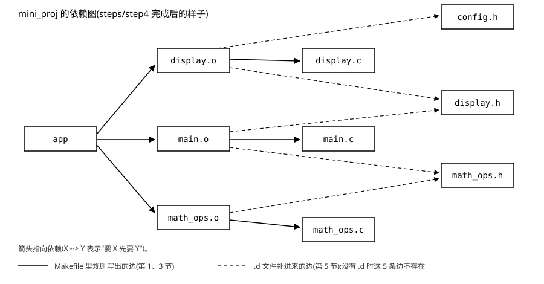
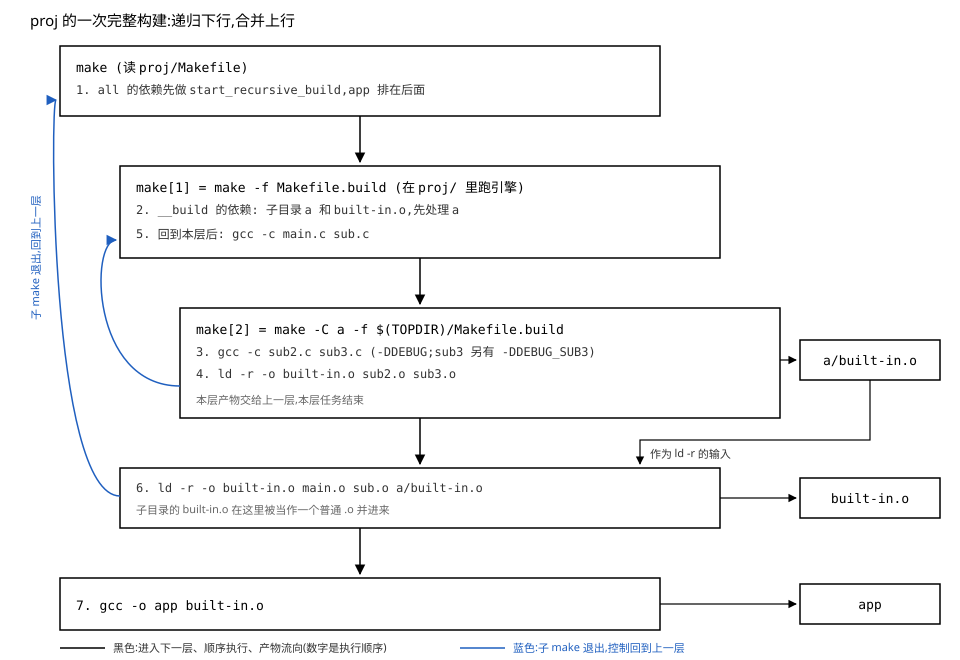

# 03 Makefile 的使用

    实验    Knowledge/labs/03_makefile/
              mini_proj/      六个源文件的小工程，steps/ 下是 step0～step4
                              五个中间形态，mini_proj/Makefile 是最终形态
              stale/          只重编一半会编出什么（第 5.2 节）
              phony/ vars/ funcs/   规则、变量、函数的小实验
              proj/           多目录递归构建（第 7 节）
              check.sh        全部判据，从源码重建后逐条核对
    电脑    WSL Ubuntu 26.04，GNU Make 4.4.1，gcc 15.2.0，
            arm-linux-gnueabihf-gcc 15.2.0
            （本篇"本机实测"均为 2026-10-20 实跑）
    板子    本篇不上板

---

**读前须知**：需要 [02 GCC 编译器的使用](./02_GCC编译器的使用.md) 的底子，具体是这几条：

- 分开编再链接的三条命令（02 篇 5.3 节）：本篇第 1 节把它们原样写成规则，
  make 要判断的就是"这三条里哪几条需要重跑"
- `-MD` 生成的 `.d` 依赖文件（02 篇 5.4 节）：本篇第 5 节让 make 把它读回来
- `.o` 是还没填完空洞的可重定位文件，链接器负责把它们拼起来（02 篇 4.3、4.4、
  5.1 节）：第 7 节的 `ld -r` 只做拼接这一半
- 交叉编译器只是换了名字（01 篇 2.3 节）：第 6 节靠一个前缀变量切换工具链
- 退出码与 `$?`（01 篇 1.3 节）：本篇看 make 成败也靠它

make 的写法有很多条目，本篇只就地讲主线用到的那些。想查全表时翻
[fundamentals/06 make 的语法与函数](../../fundamentals/06_make的语法与函数.md)，
不读它也能顺着正文走。

**这一章在整机里的位置**：上接 02 篇，下接 04 篇（文件 IO）。02 篇把
`gcc hello.c -o hello` 拆成了四步，又在多文件时拆成"分开编、再链接"三条命令，
留下一个问题：改了某个文件之后，三条命令里哪几条要重跑。本章把这个判断交给 make。
从 04 篇起每一章的实验、`Project/` 的整套构建、各个 `check.sh` 里的构建段，用的都是
本章的东西。

**不学它会怎样**：手敲 gcc 迟早漏掉一个文件；改了头文件里的结构体定义，make
却只重编了一半的 `.o`，程序编译零警告、运行时字段错位（第 5.2 节当场复现）；
在 Makefile 里多敲一个 TAB，某个 `.o` 从此再也不会生成（第 5.4 节）；用
`wildcard` 收集源文件后删掉一个 `.c`，它的 `.o` 永远留在目录里，`make clean`
也清不掉（第 4.4 节）。这四件事都不报错或者报得很远，查起来很费时间。

## 0 起点

02 篇 5.3 节最后手里有三条命令：

```bash
gcc -c -o main.o main.c
gcc -c -o sub.o  sub.c
gcc -o test main.o sub.o
```

分开编的好处是改了 `main.c` 只需重跑第一条和第三条，`sub.o` 直接复用。代价是
每次都要有人判断"哪几条需要重跑"。两个文件时人还能判断，几十个文件、几十个头文件
交叉 include 时，人一定会判断错，而判断错的后果是新旧 `.o` 拼成一个程序。

本章要做的事：**让机器来做这个判断，并且判断得对。** 先看终点。本章的小工程
`mini_proj` 在最终形态下连续做四件事，本机实测：

```text
$ make
gcc -O2 -Wall -Wextra -MMD -c -o display.o display.c
gcc -O2 -Wall -Wextra -MMD -c -o main.o main.c
gcc -O2 -Wall -Wextra -MMD -c -o math_ops.o math_ops.c
gcc display.o main.o math_ops.o -o app
$ make
make: 'app' is up to date.
$ touch config.h && make
gcc -O2 -Wall -Wextra -MMD -c -o display.o display.c
gcc display.o main.o math_ops.o -o app
$ make CROSS=arm-linux-gnueabihf-       （先 make clean）
arm-linux-gnueabihf-gcc -O2 -Wall -Wextra -MMD -c -o display.o display.c
...
```

第一次全编，第二次什么都不做，碰一下头文件 `config.h` 恰好只重编用到它的
`display.c`，命令行给一个前缀就换成交叉编译。读完本章，你应该能解释这四次的
每一行为什么出现、为什么没出现别的行，并且能从零写出这份 Makefile。路线是：

    第 1 节  把三条命令写成规则；make 凭什么判断要不要重跑
    第 2 节  clean 这类"不生成文件"的目标会遇到什么问题
    第 3 节  规则太啰嗦：变量、模式规则、自动变量
    第 4 节  加一个源文件还得改 Makefile：wildcard 与几个函数
    第 5 节  改了头文件却不重编：让 gcc 算出依赖，make 读回来
    第 6 节  同一份 Makefile 给板子编：工具链前缀变量
    第 7 节  多层目录：内核那种递归构建是怎么搭起来的
    第 8 节  对照 Project/Makefile，看这些写法在真实工程里的样子

每一节的 Makefile 都在 `Knowledge/labs/03_makefile/mini_proj/steps/` 下有对应的
一份（step0 到 step4），最终形态是 `mini_proj/Makefile`。照着一步一步做，每一步都
能单独运行、单独验证。

---

## 1 把三条命令交给 make：规则与时间戳

### 1.1 实验工程 mini_proj

本篇的主线工程在 `Knowledge/labs/03_makefile/mini_proj/`，六个源文件，比 02 篇的
三文件工程多了一层头文件关系，后面第 5 节要靠它：

```c
/* main.c */
#include <stdio.h>
#include "math_ops.h"
#include "display.h"

int main(void)
{
    printf("1 + 2 = %d\n", add(1, 2));
    print_banner();
    return 0;
}
```

```c
/* math_ops.h */                 /* math_ops.c */
int add(int a, int b);           #include "math_ops.h"

                                 int add(int a, int b)
                                 {
                                     return a + b;
                                 }
```

```c
/* display.h */
void print_banner(void);

/* config.h */
#define BANNER_TEXT "hello, makefile"

/* display.c */
#include <stdio.h>
#include "config.h"
#include "display.h"

void print_banner(void)
{
    printf("%s\n", BANNER_TEXT);
}
```

（文件里还有几行注释，这里省掉。）关系如下：`main.c` 调用 `add` 和
`print_banner`，两者的声明分别在 `math_ops.h`、`display.h`；`display.c` 打印的那串字
来自 `config.h` 里的宏 `BANNER_TEXT`。宏在预处理时被原样替换进 `display.c`
（02 篇 2.3 节），所以 `config.h` 一改，受影响的只有 `display.o`。画成谁 include
了谁：

```
 main.c ------> math_ops.h <------ math_ops.c
   |
   +----------> display.h  <------ display.c
                                      |
                config.h   <----------+
```

箭头的意思是"左边 include 了右边"。记住 `config.h` 只被 `display.c` 用到这一点，
第 5 节整节都围绕它。

**这一节搭好的积木**：一个六文件的工程，三个 `.c` 各自编成 `.o` 再链接成 `app`。
接下来的问题：怎么把"编它"这件事写给 make。

### 1.2 最笨的写法：一条规则编全部

先写一个能用的版本，`steps/step0/Makefile`：

```make
app: main.c math_ops.c display.c math_ops.h display.h config.h
	gcc -o app main.c math_ops.c display.c

clean:
	rm -f app

.PHONY: clean
```

（文件开头还有三行以 `#` 开头的注释，Makefile 里 `#` 到行尾是注释。`clean` 和
`.PHONY` 两段第 2 节讲，这里先看前两行。）

第一行的格式是 `目标: 依赖1 依赖2 ...`。冒号左边的 `app` 是要生成的文件，叫
**目标**；冒号右边是生成它要用到的文件，叫**依赖**。第二行是生成目标的命令，
交给 shell 执行。目标、依赖、命令三样合在一起叫一条**规则**。Makefile 里一切
写法最终都是为了写出规则，这是唯一的原子。

在 `mini_proj` 目录下运行。`-f` 指定读哪个文件作为 Makefile，不给时 make 读当前
目录下名叫 `Makefile` 的文件：

```bash
cd Knowledge/labs/03_makefile/mini_proj
make -f steps/step0/Makefile          # 第一次
make -f steps/step0/Makefile          # 紧接着再来一次
touch display.c                       # 只碰一下 display.c
make -f steps/step0/Makefile
```

- `touch display.c`：不改文件内容，只把它的修改时间刷新成现在。为什么要这样做，
  1.5 节就是答案。

本机实测：

```text
$ make -f steps/step0/Makefile
gcc -o app main.c math_ops.c display.c
$ make -f steps/step0/Makefile
make: 'app' is up to date.
$ touch display.c
$ make -f steps/step0/Makefile
gcc -o app main.c math_ops.c display.c
```

逐行读：

1. 第一次，make 把命令打印出来再执行它（make 默认先回显命令）。
2. 第二次，make 说 `app` 已经是最新的，什么都没做。make 已经能判断"要不要重跑"了。
3. 碰了一下 `display.c` 之后，make 又执行了那条命令。可这条命令编的是**全部三个**
   `.c`：`main.c` 和 `math_ops.c` 没有任何变化，也被从头再编了一遍。

问题出在命令只有一条。make 只能决定"这条命令跑不跑"，没法只跑它的三分之一。
想要"只重编改过的那个文件"，就得把编每个文件写成单独的命令，也就是 02 篇的
分开编。

**这一节搭好的积木**：规则 = 目标 + 依赖 + 命令；make 能判断一条规则要不要执行，
但执行的粒度是整条命令。接下来的问题：命令前面那个缩进有什么讲究。

### 1.3 命令前面必须是 TAB

规则的第二行开头那个缩进，必须是一个 TAB 字符（键盘上的 Tab 键，ASCII 码 9），
不能是空格。用 `printf` 造一个用四个空格缩进的 Makefile 看看：

```bash
mkdir -p /tmp/tabtest && cd /tmp/tabtest
printf 'all:\n    echo hi\n' > Makefile     # 命令前是四个空格
make; echo "exit=$?"
cat -A Makefile
```

- `printf 'all:\n    echo hi\n'`：`\n` 是换行，第二行开头是四个空格。
- `cat -A`：把不可见字符显出来。TAB 显示成 `^I`，行尾显示成 `$`。

本机实测：

```text
Makefile:2: *** missing separator.  Stop.
exit=2
all:$
    echo hi$
```

`Makefile:2` 指出第 2 行，`missing separator` 是 make 读不懂这一行的写法。原因是
make 读 Makefile 时，靠"行首是不是 TAB"来区分"这是上一条规则的命令"和"这是
一条新的语句"。第 2 行以空格开头，不是命令；作为语句它既不是规则（没有冒号）也
不是赋值（没有等号），make 找不到能分隔它的符号，报 missing separator，退出码 2。
`cat -A` 证实第 2 行开头没有 `^I`。

把空格换回 TAB，顺便看一个前缀：

```bash
printf 'all:\n\techo hi\n\t@echo quiet\n' > Makefile    # \t 是 TAB
make
```

```text
echo hi
hi
quiet
```

第一条命令被 make 回显了一行 `echo hi`，然后才是它的输出 `hi`；第二条命令前面
加了 `@`，make 不回显，只剩输出 `quiet`。`@` 只是让屏幕清爽，不改变命令本身。

很多编辑器默认把 TAB 转成空格，写 Makefile 时要单独设成保留 TAB。

**这一节搭好的积木**：命令行以 TAB 开头，空格会得到 `missing separator`；
`@` 开头的命令不回显。接下来回到 1.2 节的问题：把编译拆成每个文件一条规则。

### 1.4 拆成四条规则：make 沿着依赖往下找

`steps/step1/Makefile`，就是把 02 篇那三条命令原样搬进来（本工程是三个 `.c`，
所以是三条编译加一条链接）：

```make
app: main.o math_ops.o display.o
	gcc -o app main.o math_ops.o display.o

main.o: main.c
	gcc -c -o main.o main.c

math_ops.o: math_ops.c
	gcc -c -o math_ops.o math_ops.c

display.o: display.c
	gcc -c -o display.o display.c

clean:
	rm -f app main.o math_ops.o display.o

.PHONY: clean
```

和 step0 比，`app` 的依赖从 `.c` 变成了 `.o`，而每个 `.o` 又各有一条规则说明它
从哪个 `.c` 来。运行：

```bash
make -f steps/step1/Makefile
./app
make -f steps/step1/Makefile
touch display.c
make -f steps/step1/Makefile
```

本机实测：

```text
$ make -f steps/step1/Makefile
gcc -c -o main.o main.c
gcc -c -o math_ops.o math_ops.c
gcc -c -o display.o display.c
gcc -o app main.o math_ops.o display.o
$ ./app
1 + 2 = 3
hello, makefile
$ make -f steps/step1/Makefile
make: 'app' is up to date.
$ touch display.c
$ make -f steps/step1/Makefile
gcc -c -o display.o display.c
gcc -o app main.o math_ops.o display.o
```

第三次 make 只重编了 `display.o`，再重新链接；`main.o`、`math_ops.o` 没动。这正是
02 篇 5.3 节想要的效果。

make 是怎么走出这个顺序的？它不带参数运行时，要生成的是文件里**第一条规则的
目标**，这里是 `app`（`clean` 写在后面，不会被默认执行）。然后它递归地处理依赖：

```
 make app
   |
   +-- need main.o     --> rule "main.o: main.c"         check main.c
   +-- need math_ops.o --> rule "math_ops.o: math_ops.c" check math_ops.c
   +-- need display.o  --> rule "display.o: display.c"   check display.c
   |
   +-- all three ready --> decide whether to run "gcc -o app ..."
```

从上往下读：要 `app`，先要它的三个依赖；每个依赖本身又是另一条规则的目标，于是
先去处理那条规则；三个 `.o` 都处理完，才回来决定 `app` 自己的命令跑不跑。依赖
是一张图，make 从目标出发沿着图往下走到底（`.c` 文件没有规则，是图的叶子），再
从叶子往回逐层决定每条命令跑不跑。

第一次运行时三个 `.o` 都不存在，所以三条编译全跑，`app` 也不存在，链接也跑。
第三次运行时只有 `display.o` 被重编，说明 make 判断出了"`display.c` 变了而另外
两个没变"。它是怎么看出来的？

**这一节搭好的积木**：每个 `.o` 一条规则，make 从第一个目标出发沿依赖图递归，
叶子处理完再逐层往回决定。接下来的问题：make 凭什么判断 `display.c` "变了"。

### 1.5 make 只比修改时间

每个文件都带着一个**修改时间**（mtime）：文件内容最后一次被写入的时刻，由文件
系统记录。`stat` 能把它打出来。先完整 make 一次，再看三个文件的修改时间
（`TZ=UTC0` 让时间按 UTC 显示，免得时区干扰阅读）：

```bash
make -f steps/step1/Makefile
TZ=UTC0 stat -c '%y %n' main.c main.o app
touch display.c
TZ=UTC0 stat -c '%y %n' display.c display.o
```

- `stat -c '%y %n'`：`-c` 后面是输出格式；`%y` 是修改时间，`%n` 是文件名。

本机实测：

```text
2026-10-20 19:18:27.405704721 +0000 main.c
2026-10-20 19:18:27.441704717 +0000 main.o
2026-10-20 19:18:27.725704685 +0000 app
2026-10-20 19:18:27.733704685 +0000 display.c
2026-10-20 19:18:27.465704715 +0000 display.o
```

前三行：`main.c` 早于 `main.o`（`.o` 是从 `.c` 编出来的，当然更晚），`main.o` 早于
`app`。后两行：`touch` 之后 `display.c` 的时间（.733）晚于 `display.o`（.465）。
时间精确到纳秒，小数点后九位。

make 的判断规则只有一句：**目标文件不存在，或者任何一个依赖文件的修改时间比
目标新，就执行这条规则的命令；否则不执行。** make 自己能把判断过程说出来，`-d`
打开调试输出，`grep` 只留下比较时间的那些行：

```bash
make -d -f steps/step1/Makefile | grep -E 'newer|older|Must remake|No need'
```

- `make -d`：打印 make 做每个决定的理由，输出很长，所以用 grep 过滤。
- `grep -E 'a|b'`：留下含 a 或含 b 的行。

本机实测（紧接着上面的 `touch display.c`）：

```text
 No need to remake target 'steps/step1/Makefile'.
  No need to remake target 'main.c'.
  Prerequisite 'main.c' is older than target 'main.o'.
 No need to remake target 'main.o'.
  No need to remake target 'math_ops.c'.
  Prerequisite 'math_ops.c' is older than target 'math_ops.o'.
 No need to remake target 'math_ops.o'.
  No need to remake target 'display.c'.
  Prerequisite 'display.c' is newer than target 'display.o'.
 Must remake target 'display.o'.
 Prerequisite 'main.o' is older than target 'app'.
 Prerequisite 'math_ops.o' is older than target 'app'.
 Prerequisite 'display.o' is newer than target 'app'.
Must remake target 'app'.
```

逐行读：

1. 第一行是 make 先检查 Makefile 自己要不要重新生成（它也能是某条规则的目标），
   这里不用管。
2. `Prerequisite 'main.c' is older than target 'main.o'`：依赖（prerequisite）
   比目标旧，所以 `No need to remake target 'main.o'`。`math_ops.o` 同理。
3. `'display.c' is newer than target 'display.o'`：依赖比目标新，
   `Must remake target 'display.o'`。这就是 `stat` 里 .733 和 .465 的比较。
4. 回到 `app`：`display.o` 刚刚重编过，比 `app` 新，于是 `app` 也要重新链接。
   一个叶子变了，影响会沿依赖图一直往上传到最顶上的目标。

缩进的层数就是 1.4 节那张图的深度：`app` 在最外层，`.o` 缩进一格，`.c` 缩进两格。

容易以为 make 会看文件内容有没有变；实测它只比时间。两个实验各说明一半：

```bash
touch -d '2000-01-01' main.c                # 把 main.c 的时间改到 2000 年
make -f steps/step1/Makefile
cp math_ops.c /tmp/m.bak
sed -i 's/a + b/b + a/' math_ops.c          # 改一个字再改回来
make -f steps/step1/Makefile
cp /tmp/m.bak math_ops.c
make -f steps/step1/Makefile
```

- `touch -d '日期'`：把修改时间设成指定的时刻，而不是现在。
- `sed -i 's/旧/新/' 文件`：在文件里把第一处"旧"替换成"新"，`-i` 表示直接改文件。

本机实测：

```text
$ touch -d '2000-01-01' main.c
$ make -f steps/step1/Makefile
make: 'app' is up to date.
$ sed -i 's/a + b/b + a/' math_ops.c; make -f steps/step1/Makefile
gcc -c -o math_ops.o math_ops.c
gcc -o app main.o math_ops.o display.o
$ cp /tmp/m.bak math_ops.c; make -f steps/step1/Makefile
gcc -c -o math_ops.o math_ops.c
gcc -o app main.o math_ops.o display.o
```

第一组：`main.c` 的时间被改得比 `main.o` 早，哪怕你刚刚真改过它的内容，make 也
认为它没变。第二组：内容改了又改回来，和最初一模一样，make 照样重编了两次，因为
每次写文件都刷新了修改时间。

只比时间的好处是快：判断几万个文件只需要几万次 `stat`，不用读任何文件内容。代价
就是上面两种"判断错"，但这两种在正常编辑中很少出现：编辑器保存文件时总会把时间
刷新成现在。真想按内容判断，可以在 gcc 前面加一层缓存工具 ccache（本机已装，
`/usr/bin/ccache`），它按源码内容的哈希查找上一次的 `.o`，那是 gcc 那一层的事，
make 还是只比时间。

这里有一个前提：电脑的时钟不能乱跳。make 只关心"谁比谁新"，如果一个文件的时间
比现在还晚（例如从别的机器拷来的），比较结果就会出乎意料。本仓的 `check.sh` 都先
把工程复制到 `mktemp -d` 建的临时目录再构建，复制出来的文件时间统一是复制那一刻，
不受仓库里原有时间的影响。

**这一节搭好的积木**：make 的判断依据只有修改时间：目标不存在，或任一依赖比目标
新，就执行命令；影响沿依赖图往上传。接下来的问题：不想生成 `app`，只想生成某一个
`.o`，或者只想看看 make 打算做什么，该怎么办。

### 1.6 指定目标与预演：make 目标名、make -n

`make` 后面可以跟一个目标名，指定这次生成谁：

```bash
make -f steps/step1/Makefile clean          # 先清干净
make -f steps/step1/Makefile math_ops.o     # 只要 math_ops.o
ls
make -n -f steps/step1/Makefile             # 预演
ls
```

- `make math_ops.o`：不再默认生成第一个目标，只生成 `math_ops.o` 以及它依赖的东西。
- `make -n`：把将要执行的命令打印出来，但一条都不执行。

本机实测：

```text
$ make -f steps/step1/Makefile clean
rm -f app main.o math_ops.o display.o
$ make -f steps/step1/Makefile math_ops.o
gcc -c -o math_ops.o math_ops.c
$ ls
Makefile  config.h  display.c  display.h  main.c  math_ops.c  math_ops.h  math_ops.o  steps
$ make -n -f steps/step1/Makefile
gcc -c -o main.o main.c
gcc -c -o display.o display.c
gcc -o app main.o math_ops.o display.o
$ ls
Makefile  config.h  display.c  display.h  main.c  math_ops.c  math_ops.h  math_ops.o  steps
```

（`ls` 的输出原本一行一个，这里并成一行。）`make math_ops.o` 只执行了一条命令，
目录里只多出 `math_ops.o`。`make -n` 列出的计划里没有编 `math_ops.o`，因为它已经
存在且比 `math_ops.c` 新；预演之后再 `ls`，`main.o`、`display.o`、`app` 都没出现，
证明命令确实没执行。`-n` 是排查 Makefile 的第一个工具：改完 Makefile 先预演，看
make 打算做的事是不是你想要的。

### 1.7 [判] 第 1 节

    [ ] step0:首次只有 1 条命令;再 make 是 up to date;touch display.c 后
        那 1 条命令又跑一遍(三个 .c 全编)
    [ ] step1:首次 4 条 gcc;运行输出 1 + 2 = 3 / hello, makefile
    [ ] step1:再 make 是 up to date;touch display.c 后恰好 1 条 gcc -c,
        编的是 display.c
    [ ] touch -d '2000-01-01' main.c 后 make 仍是 up to date
    [ ] 空格缩进报 missing separator
    [ ] make math_ops.o 之后目录里只有 math_ops.o 一个 .o

    注错见红:把 step0 第一行依赖里的 display.c 删掉,
    "touch 一个文件,三个 .c 全部重编"那条必须 FAIL
    (make 不再知道 app 依赖 display.c,touch 之后回答 up to date)。

这些判据都在 `Knowledge/labs/03_makefile/check.sh` 里，`bash check.sh` 从源码重建
后逐条核对。

**第 1 节搭好的积木**：规则是唯一的原子；make 从默认目标（第一条规则的目标）出发
沿依赖图递归，只按修改时间决定每条命令跑不跑。接下来的问题：step1 里那条 `clean`
规则没有依赖、也不生成名叫 `clean` 的文件，按"目标不存在就执行"它每次都会执行，
这有没有漏洞。

---

## 2 动作目标：clean 与 .PHONY

### 2.1 clean 为什么每次都会执行

step1 里的 `clean` 规则：

```make
clean:
	rm -f app main.o math_ops.o display.o
```

- `rm -f`：删除文件；`-f` 让它在文件不存在时也不报错，所以连续 `make clean` 两次
  不会失败。

这条规则冒号右边是空的，没有依赖；命令执行后也不会生成一个叫 `clean` 的文件。按
1.5 节的判断规则，"目标文件不存在"每次都成立，所以每次 `make clean` 命令都会执行。
它利用的是规则的执行条件，本身并不生成文件。这种目标叫**动作目标**：名字代表一个
动作，而不是一个要生成的文件。

### 2.2 目录里出现一个叫 clean 的文件

既然靠的是"`clean` 这个文件不存在"，那它要是存在呢？`labs/03_makefile/phony/`
下的 Makefile 有两个动作目标：

```make
all:
	@echo build done

clean:
	@echo cleaning

.PHONY: all clean
```

为了看清最后一行的作用，先用 `grep -v` 生成一份去掉它的副本，再在目录里造一个
名叫 `clean` 的空文件：

```bash
cd Knowledge/labs/03_makefile/phony
grep -v PHONY Makefile > /tmp/nophony.mk    # 去掉 .PHONY 那一行
make -f /tmp/nophony.mk clean
touch clean                                 # 造一个名叫 clean 的文件
make -f /tmp/nophony.mk clean
```

- `grep -v PHONY`：输出所有不含 `PHONY` 的行，也就是把最后一行去掉。

本机实测：

```text
$ make -f /tmp/nophony.mk clean
cleaning
$ touch clean
$ make -f /tmp/nophony.mk clean
make: 'clean' is up to date.
```

有了 `clean` 文件之后，命令不执行了。按 1.5 节的规则逐条对：目标文件 `clean`
存在，"不存在"不成立；规则没有依赖，"有依赖比目标新"也不成立。两个条件都不满足，
make 就认为 `clean` 已经是最新的。真实工程里要是有人恰好建了一个叫 `clean`、`all`
或 `test` 的文件或目录，对应的动作就会悄悄失效，而 make 的回答看起来完全正常。

### 2.3 .PHONY：告诉 make 这个目标不是文件

正解是明确告诉 make：这个名字不代表文件，不要去看同名文件的时间，每次都执行。
写法就是 phony/Makefile 最后那一行：

```make
.PHONY: all clean
```

`.PHONY` 是 make 认识的一个特殊目标名，列在它冒号右边的目标叫**假想目标**
（phony target）。目录里的 `clean` 文件还在，换回原 Makefile：

```bash
make clean
rm clean
```

```text
$ make clean
cleaning
```

命令照常执行。本仓的约定：所有动作目标（`all`、`clean`、`test`、`show`……）都
写进 `.PHONY`。`Project/Makefile` 第 76 行就是这样一行。

**第 2 节搭好的积木**：没有依赖、不生成文件的目标靠"目标不存在"每次执行；同名
文件一出现它就失效；`.PHONY` 声明它不是文件，从此无条件执行。接下来的问题：
step1 能用了，可每加一个源文件就要多写一条几乎一样的规则，这些重复能不能消掉。

---
## 3 把规则写短：变量、模式规则、自动变量

### 3.1 四条规则里重复的是什么

把 step1 的三条编译规则排在一起看：

```
main.o:     main.c       gcc -c -o main.o     main.c
math_ops.o: math_ops.c   gcc -c -o math_ops.o math_ops.c
display.o:  display.c    gcc -c -o display.o  display.c
            ^^^^^^^^^^             ^^^^^^^^^^ ^^^^^^^^^^
            same stem              same stem  same stem
```

三条规则除了文件名的主干（main、math_ops、display，叫**词干**）不同，其余一字不差。
重复的有两类：

1. 命令里固定的碎片：`gcc`、以后要加的编译选项。想加 `-Wall` 得改三处，想换交叉
   编译器也得改三处（链接那条再加一处）。
2. 规则的形状：每条都是"`X.o` 依赖 `X.c`，命令是用 `X.c` 编出 `X.o`"。

第一类用**变量**消掉，第二类用**模式规则**消掉。

### 3.2 变量：把重复的碎片提出来

`steps/step2/Makefile` 的前三行：

```make
CC     := gcc
CFLAGS := -O2 -Wall -Wextra
OBJS   := main.o math_ops.o display.o
```

`名字 := 值` 定义一个变量；以后在任何地方写 `$(名字)`，make 就把它替换成值。
这里定义了三个：

- `CC`：编译器的命令名。这个名字是约定俗成的（3.4 节会看到 make 自己内置的规则也
  用它），换交叉编译器时只改这一处。
- `CFLAGS`：编译选项。`-O2` 开优化，`-Wall -Wextra` 开警告（01 篇 1.1 节）。
- `OBJS`：全部 `.o` 的清单，链接规则要用两次。

`$(名字)` 的括号可以换成花括号 `${名字}`；变量名只有一个字符时括号可以省掉，
`$A` 等于 `$(A)`。多于一个字符时不能省，在临时目录里试一下：

```make
C := one
CC := gcc
all:
	@echo [$CC] [${CC}] [$(CC)]
```

```text
[oneC] [gcc] [gcc]
```

`$CC` 被读成了单字符变量 `$C`（值 `one`）后面跟一个普通字母 `C`。本仓一律写括号。

变量名区分大小写。定义的符号有好几种，`:=` 只是其中一种，它们的差别在 3.5 节讲；
在那之前所有例子都用 `:=`。

### 3.3 模式规则 %.o: %.c 与三个自动变量

step2 剩下的部分：

```make
app: $(OBJS)
	$(CC) $(OBJS) -o $@

%.o: %.c
	$(CC) $(CFLAGS) -c -o $@ $<

clean:
	rm -f app $(OBJS)

.PHONY: clean
```

三条编译规则塌缩成了中间那一条：

```make
%.o: %.c
	$(CC) $(CFLAGS) -c -o $@ $<
```

`%` 是一个通配符，匹配任意一段文字。这条规则叫**模式规则**，意思是"任何一个
`词干.o`，都依赖同一个词干的 `词干.c`"。make 需要生成 `display.o`、又找不到专门
写给 `display.o` 的规则时，就拿 `display.o` 去套 `%.o`：

```
 need display.o
   |
   v
 match pattern %.o        --> % = "display"
   |
   v
 prerequisite %.c         --> display.c
   |
   v
 recipe: $@ = display.o   $< = display.c
         gcc -O2 -Wall -Wextra -c -o display.o display.c
```

先套目标得出词干，再把同一个词干代进依赖，最后把命令里的两个特殊记号换掉。这两个
记号不用定义就有值，是 make 在执行每条规则时自动填好的，叫**自动变量**。主线用到三个：

    $@   这条规则的目标
    $<   第一个依赖
    $^   全部依赖(重复的只留一个)

在 `%.o: %.c` 里，目标是 `display.o`，依赖只有 `display.c` 一个，于是 `$@` 是
`display.o`、`$<` 是 `display.c`。模式规则必须用自动变量，因为写规则时还不知道
文件名是什么。

链接规则 `app: $(OBJS)` 的命令里也用了 `$@`，它就是 `app`。这条命令把 `$(OBJS)`
写了第二遍，也可以写成 `$^`（全部依赖），效果一样；step2 保留写法是为了和 step1
逐字对照。

**编译用 `$<`，链接用 `$^`**，这是本仓的一条纪律。编译一次只吃一个 `.c`；链接
要把全部 `.o` 一起交给 gcc。现在这条纪律还看不出必要性，因为编译规则只有一个依赖，
`$<` 和 `$^` 相同。第 5.9 节会看到依赖列表里混进 `.h` 之后，误用 `$^` 会直接报错。

运行：

```bash
make -f steps/step2/Makefile
make -f steps/step2/Makefile
```

本机实测：

```text
$ make -f steps/step2/Makefile
gcc -O2 -Wall -Wextra -c -o main.o main.c
gcc -O2 -Wall -Wextra -c -o math_ops.o math_ops.c
gcc -O2 -Wall -Wextra -c -o display.o display.c
gcc main.o math_ops.o display.o -o app
$ make -f steps/step2/Makefile
make: 'app' is up to date.
```

make 回显的是**替换之后**的命令：`$(CC)` 已经变成 `gcc`，`$@`、`$<` 已经变成具体的
文件名。三条编译命令由同一条模式规则产生，词干各不相同。顺序是 `OBJS` 里列的顺序：
make 按依赖列表从左到右处理。

**这一节搭好的积木**：变量消掉命令里的重复碎片；模式规则 `%.o: %.c` 加自动变量
`$@` `$<` 消掉规则形状的重复。接下来的问题：如果连这条模式规则都不写，会怎样。

### 3.4 不写编译规则，make 也会编：内建规则

在临时目录里放进 mini_proj 的源文件，写一个**只有链接规则**的 Makefile：

```bash
mkdir -p /tmp/bi
cp *.[ch] /tmp/bi/               # 在 mini_proj 目录下执行
cd /tmp/bi
printf 'app: main.o math_ops.o display.o\n\tgcc -o $@ $^\n' > Makefile
cat Makefile
make
```

- `*.[ch]`：shell 通配，匹配所有以 `.c` 或 `.h` 结尾的文件。

本机实测：

```text
$ cat Makefile
app: main.o math_ops.o display.o
	gcc -o $@ $^
$ make
cc    -c -o main.o main.c
cc    -c -o math_ops.o math_ops.c
cc    -c -o display.o display.c
gcc -o app main.o math_ops.o display.o
```

三个 `.o` 也编出来了，命令是 `cc    -c -o main.o main.c`，这不是我们写的。make 自带
一批**内建规则**，找不到给 `main.o` 的规则时，就用内建的那条。用 `-p` 把它们问出来：

```bash
make -p -f /dev/null 2>/dev/null | grep -A2 -E '^%\.o: %\.c$'
make -p -f /dev/null 2>/dev/null | grep -E '^(COMPILE\.c|OUTPUT_OPTION|CC) '
```

- `make -p`：打印 make 知道的全部规则和变量，包括内建的。
- `-f /dev/null`：拿一个空文件当 Makefile，这样打印出来的全是内建的。
- `grep -A2`：匹配行之后再多带 2 行。

本机实测：

```text
%.o: %.c
#  recipe to execute (built-in):
	$(COMPILE.c) $(OUTPUT_OPTION) $<
COMPILE.c = $(CC) $(CFLAGS) $(CPPFLAGS) $(TARGET_ARCH) -c
OUTPUT_OPTION = -o $@
CC = cc
```

内建规则也是一条普通的模式规则 `%.o: %.c`，命令由几个变量拼成。把它展开：
`$(COMPILE.c)` 是 `$(CC) $(CFLAGS) $(CPPFLAGS) $(TARGET_ARCH) -c`；`CC` 的内建值是
`cc`（本机 `readlink -f $(which cc)` 得到 `/usr/bin/x86_64-linux-gnu-gcc-15`，就是 gcc），`CFLAGS`、`CPPFLAGS`、`TARGET_ARCH` 都没定义，
展开成空，各留下一个空格；`$(OUTPUT_OPTION)` 是 `-o $@`。拼起来正好是
`cc    -c -o main.o main.c`，中间那几个空格就是三个空变量留下的。

这说明了 `CC`、`CFLAGS` 这两个名字为什么是约定：内建规则就用它们。在命令行写
`make CFLAGS=-O2`，连内建规则的行为也跟着变。工程里自己写了 `%.o: %.c`，就盖掉
内建的同名规则，step2 的输出里没有 `cc` 就是这个原因。本仓的 Makefile 都显式写
编译规则，不依赖内建规则：内建规则用的选项太少，而且要读者额外记住它的存在。

### 3.5 变量什么时候算出值：= 与 :=

3.2 节说了变量定义有好几种符号。最常用的两种是 `=` 和 `:=`，它们的差别只在一件
事上：右边的式子**什么时候**被算出来。`labs/03_makefile/vars/Makefile` 的前三行：

```make
A := $(C)
B = $(C)
C := abc
```

`A`、`B` 都引用 `C`，而 `C` 写在它们后面。打印三个变量的规则：

```make
all:
	@echo A=[$(A)]
	@echo B=[$(B)]
	@echo C=[$(C)]
	...（同样打印 D E X）
```

本机实测（`make` 在 vars 目录下运行）：

```text
A=[]
B=[abc]
C=[abc]
D=[first]
E=[first]
X=[abc def]
```

`A` 是空的，`B` 却是 `abc`。要解释这个差别，得先知道 make 的工作分两个阶段：

```
 phase 1: read the whole Makefile, top to bottom
 ------------------------------------------------
 line 12  A := $(C)    expand now: C undefined   -> A = ""
 line 13  B = $(C)     keep the text "$(C)"
 line 14  C := abc     C = "abc"

 phase 2: run the recipes of "all"
 ------------------------------------------------
 echo A=[$(A)]         A is already ""           -> A=[]
 echo B=[$(B)]         expand "$(C)" now         -> B=[abc]
```

第一阶段，make 从头到尾把整个 Makefile 读完，记下所有变量和规则，一条命令都不执行。
第二阶段，才按依赖图执行命令。

- `:=` 在**读到这一行的那一刻**就把右边算出来，以后不再变。`A := $(C)` 读到时 `C`
  还没定义，没定义的变量展开成空，于是 `A` 定死为空。这种变量叫**立即变量**。
- `=` 读到时只把右边的原文 `$(C)` 记下来，**每次用到它时**才去算。`B` 在第二阶段
  被 echo 用到时，`C` 早已是 `abc`。这种变量叫**延时变量**。

延时变量的一个直接用处：它的值可以引用到执行时才有的东西。vars/Makefile 里：

```make
VAL = $@
show:
	@echo VAL=[$(VAL)]
```

```text
$ make show
VAL=[show]
```

`$@` 只在执行某条规则时才有值。`VAL` 是延时的，在 `show` 的命令里被用到时才展开，
那时 `$@` 就是 `show`。在临时目录里写一个对照：

```make
A = $@
B := $@
test:
	@echo A=[$A] B=[$B]
```

```text
$ make -f /tmp/at.mk
A=[test] B=[]
```

`B := $@` 在读文件阶段就展开了，那时没有任何规则在执行，`$@` 是空的。这里顺便
用到了 3.2 节说的单字符变量省括号写法 `$A`。

延时变量的代价：它不能在定义里引用自己。`vars/selfref/Makefile` 只有三行：

```make
Y = $(Y) tail
all:
	@echo $(Y)
```

```text
$ make -C selfref
make: Entering directory '.../vars/selfref'
Makefile:4: *** Recursive variable 'Y' references itself (eventually).  Stop.
make: Leaving directory '.../vars/selfref'
```

（`-C 目录` 让 make 先切换到那个目录再工作，第 7.2 节细讲；行号 4 是因为文件前面
还有三行注释。）`Y` 用到时要展开 `$(Y) tail`，展开其中的 `$(Y)` 又得展开
`$(Y) tail`，没有尽头。make 检测到这个环，报错停下，退出码 2。改成 `Y := $(Y) tail`
就没事：立即变量在定义那一刻展开右边，那时的 `$(Y)` 是旧值（这里是空）。想在一个
变量原有值的基础上加长，要么用 `:=`，要么用下一节的 `+=`。

**规则的依赖列表属于哪个阶段？** 这一点第 7.9 节的一个坑要用到，这里先测清楚。
vars/Makefile 里：

```make
LIST = one
prereq: $(LIST)
	@echo prereq 展开成了 $^, 而 LIST 现在是 $(LIST)
LIST = two
```

`LIST` 是延时变量，先是 `one`，规则之后又改成 `two`。规则 `prereq` 的依赖到底是
`one` 还是 `two`：

```text
$ make prereq
make: *** No rule to make target 'one', needed by 'prereq'.  Stop.
$ touch one
$ make prereq
prereq 展开成了 one, 而 LIST 现在是 two
```

第一次报错说找不到 `one`，说明依赖已经是 `one`。造一个 `one` 文件后，命令里的
`$^`（全部依赖）是 `one`，而命令里的 `$(LIST)` 已经是 `two`。结论：**规则的依赖列表
在第一阶段读到那一行时就展开，命令在第二阶段才展开。** 所以变量即使是延时的，
用在依赖里也只能拿到"读到这条规则那一刻"的值。

**这一节搭好的积木**：make 先读完整个文件、再执行命令；`:=` 在读的时刻定值，
`=` 在用的时刻定值；规则的依赖在读的时刻展开，命令在执行时展开；延时变量不能
自引用。接下来的问题：另外两种赋值 `?=`、`+=`，以及命令行上给的变量谁说了算。

### 3.6 ?=、+= 与命令行赋值

vars/Makefile 的其余赋值：

```make
D := first
D ?= second
E ?= first

X := abc
X += def
```

对照 3.5 节输出里的 `D=[first] E=[first] X=[abc def]`：

- `?=`：只在这个变量**此前从没被定义过**时才赋值。`D` 已经是 `first`，`?= second`
  被忽略；`E` 之前没定义，`?= first` 生效。它的用处是给变量一个"缺省值"，允许别人
  在别处覆盖。
- `+=`：在原值后面追加，中间自动加一个空格。它沿用这个变量原来的种类：前面是 `:=`
  定义的，追加的部分也立即展开；前面是 `=` 定义的，追加的部分也延时展开（逐条实测见
  [fundamentals/06 第 2.1 节](../../fundamentals/06_make的语法与函数.md)）。

命令行上也能给变量赋值，写在 make 后面：

```bash
make D=cmdline
```

```text
A=[]
B=[abc]
C=[abc]
D=[cmdline]
E=[first]
X=[abc def]
```

文件里明明写着 `D := first`，打出来的却是 `cmdline`。**命令行赋值的优先级高于
文件里的普通赋值**，文件里的 `:=`、`=`、`?=` 都改不动它。第 6 节给板子编译就靠这
一条：Makefile 里写好本机的缺省值，换工具链时不改文件，在命令行上覆盖。

（环境变量也能给 make 提供变量，优先级在命令行和文件之下；文件里想反过来压住命令行
要用 `override`。这两条主线暂时用不到，实测见 fundamentals/06 第 2.3 节。）

### 3.7 [判] 第 2、3 节

    [ ] 有 .PHONY 时 make clean 输出 cleaning
    [ ] 去掉 .PHONY、目录里有 clean 文件时,输出 make: 'clean' is up to date.
    [ ] 补回 .PHONY 后照常执行
    [ ] step2 构建后运行输出 1 + 2 = 3
    [ ] 只写链接规则的 Makefile 也编得出三个 .o,命令是 cc    -c -o main.o main.c
    [ ] vars:A 为空,B 为 abc;D 为 first(?= 挡不住已定义),E 为 first,X 为 abc def
    [ ] make D=cmdline 后 D 为 cmdline
    [ ] make show 输出 VAL=[show]
    [ ] make prereq 先报 No rule to make target 'one';touch one 后输出
        "prereq 展开成了 one, 而 LIST 现在是 two"
    [ ] selfref 报 Recursive variable 'Y' references itself

    注错见红:把 vars/Makefile 第 12 行的 := 改成 =,
    "A := $(C) 定义时 C 还是空"那条必须 FAIL(A 变成 abc)。

**第 3 节搭好的积木**：变量收住重复的碎片，模式规则加自动变量收住重复的规则；
变量有"读的时刻"和"用的时刻"两种定值方式，命令行赋值压过文件。step2 的规则已经
不随文件数量增长了，可清单 `OBJS := main.o math_ops.o display.o` 还是手写的。接下来
的问题：加一个源文件，能不能连这一行都不改。

---

## 4 加文件不改 Makefile：wildcard

### 4.1 清单写死的代价

step2 里加一个 `extra.c`，要做两件事：写 `extra.c`，再把 `extra.o` 加进 `OBJS`。
忘了第二件，`extra.c` 根本不会被编译，链接时报 `undefined reference`（02 篇 5.3 节
那类报错），而报错指向的是调用它的地方，不是 Makefile。文件越多，这一行越容易漏。

清单的内容其实都在磁盘上：目录里有哪些 `.c`，`.o` 的清单就是把它们的后缀换掉。
让 make 去看目录就行。

### 4.2 wildcard 与替换引用

`steps/step3/Makefile` 只改了清单那一行，换成两行：

```make
SRCS := $(wildcard *.c)
OBJS := $(SRCS:.c=.o)
```

- `$(wildcard *.c)`：这是 make 的一个**函数**。函数的写法是 `$(函数名 参数)`，
  函数名和参数之间用空格隔开，多个参数之间用逗号隔开。`wildcard` 真的去访问磁盘，
  返回当前目录下所有匹配 `*.c` 的、**此刻存在**的文件名，用空格隔开。
- `$(SRCS:.c=.o)`：**替换引用**。取 `SRCS` 的值，把其中每个以 `.c` 结尾的词的结尾
  换成 `.o`。它等价于函数写法 `$(patsubst %.c,%.o,$(SRCS))`。

两行都用 `:=`：`wildcard` 访问磁盘，用 `=` 的话每次用到 `OBJS` 都要重新扫一遍目录。

`labs/03_makefile/funcs/` 里把这几个函数单独拿出来测。目录里真实存在 `a.c`、`b.c`、
`c.h`，没有 `ghost.c`。Makefile 的相关行：

```make
files := $(wildcard *.c)
ask   := $(wildcard a.c b.c ghost.c)

objs  := $(files:.c=.o)
objs2 := $(patsubst %.c,%.o,$(files) read.me)
```

本机实测（`make` 在 funcs 目录下运行，这里只摘这四行）：

```text
files = a.c b.c
ask = a.c b.c
objs = a.o b.o
objs2 = a.o b.o read.me
```

- `files`：`*.c` 收到 `a.c b.c`，`c.h` 不匹配，没收。
- `ask`：直接列了三个名字，`ghost.c` 不存在，被丢掉。`wildcard` 是"列出存在的"，
  不是"原样返回"。
- `objs`：后缀替换。
- `objs2`：`patsubst` 只替换**整个词**都匹配模式 `%.c` 的那些词，`read.me` 不匹配，
  原样保留。

step3 运行一次：

```text
$ make -f steps/step3/Makefile
gcc -O2 -Wall -Wextra -c -o display.o display.c
gcc -O2 -Wall -Wextra -c -o main.o main.c
gcc -O2 -Wall -Wextra -c -o math_ops.o math_ops.c
gcc display.o main.o math_ops.o -o app
```

和 step2 比，编译顺序变成了按字母排序（display、main、math_ops）：`wildcard` 返回的
是排好序的文件名，`OBJS` 跟着它排序。

### 4.3 [做 L2] 加一个 extra.c，不改 Makefile

在 mini_proj 里加一个文件，并让 `main.c` 调用它：

```bash
printf 'int mul(int a, int b) { return a * b; }\n' > extra.c
cp main.c /tmp/main.bak
sed -i 's/#include "display.h"/#include "display.h"\nint mul(int, int);/' main.c
sed -i 's/print_banner();/print_banner(); printf("3 * 4 = %d\\n", mul(3, 4));/' main.c
make -f steps/step3/Makefile
./app
```

- 第一条 `printf` 写出 `extra.c`，里面只有一个乘法函数。
- 两条 `sed` 改 `main.c`：在 `#include "display.h"` 后面加一行 `mul` 的声明（`\n` 是
  换行），在 `print_banner();` 后面加一句调用。
- 先把原来的 `main.c` 备份到 `/tmp/main.bak`，做完实验再拷回来。

本机实测：

```text
$ make -f steps/step3/Makefile
gcc -O2 -Wall -Wextra -c -o extra.o extra.c
gcc -O2 -Wall -Wextra -c -o main.o main.c
gcc display.o extra.o main.o math_ops.o -o app
$ ./app
1 + 2 = 3
hello, makefile
3 * 4 = 12
```

Makefile 一个字没改：`wildcard` 收到了新的 `extra.c`，`OBJS` 里多了 `extra.o`；
`extra.o` 不存在，所以编它；`main.c` 被 sed 改过、比 `main.o` 新，所以重编；
`display.o`、`math_ops.o` 不动。`./app` 多出了第三行。

### 4.4 wildcard 的三类代价

"目录里有什么就编什么"省掉了维护清单，也带来了三个新问题。

**代价一：删掉的源文件会留下孤儿产物。** 接着上面的实验，把 `extra.c` 删掉、
`main.c` 还原，再 `make clean`：

```bash
rm extra.c
cp /tmp/main.bak main.c
make -f steps/step3/Makefile clean
ls -A
```

- `ls -A`：列出目录内容，包括以 `.` 开头的隐藏文件（第 7 节的 `.d` 文件就是隐藏的）。

本机实测：

```text
$ make -f steps/step3/Makefile clean
rm -f app display.o main.o math_ops.o
$ ls -A
Makefile  config.h  display.c  display.h  extra.o  main.c  math_ops.c  math_ops.h  steps
```

`extra.o` 还在。`clean` 的命令是 `rm -f app $(OBJS)`，`OBJS` 由 `wildcard *.c` 算出；
`extra.c` 已经没了，`OBJS` 里也就没了 `extra.o`。clean 只删"现在的源文件对应的产物"，
曾经存在过的那些它不知道。孤儿 `.o` 平时无害，但下次有人重新加回一个同名的
`extra.c`，而它的修改时间恰好早于那个旧 `.o`（例如从备份里拷回来，保留了旧时间），
make 就会直接用那个旧 `.o`。

解决办法有两种：clean 不依赖清单，用 `find . -name '*.o'` 扫整个目录树（第 7 节
proj 的 clean 就这么写）；或者把全部产物放进一个单独的目录，clean 时整个删掉
（`Project/Makefile` 第 133～134 行 `rm -rf $(BUILD)` 就这么写）。

**代价二：误收一个带 main 的文件。** 有人在目录里放了一个自测用的小程序：

```bash
printf '#include <stdio.h>\nint main(void) { puts("test"); return 0; }\n' > t_add.c
make -f steps/step3/Makefile
```

本机实测：

```text
gcc -O2 -Wall -Wextra -c -o display.o display.c
gcc -O2 -Wall -Wextra -c -o main.o main.c
gcc -O2 -Wall -Wextra -c -o math_ops.o math_ops.c
gcc -O2 -Wall -Wextra -c -o t_add.o t_add.c
gcc display.o main.o math_ops.o t_add.o -o app
/usr/bin/x86_64-linux-gnu-ld.bfd: t_add.o: in function `main':
t_add.c:(.text.startup+0x0): multiple definition of `main'; main.o:main.c:(.text.startup+0x0): first defined here
collect2: error: ld returned 1 exit status
make: *** [steps/step3/Makefile:13: app] Error 1
```

（这次是 clean 之后从零编的，所以四个文件全编。）`wildcard` 把 `t_add.c` 也收了进来，
链接时出现两个 `main`。报错来自链接器，说的是"`main` 被定义了两次"，读的人得想到
是 Makefile 收多了文件。最后一行 `make: *** [steps/step3/Makefile:13: app] Error 1`
是 make 的报告：Makefile 第 13 行的命令（链接 `app` 那一条）失败了，gcc 退出码 1，make 就停下，
自己以退出码 2 结束。`Project/` 的做法是把单测放进不参与收集的 `unittest/` 目录
（`Project/Makefile` 第 28～33 行的注释写了原因）。

**代价三：废弃但没删的 `.c` 也会被编进去。** 道理同上，不再演示。

三类代价的共同点：`wildcard` 让"目录内容"变成了 Makefile 的一部分，目录里多什么、
少什么都会直接改变构建结果。所以用它的工程要守住目录：要参与构建的 `.c` 才放进
被收集的目录。

### 4.5 再认识几个函数：filter、foreach、if、shell

第 7 节的递归构建和第 8 节的 Project 还会用到几个函数。funcs/Makefile 的其余行：

```make
mixed := src/ include/ main.o
dirs  := $(filter %/,$(mixed))
plain := $(filter-out %/,$(mixed))

deps  := $(foreach f,$(objs),.$(f).d)

arch  := $(if $(CROSS),$(firstword $(subst -, ,$(CROSS))),x86)

top   := $(shell pwd)
```

本机实测（`make` 与 `make CROSS=arm-linux-gnueabihf-` 各一次，摘相关行）：

```text
dirs = src/ include/
plain = main.o
deps = .a.o.d .b.o.d
arch = x86
top = /tmp/el-t03/funcs
---- make CROSS=arm-linux-gnueabihf- ----
arch = arm
```

（`top` 显示的是实验时复制到的临时目录。）逐个读：

- `$(filter 模式,文本)`：留下文本里匹配模式的词。`%/` 匹配以斜杠结尾的词，留下
  `src/ include/`。`filter-out` 相反，扔掉匹配的，留下 `main.o`。第 7 节靠这一对把
  "目录"和"文件"分开。
- `$(foreach 变量,列表,模板)`：把列表里的每个词依次赋给变量，各展开一次模板，结果
  用空格连起来。这里 `f` 依次是 `a.o`、`b.o`，模板 `.$(f).d` 展开成 `.a.o.d`、
  `.b.o.d`。注意这里第三个参数里的 `$(f)` 在每一轮才展开，和 3.5 节"延时"的道理相同。
- `$(if 条件,则,否则)`：条件展开后非空就取"则"，否则取"否则"。`CROSS` 没给时为空，
  取 `x86`；给了 `arm-linux-gnueabihf-` 时取前一项：先 `$(subst -, ,...)` 把横线替换
  成空格，得到 `arm linux gnueabihf`（末尾一个空格），再 `$(firstword ...)` 取第一个词
  `arm`。`Project/Makefile` 第 16 行就是这一行。
- `$(shell 命令)`：执行一条 shell 命令，取它的输出（输出里的换行变成空格）。这里取
  当前目录的绝对路径。第 7 节的 `TOPDIR := $(shell pwd)` 就是它。

函数的全表（`subst`、`patsubst`、`strip`、`findstring`、`sort`、`dir`、`notdir`、
`suffix`、`basename`、`addsuffix`、`addprefix`、`origin` 等）每个都有实测输出，见
[fundamentals/06 第 6 节](../../fundamentals/06_make的语法与函数.md)。

### 4.6 [判] 第 4 节

    [ ] wildcard *.c 只收 a.c b.c;列名单时丢掉不存在的 ghost.c
    [ ] $(files:.c=.o) 得 a.o b.o;patsubst 让 read.me 原样保留
    [ ] filter %/ 得 src/ include/;filter-out %/ 得 main.o
    [ ] foreach 得 .a.o.d .b.o.d
    [ ] arch 缺省 x86,CROSS=arm-linux-gnueabihf- 时为 arm
    [ ] step3:新建 extra.c 不改 Makefile,make 输出含 -c -o extra.o extra.c,
        ./app 第三行 3 * 4 = 12
    [ ] 删掉 extra.c 后 make clean,extra.o 还在(孤儿)
    [ ] 放进带 main 的 t_add.c,链接报 multiple definition of `main'

    注错见红:把 step3 的 SRCS 改成 $(filter-out t_%.c,$(wildcard *.c)),
    "收进带 main 的测试文件"那条必须 FAIL(t_add.c 不再被收,链接成功)。

**第 4 节搭好的积木**：`wildcard` 收集存在的源文件，替换引用换出 `.o` 清单，加文件
不改 Makefile；代价是目录里的多余文件和已删文件都会影响构建。到这里 step3 看起来
已经很完整了。接下来的问题：mini_proj 的 `config.h` 被 `display.c` include，可 step3
里没有任何一处提到 `config.h`，改了它会怎样。

---
## 5 改了头文件却不重编：自动依赖

### 5.1 现象：改了 config.h，make 说 up to date

用 step3 先完整构建一次，然后只碰 `config.h`，再真改一次它的内容：

```bash
make -f steps/step3/Makefile
touch config.h
make -f steps/step3/Makefile
sed -i 's/hello, makefile/hello, header/' config.h
make -f steps/step3/Makefile
./app
```

本机实测：

```text
$ touch config.h
$ make -f steps/step3/Makefile
make: 'app' is up to date.
$ sed -i 's/hello, makefile/hello, header/' config.h; make -f steps/step3/Makefile; ./app
make: 'app' is up to date.
1 + 2 = 3
hello, makefile
```

`config.h` 里的字已经改成 `hello, header`，程序打印的还是旧的。make 不是判断错了，
而是根本没有判断：step3 的规则里，`config.h` 一次都没出现。把 make 知道的依赖和
真实的 include 关系摆在一起：

```
 what step3 tells make          what display.c really needs
 ---------------------          ---------------------------
 app                            app
  +-- display.o                  +-- display.o
  |     +-- display.c            |     +-- display.c
  +-- main.o                     |     +-- config.h      <-- missing
  |     +-- main.c               |     +-- display.h     <-- missing
  +-- math_ops.o                 +-- main.o
        +-- math_ops.c           |     +-- main.c
                                 |     +-- math_ops.h    <-- missing
                                 |     +-- display.h     <-- missing
                                 +-- math_ops.o
                                       +-- math_ops.c
                                       +-- math_ops.h    <-- missing
```

左边是 make 手里的依赖图，右边是预处理时真正被读进去的文件。右边标 `missing` 的
五条边 make 都不知道。1.4 节说过 make 沿依赖图从目标走到叶子；`config.h` 不在图上，
它怎么变，make 都看不见。

（顺带确认一点：1.4 节的 step1 也一样没有头文件依赖，从 step1 起这个问题就一直在。
本机实测 step3 下 `touch config.h` 之后，make 连重新链接都没做，因为 `app` 的三个
依赖 `.o` 一个都没变。）

这时只有 `display.c` 自己被碰到，才会重编：

```text
$ touch display.c; make -f steps/step3/Makefile; ./app
gcc -O2 -Wall -Wextra -c -o display.o display.c
gcc display.o main.o math_ops.o -o app
1 + 2 = 3
hello, header
```

### 5.2 只重编一半会怎样：stale 实验

5.1 节的后果只是打印了旧字，看起来无害。换一个头文件被两个 `.c` 共用的场景，后果
就不一样了。`labs/03_makefile/stale/` 里三个文件：

```c
/* point.h */
struct point {
    int x, y;
};

void fill(struct point *p);
```

```c
/* fill.c */
#include "point.h"

void fill(struct point *p)
{
    p->x = 1;
    p->y = 2;
}
```

```c
/* main.c */
#include <stdio.h>
#include "point.h"

int main(void)
{
    struct point p = {0};

    fill(&p);
    printf("x=%d y=%d sizeof=%zu\n", p.x, p.y, sizeof p);
    return 0;
}
```

- `struct point { int x, y; };`：一个结构体，两个 `int` 字段。编译器按定义的顺序给
  字段安排位置：`x` 在开头（偏移 0），`y` 紧随其后（偏移 4，一个 `int` 占 4 字节），
  整个结构体 8 字节。
- `fill` 往传进来的结构体里写 `x = 1`、`y = 2`。编进 `fill.o` 的机器码里，"写 x"
  就是"往偏移 0 写"，"写 y"就是"往偏移 4 写"，偏移是编译那一刻按头文件算死的。
- `main` 里 `struct point p = {0};` 把整个结构体清零，调 `fill`，再打印两个字段和
  结构体大小。`%zu` 是打印 `sizeof` 结果（`size_t` 类型）的占位符。

stale/Makefile 和 step3 一样不写头文件依赖：

```make
app: main.o fill.o
	gcc -o $@ $^

%.o: %.c
	gcc -Wall -Wextra -c -o $@ $<
```

实验：先编一次；然后在 `x` 前面加一个字段 `tag`；再模拟"顺手改了一下 main.c"
（`touch main.c`）；make：

```bash
cd Knowledge/labs/03_makefile/stale
make && ./app
sed -i 's/    int x, y;/    int tag;\n    int x, y;/' point.h
cat point.h
touch main.c
make && ./app
```

本机实测：

```text
$ make
gcc -Wall -Wextra -c -o main.o main.c
gcc -Wall -Wextra -c -o fill.o fill.c
gcc -o app main.o fill.o
$ ./app
x=1 y=2 sizeof=8
$ cat point.h
/* 两个 .c 共用的结构体。实验时在 x 前面加一个字段,看只重编一半会怎样 */
struct point {
    int tag;
    int x, y;
};

void fill(struct point *p);
$ touch main.c
$ make
gcc -Wall -Wextra -c -o main.o main.c
gcc -o app main.o fill.o
$ ./app
x=2 y=0 sizeof=12
```

只有 `main.o` 重编了。编译零警告、链接成功，运行结果却是 `x=2 y=0`。把两边对同一块
内存的理解画出来：

```
 offset:        0         4         8        12
               +---------+---------+---------+
 memory        |    1    |    2    |    0    |
               +---------+---------+---------+
 fill.o (old)  |    x    |    y    |            8 bytes:  x@0  y@4
 main.o (new)  |   tag   |    x    |    y    |  12 bytes: tag@0 x@4 y@8
```

`fill.o` 还是按旧的 `point.h` 编的，它往偏移 0 写 1、偏移 4 写 2；`main.o` 按新的
`point.h` 编，它从偏移 4 读 `x`、偏移 8 读 `y`，`sizeof` 是 12。偏移 4 里是 2，偏移
8 里是初始化时清的 0，于是打印 `x=2 y=0 sizeof=12`。两个 `.o` 对同一个结构体的理解
不同，而链接器只按符号名 `fill` 把它们接上，不检查结构体的形状（02 篇 4.3 节：符号
表里只有名字和位置）。

全量重编之后：

```text
$ make clean; make; ./app
rm -f app *.o *.d
gcc -Wall -Wextra -c -o main.o main.c
gcc -Wall -Wextra -c -o fill.o fill.c
gcc -o app main.o fill.o
x=1 y=2 sizeof=12
```

两边都按新定义编，结果正确。容易以为"头文件改了不重编，最多就是没生效"；实测是
只要有一部分 `.o` 因为别的原因重编了，新旧两种理解就会被链在一起，程序能跑但字段
错位；原因是结构体的布局在编译时就写死进了每个 `.o` 的机器码，链接时没有任何检查。
这类 bug 极难查：每个 `.c` 单独看都是对的，Makefile 也"能用"。

所以头文件必须进依赖图。问题是怎么进。

### 5.3 手工补一条依赖

最直接的办法是把依赖写出来。在 step3 的末尾追加一行（在临时文件里做）：

```make
display.o: config.h
```

这一行是一条**没有命令的规则**。make 允许同一个目标出现在多条规则里，各条的依赖会
合并；命令只能有一处。这里 `display.o` 的依赖变成 `display.c`（来自模式规则）加上
`config.h`（来自这一行），命令仍然由模式规则提供。

```bash
cp steps/step3/Makefile /tmp/hand.mk
printf 'display.o: config.h\n' >> /tmp/hand.mk
make -f /tmp/hand.mk
touch config.h
make -f /tmp/hand.mk
```

- `>>`：追加到文件末尾，不覆盖原内容。

本机实测（第一次 make 的全编输出略）：

```text
$ touch config.h
$ make -f /tmp/hand.mk
gcc -O2 -Wall -Wextra -c -o display.o display.c
gcc display.o main.o math_ops.o -o app
```

生效了，恰好重编 `display.o`。可这条路走不远：mini_proj 有五条头文件边，就要写五条；
真实工程里一个 `.c` include 几十个头文件，头文件又 include 别的头文件，谁 include
了谁还天天在变，人工维护这张表一定会漏。

### 5.4 空命令规则：多一个 TAB 的后果

手工补依赖还有一个很隐蔽的写错方式。把补的那条写成下面这样，后面多跟一行
**只有一个 TAB 的空行**：

```bash
cp steps/step3/Makefile /tmp/empty.mk
printf 'display.o: display.c config.h\n\t\n' >> /tmp/empty.mk
tail -2 /tmp/empty.mk | cat -A
```

```text
display.o: display.c config.h$
^I$
```

`cat -A` 显出第二行只有一个 `^I`（TAB）。1.3 节说过，以 TAB 开头的行是上一条规则的
命令，**TAB 后面什么都不写也是一条命令**，叫空命令。于是这条规则成了 `display.o`
的一条带命令的显式规则，命令是"什么都不做"，它取代了模式规则 `%.o: %.c`。

在已经编好的目录里，现象是改了头文件什么都不发生（`check.sh` 里有这一条）；在干净的
目录里从零构建，现象更直接：

```bash
make -f /tmp/empty.mk clean
make -f /tmp/empty.mk
ls *.o
```

本机实测：

```text
rm -f app display.o main.o math_ops.o
gcc -O2 -Wall -Wextra -c -o main.o main.c
gcc -O2 -Wall -Wextra -c -o math_ops.o math_ops.c
gcc display.o main.o math_ops.o -o app
/usr/bin/x86_64-linux-gnu-ld.bfd: cannot find display.o: No such file or directory
collect2: error: ld returned 1 exit status
make: *** [/tmp/empty.mk:13: app] Error 1
main.o
math_ops.o
```

`main.o`、`math_ops.o` 编了，`display.o` 没有编：make 执行了 `display.o` 的"空命令"，
认为它已经生成好了，接着去链接，链接器才发现文件根本不存在。容易以为一个空行无关
紧要；实测是这个空行让 `display.o` 再也不会被编译；原因是空命令也是命令，它把模式
规则挤掉了。删掉那个 TAB（让那一行变成真正的空行，或者干脆不要那一行），就恢复成
5.3 节的"只加依赖、不给命令"。

### 5.5 依赖让 gcc 来算：-M 一族

手工维护依赖表不现实，可依赖表的内容有一个现成的出处：gcc 在预处理时把每个
`#include` 都展开过一遍（02 篇第 2 节），它完全知道一个 `.c` 读进了哪些头文件。
02 篇 5.4 节已经用过 `-MD`，这里把这一族选项一次对比清楚。在 mini_proj 里对
`display.c` 依次试：

```bash
gcc -M  display.c
gcc -MM display.c
gcc -MMD -c -o display.o display.c;     cat display.d
gcc -MMD -MP -c -o display.o display.c; cat display.d
```

本机实测，`-M`：

```text
display.o: display.c /usr/include/stdc-predef.h /usr/include/stdio.h \
 /usr/include/x86_64-linux-gnu/bits/libc-header-start.h \
 /usr/include/features.h /usr/include/features-time64.h \
 /usr/include/x86_64-linux-gnu/bits/wordsize.h \
 /usr/include/x86_64-linux-gnu/bits/timesize.h \
 /usr/include/x86_64-linux-gnu/sys/cdefs.h \
 /usr/include/x86_64-linux-gnu/bits/long-double.h \
 /usr/include/x86_64-linux-gnu/gnu/stubs.h \
 /usr/include/x86_64-linux-gnu/gnu/stubs-64.h \
 /usr/lib/gcc/x86_64-linux-gnu/15/include/stddef.h \
 /usr/lib/gcc/x86_64-linux-gnu/15/include/stdarg.h \
 /usr/include/x86_64-linux-gnu/bits/types.h \
 /usr/include/x86_64-linux-gnu/bits/typesizes.h \
 /usr/include/x86_64-linux-gnu/bits/time64.h \
 /usr/include/x86_64-linux-gnu/bits/types/__fpos_t.h \
 /usr/include/x86_64-linux-gnu/bits/types/__mbstate_t.h \
 /usr/include/x86_64-linux-gnu/bits/types/__fpos64_t.h \
 /usr/include/x86_64-linux-gnu/bits/types/__FILE.h \
 /usr/include/x86_64-linux-gnu/bits/types/FILE.h \
 /usr/include/x86_64-linux-gnu/bits/types/struct_FILE.h \
 /usr/include/x86_64-linux-gnu/bits/types/cookie_io_functions_t.h \
 /usr/include/x86_64-linux-gnu/bits/stdio_lim.h \
 /usr/include/x86_64-linux-gnu/bits/floatn.h \
 /usr/include/x86_64-linux-gnu/bits/floatn-common.h config.h display.h
```

`-MM`：

```text
display.o: display.c config.h display.h
```

`-MMD` 之后的 `display.d`：

```text
display.o: display.c config.h display.h
```

`-MMD -MP` 之后的 `display.d`：

```text
display.o: display.c config.h display.h
config.h:
display.h:
```

逐个读：

1. **输出的格式就是一条 make 规则**：`目标: 依赖...`，没有命令。正是 5.3 节手工补的
   那种"只加依赖"的写法，只是列得全。行尾的 `\` 是续行：make 把它和下一行接成一行。
2. `-M` 列出了全部头文件，包括 `stdio.h` 以及它层层 include 的二十多个系统头文件。
   `-MM` 只留"用户头文件"，跳过系统头。系统头文件不会被你改，工程里一般不需要它们。
3. `-M`、`-MM` 只打印，不编译，清单输出到标准输出（02 篇 5.4 节：`-M` 后面再跟一个
   文件名会被当成链接输入而报错）。
4. `-MD`、`-MMD` 是**编译的同时**顺带把清单写进 `.d` 文件，文件名是 `-o` 给的名字
   把 `.o` 换成 `.d`。`-MD` 对应 `-M`（全列），`-MMD` 对应 `-MM`（跳过系统头）。本机
   实测 `-MD` 写出的 `display.d` 和上面 `-M` 的输出一字不差。编译本来就要做预处理，
   顺带写清单几乎不花额外时间，这是工程里用它们的原因。
5. `-MP` 给每个头文件额外补一条**没有依赖也没有命令**的空规则 `config.h:`，5.8 节
   讲它防的是什么。

还有一种写法会在递归构建（第 7 节）和 Linux 内核的构建里看到：
`-Wp,-MD,文件名`。`-Wp,` 把逗号后面的内容原样交给预处理器，等于让预处理器自己写依赖，
文件名可以随意指定：

```bash
gcc -Wp,-MD,.display.o.d -c -o display.o display.c        # 内容同 -MD
gcc -MP -Wp,-MMD,.display.o.d -c -o display.o display.c   # 内容同 -MMD -MP
cat .display.o.d
```

```text
display.o: display.c config.h display.h
config.h:
display.h:
```

文件名以 `.` 开头，`ls` 时默认看不见，不占视线；这就是第 7 节 proj 目录里那些
`.sub3.o.d` 的来历。各选项的全表见
[fundamentals/04 第 7.2 节](../../fundamentals/04_GCC的选项.md)。

**这一节搭好的积木**：gcc 在编译的同时能把"这个 `.o` 依赖哪些头文件"写成一条
make 规则存进 `.d`。接下来的问题：怎么让 make 把这些规则读进它的依赖图。

### 5.6 把 .d 读回 make：-include

Makefile 里写 `include 文件名`，make 在第一阶段读到这一行时，会把那个文件的内容原地
读进来，就像它本来就写在这里。`.d` 里是规则，读进来就是"在 Makefile 末尾追加了几条
5.3 节那样的依赖规则"，正好是我们想要的。

`steps/step4/Makefile` 在 step3 的基础上改了三处：

```make
CC     := gcc
CFLAGS := -O2 -Wall -Wextra

SRCS := $(wildcard *.c)
OBJS := $(SRCS:.c=.o)
DEPS := $(OBJS:.o=.d)

app: $(OBJS)
	$(CC) $(OBJS) -o $@

%.o: %.c
	$(CC) $(CFLAGS) -MMD -c -o $@ $<

clean:
	rm -f app $(OBJS) $(DEPS)

.PHONY: clean

# 第一次 make 时 .d 还不存在,-include 对不存在的文件跳过不报错
-include $(DEPS)
```

- `DEPS := $(OBJS:.o=.d)`：`.d` 的清单，`display.d main.d math_ops.d`。
- 编译命令加了 `-MMD`：每编一个 `.o` 就顺带写出它的 `.d`。
- `clean` 也删 `.d`。
- 最后一行 `-include $(DEPS)`：把所有 `.d` 读进来。

为什么是 `-include` 而不是 `include`？第一次 make 时还没编过任何文件，`.d` 一个都
不存在。把 `-include` 换成 `include` 试一下（在干净目录里）：

```bash
sed 's/^-include/include/' steps/step4/Makefile > /tmp/badinc.mk
make -f /tmp/badinc.mk
```

本机实测：

```text
/tmp/badinc.mk:24: display.d: No such file or directory
make: *** No rule to make target 'display.d'.  Stop.
```

`include` 要求文件必须存在。make 发现它不存在时，还会先试着把它当成一个目标去生成
（找有没有规则能造出 `display.d`），找不到才报错退出，所以出现了第二行。前面加一个
`-` 变成 `-include`，文件不存在就当没看见，继续往下读。第一次构建时没有 `.d`，也
不需要：所有 `.o` 都不存在，本来就要全编；编完之后 `.d` 就有了，从第二次起依赖图
就是全的。

另一种等价写法是先用 `wildcard` 把不存在的过滤掉，再 `include`，非空时才 include：

```make
dep_files := $(wildcard $(DEPS))
ifneq ($(dep_files),)
  include $(dep_files)
endif
```

`ifneq (a,b)` 是条件语句：a、b 不相等时，到 `endif` 为止的内容才生效（全部条件写法见
[fundamentals/06 第 5 节](../../fundamentals/06_make的语法与函数.md)）。第 7 节的
`Makefile.build` 第 34～38 行用的就是这种写法。

### 5.7 [做 L2] step4：回到 5.1 节的现象

```bash
make -f steps/step4/Makefile clean
make -f steps/step4/Makefile
ls *.d; cat *.d
make -f steps/step4/Makefile
touch config.h
make -f steps/step4/Makefile
```

本机实测：

```text
$ make -f steps/step4/Makefile
gcc -O2 -Wall -Wextra -MMD -c -o display.o display.c
gcc -O2 -Wall -Wextra -MMD -c -o main.o main.c
gcc -O2 -Wall -Wextra -MMD -c -o math_ops.o math_ops.c
gcc display.o main.o math_ops.o -o app
$ ls *.d; cat *.d
display.d
main.d
math_ops.d
display.o: display.c config.h display.h
main.o: main.c math_ops.h display.h
math_ops.o: math_ops.c math_ops.h
$ make -f steps/step4/Makefile
make: 'app' is up to date.
$ touch config.h
$ make -f steps/step4/Makefile
gcc -O2 -Wall -Wextra -MMD -c -o display.o display.c
gcc display.o main.o math_ops.o -o app
```

三个 `.d` 合起来正好是 5.1 节那张图右边的五条 `missing` 边。现在 make 的依赖图是全的：



图里箭头从目标指向依赖。从 `app` 出发的三条实线和 `.o` 到 `.c` 的三条实线是规则写的
（第 1、3 节）；五条虚线是三个 `.d` 文件读进来之后才有的边，没有 `.d` 时它们不存在，
也就是 5.1 节的状态。`touch config.h` 之后，从 `config.h` 往回找，只有 `display.o` 一个
目标依赖它，所以恰好重编 `display.o`，再沿实线往上让 `app` 重链接。

再验证两件事：内容真的跟着变；一个被两处 include 的头文件会让两个 `.o` 都重编。

```bash
sed -i 's/hello, makefile/hello, auto-dep/' config.h
make -f steps/step4/Makefile; ./app
sed -i 's/hello, auto-dep/hello, makefile/' config.h
make -f steps/step4/Makefile; ./app
touch math_ops.h
make -f steps/step4/Makefile
```

本机实测：

```text
gcc -O2 -Wall -Wextra -MMD -c -o display.o display.c
gcc display.o main.o math_ops.o -o app
1 + 2 = 3
hello, auto-dep
gcc -O2 -Wall -Wextra -MMD -c -o display.o display.c
gcc display.o main.o math_ops.o -o app
1 + 2 = 3
hello, makefile
gcc -O2 -Wall -Wextra -MMD -c -o main.o main.c
gcc -O2 -Wall -Wextra -MMD -c -o math_ops.o math_ops.c
gcc display.o main.o math_ops.o -o app
```

改宏，输出跟着变；改回来，又只重编 `display.o`。`touch math_ops.h`，按图上两条指向
`math_ops.h` 的虚线，`main.o`、`math_ops.o` 都重编了，`display.o` 不动。

**注错：去掉 `-include`。** 这一步要亲手做一次，看到它才算真正理解第 5 节：

```bash
sed 's/^-include/#-include/' steps/step4/Makefile > /tmp/noinc.mk
make -f /tmp/noinc.mk clean; make -f /tmp/noinc.mk
touch config.h
make -f /tmp/noinc.mk
```

```text
$ touch config.h
$ make -f /tmp/noinc.mk
make: 'app' is up to date.
```

编译时 `.d` 照样生成了（`-MMD` 还在），但 make 不读它们，依赖图退回 5.1 节的样子。
**光生成 `.d` 不够，必须读回来。**

这里有一个验证顺序上的坑：判断"自动依赖生效没有"，必须先完整 make 一次，再 touch
头文件，再 make。要是在干净目录里直接 touch 头文件再 make，所有 `.o` 都不存在，本来
就要全编，看到的重编和依赖毫无关系。

### 5.8 删了头文件：-MP

`.d` 让头文件进了依赖图，也带来一个新问题：头文件本身成了依赖。有一天你决定不要
`config.h` 了，把它删掉，同时改 `display.c` 不再 include 它：

```bash
make -f steps/step4/Makefile                        # 先完整编一次
cp display.c /tmp/d.bak; cp config.h /tmp/c.bak
sed -i '2,3d' display.c                             # 删掉 include config.h 那两行
sed -i 's/BANNER_TEXT/"bye"/' display.c             # 宏换成字面字符串
rm config.h
make -f steps/step4/Makefile
```

- `sed -i '2,3d'`：删掉第 2、3 行。`display.c` 的第 2 行是 `#include "config.h"`，
  第 3 行是它后面那句注释的续行。

本机实测：

```text
make: *** No rule to make target 'config.h', needed by 'display.o'.  Stop.
```

源码已经不需要 `config.h` 了，make 却停下了。原因是旧的 `display.d` 还在，里面写着
`display.o: display.c config.h display.h`。make 先读 `.d`、再决定要不要重编
`display.o`；它要检查依赖 `config.h` 的时间，文件不存在，又找不到能生成它的规则，
只能报错。可 `display.d` 只有重编 `display.o` 时才会更新，而重编又被这个报错挡住了，
成了死结，只能手工删掉 `.d`。

`-MP` 解的就是这个结：它在 `.d` 里给每个头文件补一条空规则。用 `-MMD -MP` 重做
同一个实验：

```bash
cp /tmp/d.bak display.c; cp /tmp/c.bak config.h
sed 's/-MMD/-MMD -MP/' steps/step4/Makefile > /tmp/mp.mk
make -f /tmp/mp.mk clean; make -f /tmp/mp.mk
cat display.d
sed -i '2,3d' display.c; sed -i 's/BANNER_TEXT/"bye"/' display.c; rm config.h
make -f /tmp/mp.mk; ./app
```

本机实测：

```text
$ cat display.d
display.o: display.c config.h display.h
config.h:
display.h:
$ make -f /tmp/mp.mk
gcc -O2 -Wall -Wextra -MMD -MP -c -o display.o display.c
gcc display.o main.o math_ops.o -o app
$ ./app
1 + 2 = 3
bye
```

`config.h:` 是一条目标为 `config.h`、没有依赖也没有命令的规则。make 要检查
`config.h` 时发现它不存在，但有规则能"生成"它；执行空规则什么都不做，make 把这个
目标当作刚刚更新过，于是依赖它的 `display.o` 被重编。重编时 `-MMD -MP` 写出新的
`display.d`，里面已经没有 `config.h` 了，死结自动解开。`Project/Makefile` 第 102 行的
编译命令就带着 `-MMD -MP`。做完实验把两个文件拷回来：

```bash
cp /tmp/d.bak display.c; cp /tmp/c.bak config.h
```

### 5.9 编译用 $<，不用 $^

3.3 节立了一条纪律：编译用 `$<`，链接用 `$^`。现在可以看到它的必要性了。读进 `.d`
之后，`display.o` 的依赖列表是 `display.c config.h display.h`。把 step4 编译命令里的
`$<` 换成 `$^`：

```bash
sed 's/-c -o \$@ \$</-c -o $@ $^/' steps/step4/Makefile > /tmp/caret.mk
make -f /tmp/caret.mk clean; make -f /tmp/caret.mk     # 第一次:还没有 .d,一切正常
touch config.h
make -f /tmp/caret.mk                                   # 第二次:.d 已读入
```

本机实测（第二次）：

```text
gcc -O2 -Wall -Wextra -MMD -c -o display.o display.c config.h display.h
gcc: fatal error: cannot specify ‘-o’ with ‘-c’, ‘-S’ or ‘-E’ with multiple files
compilation terminated.
make: *** [/tmp/caret.mk:16: display.o] Error 1
```

第一次构建时没有 `.d`，依赖只有 `display.c` 一个，`$^` 和 `$<` 一样，错误被藏住了；
第二次 `.d` 读进来，`$^` 把两个头文件也塞进了 gcc 的命令行。gcc 看到 `-c -o display.o`
后面跟着三个输入文件，不知道该把哪个编成 `display.o`，直接拒绝。容易以为"第一次能
编过就说明 Makefile 没问题"；实测是这个错误要到第二次构建才出现；原因是 `.d` 从第二次
起才参与。

### 5.10 [判] 第 5 节

    [ ] step3 下 touch config.h,make 回答 up to date
    [ ] stale:首次 x=1 y=2 sizeof=8;加 tag、touch main.c 后只重编 1 个,
        输出 x=2 y=0 sizeof=12;全量重编后 x=1 y=2 sizeof=12
    [ ] 手工补 display.o: config.h 后 touch config.h,恰好重编 display.o
    [ ] 带空命令的规则:已编好时改头文件毫无动作;从零构建报 cannot find display.o;
        删掉那个 TAB 行后正常重编
    [ ] step4:display.d 内容是 display.o: display.c config.h display.h
    [ ] step4:touch config.h 恰好重编 1 个文件,是 display.c;改宏输出跟着变;
        touch math_ops.h 重编 2 个
    [ ] 去掉 -include 后 touch config.h,make 回答 up to date,输出还是旧值
    [ ] include 代替 -include,首次 make 报 No rule to make target
    [ ] 带 -MP 删掉 config.h 仍能编过,输出 bye
    [ ] 编译命令误用 $^,第二次构建报 with multiple files
    [ ] clean 后 .o .d app 全清

    注错见红:把 step4 末行的 -include 注释掉,自动依赖的五条判据必须 FAIL;
    把 stale/Makefile 的编译命令加上 -MMD 并 -include *.d,
    "只重编了 main.o"与"x、y 错位"两条必须 FAIL(fill.o 也被重编,结果正确)。

**第 5 节搭好的积木**：头文件必须进依赖图，否则部分重编会把新旧结构体定义链在一起；
gcc 的 `-MMD` 在编译时顺带写出依赖规则，`-include` 读回 make，`-MP` 防删头文件的死结；
编译命令必须用 `$<`。到这里 mini_proj 已经能在电脑上正确地增量构建了。接下来的问题：
同一份 Makefile 怎么给板子编。

---

## 6 给板子编：工具链前缀变量

### 6.1 CROSS ?= 与命令行覆盖

01 篇 2.3 节讲过，交叉编译器和本地编译器只差名字前面那段
`arm-linux-gnueabihf-`。最终形态 `mini_proj/Makefile` 和 step4 相比，只在开头改了
两行（文件头的注释也换了）：

```make
CROSS   ?=
CC      := $(CROSS)gcc
CFLAGS  := -O2 -Wall -Wextra
```

- `CROSS ?=`：`CROSS` 没被定义过时，定义成空。3.6 节讲过 `?=` 的语义。
- `CC := $(CROSS)gcc`：`CROSS` 为空时 `CC` 就是 `gcc`；`CROSS` 是
  `arm-linux-gnueabihf-` 时，拼起来就是 `arm-linux-gnueabihf-gcc`。

另外 clean 的命令顺序改成了 `rm -f $(OBJS) $(DEPS) app`，作用不变。

```bash
make
file app
make clean
make CROSS=arm-linux-gnueabihf-
file app
./app; echo "exit=$?"
```

本机实测：

```text
$ make
gcc -O2 -Wall -Wextra -MMD -c -o display.o display.c
gcc -O2 -Wall -Wextra -MMD -c -o main.o main.c
gcc -O2 -Wall -Wextra -MMD -c -o math_ops.o math_ops.c
gcc display.o main.o math_ops.o -o app
$ file app
app: ELF 64-bit LSB pie executable, x86-64, version 1 (SYSV), dynamically linked, interpreter /lib64/ld-linux-x86-64.so.2, ...
$ make clean
rm -f display.o main.o math_ops.o display.d main.d math_ops.d app
$ make CROSS=arm-linux-gnueabihf-
arm-linux-gnueabihf-gcc -O2 -Wall -Wextra -MMD -c -o display.o display.c
arm-linux-gnueabihf-gcc -O2 -Wall -Wextra -MMD -c -o main.o main.c
arm-linux-gnueabihf-gcc -O2 -Wall -Wextra -MMD -c -o math_ops.o math_ops.c
arm-linux-gnueabihf-gcc display.o main.o math_ops.o -o app
$ file app
app: ELF 32-bit LSB pie executable, ARM, EABI5 version 1 (SYSV), dynamically linked, interpreter /lib/ld-linux-armhf.so.3, ...
$ ./app; echo "exit=$?"
bash: line 1: ./app: cannot execute binary file: Exec format error
exit=126
```

（`file` 的输出截去了末尾的 BuildID 等字段；最后两行是用 `bash -c './app; echo "exit=$?"'`
跑的，所以报错行以 `bash: line 1:` 开头。）命令行的 `CROSS=...` 压过了文件里的
`CROSS ?=`（3.6 节），四条命令全换成了交叉编译器，产物是 32 位 ARM。在电脑上运行它
得到 `Exec format error` 和退出码 126，和 01 篇 3.1 节一模一样：内核检查文件头的
架构字段，拒绝执行。

为什么写 `?=` 而不是 `:=`？`:=` 也能被命令行覆盖。差别在环境变量：环境变量的优先级
低于文件里的赋值，`CROSS :=` 会把环境里的 `CROSS` 盖掉；`?=` 只在完全没定义时赋值，
环境变量算"已定义"，所以 `export CROSS=arm-linux-gnueabihf-` 之后直接敲 `make` 也能
交叉编译（这条优先级的实测见 fundamentals/06 第 2.3 节）。

### 6.2 换架构必须先 clean

上面在两次构建之间做了 `make clean`。不做会怎样：

```bash
make                                   # 先本机编一遍
make CROSS=arm-linux-gnueabihf-
file app
touch main.c
make CROSS=arm-linux-gnueabihf-
```

本机实测：

```text
$ make CROSS=arm-linux-gnueabihf-
make: 'app' is up to date.
$ file app
app: ELF 64-bit LSB pie executable, x86-64, version 1 (SYSV)
$ touch main.c; make CROSS=arm-linux-gnueabihf-
arm-linux-gnueabihf-gcc -O2 -Wall -Wextra -MMD -c -o main.o main.c
arm-linux-gnueabihf-gcc display.o main.o math_ops.o -o app
display.o: file not recognized: file format not recognized
collect2: error: ld returned 1 exit status
make: *** [Makefile:17: app] Error 1
```

第一次：make 只比时间，所有 `.o` 都比 `.c` 新，`app` 比所有 `.o` 新，于是回答
up to date，手里的 `app` 还是 x86 的。make 不知道"编译器换了"这件事，因为 `CC` 的值
不是任何一条规则的依赖。第二次：碰了 `main.c`，`main.o` 被交叉编译器重编成 ARM 的，
另外两个 `.o` 还是 x86 的，ARM 链接器读不懂 x86 的 `display.o`，报
`file format not recognized`。

两种对策：换架构前一律 `make clean`；或者让两种架构的产物各放一个目录，互不干扰。
`Project/Makefile` 用的是后者：第 19 行 `BUILD := build/$(ARCH)`，x86 的产物在
`build/x86/`，ARM 的在 `build/arm/`。

### 6.3 [判] 第 6 节

    [ ] 默认 make 构建可运行,输出第一行 1 + 2 = 3
    [ ] make CROSS=arm-linux-gnueabihf- 后 file app 含 ARM
    [ ] 不 clean 直接换架构:回答 up to date;touch main.c 后链接报
        file format not recognized

    注错见红:把 mini_proj/Makefile 的 CC := $(CROSS)gcc 改成 CC := gcc,
    "产物是 ARM"与"换架构链接报错"两条必须 FAIL。

**第 6 节搭好的积木**：工具链前缀放进一个 `?=` 变量，命令行或环境变量一给，整份
Makefile 换成交叉编译；产物不按架构分开时，换架构前必须 clean。mini_proj 的 Makefile
到这里全部写完。它只管一个目录。接下来的问题：源文件分布在多层目录里时怎么办。

---

## 7 多层目录：递归构建

### 7.1 源文件分在多个目录里

mini_proj 的文件全在一个目录里。真实工程按功能分目录：`Project/` 下有 display、
input、font 等七个装源码的子目录，Linux 内核的源码树有几千个目录。让 make 管多个
目录，有两种组织方式：

    方式一  一份 Makefile 管全部:wildcard 扫各个子目录,模式规则带上目录前缀
            (Project/Makefile 就这么写,第 8 节对照)
    方式二  每个目录一份小 Makefile,只声明"本目录有哪些文件、哪些子目录";
            一份公共的"引擎"挨个目录处理,处理完一层把结果交给上一层
            (Linux 内核与 U-Boot 的构建是这一种)

目录少、而且平铺时，方式一最省事。方式二解决的是方式一写起来别扭的三件事：

- 目录可以任意深。加一个子目录，只在它的父目录 Makefile 里加一行，不碰顶层。
- 每个目录可以有自己的编译选项。
- 单个文件可以有自己的编译选项。

本节从零搭出方式二，第 2 阶段读内核 Makefile 时看到的 `obj-y`、`built-in.o`、
`make -C`、`make -f`，在这里都会先用一遍。工程在 `Knowledge/labs/03_makefile/proj/`：

```text
proj/
├── Makefile           顶层:工具链变量、obj-y、启动递归、最终链接
├── Makefile.build     引擎:每个目录被它处理一次
├── main.c             依次调用下面三个函数
├── sub.c              sub_func()
├── include/
│   ├── sub2.h         sub2_print() 的声明
│   └── sub3.h         sub3_print() 的声明,外加 #define SUB3_MAGIC 3
└── a/
    ├── Makefile       只声明 obj-y 和本目录的编译选项
    ├── sub2.c         sub2_print()
    └── sub3.c         sub3_print()
```

三个函数各打印一行。`a/` 下的两个函数另有几行只在定义了某个宏时才编进去：

```c
/* a/sub3.c */
#include <stdio.h>
#include "sub3.h"

void sub3_print(void)
{
    printf("sub3 magic=%d\n", SUB3_MAGIC);
#ifdef DEBUG
    printf("sub3 debug\n");
#endif
#ifdef DEBUG_SUB3
    printf("sub3 debug only\n");
#endif
}
```

`#ifdef DEBUG` 到 `#endif` 之间的代码，只有编译时定义了宏 `DEBUG` 才会留下
（02 篇 2.4 节）；`gcc -DDEBUG` 就是在命令行上定义这个宏。`a/sub2.c` 结构
相同，只有 `sub2` 和 `sub2 debug` 两行。`main.c` 里没有 `#include`，三个函数用
`extern void sub_func(void);` 这样的声明引进来。

注意 `sub2.c` 写的是 `#include "sub2.h"`，而 `sub2.h` 不在 `a/` 里，在
`proj/include/` 里。编译 `a/sub2.c` 时必须带上 `-I` 指向那个目录（02 篇 2.5 节）。
这个要求 7.6 节会用到。

**这一节搭好的积木**：一个两层目录的工程，`a/` 里的文件要用到顶层 `include/` 的头
文件，还要带上只属于 `a/` 的宏。接下来的问题：怎么让 make 进到另一个目录里干活。

### 7.2 进别的目录干活：make -C、make -f、$(MAKE)

第 1 节起一直用 `-f` 指定读哪个 Makefile。另一个选项 `-C 目录` 让 make 先切换到那个
目录再工作。在任意目录下都能构建 mini_proj：

```bash
cd /tmp
make -C ~/Embedded-linux/Knowledge/labs/03_makefile/mini_proj      # 路径换成你的仓库位置
make -C ~/Embedded-linux/Knowledge/labs/03_makefile/mini_proj clean
```

本机实测（`...` 是工程所在目录的绝对路径，因机器而异，下同）：

```text
$ make -C .../mini_proj
make: Entering directory '.../mini_proj'
gcc -O2 -Wall -Wextra -MMD -c -o display.o display.c
gcc -O2 -Wall -Wextra -MMD -c -o main.o main.c
gcc -O2 -Wall -Wextra -MMD -c -o math_ops.o math_ops.c
gcc display.o main.o math_ops.o -o app
make: Leaving directory '.../mini_proj'
$ make -C .../mini_proj clean
make: Entering directory '.../mini_proj'
rm -f display.o main.o math_ops.o display.d main.d math_ops.d app
make: Leaving directory '.../mini_proj'
```

`Entering directory` 和 `Leaving directory` 两行是 make 自己打印的，告诉你接下来的
命令是在哪个目录里执行的。`-C` 和 `-f` 合起来用时，`-f` 的路径是相对切换之后的目录
算的，所以从别的目录指定引擎时要给绝对路径。

递归构建就是在规则的命令里再运行一次 make：

```make
a:
	$(MAKE) -C a
```

命令里写 `$(MAKE)` 而不写 `make`。`MAKE` 是 make 预先定义的变量，值是当前正在运行的
make 程序本身。写成它有两个作用：一是你用 `/usr/local/bin/make` 或别的路径的 make
启动时，子 make 用的是同一个程序；二是 make 认得出带 `$(MAKE)` 的命令是在启动
子 make，外层用 `make -n` 预演时，这一条照样真的执行，否则子 make 打算做什么就看
不到了（7.10 节会看到效果）。外层命令行上的选项（`-n`、`-j` 等）由 make 放进环境变量
`MAKEFLAGS`，子 make 启动时自动读到。

被这样调起来的 make 叫**子 make**。它是一个新的进程，从头读自己的 Makefile，外层
make 里定义的变量它一个也看不见，除非外层把变量 `export` 出去（7.6 节）。make 在
输出里用 `make[1]`、`make[2]` 标出这是第几层。

**这一节搭好的积木**：`-C` 换目录，`-f` 换 Makefile，规则命令里写 `$(MAKE)` 启动
子 make。接下来的问题：每个目录的 Makefile 里写什么，才能让一个公共引擎读懂。

### 7.3 每个目录只写 obj-y

`a/Makefile` 的全部有效内容：

```make
obj-y += sub2.o
obj-y += sub3.o

EXTRA_CFLAGS := -DDEBUG            # 本目录每个 .c 都带
CFLAGS_sub3.o := -DDEBUG_SUB3      # 只有 sub3.o 带
```

顶层 `proj/Makefile` 第 20～22 行：

```make
obj-y += main.o
obj-y += sub.o
obj-y += a/          # 结尾带斜杠的项是子目录,引擎靠它区分文件与目录
```

约定只有三条：

- `obj-y` 列出本目录要编的 `.o`，`+=`（3.6 节）一行追加一项，加文件就加一行。
- 结尾带斜杠的项（`a/`）表示一个子目录，引擎会进去处理。
- `EXTRA_CFLAGS` 是本目录所有文件的附加编译选项，`CFLAGS_文件名.o` 是单个文件的。

目录的 Makefile 里没有一条规则，没有一个 gcc。怎么编、怎么合并，全在引擎里。
加一个目录 `b/`：建目录、写一份只含 `obj-y` 的 `b/Makefile`、在父目录的 Makefile 里
加一行 `obj-y += b/`，引擎和顶层都不用动。

`obj-y` 这个名字里的 `y` 来自内核的配置系统：内核里还有 `obj-m`（编成可加载模块）、
`obj-$(CONFIG_XXX)`（按配置项的值 `y` 或 `m` 决定归哪一类）。本节只用 `obj-y`。

**这一节搭好的积木**：每个目录只声明 `obj-y` 和编译选项，结尾斜杠区分目录。接下来
的问题：一个目录编出的几个 `.o` 怎么交给上一层。

### 7.4 ld -r：把一个目录的 .o 并成一个

上一层不该关心 `a/` 里有几个文件。办法是把 `a/` 的全部 `.o` 先并成一个
`a/built-in.o`，上一层只要它。并 `.o` 用链接器 `ld` 的 `-r` 选项。单独做一次：

```bash
mkdir -p /tmp/ldr && cd /tmp/ldr
P=~/Embedded-linux/Knowledge/labs/03_makefile/proj          # 换成你的仓库位置
cp $P/a/sub2.c $P/a/sub3.c $P/include/*.h .
gcc -c sub2.c; gcc -c sub3.c
ld -r -o both.o sub2.o sub3.o
ls -l sub2.o sub3.o both.o
file both.o
nm sub2.o; nm sub3.o; nm both.o
ld -o nolink sub2.o sub3.o
gcc -o nomain both.o
```

- `ld -r -o both.o sub2.o sub3.o`：`-r` 是 relocatable，输出仍是一个可重定位文件。
- `nm`：列出目标文件里的符号。`T` 表示这个函数定义在本文件的代码段里，`U` 表示
  用到了但没有定义，等链接时别人来填。左边的数字是函数在代码段里的偏移。

本机实测：

```text
$ ls -l sub2.o sub3.o both.o
... 1952 ... both.o
... 1480 ... sub2.o
... 1512 ... sub3.o
$ file both.o
both.o: ELF 64-bit LSB relocatable, x86-64, version 1 (SYSV), not stripped
$ nm sub2.o; nm sub3.o; nm both.o
                 U puts
0000000000000000 T sub2_print
                 U printf
0000000000000000 T sub3_print
                 U printf
                 U puts
0000000000000000 T sub2_print
000000000000001a T sub3_print
$ ld -o nolink sub2.o sub3.o
/usr/bin/x86_64-linux-gnu-ld.bfd: warning: cannot find entry symbol _start; defaulting to 0000000000401000
/usr/bin/x86_64-linux-gnu-ld.bfd: sub2.o: in function `sub2_print':
sub2.c:(.text+0x13): undefined reference to `puts'
/usr/bin/x86_64-linux-gnu-ld.bfd: sub3.o: in function `sub3_print':
sub3.c:(.text+0x1d): undefined reference to `printf'
$ gcc -o nomain both.o
/usr/bin/x86_64-linux-gnu-ld.bfd: .../Scrt1.o: in function `_start':
(.text+0x1b): undefined reference to `main'
collect2: error: ld returned 1 exit status
```

逐条读：

1. `both.o` 仍是 `relocatable`，和 `sub2.o` 同一类文件，可以继续当作普通 `.o` 参加
   下一次合并或最终链接。
2. 两个文件的代码段被拼成一段：`sub2_print` 在偏移 0，`sub3_print` 被挪到了
   `0x1a`，排在 `sub2.o` 那 0x1a（26）字节代码之后。
3. `puts`、`printf` 仍是 `U`。`-r` 只做 02 篇 4.4 节说的"拼接"，不做"填空"：没有
   找 C 库，也不要求有入口。`sub2.c` 写的是 `printf("sub2\n")`，`nm` 里却是 `puts`：
   gcc 把只打印一个固定字符串加换行的 `printf` 换成了更简单的 `puts`，02 篇 3.3 节
   见过同一件事。
4. 去掉 `-r` 的 `ld` 是要生成可执行文件，于是要找入口 `_start`、要填 `puts`、
   `printf`，全都找不到。
5. 拿 `both.o` 直接链接程序，报缺 `main`。合并后的 `.o` 在链接器眼里就是普通 `.o`，
   缺什么照样报。

`both.o` 比两个输入加起来小（1952 对 1480 + 1512），因为每个 `.o` 都带一份 ELF 头、
段表、符号表，合并后只剩一份。

这一层一层的合并，就是递归构建最后让顶层只写一行链接命令的原因：顶层的
`built-in.o` 里已经装着所有子目录的代码。

**这一节搭好的积木**：`ld -r` 把多个 `.o` 并成一个仍可重定位的 `.o`，未解决的符号
原样留着，留给最终链接去填。接下来的问题：把 7.2～7.4 节三样东西装进一个引擎。

### 7.5 引擎 Makefile.build 逐段读

引擎被每个目录调用一次，调用的样子是"在那个目录里，用 `-f` 指定读引擎"。它要做
三件事：读进当前目录的 `obj-y`；先递归处理子目录；再把本目录的 `.o` 和子目录的
`built-in.o` 合并成本目录的 `built-in.o`。全文去掉开头的注释，按行号读。

第 14～21 行，准备：

```make
.DEFAULT_GOAL := __build
PHONY := __build

obj-y        :=
subdir-y     :=
EXTRA_CFLAGS :=

CFLAGS := -I$(TOPDIR)/include
```

- 第 14 行：`.DEFAULT_GOAL` 是 make 的特殊变量，指定不带参数运行时的目标。平时默认
  目标是文件里第一条规则的目标（1.4 节），这里显式指定成 `__build`。为什么不能省，
  7.9 节当场演示。
- 第 15 行：把要声明成 `.PHONY` 的名字先攒在变量 `PHONY` 里，第 56 行一次声明。
- 第 17～19 行：三个变量先清空。子 make 是新进程，没 `export` 的变量本来带不进来；
  清空是为了环境变量里恰好有同名变量（比如 shell 里 `export` 过 `EXTRA_CFLAGS`）时，
  每个目录也从空开始，3.6 节说过文件里的赋值优先于环境变量。
- 第 21 行：`-I` 指向顶层的 `include/`。`TOPDIR` 是顶层 Makefile 传下来的绝对路径，
  不管引擎在哪一层目录运行，这个路径都对。

第 23 行，读进当前目录的声明：

```make
include Makefile
```

`include` 把另一个文件的内容原地插进来（5.6 节）。引擎运行在哪个目录，读的就是哪个
目录的 `Makefile`：在 `a/` 里读到 `a/Makefile`，`obj-y` 变成 `sub2.o sub3.o`；在顶层
读到的是顶层 `Makefile`，`obj-y` 变成 `main.o sub.o a/`。

第 26～30 行，把 `obj-y` 拆成目录和文件两半：

```make
subdir-y     := $(filter %/, $(obj-y))
subdir-y     := $(patsubst %/,%,$(subdir-y))
subdir_objs  := $(filter %/, $(obj-y))
subdir_objs  := $(patsubst %/,%/built-in.o, $(subdir_objs))
cur_objs     := $(filter-out %/, $(obj-y))
```

`patsubst` 在 4.2 节、其余几个在 4.5 节都测过。在顶层运行时逐行代入：

    obj-y        = main.o sub.o a/
    第 26 行     filter %/        留下以斜杠结尾的词         subdir-y    = a/
    第 27 行     patsubst %/,%    去掉结尾斜杠               subdir-y    = a
    第 28、29 行 同样先 filter,再把 a/ 换成 a/built-in.o      subdir_objs = a/built-in.o
    第 30 行     filter-out %/    扔掉以斜杠结尾的词         cur_objs    = main.o sub.o

在 `a/` 里运行时，`obj-y` 没有带斜杠的项，`subdir-y`、`subdir_objs` 为空，`cur_objs`
是 `sub2.o sub3.o`。

第 34～38 行，读回上一次编译留下的依赖文件：

```make
dep_files := $(foreach f, $(cur_objs), .$(f).d)
dep_files := $(wildcard $(dep_files))
ifneq ($(dep_files),)
  include $(dep_files)
endif
```

`foreach` 给每个 `.o` 拼出隐藏依赖文件名，顶层得到 `.main.o.d .sub.o.d`；`wildcard`
只留下真实存在的；`ifneq (A,B)` 是条件判断，A 与 B 不相等时才处理到 `endif` 为止的
内容，这里是"列表非空才 include"。效果和 5.6 节的 `-include` 一样：首次编译 `.d`
还不存在，不报错。

第 40～42 行，进子目录：

```make
.PHONY: $(subdir-y)
$(subdir-y):
	$(MAKE) -C $@ -f $(TOPDIR)/Makefile.build
```

目标是目录名 `a`，命令是"切到 `a`，用引擎处理它"。`-f` 给的是绝对路径，因为 `-C`
之后当前目录已经变了（7.2 节）。第 40 行的 `.PHONY` 不能少：`a` 是一个真实存在的目录，
又没有依赖，不声明成动作目标的话，make 按 2.2 节的规则判断"`a` 已存在且是最新"，
从此不再进子目录。本机实测删掉第 40 行再构建：

```text
make[1]: *** No rule to make target 'a/built-in.o', needed by 'built-in.o'.  Stop.
```

`a` 被判为最新、没有递归，`a/built-in.o` 也就没人去生成。

第 45～46 行，合并：

```make
built-in.o: $(cur_objs) $(subdir_objs)
	$(LD) -r -o $@ $^
```

本目录的 `.o` 加上子目录的 `built-in.o`，`ld -r` 并成本目录的 `built-in.o`。这里用
`$^` 是对的：合并要的正是全部依赖（3.3 节的纪律是"编译用 `$<`，链接用 `$^`"，
合并属于链接这一边）。

第 50～51 行，编译：

```make
%.o: %.c
	$(CC) $(CFLAGS) $(EXTRA_CFLAGS) $(CFLAGS_$@) -MP -Wp,-MMD,.$@.d -c -o $@ $<
```

- `$(CFLAGS_$@)`：变量名本身是拼出来的。编 `sub3.o` 时 `$@` 是 `sub3.o`，这一项就是
  `$(CFLAGS_sub3.o)`，即 `a/Makefile` 里的 `-DDEBUG_SUB3`；编 `sub2.o` 时是
  `$(CFLAGS_sub2.o)`，没定义过，展开为空。命令在执行时才展开（3.5 节的第二阶段），
  那时 `$@` 已经有值。
- 三层选项依次排开：`CFLAGS` 全局、`EXTRA_CFLAGS` 本目录、`CFLAGS_文件名` 单文件。
- `-Wp,-MMD,.$@.d`：`-Wp,` 把后面用逗号隔开的内容原样交给预处理器，等于让预处理器
  执行 `-MMD .sub3.o.d`，把依赖写进文件 `.sub3.o.d`。效果和 5.5 节的 `-MMD` 相同，
  只是文件名以点开头，成了隐藏文件（5.5 节末尾）。`-MP` 是 5.8 节的那个。

第 53～56 行，总目标：

```make
__build: $(subdir-y) built-in.o
	@:

.PHONY: $(PHONY)
```

先处理子目录，再合并本目录。命令 `:` 是 shell 里什么都不做、直接成功的命令，前面
的 `@` 让 make 不回显它。只写一个空操作，是为了让 `__build` 有一条命令：本机实测
删掉 `@:` 那一行，每次没事可做时子目录里都会多打一句
`make[2]: Nothing to be done for '__build'.`。

第 63 行还有一个 `.NOTPARALLEL:`，7.10 节讲。

**这一节搭好的积木**：引擎 = 读目录声明 + 拆出目录与文件 + 读回 `.d` + 递归子目录 +
`ld -r` 合并 + 三层选项的编译规则。接下来的问题：谁第一个调起引擎，`TOPDIR` 从哪来。

### 7.6 顶层 Makefile：启动递归，把变量传下去

顶层 `proj/Makefile` 第 10～37 行（注释略）：

```make
CROSS_COMPILE ?=
AS  := $(CROSS_COMPILE)as
CC  := $(CROSS_COMPILE)gcc
LD  := $(CROSS_COMPILE)ld

TOPDIR := $(shell pwd)
export AS CC LD TOPDIR

TARGET := app

obj-y += main.o
obj-y += sub.o
obj-y += a/

all: start_recursive_build $(TARGET)

start_recursive_build:
	$(MAKE) -f Makefile.build

$(TARGET): built-in.o
	$(CC) -o $@ $<

clean:
	rm -f $(shell find . -name '*.o') $(shell find . -name '.*.d') $(TARGET)

.PHONY: all clean start_recursive_build
```

- 第 10～13 行：工具链前缀，同第 6 节。这里沿用内核的变量名 `CROSS_COMPILE`。
- 第 15 行：`$(shell pwd)`（4.5 节）在顶层目录执行，得到顶层的绝对路径。
- 第 16 行：`export` 把这四个变量放进环境，子 make 启动时从环境里读到它们。
- 第 25 行：`all` 有两个依赖，make 按顺序先做 `start_recursive_build`，再看 `app`。
- 第 28～29 行：在顶层目录里用 `-f` 调起引擎，这是第一层子 make。它是动作目标，每次
  `make` 都会执行，由引擎和各级子 make 自己判断哪些文件需要重编。
- 第 31～32 行：`app` 只依赖顶层的 `built-in.o`，链接命令永远只有这一行。递归回来后
  `built-in.o` 变新了，`app` 才重链接；没变就不动。
- 第 34～35 行：`clean` 用 `find` 扫整棵树，而不是用某个文件清单，4.4 节说过原因。

`export` 少了会怎样。把第 16 行改成 `export AS CC LD`（去掉 `TOPDIR`）再构建：

```bash
cd ~/Embedded-linux/Knowledge/labs/03_makefile/proj
cp Makefile /tmp/top.bak
sed -i 's/^export AS CC LD TOPDIR/export AS CC LD/' Makefile
make
cp /tmp/top.bak Makefile; make clean
```

本机实测：

```text
$ make
make -f Makefile.build
make[1]: Entering directory '.../proj'
make -C a -f .../proj/Makefile.build
make[2]: Entering directory '.../proj/a'
gcc -I/include -DDEBUG              -MP -Wp,-MMD,.sub2.o.d -c -o sub2.o sub2.c
sub2.c:2:10: fatal error: sub2.h: No such file or directory
    2 | #include "sub2.h"
      |          ^~~~~~~~
compilation terminated.
make[2]: *** [.../proj/Makefile.build:51: sub2.o] Error 1
make[2]: Leaving directory '.../proj/a'
make[1]: *** [Makefile.build:42: a] Error 2
make[1]: Leaving directory '.../proj'
make: *** [Makefile:29: start_recursive_build] Error 2
```

`-I/include`：`TOPDIR` 在 `a/` 那一层是空的，`-I$(TOPDIR)/include` 只剩 `/include`。
奇怪的是第二行 `-f .../proj/Makefile.build` 里 `TOPDIR` 明明有值。原因在于这一行是
`make[1]` 打印的：`make[1]` 在顶层目录里 `include Makefile`，第 15 行的
`TOPDIR := $(shell pwd)` 在它那里又算了一遍，算出来还是顶层路径；到了 `a/` 里的
`make[2]`，`include` 的是 `a/Makefile`，没有人给 `TOPDIR` 赋值，环境里也没有，就是空。
最后三行错误从里往外层层报出：每层子 make 失败，都让它上一层执行它的那条命令失败。

为什么 `CFLAGS` 不 `export`？`CFLAGS` 在引擎第 21 行每层重新赋值，用不着传；
`EXTRA_CFLAGS` 就算有人 `export` 了，也会被引擎第 19 行清空，"只管本目录"
靠的就是那一行。

**这一节搭好的积木**：顶层只做四件事：定工具链、定 `TOPDIR` 并 `export`、列顶层
`obj-y`、调起引擎再链接。子 make 只认环境变量和自己读到的文件。接下来就把整套跑一遍。

### 7.7 [做 L3] 跑一遍：完整构建、增量、清理、交叉

```bash
cd ~/Embedded-linux/Knowledge/labs/03_makefile/proj
make
./app
make
find . -name built-in.o
nm a/built-in.o
nm built-in.o
ls -A . a
cat a/.sub3.o.d
```

- `ls -A`：列目录内容，包括以点开头的隐藏文件。

本机实测：

```text
$ make
make -f Makefile.build
make[1]: Entering directory '.../proj'
make -C a -f .../proj/Makefile.build
make[2]: Entering directory '.../proj/a'
gcc -I.../proj/include -DDEBUG              -MP -Wp,-MMD,.sub2.o.d -c -o sub2.o sub2.c
gcc -I.../proj/include -DDEBUG             -DDEBUG_SUB3       -MP -Wp,-MMD,.sub3.o.d -c -o sub3.o sub3.c
ld -r -o built-in.o sub2.o sub3.o
make[2]: Leaving directory '.../proj/a'
gcc -I.../proj/include   -MP -Wp,-MMD,.main.o.d -c -o main.o main.c
gcc -I.../proj/include   -MP -Wp,-MMD,.sub.o.d -c -o sub.o sub.c
ld -r -o built-in.o main.o sub.o a/built-in.o
make[1]: Leaving directory '.../proj'
gcc -o app built-in.o
$ ./app
sub
sub2
sub2 debug
sub3 magic=3
sub3 debug
sub3 debug only
$ make
make -f Makefile.build
make[1]: Entering directory '.../proj'
make -C a -f .../proj/Makefile.build
make[1]: Leaving directory '.../proj'
$ find . -name built-in.o
./built-in.o
./a/built-in.o
$ nm a/built-in.o
                 U printf
                 U puts
0000000000000000 T sub2_print
0000000000000029 T sub3_print
$ nm built-in.o
0000000000000000 T main
                 U printf
                 U puts
0000000000000038 T sub2_print
0000000000000061 T sub3_print
000000000000001e T sub_func
$ ls -A . a
.:
.main.o.d  .sub.o.d  Makefile  Makefile.build  a  app  built-in.o  include  main.c  main.o  sub.c  sub.o

a:
.sub2.o.d  .sub3.o.d  Makefile  built-in.o  sub2.c  sub2.o  sub3.c  sub3.o
$ cat a/.sub3.o.d
sub3.o: sub3.c .../proj/include/sub3.h
.../proj/include/sub3.h:
```

（`ls -A` 的输出原本一行一个，这里并成了一行。）第一次构建的顺序画成图：



对着输出读：

1. `make -f Makefile.build`：顶层第 29 行，调起第一层引擎，`make[1]` 在顶层目录里。
2. `make -C a -f ...`：引擎第 42 行，`__build` 的第一个依赖 `a`，进入 `a/`，`make[2]`。
3. `a/` 里两条编译：都带 `-DDEBUG`（`EXTRA_CFLAGS`），只有 `sub3` 带 `-DDEBUG_SUB3`
   （`CFLAGS_sub3.o`）。命令里那几段空格，是变量为空时留下的。
4. `ld -r` 并出 `a/built-in.o`，`make[2]` 退出。
5. 回到 `make[1]`，编顶层两个文件。它们不带 `-DDEBUG`：`a/` 的选项只管 `a/`。
6. `ld -r` 把 `main.o`、`sub.o`、`a/built-in.o` 并成顶层 `built-in.o`。`nm` 能看到
   `a/` 的两个函数被整体并进来，偏移跟着挪了。
7. `make[1]` 退出，顶层链接 `app`。

第二次 `make`，引擎照样被调起、照样进 `a/`，但哪里都没有命令执行，连 `make[2]` 的
`Entering`、`Leaving` 两行也没有出现：子 make 没有任何输出时，make 不打印这对目录
提示。顶层 `built-in.o` 没变，`app` 也没有重链接。

`a/.sub3.o.d` 记下了 `sub3.h` 的绝对路径，下一组实验验证它真的起作用：

```bash
touch include/sub3.h; make
touch sub.c; make
make clean; ls -A . a
```

本机实测：

```text
$ touch include/sub3.h; make
make -f Makefile.build
make[1]: Entering directory '.../proj'
make -C a -f .../proj/Makefile.build
make[2]: Entering directory '.../proj/a'
gcc -I.../proj/include -DDEBUG             -DDEBUG_SUB3       -MP -Wp,-MMD,.sub3.o.d -c -o sub3.o sub3.c
ld -r -o built-in.o sub2.o sub3.o
make[2]: Leaving directory '.../proj/a'
ld -r -o built-in.o main.o sub.o a/built-in.o
make[1]: Leaving directory '.../proj'
gcc -o app built-in.o
$ touch sub.c; make
make -f Makefile.build
make[1]: Entering directory '.../proj'
make -C a -f .../proj/Makefile.build
gcc -I.../proj/include   -MP -Wp,-MMD,.sub.o.d -c -o sub.o sub.c
ld -r -o built-in.o main.o sub.o a/built-in.o
make[1]: Leaving directory '.../proj'
gcc -o app built-in.o
$ make clean; ls -A . a
rm -f ./built-in.o ./sub.o ./main.o ./a/built-in.o ./a/sub3.o ./a/sub2.o ./.sub.o.d ./.main.o.d ./a/.sub3.o.d ./a/.sub2.o.d app
.:
Makefile  Makefile.build  a  include  main.c  sub.c

a:
Makefile  sub2.c  sub3.c
```

改 `sub3.h`：只重编 `sub3.o`，然后两层 `ld -r` 依次重做，最后重链接，影响沿着
`sub3.o → a/built-in.o → built-in.o → app` 一路往上传，和 1.4 节单目录时的道理相同。
改 `sub.c`：`a/` 里什么都没变，只有顶层重编和重新合并。`make clean` 用 `find` 把两层
的 `.o` 和隐藏 `.d` 一起找出来删掉。

交叉编译只需一个前缀：

```bash
make CROSS_COMPILE=arm-linux-gnueabihf-
file app a/built-in.o
make clean
```

本机实测：

```text
$ make CROSS_COMPILE=arm-linux-gnueabihf-
make -f Makefile.build
...
arm-linux-gnueabihf-gcc -I.../proj/include -DDEBUG              -MP -Wp,-MMD,.sub2.o.d -c -o sub2.o sub2.c
...
arm-linux-gnueabihf-ld -r -o built-in.o main.o sub.o a/built-in.o
make[1]: Leaving directory '.../proj'
arm-linux-gnueabihf-gcc -o app built-in.o
$ file app a/built-in.o
app:          ELF 32-bit LSB pie executable, ARM, EABI5 version 1 (SYSV), dynamically linked, interpreter /lib/ld-linux-armhf.so.3, BuildID[sha1]=c59c5d59a2233469f9f800c64db56c41a1784a88, for GNU/Linux 3.2.0, not stripped
a/built-in.o: ELF 32-bit LSB relocatable, ARM, EABI5 version 1 (SYSV), not stripped
```

命令行上的 `CROSS_COMPILE=...` 传给第一层 make，顶层第 11～13 行据此算出 `AS`、`CC`、
`LD`，第 16 行 `export` 下去，所以子目录里用的也是交叉工具，连 `ld -r` 都换成了
`arm-linux-gnueabihf-ld`。`ld -r` 必须用同一套工具链的 `ld`：x86 的 `ld` 读不懂 ARM 的
`.o`，6.2 节已经见过这种报错。

**这一节搭好的积木**：递归下行、合并上行；增量判断在每一层各自进行，变化沿依赖链传到
`app`。接下来看按目录、按文件设选项的效果和代价。

### 7.8 按目录、按文件设选项，漏声明会怎样

7.7 节的输出已经对上了三层选项：`a/` 两个文件都带 `-DDEBUG`，只有 `sub3` 带
`-DDEBUG_SUB3`，顶层文件两个都不带，所以 `./app` 打印的六行里有三行 debug。

`obj-y` 是唯一的文件清单，漏写一个文件会怎样。删掉 `a/Makefile` 里的
`obj-y += sub2.o`：

```bash
cp a/Makefile /tmp/a.bak
sed -i 's/^obj-y += sub2.o//' a/Makefile
make
cp /tmp/a.bak a/Makefile; make clean
```

本机实测：

```text
make[2]: Entering directory '.../proj/a'
gcc -I.../proj/include -DDEBUG             -DDEBUG_SUB3       -MP -Wp,-MMD,.sub3.o.d -c -o sub3.o sub3.c
ld -r -o built-in.o sub3.o
make[2]: Leaving directory '.../proj/a'
...
ld -r -o built-in.o main.o sub.o a/built-in.o
make[1]: Leaving directory '.../proj'
gcc -o app built-in.o
/usr/bin/x86_64-linux-gnu-ld.bfd: built-in.o: in function `main':
(.text+0xe): undefined reference to `sub2_print'
collect2: error: ld returned 1 exit status
make: *** [Makefile:32: app] Error 1
```

`sub2.c` 根本没被编，前面三层 `ld -r` 都成功（`-r` 不要求符号齐全），错误一直拖到
最顶上的最终链接才报出来，而且报在 `main` 里，不在 `a/` 里。递归构建的报错离原因
很远，这是它的代价之一：`undefined reference` 出现时，先去查那个函数所在目录的
`obj-y`。

**这一节搭好的积木**：选项按"全局、本目录、单文件"三层叠加；`obj-y` 漏一项，错误
在最终链接时才出现。接下来看复现这套引擎时最容易写错的两处。

### 7.9 复现时最容易写错的两处

**一、默认目标被 include 抢走。** 把引擎第 14 行 `.DEFAULT_GOAL := __build` 删掉。
引擎在 `include Makefile` 之前没有任何一条规则（前面全是变量赋值），于是"文件里第一条
规则"成了 include 进来的那份 Makefile 里的第一条。在 `a/` 里那是 `a/Makefile`，里面
没规则，问题不显；在顶层目录里，include 进来的是顶层 `Makefile`，第一条规则是 `all`。
引擎于是去执行 `all`，`all` 要 `start_recursive_build`，它的命令是
`$(MAKE) -f Makefile.build`，又启动一个引擎，新引擎又去执行 `all`……没有尽头。

这个实验会不断创建进程，不加限制会拖慢整台机器。先用 `ulimit -u 256` 把当前 shell
能开的进程数压到 256，再用 `timeout 20` 限定最多跑 20 秒，都放在括号里的子 shell 中，
不影响你的终端：

```bash
cp Makefile.build /tmp/mb.bak
sed -i '/DEFAULT_GOAL/d' Makefile.build
( ulimit -u 256; timeout 20 make ) > /tmp/dg.out 2>&1
head -6 /tmp/dg.out
grep -v 'Entering\|Leaving\|^make -f\|start_recursive_build] Error 2' /tmp/dg.out
grep -c 'Entering directory' /tmp/dg.out
cp /tmp/mb.bak Makefile.build; make clean
```

- `grep -v`：只显示不匹配的行。`\|` 在 grep 的默认语法里表示"或"。这里把大量重复的
  进入、离开、启动、逐层报错行滤掉，看剩下的是什么。

本机实测：

```text
$ head -6 /tmp/dg.out
make -f Makefile.build
make[1]: Entering directory '.../proj'
make -f Makefile.build
make[2]: Entering directory '.../proj'
make -f Makefile.build
make[3]: Entering directory '.../proj'
$ grep -v ... /tmp/dg.out
make[224]: pwd: Resource temporarily unavailable
make[224]: make: Resource temporarily unavailable
make[224]: *** [Makefile:29: start_recursive_build] Error 127
$ grep -c 'Entering directory' /tmp/dg.out
224
```

全部在同一个目录 `proj` 里打转，一层也没有进 `a/`。到第 224 层，进程数到了上限：
顶层 Makefile 第 15 行的 `$(shell pwd)` 开不出进程，`make` 本身也启动不了
（`Resource temporarily unavailable` 是 `fork` 失败时的错误信息），然后 224 层逐层报错
退出。层数取决于进程数上限。不加 `ulimit` 时本机的上限是 `ulimit -u` 显示的 23669，
递归会深得多，同时占满进程表，整台机器都跟着变慢。修法就是第 14 行：一开头把默认目标钉死成 `__build`。

**二、`__build` 写在拆分之前。** 把第 53～54 行的 `__build` 规则挪到第 23 行
`include Makefile` 的紧后面，也就是第 26～30 行拆分 `obj-y` 之前：

```bash
cp Makefile.build /tmp/mb.bak
grep -v -e '^__build:' -e '^	@:$' Makefile.build > /tmp/mb.tmp
awk '{print} /^include Makefile$/{print "__build: $(subdir-y) built-in.o"; print "\t@:"}' /tmp/mb.tmp > Makefile.build
grep -n -A1 '^__build' Makefile.build
make
cp /tmp/mb.bak Makefile.build; make clean
```

- 第二行的 `grep -v -e A -e B`：去掉匹配 A 或 B 的行，这里删掉原来的 `__build` 两行。
  `'^	@:$'` 里 `^` 后面是一个 TAB，手敲时用 `Ctrl+V` 再按 `Tab` 输入。
- `awk '{print} /模式/{...}'`：每行照抄；遇到匹配模式的行，在它后面多输出两行。
  `\t` 在 awk 的字符串里是 TAB。

本机实测：

```text
$ grep -n -A1 '^__build' Makefile.build
24:__build: $(subdir-y) built-in.o
25-	@:
$ make
make -f Makefile.build
make[1]: Entering directory '.../proj'
gcc -I.../proj/include   -MP -Wp,-MMD,.main.o.d -c -o main.o main.c
gcc -I.../proj/include   -MP -Wp,-MMD,.sub.o.d -c -o sub.o sub.c
make[1]: *** No rule to make target 'a/built-in.o', needed by 'built-in.o'.  Stop.
make[1]: Leaving directory '.../proj'
make: *** [Makefile:29: start_recursive_build] Error 2
```

`a/` 没有被递归。3.5 节测过：规则的目标和依赖在读文件阶段、读到那一行时就展开。
第 24 行被读到时，`subdir-y` 还要等第 26～27 行才赋值，这时是空的（第 18 行清空过），
于是 `__build` 的依赖只剩 `built-in.o`。`built-in.o` 的规则在第 45 行，那时
`subdir_objs` 已经有值，所以它要 `a/built-in.o`，却没有人去生成它。

两处合起来就是读这类引擎的钥匙：**默认目标一开头就钉死；变量在 include 之后才填；
用到变量的规则写在变量填完之后。**

**这一节搭好的积木**：`.DEFAULT_GOAL` 防止默认目标被 include 进来的文件抢走；规则的
依赖读到即展开，所以规则位置有讲究。接下来的问题：这套引擎在并行构建下还成立吗。

### 7.10 make -j 与 make -n：一条没有写出来的依赖

`make -j2` 让 make 同时执行最多两条命令，多核机器上能快不少。先看引擎末尾和顶层末尾
都没有 `.NOTPARALLEL:` 时会怎样（两份文件各删掉最后那一行）：

```bash
cp Makefile /tmp/top.bak; cp Makefile.build /tmp/mb.bak
sed -i '/^\.NOTPARALLEL:/d' Makefile Makefile.build
make -j2
cp /tmp/top.bak Makefile; cp /tmp/mb.bak Makefile.build; make clean
```

本机实测：

```text
$ make -j2
make -f Makefile.build
make: *** No rule to make target 'built-in.o', needed by 'app'.  Stop.
make: *** Waiting for unfinished jobs....
make[1]: Entering directory '.../proj'
make -C a -f .../proj/Makefile.build
gcc -I.../proj/include   -MP -Wp,-MMD,.main.o.d -c -o main.o main.c
make[2]: Entering directory '.../proj/a'
gcc -I.../proj/include -DDEBUG              -MP -Wp,-MMD,.sub2.o.d -c -o sub2.o sub2.c
gcc -I.../proj/include -DDEBUG             -DDEBUG_SUB3       -MP -Wp,-MMD,.sub3.o.d -c -o sub3.o sub3.c
gcc -I.../proj/include   -MP -Wp,-MMD,.sub.o.d -c -o sub.o sub.c
make[1]: *** No rule to make target 'a/built-in.o', needed by 'built-in.o'.  Stop.
make[1]: *** Waiting for unfinished jobs....
ld -r -o built-in.o sub2.o sub3.o
make[2]: Leaving directory '.../proj/a'
make[1]: Leaving directory '.../proj'
make: *** [Makefile:29: start_recursive_build] Error 2
```

两层各报一次 `No rule to make target`。原因是同一个：

    顶层   all: start_recursive_build app      app 要 built-in.o
           built-in.o 由 start_recursive_build 的命令(子 make)生成,
           但没有任何规则写着"built-in.o 依赖 start_recursive_build"
    引擎   __build: a built-in.o                built-in.o 要 a/built-in.o
           a/built-in.o 由目标 a 的命令(子 make)生成,
           同样没有规则写着"a/built-in.o 依赖 a"

串行时，make 严格按依赖列表从左到右做，左边那个子 make 跑完，文件已经在磁盘上了，
右边检查时自然找得到。并行时两个依赖同时开工，右边一检查，文件还没生成，make 又
不知道该用哪条规则生成它，只能报错。整套引擎其实一直靠"依赖列表从左到右串行执行"
这个隐含顺序在工作。

`make -n` 暴露的是同一个缺口。`-n` 只打印命令不执行（1.6 节），但带 `$(MAKE)` 的命令
例外，照样执行，好让你看到子 make 打算做什么（7.2 节）。子 make 也带着 `-n`，于是它
只打印 `ld -r` 而不真的生成 `a/built-in.o`。在干净的目录里：

```text
$ make -n
make -f Makefile.build
make[1]: Entering directory '.../proj'
make -C a -f .../proj/Makefile.build
make[2]: Entering directory '.../proj/a'
gcc -I.../proj/include -DDEBUG              -MP -Wp,-MMD,.sub2.o.d -c -o sub2.o sub2.c
gcc -I.../proj/include -DDEBUG             -DDEBUG_SUB3       -MP -Wp,-MMD,.sub3.o.d -c -o sub3.o sub3.c
ld -r -o built-in.o sub2.o sub3.o
:
make[2]: Leaving directory '.../proj/a'
gcc -I.../proj/include   -MP -Wp,-MMD,.main.o.d -c -o main.o main.c
gcc -I.../proj/include   -MP -Wp,-MMD,.sub.o.d -c -o sub.o sub.c
make[1]: *** No rule to make target 'a/built-in.o', needed by 'built-in.o'.  Stop.
make[1]: Leaving directory '.../proj'
make: *** [Makefile:29: start_recursive_build] Error 2
```

（`:` 那一行是 `__build` 的 `@:`：`-n` 下连 `@` 开头的命令也会打印。）已经完整构建
过一次之后 `a/built-in.o` 在磁盘上，`make -n` 就能正常列出计划。所以在这套引擎上，
`make -n` 只在构建过一次之后才可靠。

本工程用最直接的办法：`.NOTPARALLEL:`。这是 make 的特殊目标，一个 Makefile 里出现
它，这个 make 就整份串行执行，命令行给 `-j` 也不并行。顶层 `Makefile` 第 41 行和引擎
第 63 行各有一行。顶层在 `proj/` 里运行的引擎会 include 顶层 Makefile，顺带读到
第 41 行；引擎自己第 63 行那一行管的是子目录里还有子目录的情况，那时 include 的是
子目录的 Makefile，读不到顶层那一行。代价是放弃了并行。本机实测加回之后：

```text
$ make -j2
（与 7.7 节完整构建的输出逐行相同）
$ touch sub.c; make -j2
make -f Makefile.build
make[1]: Entering directory '.../proj'
make -C a -f .../proj/Makefile.build
gcc -I.../proj/include   -MP -Wp,-MMD,.sub.o.d -c -o sub.o sub.c
ld -r -o built-in.o main.o sub.o a/built-in.o
make[1]: Leaving directory '.../proj'
gcc -o app built-in.o
```

要真正并行，就得把缺的依赖补出来，让 make 知道 `a/built-in.o` 是哪条规则生成的；
Linux 内核的构建系统在这件事上下了很大功夫，第 2 阶段读内核 Makefile 时再看。

**这一节搭好的积木**：一条"文件由子 make 生成"的依赖如果不写进规则，串行时被执行
顺序掩盖，`-j` 与 `-n` 下就会暴露；`.NOTPARALLEL:` 强制串行是最小的修法。

### 7.11 [判] 第 7 节

    [ ] make 输出里有 make -f Makefile.build 与 make -C a -f
    [ ] ./app 输出六行:sub、sub2、sub2 debug、sub3 magic=3、sub3 debug、
        sub3 debug only
    [ ] sub3 的编译命令带 -DDEBUG_SUB3,sub2 的不带;顶层 main.c 不带 -DDEBUG
    [ ] 紧接着再 make:没有任何 gcc、ld 命令
    [ ] touch include/sub3.h:恰好重编 1 个 .c,两条 ld -r,重新链接 app
    [ ] find . -name built-in.o 恰好两个;a/.sub3.o.d 里有 sub3.h
    [ ] make CROSS_COMPILE=arm-linux-gnueabihf- 后 file app 含 ARM
    [ ] make -j2 从零构建成功;-j2 下 touch sub3.h 后仍重新链接 app
    [ ] 顶层不 export TOPDIR:子目录编译命令出现 -I/include,报 sub2.h 找不到
    [ ] a/Makefile 去掉 obj-y += sub2.o:链接报 undefined reference to `sub2_print'
    [ ] 删掉 .DEFAULT_GOAL:无限递归直到 Resource temporarily unavailable
    [ ] __build 挪到拆分之前:报 No rule to make target 'a/built-in.o'

    注错见红:删掉 a/Makefile 的 EXTRA_CFLAGS 那一行,"输出六行"与"输出内容"
    两条必须 FAIL(只剩四行,两行 debug 消失);删掉引擎第 40 行
    .PHONY: $(subdir-y),子目录不再被递归,本节判据成片 FAIL;删掉顶层
    Makefile 末尾的 .NOTPARALLEL:,"make -j2 从零构建成功"必须 FAIL。

这些都在 `check.sh` 的"proj 递归构建"一段里，`bash check.sh` 一次跑完。

**第 7 节搭好的积木**：每个目录只声明 `obj-y`，一个引擎被 `make -C 目录 -f 引擎`
逐层调起，`ld -r` 逐层合并成 `built-in.o`，顶层只链接一个文件；`TOPDIR` 靠 `export`
下传；`.DEFAULT_GOAL`、规则位置、`.PHONY` 目录、隐含的串行顺序是这套引擎的四个要害。
接下来回到本仓自己的工程，看它为什么没用这一套。

---

## 8 对照 Project/Makefile

§7 末尾留下的问题：proj 用引擎解决了多目录，`Project/` 同样有七个装源码的子目录
（display、input、font、ui、page、config、business），为什么它只有顶层一份
Makefile，一个子 make 都没有。

先看它自己声明的目标（`Project/Makefile` 第 10 行）：

```make
# 设计约束: 新增一个 .c 到任何已列出的子目录, 不需要修改本文件。
```

这就是 §7.1 里的方式一：一份 Makefile，wildcard 收集。方式一写起来别扭的三件事
（目录任意深、每目录自己的选项、每文件自己的选项）它一个都不占：目录只有一层；
编译选项全局统一（第 62 行一份 `CFLAGS`）；方式一的三类代价（§4.4）它逐条用手段
堵上了。逐段读，行号都是 `Project/Makefile` 的。

**工具链与架构（第 12～19 行）**

```make
CROSS   ?=
CC      := $(CROSS)gcc
ARCH    := $(if $(CROSS),$(firstword $(subst -, ,$(CROSS))),x86)
BUILD   := build/$(ARCH)
```

第一行是 §6.1 的 `CROSS ?=`；`ARCH` 那一行和 §4.5 在 funcs/ 里练过的 `arch`
一字不差，第一次在真实工程里露面；`BUILD` 是 §6.2 末尾那句话的落地：x86 与 ARM
的产物各放一个目录，换架构不用 clean 也不会互相踩。

**收集与清单（第 23～26 行）**

```make
SUBDIRS := display input font ui page config business
SRCS    := $(wildcard *.c) $(foreach d,$(SUBDIRS),$(wildcard $(d)/*.c))
OBJS    := $(patsubst %.c,$(BUILD)/%.o,$(SRCS))
```

`wildcard`（§4.2）从"扫当前目录"扩成"扫顶层加七个子目录"，`foreach`（§4.5）把
每个子目录套一遍；`patsubst` 除了换后缀，还顺手把每个 `.o` 的路径前面接上
`build/$(ARCH)/`，产物和源文件从此分家。加一个 `.c` 不改 Makefile；加一层目录，
只动 `SUBDIRS` 那一行（第 22 行注释写的就是这个）。

**把带 main 的文件挡在收集外（第 28～39 行）**

unittest/ 和 items/ 里的 `.c` 都自带 `main`，但都不在 `SUBDIRS` 里。§4.4 代价二
的 `multiple definition of 'main'`，在这里的防法是目录隔离：单测根本不进收集
范围，各自单独链接（第 87～95 行）。单测链接时还差一步：工程的 `main.o` 不能
进去，不然又是两个 `main`。所以第 33 行

```make
LIB_OBJS  := $(filter-out $(BUILD)/main.o,$(OBJS))
```

用 `filter-out`（§4.5）把 `main.o` 从链接清单里滤掉。§4.5 练这个函数时它只是
把目录和文件分开，这里才是它的正经用途。

**规则与自动依赖（第 99～102、123 行）**

```make
$(BUILD)/%.o: %.c
	@mkdir -p $(dir $@)
	@echo "  CC    $<"
	$(Q)$(CC) $(CPPFLAGS) $(CFLAGS) -MMD -MP -c -o $@ $<
```

模式规则还是 `%.o: %.c`，只是目标带了 `build/$(ARCH)/` 前缀；编译命令是 §5.5 的
`-MMD` 加 §5.8 的 `-MP`，`$<` 守着 §5.9 的纪律。`@mkdir -p $(dir $@)` 是产物
离开源文件目录的代价：`.o` 要放进 `build/x86/display/` 这类还不存在的目录，
链接和编译之前都得先把它建出来。第 123 行 `-include $(DEPS)` 是 §5.6，连旁边
那句"对不存在的文件不报错"的注释都和 step4 说的是同一件事。

**clean、show 与静音（第 70～74、126～137 行）**

clean 只有一句 `rm -rf $(BUILD)`，是 §4.4 代价一的解法二：整个产物目录一删，
孤儿 `.o` 无处藏身。show 目标把关键变量原样打出来，排查变量展开用。`$(Q)` 是
§1.3 的 `@` 反过来用：

```make
ifeq ($(V),1)
  Q :=
else
  Q := @
endif
```

默认 `Q` 是 `@`，编译时每条命令前面都挂着它，所以屏幕上只看到 `  CC    main.c`
这样的短行；`make V=1` 时 `Q` 展开成空，完整命令露出来。做什么和显示什么分开，
靠的就是这一个变量。

`make show` 现在就能跑。本机实测（2026-10-21，WSL，默认 x86；`SRCS`、`OBJS`
原各为一整行，这里截去中段）：

```text
$ make show
ARCH  = x86
CC    = gcc
SRCS  = common.c main.c display/disp_manager.c ... business/business_settings_page.c
OBJS  = build/x86/common.o build/x86/main.o build/x86/display/disp_manager.o ...
FT    = -lfreetype
```

`SRCS` 里十八个 `.c`，七个子目录的全在；`OBJS` 每一项都带 `build/x86/` 前缀；
`FT` 一行是 x86 走系统包的 FreeType。同一份 Makefile 换成
`make CROSS=arm-linux-gnueabihf- show`，`ARCH` 变 `arm`，`FT` 变成指向
`build/arm/deps/freetype` 里隔离构建出来的静态库；那条构建流水线（解包、
configure、编译、安装到 staging 目录）是
[06 文字显示](06_文字显示.md)第 4 节的主线，原理在
[14 第三方库的交叉构建与部署](../../fundamentals/14_第三方库的交叉构建与部署.md)。

**为什么它不用递归引擎。** 引擎解决的三件事（深层目录、每目录选项、加目录只改
父目录）它都不需要；而方式一保住了两样引擎要花力气去换的东西：所有规则写在
同一份文件里、全部显式，§7.10 那个"文件由子 make 生成却没写进规则"的缺口在
方式一根本不存在，`make -j` 天生安全；全部 `.o` 走同一条模式规则，产物树整齐。
两条路线没有高下，工程形状决定选哪条：Project 是一层平铺，内核是几千层。

**这一节搭好的积木**：本章每个写法在 `Project/Makefile` 里都有一个落点：
`CROSS`/`ARCH`/`BUILD` 三件套，`wildcard`+`foreach` 收集，目录隔离防 `main`
撞车，`-MMD -MP -include` 自动依赖，`rm -rf` 防孤儿，`Q` 变量管回显。正文到此
讲完。接下来三节把整章串一遍：先回看问题链，再自检，最后把坑和产出各归各位。

---

## 9 回看：整章的问题链

| 问题 | 答案 | 证据在哪 |
|---|---|---|
| 三条命令哪几条要重跑，谁判断 | make 沿依赖图递归，只比修改时间 | 1.4、1.5 |
| make 怎么知道 display.c "变了" | 只看 mtime；-d 打印每次比较 | 1.5，stat 与 touch -d 对照 |
| 命令的缩进有什么讲究 | 必须 TAB，空格报 missing separator | 1.3 |
| clean 为什么会悄悄失效 | 目录里出现同名文件；.PHONY 解 | 2.2、2.3 |
| 重复的规则怎么消掉 | 变量收碎片，模式规则加自动变量收形状 | 3.2、3.3 |
| 不写编译规则谁来编 | 内建规则 %.o: %.c，CC 默认 cc | 3.4 |
| = 与 := 差在哪 | 用的时刻算 vs 读的时刻算；依赖在读时展开 | 3.5 |
| 加文件必须改 Makefile 吗 | wildcard 加替换引用就不用 | 4.2、4.3 |
| wildcard 的代价 | 孤儿 .o、误收 main、废弃文件入编 | 4.4 |
| 改了头文件为什么 make 说没变 | 头文件不在依赖图上 | 5.1 |
| 只重编一半的后果 | 新旧布局链在一起，x=2 y=0 sizeof=12 | 5.2 |
| 依赖表谁维护 | gcc -MMD 编译时顺带写 .d，-include 读回 | 5.5、5.6 |
| 删了头文件为什么报 No rule | 旧 .d 成死结；-MP 补空规则解开 | 5.8 |
| 编译命令为什么用 $< 不用 $^ | .d 读入后 $^ 把头文件塞进 gcc 命令行 | 5.9 |
| 一份 Makefile 怎么给板子编 | CROSS ?= 前缀变量，命令行覆盖 | 6.1 |
| 换架构为什么不 clean 就出错 | make 不知道编译器换了 | 6.2 |
| 多层目录怎么构建 | obj-y 加引擎加 ld -r，递归下行合并上行 | 7.3～7.5 |
| 顶层变量怎么进子 make | export；子 make 只认环境和自己读的文件 | 7.6 |
| -j 与 -n 为什么会报 No rule | "文件由子 make 生成"这条依赖没写进规则 | 7.10 |
| Project 为什么不用引擎 | 一层平铺、选项统一，方式一够了 | 8 |

---

## 10 自检

答不上来就回到对应小节。每题都能用命令验证，不要凭印象答。

    1. step0 与 step1 在 touch display.c 之后各重跑什么?step0 为什么
       做不到"只编 display.c"?                                      (1.2 1.4)

    2. make 判断"要不要重跑"的唯一依据是什么?touch -d '2000-01-01' 把
       刚改过的文件时间拨回去,make 的判断变成什么?内容改了又改回来呢?  (1.5)

    3. 命令前用四个空格缩进,make 报什么错、退出码多少?@ 开头的命令和
       普通命令差在哪?                                                 (1.3)

    4. 目录里有一个叫 clean 的文件,make clean 会怎样?.PHONY 改变了
       1.5 节判断规则里的哪个条件?                                     (2.2 2.3)

    5. $@、$<、$^ 各是什么?编 .o 的命令该用哪个,链接用哪个?
       把编译命令里的 $< 换成 $^,第一次构建正常,第二次报什么?为什么
       拖到第二次?                                                     (3.3 5.9)

    6. 只有链接规则的 Makefile 为什么也编得出三个 .o?命令里的 cc 和
       中间那几段空格分别是谁、怎么留下的?                             (3.4)

    7. A := $(C) 写在 C := abc 之前,A 为什么是空的?B = $(C) 为什么
       有值?规则的依赖列表和命令各在哪个阶段展开?                      (3.5)

    8. make D=cmdline 之后,文件里的 D := first 为什么输了?想让
       环境变量也能定 CROSS,文件里该用哪种赋值符号?                    (3.6 6.1)

    9. wildcard 收清单的工程里删掉一个 .c,make clean 为什么清不掉它的
       .o?这个孤儿 .o 什么时候会咬人?Project 用哪一招杜绝?             (4.4 8)

   10. step3 下改 config.h,app 为什么打印旧字?三个 .d 合起来补上了
       5.1 节图里哪几条边?只生成 .d 不读回行不行,怎么验证?             (5.1 5.6 5.7)

   11. stale 实验的 x=2 y=0 sizeof=12,三个数各是哪边的 .o 按哪个版本的
       point.h 算出来的?链接器为什么不报错?                            (5.2)

   12. -MP 补的空规则防的是什么?没有它,删掉一个头文件时 make 卡在哪句
       报错上,为什么是死结?                                            (5.8)

   13. 不 clean 直接 make CROSS=arm-linux-gnueabihf-,第一次 make 说什么,
       touch main.c 之后报什么?Project 的 BUILD := build/$(ARCH) 防的
       就是这件事?                                                      (6.2 8)

   14. 引擎的 .DEFAULT_GOAL := __build、.PHONY: $(subdir-y)、
       .NOTPARALLEL: 各防的什么?分别去掉,看到的现象是什么?             (7.5 7.9 7.10)

   15. 顶层去掉 export TOPDIR,子目录的编译命令里 -I 变成了什么?
       make[1] 打印的 -f 路径为什么却是对的?                            (7.6)

---

## 11 已知的坑

    坑 1  命令缩进用空格:报 missing separator,退出码 2。编辑器要把
          TAB 保留设置打开;cat -A 里命令行开头必须是 ^I。             (1.3)

    坑 2  规则后面多一行只有一个 TAB 的空行,成了一条空命令,顶掉模式
          规则:改头文件毫无动作,从零构建报 cannot find display.o。
          补依赖的规则后面不能跟 TAB 行。                              (5.4)

    坑 3  make 只比修改时间,不看内容。touch -d 能把真改动伪装成没变;
          改了又改回来也算变。判断不对劲时先 stat 对时间。              (1.5)

    坑 4  wildcard 的 clean 清不掉已删源文件的孤儿 .o;下次同名文件带着
          旧时间回来,旧 .o 被直接采用。clean 用 find 扫树,或产物进
          单独目录整个删。                                              (4.4 8)

    坑 5  wildcard 误收带 main 的文件,链接报 multiple definition of
          `main',报错指向符号不在 Makefile。测试代码放独立目录,
          不进收集范围。                                                (4.4 8)

    坑 6  头文件不进依赖图:改头文件 make 回答 up to date;更险的是只重
          编一半,编译零警告、字段错位(结构体布局编译时写死,链接不查)。
          -MMD -MP 加 -include 是全套解法。                             (5.1 5.2 5.5 5.6)

    坑 7  光让 gcc 生成 .d 没用,必须 -include 读回来。判据要按"先完整
          构建一次,再碰头文件,再 make"的顺序验证,干净目录里直接碰
          头文件看到的全编和依赖无关。                                  (5.7)

    坑 8  删掉头文件后旧 .d 成死结:重编 .d 要先重编 .o,重编 .o 又被
          旧 .d 里的依赖挡住。-MP 的空规则解开它。                      (5.8)

    坑 9  换架构前不 clean:make 答 up to date(它不知道编译器换了),
          touch 之后新旧 .o 混链,file format not recognized。
          产物按架构分目录是根治。                                      (6.2 8)

   坑 10  递归构建的报错离原因很远:obj-y 漏一项,三层 ld -r 都成功,
          到最终链接才报 undefined reference。先去查那个函数所在目录
          的 obj-y。                                                    (7.8)

   坑 11  引擎的默认目标被 include 进来的 Makefile 抢走,无限递归拖死
          整台机器(实测 224 层后 Resource temporarily unavailable)。
          引擎第一行就 .DEFAULT_GOAL := __build。                       (7.9)

   坑 12  用到变量的规则写在变量赋值之前,依赖在读到那行时就按空值展开:
          __build 的依赖丢了 subdir-y,子目录永远不被递归。规则写在
          变量填完之后。                                                (7.9 3.5)

   坑 13  "这个文件由子 make 生成"的依赖不写进规则,串行时被从左到右的
          执行顺序掩盖,make -j 与 make -n 一上就报 No rule。
          最小修法 .NOTPARALLEL:。                                      (7.10)

   坑 14  没 export 的变量子 make 看不见:TOPDIR 漏 export,子目录的
          -I$(TOPDIR)/include 变成 -I/include。make[1] 打印的路径对
          不代表 make[2] 手里的值对,看编译命令要在出事的那一层看。       (7.6)

---

## 12 交出了什么

现在能独立做到：

- 把一组编译命令写成规则，让 make 判断哪条重跑；说清它的判断只依据修改时间，
  以及这个依据在哪种情况下会判断错
- 用变量、模式规则、自动变量把 Makefile 缩到不随文件数量增长；说清内建规则
  `%.o: %.c` 在背后补了什么
- 用 wildcard 加替换引用做到加文件不改 Makefile，并说出三类代价与对策
- 搭起全套自动依赖：`-MMD -MP` 写 `.d`、`-include` 读回；能解释 stale 字段
  错位与删头文件的死结这两个经典事故的全过程
- 一份 Makefile 两用：`CROSS ?=` 前缀切换工具链，产物按架构分目录
- 从零读懂内核式递归构建：`obj-y`、`Makefile.build`、`ld -r`、`export` 下传，
  并说出它的四个要害（`.DEFAULT_GOAL`、规则位置、`.PHONY` 目录、串行依赖）
- 打开 `Project/Makefile`，把本章每个写法指认到行号

本篇判据全部在 `Knowledge/labs/03_makefile/check.sh`，2026-10-21 复核
90 PASS / 0 FAIL / 0 SKIP（含 §7 的 proj 递归构建一段）。

还做不到：

- 真正并行的递归构建：缺的依赖要补进规则，那是内核构建系统（Kbuild）花大力气
  做的事，第 2 阶段读内核 Makefile 时再看
- 按内容而不是时间判断要不要重编：make 这层做不到，ccache 那类工具在 gcc 外面
  做了一层，1.5 节提过一句

下一章：[04 文件 IO](04_文件IO.md)。构建的事交给 make 之后，回到程序本身：
它怎么打开、读写一个文件，`printf` 打出去的字又经过了谁。
