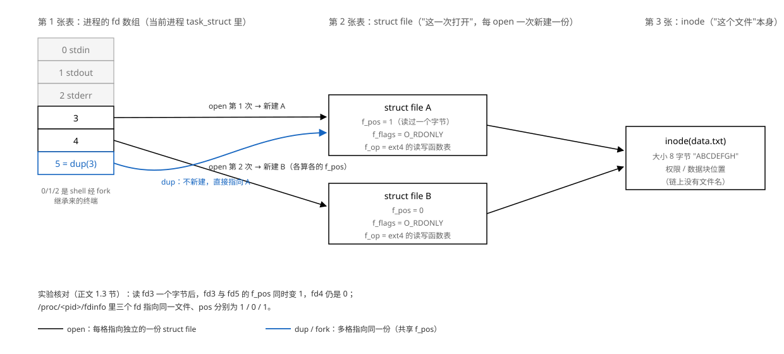

# 04 文件 IO

    实验    Knowledge/labs/04_file_io/
    电脑    WSL Ubuntu 26.04，gcc 15.2.0，arm-linux-gnueabihf-gcc 15.2.0
            （本篇"本机实测"均为 2026-10-20 在 WSL 里实跑）
    板子    100ASK_IMX6ULL Pro，Linux 4.9.88，glibc 2.30
            （板上输出均为 2026-09-14 实测归档，未重跑、未改数字）

---

**读前须知**：看懂本篇需要下面的底子。开读前扫一眼，缺哪条先补哪条；标了
"用到再读"的可以等正文引用时再翻。

- 前一章 [03 Makefile 的使用](03_Makefile的使用.md)：本篇实验多、产物多，
  编译和判据都按那里的方式组织；`Knowledge/labs/04_file_io/check.sh` 一键全跑
- 再往前 [01 HelloWorld 背后没那么简单](01_HelloWorld背后没那么简单.md)：
  退出码与 `echo $?`（1.3 节）、程序分 app/C 库/内核三层（1.5 节）、
  strace 的用法（3.2 节）、串口上板流程（4.4 节起）本篇全程在用
- 先读 [fundamentals/08 文件描述符与VFS](../../fundamentals/08_文件描述符与VFS.md)
  更好：fd 表、struct file、inode 三张表是第 1 节的主线，那里讲得更慢，
  本篇是它的应用与复查
- 用到再读 [fundamentals/07 系统调用与用户内核态](../../fundamentals/07_系统调用与用户内核态.md)：
  第 6 节讲 svc 指令、调用号、sys_call_table 时引用
- 用到再读 [fundamentals/09 虚拟内存与mmap](../../fundamentals/09_虚拟内存与mmap.md)：
  第 7 节 mmap 的缺页、MAP_SHARED/PRIVATE 在那里展开

**这一章在整机里的位置**：上接 03 篇（构建自动化），下接 05 篇 Framebuffer
（那里第一件事就是 `open("/dev/fb0")`）。它补的零件是"一切皆文件"的那套访问
方式：fd、read/write、lseek、dup2、mmap。后面每一篇碰设备都走这里的手脚：
05 篇开显存，07 篇读输入事件，08 篇 socket，10 篇 I2C，11 篇串口。Project
的日志落文件（本篇第 8 节）也建在这里。

**不学它会怎样**：把 `read` 返回小于 count 当成错误，程序会丢掉真实数据
（2.1 节）；`printf` 写的日志在进程崩溃时整段消失（5.4 节）；两个进程同时
追加日志互相覆盖（2.7 节）；mmap 越界拿到的不是错误码而是 SIGBUS（7.3 节）。

## 0 起点

### 0.1 把一次"读文件"拆开看

前面三章攒下的东西：会交叉编译，会把程序送上板子，会用 make 自动重建。
程序跑起来之后，下一件事就是和文件打交道：读配置、写日志、开设备。本章从这
一个问题出发：**程序读写一个文件，到底经过了哪几道口，每一道口是谁在把守。**

最直接的看法：用 strace 跟着一个"读文件"的程序，把它向内核发的系统调用逐个
打印出来。先拿现成的 `cat` 试（strace 的用法在 01 篇 3.2 节讲过）：

```bash
cd ~/fio04                     # 本篇实验都在 WSL 原生目录里做，不要用 /mnt/e（原因见 2.5 节）
strace cat score.csv 2>&1 >/dev/null | sed -n '/openat.*score.csv/,/munmap/p'
```

- `strace cat score.csv`：运行 cat，同时把它发的系统调用打到标准错误。
- `2>&1 >/dev/null`：先让标准错误并入"当前的 stdout"（也就是终端，strace 的
  输出走这里），再把 stdout 改到 /dev/null（cat 打印的文件内容扔掉）。两个
  重定向的顺序不能反：反了的话 strace 的输出会跟着进 /dev/null。
- `sed -n '/起/,/止/p'`：只打印从打开 score.csv 那一行到 munmap 之间的内容，
  前面加载动态库的一百多行跳过。

本机实测：

```text
openat(AT_FDCWD, "score.csv", O_RDONLY|O_CLOEXEC) = 3
fstat(3, {st_mode=S_IFREG|0644, st_size=93, ...}) = 0
fstat(1, {st_mode=S_IFCHR|0666, st_rdev=makedev(0x1, 0x3), ...}) = 0
splice(3, NULL, 1, NULL, 1048576, 0)    = -1 EINVAL (Invalid argument)
pipe([4, 5])                            = 0
fcntl(4, F_SETPIPE_SZ, 1048576)         = 1048576
splice(3, NULL, 5, NULL, 1048576, 0)    = 93
splice(4, NULL, 1, NULL, 93, 0)         = 93
splice(3, NULL, 5, NULL, 1048576, 0)    = 0
close(5)                                = 0
close(4)                                = 0
close(3)                                = 0
```

逐行读：cat 用 `openat` 打开文件拿到编号 3；`fstat` 问清大小；然后没有出现
一次 `read` 或 `write`，而是建了一条管道（`pipe([4, 5])`），用 `splice` 把
93 个字节从文件搬进管道（`= 93`），再从管道搬进 1 号（标准输出）。第一次
`splice(3, NULL, 1, ...)` 报 EINVAL，是因为普通文件不能直接 splice 到终端，
cat 退而借了一条管道中转。

容易以为 cat 就是"read 一块、write 一块"的循环；实测它根本不走 read/write，
数据全程在内核里转手，连 cat 自己的内存都不进。splice 是后加的近路，而**所有
程序的底牌仍是那条老路**：open、read、write、close。用本章自己的拷贝程序
mycopy（2.6 节从零写出）再跟一次，这条老路就现形了：

```bash
strace ./mycopy score.csv m.txt 2>&1 | grep -E 'score.csv|m.txt|^read|^write|^close'
```

本机实测：

```text
openat(AT_FDCWD, "score.csv", O_RDONLY) = 3
openat(AT_FDCWD, "m.txt", O_WRONLY|O_CREAT|O_TRUNC, 0644) = 4
read(3, "\357\273\277,\350\257\255\346\226\207,\346\225\260\345\255\246,\350\213\261\350\257\255,\346\200\273\345\210\206,"..., 4096) = 93
write(4, "\357\273\277,\350\257\255\346\226\207,\346\225\260\345\255\246,\350\213\261\350\257\255,\346\200\273\345\210\206,"..., 93) = 93
read(3, "", 4096)                       = 0
close(3)                                = 0
close(4)                                = 0
```

逐行读：打开源文件得 3、打开目标文件得 4；从 3 号读，要 4096 字节、实际回了
93；往 4 号写，93 字节全收；再读 3 号回了 0（文件到头）；最后两个都关掉。
`\357\273\277` 是三个八进制字节（0xEF 0xBB 0xBF），4.3 节会专门和它打交道。

整个 Linux 里程序对文件能做的事，内核就收这么几个动词：**openat（打开）、
read（读）、write（写）、lseek（挪位置）、close（关）、dup2（复制编号）**，
外加一个不动 fd 的 mmap（第 7 节）。普通文件、串口、显存、网络连接，全从这
几个动词进出。本章的任务就是把每个动词讲透：它实际做了什么、返回值怎么读、
失败时长什么样、在内核里落在哪张表上。

### 0.2 为什么会有两套函数

学 C 语言时，写文件用的是 `fopen/fwrite/fclose`；上面 strace 抓到的却是
`openat/read/write/close`。两套都在用，它们是什么关系？

两套接口来自两个标准：

| 接口层 | 函数 | 来自哪个标准 | 可移植范围 |
|---|---|---|---|
| 系统调用 IO | `open / read / write / lseek / close` | POSIX | Linux 及各家 UNIX |
| 标准 IO | `fopen / fread / fwrite / fseek / fclose` | C 语言标准 | 任何有 C 库的系统，含 Windows |

POSIX 把"操作系统该提供哪些函数、各收什么参数、返回什么"定成一套接口，
Linux 和 UNIX 家族都照它实现，所以按 POSIX 写的程序能在这一家族里互相搬。
Windows 不进这个家族；C 标准库在 POSIX 那套之上又封了一层（f 开头的函数），
Windows 上也有同一套 C 标准库，所以只用标准 IO 的程序重新编译就能跨过去。

两条结论，全章反复用：

1. **上面那套是拿下面那套实现的。** `fwrite` 内部最终调 `write`，它多出来的
   实质东西只有一样：一块用户态缓冲。多的这块缓冲带来什么、惹什么祸，
   第 5 节用 strace 数出来。
2. **越往下越贴硬件。** 碰 `/dev` 下的设备一律用下面那套，因为标准 IO 为了
   可移植把 `ioctl` 整个砍掉了（5.5 节）。

### 0.3 怎么读这一章

    完整学一遍      1 → 7 顺读，8 落进 Project，9 是板上归档
    只想先看见骨干  0.1（六个动词）→ 1.1（fd 是什么）→ 2.1（返回值）→ 5.2（缓冲）
    选读            6（内核那一侧的细节）、7（mmap，05 篇前再看也来得及）

每节末有"这一节搭好的积木"，每章末有回看表。所有实验源码在
`Knowledge/labs/04_file_io/`，正文逐行讲；`check.sh` 从源码重建一切并逐条
核对，判据改动都做过注错见红（亲手改坏、确认变红、再改回）。

---

## 1 open：一个整数凭什么代表一个文件

上一节看到：openat 返回 3，后面所有操作都拿着这个 3 说话。这个整数是什么？
为什么是它而不是别的什么？这一节把它拆穿。

### 1.1 先看见它：/proc 里的 fd

写一个程序，打开一个文件之后挂住，好让我们从容地围观它的内部状态。实验程序
`Knowledge/labs/04_file_io/hold.c`：

```c
#include <stdio.h>
#include <fcntl.h>
#include <unistd.h>

int main(int argc, char **argv)
{
    int fd;

    if (argc != 2) {
        printf("Usage: %s <file>\n", argv[0]);
        return 1;
    }
    fd = open(argv[1], O_RDONLY);
    if (fd < 0) {
        perror("open");
        return 1;
    }
    printf("pid=%d fd=%d\n", getpid(), fd);
    fflush(stdout);          /* printf 的先进 C 库缓冲，不冲这一下终端看不到（第 5 节） */
    pause();                 /* 挂住，等信号 */
    return 0;
}
```

逐行读：

- `int fd;`：准备一个整数装 open 的返回值。fd 是 file descriptor（文件描述符）
  的缩写。
- `open(argv[1], O_RDONLY)`：以只读方式打开命令行给的文件。`O_RDONLY` 是一个
  标志常量，意思是"只读"。open 的完整参数和标志表在 1.5、1.6 节。
- `if (fd < 0)`：open 失败时返回 -1。`perror("open")` 把失败原因翻译成文字
  打到标准错误（1.7 节细讲）。
- `getpid()`：拿回自己的进程号，打印出来，等下要用它去翻 /proc。
- `fflush(stdout)`：把 printf 攒在 C 库缓冲里的那行字立刻推出去。没有它，
  程序挂在 pause 里，你在终端上什么行也看不到（为什么，第 5 节）。
- `pause()`：什么也不做，直到有信号进来。程序停在这一点，fd 一直开着。

编译，同时起两个，各开一个不同的文件：

```bash
gcc -Wall hold.c -o hold
printf 'x' > f1.txt; printf 'y' > f2.txt
./hold f1.txt &              # & 让程序在后台跑，终端还给你
./hold f2.txt &
```

本机实测：

```text
pid=12729 fd=3
pid=12730 fd=3
```

两个进程，打开的是两个不同的文件，拿到的 fd 却都是 3。再看内核是怎么记账的。
/proc 下面每个进程有一个目录，目录里的 `fd/` 子目录把这个进程占用的每个 fd
列成一个快捷方式，指向它背后的文件：

```bash
ls -l /proc/12729/fd/3 /proc/12730/fd/3
```

本机实测：

```text
lr-x------ 1 glorinz glorinz 64 Oct 20 19:04 /proc/12729/fd/3 -> /home/glorinz/fio04/f1.txt
lr-x------ 1 glorinz glorinz 64 Oct 20 19:04 /proc/12730/fd/3 -> /home/glorinz/fio04/f2.txt
```

两个 3，各指各的文件。再把其中一个进程的整张 fd 表列出来（这次让程序跑在一个
伪终端里，输出更贴近日常）：

```text
lr-x------ 1 glorinz glorinz 64 Oct 20 19:07 0 -> /dev/null
lrwx------ 1 glorinz glorinz 64 Oct 20 19:07 1 -> /dev/pts/0
lrwx------ 1 glorinz glorinz 64 Oct 20 19:07 2 -> /dev/pts/0
lr-x------ 1 glorinz glorinz 64 Oct 20 19:07 3 -> /home/glorinz/fio04/f1.txt
```

读这张表：

- 0、1、2 在我们 open 之前就占了：标准输入、标准输出、标准错误。1 和 2 指向
  终端（/dev/pts/0）；0 指向 /dev/null，是因为后台任务的 stdin 被 shell 接到
  了 /dev/null（不开作业控制的 shell 对后台任务的规矩）。
- 我们 open 的那个文件排到了 3。**open 拿的是当前没被占用的最小编号**，
  0/1/2 都占着，所以是 3。这条规则 3.1 节的 dup 还会再用。

（看完把两个后台进程收掉：`kill %1 %2`。）

两个事实先记下来：**fd 是进程自己的小编号**，说"fd 3 是哪个文件"必须带上
"哪个进程"，否则两个进程的 3 对不上同一个东西；**fd 0/1/2 到程序手里时已经
有主了**，谁放的，1.4 节讲。

**这一节搭好的积木**：open 返回一个小整数 fd；内核给每个进程记一张"编号到
文件"的表，/proc/\<pid\>/fd 能直接看到；新 fd 取最小空闲编号。接下来的问题：
内核为什么不直接把"文件"交给程序，非要绕一个编号。

### 1.2 内核不肯给你指针，只好给你下标

内核里描述"这一次打开"的是一个实实在在的结构体 `struct file`，它在内核内存
里有地址。最直接的给法是把地址交给程序，程序拿着地址来找。这个给法被硬件
挡死了：用户态和内核态是 CPU 强制的两级（01 篇 1.5 节），用户态的程序碰到
内核地址，CPU 当场报异常。何况真给了地址，程序就能拿它去读改内核的任何数据，
内核再没法核对每次访问合不合法。

所以内核换了个给法：在每个进程里放一张数组，数组的每一格存一个
`struct file *` 指针，**给程序的只是格子编号**。程序每次说"对 3 号操作"，
内核先查这个进程的表：3 没越界、那一格不空，才取出指针往下走；越界或空格，
直接拒绝（EBADF）。下标是能在每次使用时重新验证的，指针不能。

```text
当前进程的 fd 数组(内核里)          内核里的打开文件
  +---+---------------+
  | 0 | ------------> struct file (stdin)
  +---+---------------+
  | 1 | ------------> struct file (stdout)
  +---+---------------+
  | 2 | ------------> struct file (stderr)
  +---+---------------+
  | 3 | ------------> struct file (f1.txt)      open 新建
  +---+---------------+
  | 4 |      空
  +---+---------------+
```

程序手里只有左边的编号，碰不到右边的指针。1.1 节的"两个进程都是 3"现在也
顺理成章：这张数组每个进程一张，两个进程的第 3 格是两格。

**这一节搭好的积木**：fd 是进程 fd 数组的下标，内核靠它在每次操作时重新找到
struct file 并验证合法性。接下来的问题：struct file 里装了什么，为什么它
必须是独立于"文件本身"的一层。

### 1.3 三张表：f_pos 属于"这一次打开"

struct file 里最关键的一项是 `f_pos`：这一次打开，读到哪了、写到哪了。
文件本身（内核里叫 inode）只记大小、权限、数据块在哪；**"读到哪"不属于文件，
属于打开它的这一次**。同一个文件被打开两次，就是两个 struct file、两个
f_pos，各走各的。

三张表的完整关系（实验：open 同一个文件两次得 fd 3 和 4，再 dup 一次得 5，
然后从 fd 3 读一个字节）：



读法：从左往右。左边是当前进程的 fd 数组；中间每个 struct file 是一次 open
的产物，带着自己的 f_pos；右边是文件本身。fd 5 是 `dup(3)` 出来的，没有新建
struct file，直接指向 fd 3 那一份，所以两者共用一个 f_pos。`dup` 为什么存在、
怎么用，第 3 节专门讲，这里先认下"共享同一个 struct file"这件事。

嘴上说的不算，让程序自己把三个位置报出来。用 fundamentals 08 篇配套的
fdshow（源码在 `Knowledge/labs/00_basics/02_fd_and_vfs/fdshow.c`，它 open
同一文件两次、dup 一次，然后直接读 `/proc/self/fdinfo/` 把每个 fd 背后的
pos 打出来）：

```bash
printf 'ABCDEFGH' > data.txt
gcc -w /mnt/e/Workspace/Embedded-linux/Knowledge/labs/00_basics/02_fd_and_vfs/fdshow.c -o fdshow
./fdshow
```

本机实测：

```text
open 返回的编号: fd1=3 fd2=4 fd3=5

[读之前] 三个 fd 的位置：
  fd 3  (open 1    )  pos:	0  flags:	0100000
  fd 4  (open 2    )  pos:	0  flags:	0100000
  fd 5  (dup fd1   )  pos:	0  flags:	0100000

从 fd 1 读了 1 个字节（读到 'A'）

[读之后] 三个 fd 的位置：
  fd 3  (open 1    )  pos:	1  flags:	0100000
  fd 4  (open 2    )  pos:	0  flags:	0100000
  fd 5  (dup fd1   )  pos:	1  flags:	0100000
```

从 fd 3 读了一个字节之后：fd 3 的位置变成 1，**fd 5 跟着变成 1**（共享同一
个 struct file），fd 4 纹丝不动（第二次 open 有自己独立的一份）。fdinfo 里
的 `flags: 0100000` 是 open 标志位的八进制，0100000 是 O_LARGEFILE，内核在
64 位系统上给每次 open 自动加上，表示支持大文件。

三张表逐行的完整讲解在 fundamentals 08 篇的[08 文件描述符与VFS](../../fundamentals/08_文件描述符与VFS.md)第 2 节。本篇只要守住
一句话：**f_pos 属于"这一次打开"（struct file），不属于"这个文件"（inode）。**
2.2 节的读写位置、2.7 节的并发追加、3 节的 dup，全是这句话的推论。

**这一节搭好的积木**：fd 数组指向 struct file，struct file 指向 inode；
open 两次各有一份 f_pos，dup 共享同一份。接下来的问题：程序还没 open 任何
东西时，fd 0/1/2 是哪来的。

### 1.4 0、1、2 是谁放进去的

程序一启动，fd 表前三格已填好：

```text
fd 0   stdin    标准输入
fd 1   stdout   标准输出
fd 2   stderr   标准错误
```

**这三格是 shell 填的。** shell 用 fork 分出子进程，子进程原样继承 shell 的
整张 fd 表（继承的细节在[08 文件描述符与VFS](../../fundamentals/08_文件描述符与VFS.md)第 3.2 节），三格里装的是终端；之后
子进程 execve 变成你的程序，表不动。所以你的程序一睁眼，0/1/2 已经可用。

你在命令行敲的 `./prog > out.txt`，那个 `>` 做的事就是在 execve 之前把子
进程 fd 表的第 1 格改指向 out.txt。程序里一句都不用改，printf 照常写 1 号，
内核照常按 1 号去查表，查到的已经是 out.txt 了。这个"换格子"的动作就是
dup2，第 3 节我们亲手做一遍；做完回头再看 `>`，它就是一行 dup2。

**这一节搭好的积木**：fd 0/1/2 由 shell 经 fork 继承而来；重定向改的是表里的
指向，程序自己不知道。接下来回到 open 本身：它的参数到底能填什么。

### 1.5 open 的参数：flags 与怎么查 man

open 的原型（`man 2 open` 开头的 SYNOPSIS 一节）：

```c
#include <fcntl.h>
int open(const char *pathname, int flags);
int open(const char *pathname, int flags, mode_t mode);
```

两个原型是同一个函数：flags 里带了 O_CREAT 时，必须有第三个参数 mode（新建
文件的权限，1.6 节）；不带 O_CREAT 时不能给。

flags 是一个整数，每个比特位一个开关，用 `|` 拼。按用途分四组：

| 组 | 标志 | 含义 |
|---|---|---|
| 访问方式（三选一，必须有一个） | `O_RDONLY` / `O_WRONLY` / `O_RDWR` | 只读 / 只写 / 可读可写 |
| 创建与截断 | `O_CREAT` | 文件不存在就创建（配合 mode） |
| | `O_EXCL` | 与 O_CREAT 同用时：文件已存在就失败 |
| | `O_TRUNC` | 文件已存在且以写方式打开时，先把长度截成 0 |
| 写入位置与时机 | `O_APPEND` | 每次 write 都自动落到文件末尾（2.7 节） |
| | `O_SYNC` / `O_DSYNC` | 每次 write 等到落盘才返回（5.4 节） |
| 其他 | `O_NONBLOCK` | 打不开就等、读不到就等的设备，改成立刻返回（2.1 节管道演示过） |
| | `O_NOCTTY` | 路径是终端设备时，别把它变成本进程的控制终端 |

日常 90% 的 open 是这四个组合：

| 组合 | 语义 | 典型用途 |
|---|---|---|
| `O_RDONLY` | 只读，文件必须已存在 | 读配置 |
| `O_WRONLY\|O_CREAT\|O_TRUNC` | 不存在就建，存在就清空 | 写结果文件 |
| `O_WRONLY\|O_CREAT\|O_APPEND` | 不存在就建，存在就接末尾 | 日志 |
| `O_WRONLY\|O_CREAT\|O_EXCL` | 必须不存在，已存在就失败 | 抢锁、防覆盖 |

标志全表（O_CLOEXEC、O_DIRECTORY、O_NOFOLLOW 等）收在 fundamentals 08 篇的
[08 文件描述符与VFS](../../fundamentals/08_文件描述符与VFS.md)第 7 节，那里每条标了依据。

顺手把"怎么查"说清，本篇起函数原型不再抄全，自己去 man 手册查。man 手册分
9 卷，同名的条目可能落在好几卷里：

| 卷 | 内容 | 例子 |
|---|---|---|
| 1 | 命令 | `man 1 ls` |
| 2 | 系统调用 | `man 2 open` |
| 3 | C 库函数 | `man 3 printf` |
| 4 | 设备文件 | `man 4 tty` |
| 5 | 文件格式与约定 | `man 5 passwd` |
| 7 | 杂项（协议、机制综述） | `man 7 signal` |
| 8 | 管理命令（多要 root） | `man 8 mount` |

（6 是游戏，9 是内核内部函数，用得少。）`man open` 不带卷号时按卷序先找到
哪卷算哪卷，可能撞到 1 卷里的同名命令；查函数一律带卷号。man 里按 `/` 加
回车搜关键词，`n` 跳下一个，`q` 退出。

**这一节搭好的积木**：flags 按位拼，四种组合覆盖日常；查原型用 `man 2 函数名`。
接下来的问题：带 O_CREAT 时那个 mode，传 0777 为什么落地的不是 0777。

### 1.6 mode 与 umask：0777 传下去不会原样落地

先看见现象。实验程序 `Knowledge/labs/04_file_io/mode.c`，把命令行给的八进制
数直接传给 open 的 mode：

```c
fd = open(argv[1], O_WRONLY | O_CREAT | O_TRUNC, (int)strtol(argv[2], NULL, 8));
```

跑三次：第一次文件不存在，新建；后两次文件已在，看它改不改权限。

```bash
rm -f a.txt
./mode a.txt 0777 && stat -c '%a' a.txt
./mode a.txt 0600 && stat -c '%a' a.txt
./mode a.txt 0777 && stat -c '%a' a.txt
```

- `stat -c '%a'`：只打印文件的八进制权限。

本机实测：

```text
755
755
755
```

两个意外：**要 0777 落地成 755**；**文件已存在时 mode 整个被忽略**（后两次
什么都没改，连报错都没有）。

先说第一个。权限的九个比特分三段：属主、同组、其他人，每段读/写/执行三个
比特。0777 就是九位全 1。但每个进程还戴着一张"禁止位"面具，叫 umask：
mask 里是 1 的位，新建文件时不许落地。落地权限的计算：

```text
mode   0777 = 111 111 111      rwx rwx rwx
umask  0022 = 000 010 010      --- -w- -w-
~umask      = 111 101 101      mask 取反
&           = 111 101 101  =  0755
```

`mode & ~umask`，按位与。当前 shell 的 umask 用 `umask` 命令看，本机是 0022：
同组和其他人的"写"位被禁。所以 0777 落地 755，0644 落地还是 644（那两个位
本来就是 0）。这是系统层的保护：防止程序手一松建出个人人可写的文件。每个
进程有自己的 umask，从 shell 继承，程序里可以用 `umask()` 调。

再说第二个。**mode 只在"创建"那一刻被看一眼**；文件已存在时，O_CREAT 退化成
"打开它"，mode 参数内核根本不读，也不报"你给了个没用的参数"。容易以为带
O_CREAT 的 open 会顺手把权限修正成 mode；实测一动不动。这条有安全含义：用
`open(path, O_WRONLY|O_CREAT, 0600)` 写私密数据，如果 path 已经被人以 0666
建好，你的数据就落进了人人可读的文件。真要保证"只有我新建"，用 O_EXCL：
已存在就失败（errno 17，1.7 节的实验里正好有这一行）。

**这一节搭好的积木**：落地权限 = mode & ~umask，umask 每进程一份；mode 只对
新建生效。接下来把 open 的失败面整个看一遍，顺便把 errno 的脾气摸清。

### 1.7 让 open 失败：看清 errno

open 失败返回 -1。原因呢？内核把原因码放在一个每线程一份的全局整数 `errno`
里。实验程序 `Knowledge/labs/04_file_io/o.c` 连试五种失败，每次把 fd、errno
数值和它的文字说明一起打出来：

```c
static void try_open(const char *tag, const char *path, int flags, unsigned mode)
{
    int fd = open(path, flags, mode);

    printf("%-30s fd=%3d errno=%2d %s\n", tag, fd, errno, strerror(errno));
    if (fd >= 0)
        close(fd);
}

int main(void)
{
    try_open("打开不存在的文件", "/tmp/no_such_file", O_RDWR, 0);
    try_open("用 O_RDWR 打开一个目录", "/tmp", O_RDWR, 0);
    try_open("用 O_RDONLY 打开一个目录", "/tmp", O_RDONLY, 0);
    try_open("O_CREAT|O_EXCL 打已存在文件", "/etc/hostname", O_WRONLY | O_CREAT | O_EXCL, 0644);
    try_open("用 O_WRONLY 打开 root 的 644 文件", "/etc/hostname", O_WRONLY, 0);
    return 0;
}
```

- `strerror(errno)`：把错误码翻译成文字。头文件 `string.h`，errno 在 `errno.h`。

本机实测：

```text
打开不存在的文件       fd= -1 errno= 2 No such file or directory
用 O_RDWR 打开一个目录  fd= -1 errno=21 Is a directory
用 O_RDONLY 打开一个目录 fd=  3 errno=21 Is a directory
O_CREAT|O_EXCL 打已存在文件 fd= -1 errno=17 File exists
用 O_WRONLY 打开 root 的 644 文件 fd= -1 errno=13 Permission denied
```

（各行没有对齐，是因为 `%-30s` 按字节数补空格，一个汉字在 UTF-8 里占 3 个
字节，屏幕上却只占 2 列宽。）逐行读：

1. 文件不存在：errno 2，ENOENT。
2. 用 O_RDWR 开目录：errno 21，EISDIR。目录可以用 O_RDONLY 打开（下一行就是），
   但不能写。
3. **这一行是本节最重要的一行：open 成功了（fd=3），errno 却印着 21。** 那是
   第二行失败留下的残值。errno 只在"函数确实失败了"之后才有意义；成功的调用
   不会把它清零。规矩：**先判返回值，失败才准看 errno。**
4. O_CREAT|O_EXCL 打一个已存在的文件：errno 17，EEXIST。这就是 1.6 节说的
   "必须不存在"的用法。
5. /etc/hostname 属主是 root、权限 644，我们不在属主位，写位被挡：errno 13，
   EACCES。注意权限检查发生在 open 这一刻，不是 read/write 那一刻。open 一旦
   成功，哪怕别人随后 `chmod 000` 甚至 `unlink` 这个文件，手里这个 fd 照样能
   把内容读完（2026-09-14 板上实测：unlink 之后 read 仍得到原来的 ABCD）。
   这是三张表的直接推论：fd → struct file → inode，这条链上没有文件名。
   同一个道理反过来用：删掉一个正被进程打开的大日志文件，`df` 看到的占用不会
   立刻回来，inode 上还挂着引用，要等进程 close。

打印错误原因有三种写法，按场景挑：

```c
perror("open");                          /* 最省事："open: No such file or directory"，固定打 stderr */
printf("%s\n", strerror(errno));         /* 自己拼上下文，写库、往日志里塞时用 */
printf("%d\n", errno);                   /* 只拿到数字，还得翻表，不推荐单独用 */
```

`perror("open")` 的参数会原样印在冒号前面，写成这次失败的动作名，定位最快。

**这一节搭好的积木**：失败返回 -1、原因在 errno；errno 只在失败后有效；
权限在 open 时检查，之后改权限、删文件都不影响已拿到的 fd。

### 1.8 [判] 第 1 节的判据

    [ ] hold：两个进程各开一个文件，都拿到 fd 3；/proc/<pid>/fd/3 各指各的
    [ ] 说得出 fd 为什么是下标不是指针（指针给出去没法逐次验证）
    [ ] fdshow：open 两次加 dup 一次，读后三个 pos 是 1 / 0 / 1
    [ ] 说得出 fd 0/1/2 是 shell 经 fork 继承来的；> 改的是表里第 1 格的指向
    [ ] mode：新建要 0777 落地 755（算得出 0777 & ~022）；已存在时 mode 不生效
    [ ] o：五种失败各报对 errno；说得出第三行 errno=21 是哪来的
    [ ] 说得出"先判返回值再看 errno"的依据（成功调用不清 errno）

    注错见红：把 mode 实验的 umask 改成 0077 再新建，落地必须从 755 变 700；
    把 o.c 第三行改成 O_RDONLY 打一个不存在的路径，fd 必须从 3 变 -1。

---

## 2 read/write：返回值比你想的有内容

上一节把"fd 是谁"拆穿了。这一节把最常用的两个动词 read 和 write 拆穿。它们
最大的认知门槛不在参数，在**返回值**：返回 5 不是出错，返回 4096 不等于你要
的 4096 真的发出去了。

### 2.1 返回值先看见：少读少写不是错误

原型（`man 2 read`、`man 2 write`）：

```c
#include <unistd.h>
ssize_t read(int fd, void *buf, size_t count);
ssize_t write(int fd, const void *buf, size_t count);
```

三个参数都是大白话：几号、往哪块内存、要几个字节。讲究全在返回值：

- 返回正数 n：实际读/写了 n 个字节，**n 可以小于 count**。
- 返回 0：只对 read 有意义，文件读完了（EOF）或对端关了（管道、socket）。
- 返回 -1：出错，原因在 errno。

"少读少写"（short read/write）在普通文件上少见，在管道、串口、网络上是常态。
先用管道把三种返回各看一遍。实验程序
`Knowledge/labs/04_file_io/pipe_rw.c`：

```c
#define _GNU_SOURCE             /* F_GETPIPE_SZ 需要 */
#include <stdio.h>
#include <string.h>
#include <unistd.h>
#include <fcntl.h>
#include <errno.h>

int main(void)
{
    int fds[2];
    char buf[100];
    static char big[1048576];   /* 1 MiB，供那次大 write 用 */
    ssize_t n;
    long total;

    if (pipe(fds) != 0) {
        perror("pipe");
        return 1;
    }
    printf("管道容量: %d 字节\n", fcntl(fds[1], F_GETPIPE_SZ));

    write(fds[1], "12345", 5);            /* 管道里只放 5 个字节 */
    n = read(fds[0], buf, 100);           /* 你要 100 个 */
    printf("read(要 100) 实际返回 %zd\n", n);

    fcntl(fds[1], F_SETFL, O_NONBLOCK);   /* 写端设成非阻塞：写不下就立刻返回，不等着 */
    n = write(fds[1], big, sizeof(big));  /* 你要写 1 MiB */
    printf("write(要 1048576) 实际返回 %zd\n", n);

    total = n > 0 ? n : 0;
    while ((n = write(fds[1], buf, sizeof(buf))) > 0)
        total += n;                       /* 接着写，直到写不进去 */
    printf("管道一共收下 %ld 字节；写满后再 write(100) 返回 %zd, errno=%d (%s)\n",
           total, n, errno, strerror(errno));
    return 0;
}
```

逐行读：

- `#define _GNU_SOURCE`：`F_GETPIPE_SZ` 是 Linux 自己加的扩展，不在 POSIX 里。
  glibc 的头文件只有在这个宏先定义了的情况下才把它露出来，所以这一行必须写在
  所有 `#include` 之前。
- `static char big[1048576]`：1 MiB 的数组。加 `static` 是让它放进静态数据区，
  不占栈：栈默认只有 8 MiB，函数里随手开 1 MiB 的局部数组是坏习惯。
- `pipe(fds)`：建一条管道，`fds[0]` 是读端、`fds[1]` 是写端，两个 fd 一次开好。
  管道是内核里的一段缓冲，写进去的字节从读端按顺序出来。这里只拿它当"行为有
  脾气的文件"用。
- `fcntl(fds[1], F_GETPIPE_SZ)`：问出这条管道的容量（字节）。`fcntl` 是"对一个
  已打开的 fd 做杂项操作"的系统调用，第二个参数说做哪一项。
- 第一回合：往管道里放 5 个字节，然后 read 要 100 个。**管道里只有 5 个，read
  不会等够 100**，手里有几个回几个。
- `fcntl(fds[1], F_SETFL, O_NONBLOCK)`：给写端加上非阻塞标志。非阻塞的意思是
  "办不到就立刻返回，别把我挂起"。不加的话，写超过容量时 write 会一直等，等到
  有人从读端把数据取走。
- 第二回合：往管道里一次写 1 MiB。`%zd` 是打印 `ssize_t` 的格式。
- 第三回合：`while` 循环每次再写 100 字节，直到 write 不再返回正数，把每次写
  进去的字节数累加到 `total`。循环退出时 `n` 是最后那次的返回值，`errno` 是
  失败原因。

编译运行（`gcc -Wall pipe_rw.c -o pipe_rw && ./pipe_rw`），本机实测：

```text
管道容量: 65536 字节
read(要 100) 实际返回 5
write(要 1048576) 实际返回 65536
管道一共收下 65536 字节；写满后再 write(100) 返回 -1, errno=11 (Resource temporarily unavailable)
```

三种返回一次看齐：

1. 要 100 回 5：少读，不是错。
2. 要 1 MiB 回 65536：少写，也不是错。65536 正好是第一行的管道容量，剩下的
   983040 字节（1048576 - 65536）得等管道腾出地方再补写。
3. 管道已满，再写 100 字节，返回 -1，errno 11，也就是 EAGAIN（`strerror` 把它
   翻成 "Resource temporarily unavailable"，资源暂时不可用）。这才是错，而且在
   非阻塞模式下它是正常业务，意思是"现在没地方，过一会儿再来"。第四行的
   "一共收下 65536 字节"还说明：那次 1 MiB 的大写一下就把管道塞满了，之后连
   100 字节都进不去。

大写一次能进多少，取决于内核怎么给管道分配页面，不是一个固定的数：同一台
电脑在 2026-10-16 跑同一个程序时，这一行回的是 4096。要记的是"小于 count
不是错误"，不是 65536 这个数。
容易以为 write 返回 65536 是"写失败了 983040 字节"；实测返回值只要非负就是
成功，只不过成功的只有前 65536 字节。**read/write 都不替你循环**，凑够你要
的量是你自己的代码的事（2.3 节）。

**这一节搭好的积木**：read/write 返回值是"实际字节数"，可短；0 是 EOF；-1
才是错。接下来的问题：那些字节落在文件的哪个位置，谁来记。

### 2.2 文件位置：每读一个字节，指针挪一步

1.3 节留下的那句话这里兑现：内核在 struct file 里记着一个 f_pos，**read 从
f_pos 开始读，读完把 f_pos 加上实际读的字节数；write 同理**（O_APPEND 例外，
2.7 节）。所以连续两次 read 读到的是前后两段，不用你记账：

```text
文件: a b c d e f g h
read(fd, buf, 3)   -> "abc"    f_pos: 0 -> 3
read(fd, buf, 3)   -> "def"    f_pos: 3 -> 6
read(fd, buf, 100) -> "gh"     f_pos: 6 -> 8   只剩 2 个,就回 2 个
read(fd, buf, 100) -> ""       返回 0         到 EOF
write(fd, "X", 1)  -> 1        f_pos: 8 -> 9   追加在末尾
```

write 从 f_pos 起笔，**覆盖原有字节**，文件里没有"插入"这回事（2.4 节实测）。
管道、串口这类东西没有"位置"可言，对它们 lseek 会失败（ESPIPE）。

**这一节搭好的积木**：f_pos 随每次读写自动前进。接下来的问题：返回值要检查，
循环要自己写，正确长什么样。

### 2.3 正确写法：循环，而不是想当然

处理短写的标准骨架，"写够 n 字节才罢手"：

```c
ssize_t done = 0;
while (done < n) {
    ssize_t r = write(fd, buf + done, n - done);
    if (r < 0) {
        if (errno == EINTR)        /* 被信号打断，不算错，重来 */
            continue;
        perror("write");           /* 真错 */
        break;
    }
    done += r;
}
```

三个要点：指针随 done 前进（`buf + done`）；EINTR（被信号打断）单独挑出
重试；真错才停。读侧同理，区别是读侧"短"可能只是因为到了 EOF，循环退出
条件里要把"返回 0"当正常结束。

读字符串场景还有一个反复咬人的细节：**read 读回来的是字节，不是 C 字符串，
末尾没有 '\0'**。想把读到的内容当字符串用（printf %s、sscanf），得自己补：

```c
char buf[100];
ssize_t len = read(fd, buf, sizeof(buf) - 1);   /* 给 '\0' 留一个位置 */
if (len < 0) { perror("read"); return 1; }
buf[len] = '\0';                                 /* 自己封口 */
```

要 99 而不是 100，因为 read 可能真的给满 99 个；写成 `sizeof(buf)` 再补
`buf[len]`，满读时就越界一格。第 4 节的 CSV 实验全靠这个习惯活着。

**这一节搭好的积木**：读写循环骨架（含 EINTR）与"自己补 '\0'"两条规矩。
接下来的问题：想在文件中间改几个字节怎么办。

### 2.4 lseek：挪位置；中间写是覆盖不是插入

原型：

```c
#include <unistd.h>
off_t lseek(int fd, off_t offset, int whence);
```

whence 三选一：SEEK_SET（从文件头数 offset）、SEEK_CUR（从当前 f_pos 数）、
SEEK_END（从文件尾数）。返回值是新位置，出错返回 -1。`lseek(fd, 0, SEEK_CUR)`
一步不动，只把当前位置问出来，这是查 f_pos 的标准手法。

实验程序 `Knowledge/labs/04_file_io/wp.c` 的核心只有三行：以可读可写打开
命令行给的文件，lseek 到偏移 3，写 "123"：

```c
fd = open(argv[1], O_RDWR);
lseek(fd, 3, SEEK_SET);       /* 位置移到第 3 字节(0 起) */
if (write(fd, "123", 3) != 3)
    perror("write");
```

先造一个 21 字节的文件（20 个字母加一个换行），跑前跑后各看一次内容和长度：

```bash
gcc -Wall wp.c -o wp
printf 'abcdefghijklmnopqrst\n' > w.txt
cat w.txt; wc -c < w.txt
./wp w.txt
cat w.txt; wc -c < w.txt
```

- `wc -c < w.txt`：数字节数。用 `<` 把文件接到 wc 的标准输入，wc 就只打印数字，
  不带文件名。

本机实测：

```text
abcdefghijklmnopqrst
21
abc123ghijklmnopqrst
21
```

偏移从 0 数，偏移 3 是第 4 个字符 d。def 被 123 盖掉了，后面 ghij… 原样跟上，
总长还是 21。**write 是覆盖**，文件
不是数组，没有"把后面的字节往后挤"的操作；真要插入，只能自己把后面的内容
读出、挪动、写回（这正是文本编辑器保存时在做的事）。

**这一节搭好的积木**：lseek 三基准、SEEK_CUR 查位置、写即覆盖。接下来的
问题：lseek 一把挪过文件尾再写，会发生什么。

### 2.5 lseek 越过 EOF：空洞文件

实验程序 `Knowledge/labs/04_file_io/hole.c`：新建文件，写 4 字节 "HEAD"，
然后 `lseek(fd, 1048576, SEEK_SET)` 一把挪到 1 MiB 处，再写 4 字节 "TAIL"：

```c
write(fd, "HEAD", 4);              /* 开头 4 字节 */
lseek(fd, 1048576, SEEK_SET);      /* 跳到 1 MiB 处，中间不写 */
write(fd, "TAIL", 4);              /* 末尾 4 字节 */
```

```bash
gcc -Wall hole.c -o hole && ./hole h.txt
ls -l h.txt && du -h h.txt && stat -c '大小 %s 字节, 占 %b 个 512B 块' h.txt
od -Ad -tx1 -j 512 -N 16 h.txt        # 从偏移 512 处看 16 个字节
```

- `ls -l` 看的是文件大小；`du -h` 看的是实际占了磁盘多少。
- `stat -c`：按格式打印文件属性，`%s` 是字节数，`%b` 是分配了几个 512 字节的块。
- `od -Ad -tx1 -j 512 -N 16`：按字节转储。`-Ad` 地址用十进制，`-tx1` 每字节
  打成两位十六进制，`-j 512` 先跳过 512 字节，`-N 16` 只看 16 个。

本机实测：

```text
-rw-r--r-- 1 glorinz glorinz 1048580 Oct 20 19:04 h.txt
8.0K    h.txt
大小 1048580 字节, 占 16 个 512B 块
0000512 00 00 00 00 00 00 00 00 00 00 00 00 00 00 00 00
```

三个数对不上，而这正是重点：文件大小 1048580（1048576 + 4），实际只占 8 KiB
（16 个 512 字节块 = 8192 字节，正好是首尾两头各一个 4 KiB 的数据块），中间
近 1 MiB 是**空洞**：
内核不分配磁盘块，读出来一律是 0（od 看到的就是全 0）。只写 8 字节，做出来
一个"1 MiB 的文件"。

空洞是合法的省空间手段：下载工具的预分配、磁盘镜像、稀疏数据库文件都靠它。
但"文件系统答不答应"是文件系统自己的事，两个实测反例：

- 同一个 hole 程序在 /mnt/e（WSL 访问 Windows 盘的挂载点）上跑，du 报 1.1M：
  那层文件系统不玩稀疏，把空洞整段落实成了真数据（2026-09-14 实测归档）。
  **本篇实验坚持在 WSL 原生目录（如 ~/fio04）里做**，/mnt/e 的行为会把
  这节课搅浑。
- 板上 eMMC（ext4）用 `board_fs_probe` 做了同一件事的简化版：只 lseek 到
  1 MiB 处写 4 字节，开头不写。逻辑大小同样是 1048580，实际只分配 4096 字节，
  也就是只有末尾那一个 4 KiB 块落了盘（2026-09-14 板上实测归档，9.5 节）。

**这一节搭好的积木**：lseek 可以越过 EOF，跳过的区域读作 0、不占盘（文件系统
支持稀疏时）；文件大小与占盘大小是两个数。接下来的问题：把上面所有积木拼成
第一个完整的工具。

### 2.6 L3 综合：自己写一个 mycopy

任务（L3 级，先自己写，再看答案）：把 a 拷成 b，不调用 cp。

1. 用法 `./mycopy 源 目标`；源不存在、目标打不开都要有明确报错（perror）。
2. 拷完和 `cmp 源 目标` 逐字节一致，包括二进制文件。
3. 空文件也要能拷（拷出 0 字节的目标，cmp 通过）。

判据：

```bash
gcc -Wall -O2 mycopy.c -o mycopy
./mycopy /etc/hostname /tmp/m.txt && cmp /etc/hostname /tmp/m.txt && echo SAME
: > /tmp/empty && ./mycopy /tmp/empty /tmp/m2 && cmp /tmp/empty /tmp/m2 && echo EMPTY-OK
```

参考答案 `Knowledge/labs/04_file_io/mycopy.c`：

```c
#include <stdio.h>
#include <fcntl.h>
#include <unistd.h>

int main(int argc, char **argv)
{
    int in, out;
    char buf[4096];
    ssize_t n, w;

    if (argc != 3) {
        fprintf(stderr, "Usage: %s <src> <dst>\n", argv[0]);
        return 1;
    }
    in = open(argv[1], O_RDONLY);
    if (in < 0) {
        perror("open src");          /* 别只打 "error",要把原因带出来 */
        return 1;
    }
    out = open(argv[2], O_WRONLY | O_CREAT | O_TRUNC, 0644);
    if (out < 0) {
        perror("open dst");
        close(in);
        return 1;
    }
    while ((n = read(in, buf, sizeof(buf))) > 0) {
        w = write(out, buf, n);      /* 用返回值 n, 不是 sizeof(buf) */
        if (w != n) {
            perror("write");
            close(in);
            close(out);
            return 1;
        }
    }
    if (n < 0)
        perror("read");
    close(in);
    close(out);
    return n < 0 ? 1 : 0;
}
```

逐行读：

- `char buf[4096]`：中转缓冲。大小只影响系统调用次数（7.2 节会数），不影响
  正确性，4096 是顺手的页大小。
- `ssize_t n, w`：`n` 装 read 的返回值，`w` 装 write 的返回值。`ssize_t` 是
  "带符号的字节数"，因为要能装下 -1。
- 两个 open 失败都 perror 后退出；打开目标失败时先把已经开着的源文件关掉。
  **open 目标用 `O_WRONLY|O_CREAT|O_TRUNC`**：不存在就建（权限 0644 经 umask
  落地），存在就先清空。不截断的话，旧文件比新内容长时，旧内容的尾巴会留着。
- 循环条件 `(n = read(...)) > 0`：先把 read 的返回值赋给 `n`，再拿 `n` 和 0
  比。返回 0（EOF）或 -1（出错）都退出循环，退出后由 `if (n < 0)` 区分两者。
- `w = write(out, buf, n)`：**写 n 个，不是 sizeof(buf) 个**。最后一趟 read
  通常读不满 4096，多写的部分是 buf 里上一趟留下的旧数据。
- `if (w != n)`：写进去的不足 n 就当失败处理。2.1 节说过短写不是错误，这里图
  简单把它当失败；对普通文件，除了磁盘满，write 总是写全。对象换成管道或
  socket 时要换成 2.3 节的循环。
- 最后一行 `return n < 0 ? 1 : 0`：读出错时退出码 1，否则 0。`a ? b : c` 是
  条件表达式，a 成立取 b，否则取 c。退出码怎么交给 shell，01 篇 1.3 节讲过。

本机实测（判据那两行命令）：

```text
SAME
EMPTY-OK
```

源文件不存在时：

```text
$ ./mycopy /no/such x.bin; echo rc=$?
open src: No such file or directory
rc=1
```

两个注错，一个必须红、一个红不了，都值得亲手做：

- 把 `write(out, buf, n)` 改成 `write(out, buf, sizeof(buf))`，拿 1048577 字节
  （1 MiB + 1）的随机文件去拷。本机实测：程序打印 `write: Success`，退出码 1，
  目标文件 1052672 字节（257 × 4096）。最后一趟 read 只回了 1 个字节，write 却
  写了 4096 个，`w != n` 于是成立，perror 报错；但 write 本身并没有失败，errno
  还是 0，所以 perror 打出来的原因是荒唐的 "Success"。同一个注错拿 1048576
  字节（正好 256 × 4096）的文件拷，cmp 判一致，错误被数据完全掩盖：每趟都
  读满，`n` 恰好等于 `sizeof(buf)`。所以判据挑的是带零头的输入，check.sh 里
  用的就是 1048577 字节。
- 把 `while` 换成 `if`，只读一次：拷一个 6 字节的小文件，cmp 照样一致；拷
  10000 字节的文件，`cmp` 报 `EOF on 'b2.bin' after byte 4096`，只拷了第一块。
  判据输入若只有小文件，这个注错红不了。
**这一节搭好的积木**：一个完整的 read/write 循环工具，带全错误处理与可验证
判据。接下来的问题：两个进程同时往一个文件里写，f_pos 听谁的。

### 2.7 O_APPEND：两次系统调用之间的那个窗口

日志文件几乎总是以 O_APPEND 打开。为什么必须用它，让两个进程同时写给你看。
实验程序 `Knowledge/labs/04_file_io/apprace.c`：

```c
#define LINE "0123456789abcdef\n"   /* 17 字节 */

static void writer(int use_append, int n)
{
    int fd = open("out.txt", O_WRONLY | (use_append ? O_APPEND : 0));
    int i;

    if (fd < 0) {
        perror("open");
        exit(1);
    }
    for (i = 0; i < n; i++) {
        if (!use_append)
            lseek(fd, 0, SEEK_END);      /* 先自己找末尾：第 1 次系统调用 */
        write(fd, LINE, strlen(LINE));   /* 再写：第 2 次；两次之间另一个进程可能插进来 */
    }
    close(fd);
}
```

`main` 先用 `O_TRUNC` 把 out.txt 建成空文件，然后 `fork()` 分出一个子进程。
fork 之后父子是两个进程，从同一行代码继续往下跑；`fork` 在子进程里返回 0，
在父进程里返回子进程的 pid，靠这个区分谁是谁。父子各调一次 `writer`，**各自
open 一次** out.txt，各写 N 行（默认 2000）。父进程用 `wait(NULL)` 等子进程
写完，再用 `lseek(fd, 0, SEEK_END)` 问出文件总长，和期望值 2 × N × 17 比。
命令行第一个参数选模式：`append` 用 O_APPEND 打开；`lseek` 不加 O_APPEND，
每次自己 lseek 到尾再写。

```bash
gcc -Wall apprace.c -o apprace
./apprace append            # 期望 2 * 2000 * 17 = 68000
./apprace lseek
./apprace lseek 20000       # 每个进程写 20000 行
```

本机实测（每种各跑三次）：

```text
append  模式：期望 68000 字节，实际 68000 字节
append  模式：期望 68000 字节，实际 68000 字节
append  模式：期望 68000 字节，实际 68000 字节
lseek   模式：期望 68000 字节，实际 42262 字节
lseek   模式：期望 68000 字节，实际 35360 字节
lseek   模式：期望 68000 字节，实际 36380 字节
lseek   模式：期望 680000 字节，实际 346409 字节
lseek   模式：期望 680000 字节，实际 352478 字节
lseek   模式：期望 680000 字节，实际 351950 字节
```

append 模式三次一字不差；lseek 模式每次都丢，丢多少每次不同，丢掉的接近一半。
板上 2026-09-14 归档的同构实验（tmpfs 与 eMMC 各 5 轮）：append 全部 68000，
lseek 版在 67898 到 67983 之间，丢得少，因为板子是单核，两个进程只能轮流在
一颗核上跑，同时卡在"lseek 完还没 write"那一刻的机会少得多。

机制：父子各自 open，各有各的 struct file、**各有各的 f_pos**（1.3 节）。
lseek 模式写一行是两步：

```text
父: lseek(SEEK_END)    父的 f_pos = 100
父: 被调度让出         <- 窗口在这里
子: lseek(SEEK_END)    子的 f_pos 也是 100 (父还没写, 尾还在 100)
子: write 17 字节      写在 100..116, 文件尾到 117
父: write 17 字节      父的 f_pos 还是 100, 也写在 100..116, 盖掉子刚写的
```

lseek 和 write 是两次系统调用，中间隔着长度不定的窗口，另一个进程什么时候插
进来，内核不作任何保证。O_APPEND 把"定位到尾 + 写"合成**一次**系统调用：每次
write 时由内核在持有 inode 锁的情况下取当前文件尾作为写入位置，窗口消失（原子性
的内核实现在[08 文件描述符与VFS](../../fundamentals/08_文件描述符与VFS.md)第 5.2 节有源码级展开）。

容易以为"反正都在文件末尾写，错不到哪去"；实测本机每轮都丢三到五成。换到慢
一点、核少一点的机器上，丢失率会降到千分之一量级（板上那组数），测试时一两次
看不出来，跑久了才现形。规矩：**日志、收集类文件，一律 O_APPEND；不要自己
lseek(SEEK_END) 再 write。**
**这一节搭好的积木**：并发追加为什么必须 O_APPEND。2 节收束。

### 2.8 [判] 第 2 节的判据

    [ ] pipe_rw：四行输出对上（容量 65536 / 读回 5 / 写进 65536 / errno 11）
    [ ] 说得出 read 返回 5、write 返回 65536 为什么都不是错误
    [ ] 默写得出 2.3 节的写循环骨架（含 EINTR 分支与 buf+done）
    [ ] wp：lseek(3) 后写 "123"，文件变 abc123ghi…，长度不变
    [ ] hole：ls 报 1048580、du 报 8.0K，说得清两个数为什么可以不同
    [ ] mycopy：cmp 判 SAME，空文件也过；改 sizeof(buf) 的注错在 1048577
        字节输入下变红
    [ ] apprace：O_APPEND 三次分毫不差，lseek 模式丢字节；说得出那个窗口在哪
    [ ] 知道本篇实验为什么在 WSL 原生目录做而不用 /mnt/e

---

## 3 dup 与 dup2：重定向是程序能亲手做的事

第 1 节说 `>` 是在 execve 之前改了 fd 表第 1 格的指向。这一节亲手做这件事。
做完你会发现：重定向不是 shell 的魔法，是任何程序都能调的两个系统调用。

### 3.1 dup：复制一个编号

```c
#include <unistd.h>
int dup(int oldfd);
```

dup 做的事极小：**在 fd 数组里找最小空格，填上 oldfd 那一格同一个
struct file 指针**，返回新编号。1.3 节的 fdshow 实验里 fd 5 就是 `dup(3)`
来的：读 fd 3 之后 fd 5 的 pos 跟着动，因为两者背后是同一个 f_pos。

dup 在内核里只做三件事中的两件：找空格、共享 struct file；它**不新建
struct file**（open 才建，6.2 节对照看）。所以 dup 出来的 fd 和原 fd 共享
读写位置、共享 O_APPEND 等状态标志。

### 3.2 dup2：把 printf 骗进文件

`dup2(oldfd, newfd)` 更进一步：把 newfd 那一格**先关掉**，再让它指向 oldfd
的 struct file。dup 由内核挑最小空号，dup2 由你指定号码，想改 0/1/2 这几个
固定号码就只能用 dup2。拿它做一件直观的事：不改 printf，让 printf 的输出进
文件。实验程序 `Knowledge/labs/04_file_io/dup2_printf.c`：

```c
#include <stdio.h>
#include <fcntl.h>
#include <unistd.h>

int main(int argc, char **argv)
{
    int fd, save;

    if (argc != 2) {
        printf("Usage: %s <file>\n", argv[0]);
        return 1;
    }
    save = dup(1);                 /* 先存一份原 stdout，事后好恢复 */
    fd = open(argv[1], O_RDWR | O_CREAT | O_TRUNC, 0644);
    if (fd < 0) {
        perror("open");
        return 1;
    }
    dup2(fd, 1);                   /* 1 号槽改指这个文件(旧的先被关掉) */
    printf("hello, world\n");      /* printf 认的是数字 1, 不是"终端" */
    fflush(stdout);                /* 不冲这一下, _exit 版本会丢 */
    dup2(save, 1);                 /* 恢复原 stdout */
    close(fd);
    return 0;
}
```

逐行读：

- `save = dup(1)`：把当前 fd 1（终端）复制到最小空格，0/1/2 都占着，所以是 3。
  不先备份，等下 1 号格被改走，原来那个终端的 struct file 就没有任何格子指着
  了，再也还不回去。
- `open(argv[1], ...)`：打开命令行给的文件，拿到 fd 4。
- `dup2(fd, 1)`：核心一步。1 号格原来指向终端的 struct file，先被关掉（因为
  3 号格还指着它，这个 struct file 并不会真的销毁），然后 1 号格改指文件的
  struct file。
- `printf("hello, world\n")`：C 库的 printf 永远往"fd 1"写，它只认编号；编号
  背后换了文件，字就跟着进了文件。
- `fflush(stdout)`：printf 的字先进 C 库缓冲，还在本进程的内存里，没交给内核。
  在 1 号格换回终端之前必须把它冲出去，否则等程序结束时再冲，那时 1 号格已经
  指回终端，这行字就打到终端上去了（这块缓冲第 5 节专门讲）。
- `dup2(save, 1)`：1 号格还给终端。`close(fd)` 关掉 4 号格；文件的 struct file
  此时已没有格子指着，才真正关闭。

运行：

```bash
gcc -Wall dup2_printf.c -o dup2_printf
./dup2_printf out.txt; echo "rc=$?"
cat out.txt; wc -c < out.txt
```

本机实测：

```text
rc=0
hello, world
13
```

终端上什么也没打印，那行字全进了 out.txt。13 字节 = `hello, world` 的 12 个
字符（中间的逗号和空格各算一个）加末尾的 `\n`。

注错（结论第 5 节解释）：把 `fflush(stdout);` 一行删掉、`return 0;` 改成
`_exit(0);`（带下划线的 `_exit` 直接请内核结束进程，不做 C 库的收尾），本机
实测 out.txt 是 0 字节，那行字留在缓冲里随进程一起没了；保留 fflush、只改
`_exit`，out.txt 仍是 13 字节。
**这一节搭好的积木**：dup2 换格子，printf 不知情；先 dup 备份才能还原。

### 3.3 shell 的 `>` 就是一行 dup2

`./prog > out.txt` 的完整分解：

```text
shell 自己(终端: fd 0 1 2)
   |  fork: 子进程继承整张 fd 表
   v
子进程(终端: fd 0 1 2)
   |  open("out.txt", O_WRONLY|O_CREAT|O_TRUNC, 0644) -> fd 3
   |  dup2(3, 1): 1 号格关掉终端、改指 out.txt
   |  close(3)
   v
execve("./prog"): 程序睁眼,fd 1 已经是 out.txt
```

`2> err.txt` 是 dup2 到 2 号格；`>>` 是 open 时加 O_APPEND（2.7 节的原因
就在这里）；`> out.txt 2>&1` 是两句：`dup2(3, 1)` 再 `dup2(1, 2)`，顺序
不能反（先把 1 换走再把 2 指向 1 现在的东西）。程序本身全程无感，这正是
"一切皆文件加一张可换的表"的回报：Project 的日志重定向（第 8 节）用的就是
同一块积木。

dup2 有个近亲 dup3，多收一个 flags 参数，常用 O_CLOEXEC（execve 时自动关闭，
防止 fd 泄漏给新程序），需要时 `man 2 dup3`。

### 3.4 [判] 第 3 节的判据

    [ ] 说得出 dup 与 open 的区别：dup 不新建 struct file，共享 f_pos
    [ ] dup2_printf：out.txt 收到 hello, world，正好 13 字节
    [ ] 画得出 `prog > out.txt` 的 fork/open/dup2/execve 四步
    [ ] 说得出 `> f 2>&1` 两个 dup2 的顺序为什么不能反
    [ ] 注错见红：把 dup2(fd, 1) 一行删掉，check.sh 的"dup2(fd,1) 后 printf
        落进文件"必须变红（本机实测：字打到终端，文件 0 字节）

---

## 4 L3 综合实验：处理一张 CSV 成绩表

到这里积木够搭一个真东西了：读一张 CSV 格式的成绩表，算出总分和评价，写成
一张新表。这类表格经常在 Windows 和 Linux 之间来回传，**字节层面的坑都出在这种
交界上**。这个实验有三个坑，每个都先用工具看见，再在代码里防住。

### 4.1 任务与输入

CSV 是"逗号分隔的值"：一行一条记录，字段之间用逗号隔开，表格软件能直接打开。
先在实验目录里把输入文件 score.csv 造出来：

```bash
printf '\xef\xbb\xbf,\xe8\xaf\xad\xe6\x96\x87,\xe6\x95\xb0\xe5\xad\xa6,\xe8\x8b\xb1\xe8\xaf\xad,\xe6\x80\xbb\xe5\x88\x86,\xe8\xaf\x84\xe4\xbb\xb7\n\xe5\xbc\xa0\xe4\xb8\x89,90,91,92,,\n\xe6\x9d\x8e\xe5\x9b\x9b,80,81,82,,\n\xe7\x8e\x8b\xe4\xba\x94,70,71,72,,\n' > score.csv
wc -c < score.csv
file score.csv
```

- `printf` 的 `\xHH` 按十六进制写一个字节。中文写成字节是为了让文件内容和终端
  的编码设置无关，每个字节都确定。
- `file`：看文件内容，猜它是什么类型。

本机实测：

```text
93
score.csv: CSV Unicode text, UTF-8 (with BOM) text
```

这就是 0.1 节 strace 里那个 93 字节的文件，内容等价于：

```text
,语文,数学,英语,总分,评价
张三,90,91,92,,
李四,80,81,82,,
王五,70,71,72,,
```

第一行是表头，第一格空着；后面每行一个人，三科成绩，"总分""评价"两格空着。
file 的输出里那个 "with BOM" 4.3 节专门讲。

任务规格（L3，先自己写，再看 4.6 节的参考答案）：

    ./csvproc <输入.csv> <输出.csv>
    - 逐行读、逐行处理、逐行写，不许一次把整个文件读进内存
    - 表头行原样输出
    - 数据行补上总分（三科之和）与评价：>=270 为 A+，>=240 为 A，其余为 B
    - 输出行尾统一为 CRLF（4.2 节），保留文件开头的 BOM（4.3 节）

"逐行"这条限制是故意的：真实的日志、采集数据可能比内存大，一次读完的写法到
那时就不能用了。先把主循环的形状定下来，再填函数：

```c
while (1) {
    len = read_line(fd_in, line, sizeof(line));   /* 读一行 */
    if (len < 0)                                  /* 读完了 */
        break;
    if (len == 0)                                 /* 空行，跳过 */
        continue;
    process_line(line, result);                   /* 算出这一行的输出 */
    write(fd_out, result, strlen(result));
    write(fd_out, "\r\n", 2);
}
```

`read_line` 负责从 read 的字节流里切出一行；`process_line` 负责拆字段、算分、
拼出输出行。接口先定死，下面三个坑会逼着我们把这两个函数的细节一一补齐。

### 4.2 坑一：行尾是一个字节还是两个

Windows 上的工具存文本文件，行尾通常是两个字节 `\r\n`（CR LF，回车加换行）；
Linux 的惯例是一个 `\n`。`\r` 是"光标回到行首"的控制字符，打印出来看不见。
看不见不等于不在，要看字节：

```bash
printf 'a,b\r\nc,d\r\n' > crlf0.csv
hexdump -C crlf0.csv
```

- `hexdump -C`：左边是偏移，中间是每个字节的十六进制，右边是能打印的字符
  （不能打印的显示成 `.`）。

本机实测：

```text
00000000  61 2c 62 0d 0a 63 2c 64  0d 0a                    |a,b..c,d..|
0000000a
```

`0d 0a` 就是 `\r\n`。score.csv 的行尾是哪一种？4.3 节的 hexdump 里能找到：
偏移 0x26 处是 `0a`，前面没有 `0d`，它是 LF 行尾。

一个文件是哪种行尾，只能看，不能猜：同一张表从 Windows 拷过来是 CRLF，经过
某些工具（例如配置了行尾转换的 git）一转就成了 LF。所以 read_line 两种都得认。
如果只认 `\n`，CRLF 文件的每行末尾会多带一个 `\r`：表头原样输出时就成了
`...评价\r\r\n`；数据行里 `%d` 读数字不受影响，但只要哪里拿这一格做字符串比较，
`"B\r"` 和 `"B"` 就不相等，而在终端上打印出来两者一模一样。

参考答案的做法是把 `\r` 和 `\n` 都当成行尾：

```c
if (b == '\n' || b == '\r')
    break;
```

这样一来，CRLF 文件的每个行尾会被切成"一行 + 一个空行"：

```text
输入字节    张 三 , 9 0 , ... , , \r \n 李 四 ...
第 1 次调用 读到 \r 停下            返回这一行的长度 (>0)
第 2 次调用 第一个字节就是 \n 停下  返回 0 (空行)
第 3 次调用 从 李 开始              返回下一行的长度
```

中间那次"返回 0"就是主循环里 `if (len == 0) continue;` 存在的原因：空行跳过，
不当结束。用 perl 把 score.csv 的行尾换成 CRLF，再处理一遍，和 LF 输入的输出
逐字节比较：

```bash
perl -pe 's/\n/\r\n/' score.csv > crlf.csv
./csvproc score.csv out.csv
./csvproc crlf.csv o1.csv
wc -l < o1.csv; cmp out.csv o1.csv && echo SAME_AS_LF
```

- `perl -pe 's/\n/\r\n/'`：逐行读输入，把每行的 `\n` 换成 `\r\n` 后输出。
  这里用 perl 不用 sed，因为 sed 处理每一行时看不到行尾的 `\n`。
- `cmp`：两个文件逐字节比较，一样就什么也不打印、退出码 0。

本机实测：

```text
4
SAME_AS_LF
```

LF 输入和 CRLF 输入产出的文件一个字节都不差，这是"两种行尾都认对了"最直接的
证据。

### 4.3 坑二：BOM，文件开头的三个隐形字节

```bash
hexdump -C score.csv
```

本机实测：

```text
00000000  ef bb bf 2c e8 af ad e6  96 87 2c e6 95 b0 e5 ad  |...,......,.....|
00000010  a6 2c e8 8b b1 e8 af ad  2c e6 80 bb e5 88 86 2c  |.,......,......,|
00000020  e8 af 84 e4 bb b7 0a e5  bc a0 e4 b8 89 2c 39 30  |.............,90|
00000030  2c 39 31 2c 39 32 2c 2c  0a e6 9d 8e e5 9b 9b 2c  |,91,92,,.......,|
00000040  38 30 2c 38 31 2c 38 32  2c 2c 0a e7 8e 8b e4 ba  |80,81,82,,......|
00000050  94 2c 37 30 2c 37 31 2c  37 32 2c 2c 0a           |.,70,71,72,,.|
0000005d
```

最后一行 `0000005d` 是总长，十六进制 5d 就是 93。第一行开头的 `ef bb bf` 是
UTF-8 的 BOM（字节序标记）：Windows 上的表格软件存 UTF-8 文件时会在开头放这
三个字节，表明"这是 UTF-8"。cat 看不见它，`wc -c` 却算进了长度，read 也会原样
读进来。第 4 个字节才是表头的那个逗号 `2c`。

所以"第一个字节是逗号的就是表头"这个判断在第一行上不成立：`line[0]` 是 0xEF。
表头识别要多认一种情况：前三个字节是 EF BB BF。这里有一个跨平台的暗坑，写法
决定对错：

```c
if (line[0] == 0xEF)          /* 错在哪？ */
```

`0xEF` 是 int 常量 239。`line[0]` 是 char，比较前先被提升成 int。C 标准没规定
char 有没有符号，由平台决定：

- x86 上 char 默认有符号，字节 0xEF 读出来是 -17，`-17 == 239` 恒为假，
  BOM 永远认不出来。
- ARM 上 char 默认无符号，字节 0xEF 就是 239，这行"碰巧"是对的。

同一份代码，电脑上错、板子上对。`Knowledge/labs/04_file_io/board_fs_probe.c`
里有专门测这一条的一行：把 `(char)0xef` 分别直接与 0xef 比较、转成
`unsigned char` 再比较。本机实测（x86）：

```text
char_default=signed char_0xef_as_int=-17 direct_eq=0 unsigned_eq=1
```

板上 2026-09-14 实测归档：`char_default=unsigned`，直接比较判得出来（9.5 节）。

编译器其实能发现 x86 上的这个问题，只是默认不说。把参考答案里的强制转换去掉，
用 `-Wall -Wextra` 分别交给两个编译器：

```bash
sed 's/(unsigned char)line\[0\] == 0xEF/line[0] == 0xEF/' csvproc.c > sw.c
gcc -Wall -Wextra -c sw.c -o /dev/null
arm-linux-gnueabihf-gcc -Wall -Wextra -c sw.c -o /dev/null && echo arm-nowarn
```

本机实测：

```text
sw.c: In function ‘process_line’:
sw.c:46:17: warning: comparison is always false due to limited range of data type [-Wtype-limits]
   46 |     if (line[0] == 0xEF   /* 坑 2:UTF-8 BOM,必须转 unsigned char */
      |                 ^~
arm-nowarn
```

x86 的 gcc 说"由于数据类型的范围有限，这个比较恒为假"；ARM 的 gcc 一声不吭，
因为在 ARM 上它不是恒假。只加 `-Wall` 时两边都不报，这条警告属于 `-Wextra`。
可移植的写法是先把 char 转成 `unsigned char`，两个平台上都是 0～255：

```c
if ((unsigned char)line[0] == 0xEF)
```

### 4.4 坑三：sscanf 的 %s 不认逗号

拆字段最顺手的是 sscanf：按格式串从一个字符串里依次取出各个字段，返回成功
取到了几个。第一反应是写 `"%s,%d,%d,%d"`。实验程序
`Knowledge/labs/04_file_io/sscanf_demo.c` 对同一行用两种格式串各拆一次：

```c
const char *line = "张三,90,91,92,,";
char name[100];
int a, b, c, r;

a = b = c = -1;
r = sscanf(line, "%s,%d,%d,%d,", name, &a, &b, &c);
printf("%%s     : ret=%d name='%s' a=%d\n", r, name, a);

a = b = c = -1;
r = sscanf(line, "%99[^,],%d,%d,%d,", name, &a, &b, &c);
printf("%%99[^,]: ret=%d name='%s' a=%d b=%d c=%d\n", r, name, a, b, c);
```

- `a = b = c = -1`：连续赋值，从右往左，三个变量都先放 -1，好看出 sscanf 有
  没有写它们。
- `printf` 格式串里的 `%%` 打印一个 `%` 本身。

本机实测：

```text
%s     : ret=1 name='张三,90,91,92,,' a=-1
%99[^,]: ret=4 name='张三' a=90 b=91 c=92
```

`%s` 的停止条件是**空白字符**（空格、制表符、换行），逗号不是空白，它一口吞到
行尾，整行进了 name；后面三个 `%d` 没东西可读，返回值是 1，a 还是 -1。

`%[^,]` 叫扫描集：方括号里列出"可以接受的字符"，开头的 `^` 表示取反，`[^,]`
就是"除逗号以外的任何字符"，读到逗号停下。前面的 99 是最多读几个字符，给
`name[100]` 留一格放 `'\0'`，防止名字过长写出数组。返回 4，四个字段都拿到了。

这个返回值本身也是一道防线：**sscanf 返回的数不等于想要的字段数时，这一行就
没有拆对，不要拿那些变量去算**。4.6 节的参考答案靠它兜底，注错实验会看到没有
它会怎样。

### 4.5 read_line：返回值怎么设计

"读一行"要在字节流上自己实现。最直接的写法：循环每次 read 一个字节，攒进
buf，遇到行尾停下。一字节一次 read 系统调用很慢，但这里只处理几十字节，先求
写对（批量读再自己切行是性能优化）。

难点在返回值。一个 int 要区分三种情况：

| 返回 | 含义 | 主循环动作 |
|---|---|---|
| > 0 | 读到了一行，值是这行的字节数 | 处理这一行 |
| 0 | 空行（连着两个行尾字节） | 跳过，继续读 |
| < 0 | 文件读完了，而且手里没有半行；或者出错 | 退出循环 |

中间那种最容易写错：把"返回 0"也当结束，文件中间只要有一个空行，后面的数据
就全丢了，而 4.2 节说过，CRLF 文件的每个行尾都会产生一个空行。所以主循环里
必须是 `< 0 break` 和 `== 0 continue` 两条，不能合成一条 `<= 0 break`。

还有一个边角：**最后一行没有行尾**。文件以数据结尾时，read 返回 0（EOF）之前
已经攒了半行，这半行是合法数据，必须先交出去；下一次调用再报"读完了"。

score.csv 行尾整齐、没有空行、最后一行有 `\n`，这两条路径它一条都走不到。
判据要专门造输入把它们逼出来：4.2 节的 crlf.csv 走"空行"那条，再造一个最后
一行没有换行的 nonl.csv：

```bash
printf '\xEF\xBB\xBF,a,b,c,d,e\n\xE7\x94\xB2,1,2,3,,' > nonl.csv
hexdump -C nonl.csv
```

本机实测：

```text
00000000  ef bb bf 2c 61 2c 62 2c  63 2c 64 2c 65 0a e7 94  |...,a,b,c,d,e...|
00000010  b2 2c 31 2c 32 2c 33 2c  2c                       |.,1,2,3,,|
00000019
```

最后一个字节是逗号 `2c`，后面没有 `0a`。第二行"甲,1,2,3,,"的总分是 6，评价 B。

### 4.6 参考答案 csvproc.c 与判据

完整实现 `Knowledge/labs/04_file_io/csvproc.c`（去掉了文件头注释）：

```c
#include <stdio.h>
#include <string.h>
#include <fcntl.h>
#include <unistd.h>

/* 读一行。返回值三态(教程 4.5"返回值怎么设计"):
 *   >0  这行的字节数
 *    0  空行(连着的换行),不是错误,调用方要 continue
 *   -1  文件读完(且手里没有半行)或出错
 */
static int read_line(int fd, char *buf, int size)
{
    int i = 0, err = 0;
    char b;
    ssize_t c;

    while ((c = read(fd, &b, 1)) == 1) {
        if (b == '\n' || b == '\r')      /* 坑 1:两个行尾字节都要认 */
            break;
        if (i < size - 1)
            buf[i++] = b;
    }
    if (c <= 0)
        err = 1;                         /* 读到 EOF(或出错) */
    buf[i] = '\0';
    if (err && i == 0)
        return -1;                       /* EOF 且手里没有半行 */
    return i;                            /* 手里有半行就先交出去 */
}

/* 处理一行。表头(BOM 打头或逗号打头)原样过;数据行补总分与评价。 */
static void process_line(const char *line, char *result)
{
    char name[100];
    int s0, s1, s2, sum;
    const char *level;

    if ((unsigned char)line[0] == 0xEF   /* 坑 2:UTF-8 BOM,必须转 unsigned char */
        || line[0] == ',') {             /* 表头行 */
        strcpy(result, line);
        return;
    }
    /* 坑 3:%s 遇到逗号不停,会把整行吞掉;要用 %[^,] */
    if (sscanf(line, "%99[^,],%d,%d,%d,", name, &s0, &s1, &s2) != 4) {
        strcpy(result, line);            /* 解析不动就原样过,不猜 */
        return;
    }
    sum = s0 + s1 + s2;
    level = sum >= 270 ? "A+" : (sum >= 240 ? "A" : "B");
    sprintf(result, "%s,%d,%d,%d,%d,%s", name, s0, s1, s2, sum, level);
}

int main(int argc, char **argv)
{
    int fd_in, fd_out, len;
    char line[1000], result[1200];

    if (argc != 3) {
        printf("Usage: %s <data csv> <result csv>\n", argv[0]);
        return 1;
    }
    fd_in = open(argv[1], O_RDONLY);
    if (fd_in < 0) {
        perror("open data");
        return 1;
    }
    fd_out = open(argv[2], O_WRONLY | O_CREAT | O_TRUNC, 0644);
    if (fd_out < 0) {
        perror("create result");
        close(fd_in);
        return 1;
    }
    while (1) {
        len = read_line(fd_in, line, sizeof(line));
        if (len < 0)                     /* 只能 <0 停;==0 是空行要继续 */
            break;
        if (len == 0)
            continue;
        process_line(line, result);
        write(fd_out, result, strlen(result));
        write(fd_out, "\r\n", 2);        /* 输出行尾统一 CRLF */
    }
    close(fd_in);
    close(fd_out);
    return 0;
}
```

逐段读：

- `read_line` 的循环：每次 read 1 个字节到 `b`，返回值存进 `c`。读到行尾字节
  就停；不是行尾就存进 buf。`if (i < size - 1)` 保证最多存 size-1 个，最后一格
  留给 `'\0'`（2.3 节"自己封口"的规矩）；超长的行多出来的部分被丢掉，不会写出
  数组。
- 循环有两种退出方式：因为行尾 `break`（此时 `c` 是 1），或者 read 不再返回 1
  （`c` 是 0 即 EOF，或 -1 即出错）。`if (c <= 0) err = 1;` 记下是后一种。
- `if (err && i == 0) return -1;`：EOF 了**并且**一个字节都没攒到，才是真读完。
  EOF 了但攒到了半行（nonl.csv 的最后一行），走到 `return i`，先把这半行交出去；
  下一次调用时 read 立刻返回 0，`i` 是 0，这才返回 -1。
- `process_line` 第一段：首字节是 0xEF（BOM）或逗号，就是表头，`strcpy` 原样
  抄进 result。BOM 不剥掉，跟着表头原样写回，输出文件开头也就保留了它。
- 第二段：sscanf 不等于 4 就原样抄过去，不拿没赋过值的变量去算。
- `level = sum >= 270 ? "A+" : (sum >= 240 ? "A" : "B");`：两层条件表达式，
  先判 270，不满足再判 240，都不满足取 "B"。
- `sprintf(result, ...)`：按格式把各字段拼成一行写进 result，和 printf 一样，
  只是目标是一块内存。`result[1200]` 比 `line[1000]` 大，留出了总分与评价的位置。
- `main` 的主循环就是 4.1 节定下的形状；每行输出后补 `"\r\n"`，满足"输出统一
  CRLF"。

编译运行：

```bash
gcc -Wall csvproc.c -o csvproc
./csvproc score.csv out.csv
wc -c < out.csv
hexdump -C out.csv
./csvproc nonl.csv o2.csv
wc -l < o2.csv; tr -d '\r' < o2.csv
```

- `tr -d '\r'`：删掉所有 `\r` 再输出，只为了让终端显示干净。

本机实测：

```text
110
00000000  ef bb bf 2c e8 af ad e6  96 87 2c e6 95 b0 e5 ad  |...,......,.....|
00000010  a6 2c e8 8b b1 e8 af ad  2c e6 80 bb e5 88 86 2c  |.,......,......,|
00000020  e8 af 84 e4 bb b7 0d 0a  e5 bc a0 e4 b8 89 2c 39  |..............,9|
00000030  30 2c 39 31 2c 39 32 2c  32 37 33 2c 41 2b 0d 0a  |0,91,92,273,A+..|
00000040  e6 9d 8e e5 9b 9b 2c 38  30 2c 38 31 2c 38 32 2c  |......,80,81,82,|
00000050  32 34 33 2c 41 0d 0a e7  8e 8b e4 ba 94 2c 37 30  |243,A........,70|
00000060  2c 37 31 2c 37 32 2c 32  31 33 2c 42 0d 0a        |,71,72,213,B..|
0000006e
2
,a,b,c,d,e
甲,1,2,3,6,B
```

110 字节算得出来：输入 93 字节；三个数据行各补上总分和评价，`273,A+` 多出
`273` 和 `A+` 共 5 个字符（两个逗号原本就在），`243,A` 和 `213,B` 各多 4 个，
共 13；四行行尾从 `0a` 变成 `0d 0a`，又多 4。93 + 13 + 4 = 110。hexdump 里
BOM 还在开头，每行末尾都是 `0d 0a`。nonl.csv 产出 2 行，最后那半行被处理了。
（tr 的输出里第一行开头看起来多了个空位，那是 BOM 被终端当成一个不可见字符
显示。）

判据（`check.sh` 第 4 组）：

    [ ] score.csv 输出 110 字节
    [ ] 输出 4 行且都以 CRLF 结尾
    [ ] BOM 三个字节原样保留
    [ ] 张三 273 A+、李四 243 A、王五 213 B 三行各自正确
    [ ] crlf.csv（CRLF 输入）产出 4 行，并且与 LF 输入的输出逐字节一致
    [ ] nonl.csv（末行无 \n）产出 2 行，末行是 甲,1,2,3,6,B
    [ ] sscanf_demo：%s 返回 1，%99[^,] 返回 4

每一处防线都拆掉一次，看判据红不红。本机实测（每个注错单独做、做完改回）：

| 注错 | score.csv 的输出 | 哪条判据变红 |
|---|---|---|
| `%99[^,]` 改成 `%s` | 97 字节，三个数据行原样抄过去，没有总分 | 110 字节、三个人的成绩行 |
| 输出行尾 `"\r\n"` 改成 `"\n"` | 106 字节，正好少 4 个 `\r` | 110 字节、CRLF 结尾 |
| read_line 只认 `\n` | 110 字节，全绿 | crlf.csv 的输出变成 111 字节，与 LF 输出不一致 |
| `if (err && i == 0)` 改成 `if (err)` | 110 字节，全绿 | nonl.csv 从 2 行掉到 1 行 |
| 主循环 `< 0` 改成 `<= 0` | 110 字节，全绿 | crlf.csv 从 4 行掉到 1 行 |
| 去掉 BOM 判断 | 110 字节，全绿 | 都不红 |
| 去掉 BOM 判断，同时不检查 sscanf 返回值 | 117、118、114 字节，每次不同 | 110 字节 |

后五行各有一个教训：

1. **只用 score.csv 做判据，有三个注错红不了。** read_line 只认 `\n`、EOF 丢
   半行、`<= 0 break`，在一个行尾整齐、没有空行、末行带换行的文件上都看不出
   毛病。crlf.csv 和 nonl.csv 就是为了让这三条路径真的被走到才造的。写判据之前
   先问"哪种输入会让它失败"，答不上来，这条判据多半是摆设。
2. **"只认 `\n`"那一条，只数行数也红不了。** crlf.csv 照样 4 行；多出来的那个
   `\r` 落在表头末尾（`...评价\r\r\n`），只有逐字节比较才看得出。所以第 5 条
   判据要求和 LF 输出 cmp 一致，不只是 4 行。
3. **去掉 BOM 判断仍然全绿，是因为有第二道防线。** 表头没被认出来，进了
   sscanf：`%99[^,]` 把 BOM 三个字节读成 name，接着 `,%d` 碰上"语文"失败，返回
   1，不等于 4，于是原样抄过去，结果恰好和表头分支一样。两道防线都拆掉，
   sscanf 只填了 name，s0、s1、s2 是栈上没初始化的残值，表头行变成本机实测的
   这个样子：

   ```text
   ,-360326048,32765,436357469,76064186,A+
   ```

   而且每次运行都不一样（117、118、114 字节）。**"红的形状每次不同"是踩到
   未初始化变量的标志**。

还有一条和判据本身有关：预期输出文件如果经过了带行尾转换的工具（例如 git 的
autocrlf 设置），里面的 `\r` 会被悄悄去掉，拿它当标准答案比较，正确的程序反而
会被判错（110 对 106，差的正是 4 个 `\r`）。拿一个文件当判据之前，先 hexdump
确认它没有被转换过。

### 4.7 [判] 第 4 节的判据

    [ ] 三个坑各说得出"先用什么工具看见、代码里怎么防"（hexdump 看行尾、
        hexdump 看 BOM、sscanf 的返回值）
    [ ] 说得出 BOM 检测在 x86 与 ARM 上行为不同的根因（char 的符号由平台决定），
        以及哪个编译选项能在 x86 上报出来（-Wextra 的 -Wtype-limits）
    [ ] read_line 三态返回值与"末行无 \n"的处理说得清；说得出 CRLF 为什么会
        产生空行、主循环为什么不能写成 <= 0 break
    [ ] csvproc 的判据全绿；上表七个注错做过，说得出后四行为什么只靠 score.csv
        红不了

**第 4 节搭好的积木**：open/read/write 加上自己写的 read_line，可以处理真实的
文本数据；字节层面的坑（行尾、BOM、char 符号）只能用 hexdump 看见。接下来的
问题：到这里我们一直直接用 read/write，而日常写 C 更多用的是 printf 和
fopen/fwrite 那一套。它们多出来的那块缓冲到底做了什么。

---

## 5 标准 IO 那层缓冲

0.2 节说过，标准 IO（printf、fopen、fwrite……）是拿系统调用 IO 实现的，多出来
的实质东西只有一块用户态缓冲。前面几节已经三次碰到它：hold.c 里不 fflush 就
看不到那行 pid（1.1 节），dup2_printf.c 里不 fflush、改用 `_exit` 就丢了那行
字（3.2 节）。这一节把这块缓冲正面拆开：它为什么存在、什么时候把数据交给内核、
什么时候会把数据弄丢。

### 5.1 进一次内核很贵，所以先攒着

`printf` 不是系统调用，`write` 才是。一次系统调用要做的事比一次普通函数调用
多得多：CPU 从用户态切到内核态，内核保存现场、检查参数、按 fd 查表找到
struct file、走文件系统，做完再恢复现场切回用户态（这条路的细节在第 6 节）。
如果每个 printf 都直接变成一次 write，打印 1000 行就是 1000 次进出内核。

C 库的办法是在用户态放一块缓冲：printf 只把格式化好的字符复制进这块缓冲就
返回；攒到一定程度，才调一次 write 把一整块交给内核。复制内存比进一次内核
便宜得多，攒着发一次比发几百次省。代价是：字在缓冲里的那段时间，内核还不知道
它的存在，别的进程看不到，进程一死它就跟着没了。

这块缓冲属于 C 库里的 `FILE` 结构：`stdout` 本身就是一个 `FILE *`，`fopen`
返回的也是 `FILE *`，每个 FILE 带一块自己的缓冲，底下记着一个 fd（`fileno(fp)`
能取出来）。

```text
你的代码      printf / fwrite
                 |  复制进缓冲,立刻返回
                 v
C 库          FILE: buf[4096] + fd 1     用户态
- - - - - - - - -|- - - - - - - - - - - - - - - - -
                 |  攒够了才 write(1, buf, n)
                 v
内核          fd 表 -> struct file -> ...  内核态
```

虚线是用户态和内核态的边界。缓冲在边界上方，所以它是"本进程的一块内存"，
内核看不见。

### 5.2 用 strace 把这件事数出来

实验程序 `Knowledge/labs/04_file_io/buf.c`，循环打印 1000 行：

```c
#include <stdio.h>

int main(void)
{
    int i;

    for (i = 0; i < 1000; i++)
        printf("line %d\n", i);
    return 0;
}
```

1000 行一共多少字节，先算出来：`line 0` 到 `line 9` 每行 7 字节（"line "5 个、
1 位数字、`\n`），共 70；`line 10` 到 `line 99` 每行 8 字节，90 行共 720；
`line 100` 到 `line 999` 每行 9 字节，900 行共 8100。合计 70 + 720 + 8100 =
8890 字节。

让 stdout 分别接到文件、管道和终端，用 strace 只看 write，数次数：

```bash
gcc -Wall buf.c -o buf
strace -f -e trace=write -o tf.txt ./buf > bufout.txt                  # 接文件
strace -f -e trace=write -o tp.txt ./buf | cat > /dev/null             # 接管道
script -q -c "strace -f -e trace=write -o tt.txt ./buf" /dev/null > /dev/null   # 接终端
grep -cE '(^|[0-9]+ +)write\(' tf.txt tp.txt tt.txt
```

- `strace -e trace=write`：只记录 write 这一个系统调用。`-o 文件`：记录写进
  文件，不和程序自己的输出混在一起。`-f`：连程序 fork 出的子进程一起跟踪。
- `| cat > /dev/null`：stdout 接进管道，由 cat 读走再扔掉。
- `script -q -c "命令" /dev/null`：script 会新建一个伪终端，在里面运行命令，
  命令看到的 stdout 就是一个终端。`-q` 不打印开始结束提示，最后的 `/dev/null`
  是 script 本来要写的会话记录文件，这里不要。
- `grep -cE '(^|[0-9]+ +)write\('`：数以 write( 开头的行。加了 `-f` 之后
  strace 在每行行首加上进程号，所以正则写成"行首，或者行首一串数字加空格"。

本机实测：

```text
tf.txt:3
tp.txt:3
tt.txt:1000
```

再看接文件时那三次 write 各写了多少：

```text
1600  write(1, "line 0\nline 1\nline 2\nline 3\nline"..., 4096) = 4096
1600  write(1, "e 467\nline 468\nline 469\nline 470"..., 4096) = 4096
1600  write(1, " 922\nline 923\nline 924\nline 925\n"..., 698) = 698
```

行首的 1600 是进程号。4096 + 4096 + 698 = 8890，和上面算出的总字节数一个不差。
第一块正好在 `line 467` 中间切断（第二块以 `e 467` 开头），说明 C 库是按字节数
攒满 4096 就发，不管一行是否完整。接终端时是 1000 次，每次一行：

```text
1614  write(1, "line 0\n", 7)           = 7
1614  write(1, "line 1\n", 7)           = 7
1614  write(1, "line 2\n", 7)           = 7
```

同一个程序，一行代码没改，write 次数差了三百多倍，差别只在 stdout 接的是什么。
这条判据是计数型的，还能和总字节数对账，是本章最硬的一条。

**注错见红**：在循环前加一行 `setvbuf(stdout, NULL, _IONBF, 0);`（5.3 节讲它），
接文件时的 write 次数本机实测从 3 变成 1000。那个 3 完全来自缓冲。

容易以为 `grep -c '^write('` 也能数；实测加了 `-f` 之后它数出来是 0，因为每行
开头是进程号。差一点就会得出"printf 一次系统调用都不发"的结论。不加 `-f` 时
行首没有进程号（`write(1, "line 0\nline 1\n..."..., 4096) = 4096`），但判据里
统一加 `-f`，正则就要按带进程号的写。

### 5.3 三种缓冲方式，谁决定用哪种

C 库给每个 FILE 定一种缓冲方式：

```text
无缓冲  _IONBF   每次调用立刻 write                  stderr 恒定是这种
行缓冲  _IOLBF   遇到 \n 或缓冲满了才 write            stdout 接终端时
全缓冲  _IOFBF   缓冲满了才 write(或 fflush、正常退出)  stdout 接文件、管道时
```

stdout 接的是什么，C 库自己去问内核。把 5.2 节的实验不加 `-e` 过滤再跟一次，
找 fd 1 相关的那几行：

```bash
strace -o sf.txt ./buf > o.txt
script -q -c 'strace -o st.txt ./buf' /dev/null > /dev/null
grep -nE 'fstat\(1|write\(1' sf.txt | head -2
grep -nE 'fstat\(1|write\(1' st.txt | head -2
```

本机实测：

```text
31:fstat(1, {st_mode=S_IFREG|0644, st_size=0, ...}) = 0
34:write(1, "line 0\nline 1\nline 2\nline 3\nline"..., 4096) = 4096
31:fstat(1, {st_mode=S_IFCHR|0620, st_rdev=makedev(0x88, 0x2), ...}) = 0
34:write(1, "line 0\n", 7)                 = 7
```

第一次 write 之前，C 库对 fd 1 做了一次 fstat（问内核"这个 fd 背后是什么"）。
接文件时回答是 `S_IFREG`（普通文件），C 库选全缓冲；接终端时回答是 `S_IFCHR`
（字符设备），设备号 `0x88` 即 136，是伪终端的主设备号，C 库认定它是终端，选行
缓冲。中间隔着的第 32、33 行是两次 `brk`，C 库在向内核要内存，放的就是这块
缓冲。这个判断发生在这个流第一次要输出的时候，不在程序启动时，所以 3.2 节的
dup2_printf 先换掉 fd 1 再第一次 printf，stdout 就被定成了全缓冲。

所以同一个程序，`./prog` 和 `./prog > log` 的输出时机完全不同。一个程序在终端上
一行一行打得好好的，重定向到文件之后"日志总是晚到一大截"，就是这个原因。

要自己定，用 `setvbuf`：

```c
setvbuf(stdout, NULL, _IONBF, 0);   /* stdout 改成无缓冲 */
```

四个参数：哪个流；缓冲区地址（NULL 表示让 C 库自己分配）；方式；缓冲区大小
（无缓冲时填 0）。它必须在这个流**任何一次 IO 之前**调用，`man 3 setvbuf` 写明
了这一点。5.2 节的注错就是这一行。

**这一节搭好的积木**：缓冲方式由 C 库在第一次输出时 fstat 决定，stderr 恒为
无缓冲。接下来的问题：字还在缓冲里时进程死了，会怎样。

### 5.4 崩溃时，缓冲里的数据会丢

实验程序 `Knowledge/labs/04_file_io/crash_stdio.c`：

```c
#include <stdio.h>
#include <stdlib.h>

int main(void)
{
	printf("to stdout\n");
	fprintf(stderr, "to stderr\n");
	abort();
}
```

- `fprintf(stderr, ...)`：和 printf 一样，只是写到 stderr 这个流。
- `abort()`：给自己发 SIGABRT 信号，进程被信号杀死，不走正常的退出流程。程序
  断言失败、内存被破坏时，C 库走的就是这条路。

```bash
gcc -Wall crash_stdio.c -o crash_stdio
./crash_stdio > c_out.txt 2> c_err.txt; echo "rc=$?"
wc -c c_out.txt c_err.txt; cat c_err.txt
```

本机实测：

```text
rc=134
 0 c_out.txt
10 c_err.txt
10 total
to stderr
```

- 退出码 134 = 128 + 6。被信号杀死的进程，shell 报的退出码是 128 加信号编号，
  SIGABRT 是 6 号（01 篇 3.5 节的 139 是 128 + 11，SIGSEGV）。
- c_out.txt 0 字节：stdout 接的是文件，全缓冲，那行 "to stdout" 还在 C 库缓冲里，
  进程被信号杀死，这块内存跟着进程一起被回收，那行字从来没交给过内核。
- c_err.txt 10 字节：`to stderr` 9 个字符加 `\n`。stderr 无缓冲，fprintf 当场就
  变成了一次 write，字已经在内核手里，进程死不死都不影响。

**这就是日志要走 stderr 的原因**：掉电、段错误、看门狗复位，这三种情况下
stdout 缓冲里最后那几 KB 都拿不回来，恰恰是出事前最后的那几行，最有用。第 8 节
Project 的日志走 stderr，依据就是这条实测。

`_exit` 是同一件事的另一种触发方式。程序正常从 main 返回或调 `exit()` 时，C 库
会在进程结束前把所有 FILE 的缓冲冲出去；`_exit()` 直接请内核结束进程，跳过这
一步。3.2 节的注错就是这样：删掉 fflush、改成 `_exit(0)`，out.txt 0 字节。

"把数据交出去"有三层，别混：

```text
printf/fwrite     -> C 库缓冲       用户态内存,进程死就没
fflush(fp)        -> 内核页缓存     内核内存,进程死了还在,掉电就没
fsync(fd)         -> 磁盘           真正落盘
open 时加 O_SYNC  -> 每次 write 都等到落盘才返回
```

- `fflush(fp)`：只把 C 库缓冲交给内核，相当于替你调一次 write。
- `fsync(fd)`：要求内核把这个文件在页缓存里还没写到磁盘的数据（脏页）真正写
  下去，写完才返回。
- `O_SYNC`：1.5 节标志表里那一项，相当于每次 write 之后自动 fsync。

一个 FILE 想真正落盘，两个都要调：先 `fflush(fp)` 把数据交给内核，再
`fsync(fileno(fp))` 让内核写盘。顺序反了没有用，fsync 时数据还不在内核里。

落盘有多贵？`board_fs_probe` 测了三种写法：64 次 4096 字节的 write，最后
fsync 一次；每次 write 后都 fsync；用 O_SYNC 打开。各跑 5 轮取中位数。本机
实测，在 WSL 的 ext4 家目录下：

```text
buffered+one-fsync     median_us=1860 (64 x 4096-byte writes, 5 rounds)
fsync-after-each-write median_us=81350 (64 x 4096-byte writes, 5 rounds)
O_SYNC                 median_us=78440 (64 x 4096-byte writes, 5 rounds)
```

每次都落盘比只落一次慢了约 44 倍（81350 / 1860）。同一程序放在 /tmp（WSL 里
是 tmpfs，内存文件系统，没有磁盘可落）下跑，三种都在 35～42 微秒，没有稳定差别。
板上 eMMC 的数字在 9.5 节：逐次 fsync 和 O_SYNC 约为一次 fsync 的 15～16 倍。
这就是第 8 节日志重定向不给每行加 O_SYNC 的依据。

**这一节搭好的积木**：缓冲里的数据只在用户态，崩溃和 `_exit` 都会丢它；
stderr 无缓冲；fflush、fsync、O_SYNC 各推到哪一层。接下来的问题：既然标准 IO
这么方便，访问设备时为什么不用它。

### 5.5 为什么访问设备不能用标准 IO

后面几章要打开的都是 `/dev` 下的设备文件：05 篇的显存 `/dev/fb0`，07 篇的输入
设备，11 篇的串口。对它们，标准 IO 有三处不合适，每一处都是前面结论的推论：

1. **时机不可控**（5.3 节）。往设备写一条命令，要的是"现在就写"；接的不是终端，
   全缓冲会把它攒着，攒满 4096 字节或 fflush 时才真正送出。
2. **没有 ioctl**。设备的大量操作不是读写字节，而是"问它分辨率是多少""把波特率
   设成 115200"，这些走 `ioctl` 系统调用（05 篇第一次用）。C 标准库要在各种系统上
   都能实现，没有收这种和具体设备绑死的接口，FILE 上没有对应的函数。用
   `fileno(fp)` 抠出 fd 再调 ioctl 可以，但那就不如一开始就用 fd。
3. **缓冲会切碎数据**（5.2 节）。很多驱动把一次 write 当成一个完整的单位：一帧
   图像、一条命令、一个数据包。C 库按 4096 字节切块，会把一条命令拆成两次
   write，或者把几条命令粘成一次，驱动收到的就不是你以为的那样。

规矩：**碰 /dev 下的设备，一律 open/read/write/ioctl/close。** 标准 IO 留给普通
文件和终端上的文本。

### 5.6 [判] 第 5 节的判据

    [ ] buf 输出到文件 write 3 次、管道 3 次、终端 1000 次
    [ ] 三次 write 长度 4096 + 4096 + 698 = 8890，与算出的总字节数对上账
    [ ] 说得出 C 库凭什么知道 stdout 接的是终端（第一次输出前 fstat 看 st_mode）
    [ ] crash_stdio：退出码 134，stdout 0 字节，stderr 那 10 字节在
    [ ] 说得出 fflush、fsync、O_SYNC 各把数据推到哪一层
    [ ] 说得出访问设备不用标准 IO 的三条理由

    注错见红：buf.c 循环前加 setvbuf(stdout, NULL, _IONBF, 0)，输出到文件的
    write 次数必须从 3 变 1000（本机实测 1000）。

**第 5 节搭好的积木**：标准 IO 与系统调用 IO 的全部差别就是那块缓冲，它的行为
可以用 strace 数清楚。到这里，用户态这一侧讲完了。接下来的问题：每次 read、
write 进了内核之后，内核那一侧发生了什么。

---

## 6 内核那一侧：open 进去之后

前五节都站在用户态看：调 open 拿到 fd，调 read/write 得到返回值，中间发生了什么
只能从结果反推。这一节到边界另一侧走一趟，回答三个前面留下的问题：系统调用的
号是怎么交给内核的；open 和 dup 在内核里差在哪一步（3.1 节说 dup "不新建
struct file"）；源码里写的 `open`，内核收到的到底是哪个调用。

### 6.1 用户态怎么进内核：调用号、svc，以及 OABI 与 EABI

01 篇 1.5 节讲过，用户态程序碰不了内核，要请内核办事只能走系统调用。在 ARM 上
这条路是：C 库把参数放进 r0～r6 这几个寄存器，把**系统调用号**（每个系统调用
一个编号，内核用它查 `sys_call_table` 这张函数指针表，找到对应的内核函数）放进
r7，然后执行一条 `svc 0` 指令。这条指令让 CPU 进入内核态，跳到内核预先设好的
入口；内核从 r7 取出号，查表，调用对应的函数，把返回值放回 r0，再回到用户态。
这条路怎么用反汇编一步步看出来，在
[fundamentals/07 系统调用与用户内核态](../../fundamentals/07_系统调用与用户内核态.md)。

调用号怎么交给内核，ARM Linux 历史上换过一次约定：

```text
OABI(旧)  调用号编在指令里:   swi #0x900005
          内核进入异常后, 要回到用户空间把这条指令本身读出来,
          从低 24 位里抠出调用号
EABI(新)  调用号放寄存器:     mov r7, #5   然后   svc #0
          内核直接读 r7, 指令里的立即数不看
```

（`swi` 是 `svc` 的旧名字，同一条指令。）换的理由在 OABI 的那一步"回去读指令"：
每次系统调用都要多一次访问内存，而且那条指令所在的页面可能恰好不在内存里，
内核还得处理这种情况。EABI 把号放进寄存器，异常一进来号就在现场。

工具链名字 `arm-linux-gnueabihf` 里的 `eabi` 说的就是这套约定（01 篇 2.5 节）。
**内核和应用必须用同一套**：EABI 的程序交给只认 OABI 的内核，内核去指令里抠号，
抠出来的是 `svc #0` 的 0，不是 r7 里那个号，没有一个系统调用能对上。板子的内核和我们的交叉工具
链都是 EABI，6.4 节的反汇编里能看到 r7。

**这一节搭好的积木**：调用号放 r7，`svc` 进内核，内核查表。接下来的问题：
查到 open 对应的内核函数之后，它做了哪几步。

### 6.2 sys_open 的三步，dup 跳过哪一步

open 和 openat 在内核里都汇到 `fs/open.c` 的 `do_sys_open`。去掉错误处理之外的
细节，它的主体是三步（板子的 4.9.88 内核源码）：

```c
long do_sys_open(int dfd, const char __user *filename, int flags, umode_t mode)
{
	...
	fd = get_unused_fd_flags(flags);              /* 1. 在本进程 fd 表找最小空格 */
	if (fd >= 0) {
		struct file *f = do_filp_open(dfd, tmp, &op); /* 2. 真正打开, 新建 struct file */
		if (IS_ERR(f)) {
			put_unused_fd(fd);
			fd = PTR_ERR(f);
		} else {
			fsnotify_open(f);
			fd_install(fd, f);                      /* 3. 把指针填进第 fd 格 */
		}
	}
	...
	return fd;
}
```

对着 1.3 节的三张表看这三步：

```text
第 1 步  get_unused_fd_flags   只动第 1 张表(fd 数组): 找最小的空格子
                               1.1 节"取最小空闲编号"就是它
第 2 步  do_filp_open          只动第 2、3 张表: 解析路径, 找到 inode,
                               新建 struct file(f_pos 从 0 开始)
第 3 步  fd_install            把两边挂上钩: 第 fd 格 = 这个 struct file
```

第 2 步失败（文件不存在、没有权限……）时，`put_unused_fd` 把第 1 步占的格子还
回去，返回负的错误码；C 库把它取反放进 errno，给你返回 -1。1.7 节那五种失败，
都是在第 2 步里被拒绝的；权限也是在这一步检查的，所以 open 成功之后再改权限，
已经拿到的 fd 不受影响。

这三步的分法直接给出 dup 的实现：`fs/file.c` 里 dup 的正文就是三行，
`fget_raw` 按旧 fd 取出现成的 struct file，`get_unused_fd_flags` 找空格，
`fd_install` 填进去。**dup 跳过的就是第 2 步**，不新建 struct file，所以新旧
两个 fd 共享 f_pos，这正是 1.3 节 fdshow 里 fd 5 跟着 fd 3 走的原因。

read 沿着同一条链反方向走：按 fd 查表取出 struct file，从它的 f_pos 开始，经
struct file 里记着的那组函数（打开时第 2 步按"打开的是什么"填好的）去读，读完
把 f_pos 加上实际读到的字节数。普通文件、管道、终端各填各的函数，所以同一句
read 在它们身上表现不同（2.1 节的短读）。这组函数怎么按对象分派，在[08 文件描述符与VFS](../../fundamentals/08_文件描述符与VFS.md)第 6.1 节。

**这一节搭好的积木**：open = 找格子 + 新建 struct file + 挂钩；dup 只做第 1、3
步。接下来的问题：第三种"复制"，fork，落在哪一层。

### 6.3 open 两次、dup、fork：共享到哪一层

2.7 节的 apprace 里，父子进程各自 open，所以各有各的 f_pos，才会互相覆盖。如果
父进程先 open，再 fork 呢？fork 复制出一个子进程，子进程的 fd 表是父进程那张
表的副本，表里每一格的指针原样复制，指向的还是父进程那些 struct file。实验程序
`Knowledge/labs/00_basics/02_fd_and_vfs/forkfd.c`：

```c
int fd = open("shared.txt", O_WRONLY | O_CREAT | O_TRUNC, 0644);
pid_t pid;

write(fd, "AAAAA", 5);        /* fork 前先写 5 字节，f_pos = 5 */

pid = fork();
if (pid == 0) {
	write(fd, "child", 5);    /* 子进程写 */
	exit(0);
}
wait(NULL);                   /* 等子进程写完 */
write(fd, "PAREN", 5);        /* 父进程再写 */
close(fd);
```

最后程序用 `execlp("cat", ...)` 把自己换成 cat，打印文件内容。

```bash
gcc -w /mnt/e/Workspace/Embedded-linux/Knowledge/labs/00_basics/02_fd_and_vfs/forkfd.c -o forkfd
./forkfd
```

本机实测：

```text
文件内容: AAAAAchildPAREN
```

15 个字节，三段首尾相接，谁也没盖谁：子进程从 5 开始写 child，把**共享的**
f_pos 推到 10；父进程接着从 10 写 PAREN。如果父子各有一份 f_pos，父进程的
f_pos 还停在 5，PAREN 会盖掉 child，结果是 `AAAAAPAREN`。板上 2026-09-14 实测
同样是 `AAAAAchildPAREN`。

三种操作摆在一起：

| 操作 | fd 表 | struct file | f_pos |
|---|---|---|---|
| `open` 两次 | 本进程多两格 | 各建一份 | 各算各的 |
| `dup` / `dup2` | 本进程多一格 | 新旧 fd 指向同一份 | 共享 |
| `fork` | 子进程得到整张表的副本 | 父子的同号格子指向同一份 | 跨进程共享 |

第三行解释一个日常现象：`(./a; ./b) > log` 里，shell 只打开 log 一次，两个程序
都是这个 shell fork 出来的，继承的是同一个 struct file，b 接着 a 的位置往下写；
`./a > log; ./b > log` 是两次独立的重定向，各自 open 一次，第二次的 O_TRUNC 把
第一次写的清掉。

那么 close 关的是哪一层？`close(fd)` 只把本进程 fd 表里那一格摘掉。struct file
上有一个引用计数，记着有几个格子指着它（dup 和 fork 都会让它加一），close 让它
减一，减到 0 才真正释放这个 struct file。3.2 节 dup2 关掉 1 号格时终端没有被
关掉，原因就在这里：备份的 3 号格还指着它。完整的三种复制与 close 的源码级展开
在[08 文件描述符与VFS](../../fundamentals/08_文件描述符与VFS.md)第 3.2 节。

**这一节搭好的积木**：共享到哪一层，看有没有新建 struct file：open 新建，dup 和
fork 不新建。接下来回到 6.1 节留下的那个号：open 对应的是哪个号。

### 6.4 你写的 open，内核收到的是 openat

用 strace 只盯 open 和 openat 两个系统调用，跑 3.2 节的 dup2_printf：

```bash
strace -f -e trace=open,openat -o to.txt ./dup2_printf z.txt
cat to.txt
grep -c "open(" to.txt; grep -c "openat(" to.txt
```

本机实测：

```text
1594  openat(AT_FDCWD, "/etc/ld.so.cache", O_RDONLY|O_CLOEXEC) = 3
1594  openat(AT_FDCWD, "/usr/lib/x86_64-linux-gnu/libc.so.6", O_RDONLY|O_CLOEXEC) = 3
1594  openat(AT_FDCWD, "z.txt", O_RDWR|O_CREAT|O_TRUNC, 0644) = 4
1594  +++ exited with 0 +++
0
3
```

前两行是动态链接器在加载 C 库（02 篇讲动态链接），第三行才是源码里那句
`open(argv[1], O_RDWR | O_CREAT | O_TRUNC, 0644)`。三次全是 openat，一个 open
都没有。

容易以为 C 库的 `open()` 发给内核的就是 open 这个系统调用；实测 glibc 把它翻译成
了 `openat(AT_FDCWD, path, flags, mode)`。openat 多一个参数 dfd：路径是相对路径
时，相对哪个目录解析。`AT_FDCWD` 是一个特殊值，意思是"相对当前工作目录"，这正好
是 open 的语义。所以 open 只是 openat 的特例，C 库统一走 openat，内核里两者也汇到
同一个 `do_sys_open`（6.2 节那段代码的第一个参数 dfd 就是它）。

ARM 上也一样。两个调用号在交叉工具链自带的内核头文件里：

```bash
grep -nE '__NR_(open|openat)\b' /usr/arm-linux-gnueabihf/include/asm/unistd-eabi.h
```

本机实测：

```text
9:#define __NR_open (__NR_SYSCALL_BASE + 5)
281:#define __NR_openat (__NR_SYSCALL_BASE + 322)
```

open 是 5 号，openat 是 322 号。把 dup2_printf 静态编成 ARM 程序，反汇编 C 库的
open 函数，看它用的是哪个号：

```bash
arm-linux-gnueabihf-gcc -static -O2 dup2_printf.c -o d_arm
arm-linux-gnueabihf-objdump -d d_arm > d_arm.dis
grep -A20 '<__libc_open>:' d_arm.dis | grep '#322'
grep -A30 '<__syscall_cancel_arch>:' d_arm.dis | grep -E 'r7, r1|svc'
```

- `-static`：静态链接，C 库的代码整个拷进程序，才能在里面反汇编到 open。
- `objdump -d`：反汇编，把机器码翻回汇编指令。

本机实测（交叉 glibc 2.43）：

```text
   1c7f2:	f44f 70a1 	mov.w	r0, #322	@ 0x142
   368dc:	460f      	mov	r7, r1
   368e6:	df00      	svc	0
```

`__libc_open` 里装的号是 322，即 openat，不是 5。这一版 glibc 先把号作为参数交给
`__syscall_cancel`（为了支持线程取消），最后在 `__syscall_cancel_arch` 里
`mov r7, r1` 把号放进 r7，再 `svc 0`：和 6.1 节说的 EABI 约定一致。板上 2026-09-14
归档（glibc 2.30 的反汇编加 strace）是同样的结论：r7 里是 322，strace 统计
open 0 次、openat 8 次。

实际影响有两条：用 strace 抓"程序打开了哪些文件"要 `grep openat`，或者用
`-e trace=%file` 把所有带路径参数的调用都抓下来，只写 `grep 'open('` 会静默地数
出 0；在内核里找入口，以板子的 4.9.88 源码为准，从 `do_sys_open` 找起，别只盯
`sys_open` 这个名字。

### 6.5 [判] 第 6 节的判据

    [ ] 说得出 ARM EABI 下调用号放在哪个寄存器、靠哪条指令进内核；
        OABI 与 EABI 差在哪、为什么改、为什么内核和应用必须同一套
    [ ] 说得出 do_sys_open 三步各动哪张表，dup 跳过的是第 2 步
    [ ] fdshow：读后三个 fd 的位置是 1 / 0 / 1（check.sh 第 6 组）
    [ ] forkfd：文件内容是 AAAAAchildPAREN，说得出为什么不是 AAAAAPAREN
    [ ] strace 抓到 openat 不是 open；ARM 上 C 库装的号是 322

    注错见红：forkfd 的子进程分支里先重新 open 一次 shared.txt 再写，
    父子不再共享 f_pos，内容必须变（check.sh 实测变成 childPAREN）；
    fdshow 里的 dup(fd1) 改成再 open 一次，fd 5 读后的位置必须从 1 变 0。

**第 6 节搭好的积木**：用户态的 fd、f_pos、短读这些现象，在内核里都落在
do_sys_open 的三步和三张表上。接下来的问题：read 每次都要把数据从内核复制到
用户的 buf 里，能不能连这次复制也省掉。

---

## 7 mmap：把那次拷贝去掉

上一节最后的问题来自 6.2 节的 read 那条链：read 的最后一步，是内核把数据从它
自己的内存复制到你给的 buf 里。这一节讲另一种访问文件的方式 mmap，它连 fd 上的
read/write 都不用。05 篇打开 `/dev/fb0` 之后第一件事就是 mmap 显存，这里先在
普通文件上把它弄清楚。

### 7.1 read 搬两段，mmap 只让指针指过去

读一个普通文件，数据走两段：

```text
磁盘 --(1)--> 页缓存(内核内存) --(2)--> 你的 buf(用户内存)
```

第 (1) 段是内核把文件内容读进自己的一块内存，叫页缓存（按 4096 字节一页管理，
同一个文件被多个进程读，页缓存里只有一份）；第 (2) 段是 read 系统调用替你做的
一次内存复制。mmap 的想法是：页缓存本来就是内存，把它直接映射进进程的地址空间，
让进程拿一个指针直接读写它，第 (2) 段就没有了。

```c
#include <sys/mman.h>
void *mmap(void *addr, size_t length, int prot, int flags, int fd, off_t offset);
int munmap(void *addr, size_t length);
```

| 参数 | 一般给什么 | 管什么 |
|---|---|---|
| addr | NULL | 映射到进程地址空间的哪里；NULL 让内核挑 |
| length | 文件大小（用 fstat 查） | 映射多长 |
| prot | `PROT_READ`、`PROT_WRITE`，可用 `\|` 拼 | 这段内存能读还是能写 |
| flags | `MAP_SHARED` 或 `MAP_PRIVATE` | 往这段内存写的东西算不算数（7.4 节） |
| fd | 已经 open 的 fd | 映射哪个文件 |
| offset | 0 | 从文件的哪里开始映射，必须是页大小的整数倍 |

返回一个指针，之后就当普通内存用：`p[0]` 就是文件的第一个字节。失败时返回
`MAP_FAILED`，它的值是 `(void *)-1`，**不是 NULL**，写 `if (p == NULL)` 永远判
不出失败。

还有一点和 read 很不一样：**mmap 返回时，一个字节都还没读。**内核只是在进程的
地址空间里登记了"这一段对应那个文件"。程序第一次访问其中某一页时，CPU 发现这一页
还没有对应的物理内存，触发一次缺页异常，内核这才把文件的那一页读进页缓存，把它
挂到这个地址上，然后让程序继续。缺页的过程、MAP_SHARED 与 MAP_PRIVATE 在内核里的
区别，在 [fundamentals/09 虚拟内存与mmap](../../fundamentals/09_虚拟内存与mmap.md)。

### 7.2 数一数系统调用，也数时间

实验程序 `Knowledge/labs/04_file_io/cp_rw.c`：同一份源码，用 `-DUSE_MMAP` 编译
时走 mmap 支路，否则走 read/write 支路。

```c
    in = open(argv[1], O_RDONLY);
    if (in < 0) { perror("open src"); return 1; }
    fstat(in, &st);

#ifdef USE_MMAP
    /* mmap 版:整个文件映射进来,一次 write 发出去 */
    if (st.st_size == 0) {                    /* 空文件不能映射 */
        fprintf(stderr, "mmap: empty file\n");
        return 1;
    }
    char *p = mmap(NULL, st.st_size, PROT_READ, MAP_SHARED, in, 0);
    if (p == MAP_FAILED) { perror("mmap"); return 1; }
    out = open(argv[2], O_WRONLY | O_CREAT | O_TRUNC, 0644);
    if (out < 0) { perror("open dst"); return 1; }
    n = write(out, p, st.st_size);
    if (n != st.st_size) { perror("write"); return 1; }
#else
    /* read/write 版:4096 字节缓冲循环 */
    char buf[4096];
    out = open(argv[2], O_WRONLY | O_CREAT | O_TRUNC, 0644);
    if (out < 0) { perror("open dst"); return 1; }
    while ((n = read(in, buf, sizeof(buf))) > 0) {
        if (write(out, buf, n) != n) { perror("write"); return 1; }
    }
    if (n < 0) { perror("read"); return 1; }
#endif
```

- `fstat(in, &st)`：问出这个 fd 背后文件的属性，`st.st_size` 是字节数。
- `#ifdef USE_MMAP ... #else ... #endif`：预处理阶段的条件编译（02 篇讲预处理）。
  编译命令里带了 `-DUSE_MMAP`，就只编前半段，否则只编后半段。
- mmap 支路：把整个源文件映射进来，`p` 指向它的第一个字节，然后一次
  `write(out, p, st.st_size)` 把整段内存写进目标文件。源文件这一侧一次 read
  都没有。
- read/write 支路：和 2.6 节的 mycopy 是同一个循环。

拷一个 8 MiB 的随机文件，各数一次 read 和 write：

```bash
gcc -O2 -Wall cp_rw.c -o cp_rw
gcc -O2 -Wall -DUSE_MMAP cp_rw.c -o cp_mmap
head -c 8388608 /dev/urandom > big8.bin
strace -f -e trace=read,write -o t1.txt ./cp_rw big8.bin c1.bin
strace -f -e trace=read,write -o t2.txt ./cp_mmap big8.bin c2.bin
cmp big8.bin c1.bin && cmp big8.bin c2.bin && echo SAME
```

本机实测（数 t1.txt、t2.txt 里的 read 和 write 行数，以及 read 返回 0 的那次）：

```text
cp_rw    read 2050 次  write 2048 次  其中返回 0 的 read 1 次
cp_mmap  read 1 次     write 1 次
SAME
```

对账：8388608 / 4096 = 2048，所以读满 2048 次、写 2048 次；再加 1 次读到 EOF 返回
0；剩下 1 次 read 不是拷贝程序发的，是动态链接器加载 libc 时读 ELF 文件头
（t1.txt 第一行 `read(3, "\177ELF...", 832)`）。cp_rw 一共 2050 + 2048 = 4098 次，
cp_mmap 只有加载器那 1 次 read 加拷贝本身 1 次 write，共 2 次。系统调用差了
两千倍。

时间呢？各跑三轮，用 `date +%s%N`（纳秒）前后相减：

```bash
for i in 1 2 3; do
  a=$(date +%s%N); ./cp_rw big8.bin c1.bin
  b=$(date +%s%N); ./cp_mmap big8.bin c2.bin
  c=$(date +%s%N)
  echo "round $i: rw $(( (b-a)/1000000 )) ms, mmap $(( (c-b)/1000000 )) ms"
done
```

本机实测：

```text
round 1: rw 6 ms, mmap 6 ms
round 2: rw 6 ms, mmap 6 ms
round 3: rw 7 ms, mmap 6 ms
```

看不出稳定的差别（2026-10-16 在同一台电脑上测的三轮是 9/9、9/8、10/8 ms，也是
如此）。这个规模下真正花时间的是搬 8 MiB 数据本身，外加启动进程；两千次系统调用
省下的那点时间淹没在其中。

容易以为"系统调用少两千倍"就是"快两千倍"；实测两者几乎一样快。次数容易报，时间
要真去测，两个数不会自动互相印证。mmap 真正占优的场景是**随机访问大文件**：用
read 访问文件中间的一小块，要先 lseek 再 read，两次系统调用加一次复制；用 mmap
就是一次指针运算，访问哪页才读哪页。05 篇的显存就是这种访问方式：随便往哪个像素
写，就是往那个地址写。

### 7.3 三个边界：空文件、按页取整、SIGBUS

**空文件不能映射。** length 为 0 时 mmap 直接失败。实验程序
`Knowledge/labs/04_file_io/mmap_empty.c` 打开一个 0 字节的文件，调
`mmap(NULL, 0, PROT_READ, MAP_SHARED, fd, 0)`，打印返回值、它是否等于
MAP_FAILED、以及 errno（`: > e0.bin && ./mmap_empty e0.bin`），本机实测：

```text
p=0xffffffffffffffff MAP_FAILED=1 errno=22 Invalid argument
```

返回值是全 1，也就是 `(void *)-1`，即 MAP_FAILED；errno 22 是 EINVAL。cp_rw.c 的
mmap 支路先判 `st.st_size == 0` 就是为这个：`./cp_mmap` 拷空文件，本机实测打印
`mmap: empty file`，退出码 1。（同一种情况 read/write 版能正常拷出 0 字节的文件，
mmap 版要单独处理。）

**映射按页取整，文件不按。** 映射的最小单位是一页（4096 字节）。一个 3 字节的
文件映射进来，第一页里文件之外的那 4093 个字节也能访问，读到的是 0，写进去的东西
不会进文件。

**摸到文件末尾所在页之外，是 SIGBUS。** 实验程序
`Knowledge/labs/00_basics/03_vm_and_mmap/sigbus.c`：文件只写 3 字节 "abc"，却
映射 8192 字节（两页），然后按命令行参数选择访问哪里：

```c
write(fd, "abc", 3);                        /* 文件只有 3 字节 */
p = mmap(NULL, 8192, PROT_READ, MAP_SHARED, fd, 0);   /* 却映射两页 */
...
case 0:  读 p[0]、p[100]、p[4095]
case 1:  读 p[5000]
```

```bash
gcc -w /mnt/e/Workspace/Embedded-linux/Knowledge/labs/00_basics/03_vm_and_mmap/sigbus.c -o sigbus
./sigbus tiny.bin 0; echo rc=$?
./sigbus tiny.bin 1; echo rc=$?
```

本机实测：

```text
p[0]    = 'a'   （文件里真有这个字节）
p[100]  = 0     （第一页里、文件外：读到 0，不报错）
p[4095] = 0     （第一页最后一个字节，仍然安全）
rc=0
正要读 p[5000]（第二页，完全在文件之外）...
rc=135
```

第二次运行时 shell 还会在标准错误上报一行 Bus error（在脚本里跑时形如
`line 21:  1628 Bus error  ./sigbus tiny.bin 1`）。

| 访问 | 位置 | 结果 |
|---|---|---|
| p[0] | 文件里 | 'a' |
| p[100]、p[4095] | 第一页里、文件外 | 0，不报错 |
| p[5000] | 第二页，整页都在文件外 | SIGBUS，退出码 135 |

135 = 128 + 7，SIGBUS 是 7 号信号。第二页属于映射范围，地址本身是合法的（所以不是
SIGSEGV 段错误）；但缺页时内核去文件里找这一页，文件根本没有这么长，给不出数据，
只能发 SIGBUS。**见到 SIGBUS，先怀疑映射长度超过了文件长度**，它和 SIGSEGV 是
两种毛病。板上 2026-09-14 实测同样是 Bus error、退出码 135。

### 7.4 MAP_SHARED 与 MAP_PRIVATE

前面的映射都是只读的。映射成可写，往那段内存里写，写进去的东西会不会进文件？
由 flags 决定。实验程序 `Knowledge/labs/00_basics/03_vm_and_mmap/shared_private.c`
对两种 flags 各做一遍：文件初始是 10 个 A，映射成可读可写，往映射区开头写 5 个
B；然后 fork 一个子进程，子进程自己用 MAP_SHARED 映射同一个文件，看它看到什么；
最后父进程 munmap，再用 read 读文件，看文件里最终是什么。

```bash
gcc -w /mnt/e/Workspace/Embedded-linux/Knowledge/labs/00_basics/03_vm_and_mmap/shared_private.c -o shared_private
./shared_private .
```

本机实测：

```text
往映射区写 5 个 B（文件原本是 10 个 A）：

  MAP_SHARED   另一个进程映射同一文件看到: BBBBBAAAAA
  MAP_SHARED   文件里最终存的是          : BBBBBAAAAA

  MAP_PRIVATE  另一个进程映射同一文件看到: AAAAAAAAAA
  MAP_PRIVATE  文件里最终存的是          : AAAAAAAAAA
```

- `MAP_SHARED`：写的就是页缓存里那一页本身，别的进程立刻看得见，最后也会写回
  文件。
- `MAP_PRIVATE`：第一次写的时候，内核给这个进程单独复制一页（写时复制），之后
  的写都落在这份私有副本上，别的进程看不见，也不会进文件。

05 篇映射显存必须用 MAP_SHARED：写进去的像素要真正到达显存，屏幕才会变。板上
2026-09-14 实测与本机相同（MAP_SHARED 把文件改成 BBBBBAAAAA，MAP_PRIVATE 不改）。

容易以为把 cp_rw.c 的 MAP_SHARED 改成 MAP_PRIVATE，判据会红；实测拷贝结果不变、
判据全绿。只读映射时两者确实没有差别，差别只在写的时候才出现。判据覆盖不到哪里，
自己要知道；验证这个差别要靠 shared_private 这种"往映射区写、再从别处读"的实验。

### 7.5 [判] 第 7 节的判据

    [ ] cp_rw 与 cp_mmap 拷贝都与源文件逐字节一致
    [ ] cp_rw write 2048 次、read 约 2049 次；cp_mmap write 1 次；说得出 4098
        是怎么凑出来的
    [ ] 说得出"次数差两千倍，时间看不出稳定差别"，以及 mmap 真正占优的场景
    [ ] 空文件 mmap 返回 MAP_FAILED（EINVAL）；MAP_FAILED 不是 NULL
    [ ] sigbus：第一页内文件外读到 0；第二页 Bus error，退出码 135
    [ ] shared_private：SHARED 改了文件，PRIVATE 没改

    注错见红：sigbus.c 的映射长度 8192 改成 4096，p[5000] 落到映射范围之外，
    退出码必须不再是 135。本机实测 p[5000] 读出 0、退出码 0：那个地址恰好
    落在进程的另一块可读内存上，连 SIGSEGV 都没有，越界读悄无声息；shared_private.c 第二次调用的
    MAP_PRIVATE 改成 MAP_SHARED，PRIVATE 那两行必须变成 BBBBBAAAAA。
    "故意不红"：cp_rw.c 的 MAP_SHARED 改 MAP_PRIVATE，判据照样全绿（见上）。

**第 7 节搭好的积木**：mmap 让进程直接访问页缓存，省掉一次复制；边界上是
MAP_FAILED、按页取整与 SIGBUS。到这里本章的系统调用讲完了。接下来的问题：这些
积木在 Project 里落到哪里。

---

## 8 落进 Project：日志能落到文件了

前七节的积木，Project 现在要用上其中一组。板子上只有一根串口，Project 的日志
打到串口终端上，刷过去就没了；程序在板子上跑一整夜，出了问题想回头查，没有任何
记录。这一节给 Project 加一个能力：设了环境变量 `LOG_FILE`，所有日志就落进那个
文件；不设，照旧打到终端。

### 8.1 log_redirect：四个设计决定

Project 的日志全部通过 `include/common.h` 里的宏输出，最底层是 `LOG_RAW`：

```c
#define LOG_RAW(tag, fmt, ...) \
	fprintf(stderr, "[%s] %s:%d " fmt "\n", tag, __FILE__, __LINE__, ##__VA_ARGS__)
```

所有层的 `LOG_INFO`、`LOG_ERR` 最后都展开成往 stderr 的一次 fprintf。新加的函数在
`Project/common.c`，声明在 `Project/include/common.h`：

```c
// 日志重定向
int log_redirect(const char *path, int *os_errno)
{
	int fd;
	int saved_errno;

	if (os_errno == NULL)
		return ERR_PARAM;

	*os_errno = 0;
	if (path == NULL || path[0] == '\0')
		return ERR_PARAM;

	fd = open(path, O_WRONLY | O_CREAT | O_APPEND, 0644);
	if (fd < 0) {
		*os_errno = errno;
		return ERR_IO;
	}

	if (dup2(fd, STDERR_FILENO) < 0) {
		// close 也可能改 errno，先保存 dup2 的失败原因
		saved_errno = errno;
		close(fd);
		*os_errno = saved_errno;
		return ERR_IO;
	}

	close(fd);
	return ERR_OK;
}
```

`Project/main.c` 在初始化各层之前调它：

```c
	log_path = getenv("LOG_FILE");

	if (log_path != NULL) {
		ret = log_redirect(log_path, &os_errno);
		if (ret != ERR_OK) {
			if (os_errno != 0) {
				LOG_ERR("cannot redirect log to %s: %s (%s)",
					log_path, err_str(ret), strerror(os_errno));
			} else {
				LOG_ERR("cannot redirect log to %s: %s",
					log_path, err_str(ret));
			}
			return 1;
		}
	}
```

- `getenv("LOG_FILE")`：读环境变量，没设返回 NULL，设成空串返回 `""`。
- `STDERR_FILENO`：`unistd.h` 里定义的常量 2，就是 stderr 的 fd 号。

这几十行里的每个选择，都对应本章的一条实测：

1. **只改 2 号格的去向，不给每层加日志参数。** `dup2(fd, STDERR_FILENO)` 之后，
   七层代码里所有的 LOG 宏一行不改，照常往 stderr 写，内核按 2 号格查表，查到的
   已经是日志文件。理由和 3.2 节一样：fprintf(stderr) 认的是数字 2。另一种做法是
   让每一层都知道日志文件在哪、各自去写，那要改每一层的接口，还得处理七层同时写
   一个文件的问题。dup2 之后 `close(fd)`，因为 2 号格已经指着那个 struct file，
   原来那一格多余了（6.3 节的引用计数）。
2. **`O_APPEND`，不是 `O_TRUNC`。** 每次运行接着上次的末尾写，历史不丢；就算将来
   有两个进程同时写同一个日志文件，也不会像 2.7 节 lseek 版那样互相覆盖。
3. **日志走 stderr，不走 stdout。** 5.4 节的崩溃实测：stdout 接文件时是全缓冲，
   进程一崩，缓冲里最后那几 KB 全丢；stderr 无缓冲，每条日志当场就是一次 write。
   日志最有用的恰恰是出事前的最后几行。也因此不必给每行加 O_SYNC：每行已经交给
   内核，进程崩溃不会丢；只有掉电才会丢页缓存里还没落盘的部分，而 9.5 节的板上
   实测表明，每次都同步写要慢 15 倍左右。
4. **项目错误码和 errno 分开传。** 返回值 `ERR_IO` 回答"哪一类操作失败了"（项目
   自己的错误码，`err_str` 翻成文字）；`int *os_errno` 带出"这次系统调用为什么
   失败"。dup2 失败后先把 errno 存进 `saved_errno` 再 close，因为 close 也是系统
   调用，可能改写 errno（1.7 节：errno 只反映最近一次失败）；先保存失败现场，
   再做清理。路径为空串时返回 `ERR_PARAM`，`*os_errno` 保持 0，main 就只报
   "invalid parameter"，不会带出一个和这次无关的旧 errno。

### 8.2 [做 L4] 亲手跑

WSL 里没有 `/dev/fb0` 和真实的输入设备，判据环境用内存显存、内置字体、空的回放
输入，并给一个短超时的配置（和 `Project/check_core.sh` 的做法一致）：

```bash
cd /mnt/e/Workspace/Embedded-linux/Project
printf '[global]\npage_timeout_ms = 300\n' > /tmp/etc_check.conf
export CONFIG_FILE=/tmp/etc_check.conf DISP_DEV=mem FONT_DEV=builtin \
       INPUT_BACKEND=replay INPUT_REPLAY=/dev/null
make -j2
./build/x86/product_tool 2>&1 | wc -l                   # 不设 LOG_FILE: 终端几行
rm -f /tmp/run.log
LOG_FILE=/tmp/run.log ./build/x86/product_tool 2>&1 | wc -l   # 设了: 终端几行
wc -l < /tmp/run.log                                    # 文件几行
LOG_FILE=/tmp/run.log ./build/x86/product_tool
wc -l < /tmp/run.log                                    # 再跑一次: 文件几行
```

- `export A=1 B=2`：设环境变量，并让之后启动的程序都继承它们。
- `2>&1 | wc -l`：把 stderr 并进 stdout 一起交给 wc 数行，日志在 stderr 上，不并
  进去就数不到。
- `LOG_FILE=/tmp/run.log ./build/x86/product_tool`：变量写在命令前面，只对这一条
  命令生效。

本机实测：

```text
20
0
20
40
```

不设 LOG_FILE 时终端上 20 行日志（七层各一行 init OK、一行 exit OK，加 6 行其他
信息）；设了之后终端 0 行，20 行全进了文件；再跑一次，文件变成 40 行，接着写的，
这是 O_APPEND。

再用 strace 数 2 号 fd 上的 write：

```bash
rm -f /tmp/run.log
strace -f -e trace=write -o /tmp/pt.txt \
    env LOG_FILE=/tmp/run.log ./build/x86/product_tool >/dev/null 2>&1
grep -cE '(^|[0-9]+ +)write\(2,' /tmp/pt.txt
```

- `env LOG_FILE=... 程序`：env 是一个设好环境变量再启动后面那个程序的小程序。

本机实测：

```text
20
```

20 条日志正好 20 次 `write(2, ...)`，一条一次，这就是"stderr 无缓冲"（5.3 节）在
项目里的样子。

最后是两条错误路径：

```bash
LC_ALL=C LOG_FILE=/no/such/dir/x.log ./build/x86/product_tool; echo "rc=$?"
LC_ALL=C LOG_FILE= ./build/x86/product_tool; echo "rc=$?"
```

- `LC_ALL=C`：让 strerror 输出英文，判据比较的是固定的英文字符串。

本机实测：

```text
[E] main.c:80 cannot redirect log to /no/such/dir/x.log: device io failed (No such file or directory)
rc=1
[E] main.c:83 cannot redirect log to : invalid parameter
rc=1
```

目录不存在，open 失败：项目错误码说"device io failed"，括号里 errno 说清原因。
LOG_FILE 设成空串：参数错误，没有括号，没带出任何 errno。两条都退出 1，各层都
没有启动。

容易以为 `LOG_FILE=/tmp/run.log strace ... ./prog` 只把变量给了 strace，被跟踪的
程序拿不到；实测被跟踪的程序照样继承了这个变量（日志文件里 20 行，`write(2,`
20 次），因为 strace 启动程序时把自己的环境原样传下去。上面写成
`strace ... env LOG_FILE=... ./prog`，只是让变量离程序更近、读起来不含糊。

### 8.3 三次注错

每一个设计决定都要能被判据抓住。三次注错，每次只改一处，跑完改回：

```text
A (对应 2.7)  common.c 的 O_APPEND 改成 O_TRUNC, 带 LOG_FILE 连跑两次:
              文件 40 行变 20 行, 第二次把第一次清掉了
B (对应 5.4)  common.h 里 LOG_RAW 的 fprintf(stderr 改成 fprintf(stdout:
              日志文件 0 行, 20 行全打到了终端;
              strace 里全部输出变成对 fd 1 的一次合并 write:
              write(1, "[I] display/disp_manager.c:66 di"..., 963) = 963
C (对应 8.1 第 4 条)  open 失败分支的 *os_errno = errno 改成 *os_errno = 0:
              仍报 device io failed, 但 (No such file or directory) 消失
```

以上三条都是本机实测。B 那一行最有说服力：stdout 被 dup2 留在了终端上，日志文件
里一行都没有；而且 20 条日志被攒成一次 963 字节的 write 才发出去，这时候进程要是
崩溃，963 字节全丢。

`Project/check_core.sh` 的 `[6]` 组把 8.2 节的数字做成判据，`[6r]` `[6r2]` `[6r3]`
三组在临时副本里自动做注错：`[6r]` 是上面的 A，`[6r3]` 是 C，`[6r2]` 是把 dup2
整个去掉（日志去向没有改成文件，第一次跑完文件 0 行）。Project 的判据以
`Project/doc/验证流程.md` 为准，提交前跑 `bash Project/check.sh`。

**这一节搭好的积木**：dup2 + O_APPEND + stderr 无缓冲 + errno 分开传，四块积木
合成 Project 的日志落文件。接下来的问题：这些结论在板子上是不是同样成立。

---

## 9 上板实测（2026-09-14 归档）

本章的判据在 2026-09-14 原样搬到板子上跑过一遍：ARM 静态链接编译，连接和传文件
全走 `Tools/serial-board.ps1`（串口分块校验重传，01 篇第 4 节）。板子现在不在线，
下面是归档的结论，数字一个没改。板子在线时按这个清单复现。

### 9.1 上传

所有板上实验的程序打成一个包 `Knowledge/labs/04_file_io/board.tar`（4.4 MB），
里面是 9 个 ARM 静态程序：append、board_fs_probe、crash_stdio、fdshow、forkfd、
logredir、product_tool、shared_private、sigbus（目录 `Knowledge/labs/04_file_io/board/`
下是同一批文件）。

```text
上传   board.tar 4.4 MB, 75 块, 真实损坏重传 1 块, oe 计数 2->4, sha256 OK
```

75 块里有 1 块在路上真的坏了，被校验发现并重发；板子串口驱动的溢出计数 oe 从 2
涨到 4（01 篇 4.6 节讲过这个计数在哪看），说明这次传输中确实丢过字节。分块校验
重传不是摆设。

这一天还有一次真实事故：第一次上传时包尾损坏，脚本报了校验不一致，但 tar 解包
时已经解出来的文件都还在，其余实验全对，只有包里最后的 sigbus 一运行就段错误，
被"退出码 135"那条判据拦了下来。规矩：上传报校验不一致就停，不要接着解包
"试试看"；判据比对的是退出码和完整输出，不是"跑起来了"。

### 9.2 fd 与 fork

```text
fd     fdshow 读后位置 1/0/1(与 WSL 一致); forkfd 得 AAAAAchildPAREN(fork 共享)
       hold 两个进程: pid=2598 fd=3 file=f1.txt / pid=2599 fd=3 file=f2.txt
       ARM strace: open=0 openat=8, 两次 open(data.txt) 返回 3/4
       open 后 unlink, read 仍得到 ABCD
```

1.1、1.3、1.7、6.3、6.4 节的结论在 ARM 上逐条成立：fd 是每进程的小编号；dup 共享
f_pos、第二次 open 不共享；fork 后父子共享 f_pos；C 库发的是 openat；已经打开的
fd 不受 unlink 影响。

### 9.3 并发追加

```text
追加   tmpfs 与 eMMC 各 5 轮: append 全部 68000; lseek 版 67898~67983
```

2.7 节的结论在板上同样成立，只是 lseek 版丢得少（单核，两个进程轮流跑）。

### 9.4 mmap 与崩溃

```text
mmap   MAP_SHARED 改文件(BBBBBAAAAA), MAP_PRIVATE 不改; 越页 Bus error 135
崩溃   abort 后 stdout 0 字节, stderr 10 字节, 退出 134
```

7.3、7.4、5.4 节的结论，数字和 WSL 完全一样。

### 9.5 文件系统探针

`board_fs_probe` 在板上的 /tmp 和 eMMC 上各跑一次：

```text
文件系统  /tmp 是 tmpfs
空洞      eMMC 上逻辑 1048580 / 实际分配 4096
char      ARM 的 char 默认 unsigned, (char)0xEF == 0xEF 判得出来
同步写    eMMC: 逐次 fsync 与 O_SYNC 约为一次 fsync 的 15~16 倍
          tmpfs: 三种写法没有稳定差别
```

- 空洞（2.5 节）：eMMC 的 ext4 和 WSL 的 ext4 一样支持稀疏文件。
- char 符号（4.3 节）：这就是"同一份 BOM 检测代码电脑上错、板子上对"的板上证据。
- 同步写（5.4 节）：WSL 的 ext4 上是约 44 倍，板上 eMMC 是 15～16 倍，倍数随
  存储介质不同，但"每次都落盘很贵"这一点两边一致；tmpfs 没有磁盘可落，三种一样。
  这是 8.1 节第 3 条"不给每行加 O_SYNC"的板上依据。

### 9.6 日志与回传

```text
日志   product_tool 六层按序起、反序退; 终端模式 13 行;
       LOG_FILE 两次 26 行; write2=13; 两个错误分支退出 1
回传   run.log 经 -Download 拉回电脑, sha256 OK, 26 行; 板上目录已清理
```

那时 Project 还是六层，每次运行 13 行日志（六层各 init、exit 一行，加 main 的
一行）；现在是七层、20 行（8.2 节）。行数随代码变化，结构上的结论不变：设了
LOG_FILE 后日志全进文件、两次运行接着写、每条日志一次 write(2)、两个错误分支
退出 1。拉回来的日志在 `Knowledge/labs/04_file_io/board/results/run.log`，26 行，
就是两次运行各 13 行。判据数字以当前代码在 8.2 节跑出来的为准。

---

## 10 回看：整章的问题链

整章从"程序读写一个文件，经过了哪几道口"出发，每一步都是被上一步逼出来的：

| 问题 | 答案 | 证据在哪 |
|---|---|---|
| 读一个文件，程序向内核发了什么 | openat、read、write、close 这几个动词 | 0.1 |
| 为什么有 open 和 fopen 两套 | POSIX 与 C 标准两个来源；上层用下层实现，多一块缓冲 | 0.2 |
| open 返回的整数是什么 | 每进程 fd 数组的下标，取最小空格 | 1.1、1.2 |
| 读写位置记在哪 | struct file 的 f_pos，属于"这一次打开" | 1.3 |
| 0、1、2 是谁给的 | shell 经 fork 继承来的 | 1.4 |
| 新建文件的权限怎么定 | mode & ~umask；文件已存在时 mode 不看 | 1.6 |
| open 失败怎么知道原因 | errno，只在失败后有效 | 1.7 |
| read 返回小于 count 算错吗 | 不算；-1 才是错，0 是 EOF | 2.1 |
| 怎么写才能搬完 | 循环补写，处理 EINTR，自己补 '\0' | 2.3 |
| 在文件中间写是什么效果 | 覆盖，不是插入；越过 EOF 写出空洞 | 2.4、2.5 |
| 两个进程同时追加为什么丢数据 | lseek 与 write 之间有窗口；O_APPEND 合成一次 | 2.7 |
| shell 的 `>` 怎么实现 | fork 后 open + dup2 + execve | 3.2、3.3 |
| 真实文本数据有哪些字节级的坑 | CRLF、BOM 与 char 符号、%s 不认逗号 | 4.2～4.4 |
| 判据怎样才算覆盖到 | 输入要能走到每条分支；只数行数会漏 | 4.6 |
| printf 什么时候真的写 | 缓冲满、遇换行（终端）、fflush、正常退出 | 5.2、5.3 |
| 崩溃时会丢什么 | stdout 缓冲里的全部；stderr 无缓冲不丢 | 5.4 |
| 访问设备为什么不用标准 IO | 时机不可控、没有 ioctl、会切碎数据 | 5.5 |
| 系统调用号怎么交给内核 | EABI 放 r7，svc 进内核 | 6.1 |
| open 和 dup 在内核里差在哪 | do_sys_open 三步，dup 跳过新建 struct file | 6.2 |
| fork 之后共享到哪一层 | 父子共享 struct file 与 f_pos | 6.3 |
| 源码里的 open 发出去是什么 | openat，ARM 上号是 322 | 6.4 |
| 能不能省掉 read 的那次复制 | mmap；次数少两千倍，时间差不多 | 7.1、7.2 |
| mmap 的边界在哪 | MAP_FAILED、按页取整、SIGBUS | 7.3 |
| Project 的日志怎么落文件 | dup2 到 2 号格、O_APPEND、走 stderr | 8 |
| 板上是否同样成立 | 逐条成立；只有丢失率与同步写倍数随机器不同 | 9 |

---

## 11 自检

答不上来就回到对应小节。每一题都能用命令验证，不要凭印象回答。

    1. 同时跑两个 hold，各开一个不同的文件，两边的 fd 各是几?为什么一样?
       用什么路径能看到每个 fd 指向的文件?                          (1.1 1.2)

    2. fd 为什么是小整数下标，而不是内核里 struct file 的地址?          (1.2)

    3. open 同一个文件两次、再 dup 一次，从第一个 fd 读 1 字节，三个 fd 的
       位置各是多少?用什么文件能直接看到?                       (1.3 6.2)

    4. open(O_CREAT, 0777) 新建出来的权限是多少，怎么算?文件已存在时这个
       参数还起作用吗?有什么安全含义，怎么防?                         (1.6)

    5. o 的第三行 open 成功了，errno 为什么是 21?open 成功后别人把文件
       删掉，你还能读吗?为什么?                                       (1.7)

    6. read 要 100 返回 5，程序错了吗?非阻塞的管道写满后再写，返回什么、
       errno 是多少?                                                   (2.1)

    7. 写够 n 字节的循环怎么写?EINTR 为什么要单独处理?read 读字符串时
       缓冲区为什么要少给一格?                                        (2.3)

    8. lseek 到偏移 3 再写 "123"，文件变成什么、长度变不变?ls -l 说
       1048580、du 说 8.0K，中间是什么?为什么不能在 /mnt/e 下做这个实验? (2.4 2.5)

    9. mycopy 把 write(out, buf, n) 写成 sizeof(buf)，用什么大小的输入
       文件才能让判据变红?为什么 perror 打出的是 Success?             (2.6)

   10. O_APPEND 和"lseek 到尾再 write"差在哪?lseek 版丢数据的窗口在哪
       两次系统调用之间?                                              (2.7)

   11. `./prog > out.txt 2>&1` 在 shell 里依次做了哪几个系统调用?两个
       dup2 的顺序为什么不能反?                                   (3.2 3.3)

   12. score.csv 的行尾是 LF 还是 CRLF，用什么命令确认?参考答案为什么把
       \r 也当行尾?CRLF 输入为什么会产生空行?                         (4.2)

   13. line[0] == 0xEF 在 x86 和 ARM 上结果为什么不同?哪个编译选项能在
       x86 上报出来?                                              (4.3 9.5)

   14. sscanf 用 %s 拆 张三,90 得到什么、返回几?%99[^,] 里的 99 管什么? (4.4)

   15. 只用 score.csv 做判据，哪三个注错红不了?为什么 CRLF 判据要逐字节
       比较而不是只数行数?去掉 BOM 判断为什么也不红?                 (4.6)

   16. buf 打印 1000 行，stdout 接文件、管道、终端，write 各几次?3 次的
       长度怎么和总字节数对账?C 库在什么时候、凭什么决定缓冲方式?  (5.2 5.3)

   17. crash_stdio 被 abort 之后，哪个文件有内容?退出码 134 怎么来的?
       fflush、fsync、O_SYNC 各把数据推到哪一层?                      (5.4)

   18. 操作 /dev/fb0 为什么不用 fopen/fwrite?三条理由。               (5.5)

   19. ARM EABI 下调用号放在哪?OABI 放在哪，为什么改?               (6.1)

   20. do_sys_open 的三步各动哪张表?dup 跳过哪一步?forkfd 为什么打印
       AAAAAchildPAREN 而不是 AAAAAPAREN?                         (6.2 6.3)

   21. 源码写 open，strace 抓到的是什么?ARM 上 C 库装的调用号是多少?  (6.4)

   22. 拷 8 MiB，cp_rw 的 4098 次系统调用怎么凑出来?mmap 版快了多少?
       说明什么?                                                      (7.2)

   23. 空文件 mmap 返回什么?映射 8192 字节而文件只有 3 字节，读 p[100]
       和 p[5000] 各得到什么?                                         (7.3)

   24. MAP_SHARED 和 MAP_PRIVATE 写进去的东西各去了哪?为什么把 cp_rw 的
       MAP_SHARED 改成 MAP_PRIVATE 判据不红?                         (7.4)

   25. Project 的 log_redirect 为什么用 dup2 而不是给每层加参数?为什么
       O_APPEND?为什么走 stderr?dup2 失败后为什么先存 errno 再 close? (8.1)

---

## 12 已知的坑

    坑 1  在 /mnt/e 下做空洞和 mmap 实验:那一层文件系统不支持稀疏文件,
          du 显示 1.1M,结论整个反过来。在 WSL 原生目录(~ 下)做。      (2.5)

    坑 2  strace -f 之后行首多了进程号,数系统调用的正则要写
          grep -cE '(^|[0-9]+ +)write\('。写 ^write( 会数成 0,
          差点得出"printf 一次系统调用都不发"的结论。                  (5.2)

    坑 3  errno 只在失败之后才有意义,成功的调用不清零。o 的第三行就是
          活证据:open 成功 fd=3,errno 还是上一次失败留下的 21。
          先判返回值,再看 errno。                                      (1.7)

    坑 4  mmap 失败返回 MAP_FAILED((void *)-1),不是 NULL,
          写 if (p == NULL) 永远判不出来。                              (7.3)

    坑 5  strace 里 grep 'open(' 什么都抓不到,实际发的是 openat。
          要么 grep openat,要么 -e trace=%file。写判据时这一条会静默
          把计数变成 0。                                               (6.4)

    坑 6  line[0] == 0xEF 在 x86 上恒为假(char 有符号,0xEF 是 -17),
          在 ARM 上却是对的(默认无符号)。两边都已实测。凡是拿 char 和
          大于 0x7F 的常量比较,一律先转 unsigned char;编译加 -Wextra
          能让 x86 报出 -Wtype-limits 警告。                         (4.3)

    坑 7  判据输入只用"干净"的数据,一半的注错红不了:EOF 丢半行、
          <= 0 break、只认 \n,在 score.csv 上全绿。CRLF 判据只数行数
          也会漏掉多出来的 \r,要逐字节 cmp。                           (4.6)

    坑 8  拿经过行尾转换的文件当预期输出,正确的程序反而被判错
          (110 对 106,差的正是 4 个 \r)。当判据之前先 hexdump。          (4.6)

    坑 9  重定向到文件之后,printf 的输出不再一行一行出现,而是攒满 4096
          字节才出现;进程崩溃时这些全丢。日志写 stderr,或者自己 fflush。 (5.3 5.4)

    坑 10 dup2 换掉 fd 1 之前没有 fflush,缓冲里的字会在程序结束时冲到
          换回来的那个终端上,而不是文件里;用 _exit 结束则直接丢掉。     (3.2 5.4)

    坑 11 串口上传报校验不一致之后接着解包"试试看":tar 解包失败时已经
          解出来的文件还留着,其余实验全对,只有包尾那个程序出怪错
          (2026-09-14 真实事故:sigbus 一运行就段错误,被"退出码 135"
          那条判据拦住)。报不一致就停,重传。                          (9.1)

---

## 13 交出了什么

现在能独立做到：

- 用 fd 与三张表解释 open 两次、dup、fork 之后共享到哪一层，并用 /proc 和
  fdinfo 亲眼验证
- 正确处理 read/write 的返回值：短读短写不是错误，循环到搬完，0 是 EOF
- 用 lseek 覆盖写、造空洞，说得出文件大小与占盘大小为什么是两个数
- 用 dup2 把 printf 或日志重定向进文件；用 O_APPEND 保证多进程追加不互相覆盖
- 处理真实的文本数据：认 CRLF 与 BOM，用 %[^,] 和返回值拆字段，并为每条分支
  造出能让判据变红的输入
- 说清标准 IO 三种缓冲各在什么条件下生效、崩溃时哪些数据会丢，fflush、fsync、
  O_SYNC 各推到哪一层
- 用 strace 数系统调用，看出 open 实际发的是 openat；说得出 do_sys_open 的三步
- 用 mmap 访问文件，说得出 MAP_FAILED、SIGBUS 与 MAP_SHARED/PRIVATE 的差别
- 在 Project 里用 LOG_FILE 把日志落到文件，并用三次注错验证每个设计决定

还做不到：

- 用 ioctl 和 mmap 操作真实的设备（下一章从 /dev/fb0 开始）
- socket 的阻塞、粘包与并发（08 篇）
- 自己写文件系统或驱动的 read/write（第 2 阶段驱动开发）

下一章：[05 Framebuffer 应用编程](05_Framebuffer应用编程.md)。这一章在普通文件上
练熟的 open、mmap 和"往映射区写就是往文件写"，下一章换成 `/dev/fb0`，写进去的
就是屏幕上的像素。
