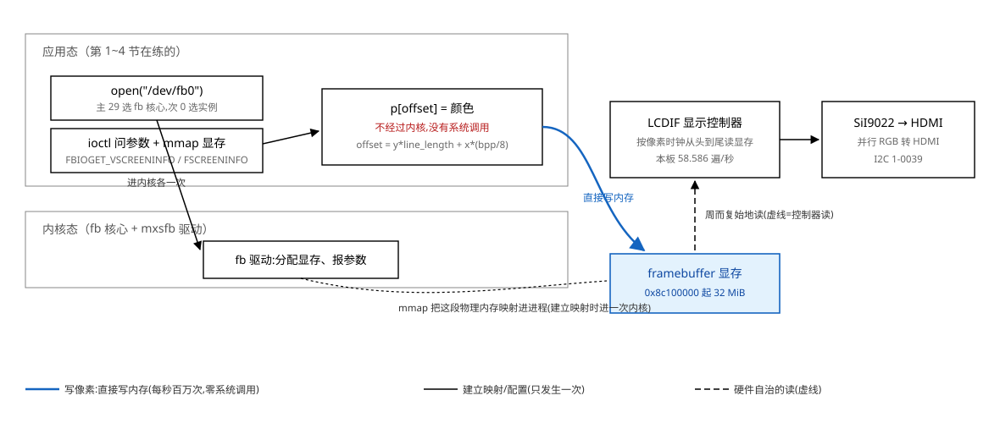
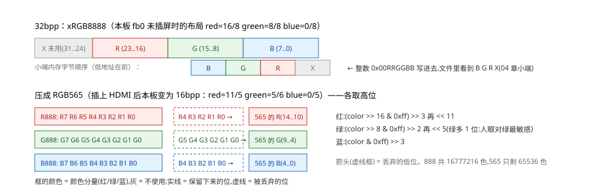

# 05 Framebuffer 应用编程

    原书    第四篇 第 5 章，PDF 174-181 页（8 页，全章只有一集视频）
    视频    4_5-1（14 分）——知识已全部融入本篇，不必再看
    源码    $Q\04_...\source\07_framebuffer\show_pixel.c
    实验    Knowledge/labs/05_framebuffer/（fbinfo、fakefb 为本篇配套；
            probe/ 下 8 个探针。WSL 侧"本机实测"均为 2026-10-16 真跑，
            板上输出为 2026-09-14/22 实测归档）

---

**前置基础**：看懂本篇需要下面的底子。开读前扫一眼，缺哪条先补哪条；
标了"用到再读"的可以等正文引用时再翻。

- 先读 [10 驱动与设备文件](../../fundamentals/10_驱动与设备文件.md)：
  设备节点、mknod、ENODEV 与 ENOTTY 的区别——§1.2 一开场就在用
- 前一章 [04 文件 IO](./04_文件IO.md)：open/read/write/mmap/ioctl 是本篇的
  手脚，§2 起全程在用
- 再往前 [01 HelloWorld 背后没那么简单](./01_HelloWorld背后没那么简单.md)：
  §4.4 的板测流程（交叉编译静态程序打 tar、串口上传、回读对账）与本篇同一条路
- 用到再读 [09 虚拟内存与mmap](../../fundamentals/09_虚拟内存与mmap.md)：
  §2.4 讲映射越界 SIGSEGV、显存多大≠能访问多少时引用
- 用到再读 [11 显示原理](../../fundamentals/11_显示原理.md)：§1.3 的行场时序
  与帧率、§5 的 EDID 和插线后改分辨率都指过去
- 用到再读 [12 进程与信号](../../fundamentals/12_进程与信号.md)：
  §4.2 给出厂 GUI 发 SIGTERM 请它优雅退出时引用

**这一章在整机里的位置**：上接 04 篇（open/ioctl/mmap）与 01 篇的上板流程，下接
06 篇（文字）与 Project 的 display 层。它补的零件是"显示就是写内存"：问驱动要
参数、把二维坐标拍扁、按位段拼颜色、直接写显存。刀 2/4/9 都建在它上面。

**不学它会怎样**：画面写不上去；行宽写死成 `xres*bpp/8`，在带填充的假显存上
会错行（板上两种模式恰好相等，永远看不出来）；16/32bpp 位段拼错，颜色全反；
GUI 占着屏幕时画了也看不见；mmap 越界不是返回错误，是 SIGSEGV。

## 0 这一章解决什么问题

### 0.1 先看结果：红 100，白 614300

在板上停掉 GUI，画一条红线（100 个像素），再把整块显存 `dd` 回来数：

```text
red=100 white=614300          合计 614400 = 1024 × 600
```

2026-09-14 板上实测。本章就是把这三个数拆开：谁在读这块内存、坐标怎么变成
偏移、颜色怎么拼、写进去为什么不用系统调用。

### 0.2 这一章为什么存在

一句话：**屏幕自己记不住画面，有一个硬件在不停地读一块内存；你想改屏幕，
改那块内存就行了。**

从应用写一个像素到显示器看到它，两条路径（其余细节全是这两条的注脚）：



图里最重要的是那条蓝线：**写像素这一步不经过内核。** open、ioctl、mmap 各进
一次内核，之后每秒画几百万个像素一次系统调用都不发。屏幕能跟上，是右边那个
控制器自己在不停地读。

三条贯穿全章的线：

1. **显示就是写内存**（第 1 节）。谁在读、内存多大、在哪，都能从驱动问出来。
2. **二维坐标拍扁成一维**（第 2 节）。行起点要用驱动给的 `line_length`。
3. **颜色是几个位段拼起来的**（第 3 节）。位段在哪、多宽，驱动也告诉你。

WSL 里没有可用的 framebuffer（1.2 节），所以电脑上用**假显存**练第 2、3 条，
板子上验第 1 条。第 4 节上板处理"这块内存不止你一个人在写"，第 5 节插显示器，
第 6 节对账 Project 的 display 层。

### 0.3 怎么读这一章

    只想先看见结果   0.1 → 1.3（fbinfo 把驱动问出来）→ 2.1（坐标拍扁）
    完整学一遍       1 → 4；5 插显示器时再看，6 对账 Project
    选读，第二轮再看 4.5（读显存慢 10 倍与三条设计结论）、9（延伸 A~D）

---

## 1 显示就是写内存

### 1.1 LCDIF：按固定节拍读内存的硬件

屏幕每个像素要亮成什么颜色，必须有人每秒告诉它几十遍。干这件事的是 SoC 里的
**显示控制器**（i.MX6ULL 上叫 LCDIF），工作只有一句话
（[fundamentals/11](../../fundamentals/11_显示原理.md) 把它写成两个计数器）：

> 按固定节拍，从内存里某个地址开始，一个像素一个像素往后读，读到一帧末尾
> 就回到开头。

驱动把"从哪个地址开始读、读多宽多高、每个像素几位"告诉控制器，应用改那块
内存（framebuffer）就行了。这里藏着一个第 4 节反复用的结论：**控制器不管是
谁写的**——你写、GUI 写、内核控制台写，它照读不误，谁最后写屏幕上就是谁的。
本板每秒读 58.586 遍，这个数 1.3 节自己算出来。

### 1.2 [做 L1] /dev/fb0 是怎么找到驱动的

先读 [fundamentals/10](../../fundamentals/10_驱动与设备文件.md)：设备文件里只存
类型和主、次设备号，主设备号选驱动、次设备号选实例；号码没人登记报 `ENXIO`，
登记了没有实例报 `ENODEV`。把这件事放到 fb0 上看一遍。

**板上**（PowerShell，2026-09-14 归档）：

```powershell
.\Tools\serial-board.ps1 'ls -l /dev/fb*; grep -n fb /proc/devices; ls -l /sys/class/graphics/fb0/device'
```

```text
crw-rw---- 1 root video 29, 0 Jan  1 00:00 /dev/fb0     字符设备 29:0,属组 video
11: 29 fb                                               主设备号 29 = fb 核心
lrwxrwxrwx ... /sys/class/graphics/fb0/device -> ../../../21c8000.lcdif
```

fb0 的 device 链接指向物理地址 0x021c8000 的 LCDIF 控制器，管它的驱动叫
`mxsfb`。权限 `rw-rw---- video`：**普通用户不在 video 组打不开**（本板串口登录
root，不受影响）。

**WSL 里造一个同款节点**（要 root：`wsl -u root`；**在 `~/fblab` 里做**，
`/mnt/e` 上 mknod 直接报 Operation not supported）：

```bash
mkdir -p ~/fblab && cd ~/fblab
mknod fb_fake c 29 0            # c=字符设备 29=主设备号 0=次设备号
L=/mnt/e/Workspace/Embedded-linux/Knowledge/labs/05_framebuffer
gcc -Wall -o fbopen $L/probe/fbopen.c
./fbopen fb_fake data.txt
```

本机实测（2026-10-16，对普通文件的 ioctl 那两行同一次跑出）：

```text
fb_fake     open  失败 errno=19 No such device          ← ENODEV:没有 fb 实例
data.txt    ioctl 失败 errno=25 Inappropriate ioctl for device
```

三件事对上账：WSL 内核编进了 fb 核心（`/proc/devices` 有 `29 fb`）、
`/sys/class/graphics` 下只有 `fbcon` 没有任何实例（`/dev/fb*` 不存在）、
所以造得出节点但 open 报 **ENODEV(19)**。对普通文件则 open 成功、ioctl 报
**ENOTTY(25)**，这个驱动不认这个请求码。两个 errno 分清：

    ENODEV (19)   open 就失败:号码对应的设备不存在
    ENOTTY (25)   open 成功了:但驱动不认这个请求码

**这就是 WSL 练不了真 framebuffer 的原因**，和装什么软件无关——内核里没有
显示控制器的驱动实例。电脑上练地址和颜色用假显存（第 2 节）。

### 1.3 [做 L2] fbinfo：把驱动知道的全部问出来

描点需要的数：分辨率、bpp、每行字节数、显存地址和大小、RGB 各占哪几位。
全在两个结构体里，`ioctl` 两个请求码问出来（实验
`Knowledge/labs/05_framebuffer/fbinfo.c`，完整代码在 labs）：

```c
struct fb_var_screeninfo var;           /* 可变: 分辨率、bpp、颜色位段、时序 */
struct fb_fix_screeninfo fix;           /* 固定: 显存物理地址、大小、行宽 */
int fd = open("/dev/fb0", O_RDWR);
ioctl(fd, FBIOGET_FSCREENINFO, &fix);   /* fd / 请求码 / 结构体地址 */
ioctl(fd, FBIOGET_VSCREENINFO, &var);   /* 成功 0,失败 -1(不是 PDF 说的返回 fd) */
```

WSL 里先验报错分支，再交叉编译 `-static` 上板（板上 glibc 2.30 比工具链旧，
动态版起不来；`-Wextra` 对这一章满地的 `__u32` 很有用）。**必须分别编两个
平台**：`fb_fix_screeninfo` x86-64 上 80 字节、ARM 上 68 字节，而 fb 请求码
不带结构体大小（延伸 A），用错平台的头文件程序只会读到错位数据。

**板上实测**（2026-09-14，未插显示器）：

```text
[fix] id=mxs-lcdif smem_start=0x8c100000 smem_len=33554432 line_length=4096
[var] xres=1024 yres=600 bpp=32
[var] red=16/8 green=8/8 blue=0/8 transp=0/0 (offset/length)
[var] pixclock=20000 ps  left=140 right=160 hsync=20  upper=20 lower=12 vsync=3
对账1 行宽: xres*bpp/8=4096  line_length=4096  相等
对账2 大小: 可见区=2457600  smem_len=33554432  smem_len/可见区=13.65
对账3 刷新: 像素时钟=50.000 MHz  一行=1344 像素  一帧=635 行  帧率=58.586 Hz
```

逐行读：

- **smem_start=0x8c100000**：显存**物理地址**，应用拿不到（[fundamentals/09]），
  留着对账。**smem_len=32 MiB**，是一屏（2457600 字节）的 13.65 倍，
  驱动分的比一屏大得多（2.4 节、坑 6 都用到）。
- **line_length=4096**：一行 4096 字节 = 1024×4。
- **bpp=32 + 位段 red=16/8 green=8/8 blue=0/8**：xRGB8888（图 5）。
- **pixclock=20000 皮秒**：一拍 20 ns = 50 MHz；一行 1344 拍里只有 1024 拍是
  画面，其余是空白和同步（[fundamentals/11] 第二节）。帧率 =
  (1e12/pixclock) / htotal / vtotal。
- `/dev/fb1`（id=FG）是前景叠加层，多了 `transp=24/8`，本章不用。
- 回看 PDF 那句"固定参数很少用到"：行宽和显存大小都在 fix 里，**描点公式要
  行宽、截屏要知道只读多少，少一个都出事**（2.3、坑 6）。那句话只在
  "行宽恰好等于 xres×bpp/8 且从不截屏"时成立。

**判据是对账型**：同一个数从两条独立的路拿。板上：

```powershell
.\Tools\serial-board.ps1 'cat /sys/class/graphics/fb0/stride; fbset -i -fb /dev/fb0'
```

```text
4096                                    ← 与 fbinfo 对账 1 相等
mode "1024x600-59"
    # D: 50.000 MHz, H: 37.202 kHz, V: 58.586 Hz    ← 与对账 3 逐个相等
    geometry 1024 600 1024 600 32
    timings 20000 140 160 20 12 20 3                ← 七个时序参数逐个相等
    rgba 8/16,8/8,8/0,0/0
    Address: 0x8c100000                              ← 与 smem_start 相等
```

**注错见红**：`-DBUG_VTOTAL`（算帧率忘了纵向空白同步）和 `-DBUG_HVTOTAL`
（横纵都忘）编两个注错版上板（2026-09-14）：

```text
正确版:        一行=1344  一帧=635  帧率=58.586 Hz   ← 与 fbset 一致
BUG_VTOTAL:    一行=1344  一帧=600  帧率=62.004 Hz
BUG_HVTOTAL:   一行=1024  一帧=600  帧率=81.380 Hz
```

**62 Hz 和 81 Hz 看起来都"像个正常的刷新率"**，单看数字判断不出错，只有和
另一条路对账才抓得住。第一个注错版行频还是对的，对账要比到帧率这一级。

### 1.4 [判] 第 1 节的判据

    [ ] WSL: mknod c 29 0 的节点 open 报 ENODEV(19);对普通文件 ioctl 报 ENOTTY(25)
    [ ] 板上 fbinfo 的 line_length == sysfs 的 stride(4096)
    [ ] fbinfo 算出的帧率 == fbset 的 V: 频率(58.586);smem_start == fbset -i 的 Address
    [ ] 两个注错版与 fbset 对不上,且 62/81 Hz 这类"合理"数字说明单看数没用

---

## 2 像素在哪

### 2.1 第一性原理：二维坐标拍扁成一维

显存是连续字节，屏幕是二维的，控制器从左到右从上到下读。定位 (x, y)：

```text
offset = y * line_length + x * (bpp / 8)
地址   = fb_base + offset
```

PDF 和 show_pixel.c 写的是 `y * (xres * bpp / 8)`，**假设每行恰好 xres 个
像素**。本板两数相等（1.3 对账 1），源码在本板恰好对；2.3 节把它们造得不
相等，看会发生什么。

### 2.2 [做 L2] 假显存：在电脑上练描点

实验 `Knowledge/labs/05_framebuffer/fakefb.c`（完整代码在 labs）：用普通文件
冒充显存——`open`+`ftruncate` 撑到显存大小 + `mmap(MAP_SHARED)`（0 字节文件
直接 mmap 再写会 SIGBUS，[fundamentals/09]），memset 0xff 清白，按板上同款
公式描点，close 后改动落回文件。判据全部用 `od` 数字节，不靠眼睛：

```bash
gcc -Wall -O2 fakefb.c -o fakefb
./fakefb fb.raw 1024 600 32 4096          # 板子同参数
echo "red=$(od -An -v -tx4 -w4 fb.raw | grep -c 00ff0000) white=$(od -An -v -tx4 -w4 fb.raw | grep -c ffffffff)"
n=$(od -An -v -tx4 -w4 fb.raw | grep -n -m1 00ff0000 | cut -d: -f1)
off=$(( (n - 1) * 4 ))
echo "偏移=$off y=$((off / 4096)) x=$(( (off % 4096) / 4 ))  公式预期=$(( 300 * 4096 + 512 * 4 ))"
od -An -tx1 -j "$off" -N 4 fb.raw
```

- `od -An -v -tx4 -w4`：`-An` 不打地址列;`-v` 不省略重复行(少了它连续相同的
  行折成一个 `*`,计数就错);`-tx4 -w4` 4 字节一组一行一个像素,`grep -c`
  数的就是像素个数。

本机实测（2026-10-16）：

```text
xres=1024 yres=600 bpp=32 line_length=4096 实际用的行宽=4096 显存=2457600 字节
red=100 white=614300          合计 614400 = 1024 × 600
偏移=1230848 y=300 x=512  公式预期=1230848
 00 00 ff 00
```

最后一行值得停：写进去的整数是 `0x00FF0000`，文件里按顺序是 `00 00 ff 00`。
**小端**：最低字节放最前（x86 和本板 ARM 都是小端），所以 32bpp 像素在内存
里是 **B G R x**。第 4 节转图片靠这一条。

### 2.3 行宽为什么要用 line_length

`fb_fix_screeninfo` 单独有 `line_length` 字段——**如果它永远等于
xres×bpp/8，内核没必要单独给这个字段**。本板驱动源码（NXP 4.9.88 mxsfb.c）
就是 `xres * (bpp >> 3)`，所以本板恰好相等；但有的控制器要求行按 4/8 字节
对齐、行尾有填充，有的驱动让 xres_virtual 大于 xres。

用假显存把"行尾有填充"造出来：行宽给 4104（每行多 8 字节），画竖线，
`fix` 模式按 line_length 定位、`xres` 模式按源码那种算法定位：

```bash
./fakefb fbpad_fix.raw  1024 600 32 4104 fix  vline
./fakefb fbpad_xres.raw 1024 600 32 4104 xres vline
# awk 把每个红像素换算回坐标,按真实行宽 4104 换算(控制器按真实行宽读)
```

本机实测（2026-10-16）：

```text
-- fbpad_fix.raw                          -- fbpad_xres.raw
   y=0   x=512                              y=0   x=512
   y=100 x=512                              y=100 x=312
   y=300 x=512                              y=300 x=936
   y=598 x=512                              y=598 x=340
   红像素=600 占了 1 个 x, 600 行           红像素=600 占了 513 个 x, 599 行
```

用 `line_length`：600 个点全在 x=512，竖线。用 `xres*4`：每下一行写入位置比
控制器认为的行起点早 8 字节=**左偏 2 像素**（第 100 行偏 200 像素 → x=312），
偏到行首绕到上一行行尾（第 300 行 x=936）。屏幕上是一条斜拉满屏的线。
**PDF 公式的适用条件就是 `line_length == xres * bpp / 8`；直接用 line_length
这个条件就不用记了。**

### 2.4 [做 L1] 越界的点去哪了

`show_pixel.c` 的描点不查坐标。实验 `probe/oob.c`：x 越右界一个像素
（x=1024, y=100），y 越出映射区（0,600）。本机实测（2026-10-16）：

```text
画在 (1024,100), 实际落在 (0,101)        exit=0
写 (0,600) -> 地址 ...(映射区终点)
Segmentation fault                        exit=139
```

板上对真 /dev/fb0 同构（2026-09-14：落在 (0,101)；退出 139）。

- **x 越界不报错，点跑到下一行开头**——比崩溃更糟：程序"正常"，屏幕左缘
  多出一个点。
- **y 越界撞上映射区终点，SIGSEGV**。**板上显存明明有 32 MiB 照样段错误**：
  能访问多少看**你映射了多少**（[fundamentals/09] 页表）。

所以描点函数要么自己查边界，要么约定调用者不越界——Project display 层的
设计问题之一（第 6 节）。

### 2.5 [判] 第 2 节的判据

    [ ] 1024x600x32 行宽 4096:红 100 白 614300;第一个红像素偏移=1230848
    [ ] 那个像素 4 字节按序 00 00 ff 00(小端 B G R x)
    [ ] 行宽 4104:fix 版竖线占 1 个 x;xres 版占 513 个 x(第 100 行 x=312)
    [ ] (xres,100) 落到 (0,101);(0,yres) 退出 139

    注错见红:-DBUG_ROW_NO_PW 把行起点写成 y*xres(忘了乘每像素字节数):
    红像素还是 100 个,点整整齐齐画到第 75 行(300/4),
    偏移=309248 ≠ 预期 1230848 —— 计数判据绿着,位置对账把它抓住(2026-10-16)。
    **计数型判据只能证明"写了多少",证明不了"写在哪"。**

---

## 3 颜色怎么拼

### 3.1 第一性原理：一个像素就是几个位段拼起来

一个像素占 bpp 位，哪几位是红绿蓝由驱动决定，通过 `var.red/green/blue` 的
offset/length 告诉你（**位段**=整数里连续的若干位，offset 从最低位第 0 位数起）。
本板两种布局（图 6）：



- 32bpp xRGB8888：整数写法 `0x00RRGGBB`，小端内存里是 B G R X。
  show_pixel.c 32bpp 那支直接 `*pen_32 = color` 是对的，**纯属巧合**：
  它约定的颜色格式恰好和本板位段一样。若驱动给 `red=0/8 blue=16/8`（BGR），
  同样的代码红蓝对调。视频 7:35 自己说"没看 bitfield，用惯例"。
- 16bpp RGB565：R 5 位、G 6 位（人眼对绿最敏感）、B 5 位。

### 3.2 [做 L1] 888 压成 565 丢了多少

实验 `probe/rgb565.c` 把 2^24 种颜色全部压一遍再读回（本机 2026-10-16）：

```text
888 共 16777216 种, 压成 565 后剩 65536 种
RGB888     RGB565   补0读回   复制高位读回
0xFF0000   0xF800   0xF80000     0xFF0000
0xFFFFFF   0xFFFF   0xF8FCF8     0xFFFFFF
0x808080   0x8410   0x808080     0x848284
```

纯白补 0 读回 `0xF8FCF8` 偏灰，复制高位读回纯白保住；但 `0x808080` 反过来。
**两种放大各有对的时候，丢掉的位就是丢了**。16bpp 屏上"写进去再读出来"的
判据必须按 565 比。

### 3.3 [做 L2] 按位段拼色，不写死 switch

拼一个分量两步：**砍到位数（右移 8-length），挪到位置（左移 offset）**：

```c
r = (r >> (8 - var.red.length))   << var.red.offset;
g = (g >> (8 - var.green.length)) << var.green.offset;
b = (b >> (8 - var.blue.length))  << var.blue.offset;
```

fakefb 就是这么拼的。**判据 + 一个会假绿的注错**（2026-10-16，16bpp 横线
1024 像素）：

```text
正确:            FF0000→f800   00FF00→07e0   0000FF→001f
-DBUG_565_SWAP:  FF0000→f800   00FF00→03e0   0000FF→001f
                 (红绿位数写反:红取 6 位绿取 5 位)
```

**纯红那一条，注错版和正确版一模一样**：0xFF>>2=63，63<<11=0x1F800，写进
16 位恰好溢出成 0xF800。资料仓的 show_pixel 只画红色——**判据也只用红色的话
这个 bug 永远发现不了。颜色判据至少三原色各测一次。**

### 3.4 memset 为什么能清成白色

`memset(fb_base, 0xff, screen_size)` 能清白，因为**所有位为 1** 在任何 RGB
布局下都是白；0 同理是黑。清成红色不行——memset 按字节填，红色 `00 00 ff 00`
是四个不同的字节。整屏填非黑白色最快是先填好一行再按行复制（但注意 4.2 节
读显存慢 10 倍，源行要放普通内存）。

### 3.5 [判] 第 3 节的判据

    [ ] rgb565:16777216 压成 65536;纯白补 0 读回 0xF8FCF8
    [ ] 位段拼色:565 三原色 f800/07e0/001f
    [ ] 注错 BUG_565_SWAP:纯红假绿(f800),纯绿 03e0 才红 —— 三原色各测一次

---

## 4 上板：这块内存不止你一个人在写

本节板测全部是**未插显示器**状态（1024×600×32、行宽 4096），2026-09-14
归档；插上显示器后判据命令里的 bs/count/-tx4 要全部改（第 5 节）。流程
与 01 章相同：WSL 交叉编译静态程序打 tar → 串口上传 → dd 回读 /dev/fb0
→ 下载回电脑转 PNG。上传实录（1 次真实损坏重传）：

```text
警告: block 6/17 arrived damaged (attempt 1), sending it again
fbboard.tar -> /tmp/ch03/fbboard.tar: 983040 bytes, 17 blocks, 1 resent, 70.8 s, sha256 OK
```

### 4.1 找出占着屏幕的程序

出厂 GUI 是 `mxapp2`（Qt），由 `/etc/init.d/S99myirhmi2` 拉起
（`QT_QPA_PLATFORM=linuxfb`，Qt 的显示后端就是直接写 framebuffer）。
证明它在用 fb0，看它的 fd 表和映射表：

```text
ls -l /proc/<pid>/fd | grep fb     →  4 -> /dev/fb0
grep /dev/fb0 /proc/<pid>/maps     →  71153000-73153000 rw-s 8c100000 00:06 9788  /dev/fb0
```

maps 那行逐列读：长度 0x2000000=**32 MiB（GUI 把整个显存都映射了）**；
`rw-s` 的 s 就是 MAP_SHARED；偏移列 `8c100000` 正是 smem_start——**三条独立
的路拿到同一个数**（fbinfo、fbset、GUI 的 maps），原因见延伸 C。

### 4.2 GUI 在跑时画一条线：回读计数

画完立刻数、隔 3 秒再数（`dd bs=4096 count=600` 恰好一屏，为什么必须带
count 见坑 6）：

```text
red now: 100  white now: 613889      ← 白像素比应有的 614300 少了 411
red after 3s: 100  white after 3s: 613887
```

再用 `cmp -l` 抓两次截屏的全部差异字节换算成坐标框：

```text
changed bytes=92 box x=997..1002 y=8..16
```

3 秒里只有 92 个字节变了，全在右上角 6×9 像素的小框——拉回图片一看是
**时钟的秒位**。**GUI 不整屏重画，只重画它变化的那一小块。** 你画的
东西"大部分时候还在"，被擦掉的只是恰好重叠的部分——比整屏被擦更难排查。

### 4.3 停掉 GUI 再画

```text
/etc/init.d/S99myirhmi2 stop          # killall mxapp2
pidof mxapp2                          # 必须等它是空的
```

实测两次 stop 等 1 秒结果不同：一次 `[]`，一次还有 pid——**killall 只递
SIGTERM 递到就返回，GUI 要自己收拾完才退出**（[fundamentals/12] 量过装了
处理函数的程序收到 SIGTERM 又活了 2 秒）。确认空了再画：

```text
red: 100  white: 614300               ← 与公式逐项相等
两次隔 3 秒的 md5 相同                 ← 屏幕上只剩你一个写者
```

恢复：`S99myirhmi2 start`（会把 Qt 日志混进串口输出）或重启。

### 4.4 不插显示器也能截屏

```powershell
.\Tools\serial-board.ps1 'dd if=/dev/fb0 bs=4096 count=600 of=/tmp/ch03/line.raw 2>/dev/null'
.\Tools\serial-board.ps1 -Download /tmp/ch03/line.raw -To .\Knowledge\labs\05_framebuffer\line.raw
python3 Knowledge/labs/05_framebuffer/probe/raw2png.py line.raw 1024 600 4096 line.png
```

raw2png.py 用标准库写 PNG（无第三方依赖），核心一件事是把每像素的 `B G R x`
重排成 RGB（2.2 节的小端）。实测：白底+红线那张 gzip 后 2440 字节 0.6 秒；
GUI 画面那张 659624 字节传了 79 秒。**串口截屏耗时取决于画面能压多小**。
GUI 截屏还有个发现：整帧 614400 像素**高字节不是 ff 的一个都没有**
（GUI 写 0xffff0000，show_pixel 写 0x00FF0000；fb0 的 transp=0/0 控制器不读
这 8 位，两者都正常显示）。**回读比颜色时高 8 位要么屏蔽要么和写入方约定好。**

### 4.5 读显存比写显存慢 10 倍

`probe/rwbench.c`：同样 2.4 MiB 一次 memcpy，三个方向各 5 轮取最短
（2026-09-14，两遍）：

```text
写 内存->显存     4.9 ms    481 MiB/s
读 显存->内存    49.8 ms     47 MiB/s      ← 慢 10 倍
对照 内存->内存    6.2 ms    378 MiB/s
```

出处是驱动给映射设的内存类型 writecombine（写合并），源码摘录见延伸 B；
读慢 10 倍是实测，CPU 在该类型上怎么处理读，没做进一步实验不下结论。
`probe/fillbench.c` 整屏涂色三种写法（-O2 与 -fno-inline 各一组）：

```text
                    -O2(内联)   -fno-inline
A 逐点写显存         2.5 ms      17.2 ms     ← 关掉内联涨 7 倍:函数调用比写内存贵
B 逐行 memcpy       50.5 ms      50.4 ms     ← 源数据从显存读,慢在读(≈rwbench 的 49.8)
C 离屏画完一次拷贝    7.4 ms      22.4 ms     ← 多出来的 ≈5 ms 是最后那次 memcpy
```

**三条设计结论**（Project display 层的依据）：

1. **显存当只写的用**：要读回的内容（背景/界面）自己在普通内存留一份。
2. 画大量像素时**接口粒度应该是一块不是一个点**（函数调用开销比写内存大）。
3. **离屏画完一次拷贝**只多 ≈5 ms，换来屏幕上永远不会出现画一半的帧。

### 4.6 [判] 上板清单

    [ ] GUI 的 maps:/dev/fb0 行偏移列 == smem_start(0x8c100000)
    [ ] GUI 在跑:画线后白像素 < 614300;cmp 变化框落在时钟秒位
    [ ] GUI 停掉:pidof 空;红 100 白 614300;隔 3 秒两次 md5 相同
    [ ] line.raw 下载 sha256 OK,PNG 白底红线;gui.raw 高字节非 ff 的像素为 0
    [ ] oob:(1024,100)→(0,101);(0,600) 退出 139
    [ ] rwbench 读显存比写慢约 10 倍;fillbench 三种写法的三个结论说得出

---

## 5 插上 HDMI 显示器以后

i.MX6ULL 只有 LCDIF 一个显示控制器，输出并行 RGB；HDMI 是板上 SiI9022
（I2C 总线 1-0039）转出来的，驱动经 I2C 配它。未插屏时
`/sys/bus/i2c/devices/1-0039/cable_state` 是 `plugout`。

**插线会发生什么，驱动源码说了算**：sii902x 检测到插线后读显示器的 EDID
（显示器自存的"我支持哪些模式"表，[fundamentals/11] 第五节），选一个模式后
**把 framebuffer 的分辨率改掉**。板上实测（2026-09-14，GUI 保持停止）：

```text
cable_state: plugin
dmesg 一行都没多(全是开机 1.2 秒内打的)      ← 驱动改了模式却不留日志
modes: 从 1 行变成 18 行(显示器 EDID 报上来的)
fbinfo: xres=1280 yres=720 bpp=16 line_length=2560
        red=11/5 green=5/6 blue=0/5 (RGB565)
        对账3: 74.250 MHz / 1650 / 750 / 60.000 Hz   ← 与 fbset 逐个相等
smem_start / smem_len 没变                    ← 同一块内存,解读方式变了
```

显示器报了 1920×1080，驱动为什么选 720p、为什么 bpp 降到 16，取决于 100ask
改过的驱动，拿不到那份源码不做推测，只记实测。**视频说"一个 LCD 定了就定了"，
在 HDMI 上不成立**，这就是所有程序必须运行时 ioctl 问分辨率、不能写死
1024x600x32 的原因。

**同一个 show_pixel 不重编照样画**（判据按新模式改：bs=2560 count=720、
-tx2、红 f800 白 ffff）：

```text
f800: 100  ffff: 921500        合计 921600 = 1280 × 720
```

它运行时 ioctl 读 bpp，自动走进 case 16。**当初把 1024、600、32 写死的话，
插上显示器这一刻程序就画错了。**

**彩条对账**：`probe/bars.c` 运行时读分辨率，画 8 条等宽竖彩条
（红绿蓝白黄青品红黑）+ 四周 1 像素白边，按 var 位段拼色；回读按像素值分组
计数（2026-09-14）：

```text
 114162 0000(黑)  114880 001f(蓝)  114880 07e0(绿)  114880 07ff(青)
 114162 f800(红)  114880 f81f(品)  114880 fffe0(黄) 118876 ffff(白)
合计 = 921600 = 1280 × 720;八个数逐项等于按分辨率推算的值
```

每个数都能事先算出来（左右边框各吃掉红/黑一列：159×718=114162；白=白条
+上下两行+左右两列）。**八个数逐项相等**——颜色拼错会让 f800 和 001f 互换，
边框少画一圈红黑白数全变，比数红点强得多。截图拉回转 PNG 后肉眼确认：
颜色顺序一致、四边白框看得见（2026-09-14 已确认）。
**还欠：拔掉显示器后模式是否变回 1024x600x32（未测）。**

---

## 6 落进 Project：display 层已在

本章的知识在 `Project/display/` 里已经落地（`disp_manager.c` +
`framebuffer.c` 真 fb 后端 + `memdisp.c` 假显存后端，注册链表同形于量产工具
的 `DispOpr`——manager 只认函数指针表，加后端不改 manager）。
为什么这么长、每个决定怎么来的，全过程在
[`Engineering/TechReports/project/03-display层-两个后端与一张能数的图.md`](../../../Engineering/TechReports/project/03-display层-两个后端与一张能数的图.md)；
本节只留三件本章实测直接决定的事：

1. **行宽用 fix.line_length**（2.3 节），且假显存后端的行宽故意带填充——
   板上两种模式的行宽都恰好等于 xres×bpp/8（4096、2560），
   **这个错在板上永远看不出来**，只有带填充的假显存能让它现形。
2. **接口粒度是一块不是一个点**（4.5 结论 2）：display 层有画点也有区域刷新。
3. **越界拒绝**（2.4 节）：put_pixel 查边界返回错误码。

判据跑法（WSL 无 fb0，用 mem 后端，与 check.sh 一致）：

```bash
cd /mnt/e/Workspace/Embedded-linux/Project
export DISP_DEV=mem FONT_DEV=builtin INPUT_BACKEND=replay INPUT_REPLAY=/dev/null
./build/x86/product_tool        # display init OK / exit OK 在日志里
bash check.sh                   # TOTAL 124 PASS / 0 FAIL / 0 SKIP(display 是 [1]~[10] 组)
```

上板验收（2026-09-22 已完成，不插显示器组）：停 GUI 后 disp_test 报
`mode 1024x600x32 line_length 4096` 与 fbset 一致；dd 读回一屏交板上 count.sh
计数，与电脑假显存预演逐项相等（614359/12/12/12/4/1）；两次 dd sha256 相同。
当年教学用的 D1~D7 七步施工法（先规格后实现）连同判据数字在 git 历史的
上一版；现在代码已定稿，读代码 + 跑判据 + 注错（`check_core.sh` 里的
display 组注错）代替重走。

---

## 7 自检问题

答不上来就回对应小节。

    1. 应用画一个像素发几次系统调用？屏幕为什么能跟上？             (0 1.1)
    2. WSL 里 mknod c 29 0 造的节点 open 报什么？与 ENOTTY 差在哪一步？
       节点为什么不能建在 /mnt/e 下？                              (1.2)
    3. 描点要的数哪些在 var、哪些在 fix？"fix 很少用到"何时成立？    (1.3)
    4. pixclock 和六个空白同步参数怎么算出帧率？只用分辨率算会得几？ (1.3)
    5. fb_fix_screeninfo 两平台为什么不一样大？请求码能帮你发现吗？  (1.3 延伸A)
    6. 像素偏移公式是什么？PDF 公式的适用条件？                     (2.1 2.3)
    7. 行尾 8 字节填充却用 xres*4 定位，竖线变成什么样？             (2.3)
    8. x 越右界一点落在哪？y 越映射区呢？显存 32 MiB 为什么还段错误？(2.4)
    9. 只数红像素个数的判据会放过哪种 bug？                         (2.5)
   10. 888 压 565 剩几种颜色？纯白读回为什么可能变灰？               (3.2)
   11. 按位段拼一个分量是哪两步？                                   (3.3)
   12. 565 红绿位数写反，为什么纯红测不出来？                       (3.3)
   13. memset 为什么能清白不能清红？                                (3.4)
   14. 怎么证明 GUI 在用 /dev/fb0？maps 偏移列的 8c100000 是什么？   (4.1 延伸C)
   15. GUI 在跑时你画的线会被整屏擦掉吗？怎么用数字回答？            (4.2)
   16. killall 后立刻查为什么可能还在？可靠的 stop 怎么写？          (4.3)
   17. 不插显示器怎么截屏？dd 为什么必须带 count？                  (4.4 坑6)
   18. 读显存和写显存哪个快？对 display 层接口设计意味着什么？        (4.5)
   19. 插上 HDMI 分辨率为什么可能变？谁改的？模式清单从哪来？        (5)
   20. 本板插屏后 bpp 变几？第 4.2 节 grep -c 00ff0000 为什么失效？  (5 坑11)

---

## 8 已知的坑

    坑 1  WSL 没有 /dev/fb0,mknod 也没用(ENODEV);节点要建在 ~ 下
          (/mnt/e 上 mknod 报 Operation not supported,/tmp 带 nodev)。    (1.2)

    坑 2  出厂 GUI 不整屏擦你的画,只擦它变化的那块(实测 3 秒 92 字节,
          时钟秒位)。"看着没问题"不证明没冲突。上板前停 GUI 并 pidof 确认。(4.2)

    坑 3  killall 之后进程不会立刻消失(SIGTERM 递到就返回)。
          停完轮询 pidof 到空,或写等待型 stop。                          (4.3)

    坑 4  只数个数的判据会放过整体平移:行起点少乘像素宽度,红点还是 100 个,
          挪到了第 75 行。每组判据至少一条位置对账。                      (2.5)

    坑 5  纯红测不出 565 位数写反(溢出后恰好还是 f800)。三原色各测一次。  (3.3)

    坑 6  cat /dev/fb0 读出 32 MiB 不是一屏(实测 33554432;驱动没设
          screen_size 时能读的总长是 smem_len,见延伸 D)。截屏必须
          bs=<line_length> count=<yres>,否则 2.4 MiB 变 32 MiB。         (4.4)

    坑 7  GUI 写的像素高字节是 ff。grep -c 00ff0000 只数得到写 00 的程序。  (4.4)

    坑 8  /dev/fb0 权限 crw-rw---- root video。普通用户要加 video 组。     (1.2)

    坑 9  串口截屏耗时取决于画面可压缩度:白底 0.6 秒,GUI 画面 79 秒。
          反复截屏用纯色背景。                                            (4.4)

    坑 10 插上显示器 bpp 32→16:dd 的 bs/count、od 的 -tx 宽度、颜色值
          全部要按新模式改,先跑一次 fbinfo 再定,不能抄一套数字用到底。     (5)

---

## 9 延伸（选读，不影响主线）

**延伸 A：同一个结构体两平台不一样大。** `fb_fix_screeninfo` 里 smem_start 是
`unsigned long`：x86-64 上 8 字节、ARM 上 4 字节，从 smem_len 起每个字段都挪位
（sizeof：80 vs 68；smem_len 偏移 24 vs 20）。实验 `probe/fbabi.c` 把大小变成
数组长度用 `nm -S` 读，**不运行程序一次看两平台**。工程含义：fb 请求码不带
结构体大小（`0x4602` 是裸数字），布局对不对全靠编译时头文件和目标平台一致。

**延伸 B：读显存为什么慢。** 驱动 mmap 时设了 `pgprot_writecombine`
（NXP 4.9.88 mxsfb.c：`vma->vm_page_prot = pgprot_writecombine(...)`），
ARMv7 内存类型表里 BUFFERABLE 行的缓存属性与 CACHED 不同。写合并的名字就说明
它冲着写优化；读慢 10 倍是实测，机理未深究。

**延伸 C：maps 偏移列为什么是物理地址。** 驱动 mmap 里
`vma->vm_pgoff = (smem_start + offset) >> PAGE_SHIFT`——把偏移改写成了物理页号，
maps 原样打出来。

**延伸 D：cat /dev/fb0 为什么读出 32 MiB。** 内核 fb_read 里
`total_size = info->screen_size; if (0) total_size = fix.smem_len;`，
驱动没设 screen_size 时能读到整块显存。

**顺带一提（跳过不影响）**：ysyx 的 NEMU VGA 是同一个形状（写 vmem、模拟器按
节拍刷 SDL）；龙芯 SoC 的 DVI 扫描器就是本章那个"显示控制器"的 RTL 版，
fbset 那行 timings 就是你当年写进寄存器的行场参数。[fundamentals/11] 第六节
有完整对照。

---

## 10 这一章交出了什么

现在能独立做到：

- 用 `ioctl` 把驱动知道的全部问出来：分辨率、bpp、行宽、显存地址与大小、时序
- 用 `line_length` 把二维坐标拍扁，解释为什么会有一行填充
- 按位段拼 32bpp 与 16bpp 的颜色，说得出 888 压成 565 丢了什么
- 在假显存上预演、在板上回读计数，两边逐项相等才算画对
- 停掉占着屏幕的 GUI，并确认真的停了
- 说得出"读显存比写慢 10 倍"和"接口粒度是一块不是一个点"这两条设计结论

还不能做：

- PXP 硬件转换/缩放/叠加（刀 2、刀 4）
- 在屏幕上画字（第 06 篇）
- 显示驱动的内部实现（第 2 阶段）
- 双缓冲/翻页（本仓未做）

这一章在整机里的位置：它是 display 层在应用侧的全部依据。06 篇的每个字都要
写进这块显存；OSD、GUI 页面、彩条实验都从这里开始；刀 2/4/9 直接复用它。

下一章：[06 文字显示](06_文字显示.md)。
