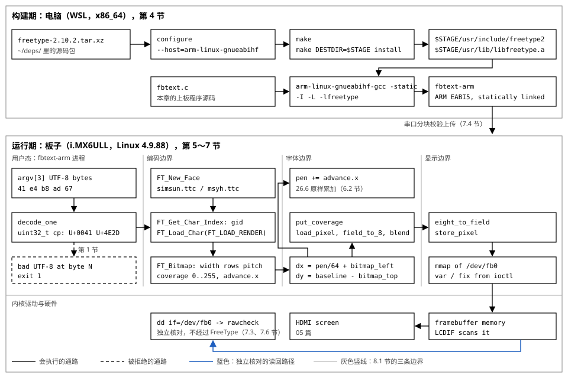

# 06 文字显示

    实验    Knowledge/labs/06_text/（utf8、bitmap8、hzk16、ftprobe、ftangle、
            fbtext、rawcheck；check.sh 60 PASS / 0 FAIL / 0 SKIP）
    电脑    WSL Ubuntu 26.04，gcc 15.2.0，arm-linux-gnueabihf-gcc 15.2.0，
            本机 FreeType 2.14.2，交叉构建 FreeType 2.10.2
            （本篇"本机实测"均为 2026-10-20 实跑）
    板子    100ASK_IMX6ULL Pro，Linux 4.9.88，glibc 2.30
            （板上输出为 2026-09-16、2026-09-23 实测归档）

---

**读前须知**：看懂本篇需要下面的底子。开读前扫一眼，缺哪条先补哪条；
标了"用到再读"的可以等正文引用时再翻。

- 先读 [13 数据表示：字节序、位序与定点数](../../fundamentals/13_数据表示_字节序位序与定点数.md)：
  UTF-8 要把几个字节里的位一段段拼出码点、点阵字节的 bit7 画在最左、FreeType
  的步进是 26.6 定点数。这三件事说的是同一门语言：一串位按哪份约定解释
- 前一章 [05 Framebuffer 应用编程](./05_Framebuffer应用编程.md)：字最终要写进
  显存才看得见。line_length、RGB 位段、停掉占屏的 GUI，第 7 节上板时直接用
- 用到再读 [14 第三方库的交叉构建与部署](../../fundamentals/14_第三方库的交叉构建与部署.md)：
  第 4 节只把交叉构建 FreeType 的主线走一遍，staging、prefix 与 DESTDIR、
  编译/链接/运行三个时刻的完整模型在那篇
- [01 HelloWorld 背后没那么简单](./01_HelloWorld背后没那么简单.md)：交叉编译器、
  上板一律静态链接的规矩，第 4 节直接用它的结论

**这一章在整机里的位置**：上接 05 篇（framebuffer，[05 Framebuffer 应用编程](05_Framebuffer应用编程.md)第 1 节），
下接 07 篇（输入系统，待写）。它补的零件是"字节 → 码点 → 字形 → 灰度覆盖图 →
像素"这条链；Project 的 font 层就是它。

**不学它会怎样**：中文显示成乱码，或者程序不报错、稳定地显示成另一个字；点阵
字节的位序弄反，字是镜像的而你自己看不出来；advance 的 26.6 定点数提前取整，
一行字越排越歪；灰度值直接当颜色写屏，字变成纯蓝色、边缘一圈锯齿；交叉构建的
FreeType 装错位置，板上加载失败。

## 0 起点

### 0.1 先看结果：8 个字节，3 个码点，2162 个像素

在电脑上给本章的 UTF-8 解码器喂三个字符（本机实测）：

```text
$ ./utf8 'A中🙂'
bytes=8
U+0041 at=0 len=1
U+4E2D at=1 len=3
U+1F642 at=4 len=4
summary codepoints=3 errors=0
```

8 个字节解出 3 个码点，长度分别是 1、3、4。在板上，同一套链路的末端把两个
字母画进显存（2026-09-16 板上实测归档，第 7 节完整展开）：

```text
glyphs=2 missing=0 covered=2162 mid=609 written=2162 clipped=0
```

两个 glyph，2162 个被墨迹覆盖的像素，其中 609 个是半覆盖的抗锯齿边缘，2162 个
全部写进了 framebuffer，0 个被裁掉。从"8 个字节"到"2162 个像素"中间发生了什么，
就是这一章。

### 0.2 这条链分五步

```text
文件里的字节        码点               字形            覆盖图          屏幕像素
41 e4 b8 ad    U+0041 U+4E2D      轮廓或点阵      每像素 0..255    framebuffer
     |               |                |               |               |
     +-- 第 1 节 ----+                |               |               |
     UTF-8 解码      |                |               |               |
                     +-- 第 2/3/5 节 -+               |               |
                     编码值选字形     |               |               |
                                      +-- 第 5 节 ----+               |
                                      光栅化成灰度图  |               |
                                                      +-- 第 7 节 ----+
                                                      混色后写显存
```

从左往右读：每一节把左边一栏的东西变成右边一栏的东西。

- 第 1 节：字节流还原成码点。"它是谁"。
- 第 2、3 节：两种点阵字库，ASCII 的 8x16 和中文的 HZK16。码点在这里只是
  一个数组下标。
- 第 4 节：点阵不够用，换矢量字体；FreeType 这个库先从源码交叉构建出来。
- 第 5、6 节：FreeType 把码点变成灰度覆盖图，再沿基线排成一行。"它长什么样、
  摆在哪"。
- 第 7 节：覆盖图和颜色混合，写进板子的 framebuffer，再把显存读回来对账。

**这一节搭好的积木**：全章的问题定义好了，结尾要能用机制解释 0.1 的每个数字。
第一个问题：文件里的 `41 e4 b8 ad` 这几个字节，凭什么还原成 A 和"中"？

---

## 1 文件里的字节怎么还原成"哪个字"

### 1.1 一个字符在文件里就是一个数

先看最小的实验：让文件里只有一个字母 A，看它实际上存了什么。

要回答的问题：一个写着 A 的文件，里面的字节是什么？

```bash
printf 'A' > a.txt     # printf 把参数原样写到标准输出，> 把它存进文件
xxd a.txt              # xxd 按字节显示文件内容
```

本机实测：

```text
00000000: 41                                       A
```

文件里只有一个字节，值是 0x41。屏幕上那个 A 的形状一点都不在文件里；文件里只有
一个数。0x41 和字母 A 的对应关系是一套约定，叫 ASCII：给 128 个常用字符各分配
一个 0 到 127 的编号。`man ascii` 可以查这张表（Linux 的 man 手册第 7 节）：

```bash
man ascii | col -b | grep -E '\b41\b' | grep -w A
```

- `man ascii`：显示 ascii(7) 手册页。
- `col -b`：man 的输出里带着用退格键实现的加粗控制符，`col -b` 把它们滤掉，
  否则后面的 grep 匹配不到干净的文本。
- `grep -E '\b41\b'`：留下含有独立的 `41` 的行；`\b` 是词边界，防止 41 匹配到
  141 里面去。

本机实测（表格行较宽，这里只留找到的那一行）：

```text
       001   1	   01	 SOH (start of heading)	     101   65	 41    A
```

这一行的后四列是八进制 101、十进制 65、十六进制 41、字符 A。同一个数，四种写法。

ASCII 有一个结构上的特点，后面每一步都要用到：128 个编号用 7 个二进制位就够了
（2^7 = 128），所以 ASCII 字节的**最高位 bit7 恒为 0**。验证一下，0x41 写成
二进制：

```text
0x41 = 0100 0001       bit7 是 0
```

"bit7 恒 0"意味着：拿到一个字节，只要看到它的最高位是 1，它就一定不是 ASCII。
第 1.2 节的中文编码和第 1.5 节的 UTF-8 都是从这一条缝里长出来的。

**这一节搭好的积木**：文件里存的是编号不是形状；A 的编号是 0x41；ASCII 用 7 位，
bit7 恒 0。接下来的问题：128 个编号装不下几千个常用汉字，中文怎么办。

### 1.2 128 个编号装不下中文：GB2312 与"一对多"

最直接的想法：编号不够用，就再加字节。GB2312（简体中文的国家标准字符集）的做法
是：ASCII 字符照旧占一个字节；非 ASCII 字符用**两个**字节表示，且两个字节的
bit7 都是 1。这样读到 bit7 为 0 的字节就知道是 ASCII，读到 bit7 为 1 的字节就
知道它和后面一个字节是一组。

亲眼看一遍。把 "A中" 转成 GB2312 存下来。`iconv` 是 glibc 自带的编码转换工具：

```bash
printf 'A中' | iconv -f UTF-8 -t GB2312 > gb.txt    # -f 输入编码，-t 输出编码
xxd gb.txt
```

本机实测：

```text
00000000: 41d6 d0                                  A..
```

A 还是 `41`；"中"是 `d6 d0`。看这两个字节和二进制位：

```text
0xd6 = 1101 0110       bit7 是 1
0xd0 = 1101 0000       bit7 是 1
```

和 ASCII 的区分规则对上了。问题出在另一面：**文件里并没有写"我用的是 GB2312"**。
同一串字节 `d6 d0`，换一张表就是另一个字。用 iconv 按三种不同的表解同一对字节：

```bash
printf '\xd6\xd0' | iconv -f GB2312     -t UTF-8; echo
printf '\xd6\xd0' | iconv -f BIG5       -t UTF-8; echo
printf '\xd6\xd0' | iconv -f ISO-8859-1 -t UTF-8; echo
```

- `printf '\xd6\xd0'`：printf 把 `\xHH` 解释成十六进制 HH 的那个字节，这里直接
  造出 `d6 d0` 两个字节。
- `iconv -f 某表 -t UTF-8`：按"某表"把输入解释成字符，再用 UTF-8 写回终端
  （本机终端按 UTF-8 显示）。
- 三张表：GB2312 是简体，BIG5 是繁体，ISO-8859-1 是西欧单字节表。

本机实测：

```text
中
笢
ÖÐ
```

同一对字节，三种解释，三个毫不相干的字符。用 GB2312 存的文件，到了默认按
BIG5 或 Latin-1 解释的系统上，显示出来的就是另外的字。这就是乱码的根源：
**数值和字符是一对多的，多出来的那条歧义由"当前系统默认用哪张表"来猜，而文件
自己什么都没说。**

顺便说清一个在 Windows 记事本里常见的词："ANSI" 保存格式。它不是一张固定的表，
它的意思是"当前系统区域设置里默认的那张表"：简体中文系统上是 GB2312，繁体系统
上是 BIG5。所以"这个文件是 ANSI 编码"这句话没有提供任何能用来解码的信息。
写接口文档、定协议的时候，要写 UTF-8 或写明具体代码页，不能写 ANSI。

**这一节搭好的积木**：双字节编码靠 bit7 和 ASCII 划界；同一串字节在不同的表下
是不同的字，乱码由此而来。要根治，就得让每个字符在全世界只有唯一一个编号。

### 1.3 Unicode：先给每个字符一个唯一的号

Unicode 做的事情只有一件：建一张全球共享的表，给每个字符分配一个唯一的编号，
这个编号叫**码点**（code point），记作 `U+` 加十六进制。几个例子（本机实测，
用 iconv 转成 UTF-32BE，每个码点固定占 4 个字节，大端，值就是码点本身）：

```bash
printf '中'  | iconv -t UTF-32BE | xxd
printf '笢'  | iconv -t UTF-32BE | xxd
printf 'A'   | iconv -t UTF-32BE | xxd
printf '🙂' | iconv -t UTF-32BE | xxd
```

```text
00000000: 0000 4e2d                                ..N-
00000000: 0000 7b22                                ..{"
00000000: 0000 0041                                ...A
00000000: 0001 f642                                ...B
```

逐行读：

- "中" = U+4E2D，上一节在 GB2312 和 BIG5 里撞成一对字节的 "中" 和 "笢"（U+7B22），
  在 Unicode 里是两个不同的号。一对多的歧义到此为止。
- A = U+0041，和 ASCII 的 0x41 一样。Unicode 把 ASCII 的 128 个编号原样保留，
  所以纯 ASCII 文本天然是合法的 Unicode 文本。
- 🙂 = U+1F642，超过了 16 位能表示的 0xFFFF。Unicode 的码点范围是
  U+0000 到 U+10FFFF，共 1,114,112 个编号。

到这里"它是谁"解决了。但码点是个整数，文件里存的还是字节。U+4E2D 这个数怎么
落成字节？直接把 `4e 2d` 写进文件行不行？不行：

```bash
printf '\x2d\x4e'; echo
```

```text
-N
```

`2d 4e` 恰好是 ASCII 的减号和大写 N。读文件的人无法判断这两个字节是一个"中"
还是两个 ASCII 字符。怎么在字节流里给字符划界，叫**编码实现**，UTF-16 和 UTF-8
就是两种不同的划界办法。

**这一节搭好的积木**：码点是字符的唯一编号，Unicode 解决"它是谁"；剩下的问题是
"码点怎么变成字节"。先看 UTF-16 的办法和它的问题。

### 1.4 UTF-16：定长两字节，丢一个字节整行错位

UTF-16 的办法：每个码点用 2 个字节（16 位）表示。用 iconv 把 "A中" 转成 UTF-16
的两种字节序各看一遍：

```bash
printf 'A中' | iconv -f UTF-8 -t UTF-16LE | xxd    # LE: 小端，低位字节在前
printf 'A中' | iconv -f UTF-8 -t UTF-16BE | xxd    # BE: 大端，高位字节在前
printf 'A中' | iconv -f UTF-8 -t UTF-16   | xxd    # 不指明时带上 BOM
```

本机实测：

```text
00000000: 4100 2d4e                                A.-N
00000000: 0041 4e2d                                .AN-
00000000: fffe 4100 2d4e                           ..A.-N
```

逐行读：

- LE：A 是 `41 00`，"中"是 `2d 4e`，低位字节在前，拼起来是 0x0041 和 0x4E2D。
- BE：同样两个码点，字节顺序整个反过来。
- 不指明字节序时，文件开头多两个字节 `ff fe`，这是 BOM（字节序标记），告诉
  读的人"后面是小端"。BOM 管的是端序，不管内容；字还是那些字。

UTF-16 有两个结构性弱点，都亲眼看得到。

弱点一：**丢一个字节，后面全部错位。** UTF-16 按两字节一组读，丢掉一个之后，
后面所有的分组都错了。造一个 "ab中" 的 UTF-16LE 文件，把头一个字节砍掉再解码：

```bash
printf 'ab中' | iconv -f UTF-8 -t UTF-16LE > u16.bin
xxd u16.bin
tail -c +2 u16.bin | iconv -f UTF-16LE -t UTF-8
```

- `tail -c +2`：从第 2 个字节开始输出，也就是丢掉第 1 个字节。

本机实测：

```text
00000000: 6100 6200 2d4e                           a.b.-N
iconv: incomplete character or shift sequence at end of buffer
戀ⴀ
```

原来 6 个字节是 `61 00 | 62 00 | 2d 4e` 三组；丢掉开头一个字节后重新两两分组，
变成 `00 62 | 00 2d | 4e`：U+6200 是"戀"，U+2D00 是"ⴀ"，最后还剩一个孤字节
报错。三个字符一个都没剩。**定长分组没有自恢复能力**，这是它不适合做文件和
传输编码的根本原因。

弱点二：**2 个字节装不下全部码点。** U+FFFF 以上的码点（比如 🙂 = U+1F642）要用
4 个字节，两个一组叫 surrogate 对：

```bash
printf '🙂' | iconv -t UTF-16LE | xxd
```

```text
00000000: 3dd8 42de                                =.B.
```

所以"UTF-16 每字符两字节"是不成立的；它同样是变长的，只是变长的规则藏得深。
另外 UTF-16LE 里字母 A 是 `41 00`，中间夹着一个 0x00；C 语言里 0x00 是字符串
结束符，这使得 UTF-16 文本没法直接用 `strlen`、`printf %s` 这一套处理。

**这一节搭好的积木**：UTF-16 定长两字节划界，丢字节全线错位，超 U+FFFF 还要
四个字节。下一个办法 UTF-8 放弃了定长，让每个字节自己报告它在一个字符里的位置。

### 1.5 UTF-8：首字节自己报告长度

UTF-8 的划界规则全部写在字节的高几位里：

```text
码点范围              字节模板                       载荷位数
U+0000..U+007F        0xxxxxxx                       7
U+0080..U+07FF        110xxxxx 10xxxxxx              5+6=11
U+0800..U+FFFF        1110xxxx 10xxxxxx 10xxxxxx     4+6+6=16
U+10000..U+10FFFF     11110xxx 10xxxxxx 10xxxxxx
                      10xxxxxx                       3+6+6+6=21
```

读法：首字节开头有几个 1，这个字符就占几个字节；`0xxxxxxx` 是单字节，和 ASCII
逐字节相同，所以 ASCII 文本天然是合法的 UTF-8；后续字节一律以 `10` 开头。
`x` 的位置是载荷，把各字节的载荷按顺序拼起来就是码点。

拿 "中" 走一遍全过程。先看它的三个字节和二进制（本机实测）：

```bash
printf '中' | xxd
printf '中' | xxd -b        # -b: 按二进制位显示
```

```text
00000000: e4b8 ad                                     ...
00000000: 11100100 10111000 10101101                             ...
```

逐位算。`e4` = `11100100`，开头是 `1110`：三个 1 接一个 0，按模板是 3 字节
字符的首字节，载荷是低 4 位 `0100`。后两个字节都以 `10` 开头，是后续字节，
载荷各 6 位：

```text
e4 = 11100100   去前缀 1110   -> 0100
b8 = 10111000   去前缀 10     ->   111000
ad = 10101101   去前缀 10     ->   101101

载荷拼接: 0100 111000 101101
        = 0100 1110 0010 1101
        = 0x4E2D = U+4E2D = 中
```

对上了 1.3 节的码点表。编码是逆过程：看码点落在哪个范围就选哪个模板，把码点的
二进制位从高到低填进 `x`。

这套设计的回报是**自同步**：任何一个字节，看一眼就能知道它是首字节还是后续字节，
所以丢掉一个字节只伤附近的一两个字符，不会像 UTF-16 那样全线错位。实测一下，
造一个字节流 `A e4 ad B`（"中"丢了中间字节），让 iconv 解码；`-c` 告诉它跳过
解不了的字节继续走：

```bash
printf 'A\xe4\xadB' | iconv -f UTF-8 -t UTF-8 -c | xxd
```

```text
00000000: 4142                                     AB
```

A 和 B 都活着，只有坏掉的那个字符消失了（iconv 用 `-c` 丢弃；1.7 节我们自己写的
解码器会把它标出来而不是悄悄丢掉）。

再量两个常用的数。`wc` 默认数字节，`-m` 按当前 locale（本机 C.UTF-8）数字符：

```bash
printf 'A中B' | wc -c
printf 'A中B' | wc -m
```

```text
5
3
```

`A中B` 是 5 个字节、3 个字符。`strlen` 数的是字节，凡是"第几个字符"的语义都不能
再用字节下标回答。

UTF-8 文件还有一个变体：开头带 `ef bb bf` 三个字节，这是 U+FEFF 的 UTF-8 编码，
写在文件开头当"我是 UTF-8"的标记（沿用了 BOM 这个名字，虽然 UTF-8 没有端序问题）：

```bash
printf '\xef\xbb\xbfA中' | xxd
```

```text
00000000: efbb bf41 e4b8 ad                        ...A...
```

带不带 BOM 内容都一样。解码器会把 `ef bb bf` 正常解成 U+FEFF，去不去掉它是应用
层的决定。

**这一节搭好的积木**：UTF-8 用首字节的高位报告长度、后续字节以 10 开头，码点位
段按模板拼装；损坏只伤局部；ASCII 是子集。下一个问题：模板检查就够了吗？一个
认真的解码器还必须拒绝什么？

### 1.6 合格的解码器必须拒绝的四种字节串

只查"首字节报长度、后续字节以 10 开头"会得到一个过于宽松的解码器。有四种字节串
满足表面的形状，但必须拒绝：

1. **过长编码**：`c0 af`。形状上它是两字节序列，解出来是 U+002F（`/`）。
   但 U+002F 落在单字节范围，按规定必须写成 `2f`。同一个码点出现两种字节表示，
   先按字节过滤再解码的检查逻辑就会被绕过（比如先拦截含 `2f` 的输入，攻击者改
   用 `c0 af`）。所以规定：两字节序列的首字节最小是 `c2`；三字节序列首字节是
   `e0` 时第二字节必须 >= `a0`，四字节序列首字节是 `f0` 时第二字节必须 >= `90`，
   这些边界把"本可以用更短模板"的写法全部封死。
2. **UTF-16 surrogate 区**：`ed a0 80` 解出来是 U+D800。U+D800..U+DFFF 这一段被
   UTF-16 拿去当 surrogate 对的一半，不允许对应任何真实字符，UTF-8 里出现就是
   错误。边界：首字节 `ed` 时第二字节必须 < `a0`。
3. **超过 U+10FFFF**：`f4 90 80 80` 解出来是 U+110000，超出 Unicode 的最大码点。
   边界：首字节 `f4` 时第二字节必须 < `90`；`f5` 到 `ff` 整个不做首字节。
4. **孤立的后续字节**：`80` 到 `bf` 开头的字节前面没有首字节，无从拼起。

这四条在 1.7 节的解码器里逐条对应，跑出来的结果：

```text
$ ./utf8 --hex ed a0 80 41
bytes=4
ERROR at=0 byte=ED
ERROR at=1 byte=A0
ERROR at=2 byte=80
U+0041 at=3 len=1
summary codepoints=1 errors=3
```

（本机实测。`--hex` 是解码器程序自带的开关：把后面的参数按十六进制字节喂进去，
绕开终端自己的编码。）surrogate 序列三个字节全被标错，后面的 A 在 at=3 正常恢复。

**这一节搭好的积木**：UTF-8 解码 = 模板 + 四条拒绝规则；坏输入按字节跳过、
重新同步。现在把它写成一个真正能跑的程序。

### 1.7 [做 L2] 写 UTF-8 解码器：坏输入只伤局部

实验 `Knowledge/labs/06_text/utf8.c`。约定：`decode_one` 成功时返回消耗的字节数
并写出码点；失败返回 -1，调用者只跳过 1 个字节再尝试，靠 UTF-8 的自同步重新
找到边界。完整源码：

```c
#include <errno.h>
#include <stdint.h>
#include <stdio.h>
#include <stdlib.h>
#include <string.h>

static int is_cont(unsigned char c)
{
	return (c & 0xc0) == 0x80;
}

/* 成功返回消耗的字节数；失败返回 -1。调用者失败时只跳过 1 字节，重新找边界。 */
static int decode_one(const unsigned char *s, size_t left, uint32_t *codepoint)
{
	uint32_t cp;

	if (left == 0)
		return -1;
	if (s[0] <= 0x7f) {
		*codepoint = s[0];
		return 1;
	}
	if (s[0] >= 0xc2 && s[0] <= 0xdf) {
		if (left < 2 || !is_cont(s[1]))
			return -1;
		cp = ((uint32_t)(s[0] & 0x1f) << 6) | (s[1] & 0x3f);
		*codepoint = cp;
		return 2;
	}
	if (s[0] >= 0xe0 && s[0] <= 0xef) {
		if (left < 3 || !is_cont(s[1]) || !is_cont(s[2]))
			return -1;
		if ((s[0] == 0xe0 && s[1] < 0xa0) ||
		    (s[0] == 0xed && s[1] >= 0xa0))
			return -1; /* 过长编码，或 UTF-16 surrogate 区 */
		cp = ((uint32_t)(s[0] & 0x0f) << 12) |
		     ((uint32_t)(s[1] & 0x3f) << 6) | (s[2] & 0x3f);
		*codepoint = cp;
		return 3;
	}
	if (s[0] >= 0xf0 && s[0] <= 0xf4) {
		if (left < 4 || !is_cont(s[1]) || !is_cont(s[2]) || !is_cont(s[3]))
			return -1;
		if ((s[0] == 0xf0 && s[1] < 0x90) ||
		    (s[0] == 0xf4 && s[1] >= 0x90))
			return -1; /* 过长编码，或超过 U+10FFFF */
		cp = ((uint32_t)(s[0] & 0x07) << 18) |
		     ((uint32_t)(s[1] & 0x3f) << 12) |
		     ((uint32_t)(s[2] & 0x3f) << 6) | (s[3] & 0x3f);
		*codepoint = cp;
		return 4;
	}
	return -1;
}

static int hex_byte(const char *text, unsigned char *out)
{
	char *end;
	unsigned long value;

	errno = 0;
	value = strtoul(text, &end, 16);
	if (errno || *text == '\0' || *end != '\0' || value > 0xff)
		return -1;
	*out = (unsigned char)value;
	return 0;
}

int main(int argc, char **argv)
{
	unsigned char *owned = NULL;
	const unsigned char *bytes;
	size_t length, offset = 0;
	unsigned codepoints = 0, errors = 0;

	if (argc >= 3 && strcmp(argv[1], "--hex") == 0) {
		length = (size_t)argc - 2;
		owned = malloc(length ? length : 1);
		if (!owned)
			return 2;
		for (int i = 2; i < argc; i++) {
			if (hex_byte(argv[i], &owned[i - 2]) < 0) {
				fprintf(stderr, "bad hex byte: %s\n", argv[i]);
				free(owned);
				return 2;
			}
		}
		bytes = owned;
	} else if (argc == 2) {
		bytes = (const unsigned char *)argv[1];
		length = strlen(argv[1]);
	} else {
		fprintf(stderr, "usage: %s TEXT | %s --hex BYTE...\n", argv[0], argv[0]);
		return 2;
	}

	printf("bytes=%zu\n", length);
	while (offset < length) {
		uint32_t cp;
		int used = decode_one(bytes + offset, length - offset, &cp);
		if (used < 0) {
			printf("ERROR at=%zu byte=%02X\n", offset, bytes[offset]);
			errors++;
			offset++;
			continue;
		}
		printf("U+%04X at=%zu len=%d\n", cp, offset, used);
		codepoints++;
		offset += (size_t)used;
	}
	printf("summary codepoints=%u errors=%u\n", codepoints, errors);
	free(owned);
	return errors ? 1 : 0;
}
```

逐块读：

- `is_cont`：`(c & 0xc0) == 0x80` 把高两位掩出来和 `10` 比，这是"后续字节"的
  判定。`0xc0` 是 `1100 0000`，`0x80` 是 `1000 0000`。
- `decode_one(s, left, codepoint)`：三个参数依次是"从哪开始看"、"还剩几个字节"、
  "码点写到哪"。`left` 必须有：一个被截断的三字节序列，如果不知道剩余长度，
  就会读到数组外面去。返回值的约定写在注释里：正数是消耗的字节数，-1 是失败。
- 四个分支按首字节范围分开，和 1.5 节的模板表一一对应：
  - `s[0] <= 0x7f`：bit7 为 0，ASCII，码点就是字节本身。
  - `0xc2..0xdf`：两字节。下界是 `c2` 而不是 `c0`，把过长编码挡在外面（1.6 节
    第 1 条）。载荷拼接：首字节低 5 位左移 6，或上后续字节的低 6 位。
  - `0xe0..0xef`：三字节。除了后续字节检查，还有两条边界：`e0` 配小于 `a0` 的
    第二字节是过长编码；`ed` 配 `a0` 以上的第二字节落在 surrogate 区。
  - `0xf0..0xf4`：四字节。`f0` 的第二字节必须 >= `90`（否则过长），`f4` 的
    第二字节必须 < `90`（否则超过 U+10FFFF）。
  - 都不沾边（`80..bf` 的孤立后续字节、`c0 c1`、`f5..ff`）：落到末尾的
    `return -1`。
- `hex_byte`：`strtoul(text, &end, 16)` 按十六进制把字符串转成数，`end` 指向
  解析停下的位置；要求整个字符串都被消耗（`*end == '\0'`）且值不超过 0xff，
  否则拒绝。这套"errno + 首尾检查"的写法后面每个实验的命令行解析都在用。
- `main`：两种用法。带 `--hex` 时把参数逐个转成字节存进 `malloc` 出来的缓冲区
  （用来喂任意字节，包括终端根本敲不出来的那些）；不带时直接解码命令行参数。
- 主循环：成功就打印 `U+XXXX at=偏移 len=长度` 并把偏移推过这个字符；失败就打
  `ERROR` 并把偏移只推 1。退出码：有错误返回 1，全干净返回 0。

编译运行。要回答的问题：合法输入解得对不对，坏输入是不是只伤局部。

```bash
cd Knowledge/labs/06_text
gcc -Wall -Wextra -Werror -O2 -o /tmp/t06/utf8 utf8.c     # 产物放 /tmp，不进仓
/tmp/t06/utf8 'A中🙂'
/tmp/t06/utf8 --hex c0 af 41; echo "exit=$?"
/tmp/t06/utf8 --hex e4 ad 41; echo "exit=$?"
```

本机实测（第一段在 0.1 节见过，这里是三组连跑）：

```text
bytes=8
U+0041 at=0 len=1
U+4E2D at=1 len=3
U+1F642 at=4 len=4
summary codepoints=3 errors=0
```

```text
bytes=3
ERROR at=0 byte=C0
ERROR at=1 byte=AF
U+0041 at=2 len=1
summary codepoints=1 errors=2
exit=1
```

```text
bytes=3
ERROR at=0 byte=E4
ERROR at=1 byte=AD
U+0041 at=2 len=1
summary codepoints=1 errors=2
exit=1
```

三组对账：

- 第一组：`1+3+4=8`，每个码点的 at 都等于前一个的 at+len；emoji U+1F642 在
  U+10000 以上，走了四字节分支。
- 第二组：`c0 af` 是过长编码（1.6 节第 1 条），两个字节都被标错；A 在 at=2
  恢复。退出码 1，shell 里可以直接拿 `$?` 判断输入是否干净。
- 第三组：`e4` 自报需要 3 个字节，但下一个字节 `ad` 以 `10` 开头、下下个是
  `41` 不以 `10` 开头，配对失败；`e4` 和 `ad` 先后被标错，A 恢复。这正是 1.5 节
  说的"丢一个字节只伤局部"在解码器视角的样子。

**这一节搭好的积木**：手里有了一个严格的 UTF-8 解码器，输入字节流，输出码点流，
坏字节标出来且只跳过 1 个。"它是谁"解决。下一个问题：拿到码点之后，屏幕上的
形状从哪来？先看最简单的答案：点阵字库。

### 1.8 [判] 第 1 节

    [ ] 说得出 字符/码点/编码/字形 四件事各管什么
    [ ] A中🙂 解出 U+0041/U+4E2D/U+1F642,长度 1/3/4,退出码 0
    [ ] C0 AF(过长)、ED A0 80(surrogate)、F4 90 80 80(超上界)分别被拒
    [ ] 丢掉"中"的中间字节,只有两个字节标错,A 恢复
    [ ] UTF-16 丢一个字节后面全部错位;U+FFFF 以上要 4 字节
    [ ] 接口文档写 UTF-8 或具体代码页,不写"ANSI"

`Knowledge/labs/06_text/check.sh` 的 "UTF-8" 一组就是上面第二到第四条的机器版，
共 9 条判据。

---

## 2 编号怎么变成 8x16 点阵

### 2.1 编号只是数组下标

上一节的结论：字节流解成了码点，比如 A 是 0x41。码点只回答"它是谁"，不回答
"它长什么样"。形状在字库里。

最简单的字库是点阵：把每个字符画在一个 8 列 16 行的格子里，每个格子一个像素，
亮或灭，一位就够：

```text
一个字符:  8 x 16 = 128 个像素 = 128 bit = 16 字节
256 个编号各留一项: 256 x 16 = 4096 字节, 整张字库 4 KiB
```

Linux 内核的控制台就用这样一张字库，源码在 `lib/fonts/font_8x16.c`，数组名叫
`fontdata_8x16`。里面编号 65 那一项长这样（内核源码原文，每个字节后面那条注释
是内核作者写的二进制展开）：

```c
	/* 65 0x41 'A' */
	0x00, /* 00000000 */
	0x00, /* 00000000 */
	0x10, /* 00010000 */
	0x38, /* 00111000 */
	0x6c, /* 01101100 */
	0xc6, /* 11000110 */
	0xc6, /* 11000110 */
	0xfe, /* 11111110 */
	0xc6, /* 11000110 */
	0xc6, /* 11000110 */
	0xc6, /* 11000110 */
	0xc6, /* 11000110 */
	0x00, /* 00000000 */
	0x00, /* 00000000 */
	0x00, /* 00000000 */
	0x00, /* 00000000 */
```

注意这张表给出的分工：**ASCII 负责把 A 变成 65，字库负责把 65 变成这 16 个字节。**
编号在这里就是一个数组下标。取 A 的点阵：

```c
dots = &fontdata_8x16[0x41 * 16];     /* 每个字符 16 字节,下标乘项大小 */
```

这是"码点 → 字形"最简单的形态：码点乘固定项大小直接当下标。第 5 节 FreeType 的
charmap 干的是同一件事，只是不再保证"乘固定大小"，所以查表这一步被收进了库里。

**这一节搭好的积木**：点阵字库是一个字节数组，编码值是下标。接下来的问题：这
16 个字节的每一位，对应格子里的哪个像素？

### 2.2 一行一个字节，一位一个像素

16 个字节对应 16 行，每个字节对应该行的 8 个像素。字节内部的对应规则看内核注释
就能定出来：`0x10` 的注释是 `00010000`，而 A 的第三行墨迹在从左数第 4 个像素
（对照 2.3 节终端里画出来的图）。0x10 的二进制里那个 1 是 bit4，按注释从左写起
第一个 1 却出现在从左数第 4 位。也就是说**注释和屏幕都是 bit7 在最左**：

```text
0x10 = 0001 0000
       ^^^^ ^^^^
       bit7  bit0        从左往右数,bit 号从 7 减到 0

屏幕列:  col = 0 .. 7  从左往右
对应位:  bit = 7 - col
```

这套约定叫 MSB-first（最高位在前）。它是点阵字库自己的约定，和 CPU 的字节序没有
关系（容易以为"板子是小端，所以字节的最低位也在左边"；实测把位序反过来画，字是
镜像的；原因是字节序管的是"几个字节哪个在前"，位序管的是"一个字节内部哪个位在
左"，是两份互不相干的协议，[13 数据表示](../../fundamentals/13_数据表示_字节序位序与定点数.md)第 3 节展开讲）。

于是把点阵画到屏幕上的坐标公式是：

```text
屏幕横坐标 = x + (7 - b)       b 是 bit 号,从 7 到 0
屏幕纵坐标 = y + i             i 是行号,从 0 到 15
```

`(x, y)` 是这个 8x16 格子的左上角。b=7 时横坐标是 x（最左），b=0 时是 x+7
（最右），和上面的对应表一致。

还有一个画法上的决定：bit 为 0 的像素怎么办。把 0 也画成黑色，每个字符就带着一
块 8x16 的黑底，会把已有的背景整个盖掉；UI 里文字要叠在背景上，正确的做法是
**bit 为 1 画前景色，bit 为 0 什么都不写**（用第 5 节的话说：bit=1 是覆盖率 255，
bit=0 是覆盖率 0）。

**这一节搭好的积木**：16 字节 = 16 行，每字节 bit7 在最左；坐标公式 x+(7-b)、
y+i；0 不写。下一个问题：不看屏幕，怎么验证这套展开是对的？

### 2.3 [做 L2] 不看屏幕，先在终端和 PGM 里验点阵

实验 `Knowledge/labs/06_text/bitmap8.c`。它把内核字库里的 A 和 F 两个字形摘出来，
在终端里用 `#` 和 `.` 画出来，同时数前景像素个数、算墨迹外框，还能把结果写成
PGM 图片，还能故意按 LSB-first 画一遍当注错。完整源码：

```c
#include <stdio.h>
#include <stdlib.h>
#include <string.h>

struct glyph {
	char name;
	unsigned char row[16];
};

/* 摘自 Linux 8x16 控制台字库，只留实验用的 A、F。 */
static const struct glyph glyphs[] = {
	{ 'A', { 0x00, 0x00, 0x10, 0x38, 0x6c, 0xc6, 0xc6, 0xfe,
	         0xc6, 0xc6, 0xc6, 0xc6, 0x00, 0x00, 0x00, 0x00 } },
	{ 'F', { 0x00, 0x00, 0xfe, 0x66, 0x62, 0x68, 0x78, 0x68,
	         0x60, 0x60, 0x60, 0xf0, 0x00, 0x00, 0x00, 0x00 } },
};

static int pixel(const struct glyph *g, int x, int y, int lsb_first)
{
	int bit = lsb_first ? x : 7 - x;
	return !!(g->row[y] & (1u << bit));
}

static const struct glyph *find_glyph(char name)
{
	for (size_t i = 0; i < sizeof glyphs / sizeof glyphs[0]; i++)
		if (glyphs[i].name == name)
			return &glyphs[i];
	return NULL;
}

static int write_pgm(const char *path, const struct glyph *g, int lsb_first)
{
	FILE *fp = fopen(path, "wb");
	if (!fp)
		return -1;
	fprintf(fp, "P5\n8 16\n255\n");
	for (int y = 0; y < 16; y++)
		for (int x = 0; x < 8; x++)
			fputc(pixel(g, x, y, lsb_first) ? 255 : 0, fp);
	return fclose(fp);
}

int main(int argc, char **argv)
{
	const struct glyph *g;
	const char *pgm = NULL;
	int lsb_first = 0, lit = 0, minx = 8, miny = 16, maxx = -1, maxy = -1;

	if (argc < 2) {
		fprintf(stderr, "usage: %s A|F [--lsb-first] [--pgm FILE]\n", argv[0]);
		return 2;
	}
	g = find_glyph(argv[1][0]);
	if (!g || argv[1][1] != '\0') {
		fprintf(stderr, "only A and F are available\n");
		return 2;
	}
	for (int i = 2; i < argc; i++) {
		if (strcmp(argv[i], "--lsb-first") == 0)
			lsb_first = 1;
		else if (strcmp(argv[i], "--pgm") == 0 && i + 1 < argc)
			pgm = argv[++i];
		else {
			fprintf(stderr, "bad option: %s\n", argv[i]);
			return 2;
		}
	}

	for (int y = 0; y < 16; y++) {
		for (int x = 0; x < 8; x++) {
			int on = pixel(g, x, y, lsb_first);
			putchar(on ? '#' : '.');
			if (on) {
				lit++;
				if (x < minx) minx = x;
				if (x > maxx) maxx = x;
				if (y < miny) miny = y;
				if (y > maxy) maxy = y;
			}
		}
		putchar('\n');
	}
	printf("glyph=%c order=%s lit=%d bbox=%d,%d..%d,%d\n",
	       g->name, lsb_first ? "LSB" : "MSB", lit, minx, miny, maxx, maxy);
	if (pgm && write_pgm(pgm, g, lsb_first) < 0) {
		perror(pgm);
		return 1;
	}
	return 0;
}
```

逐块读：

- `struct glyph`：一个字符名加 16 个字节。`glyphs[]` 里的两张表和 2.1 节内核
  源码里 `/* 65 0x41 'A' */`、`/* 70 0x46 'F' */` 两块逐项相同。
- `pixel(g, x, y, lsb_first)`：回答"格子里 (x, y) 这个像素亮不亮"。MSB-first 时
  bit 号是 `7 - x`；`--lsb-first` 开关把对应关系换成 `x`，这就是注错开关。
  `g->row[y] & (1u << bit)` 把那个 bit 掩出来，`!!` 把非零值归一成 1。
- `write_pgm`：PGM 是一种纯文本头加原始字节的灰度图格式，头 `P5\n8 16\n255\n`
  恰好 12 字节，后面 128 字节一一对应 128 个像素（亮=255，灭=0）。它存在的意义
  是让"画出来的东西"变成一个可以逐字节核对的文件，不用屏幕。
- `main` 的双层循环：外层 y 走 16 行，内层 x 走 8 列；每轮画一个字符并顺手做
  三件事：数亮点 `lit`、维护四个方向的最值（墨迹外框 bbox）、行尾换行。

要回答的问题：展开规则对不对，位序反了能不能被数字抓住。

```bash
gcc -Wall -Wextra -Werror -O2 -o /tmp/t06/bitmap8 bitmap8.c
/tmp/t06/bitmap8 A --pgm /tmp/t06/A.pgm
/tmp/t06/bitmap8 F
/tmp/t06/bitmap8 F --lsb-first
```

本机实测，A：

```text
........
........
...#....
..###...
.##.##..
##...##.
##...##.
#######.
##...##.
##...##.
##...##.
##...##.
........
........
........
........
glyph=A order=MSB lit=39 bbox=0,2..6,11
```

F 和它的镜像版：

```text
glyph=F order=MSB lit=34 bbox=0,2..6,11
glyph=F order=LSB lit=34 bbox=1,2..7,11
```

（两幅 16 行的 `#` 图在终端里都能看到，F 的正确版第三行是 `#######.`，镜像版
是 `.#######`。）逐条对账：

- A 的 39：`fontdata_8x16` 那 16 个字节逐字节数 1 的个数（0x10 有 1 个、0x38 有
  3 个、0x6c 有 3 个、0xc6 有 4 个、0xfe 有 7 个……），加起来 39。程序画的亮点
  数和手数的位数一致。
- bbox=0,2..6,11：8x16 的格子里，A 真正的墨迹只占 x 方向 0..6、y 方向 2..11。
  字库里本来就留了空白：右边一列是字间距，上下是行间距。这个"格子大于墨迹"的
  事实第 5 节会以另一种形式回来（矢量字体的 bearing）。
- F 镜像前后都是 34 个亮点。**像素个数抓不住位序反转**（左右翻转不改变 1 的
  个数），但 bbox 从 0,2..6,11 变成 1,2..7,11，第三行从 `#######.` 变成
  `.#######`：位序错了，数字和图形都会红。
- 为什么用 F 当对照：A 接近左右对称，位序反了肉眼和 bbox 都不明显（A 的 bbox
  镜像后恰好不变）；F 明显不对称。容易以为"画个 A 看看挺正"就算验证过位序；
  实测 A 验证不了，要换一个不对称的字符。
- `wc -c /tmp/t06/A.pgm` 是 140：12 字节头 + 128 字节像素体，对上了 PGM 格式的
  约定。

**这一节搭好的积木**：点阵的展开规则被一个不看屏幕的程序验证了：lit、bbox、
PGM 字节数三个独立的数互相对账，位序注错会让它们变红。下一个问题：ASCII 一个
字符一个字节，中文两个字节的编码怎么在点阵字库里找到那 32 个字节？

### 2.4 [判] 第 2 节

    [ ] A 的表项偏移 = 65*16;A 有 39 个前景像素,bbox 0,2..6,11
    [ ] F 镜像前后都是 34 点,但 bbox 和第三行不同(位序注错被抓)
    [ ] PGM 总长 140 = 12 字节头 + 128 字节体
    [ ] 说得出"bit 为 0 不写字"和"画黑色"的差别
    [ ] 位序和字节序是两份协议,各管什么说得清

---

## 3 中文点阵：HZK16 按区位码查表

### 3.1 格子变大，查表规则也变了

上一节的 8x16 字库放不下汉字：汉字至少 16x16 才看得清。16x16 的点阵：

```text
一个汉字:  16 x 16 = 256 bit = 32 字节, 每行 2 字节
行内排布:  第 1 个字节管 x=0..7, 第 2 个字节管 x=8..15, 每个字节仍是 MSB 在左
```

HZK16 就是这样一张常用汉字的 16x16 点阵字库。和 `fontdata_8x16` 的差别不只在
格子大小：ASCII 字库的下标就是编码值本身（0..255 连续），汉字的 GB2312 编码值
不连续，要先换算成"第几个字"。这个换算是本节的核心。

### 3.2 区位码到偏移：手算"中"

GB2312 把汉字排在一张 94 行 94 列的表里。一个汉字的双字节编码里，第一个字节
叫它所在的**区**，第二个字节叫它在区里的**位**。区和位的取值都是 0xA1 到
0xFE，各 94 个。

为什么不从 0 开始？1.2 节说过，GB2312 靠 bit7 和 ASCII 划界：双字节字符的两个
字节都必须落在 0x80 以上，否则解码时会被当成 ASCII 或控制字符切开。0xA1 起值，
把 0x80..0xA0 这一段空出来留给扩展，同时保证两个字节的 bit7 都是 1。

从编码值到字库里字节偏移的换算：

```text
区号   area   = 第一字节 - 0xA1        (0..93)
位号   where  = 第二字节 - 0xA1        (0..93)
第几字 index  = area * 94 + where       (0..8835)
偏移   offset = index * 32              (每字 32 字节)
```

"中"的 GB2312 编码是 `d6 d0`（1.2 节 iconv 实测过），手算一遍：

```text
area   = 0xd6 - 0xa1 = 53
where  = 0xd0 - 0xa1 = 47
index  = 53 * 94 + 47 = 4982 + 47 = 5029
offset = 5029 * 32 = 160928
```

四个数是一条链，任何一步错 1，读到的就是另一个汉字的点阵。

**这一节搭好的积木**：GB2312 双字节 → 区位号 → 线性序号 → 字节偏移，一条四步的
换算链。下一个问题：按这条链真的能从 HZK16 里读出"中"的点阵吗？读之前还要先
知道文件有多大。

### 3.3 [做 L2] 按区位公式取"中"，再故意喂 UTF-8 的前两个字节

实验 `Knowledge/labs/06_text/hzk16.c`。它接收 HZK16 文件路径和两个十六进制字节，
算偏移、查文件大小、读出 32 字节、画出来、打摘要。完整源码：

```c
#include <errno.h>
#include <stdint.h>
#include <stdio.h>
#include <stdlib.h>

static int parse_byte(const char *text, unsigned char *out)
{
	char *end;
	unsigned long value;

	errno = 0;
	value = strtoul(text, &end, 16);
	if (errno || *text == '\0' || *end != '\0' || value > 0xff)
		return -1;
	*out = (unsigned char)value;
	return 0;
}

static uint32_t fnv1a(const unsigned char *data, size_t length)
{
	uint32_t hash = 2166136261u;
	for (size_t i = 0; i < length; i++) {
		hash ^= data[i];
		hash *= 16777619u;
	}
	return hash;
}

int main(int argc, char **argv)
{
	unsigned char first, second, dots[32];
	unsigned long index, offset;
	long size = -1;
	int lit = 0, minx = 16, miny = 16, maxx = -1, maxy = -1;
	FILE *fp;

	if (argc != 4) {
		fprintf(stderr, "usage: %s HZK16 FIRST SECOND  (bytes are hex)\n", argv[0]);
		return 2;
	}
	if (parse_byte(argv[2], &first) < 0 || parse_byte(argv[3], &second) < 0) {
		fprintf(stderr, "bad byte\n");
		return 2;
	}
	if (first < 0xa1 || first > 0xfe || second < 0xa1 || second > 0xfe) {
		fprintf(stderr, "bytes are outside the GB2312 94x94 area\n");
		return 2;
	}
	index = (unsigned long)(first - 0xa1) * 94 + (second - 0xa1);
	offset = index * sizeof dots;
	fp = fopen(argv[1], "rb");
	if (!fp) {
		perror(argv[1]);
		return 1;
	}
	if (fseek(fp, 0, SEEK_END) != 0 || (size = ftell(fp)) < 0 ||
	    offset + sizeof dots > (unsigned long)size || fseek(fp, (long)offset, SEEK_SET) != 0 ||
	    fread(dots, 1, sizeof dots, fp) != sizeof dots) {
		fprintf(stderr, "glyph offset %lu is outside file size %ld\n", offset, size);
		fclose(fp);
		return 1;
	}
	fclose(fp);

	for (int y = 0; y < 16; y++) {
		for (int x = 0; x < 16; x++) {
			unsigned char byte = dots[y * 2 + x / 8];
			int on = !!(byte & (1u << (7 - x % 8)));
			putchar(on ? '#' : '.');
			if (on) {
				lit++;
				if (x < minx) minx = x;
				if (x > maxx) maxx = x;
				if (y < miny) miny = y;
				if (y > maxy) maxy = y;
			}
		}
		putchar('\n');
	}
	printf("bytes=%02X%02X index=%lu offset=%lu file_size=%ld lit=%d bbox=%d,%d..%d,%d fnv1a=%08x\n",
	       first, second, index, offset, size, lit, minx, miny, maxx, maxy,
	       fnv1a(dots, sizeof dots));
	return 0;
}
```

逐块读：

- `parse_byte`：和 utf8.c 的 `hex_byte` 同一套严格解析。
- `fnv1a`：FNV-1a 散列，把 32 个字节压成一个 32 位数。它不是加密校验，但两个
  不同的 32 字节块几乎必然得到不同的值，拿来当"这次读到的是哪一块"的指纹够用。
- 范围检查：`first`、`second` 都必须在 `0xa1..0xfe`，对应 3.2 节的区位表。
- `index`、`offset`：就是 3.2 节手算的两步，程序里原样写出。
- 读文件那一段把四件事串在一个 `if` 里，任何一步失败都走同一个报错：定位到
  文件尾拿大小、`offset + 32` 不能超过真实大小、定位到偏移、读满 32 字节。
  **"先问文件多大再读"是硬步骤**：按理论表 94x94x32 = 282752 字节去想当然，撞上
  一份截短的 HZK16 就会越界。
- 画图循环：`dots[y * 2 + x / 8]` 选出这一行两个字节里的哪一个，
  `1u << (7 - x % 8)` 选出字节里的哪一位。和 2.2 节的 ASCII 版是同一份位序
  协议，只是每行多了一个字节。

要回答的问题：区位公式算出的偏移，读出来的真是"中"吗？喂错编码会怎样？

```bash
gcc -Wall -Wextra -Werror -O2 -o /tmp/t06/hzk16 hzk16.c
/tmp/t06/hzk16 ~/deps/HZK16 d6 d0
xxd -s 160928 -l 32 ~/deps/HZK16
/tmp/t06/hzk16 ~/deps/HZK16 e4 b8
/tmp/t06/hzk16 ~/deps/HZK16 fe fe; echo "exit=$?"
```

- `xxd -s 160928 -l 32`：`-s` 跳过前 N 个字节，`-l` 只显示 32 个。用另一条工具
  从同一个偏移读同一批字节，和程序自己读的对照。

本机实测，`d6 d0`：

```text
.......#........
.......#........
.......#.....#..
.##############.
.#.....#.....#..
.#.....#.....#..
.#.....#.....#..
.#.....#.....#..
.#############..
.#.....#.....#..
.......#........
.......#........
.......#........
.......#........
.......#........
.......#........
bytes=D6D0 index=5029 offset=160928 file_size=267616 lit=52 bbox=1,0..14,15 fnv1a=0b4ee7e7
```

```text
000274a0: 0100 0100 0104 7ffe 4104 4104 4104 4104  ........A.A.A.A.
000274b0: 7ffc 4104 0100 0100 0100 0100 0100 0100  ..A.............
```

```text
bytes=E4B8 index=6321 offset=202272 file_size=267616 lit=77 bbox=0,0..13,15 fnv1a=d84ddc04
```

```text
glyph offset 282720 is outside file size 267616
exit=1
```

逐条对账：

- 16 行的 `#` 图就是一个"中"。`index=5029`、`offset=160928` 和 3.2 节手算的
  两个数逐项相等；`lit=52` 是 52 个墨迹像素；`0x274a0` 就是 160928，xxd 读到的
  32 字节和程序读到的是同一块（首行 `0100` 展开就是第一行图 `.......#........`：
  0x01 的 bit0 对应该字节的最右列，即整行的 x=7）。
- `file_size=267616`：**这份 HZK16 实际只有 267616 字节，不是理论表的 282752。**
  理论表假设 94x94 个格子全有字，实际字库没有填满。容易以为"区位公式算出的
  偏移总在文件里"；实测偏移可能超出文件末尾，所以读之前的 `offset + 32 <=
  file_size` 检查不能省。`fe fe` 这组演示的就是这件事：index=8835，offset=
  282720，超出文件大小，被拒绝，退出码 1。
- `e4 b8` 是 UTF-8 的"中"的前两个字节（1.5 节）。把这对字节当 GB2312 喂进去：
  两个字节恰好都落在 `0xa1..0xfe` 的合法范围，程序不报错，查出 index=6321 处的
  另一个汉字，77 个墨迹像素，fnv1a 摘要 `d84ddc04` 和"中"的 `0b4ee7e7` 不同。
  **编码喂错不会崩溃，只是稳定地显示另一个字。** fnv1a 摘要在这里是机器判据：
  不用肉眼认字，摘要不同就是读错了块。

**这一节搭好的积木**：HZK16 按区位码查表的全链路被实测走通，包括两个错误分支：
编码喂错查错字、偏移越界被拦。但"喂错编码不崩溃"这个事实本身是个警告：程序里
的汉字编码从哪来、谁保证它是 GB2312？这就是下一节的问题。

### 3.4 源码文件的编码会偷偷决定程序行为

写 `char *s = "A中";` 时，"中"在这份源码文件里占几个字节、是什么值，取决于
**编辑器把这份 .c 文件按什么编码保存**。而编译器默认按 UTF-8 读源码。两个编码
任何一个对不上，程序里的字节就变了，编译器还不一定吭声。把两种源码编码和两种
选项的四种组合全跑一遍，再加一种"源码编码谎报"的情形
（源码是最小的"打印字符串长度和每个字节"的程序）：

```bash
iconv -f UTF-8 -t GB2312 t_utf8.c > t_gb.c     # 造一份 GB2312 编码的同名源文件
sed -n '5p' t_gb.c | xxd                        # 确认"中"在源文件里真是 d6 d0
gcc -o t1 t_gb.c && ./t1                        # 1) GB2312 源 + 默认选项
gcc -finput-charset=GB2312 -fexec-charset=UTF-8 -o t2 t_gb.c && ./t2
gcc -o t3 t_utf8.c && ./t3                      # 3) UTF-8 源 + 默认选项
gcc -fexec-charset=GB2312 -o t4 t_utf8.c && ./t4
gcc -finput-charset=GB2312 -o t5 t_utf8.c       # 5) UTF-8 源谎称 GB2312
```

- `-finput-charset=X`：告诉 gcc 源文件按 X 编码。
- `-fexec-charset=Y`：告诉 gcc 编出来的程序里，窄字符串按 Y 编码存。
  两者不同时，gcc 在编译期做转换；都不写时两者默认都是 UTF-8。

本机实测：

```text
00000010: 7320 3d20 2241 d6d0 223b 0a              s = "A..";.     <- t_gb.c 第 5 行
```

```text
1) len=3 hex: 41 d6 d0
2) len=4 hex: 41 e4 b8 ad
3) len=4 hex: 41 e4 b8 ad
4) len=3 hex: 41 d6 d0
5) cc1: error: failure to convert GB2312 to UTF-8
```

逐条读：

- 第 1 组最危险：源文件是 GB2312，编译器默认按 UTF-8 读、按 UTF-8 写，输入输出
  编码相同就不做转换，**`d6 d0` 原样进程序，一个警告都没有**。程序"正常"运行，
  只是字符串长度是 3 不是你以为的 4。
- 第 2、3 组说明转换发生在编译期：GB2312 源加上正确的选项，和 UTF-8 源默认
  编译，产物里的字节完全一样（`41 e4 b8 ad`）。
- 第 4 组是反向：UTF-8 源要求程序里存 GB2312，转换成功，`d6 d0`。
- 第 5 组是说谎的代价：UTF-8 源谎称 GB2312，转换器发现字节对不上，编译直接
  失败。这个报错反而是好事。

把这条链和第 3 节接起来：HZK16 按 GB2312 查表，如果源码按 UTF-8 保存、又没加
选项，`"中"` 在程序里是 `e4 b8 ad` 三个字节；拿前两个去查表就是 3.3 节那个
"稳定显示错字"的现场，第三个字节 `ad` 还残留在缓冲区里。**同一个 .c 文件，仅仅
因为保存编码不同，程序行为就不同，编译还不一定报错。** 所以本章的规矩是：
入口明确接收 UTF-8（文件、串口、网络都按 UTF-8 解释），源码文件编码不参与
运行时协议；确实需要 GB2312 时，用 iconv 或查表显式转，不靠编译器选项碰运气。

补一个边角：`-fexec-charset` 管的是窄字符串；宽字符串 `L"中"` 由另一个选项
`-fwide-exec-charset` 管（`gcc -Q --help=c | grep charset` 能列出三个选项，
本机实测三条都在）。宽字符的事第 5.2 节用 FreeType 时还会回来。

**这一节搭好的积木**：源码保存编码 × 编译器两个选项，决定程序里字符串的真实
字节；四组对照说明转换在编译期，且默认不校验。点阵路线到此走完，下一节先回答
一个更大的问题：点阵哪里不够，为什么要换矢量字体和 FreeType。

### 3.5 点阵路线到此为止

HZK16 这一路有它的位置：字库小（267 KiB）、无依赖、行为完全确定，适合做启动
画面和救援显示。它的边界也清楚：

- 字号固定 16x16，放大靠把每个像素画成大方块，缩小要丢像素，都难看；
- 每个像素只有亮/灭两种，边缘全是锯齿；
- 只有"第几个字"，没有笔画粗细、字间距、基线这些排版信息，一行字里中英文
  混排时位置只能按固定格子推进；
- 字符集停在 GB2312，繁体、emoji、生僻字都不在表里。

第 4 节解决"矢量字体的库从哪来"，第 5 节解决"矢量字体怎么变成像素"。

### 3.6 [判] 第 3 节

    [ ] D6D0 -> area=53 where=47 index=5029 offset=160928,与手算逐项相等
    [ ] 这份 HZK16 实际 267616 字节,读任何区位前先查 offset+32 <= 文件大小
    [ ] "中" 32 字节的 fnv1a = 0b4ee7e7,前景 52 像素
    [ ] 把 UTF-8 的 E4B8 当 GB2312 不报错,但摘要和"中"不同(查到了另一个字)
    [ ] FE FE 的偏移 282720 超出文件大小,被拒绝,退出码 1
    [ ] 说得出 -finput-charset 和 -fexec-charset 各管哪一头,默认各是什么

---

## 4 点阵不够用：FreeType 从哪里来

### 4.1 矢量字体存的是轮廓，不是像素

上一节的结论：点阵字库把每个字的每个像素都存死了，字号、灰度、排版信息全都
定格在存储那一刻。换一种存法：不存像素，存**形状**。

一个字的形状可以用它的边界线描述："中"的外框是几段直线围成的矩形，"g"的下半
是一段曲线。边界线又可以用几个关键点加上"点与点之间怎么连"来描述：直线段只要
两个端点，曲线段再加一两个控制点决定弯曲程度。这样存下来的字叫矢量字体（本章
用的宋体文件 `simsun.ttc` 就是一种 TrueType 字体，它的曲线是二次贝塞尔曲线）。

要显示时分三步：

```text
1. 按字号缩放关键点     轮廓坐标乘一个比例,点之间的相对位置不变
2. 用直线和曲线连起来   得到一条闭合的边界
3. 填充边界内部         逐像素算"这个像素有多少面积落在边界里"
```

第 1 步是矢量字体能任意缩放的原因：缩放只改坐标的比例，不改点与点的相对位置，
所以放大以后笔画还是笔画，不会变成一块块方格。第 3 步是灰度的来源：一个像素
可能只有一半落在笔画里，记成"覆盖率 50%"，屏幕上就画成半亮。点阵字库每个像素
只有 0 和 1，3.5 节说的锯齿就是因为没有中间值。

这三步的数学都不简单。FreeType 是一个把它们全部包起来的 C 库：给它一个字体
文件、一个字号、一个码点，它还给你一张灰度图，外加这个字"占多宽、该放在基线的
哪里"这些排版数字。本章要的就是这几个数。

**这一节搭好的积木**：矢量字体存轮廓，显示时缩放、连线、填充，填充的副产品是
灰度覆盖率；FreeType 把这三步做成了库。下一个问题：这个库要在板子上跑，它从
哪里来。

### 4.2 一个库要经过两台机器：在电脑上构建，在板子上运行

电脑上装 FreeType 很简单，`pkg-config` 能直接告诉我们本机有没有：

```bash
pkg-config --modversion freetype2               # 问版本
pkg-config --cflags --libs freetype2            # 问编译和链接要加的参数
```

- `pkg-config`：读库安装时留下的 `.pc` 描述文件，回答"这个库的头文件在哪、
  要链接什么"。`freetype2` 是 FreeType 的 `.pc` 名字。

本机实测：

```text
26.5.20
-I/usr/include/freetype2 -I/usr/include/libpng16 -lfreetype
```

`26.5.20` 是 FreeType 库文件的接口版本号，不是发布版本号；本章 ftprobe 在 5.4 节
会直接问库要发布版本，得到 2.14.2。第二行说的是：头文件在 `/usr/include/freetype2`，
链接时加 `-lfreetype`。

这套东西板子用不了。`/usr/include/freetype2` 里的头文件和 `/usr/lib/x86_64-linux-gnu/`
里的库都是给 x86-64 准备的，01 篇 2.7 节讲过同样的道理：交叉编译时头文件和库也
得是 ARM 的。电脑上没有现成的 ARM 版 FreeType，只能从源码自己构建一份。

从源码构建一个第三方库，会同时牵扯三台"机器"的身份：

```text
build   在哪台机器上执行构建      本机 x86_64(运行 configure、make)
host    构建出来的库在哪里运行    板子 ARM Linux
                                  (gcc 里叫 target,configure 里叫 host)
```

FreeType 的构建脚本 `configure` 用 `--build` 和 `--host` 两个参数分别接收这两个
身份；两者不同，它就知道这是交叉编译，会去找 `arm-linux-gnueabihf-gcc` 而不是
`gcc`。

构建完还要"安装"：把头文件、库文件放到一个固定的目录树里，别的程序编译时才找得
到。装到哪里，又分成两个问题：

```text
--prefix=/usr       库到了板子上以后,逻辑上住在 /usr 下面
DESTDIR=$STAGE      这一次先不装进真的 /usr,而是装进电脑上的 $STAGE 目录
```

`$STAGE` 叫 staging 目录：一棵临时的、和板子根目录同样形状的假根。装完后
`$STAGE/usr/include/freetype2/ft2build.h` 就是将来板子上的
`/usr/include/freetype2/ft2build.h`。两个参数不能互换：如果写成
`--prefix=$STAGE/usr`，电脑上的临时路径会被写进库自带的描述文件里，换一台机器就
失效。build、host、prefix、DESTDIR 的完整模型和两者写反的实测见
[14 第三方库的交叉构建与部署](../../fundamentals/14_第三方库的交叉构建与部署.md)
（[14 第三方库的交叉构建与部署](../../fundamentals/14_第三方库的交叉构建与部署.md)第 4 节）。

为什么不直接把 ARM 版的头文件和库复制进交叉编译器自带的目录（01 篇 2.7 节的
sysroot）？复制进去之后，它们和工具链自己的文件混在一起，删不干净、分不清版本，
换一套工具链还得重新复制。staging 是一个独立的目录，整个删掉就回到原样。

**这一节搭好的积木**：板子要的是 ARM 版 FreeType，只能从源码交叉构建；configure
用 build/host 区分两台机器，安装用 prefix/DESTDIR 区分"将来住哪"和"这次放哪"。
下一步把它真的构建一遍。

### 4.3 [做 L1] 交叉构建 FreeType 2.10.2

要回答的问题：configure 有没有认出这是交叉编译，产物是不是 ARM 的，装进了哪里。

源码包 `freetype-2.10.2.tar.xz` 放在本机 `~/deps/`。整套命令：

```bash
WORK=/tmp/t06/ft
STAGE=$WORK/stage
mkdir -p "$WORK/src" "$WORK/build" "$STAGE"
tar -xJf ~/deps/freetype-2.10.2.tar.xz -C "$WORK/src"
cd "$WORK/build"
../src/freetype-2.10.2/configure \
    --build=x86_64-pc-linux-gnu \
    --host=arm-linux-gnueabihf \
    --prefix=/usr \
    --without-zlib --without-bzip2 --without-png \
    --without-harfbuzz --without-brotli > conf.log 2>&1
make -j2 > make.log 2>&1
make DESTDIR="$STAGE" install > install.log 2>&1
```

- `tar -xJf 包 -C 目录`：`x` 解包，`J` 表示 xz 压缩，`f` 后跟包文件名，`-C` 指定
  解到哪个目录。
- 单独的 `build/` 目录：在源码树外面执行 configure（`../src/.../configure`），
  构建产生的文件全落在 `build/`，上游源码保持原样，重来只要删掉 `build/`。
- `--build=x86_64-pc-linux-gnu --host=arm-linux-gnueabihf`：4.2 节的两台机器。
  `--host` 的值同时决定 configure 去找哪个编译器：它会在这个前缀后面加 `-gcc`。
- `--without-zlib ... --without-brotli`：FreeType 能借助 zlib、bzip2（压缩字体）、
  libpng（彩色 emoji 字形）、HarfBuzz（复杂文字塑形）、Brotli（WOFF2 字体）
  增加功能。这些库电脑上有 x86 版，板子上没有 ARM 版；不关掉，configure 可能
  探测到电脑上的 x86 版并试图链接它们。第一轮只验证"FreeType 本体能不能在 ARM
  上渲染 TrueType"，所以全部关掉，只留一个变量。
- `> conf.log 2>&1`：把输出存进文件，下面从里面挑关键行看。
- `make -j2`：同时跑两个编译任务，只影响速度。
- `make DESTDIR="$STAGE" install`：安装，路径前面套上 `$STAGE`。

本机实测，先看 configure 的关键行：

```bash
grep -nE 'build system type|host system type|cross compiling|for arm-linux-gnueabihf-gcc\.\.\.|checking for gcc\.\.\. gcc$' conf.log
sed -n '160,164p' conf.log
```

```text
42:checking build system type... x86_64-pc-linux-gnu
43:checking host system type... arm-unknown-linux-gnueabihf
44:checking for arm-linux-gnueabihf-gcc... arm-linux-gnueabihf-gcc
48:checking whether we are cross compiling... yes
119:checking for gcc... gcc
  external zlib: no
  bzip2:         no
  libpng:        no
  harfbuzz:      no
  brotli:        no
```

逐行读：

- 第 42、43 行：configure 把两个参数规范化成完整的平台名，build 是 x86_64，
  host 是 arm。
- 第 44 行：找到的 C 编译器是 `arm-linux-gnueabihf-gcc`，由 `--host` 推出来。
- 第 48 行：configure 编了一个小测试程序并试着运行它，运行不了（ARM 程序在
  x86 上被内核拒绝，01 篇第 3 节），于是判定"这是交叉编译"。这是一条独立证据：
  它不是从参数抄来的，是实际试出来的。
- 第 119 行：它还找了本机的 `gcc`。FreeType 构建时要先编一个叫 `apinames` 的
  小工具，在电脑上运行它，从头文件里整理出库要导出的函数名单（`ftexport.sym`）。
  这个工具在构建过程中就要执行，所以必须是 x86 的；构建完 `file build/apinames`
  显示 `ELF 64-bit LSB pie executable, x86-64`。一次构建里同时用到两个编译器，
  一个给 build 机器、一个给 host 机器，正是两个身份要分开说的原因。
- 最后五行：可选依赖全部是 no，和命令里的五个 `--without` 一一对应。

make 的输出里有两条警告：

```bash
grep 'warning:' make.log | sed 's/.*src\///'
```

```text
truetype/ttgload.c:1673:22: warning: storing the address of local variable ‘inc_stream’ in ‘*loader.stream’ [-Wdangling-pointer=]
smooth/ftgrays.c:1699:19: warning: storing the address of local variable ‘buffer’ in ‘*worker.ycells’ [-Wdangling-pointer=]
```

`-Wdangling-pointer` 是较新的 GCC 才有的检查：把局部变量的地址存进一个活得更久
的结构体，函数返回后那个地址就失效了。FreeType 2.10.2 是 2020 年的代码，这两处
在它自己的使用方式下不会在失效后再被读取，构建继续完成。本仓自己的实验代码一律
`-Werror`（有警告就当错误），第三方旧源码按上游原样构建，不套这条纪律。

安装进 staging 之后，看装了什么：

```bash
find "$STAGE" -maxdepth 3 | sort
find "$STAGE/usr/include" -name '*.h' | wc -l
ls -l "$STAGE/usr/lib"
```

```text
/tmp/t06/ft/stage
/tmp/t06/ft/stage/usr
/tmp/t06/ft/stage/usr/include
/tmp/t06/ft/stage/usr/include/freetype2
/tmp/t06/ft/stage/usr/lib
/tmp/t06/ft/stage/usr/lib/libfreetype.a
/tmp/t06/ft/stage/usr/lib/libfreetype.la
/tmp/t06/ft/stage/usr/lib/libfreetype.so
/tmp/t06/ft/stage/usr/lib/libfreetype.so.6
/tmp/t06/ft/stage/usr/lib/libfreetype.so.6.17.2
/tmp/t06/ft/stage/usr/lib/pkgconfig
/tmp/t06/ft/stage/usr/share
/tmp/t06/ft/stage/usr/share/aclocal
50
-rw-r--r-- 1 glorinz glorinz 4327122 Oct 21 03:08 libfreetype.a
-rwxr-xr-x 1 glorinz glorinz     941 Oct 21 03:08 libfreetype.la
lrwxrwxrwx 1 glorinz glorinz      21 Oct 21 03:08 libfreetype.so -> libfreetype.so.6.17.2
lrwxrwxrwx 1 glorinz glorinz      21 Oct 21 03:08 libfreetype.so.6 -> libfreetype.so.6.17.2
-rwxr-xr-x 1 glorinz glorinz 3041204 Oct 21 03:08 libfreetype.so.6.17.2
drwxr-xr-x 2 glorinz glorinz      60 Oct 21 03:08 pkgconfig
```

（`ls` 显示的文件时间是 WSL 时钟的时间，本篇统一按 2026-10-20 记录实测日期。）
逐项读：

- 所有东西都在 `$STAGE/usr/` 下面，`--prefix=/usr` 加 `DESTDIR=$STAGE` 的结果。
  本机真正的 `/usr` 一个文件都没动。
- 50 个头文件，入口是 `freetype2/ft2build.h`。
- `libfreetype.a` 是静态库（一堆 `.o` 打成的包，链接时把用到的部分拷进程序），
  `libfreetype.so.6.17.2` 是共享库（运行时才加载）。`libfreetype.so.6` 和
  `libfreetype.so` 是指向它的两个链接：前者给运行时的动态链接器找，后者给编译时
  的 `-lfreetype` 找。静态库和共享库的区别在
  [05 静态库动态库与符号](../../fundamentals/05_静态库动态库与符号.md)。

确认它们真是 ARM 的：

```bash
file "$STAGE/usr/lib/libfreetype.so.6.17.2"
readelf -h "$STAGE/usr/lib/libfreetype.so.6.17.2" | grep -E 'Class|Machine|Flags'
readelf -d "$STAGE/usr/lib/libfreetype.so.6.17.2" | grep -E 'NEEDED|SONAME'
```

- `readelf -h`：读 ELF 文件头；`-d`：读动态段（运行时要找哪些库、自己叫什么名字）。

```text
/tmp/t06/ft/stage/usr/lib/libfreetype.so.6.17.2: ELF 32-bit LSB shared object, ARM, EABI5 version 1 (SYSV), dynamically linked, with debug_info, not stripped
  Class:                             ELF32
  Machine:                           ARM
  Flags:                             0x5000400, Version5 EABI, hard-float ABI
 0x00000001 (NEEDED)                     Shared library: [libc.so.6]
 0x00000001 (NEEDED)                     Shared library: [ld-linux-armhf.so.3]
 0x0000000e (SONAME)                     Library soname: [libfreetype.so.6]
```

逐行读：

- `ELF32`、`Machine: ARM`、`hard-float ABI`：和 01 篇 2.4 节看 hello_arm 时是同
  一组字段，这个库是给板子的 CPU 和浮点约定编的。
- `NEEDED`：它运行时只依赖 C 库和动态链接器。没有 libpng、zlib，因为 configure
  里都关掉了。
- `SONAME libfreetype.so.6`：库自报的名字。链接到它的程序会记下这个名字，运行时
  按这个名字找，所以 staging 里才有 `libfreetype.so.6` 这个链接。

最后问 staging 自己的 `pkg-config` 描述文件：

```bash
grep -E '^(prefix|libdir|includedir)=|^Libs:|^Cflags:' "$STAGE/usr/lib/pkgconfig/freetype2.pc"
PKG_CONFIG_LIBDIR="$STAGE/usr/lib/pkgconfig" \
PKG_CONFIG_SYSROOT_DIR="$STAGE" \
pkg-config --cflags --libs --static freetype2
```

- `PKG_CONFIG_LIBDIR`：只在这个目录里找 `.pc`，不看本机的，防止拿到 x86 版。
- `PKG_CONFIG_SYSROOT_DIR`：给 `.pc` 里的 `/usr/...` 路径前面套上 staging。

```text
prefix=/usr
libdir=/usr/lib
includedir=/usr/include
Libs: -L${libdir} -lfreetype
Cflags: -I${includedir}/freetype2
-I/tmp/t06/ft/stage/usr/include/freetype2 -L/tmp/t06/ft/stage/usr/lib -lfreetype
```

`.pc` 里写的是 `prefix=/usr`，没有出现临时目录，这就是 4.2 节说的"prefix 写将来
的路径"；临时目录由 `PKG_CONFIG_SYSROOT_DIR` 在查询时临时套上。输出的两个路径就
是下一节编译板上程序要用的 `-I` 和 `-L`。

**这一节搭好的积木**：一份 ARM 版 FreeType 装在 `$STAGE` 里：configure 实际试出
了交叉编译，库的 Machine 是 ARM，`.pc` 里只记目标路径。下一个问题：拿着 staging
怎么编出板子上能跑的程序。

### 4.4 用 staging 编出板上程序：四个参数，四个时刻

要回答的问题：编译 fbtext（第 7 节的上板程序）时，`-I`、`-L`、`-l` 各在哪一步起
作用；少了哪一个会怎样。

```bash
arm-linux-gnueabihf-gcc -static -Wall -Wextra -Werror -O2 \
    -I"$STAGE/usr/include/freetype2" \
    -o fbtext-arm fbtext.c \
    -L"$STAGE/usr/lib" -lfreetype -lm
file fbtext-arm
readelf -d fbtext-arm
```

- `-static`：静态链接，01 篇 5.3 节定下的上板规矩：板子的 glibc 是 2.30，交叉
  工具链的更新，动态链接的程序会在板上报 GLIBC 版本找不到。
- `-I目录`：预处理时去哪里找 `#include` 的头文件。fbtext.c 里写着
  `#include <ft2build.h>`，就在这里找到。
- `-L目录`：链接时去哪里找库文件。
- `-lfreetype`：链接哪个库。`-lxxx` 的意思是找 `libxxx.a` 或 `libxxx.so`；
  加了 `-static` 就只要 `.a`。
- `-lm`：数学库。fbtext 自己不调数学函数，这里留着是为了和 6.4 节的 ftangle
  用同一行命令（见下面"少了 -lm"的实测）。

本机实测：

```text
fbtext-arm: ELF 32-bit LSB executable, ARM, EABI5 version 1 (GNU/Linux), statically linked, for GNU/Linux 3.2.0, with debug_info, not stripped

There is no dynamic section in this file.
```

`statically linked` 和 `There is no dynamic section`：程序里没有动态段，运行时
不找任何库，板子上不需要 `libfreetype.so.6`，也不碰板子的 glibc。文件 3209724
字节，FreeType 的渲染代码整个拷进来了。

现在把参数一个个拿掉，看每个参数守着哪一步：

```bash
INC=-I"$STAGE/usr/include/freetype2"
CC="arm-linux-gnueabihf-gcc -static -O2"
# 1) 少 -I
$CC -o x fbtext.c -L"$STAGE/usr/lib" -lfreetype -lm
# 2) 少 -L
$CC $INC -o x fbtext.c -lfreetype -lm
# 3) -L 指向本机 x86 库
$CC $INC -o x fbtext.c -L/usr/lib/x86_64-linux-gnu -lfreetype -lm
# 4) 库写在源文件前面
$CC $INC -o x -L"$STAGE/usr/lib" -lfreetype -lm fbtext.c
```

本机实测（每组只留关键行）：

```text
fbtext.c:14:10: fatal error: ft2build.h: No such file or directory
```

```text
/usr/bin/arm-linux-gnueabihf-ld.bfd: cannot find -lfreetype: No such file or directory
```

```text
/usr/bin/arm-linux-gnueabihf-ld.bfd: /usr/lib/x86_64-linux-gnu/libfreetype.a: error adding symbols: file format not recognized
```

```text
fbtext.c:(.text.startup+0x144): undefined reference to `FT_Init_FreeType'
/usr/bin/arm-linux-gnueabihf-ld.bfd: fbtext.c:(.text.startup+0x156): undefined reference to `FT_New_Face'
/usr/bin/arm-linux-gnueabihf-ld.bfd: fbtext.c:(.text.startup+0x2c6): undefined reference to `FT_Select_Charmap'
```

逐组读：

- 少 `-I`：报错的是 `fatal error`，来自预处理阶段，编译根本没开始。
- 少 `-L`：报错的是 `ld`（链接器），前面的预处理和编译都过了，链接时找不到
  `libfreetype.a`。
- `-L` 指向本机 x86 库：链接器找到了文件，读进去发现不是 ARM 格式，`file format
  not recognized`。错的库也是在链接这一步被抓住。
- 库写在源文件前面：一共 10 条 `undefined reference`。静态链接时链接器从左往右
  处理：读到 `libfreetype.a` 时，还没有任何目标文件需要 FreeType 的函数，它就
  一个都不拿；等读到后面的 fbtext.c 才产生需求，可库已经过去了。所以 `-l` 必须
  写在用到它的源文件或 `.o` 后面。容易以为"命令行里写了 `-lfreetype` 就一定链上了"；
  实测顺序错了照样 undefined reference；原因是静态库只在被处理的那一刻解决
  当时已知的需求。

还有两个实测结论，各自纠正一个想当然：

- 去掉 `-lm`，fbtext 也能链接成功（0 条 undefined reference）：静态版 FreeType
  的渲染路径和 fbtext 本身都不调 libm 里的函数。`-lm` 是 6.4 节的 ftangle 要的，
  它调 `sin`、`cos`；那里会看到少了 `-lm` 的报错。
- 把 `-I` 指向本机的 `/usr/include/freetype2`（FreeType 2.14.2 的头文件）、`-L`
  仍指向 staging（2.10.2 的库），编译链接**全部成功，没有任何提示**。头文件和库
  来自两个不同版本，工具链不会检查。这次碰巧能用，是因为 fbtext 只用了两个版本
  之间没变的那部分接口；换一个改过结构体布局的版本，程序会在板上读错字段而不报错。
  所以 `-I` 和 `-L` 必须指向同一棵 staging，不能"哪里有头文件就用哪里的"。

四个参数各管一个时刻，加上运行时的一个：

```text
-I      预处理时  找头文件                错了：fatal error，编译没开始
-L      链接时    去哪找库文件            错了：cannot find
                                                或 format not recognized
-l      链接时    要哪个库，位置有意义    错了：undefined reference
运行时  LD_LIBRARY_PATH / 默认目录        只对动态链接的程序有意义
        找 NEEDED 里的 .so                本章静态链接，没有这一步
```

作为对照，不加 `-static` 编一个动态版看它的需求：

```bash
arm-linux-gnueabihf-gcc -O2 -I"$STAGE/usr/include/freetype2" -o fbtext-dyn fbtext.c \
    -L"$STAGE/usr/lib" -lfreetype -lm
readelf -d fbtext-dyn | grep NEEDED
```

```text
 0x00000001 (NEEDED)                     Shared library: [libfreetype.so.6]
 0x00000001 (NEEDED)                     Shared library: [libc.so.6]
 0x00000001 (NEEDED)                     Shared library: [ld-linux-armhf.so.3]
```

动态版只有 70832 字节，代价是板子上必须有 `libfreetype.so.6`，而且它和静态版不同，
还要板子的 glibc 满足版本要求，01 篇 5.2 节已经实测过后者不满足。动态部署的完整
做法（把 `.so` 一起部署、`LD_LIBRARY_PATH` 临时指路）见
[14 第三方库的交叉构建与部署](../../fundamentals/14_第三方库的交叉构建与部署.md)第 6 节。

**这一节搭好的积木**：`-I`/`-L`/`-l` 分别守着预处理和链接两个时刻，错一个就在
对应时刻报错；`-l` 的位置有意义；头文件和库版本混用不报错，要靠纪律守住。fbtext-arm
是静态 ARM 程序，板上不依赖任何库。FreeType 有了，下一个问题：怎么用它把一个
码点变成灰度图。

### 4.5 [判] 第 4 节

    [ ] configure 输出 build=x86_64、host=arm、cross compiling... yes
    [ ] 安装只进 $STAGE；libfreetype.so.6.17.2 的 Machine 是 ARM，
        NEEDED 里没有 libpng/zlib
    [ ] .pc 里 prefix=/usr，没有临时目录
    [ ] fbtext-arm 是 ARM 静态链接，readelf -d 显示没有动态段
    [ ] 说得出少 -I、少 -L、库写在源文件前面三种报错各发生在哪一步

`Knowledge/labs/06_text/check.sh` 的"交叉构建 FreeType"一组从源码包重新构建一遍，
核对第一、二、四条，共 8 条判据。

---

## 5 一个矢量字怎么变成灰度覆盖图

### 5.1 五个对象和一条最短调用链

上一节的结论：本机有 FreeType 2.14.2，板子用的 2.10.2 也构建好了。现在的问题：
用它把一个码点变成灰度图，最少要几步。

FreeType 的接口围着五样东西转。先按它们在程序里出现的顺序认一遍：

```text
FT_Library     库实例。整个程序先申请一个,其他对象都挂在它下面
FT_Face        打开的一款字体。.ttc 文件里可以装好几款,用下标选
charmap        字体里"编码值 -> 字形序号"的对照表。一款字体可以带几张,
               对应不同编码,我们要 Unicode 那张
glyph index    字体内部给每个字形的序号(gid)。码点经 charmap 查出 gid
FT_GlyphSlot   face 自带的一个工作槽。每加载一个字,结果都放在这里
```

把这五样串起来的最短调用链：

```c
FT_Init_FreeType(&library);                    /* 申请库实例 */
FT_New_Face(library, font_path, 0, &face);     /* 0 是 ttc 里第几款 */
FT_Select_Charmap(face, FT_ENCODING_UNICODE);  /* 选 Unicode 对照表 */
FT_Set_Pixel_Sizes(face, 0, pixel_height);     /* 宽 0 表示跟高一样 */
gid = FT_Get_Char_Index(face, codepoint);      /* 0 表示没这个字 */
FT_Load_Char(face, codepoint, FT_LOAD_RENDER | FT_LOAD_TARGET_NORMAL);
/* 结果在 face->glyph：bitmap 是灰度图，
   bitmap_left/top 是位置，advance 是步进 */
FT_Done_Face(face);                            /* 按申请的反序释放 */
FT_Done_FreeType(library);
```

`FT_Load_Char` 一个调用里做了三件事：用 charmap 把码点查成 gid、按字号加载这个
gid 的轮廓、`FT_LOAD_RENDER` 要求它当场把轮廓填充成位图（4.1 节的三步）。
`FT_LOAD_TARGET_NORMAL` 选的是普通 256 级灰度的抗锯齿渲染。

这条链和第 2 节的点阵查表是同一个形状：

```text
8x16 点阵   码点 0x41 --乘 16--> 数组下标 --> 16 字节 --> 0/1 像素
FreeType    码点 U+0041 --charmap--> gid 36 --> 轮廓 --填充--> 0..255 灰度
```

点阵是"码点乘固定大小"，FreeType 换成了一张查找表，因为字体里的字形既不连续，
大小也各不相同。

既然 `FT_Load_Char` 自己会查 gid，为什么链里还要单独调一次 `FT_Get_Char_Index`？
因为字体里没有这个字的时候，`FT_Load_Char` **不报错**：它加载 gid 0，也就是
字体里专门留给"缺字"的那个字形（叫 `.notdef`），照样返回成功。只看返回值，缺字
会被当成正常。FreeType 头文件 `freetype.h` 对 `FT_Get_Char_Index` 返回值的说明
是"0 means 'undefined character code'"。所以要单独查一次 gid，0 就记一次缺字。
5.5 节会实测缺字时到底画出了什么。

**这一节搭好的积木**：五个对象、一条调用链；`FT_Load_Char` 合并了查表、加载、
渲染三步；缺字不报错，要靠 gid 0 判。下一个问题：调用链里的 `codepoint` 用什么
类型来存。

### 5.2 码点用什么类型交给 FreeType：wchar_t 与 uint32_t

`FT_Load_Char` 的第二个参数类型是 `FT_ULong`，一个无符号整数。码点从哪里来，
3.4 节留了一个话头：C 语言有宽字符串 `L"..."`，每个元素是一个 `wchar_t`。
在源码里写 `L"中gif"`，编译器会不会直接给出四个码点？

要回答的问题：`wchar_t` 多大，`L"中gif"` 里存的是什么。

```c
#include <stdio.h>
#include <wchar.h>
int main(void)
{
	const wchar_t *s = L"中gif";
	printf("sizeof(wchar_t)=%zu\n", sizeof(wchar_t));
	for (int i = 0; s[i]; i++)
		printf("0x%x ", (unsigned)s[i]);
	printf("\n");
	return 0;
}
```

```bash
gcc -Wall -Wextra -O2 -o wc wc.c && ./wc
arm-linux-gnueabihf-gcc -dM -E - < /dev/null | grep __SIZEOF_WCHAR_T__
```

- `-dM -E - < /dev/null`：让编译器只做预处理（`-E`）并列出所有预定义的宏
  （`-dM`），输入是空的。用它看交叉编译器对 `wchar_t` 的设定，不用上板。

本机实测：

```text
sizeof(wchar_t)=4
0x4e2d 0x67 0x69 0x66 
#define __SIZEOF_WCHAR_T__ 4
```

在 Linux 上，x86-64 的 gcc 和 ARM 的交叉 gcc 都把 `wchar_t` 定为 4 字节，
`L"中gif"` 里依次是 U+4E2D、`g`、`i`、`f` 四个码点，可以直接交给 `FT_Load_Char`。
那为什么本章的实验不这么用？

- C 标准只规定 `wchar_t` 能装下"实现支持的最大字符集"，没规定多大。Windows
  上的编译器把它定成 2 字节，装不下 U+FFFF 以上的码点（1.4 节的 🙂 就装不下）。
- `L"..."` 只对写死在源码里的字符串有用。文件、串口、网络送来的是 UTF-8 字节，
  总要有人把它解成码点，`wchar_t` 帮不上忙。
- 宽字符串的内容还要经过 3.4 节那套编码选项（`-fwide-exec-charset`），又多一个
  隐含的约定。

所以本章的做法是：外部一律收 UTF-8 字节，用第 1 节的解码器解成 `uint32_t`
码点（固定 32 位，能装下 U+10FFFF），再交给 FreeType。`wchar_t` 只在受控的
小演示里用。

**这一节搭好的积木**：码点用 `uint32_t` 存，由自己的 UTF-8 解码器产生；
`wchar_t` 在本机和交叉工具链上都是 4 字节，但它的大小是平台的约定，不当接口。
下一个问题：`FT_Load_Char` 交回来的那张灰度图长什么样。

### 5.3 FT_Bitmap：width 不是 pitch，字节不是颜色

`face->glyph->bitmap` 是一个 `FT_Bitmap`。它在 FreeType 头文件 `ftimage.h` 里的
定义（本章交叉构建的 2.10.2 staging 里原样摘出）：

```c
  typedef struct  FT_Bitmap_
  {
    unsigned int    rows;
    unsigned int    width;
    int             pitch;
    unsigned char*  buffer;
    unsigned short  num_grays;
    unsigned char   pixel_mode;
    unsigned char   palette_mode;
    void*           palette;

  } FT_Bitmap;
```

本章用到的字段：

```text
rows         有多少行
width        每行有多少个有效像素
pitch        相邻两行首地址差多少字节;可以大于 width,可以是负数
buffer       位图数据的起点
pixel_mode   每个像素怎么存。FT_PIXEL_MODE_GRAY(值 2)是每像素 1 字节灰度,
             FT_PIXEL_MODE_MONO(值 1)是每像素 1 位,和第 2 节的点阵一样
```

`pixel_mode` 的两个值来自同一个头文件里的枚举：`FT_PIXEL_MODE_NONE = 0`，后面
依次是 `MONO`、`GRAY`，所以 GRAY 是 2。

**width 和 pitch 是两个数。** 这和 05 篇的 `xres` 与 `line_length` 是同一回事
（[05 Framebuffer 应用编程](05_Framebuffer应用编程.md)第 2 节）：一行的有效内容和一行占的存储不一定一样长。库可能为了
对齐在行尾补字节，这时 pitch 大于 width；MONO 模式下一行 width 个像素只占
`(width+7)/8` 个字节，pitch 比 width 还小。pitch 还可以是负数：`ftimage.h` 对
pitch 的注释说，pitch 为负表示位图"自下而上"存放，`buffer` 指向的是最底下一行。
所以取第 y 行不能写 `buffer + y * width`，要这样写：

```c
row = pitch >= 0 ? buffer + y * pitch
                 : buffer + (rows - 1 - y) * (-pitch);
```

**每个字节是覆盖率，不是颜色。** GRAY 模式下第 y 行第 x 个字节的值 a 在 0 到
255 之间，含义是 4.1 节第 3 步算出的"这个像素有多少落在笔画里"：0 是完全在
笔画外，255 是完全在笔画内，中间的是笔画边缘。它不知道字是什么颜色，也不知道
屏幕是 565 还是 8888。把它变成屏幕上的颜色是第 7 节的事。

**这一节搭好的积木**：FT_Bitmap 有四个要用的数：rows、width、pitch、pixel_mode；
行地址按 pitch 算并处理负数；字节是覆盖率。下一步写一个程序，把这些数对几个
真实的字打出来。

### 5.4 [做 L2] ftprobe：不用屏幕，先在电脑上量单字

实验 `Knowledge/labs/06_text/ftprobe.c`。它收字体文件、字号、一段 UTF-8 文本，
逐字打印 gid、位图尺寸、pitch、位置、步进、覆盖率统计，再把整行画成一张 PGM
灰度图。完整源码：

```c
#include <errno.h>
#include <limits.h>
#include <stdint.h>
#include <stdio.h>
#include <stdlib.h>
#include <string.h>

#include <ft2build.h>
#include FT_FREETYPE_H

#define MAX_GLYPHS 256

struct line {
	uint32_t cp[MAX_GLYPHS];
	size_t count;
	long advance_26_6;
	int xmin, ymin, xmax, ymax;
	unsigned missing, nonzero, middle, full;
};

static int is_cont(unsigned char c)
{
	return (c & 0xc0) == 0x80;
}

static int decode_one(const unsigned char *s, size_t left, uint32_t *cp)
{
	if (!left) return -1;
	if (s[0] <= 0x7f) { *cp = s[0]; return 1; }
	if (s[0] >= 0xc2 && s[0] <= 0xdf && left >= 2 && is_cont(s[1])) {
		*cp = ((uint32_t)(s[0] & 0x1f) << 6) | (s[1] & 0x3f); return 2;
	}
	if (s[0] >= 0xe0 && s[0] <= 0xef && left >= 3 && is_cont(s[1]) && is_cont(s[2]) &&
	    !(s[0] == 0xe0 && s[1] < 0xa0) && !(s[0] == 0xed && s[1] >= 0xa0)) {
		*cp = ((uint32_t)(s[0] & 0x0f) << 12) |
		      ((uint32_t)(s[1] & 0x3f) << 6) | (s[2] & 0x3f); return 3;
	}
	if (s[0] >= 0xf0 && s[0] <= 0xf4 && left >= 4 && is_cont(s[1]) &&
	    is_cont(s[2]) && is_cont(s[3]) && !(s[0] == 0xf0 && s[1] < 0x90) &&
	    !(s[0] == 0xf4 && s[1] >= 0x90)) {
		*cp = ((uint32_t)(s[0] & 7) << 18) | ((uint32_t)(s[1] & 0x3f) << 12) |
		      ((uint32_t)(s[2] & 0x3f) << 6) | (s[3] & 0x3f); return 4;
	}
	return -1;
}

static int parse_text(const char *text, struct line *line)
{
	const unsigned char *s = (const unsigned char *)text;
	size_t length = strlen(text), offset = 0;

	while (offset < length) {
		uint32_t cp;
		int used;
		if (line->count == MAX_GLYPHS)
			return -1;
		used = decode_one(s + offset, length - offset, &cp);
		if (used < 0)
			return -1;
		line->cp[line->count++] = cp;
		offset += (size_t)used;
	}
	return 0;
}

static const unsigned char *bitmap_row(const FT_Bitmap *bitmap, unsigned y)
{
	if (bitmap->pitch >= 0)
		return bitmap->buffer + y * (unsigned)bitmap->pitch;
	return bitmap->buffer + (bitmap->rows - 1 - y) * (unsigned)(-bitmap->pitch);
}

static unsigned coverage(const FT_Bitmap *bitmap, unsigned x, unsigned y)
{
	const unsigned char *row = bitmap_row(bitmap, y);
	if (bitmap->pixel_mode == FT_PIXEL_MODE_GRAY)
		return row[x];
	if (bitmap->pixel_mode == FT_PIXEL_MODE_MONO)
		return (row[x / 8] & (0x80u >> (x % 8))) ? 255 : 0;
	return 0;
}

static long floor64(long value)
{
	if (value >= 0) return value >> 6;
	return -(((-value) + 63) >> 6);
}

static int inspect_line(FT_Face face, struct line *line)
{
	long pen = 0;
	line->xmin = line->ymin = INT_MAX;
	line->xmax = line->ymax = INT_MIN;

	for (size_t i = 0; i < line->count; i++) {
		FT_UInt glyph_index = FT_Get_Char_Index(face, line->cp[i]);
		FT_GlyphSlot slot;
		int x0, y0, x1, y1;
		unsigned nz = 0, mid = 0, full = 0;

		if (!glyph_index) line->missing++;
		if (FT_Load_Char(face, line->cp[i], FT_LOAD_RENDER | FT_LOAD_TARGET_NORMAL))
			return -1;
		slot = face->glyph;
		x0 = (int)floor64(pen) + slot->bitmap_left;
		y0 = slot->bitmap_top - (int)slot->bitmap.rows;
		x1 = x0 + (int)slot->bitmap.width;
		y1 = slot->bitmap_top;
		if (slot->bitmap.width && slot->bitmap.rows) {
			if (x0 < line->xmin) line->xmin = x0;
			if (y0 < line->ymin) line->ymin = y0;
			if (x1 > line->xmax) line->xmax = x1;
			if (y1 > line->ymax) line->ymax = y1;
		}
		for (unsigned y = 0; y < slot->bitmap.rows; y++)
			for (unsigned x = 0; x < slot->bitmap.width; x++) {
				unsigned a = coverage(&slot->bitmap, x, y);
				if (a) nz++;
				if (a && a < 255) mid++;
				if (a == 255) full++;
			}
		line->nonzero += nz;
		line->middle += mid;
		line->full += full;
		printf("glyph cp=U+%04X gid=%u bitmap=%ux%u pitch=%d mode=%u left=%d top=%d bottom=%d advance26_6=%ld advance_px=%.3f nonzero=%u mid=%u full=%u\n",
		       line->cp[i], glyph_index, slot->bitmap.width, slot->bitmap.rows,
		       slot->bitmap.pitch, slot->bitmap.pixel_mode, slot->bitmap_left,
		       slot->bitmap_top, y0, (long)slot->advance.x,
		       slot->advance.x / 64.0, nz, mid, full);
		pen += slot->advance.x;
	}
	line->advance_26_6 = pen;
	if (line->xmin == INT_MAX)
		line->xmin = line->ymin = line->xmax = line->ymax = 0;
	return 0;
}

static int write_pgm(const char *path, FT_Face face, const struct line *line)
{
	const int margin = 2;
	int width = line->xmax - line->xmin + 2 * margin;
	int height = line->ymax - line->ymin + 2 * margin;
	unsigned char *image;
	long pen = 0;
	FILE *fp;

	if (width <= 0 || height <= 0)
		return -1;
	image = calloc((size_t)width * (size_t)height, 1);
	if (!image)
		return -1;
	for (size_t i = 0; i < line->count; i++) {
		FT_GlyphSlot slot;
		int left, top;
		if (FT_Load_Char(face, line->cp[i], FT_LOAD_RENDER | FT_LOAD_TARGET_NORMAL)) {
			free(image);
			return -1;
		}
		slot = face->glyph;
		left = margin + (int)floor64(pen) + slot->bitmap_left - line->xmin;
		top = margin + line->ymax - slot->bitmap_top;
		for (unsigned y = 0; y < slot->bitmap.rows; y++)
			for (unsigned x = 0; x < slot->bitmap.width; x++) {
				int dx = left + (int)x, dy = top + (int)y;
				unsigned a = coverage(&slot->bitmap, x, y);
				if (dx >= 0 && dx < width && dy >= 0 && dy < height &&
				    a > image[dy * width + dx])
					image[dy * width + dx] = (unsigned char)a;
			}
		pen += slot->advance.x;
	}
	fp = fopen(path, "wb");
	if (!fp) {
		free(image);
		return -1;
	}
	fprintf(fp, "P5\n%d %d\n255\n", width, height);
	fwrite(image, 1, (size_t)width * (size_t)height, fp);
	fclose(fp);
	free(image);
	printf("pgm=%s size=%dx%d baseline_row=%d\n", path, width, height,
	       margin + line->ymax);
	return 0;
}

int main(int argc, char **argv)
{
	FT_Library library;
	FT_Face face;
	FT_Int major, minor, patch;
	struct line line = { 0 };
	char *end;
	long size;

	if (argc != 4 && argc != 5) {
		fprintf(stderr, "usage: %s FONT PIXELS UTF8_TEXT [OUT.pgm]\n", argv[0]);
		return 2;
	}
	errno = 0;
	size = strtol(argv[2], &end, 10);
	if (errno || *argv[2] == '\0' || *end != '\0' || size < 1 || size > 1000 ||
	    parse_text(argv[3], &line) < 0) {
		fprintf(stderr, "bad size or UTF-8 text\n");
		return 2;
	}
	if (FT_Init_FreeType(&library)) {
		fprintf(stderr, "FT_Init_FreeType failed\n");
		return 1;
	}
	FT_Library_Version(library, &major, &minor, &patch);
	if (FT_New_Face(library, argv[1], 0, &face)) {
		fprintf(stderr, "FT_New_Face failed: %s\n", argv[1]);
		FT_Done_FreeType(library);
		return 1;
	}
	if (FT_Select_Charmap(face, FT_ENCODING_UNICODE) || FT_Set_Pixel_Sizes(face, 0, (FT_UInt)size)) {
		fprintf(stderr, "Unicode charmap or pixel size unavailable\n");
		FT_Done_Face(face);
		FT_Done_FreeType(library);
		return 1;
	}
	printf("freetype=%d.%d.%d family=%s style=%s glyphs=%zu pixel_size=%ld\n",
	       major, minor, patch, face->family_name ? face->family_name : "?",
	       face->style_name ? face->style_name : "?", line.count, size);
	if (inspect_line(face, &line) < 0) {
		fprintf(stderr, "glyph render failed\n");
		FT_Done_Face(face);
		FT_Done_FreeType(library);
		return 1;
	}
	printf("line bbox=%d,%d..%d,%d width=%d height=%d advance26_6=%ld advance_px=%.3f missing=%u nonzero=%u mid=%u full=%u\n",
	       line.xmin, line.ymin, line.xmax, line.ymax,
	       line.xmax - line.xmin, line.ymax - line.ymin,
	       line.advance_26_6, line.advance_26_6 / 64.0,
	       line.missing, line.nonzero, line.middle, line.full);
	if (argc == 5 && write_pgm(argv[4], face, &line) < 0) {
		fprintf(stderr, "write pgm failed: %s\n", argv[4]);
		FT_Done_Face(face);
		FT_Done_FreeType(library);
		return 1;
	}
	FT_Done_Face(face);
	FT_Done_FreeType(library);
	return 0;
}
```

逐块读：

- `#include <ft2build.h>` 再 `#include FT_FREETYPE_H`：FreeType 规定的包含方式。
  `ft2build.h` 定义了一批宏，`FT_FREETYPE_H` 展开成 `<freetype/freetype.h>`。
  这就是 4.4 节 `-I.../freetype2` 要指到 `freetype2` 这一层的原因：
  `ft2build.h` 在那里，`freetype/` 子目录也在那里。
- `struct line`：整行的状态。`cp[]` 存解出的码点；`advance_26_6` 是累加的步进；
  `xmin..ymax` 是整行墨迹外框；最后四个是计数。
- `decode_one`：1.7 节解码器的紧凑版，四条拒绝规则一条不少，只是把条件合并进了
  `if`。`parse_text` 用它把整段文本先全部解成码点，任何一个字节坏了整段拒收。
- `bitmap_row`：5.3 节的行地址公式，pitch 正负两种情况都处理。
- `coverage`：取 (x, y) 的覆盖率。GRAY 模式直接取字节；MONO 模式按第 2 节的
  MSB-first 取一位，`0x80u >> (x % 8)` 就是 `1 << (7 - x % 8)` 的另一种写法，
  亮就当 255。两种模式在这里统一成 0..255，后面的代码不用再区分。
- `floor64`：26.6 定点数向下取整成像素，6.2 节专门讲。现在只需知道：`advance.x`
  的单位是 1/64 像素，`>> 6` 就是除以 64。
- `inspect_line` 的循环，每个字做五件事：查 gid（0 记缺字）、`FT_Load_Char`
  渲染、按位置算这个字的墨迹框并并进整行框、逐像素统计覆盖率、打印一行、把
  步进累加进 `pen`。`y0 = bitmap_top - rows` 是这个字的底边相对基线的高度，
  打印成 `bottom`。位置的含义在 6.1 节讲，这里先看数。
- 覆盖率三档：`nonzero` 是 a > 0（有墨迹），`mid` 是 0 < a < 255（边缘），
  `full` 是 a = 255（完全在笔画里）。所以 `nonzero = mid + full`。
- `write_pgm`：第二遍。重新对每个字调 `FT_Load_Char`（5.6 节解释为什么不能复用
  第一遍的结果），把位图贴进一张四边各留 2 像素的画布，重叠处取较大值。
- `main`：解析参数、初始化、打开字体、选 Unicode charmap、设字号；
  `FT_Library_Version` 问库的发布版本；每个出错分支都先释放已经申请的对象再
  返回，释放顺序和申请相反。

要回答的问题：同一个字号下，A、g、中三个字的位图一样大吗？覆盖率里有多少是边缘？

```bash
gcc -Wall -Wextra -Werror -O2 $(pkg-config --cflags freetype2) -o /tmp/t06/ftprobe ftprobe.c \
    $(pkg-config --libs freetype2)
/tmp/t06/ftprobe ~/deps/simsun.ttc 48 'Ag中' /tmp/t06/line.pgm
```

- `$(pkg-config --cflags freetype2)`：shell 先执行括号里的命令，把输出（4.2 节的
  `-I/usr/include/freetype2 ...`）原地替换进命令行。`--libs` 同理给出
  `-lfreetype`，写在源文件后面（4.4 节的顺序）。
- `simsun.ttc`：宋体，本机放在 `~/deps/`。字号 48 像素。

本机实测：

```text
freetype=2.14.2 family=SimSun style=Regular glyphs=3 pixel_size=48
glyph cp=U+0041 gid=36 bitmap=24x33 pitch=24 mode=2 left=0 top=34 bottom=1 advance26_6=1536 advance_px=24.000 nonzero=241 mid=145 full=96
glyph cp=U+0067 gid=74 bitmap=21x28 pitch=21 mode=2 left=2 top=22 bottom=-6 advance26_6=1536 advance_px=24.000 nonzero=279 mid=218 full=61
glyph cp=U+4E2D gid=1025 bitmap=37x45 pitch=37 mode=2 left=6 top=40 bottom=-5 advance26_6=3072 advance_px=48.000 nonzero=368 mid=270 full=98
line bbox=0,-6..91,40 width=91 height=46 advance26_6=6144 advance_px=96.000 missing=0 nonzero=888 mid=633 full=255
pgm=/tmp/t06/line.pgm size=95x50 baseline_row=42
```

逐项读单字的部分：

- `gid=36/74/1025`：码点经 charmap 查到的字形序号，三个都非 0，`missing=0`。
  gid 和码点没有算术关系（A 是 0x41 = 65，gid 是 36），这就是要查表的原因。
- `mode=2`：FT_PIXEL_MODE_GRAY，每像素一字节灰度。
- `bitmap=24x33`：**请求字号 48，A 的位图只有 24 列 33 行。** 字号管的是整款
  字体的度量（大致是一行的高度），每个字的位图只包住它自己的墨迹。容易以为
  `FT_Set_Pixel_Sizes(face, 0, 48)` 之后 `bitmap.rows` 就是 48；实测 A/g/中
  分别是 33、28、45；原因是位图只是墨迹的外框，2.3 节"格子大于墨迹"在这里换了
  一种形式。
- `pitch=24/21/37`：这三个字的 pitch 都等于 width。这是这个字体、这个版本的
  渲染结果碰巧如此，不是 FreeType 的保证（5.3 节）；第 7 节会看到"把 width
  当 pitch"这个错误因此在本样本上抓不住。
- `bottom=-6`：g 的底边在基线以下 6 像素，这是 g 的下伸部。A 的 `bottom=1`，
  底边在基线以上 1 像素。
- `advance26_6=1536/1536/3072`：步进，单位 1/64 像素。1536/64 = 24，
  3072/64 = 48。英文字母占 24 像素宽的位置，汉字占 48。容易以为每个字按固定的
  格子宽度往右排；实测中英文步进差一倍，按 48 排英文会留大洞，按 24 排汉字会
  叠在一起。
- 覆盖率：A 的 241 = 145 + 96，nonzero = mid + full 成立。三个字合计 888 个有
  墨迹的像素，其中 633 个是边缘（mid），比 255 个完全覆盖的像素多一倍还多。
  只画 a = 255 的像素，字会瘦掉一大圈，边缘全是锯齿。

整行那一行和 PGM 的数字，6.3 节讲完基线再逐个对账。PGM 文件本身先核对一下格式：

```bash
head -c 15 /tmp/t06/line.pgm | xxd
wc -c < /tmp/t06/line.pgm
```

```text
00000000: 5035 0a39 3520 3530 0a32 3535 0a00 00    P5.95 50.255...
4763
```

头是 `P5\n95 50\n255\n`，13 个字节；`95 x 50 = 4750`，`4750 + 13 = 4763`，和文件
大小一致。

**这一节搭好的积木**：ftprobe 把 FreeType 的输出全部变成了可以核对的数：gid、
位图尺寸、pitch、底边、步进、三档覆盖率。字号不等于位图高；步进因字而异；边缘
像素比实心像素还多。下一个问题：字体里没有的字，FreeType 交回来的是什么。

### 5.5 缺字时交回来的是什么

要回答的问题：给一个宋体里没有的字（1.3 节的 🙂，U+1F642），ftprobe 怎么报。

```bash
/tmp/t06/ftprobe ~/deps/simsun.ttc 48 'A🙂'; echo "exit=$?"
```

本机实测：

```text
freetype=2.14.2 family=SimSun style=Regular glyphs=2 pixel_size=48
glyph cp=U+0041 gid=36 bitmap=24x33 pitch=24 mode=2 left=0 top=34 bottom=1 advance26_6=1536 advance_px=24.000 nonzero=241 mid=145 full=96
glyph cp=U+1F642 gid=0 bitmap=0x0 pitch=0 mode=2 left=0 top=0 bottom=0 advance26_6=3072 advance_px=48.000 nonzero=0 mid=0 full=0
line bbox=0,1..24,34 width=24 height=33 advance26_6=4608 advance_px=72.000 missing=1 nonzero=241 mid=145 full=96
exit=0
```

逐项读：

- 🙂 的 `gid=0`，`missing=1`：`FT_Get_Char_Index` 说字体里没有它。
- `FT_Load_Char` 没有失败，程序退出码 0。它加载了 gid 0 的 `.notdef`。
- 宋体的 `.notdef` 是**空的**：位图 0x0，没有一个像素，但步进照样是 48 像素。
  屏幕上的效果是一块空白。

容易以为缺字时会看到一个方框；实测这款宋体在 FreeType 2.14.2 下画出的是 48
像素宽的空白；原因是 `.notdef` 长什么样由字体作者决定，有的字体画方框，有的
留空。不管哪一种，只看 API 返回值和屏幕都可能发现不了缺字，**`missing` 计数
是唯一可靠的判据**。

还有另一种失败：文本本身不是合法的 UTF-8。

```bash
/tmp/t06/ftprobe ~/deps/simsun.ttc 48 $'A\xe4\xadB'; echo "exit=$?"
```

- `$'...'`：bash 的一种引号，里面的 `\xHH` 会被换成那个字节。这里造出 1.7 节
  那个"丢了中间字节的中"。

```text
bad size or UTF-8 text
exit=2
```

坏输入在进 FreeType 之前就被解码器拦下，整段拒收，退出码 2。这是有意的分工：
"字节是不是合法的文字"是编码层（第 1 节）的事，"字体里有没有这个字"是字体层
的事，两种失败分开报。

**这一节搭好的积木**：缺字时 FreeType 不报错，交回 `.notdef`，宋体的 `.notdef`
是空白；坏 UTF-8 在编码层就被拒。下一个问题：每次 `FT_Load_Char` 的结果放在
`face->glyph` 里，能不能存起来以后再用？

### 5.6 slot 是工作槽，不是缓存

`face->glyph` 是 face 自带的唯一一个槽。FreeType 头文件 `freetype.h` 对它的说明
原话是："each time you call FT_Load_Glyph or FT_Load_Char, the slot's content is
erased by the new glyph data"。也就是说每加载一个字，上一个字的位图、度量全被
覆盖，`slot->bitmap.buffer` 指向的那块内存也归新字所有了。

所以下面四种做法，前两种和第四种可以，第三种不行：

```text
加载后立即用完 slot->bitmap                    可以
把位图数据和度量复制进自己申请的内存            可以(按 pitch 逐行复制)
只保存 slot->bitmap.buffer 指针,以后再用        不可以,下次 Load 后内容已变
FT_Get_Glyph 复制出独立的 glyph 对象            可以,用完调 FT_Done_Glyph
```

ftprobe 的 `write_pgm` 走的是第一种：第二遍对每个字重新 `FT_Load_Char`，加载完
立刻贴进画布。代价是每个字渲染两次。要省掉这一次，就得做第二种或第四种：自己
保管一份拷贝，这就是"字形缓存"，本章不做。第 8 节 Project 的 font 层也选了
第一种，并把"buffer 只保证到下一次 render 前有效"写进了接口注释。

**这一节搭好的积木**：slot 每次加载都被覆盖，要么立即消费，要么复制。单个字的
灰度图和它的几个数都拿到了，下一个问题：好几个字怎么排成一行。

### 5.7 [判] 第 5 节

    [ ] 说得出 FT_Library/FT_Face/charmap/gid/FT_GlyphSlot 各是什么
    [ ] A/g/中 解出 3 个 glyph,missing=0;每个 glyph 的 pitch 都打印出来
    [ ] 行地址按 pitch 算并处理 pitch<0,不写 buffer+y*width
    [ ] 抗锯齿:mid>0;nonzero = mid + full
    [ ] g 的 bottom<0,伸到基线下
    [ ] 🙂 在宋体里 gid=0,missing=1,FT_Load_Char 不报错
    [ ] 不跨过下一次 FT_Load_Char 保存 slot->bitmap.buffer

check.sh "FreeType" 一组的前 5 条对应第二、四、五条。

---

## 6 多个字怎么沿一条基线排开

### 6.1 共享的是一条线，不是左上角

上一节的结论：A、g、中三个字的位图大小各不相同，g 还伸到了基线下面。点阵字体
每个字的格子一样大，左上角对齐往右排就行；这三个字如果也按位图左上角对齐，A 的
顶、g 的顶、中的顶会排成一条线，g 的下伸部和 A 的底边一样高，整行歪七扭八。

它们真正共享的是一条水平线，叫**基线**（baseline）：拉丁字母的底边坐在这条线上，
g、p、q、y 的下伸部越过它往下走。FreeType 交回来的位置数字全是相对基线上一个点
来说的，这个点叫 **pen**（书写原点）：

```text
           bitmap_left
           |<->|
               +---------+  ---------------  ^
               |         |                   |
               |  glyph  |                   | bitmap_top
               |  bitmap |                   |
   pen o-------|---------|-------> baseline  v
               |         |
               +---------+                   (g 这类字的下伸部)
   |<----------- advance.x ------------->|
                                         o 下一个字的 pen
```

图从 pen 那个点读起：

- `bitmap_left`：位图左边缘在 pen 右边多少像素（左侧留白，叫 bearing）。
- `bitmap_top`：位图顶边在基线**上方**多少像素。
- `advance.x`：画完这个字，pen 往右挪多少（单位 1/64 像素）。
- 位图底边相对基线的高度是 `bitmap_top - rows`，ftprobe 打印的 `bottom` 就是它；
  负数表示伸到基线以下。

FreeType 的这套坐标是 y 轴向上的（"上方多少"是正数），屏幕坐标是 y 轴向下的
（05 篇：第 0 行在最上面）。给定 pen 在屏幕上的 x 和基线在屏幕上的行号
`baseline_y`，位图左上角落在屏幕的：

```text
屏幕列  = pen_x + bitmap_left
屏幕行  = baseline_y - bitmap_top          y 向上的"上方 top 像素"
                                           换成 y 向下就是减
下一个字 pen_x += advance.x                26.6 原样累加
```

用 5.4 节的数验证。取 `baseline_y = 100`：基线是屏幕第 99 行和第 100 行之间的那条
线，第 99 行在线上方，第 100 行在线下方。A 的 `top=34`，位图第一行在屏幕第
100 − 34 = 66 行；`rows=33`，最后一行在第 66 + 33 − 1 = 98 行；第 99 行空着，
墨迹离基线还有 1 行，与 `bottom=1` 一致。g 的 `top=22`，第一行在第 78 行，
`rows=28`，最后一行在第 105 行；第 100 到 105 行共 6 行在基线下方，与 `bottom=-6`
一致。

**这一节搭好的积木**：一行字共享基线，位置都相对 pen；屏幕行 = 基线行 −
bitmap_top；pen 每次加 advance。下一个问题：advance 为什么是 1536 这种数，它为什么
要原样累加。

### 6.2 26.6 定点数：步进为什么不能先取整

`advance.x = 1536` 表示 24 像素：FreeType 用整数的低 6 位存小数部分，高位存整数
部分，叫 26.6 定点数（32 位里 26 位整数、6 位小数）。数值 = 整数 / 64，所以
1536 / 64 = 24.0，最小能表示 1/64 = 0.015625 像素。

为什么不直接用像素整数？因为字的步进经常不是整数像素。到目前为止的样本碰巧都是
整数：A 是 1536（24.0），中是 3072（48.0）；这是因为 `FT_LOAD_TARGET_NORMAL` 开着
hinting（按像素网格微调轮廓），这款字体在这个字号下把步进调成了整像素。6.4 节把
"中"旋转 45 度，步进变成 `2172`，就不是整数了：

```text
2172 / 64 = 33.9375 像素
```

如果每个字先四舍五入成 34 再累加，每个字多走 0.0625 像素；一行 100 个字，最后一个
字的位置比正确位置偏右 6.25 像素，字距越排越宽。原样累加 26.6，只在落到像素时
取整一次，误差就不会累积：

```text
pen 累加(26.6)       0  2172  4344  6516 ...
落到像素(向下取整)    0    33    67   101 ...
先取整再累加          0    34    68   102 ...   每个字多 0.0625,越排越偏
```

落像素时 ftprobe 用的是 `floor64`：

```c
static long floor64(long value)
{
	if (value >= 0) return value >> 6;
	return -(((-value) + 63) >> 6);
}
```

正数直接右移 6 位（除以 64，舍去小数）。负数要单独处理：C 标准里有符号负数右移
的结果由实现定义，而我们要的是"向负无穷取整"（-0.5 像素应落在 -1 列，不是 0 列）。
写法是先取绝对值、加 63 再右移，得到向上取整的绝对值，再取负。6.4 节旋转 180 度
时 pen 会走到负数，这个分支就用上了。定点数的一般规则和负数取整的注错实验见
[13 数据表示](../../fundamentals/13_数据表示_字节序位序与定点数.md)第 5 节。

**这一节搭好的积木**：advance 是 26.6 定点数，整数 / 64 才是像素；pen 原样累加，
落像素才取整一次，负数向下取整。下一个问题：用这些数把一整行的外框算出来。

### 6.3 一行的外框和一行的步进是两回事

5.4 节 ftprobe 的整行输出现在可以逐项读了：

```text
line bbox=0,-6..91,40 width=91 height=46 advance26_6=6144 advance_px=96.000 missing=0 nonzero=888 mid=633 full=255
pgm=/tmp/t06/line.pgm size=95x50 baseline_row=42
```

`bbox` 是整行墨迹的外框，坐标系是"第一个字的 pen 在 (0, 0)，y 向上"。按 6.1 节的
公式，三个字各自的墨迹框：

```text
      pen_x   left   width   x 范围        top   bottom   y 范围
A        0     0      24     0 .. 24        34      1      1 .. 34
g       24     2      21    26 .. 47        22     -6     -6 .. 22
中      48     6      37    54 .. 91        40     -5     -5 .. 40
```

（x 范围是左闭右开：A 占第 0 到 23 列，24 是右边界。）合起来：x 从 0 到 91，
y 从 -6 到 40。逐项对账：

- `width=91`：墨迹从第 0 列到第 91 列。
- `advance_px=96`：24 + 24 + 48 = 96，pen 走过的总距离。比墨迹宽多 5 像素，
  差在"中"右侧的留白（48 + 6 + 37 = 91，到 96 还剩 5）。**排下一个字用 advance，
  算这行占多大地方用 bbox，两个数不能混用。**
- `height=46`：40 − (−6)。最下面是 g 的下伸部，最上面是"中"的顶；漏掉下伸部，
  高度就成了 40。
- PGM 的 `size=95x50`：四边各留 2 像素边距，91 + 4 = 95，46 + 4 = 50。
- `baseline_row=42`：图片里基线在第 2 + 40 = 42 行（上边距加整行最高点）。

五个独立的数逐个咬合，比"图片看着挺齐"更能抓住坐标错一行、漏掉下伸部这类错误。

这也给出了"把一行字放到指定位置"的办法。假设要让整行墨迹的左上角正好落在屏幕
(100, 50)：第一个字的 pen 不在墨迹左上角，要反推：

```text
第一遍  pen 从 (0,0) 开始,逐字 Load,只量 bbox 不画     得 xmin=0, ymax=40
反推    pen_x      = 100 - xmin = 100
        baseline_y = 50  + ymax = 90                      屏幕 y 向下
第二遍  从 pen_x=100、基线第 90 行重新 Load 每个字,画
```

ftprobe 的 `write_pgm` 就是这个两遍法，目标点是画布的 (2, 2)：
`left = margin + pen + bitmap_left - xmin`、`top = margin + ymax - bitmap_top`。
第二遍重新 `FT_Load_Char` 而不复用第一遍的结果，原因在 5.6 节。

**这一节搭好的积木**：整行 bbox 由各字的 pen、left、top、rows 合成；advance 是排版
距离，bbox 是墨迹占地，91 和 96 各管各的；两遍法把墨迹放到指定位置。下一个问题：
字不横着排，转一个角度，这套数会怎么变。

### 6.4 [做 L2] 旋转：同一个字，换一个矩阵

`FT_Set_Transform(face, &matrix, &delta)` 给之后的每次加载设一个变换：轮廓的每个
点先乘 2x2 矩阵 `matrix`，再加平移 `delta`，然后才填充成位图。旋转 θ 角（逆时针，
FreeType 的 y 轴向上）的矩阵是：

```text
| xx  xy |   | cos θ   -sin θ |
| yx  yy | = | sin θ    cos θ |
```

矩阵元素的类型是 `FT_Fixed`，16.16 定点数（低 16 位是小数），所以代码里乘 65536。
变换也作用在 advance 上：旋转后 pen 不再只往右走，`advance.y` 也会有值。

实验 `Knowledge/labs/06_text/ftangle.c`。完整源码：

```c
/* 06 章：FT_Set_Transform 旋转对单个字形外框的影响。
 * 用法: ftangle FONT PIXELS UTF8_TEXT ANGLE_DEG [ANGLE_DEG ...]
 * 每个角度输出一行的总外框与第一个字形的位图尺寸。
 */
#include <limits.h>
#include <math.h>
#include <stdint.h>
#include <stdio.h>
#include <stdlib.h>

#include <ft2build.h>
#include FT_FREETYPE_H

#define MAX_GLYPHS 64

static int is_cont(unsigned char c)
{
	return (c & 0xc0) == 0x80;
}

static int decode_one(const unsigned char *s, size_t left, uint32_t *cp)
{
	if (!left) return -1;
	if (s[0] <= 0x7f) { *cp = s[0]; return 1; }
	if (s[0] >= 0xc2 && s[0] <= 0xdf && left >= 2 && is_cont(s[1])) {
		*cp = ((uint32_t)(s[0] & 0x1f) << 6) | (s[1] & 0x3f); return 2;
	}
	if (s[0] >= 0xe0 && s[0] <= 0xef && left >= 3 && is_cont(s[1]) && is_cont(s[2]) &&
	    !(s[0] == 0xe0 && s[1] < 0xa0) && !(s[0] == 0xed && s[1] >= 0xa0)) {
		*cp = ((uint32_t)(s[0] & 0x0f) << 12) |
		      ((uint32_t)(s[1] & 0x3f) << 6) | (s[2] & 0x3f); return 3;
	}
	if (s[0] >= 0xf0 && s[0] <= 0xf4 && left >= 4 && is_cont(s[1]) &&
	    is_cont(s[2]) && is_cont(s[3]) && !(s[0] == 0xf0 && s[1] < 0x90) &&
	    !(s[0] == 0xf4 && s[1] >= 0x90)) {
		*cp = ((uint32_t)(s[0] & 7) << 18) | ((uint32_t)(s[1] & 0x3f) << 12) |
		      ((uint32_t)(s[2] & 0x3f) << 6) | (s[3] & 0x3f); return 4;
	}
	return -1;
}

static long floor64(long value)
{
	if (value >= 0) return value >> 6;
	return -(((-value) + 63) >> 6);
}

int main(int argc, char **argv)
{
	FT_Library library;
	FT_Face face;
	uint32_t cp[MAX_GLYPHS];
	size_t count = 0;
	const unsigned char *text;
	size_t length, offset = 0;
	char *end;
	long size;

	if (argc < 5) {
		fprintf(stderr, "usage: %s FONT PIXELS UTF8_TEXT ANGLE_DEG...\n", argv[0]);
		return 2;
	}
	size = strtol(argv[2], &end, 10);
	if (*argv[2] == '\0' || *end != '\0' || size < 1 || size > 1000) {
		fprintf(stderr, "bad pixel size\n");
		return 2;
	}
	text = (const unsigned char *)argv[3];
	length = strlen(argv[3]);
	while (offset < length) {
		int used;
		if (count == MAX_GLYPHS || (used = decode_one(text + offset, length - offset, &cp[count])) < 0) {
			fprintf(stderr, "bad UTF-8 text\n");
			return 2;
		}
		offset += (size_t)used;
		count++;
	}
	if (FT_Init_FreeType(&library) ||
	    FT_New_Face(library, argv[1], 0, &face) ||
	    FT_Select_Charmap(face, FT_ENCODING_UNICODE) ||
	    FT_Set_Pixel_Sizes(face, 0, (FT_UInt)size)) {
		fprintf(stderr, "FreeType setup failed\n");
		return 1;
	}

	for (int a = 4; a < argc; a++) {
		long angle = strtol(argv[a], &end, 10);
		double rad;
		FT_Matrix matrix;
		long pen_x = 0, pen_y = 0;
		int xmin = INT_MAX, ymin = INT_MAX, xmax = INT_MIN, ymax = INT_MIN;
		unsigned first_w = 0, first_h = 0;
		long first_adx = 0, first_ady = 0;

		if (*argv[a] == '\0' || *end != '\0' || angle < -360 || angle > 360) {
			fprintf(stderr, "bad angle: %s\n", argv[a]);
			return 2;
		}
		rad = (double)angle * 3.14159265358979323846 / 180.0;
		matrix.xx = (FT_Fixed)(cos(rad) * 65536.0);
		matrix.xy = (FT_Fixed)(-sin(rad) * 65536.0);
		matrix.yx = (FT_Fixed)(sin(rad) * 65536.0);
		matrix.yy = (FT_Fixed)(cos(rad) * 65536.0);
		FT_Set_Transform(face, &matrix, NULL);

		for (size_t i = 0; i < count; i++) {
			FT_GlyphSlot slot;
			int x0, y0, x1, y1;

			if (FT_Load_Char(face, cp[i], FT_LOAD_RENDER | FT_LOAD_TARGET_NORMAL)) {
				fprintf(stderr, "cannot render U+%04X\n", cp[i]);
				return 1;
			}
			slot = face->glyph;
			x0 = (int)floor64(pen_x) + slot->bitmap_left;
			y1 = (int)floor64(pen_y) + slot->bitmap_top;
			y0 = y1 - (int)slot->bitmap.rows;
			x1 = x0 + (int)slot->bitmap.width;
			if (slot->bitmap.width && slot->bitmap.rows) {
				if (x0 < xmin) xmin = x0;
				if (y0 < ymin) ymin = y0;
				if (x1 > xmax) xmax = x1;
				if (y1 > ymax) ymax = y1;
			}
			if (i == 0) {
				first_w = slot->bitmap.width;
				first_h = slot->bitmap.rows;
				first_adx = (long)slot->advance.x;
				first_ady = (long)slot->advance.y;
			}
			pen_x += slot->advance.x;
			pen_y += slot->advance.y;
		}
		if (xmin == INT_MAX)
			xmin = ymin = xmax = ymax = 0;
		printf("angle=%ld first_bitmap=%ux%u first_advance26_6=%ld,%ld bbox=%d,%d..%d,%d width=%d height=%d\n",
		       angle, first_w, first_h, first_adx, first_ady,
		       xmin, ymin, xmax, ymax, xmax - xmin, ymax - ymin);
	}
	FT_Done_Face(face);
	FT_Done_FreeType(library);
	return 0;
}
```

逐块读（`decode_one`、`floor64` 和 5.4 节 ftprobe.c 里的逐字相同）：

- `rad = angle * π / 180`：`sin`、`cos` 收弧度，命令行给的是角度。
- 四个矩阵元素：按上面的旋转矩阵填，`* 65536.0` 转成 16.16 定点。
  `FT_Set_Transform` 的第三个参数传 `NULL`，表示不平移。
- 循环里算墨迹框的四行和 ftprobe 一样，只多了一项：`y1 = floor64(pen_y) +
  bitmap_top`。不旋转时 `pen_y` 恒为 0，这一项看不出作用；旋转 90 度后字是竖着
  往上排的，`pen_y` 每个字加一次 advance.y，漏掉它，第二个字的框会和第一个字
  叠在同一个高度上。
- 每个角度打印：第一个字的位图尺寸和步进、整段文字的外框。

先看少了 `-lm` 会怎样：

```bash
gcc -Wall -Wextra -Werror -O2 $(pkg-config --cflags freetype2) -o /tmp/t06/ftangle ftangle.c \
    $(pkg-config --libs freetype2)
```

本机实测：

```text
/usr/bin/x86_64-linux-gnu-ld.bfd: /tmp/cc9j0VCg.o: undefined reference to symbol 'sincos@@GLIBC_2.2.5'
/usr/bin/x86_64-linux-gnu-ld.bfd: /usr/lib/x86_64-linux-gnu/libm.so.6: error adding symbols: DSO missing from command line
collect2: error: ld returned 1 exit status
```

报的是 `sincos`，源码里没有这个函数：`-O2` 看到同一个角度既求 `sin` 又求 `cos`，
把两次调用合并成了一次 `sincos`。它和 `sin`、`cos` 一样在数学库 libm 里，C 库本身
不带，所以要显式加 `-lm`（4.4 节说的那个参数，在这里才真正必需）。`DSO missing
from command line` 的意思是：链接器知道这个符号在 `libm.so.6` 里，但命令行没有
要求链接它，它不会自作主张加上。

加上 `-lm` 编译，量"中"在四个角度下的数，再量"Ag"转 0 度和 90 度：

```bash
gcc -Wall -Wextra -Werror -O2 $(pkg-config --cflags freetype2) -o /tmp/t06/ftangle ftangle.c \
    $(pkg-config --libs freetype2) -lm
/tmp/t06/ftangle ~/deps/simsun.ttc 48 '中' 0 90 180 45
/tmp/t06/ftangle ~/deps/simsun.ttc 48 'Ag' 0 90
```

本机实测：

```text
angle=0 first_bitmap=37x45 first_advance26_6=3072,0 bbox=6,-5..43,40 width=37 height=45
angle=90 first_bitmap=45x37 first_advance26_6=0,3072 bbox=-40,6..5,43 width=45 height=37
angle=180 first_bitmap=37x45 first_advance26_6=-3072,0 bbox=-43,-40..-6,5 width=37 height=45
angle=45 first_bitmap=38x39 first_advance26_6=2172,2172 bbox=-17,11..21,50 width=38 height=39
angle=0 first_bitmap=24x33 first_advance26_6=1536,0 bbox=0,-6..47,34 width=47 height=40
angle=90 first_bitmap=33x24 first_advance26_6=0,1536 bbox=-34,0..6,47 width=40 height=47
```

用旋转矩阵逐行验证：

- 0 度：和 5.4 节"中"的 `37x45`、`left=6`、`top=40`、`bottom=-5` 一致：
  x 从 6 到 43，y 从 -5 到 40。
- 90 度：逆时针转 90 度把点 (x, y) 变成 (−y, x)。x 范围 [6, 43] 变成新的 y 范围
  [6, 43]，y 范围 [−5, 40] 变成新的 x 范围 [−40, 5]，和 `bbox=-40,6..5,43` 逐项
  相等；位图宽高互换成 `45x37`；步进 (3072, 0) 变成 (0, 3072)：pen 改为往上走。
- 180 度：(x, y) 变成 (−x, −y)，外框整个翻到原点左下方 `-43,-40..-6,5`；步进
  变成 −3072，pen 往左走。
- 45 度：步进 `2172,2172`，即 3072 × cos 45° = 2172.2，取到 26.6 的精度。这是 6.2
  节用到的那个非整数步进。位图 `38x39` 比原来的 37x45 更方，旋转后的外框不能用
  旋转前的 width/rows 去算，必须用新交回来的数。
- Ag 转 90 度：g 的 pen 在 A 的正上方 24 像素处（`pen_y = 1536`），所以整段高 47、
  宽 40，正好是 0 度时宽 47、高 40 的互换。如果循环里漏掉 `floor64(pen_y)`，
  两个字的 y 范围会叠在一起，高度只剩一个字那么高；check.sh 里"Ag 整行高 47"
  这条判据就是看守它的（注错实测：把这一项删掉，这条判据变红）。

**这一节搭好的积木**：变换矩阵作用在轮廓和步进上；外框和步进都要用变换后交回的
数；`sin`/`cos` 在 libm，要 `-lm`。下一个问题：到这里排版是不是已经完整了？

### 6.5 FreeType 不是完整的排版器

本章的排版方式是"一个码点取一个字形，pen 加 advance"。它够画中文和基本的英文，
但真实的文字还有几件事它不做：

- **字偶距**（kerning）：`AV` 两个字母挨着时，V 应该往左缩一点。字体里存着这类
  成对的调整量，FreeType 有 `FT_Get_Kerning` 可以查，本章没有用。
- **塑形**（shaping）：阿拉伯文同一个字母在词首、词中、词尾形状不同；印地文几个
  字母合成一个字形。这要按上下文从几个码点选出几个字形，FreeType 不做，需要
  HarfBuzz 这类塑形库（4.3 节 configure 里 `--without-harfbuzz` 关掉的就是它）。
- **回退**（fallback）：5.5 节的 🙂 在宋体里没有，应该换一款有它的字体再找。
- **断行**：一行放不下时在哪里断开。

还有一件更基础的事：**一个码点不等于用户眼里的一个字。** "é" 有两种写法，
用 1.7 节的解码器看：

```bash
/tmp/t06/utf8 'é'                  # 一个码点的写法
/tmp/t06/utf8 $'e\xcc\x81'         # e 加一个组合重音符
```

```text
bytes=2
U+00E9 at=0 len=2
summary codepoints=1 errors=0
bytes=3
U+0065 at=0 len=1
U+0301 at=1 len=2
summary codepoints=2 errors=0
```

第二种是 `e`（U+0065）后面跟 U+0301（组合用的尖音符，叠在前一个字母上方）。屏幕
上两种写法应该一模一样，但码点数分别是 1 和 2。按本章"一个码点一个字形"的办法
画第二种：

```bash
/tmp/t06/ftprobe ~/deps/simsun.ttc 48 $'e\xcc\x81'
```

```text
freetype=2.14.2 family=SimSun style=Regular glyphs=2 pixel_size=48
glyph cp=U+0065 gid=72 bitmap=19x21 pitch=19 mode=2 left=3 top=22 bottom=1 advance26_6=1536 advance_px=24.000 nonzero=179 mid=114 full=65
glyph cp=U+0301 gid=0 bitmap=0x0 pitch=0 mode=2 left=0 top=0 bottom=0 advance26_6=3072 advance_px=48.000 nonzero=0 mid=0 full=0
line bbox=3,1..22,22 width=19 height=21 advance26_6=4608 advance_px=72.000 missing=1 nonzero=179 mid=114 full=65
```

宋体里没有 U+0301，`missing=1`；屏幕上是一个光秃秃的 e，后面跟着 48 像素的空白，
重音符丢了，位置也错了。即使字体里有这个组合符，"叠到前一个字母上方"也需要塑形
层来摆位置。用户认为的"一个字"（叫字素簇）可能由几个码点组成，`strlen` 数的是字节，
解码器数的是码点，两者都不是字素簇的个数。

所以第 8 节 font 层的接口不把"一个 UTF-8 字符对应一个字形"写死进函数签名：它收
一整段 UTF-8，交回整段的度量。以后在中间加塑形层，调用它的 display 层一行不用改。

**这一节搭好的积木**：本章排版到"码点 → 字形 → 基线"为止；字偶距、塑形、回退、
断行、字素簇都在它之外，接口要给它们留位置。字在内存里排好了，下一个问题：把
覆盖率变成颜色，写进板子的显存。

### 6.6 [判] 第 6 节

    [ ] pen 在基线上,不是位图左上角;屏幕行 = baseline_y - bitmap_top
    [ ] Ag中 总步进 96px、墨迹宽 91px,两个数说得出各管什么
    [ ] g 的下伸部进了整行 ymin,height = 40-(-6) = 46
    [ ] PGM 95x50 = 墨迹 91x46 + 四边各 2px
    [ ] pen 用 26.6 累加,落像素才取整;负数 floor64 向下取整
    [ ] 旋转 90 度"中"位图 37x45 变 45x37,步进 (0,3072);180 度外框 -43,-40..-6,5
    [ ] Ag 转 90 度整段高 47,第二个字沿 y 方向排开
    [ ] e+U+0301 是 2 个码点,宋体缺 U+0301

check.sh "FreeType" 一组接下来的 8 条（总步进 96、墨迹宽 91、PGM 头、四个旋转角度的
数、Ag 转 90 度高 47）对应第二、六、七条。

---

## 7 上板：把覆盖率写进 framebuffer

### 7.1 覆盖率怎么变成颜色

上一节的结论：一行字已经能在内存里排好，每个像素手里是一个 0..255 的覆盖率 a。
现在的问题：这个 a 怎么变成屏幕上的颜色。

最短的写法是把 a 直接交给描点函数。05 篇的描点函数收的是 `0xRRGGBB` 形式的
颜色（[05 Framebuffer 应用编程](05_Framebuffer应用编程.md)第 3 节），把 a 当颜色传进去：

```text
a = 255   ->  0x0000ff   纯蓝
a = 128   ->  0x000080   深蓝
a = 0     ->  0x000000   黑
```

整行字变成一行蓝字，边缘是深浅不一的蓝。a 只落进了蓝色那 8 位，红、绿两个通道
永远是 0。容易以为"灰度图就是颜色图，直接写屏就是白字"；实测写出来是蓝字；
原因是 a 的含义是"这个像素有多少被笔画盖住"，它是一个比例，不是一种颜色。

比例的正确用法：笔画盖住 a/255 的面积，这部分显示前景色 F；没盖住的 (255−a)/255
显示原来的背景色 B。每个颜色通道分开算：

```text
out = (F * a + B * (255 - a) + 127) / 255          对 R、G、B 各算一次
```

`+ 127` 是整数除法的四舍五入：C 的整数除法直接舍去小数，先加上除数的一半
（255 / 2 取 127）再除，效果就是四舍五入。几个算例：

```text
白字 F=255 黑底 B=0     a=255: (255*255 + 0 + 127)/255 = 255       全白
                        a=128: (255*128 + 0 + 127)/255 = 128       中灰
                        a=0:   (0 + 0 + 127)/255       = 0         黑,背景不变
白字 F=255 红底 B=ff0000, a=128:
   R: (255*128 + 255*127 + 127)/255 = 255
   G: (255*128 + 0       + 127)/255 = 128
   B: (255*128 + 0       + 127)/255 = 128     -> ff8080 粉色的过渡边
```

第二组算例说明为什么要三个通道分开：红底上的白字边缘是粉色，R 通道两边都是 255
不变，G、B 从 0 渐变到 255。只混一个"亮度"做不出这个颜色。

framebuffer 本身不懂透明度：显存里存的是最终颜色，硬件扫描出去就显示（05 篇
[05 Framebuffer 应用编程](05_Framebuffer应用编程.md)第 1 节）。所以混合必须由程序做：**读出这个位置原来的像素，按
屏幕的位段格式拆成 8 位的 R、G、B，和前景色逐通道混合，再按位段格式压回去写入**。
a = 0 的像素什么都不写，背景原样保留，这和 2.2 节"bit 为 0 不写"是同一条规则的
灰度版。

**这一节搭好的积木**：覆盖率是比例；输出 = 前景 × a + 背景 × (255−a)，三个通道
分开、四舍五入；写之前要先读旧像素。下一步看真机程序怎么把这四步写出来。

### 7.2 fbtext：读旧像素、拆位段、混合、压回

实验 `Knowledge/labs/06_text/fbtext.c` 是真机上的文字探针。它比"直接调描点函数"
多做了五件事：自己验证 UTF-8；按 pitch 取位图的行；用 bitmap_left/top 沿基线排字；
运行时从 framebuffer 读行宽和 RGB 位段，不写死 565 或 8888；读旧像素按覆盖率混合
再写回。它还带一个 `mem:` 模式：不打开 `/dev/fb0`，用一块内存冒充显存，几何和位段
按板上的格式填好，画完把整块内存存成文件。这个模式让 7.3 节可以在没有 framebuffer
的电脑上走完同一条写像素的路径。

用法：

```text
fbtext FB|mem:WxHxBPP:FILE FONT UTF8_TEXT X BASELINE_Y PIXELS 0xRRGGBB [--clear]
```

`X` 是第一个字的 pen 横坐标，`BASELINE_Y` 是基线所在的屏幕行，`PIXELS` 是字号，
`0xRRGGBB` 是前景色，`--clear` 先把可见区域清成黑色。完整源码：

```c
#include <errno.h>
#include <fcntl.h>
#include <linux/fb.h>
#include <stdint.h>
#include <stdio.h>
#include <stdlib.h>
#include <string.h>
#include <sys/ioctl.h>
#include <sys/mman.h>
#include <sys/stat.h>
#include <sys/types.h>
#include <unistd.h>

#include <ft2build.h>
#include FT_FREETYPE_H

struct screen {
	int fd;
	struct fb_var_screeninfo var;
	struct fb_fix_screeninfo fix;
	unsigned char *memory;
	size_t map_size;
	unsigned bytes_per_pixel;
	const char *dump_path;
};

static int is_cont(unsigned char c)
{
	return (c & 0xc0) == 0x80;
}

static int decode_one(const unsigned char *s, size_t left, uint32_t *cp)
{
	if (!left) return -1;
	if (s[0] <= 0x7f) { *cp = s[0]; return 1; }
	if (s[0] >= 0xc2 && s[0] <= 0xdf && left >= 2 && is_cont(s[1])) {
		*cp = ((uint32_t)(s[0] & 0x1f) << 6) | (s[1] & 0x3f); return 2;
	}
	if (s[0] >= 0xe0 && s[0] <= 0xef && left >= 3 && is_cont(s[1]) && is_cont(s[2]) &&
	    !(s[0] == 0xe0 && s[1] < 0xa0) && !(s[0] == 0xed && s[1] >= 0xa0)) {
		*cp = ((uint32_t)(s[0] & 0x0f) << 12) |
		      ((uint32_t)(s[1] & 0x3f) << 6) | (s[2] & 0x3f); return 3;
	}
	if (s[0] >= 0xf0 && s[0] <= 0xf4 && left >= 4 && is_cont(s[1]) &&
	    is_cont(s[2]) && is_cont(s[3]) && !(s[0] == 0xf0 && s[1] < 0x90) &&
	    !(s[0] == 0xf4 && s[1] >= 0x90)) {
		*cp = ((uint32_t)(s[0] & 7) << 18) | ((uint32_t)(s[1] & 0x3f) << 12) |
		      ((uint32_t)(s[2] & 0x3f) << 6) | (s[3] & 0x3f); return 4;
	}
	return -1;
}

static const unsigned char *bitmap_row(const FT_Bitmap *bitmap, unsigned y)
{
	/* Deliberate fault-injection hook: pretend rows are packed with no stride. */
#ifdef BUG_WIDTH_AS_PITCH
	if (bitmap->pitch >= 0)
		return bitmap->buffer + y * bitmap->width;
	return bitmap->buffer + (bitmap->rows - 1 - y) * bitmap->width;
#endif
	if (bitmap->pitch >= 0)
		return bitmap->buffer + y * (unsigned)bitmap->pitch;
	return bitmap->buffer + (bitmap->rows - 1 - y) * (unsigned)(-bitmap->pitch);
}

static unsigned coverage(const FT_Bitmap *bitmap, unsigned x, unsigned y)
{
	const unsigned char *row = bitmap_row(bitmap, y);
	if (bitmap->pixel_mode == FT_PIXEL_MODE_GRAY)
		return row[x];
	if (bitmap->pixel_mode == FT_PIXEL_MODE_MONO)
		return (row[x / 8] & (0x80u >> (x % 8))) ? 255 : 0;
	return 0;
}

static uint32_t mask_for(unsigned length)
{
	if (length == 0) return 0;
	if (length >= 32) return UINT32_MAX;
	return (1u << length) - 1u;
}

static unsigned field_to_8(uint32_t pixel, const struct fb_bitfield *field)
{
	uint32_t value, max;
	if (!field->length) return 0;
	max = mask_for(field->length);
	value = (pixel >> field->offset) & max;
	return (unsigned)((value * 255u + max / 2u) / max);
}

static uint32_t eight_to_field(unsigned value, const struct fb_bitfield *field)
{
	uint32_t max;
	if (!field->length) return 0;
	max = mask_for(field->length);
	return ((value * max + 127u) / 255u) << field->offset;
}

static uint32_t load_pixel(const unsigned char *p, unsigned bytes)
{
	uint32_t value = 0;
	for (unsigned i = 0; i < bytes; i++)
		value |= (uint32_t)p[i] << (8 * i);
	return value;
}

static void store_pixel(unsigned char *p, unsigned bytes, uint32_t value)
{
	for (unsigned i = 0; i < bytes; i++)
		p[i] = (unsigned char)(value >> (8 * i));
}

static unsigned blend(unsigned background, unsigned foreground, unsigned alpha)
{
	return (foreground * alpha + background * (255u - alpha) + 127u) / 255u;
}

static int put_coverage(struct screen *screen, int x, int y, uint32_t rgb, unsigned alpha)
{
	unsigned char *address;
	uint32_t old, pixel;
	unsigned r, g, b;
	size_t offset;

	if (x < 0 || y < 0 || (unsigned)x >= screen->var.xres || (unsigned)y >= screen->var.yres)
		return 0;
	offset = (size_t)(y + (int)screen->var.yoffset) * screen->fix.line_length +
	         (size_t)(x + (int)screen->var.xoffset) * screen->bytes_per_pixel;
	if (offset + screen->bytes_per_pixel > screen->map_size)
		return 0;
	address = screen->memory + offset;
	/* Deliberate fault-injection hook: collapse antialiasing to on/off pixels. */
#ifdef BUG_NO_ALPHA
	if (alpha)
		alpha = 255;
#endif
	old = load_pixel(address, screen->bytes_per_pixel);
	r = blend(field_to_8(old, &screen->var.red),   (rgb >> 16) & 0xff, alpha);
	g = blend(field_to_8(old, &screen->var.green), (rgb >> 8) & 0xff, alpha);
	b = blend(field_to_8(old, &screen->var.blue),   rgb & 0xff, alpha);
	pixel = eight_to_field(r, &screen->var.red) |
	        eight_to_field(g, &screen->var.green) |
	        eight_to_field(b, &screen->var.blue);
	/* Deliberate fault-injection hook: pack as 565 no matter what fb reports. */
#ifdef BUG_FIXED_565
	pixel = (uint32_t)(((r >> 3) << 11) | ((g >> 2) << 5) | (b >> 3));
#endif
	if (screen->var.transp.length)
		pixel |= mask_for(screen->var.transp.length) << screen->var.transp.offset;
	store_pixel(address, screen->bytes_per_pixel, pixel);
	return 1;
}

/* "mem:WxHxBPP:FILE" 用 malloc 的内存冒充显存，几何与位段按板上 fb0 的格式填，
 * 画完把整块内存写进 FILE。没有 /dev/fb0 的电脑也能走完同一条混色与打包路径。 */
static int open_memory_screen(struct screen *screen, const char *spec)
{
	unsigned w, h, bpp;
	int used = 0;

	if (sscanf(spec, "mem:%ux%ux%u:%n", &w, &h, &bpp, &used) != 3 || used == 0 ||
	    spec[used] == '\0' || !w || !h || w > 8192 || h > 8192 || (bpp != 16 && bpp != 32)) {
		fprintf(stderr, "bad memory screen: %s\n", spec);
		return -1;
	}
	screen->fd = -1;
	screen->var.xres = screen->var.xres_virtual = w;
	screen->var.yres = screen->var.yres_virtual = h;
	screen->var.bits_per_pixel = bpp;
	if (bpp == 32) {
		screen->var.red.offset = 16;   screen->var.red.length = 8;
		screen->var.green.offset = 8;  screen->var.green.length = 8;
		screen->var.blue.offset = 0;   screen->var.blue.length = 8;
	} else {
		screen->var.red.offset = 11;   screen->var.red.length = 5;
		screen->var.green.offset = 5;  screen->var.green.length = 6;
		screen->var.blue.offset = 0;   screen->var.blue.length = 5;
	}
	screen->bytes_per_pixel = bpp / 8;
	screen->fix.line_length = w * screen->bytes_per_pixel;
	screen->map_size = (size_t)screen->fix.line_length * h;
	screen->fix.smem_len = (unsigned)screen->map_size;
	screen->memory = calloc(screen->map_size, 1);
	if (!screen->memory) {
		fprintf(stderr, "out of memory\n");
		return -1;
	}
	screen->dump_path = spec + used;
	return 0;
}

static int save_memory_screen(const struct screen *screen)
{
	FILE *fp;
	size_t done;

	if (screen->fd >= 0)
		return 0;
	fp = fopen(screen->dump_path, "wb");
	if (!fp) {
		perror(screen->dump_path);
		return -1;
	}
	done = fwrite(screen->memory, 1, screen->map_size, fp);
	if (fclose(fp) != 0 || done != screen->map_size) {
		fprintf(stderr, "short write: %s\n", screen->dump_path);
		return -1;
	}
	return 0;
}

static int open_screen(struct screen *screen, const char *path)
{
	memset(screen, 0, sizeof *screen);
	if (strncmp(path, "mem:", 4) == 0)
		return open_memory_screen(screen, path);
	screen->fd = open(path, O_RDWR);
	if (screen->fd < 0 || ioctl(screen->fd, FBIOGET_VSCREENINFO, &screen->var) < 0 ||
	    ioctl(screen->fd, FBIOGET_FSCREENINFO, &screen->fix) < 0) {
		perror(path);
		if (screen->fd >= 0) close(screen->fd);
		return -1;
	}
	if (!screen->var.bits_per_pixel || screen->var.bits_per_pixel % 8 ||
	    screen->var.bits_per_pixel > 32) {
		fprintf(stderr, "unsupported bpp: %u\n", screen->var.bits_per_pixel);
		close(screen->fd);
		return -1;
	}
	screen->bytes_per_pixel = screen->var.bits_per_pixel / 8;
	screen->map_size = screen->fix.smem_len;
	screen->memory = mmap(NULL, screen->map_size, PROT_READ | PROT_WRITE,
	                      MAP_SHARED, screen->fd, 0);
	if (screen->memory == MAP_FAILED) {
		perror("mmap");
		close(screen->fd);
		return -1;
	}
	return 0;
}

static void close_screen(struct screen *screen)
{
	if (screen->fd < 0) {
		free(screen->memory);
		return;
	}
	munmap(screen->memory, screen->map_size);
	close(screen->fd);
}

static void clear_visible(struct screen *screen)
{
	for (unsigned y = 0; y < screen->var.yres; y++) {
		size_t offset = (size_t)(y + screen->var.yoffset) * screen->fix.line_length +
		                (size_t)screen->var.xoffset * screen->bytes_per_pixel;
		memset(screen->memory + offset, 0,
		       (size_t)screen->var.xres * screen->bytes_per_pixel);
	}
}

static int parse_long(const char *text, long min, long max, long *value)
{
	char *end;
	errno = 0;
	*value = strtol(text, &end, 0);
	return errno || *text == '\0' || *end != '\0' || *value < min || *value > max ? -1 : 0;
}

int main(int argc, char **argv)
{
	struct screen screen;
	FT_Library library;
	FT_Face face;
	const unsigned char *text;
	size_t length, offset = 0;
	long x, baseline, size, color;
	long pen;
	unsigned glyphs = 0, covered = 0, middle = 0, written = 0, clipped = 0, missing = 0;
	int clear = 0;

	if (argc != 8 && argc != 9) {
		fprintf(stderr, "usage: %s FB|mem:WxHxBPP:FILE FONT UTF8_TEXT X BASELINE_Y PIXELS 0xRRGGBB [--clear]\n", argv[0]);
		return 2;
	}
	if (parse_long(argv[4], -100000, 100000, &x) ||
	    parse_long(argv[5], -100000, 100000, &baseline) ||
	    parse_long(argv[6], 1, 1000, &size) || parse_long(argv[7], 0, 0xffffff, &color) ||
	    (argc == 9 && strcmp(argv[8], "--clear") != 0)) {
		fprintf(stderr, "bad numeric argument or option\n");
		return 2;
	}
	clear = argc == 9;
	if (open_screen(&screen, argv[1]) < 0)
		return 1;
	if (FT_Init_FreeType(&library) || FT_New_Face(library, argv[2], 0, &face) ||
	    FT_Select_Charmap(face, FT_ENCODING_UNICODE) ||
	    FT_Set_Pixel_Sizes(face, 0, (FT_UInt)size)) {
		fprintf(stderr, "FreeType setup failed\n");
		close_screen(&screen);
		return 1;
	}
	if (clear)
		clear_visible(&screen);
	text = (const unsigned char *)argv[3];
	length = strlen(argv[3]);
	pen = x << 6;
	while (offset < length) {
		uint32_t cp;
		int used = decode_one(text + offset, length - offset, &cp);
		FT_GlyphSlot slot;
		if (used < 0) {
			fprintf(stderr, "bad UTF-8 at byte %zu\n", offset);
			FT_Done_Face(face);
			FT_Done_FreeType(library);
			close_screen(&screen);
			return 1;
		}
		if (!FT_Get_Char_Index(face, cp))
			missing++;
		if (FT_Load_Char(face, cp, FT_LOAD_RENDER | FT_LOAD_TARGET_NORMAL)) {
			fprintf(stderr, "cannot render U+%04X\n", cp);
			FT_Done_Face(face);
			FT_Done_FreeType(library);
			close_screen(&screen);
			return 1;
		}
		slot = face->glyph;
		for (unsigned row = 0; row < slot->bitmap.rows; row++)
			for (unsigned col = 0; col < slot->bitmap.width; col++) {
				unsigned alpha = coverage(&slot->bitmap, col, row);
				int dx, dy;
				if (!alpha) continue;
				covered++;
				if (alpha < 255) middle++;
				dx = (int)(pen >> 6) + slot->bitmap_left + (int)col;
				dy = (int)baseline - slot->bitmap_top + (int)row;
				if (put_coverage(&screen, dx, dy, (uint32_t)color, alpha))
					written++;
				else
					clipped++;
			}
		pen += slot->advance.x;
		glyphs++;
		offset += (size_t)used;
	}
	if (screen.fd >= 0)
		msync(screen.memory, screen.map_size, MS_SYNC);
	printf("fb=%ux%u bpp=%u line_length=%u rgb=%u/%u,%u/%u,%u/%u\n",
	       screen.var.xres, screen.var.yres, screen.var.bits_per_pixel,
	       screen.fix.line_length, screen.var.red.offset, screen.var.red.length,
	       screen.var.green.offset, screen.var.green.length,
	       screen.var.blue.offset, screen.var.blue.length);
	printf("glyphs=%u missing=%u covered=%u mid=%u written=%u clipped=%u advance26_6=%ld advance_px=%.3f\n",
	       glyphs, missing, covered, middle, written, clipped,
	       pen - (x << 6), (pen - (x << 6)) / 64.0);
	FT_Done_Face(face);
	FT_Done_FreeType(library);
	if (save_memory_screen(&screen) < 0) {
		close_screen(&screen);
		return 1;
	}
	close_screen(&screen);
	return 0;
}
```

逐块读：

- `struct screen`：一块屏幕的全部信息。`var`、`fix` 是 05 篇用 ioctl 问来的两个
  结构（[05 Framebuffer 应用编程](05_Framebuffer应用编程.md)第 1.3 节）；`memory` 是 mmap 进来的显存；`dump_path` 只在 `mem:`
  模式下用。
- `decode_one`：和 ftprobe 的一样。
- `bitmap_row`：5.3 节的行地址公式。`#ifdef BUG_WIDTH_AS_PITCH` 包住的那段是
  注错开关：编译时加 `-DBUG_WIDTH_AS_PITCH`，行地址改成按 width 算。不加这个宏，
  预处理器把那几行整个删掉，正常版本里不存在。后面的 `BUG_NO_ALPHA`、
  `BUG_FIXED_565` 是同样的开关。
- `mask_for(length)`：生成低 length 位全 1 的掩码，比如 5 位得到 `0x1f`。
  `length >= 32` 单独处理，因为 C 里把 32 位整数左移 32 位是未定义行为。
- `field_to_8`：把一个像素里的某个位段取出来，换算成 0..255。例如 565 的红色是
  5 位，取出来是 0..31，乘 255 除以 31 得到 0..255；`+ max / 2` 同样是四舍五入。
- `eight_to_field`：反过来，0..255 换算成 length 位，再左移到 offset 的位置。
- `load_pixel`、`store_pixel`：按字节从低到高拼成一个整数、拆回字节。显存里一个
  像素的低位字节在低地址（板子和电脑都是小端，[13 数据表示](../../fundamentals/13_数据表示_字节序位序与定点数.md)第 2 节），所以第 i 个字节
  左移 8i 位。16bpp 时只循环 2 次，32bpp 时 4 次，`bytes_per_pixel` 决定。
- `blend`：7.1 节的公式，一个通道。
- `put_coverage`：写一个像素的全过程。先判断坐标在不在可见区里，不在就返回 0
  （算作裁掉）；按 05 篇的公式算字节偏移，`yoffset`、`xoffset` 是可见区在虚拟
  屏幕里的起点（[05 Framebuffer 应用编程](05_Framebuffer应用编程.md)第 2 节）；再查一次偏移不越过映射的大小。然后四步：
  `load_pixel` 读旧像素，三个 `field_to_8` 拆出旧的 R、G、B，三个 `blend` 和前景色
  混合，三个 `eight_to_field` 按位段压回去并 `|` 在一起。屏幕有透明度位段时把它
  填满（不透明）。最后 `store_pixel` 写回。
- `open_memory_screen`：`mem:` 模式。`sscanf` 按 `mem:%ux%ux%u:` 解出宽、高、
  每像素位数，`%n` 记下已经读了多少个字符，后面剩下的就是输出文件名。位段按
  32bpp 填 `16/8, 8/8, 0/8`、按 16bpp 填 `11/5, 5/6, 0/5`，和板上 fb0 两种模式
  报告的一致（7.5 节）；行宽 = 宽 × 每像素字节数，没有行尾填充。
- `save_memory_screen`：只在 `mem:` 模式下把整块内存写进文件；真 fb 时直接返回。
- `open_screen`：真 fb 的路径和 05 篇一样：open、两个 ioctl、检查 bpp 是 8 的倍数、
  mmap 整块显存。
- `clear_visible`：逐行把可见区域清零。逐行而不是整块 `memset`，因为行宽
  `line_length` 可能大于可见宽度，可见区之外的字节不该动。
- `main` 的主循环：每个码点查 gid（0 记缺字）、`FT_Load_Char`、遍历位图每个像素：
  a = 0 跳过；否则 `covered` 加一，a < 255 时 `mid` 加一；屏幕坐标按 6.1 节的
  公式 `dx = pen/64 + left + col`、`dy = baseline - top + row`；`put_coverage`
  成功记 `written`，否则记 `clipped`。每个字结束 `pen += advance.x`。
- 最后一行输出：`written + clipped = covered` 是守恒关系，每个有墨迹的像素
  要么写进去了，要么被裁掉了，不能凭空消失。

**这一节搭好的积木**：fbtext 的写像素路径是"坐标裁剪 → 读旧像素 → 按运行时位段
拆 → 三通道混合 → 按位段压回 → 写"，每个像素都留下计数。下一个问题：不上板，
怎么确认这条路径对。

### 7.3 [做 L2] 先在电脑上用假显存跑一遍

要回答的问题：fbtext 自己报的 `written` 是真的吗？写进去的颜色对吗？

只看 fbtext 自己的输出，等于让被测的程序证明自己。所以要第二个程序：
`Knowledge/labs/06_text/rawcheck.c`，它不调 FreeType，不打开 fb，只读一个显存
文件，按命令行给的宽、高、行宽、位段把每个像素解成 RGB，数非黑像素、算外框、
数颜色种类、找最亮的像素。完整源码：

```c
#include <errno.h>
#include <stdint.h>
#include <stdio.h>
#include <stdlib.h>
#include <string.h>

static unsigned number(const char *text, const char *name)
{
	char *end;
	unsigned long value;

	errno = 0;
	value = strtoul(text, &end, 0);
	if (errno || *text == '\0' || *end != '\0' || value > UINT32_MAX) {
		fprintf(stderr, "bad %s: %s\n", name, text);
		exit(2);
	}
	return (unsigned)value;
}

static uint32_t load_pixel(const unsigned char *p, unsigned bytes)
{
	uint32_t value = 0;

	for (unsigned i = 0; i < bytes; i++)
		value |= (uint32_t)p[i] << (8 * i);
	return value;
}

static unsigned field_to_8(uint32_t pixel, unsigned offset, unsigned length)
{
	uint32_t mask, value;

	if (!length)
		return 0;
	mask = length == 32 ? UINT32_MAX : ((UINT32_C(1) << length) - 1);
	value = (pixel >> offset) & mask;
	return (unsigned)(((uint64_t)value * 255 + mask / 2) / mask);
}

static int compare_u32(const void *left, const void *right)
{
	uint32_t a = *(const uint32_t *)left;
	uint32_t b = *(const uint32_t *)right;

	return (a > b) - (a < b);
}

int main(int argc, char **argv)
{
	FILE *file;
	unsigned width, height, stride, bpp, bytes;
	unsigned ro, rl, go, gl, bo, bl;
	size_t expected, pixels, got, nonblack = 0, unique = 0;
	uint32_t brightest = 0;
	unsigned brightest_sum = 0;
	unsigned min_x, min_y, max_x = 0, max_y = 0;
	unsigned char *raw;
	uint32_t *colors;

	if (argc != 12) {
		fprintf(stderr, "usage: %s RAW W H STRIDE BPP RO RL GO GL BO BL\n", argv[0]);
		return 2;
	}
	width = number(argv[2], "width");
	height = number(argv[3], "height");
	stride = number(argv[4], "stride");
	bpp = number(argv[5], "bpp");
	ro = number(argv[6], "red offset");
	rl = number(argv[7], "red length");
	go = number(argv[8], "green offset");
	gl = number(argv[9], "green length");
	bo = number(argv[10], "blue offset");
	bl = number(argv[11], "blue length");
	if (!width || !height || (bpp != 16 && bpp != 32) ||
	    ro + rl > bpp || go + gl > bpp || bo + bl > bpp) {
		fprintf(stderr, "unsupported geometry or bitfield\n");
		return 2;
	}
	bytes = bpp / 8;
	if (stride < width * bytes) {
		fprintf(stderr, "stride %u is smaller than one visible row %u\n",
		        stride, width * bytes);
		return 2;
	}
	expected = (size_t)stride * height;
	pixels = (size_t)width * height;
	raw = malloc(expected);
	colors = malloc(pixels * sizeof *colors);
	if (!raw || !colors) {
		fprintf(stderr, "out of memory\n");
		return 2;
	}
	file = fopen(argv[1], "rb");
	if (!file) {
		fprintf(stderr, "%s: %s\n", argv[1], strerror(errno));
		return 2;
	}
	got = fread(raw, 1, expected, file);
	if (got != expected || fgetc(file) != EOF) {
		fprintf(stderr, "size mismatch: got at least %zu, expected exactly %zu\n",
		        got, expected);
		return 2;
	}
	fclose(file);

	min_x = width;
	min_y = height;
	for (unsigned y = 0; y < height; y++) {
		for (unsigned x = 0; x < width; x++) {
			uint32_t p = load_pixel(raw + (size_t)y * stride + (size_t)x * bytes, bytes);
			uint32_t rgb = field_to_8(p, ro, rl) << 16 |
			               field_to_8(p, go, gl) << 8 |
			               field_to_8(p, bo, bl);

			colors[(size_t)y * width + x] = rgb;
			if (!rgb)
				continue;
			nonblack++;
			if ((rgb >> 16) + ((rgb >> 8) & 0xff) + (rgb & 0xff) > brightest_sum) {
				brightest_sum = (rgb >> 16) + ((rgb >> 8) & 0xff) + (rgb & 0xff);
				brightest = rgb;
			}
			if (x < min_x) min_x = x;
			if (x > max_x) max_x = x;
			if (y < min_y) min_y = y;
			if (y > max_y) max_y = y;
		}
	}
	qsort(colors, pixels, sizeof *colors, compare_u32);
	for (size_t i = 0; i < pixels; i++)
		if (i == 0 || colors[i] != colors[i - 1])
			unique++;

	printf("bytes=%zu expected=%zu visible=%ux%u bpp=%u stride=%u\n",
	       expected, expected, width, height, bpp, stride);
	if (nonblack)
		printf("nonblack=%zu bbox=%u,%u..%u,%u colors=%zu\n",
		       nonblack, min_x, min_y, max_x, max_y, unique);
	else
		printf("nonblack=0 bbox=empty colors=%zu\n", unique);
	printf("brightest=%06x\n", (unsigned)brightest);
	free(colors);
	free(raw);
	return 0;
}
```

逐块读：

- `number`：严格解析无符号整数，`strtoul(text, &end, 0)` 的 base 是 0，表示按写法
  自动判断进制（`0x` 开头是十六进制）。坏参数直接 `exit(2)`。
- 参数检查：只接受 16 和 32 位，每个位段不能超出像素宽度，行宽不能小于一行可见
  像素的字节数。
- 读文件：`fread` 读满 `stride × height` 个字节，再要求下一个 `fgetc` 是 `EOF`：
  文件**正好**这么大，多一个字节、少一个字节都拒绝。这条检查抓的是"dump 的
  参数和屏幕不一致"。
- 主循环：每个像素用 `stride` 定位行、用每像素字节数定位列（行宽和可见宽度分开，
  和 05 篇一致）；解出的 RGB 存进 `colors`；非 0 就数一个、并进外框、比较亮度
  （R+G+B 最大的那个）。
- 颜色种类：`qsort` 排序后数相邻不同的个数。
- 输出三行：字节数与几何、非黑像素/外框/颜色种类、最亮的像素。

编译两个程序，画白色的 `Ag`（pen x=40，基线第 120 行，72 像素，先清屏），
再用 rawcheck 按 32bpp 的格式解读：

```bash
gcc -Wall -Wextra -Werror -O2 $(pkg-config --cflags freetype2) -o /tmp/t06/fbtext fbtext.c \
    $(pkg-config --libs freetype2)
gcc -Wall -Wextra -Werror -O2 -o /tmp/t06/rawcheck rawcheck.c
/tmp/t06/fbtext mem:1024x600x32:/tmp/t06/fb32.raw ~/deps/simsun.ttc 'Ag' 40 120 72 0xffffff --clear
wc -c < /tmp/t06/fb32.raw
/tmp/t06/rawcheck /tmp/t06/fb32.raw 1024 600 4096 32 16 8 8 8 0 8
```

- rawcheck 的参数依次是：文件、宽、高、行宽（字节）、每像素位数，然后红、绿、蓝
  三个位段各自的 offset 和 length。

本机实测：

```text
fb=1024x600 bpp=32 line_length=4096 rgb=16/8,8/8,0/8
glyphs=2 missing=0 covered=1062 mid=541 written=1062 clipped=0 advance26_6=4608 advance_px=72.000
2457600
bytes=2457600 expected=2457600 visible=1024x600 bpp=32 stride=4096
nonblack=1062 bbox=40,70..109,128 colors=218
brightest=ffffff
```

逐项对账：

- 文件 2457600 字节 = 4096 × 600，一整屏，rawcheck 的"正好这么大"检查通过。
- `advance_px=72`：4608 / 64 = 72。用 ftprobe 在 72 像素下量（`ftprobe simsun.ttc
  72 'A中g'`，本机实测），A 和 g 的步进都是 2304（36 像素），"中"是 4608（72 像素），
  和 48 像素时"英文占字号一半、汉字占满"的比例一致。两个字母 36 + 36 = 72。
- `covered=1062 written=1062 clipped=0`：每个有墨迹的像素都写进去了。
- rawcheck 独立数出 `nonblack=1062`，和 `written` 相等。它们是两个程序从两头数的：
  fbtext 数"我写了几个"，rawcheck 数"文件里有几个不是黑的"。黑底上白字，任何
  a ≥ 1 的像素混出来至少是 (255 + 127)/255 = 1，不会是黑，所以两个数必须相等。
- `bbox=40,70..109,128`：同一次 ftprobe 量到 72 像素的 A 是 `left=0 top=50`，
  g 是 `bottom=-9`。左边第 40 列 = x 40 + A 的 left 0；上边第 70 行 = 基线 120 −
  A 的 top 50；下边第 128 行：g 在基线下方占第 120 到 128 行，共 9 行，就是
  `bottom=-9`。三个边都能从 6.1 节的公式算出来。
- `colors=218`：屏幕上有 218 种颜色：黑、白和 216 种灰。抗锯齿的边缘真的被混成了
  多级灰，没有塌成开关。
- `brightest=ffffff`：最亮的像素是纯白，前景色原样到达。

再画一次黄色的 `A中g`，验证中文和非白色的前景：

```bash
/tmp/t06/fbtext mem:1024x600x32:/tmp/t06/fbz.raw ~/deps/simsun.ttc $'A\344\270\255g' 40 160 72 0xffd040 --clear
/tmp/t06/rawcheck /tmp/t06/fbz.raw 1024 600 4096 32 16 8 8 8 0 8
```

- `$'A\344\270\255g'`：`\344\270\255` 是八进制写的 `e4 b8 ad`，也就是"中"。这里
  故意用八进制转义，因为板子的串口命令里不能直接带中文（7.5 节），电脑和板子用
  同一种写法。

```text
fb=1024x600 bpp=32 line_length=4096 rgb=16/8,8/8,0/8
glyphs=3 missing=0 covered=1882 mid=968 written=1882 clipped=0 advance26_6=9216 advance_px=144.000
bytes=2457600 expected=2457600 visible=1024x600 bpp=32 stride=4096
nonblack=1882 bbox=40,101..181,168 colors=235
brightest=ffd040
```

三个字、0 缺字、1882 个像素全写入并被独立数到；总步进 144 = 72 + 36 + 36（中占满
一个字号，A、g 各占一半）；最亮的像素就是前景色 `ffd040`。

同一个程序**不重新编译**，把假显存换成 16bpp：

```bash
/tmp/t06/fbtext mem:1024x600x16:/tmp/t06/fb16.raw ~/deps/simsun.ttc 'Ag' 40 120 72 0xffffff --clear
/tmp/t06/rawcheck /tmp/t06/fb16.raw 1024 600 2048 16 11 5 5 6 0 5
```

```text
fb=1024x600 bpp=16 line_length=2048 rgb=11/5,5/6,0/5
glyphs=2 missing=0 covered=1062 mid=541 written=1062 clipped=0 advance26_6=4608 advance_px=72.000
bytes=1228800 expected=1228800 visible=1024x600 bpp=16 stride=2048
nonblack=1054 bbox=40,70..109,128 colors=85
brightest=ffffff
```

逐项读：

- fbtext 照样写了 1062 个像素，几何一模一样；它从 `var` 里读到 565 的位段，按它
  打包，代码一行没改。
- rawcheck 数到的非黑像素是 1054，比 1062 少 8 个。少的是覆盖率极低的像素：
  白字黑底时混出来的 8 位值 v 约等于覆盖率 a。压进 5 位的红、蓝通道是
  (v × 31 + 127)/255，v ≤ 4 时为 0；压进 6 位的绿通道是 (v × 63 + 127)/255，v ≤ 2
  时为 0。所以 v 为 1 或 2 的像素三个通道全成 0，显存里就是黑的。这是 565 精度不够
  丢掉的，不是程序错。
- 颜色种类从 218 降到 85：5 位、6 位的通道能表示的灰阶少。

裁剪和坏输入各试一次：

```bash
/tmp/t06/fbtext mem:1024x600x32:/tmp/t06/clip.raw ~/deps/simsun.ttc 'Ag' 1000 120 72 0xffffff --clear
/tmp/t06/fbtext mem:1024x600x32:/tmp/t06/clip.raw ~/deps/simsun.ttc $'A\xe4\xadB' 40 120 72 0xffffff; echo "exit=$?"
```

```text
fb=1024x600 bpp=32 line_length=4096 rgb=16/8,8/8,0/8
glyphs=2 missing=0 covered=1062 mid=541 written=352 clipped=710 advance26_6=4608 advance_px=72.000
bad UTF-8 at byte 1
exit=1
```

从第 1000 列开始画，屏幕只有 1024 列，A 的一部分写进去 352 个，其余 710 个被裁掉；
352 + 710 = 1062，守恒。坏 UTF-8 报出第一个坏字节的位置（第 1 字节，`e4`），退出码 1。

**注错见红。** 三个注错开关分别编一版，同样画白色 `Ag`：

```bash
for b in BUG_NO_ALPHA BUG_FIXED_565 BUG_WIDTH_AS_PITCH; do
    gcc -Wall -Wextra -Werror -O2 -D$b $(pkg-config --cflags freetype2) -o /tmp/t06/fbtext_$b fbtext.c \
        $(pkg-config --libs freetype2)
done
```

- `-D宏名`：编译时定义一个宏，等价于在源码开头写 `#define 宏名`，被 `#ifdef` 包住
  的那段代码就编进去了。

`BUG_NO_ALPHA`（所有非零覆盖率当成 255），32bpp：

```text
glyphs=2 missing=0 covered=1062 mid=541 written=1062 clipped=0 advance26_6=4608 advance_px=72.000
bytes=2457600 expected=2457600 visible=1024x600 bpp=32 stride=4096
nonblack=1062 bbox=40,70..109,128 colors=2
brightest=ffffff
```

和正确版对照：

```text
                     正确版            BUG_NO_ALPHA
covered / written    1062 / 1062       1062 / 1062
rawcheck nonblack    1062              1062
bbox                 40,70..109,128    40,70..109,128
brightest            ffffff            ffffff
colors               218               2              <- 只有这一项变了
```

**几何对了不等于光栅化对了。** 写了多少个点、点在哪里、最亮是什么颜色，全部
放过了这个错误，只有"颜色种类"判据变红：边缘的 216 级灰全被抹成了白。

`BUG_FIXED_565`（不管屏幕报什么格式，一律按 565 打包），32bpp：

```text
nonblack=1046 bbox=40,70..109,128 colors=64
brightest=00ffff
```

白色 (255, 255, 255) 按 565 打包是 `0xffff`，放进 32 位像素的低 16 位；rawcheck 按
8888 的位段读：红在第 16..23 位，是 0；绿和蓝各取到 `ff`。白字成了青色 `00ffff`，
"最亮的像素是前景色"这条判据变红。同一个开关在 16bpp 下：

```text
nonblack=1046 bbox=40,70..109,128 colors=64
brightest=ffffff
```

屏幕本来就是 565，写死 565 碰巧是对的格式，最亮的像素仍是白色，这条判据抓不住。
和正确版 16bpp 的 1054/85 相比，非黑像素和颜色种类仍有差别，差在取整：注错版用
`r >> 3` 直接截掉低 3 位，正确版用 (v × 31 + 127)/255 四舍五入。这是取整方式的差别，
不是"写死格式"这个错误本身；**写死格式的错，只有在屏幕不是那个格式时才显形。**

`BUG_WIDTH_AS_PITCH`（行地址按 width 算）：

```bash
/tmp/t06/fbtext_BUG_WIDTH_AS_PITCH mem:1024x600x32:/tmp/t06/bad.raw ~/deps/simsun.ttc 'Ag' 40 120 72 0xffffff --clear
cmp /tmp/t06/bad.raw /tmp/t06/fb32.raw && echo identical
```

```text
glyphs=2 missing=0 covered=1062 mid=541 written=1062 clipped=0 advance26_6=4608 advance_px=72.000
identical
```

显存和正确版逐字节相同，一条判据都不红。原因在 5.4 节：这款字体在这个版本下
渲染出的 GRAY 位图 pitch 恰好等于 width，"按 width 算"和"按 pitch 算"得到同一个
地址。**注错不红，不能说明代码对，只说明这个输入没有激发这个错误。** 要抓它，得
换一个 pitch ≠ width 的输入（比如 MONO 模式的位图，一行 width 个像素只占
(width+7)/8 个字节）。这条记录在案，判据里不写一条假装能抓住它的检查。

check.sh 的"FreeType"一组后 15 条就是本节的机器版：正确版 32bpp 的字数与缺字、
守恒、步进、文件大小、独立计数、颜色种类、最亮像素；三条注错（BUG_NO_ALPHA 两条、
BUG_FIXED_565 一条）；16bpp 的最亮像素和量化；
裁剪守恒；坏 UTF-8 的退出码。每条都按"改坏一处源码，确认变红"验过：把 `blend`
改成只返回前景或背景，颜色种类那条红；把 `pen += advance.x` 改成加一半，步进和
独立计数两条红；去掉坐标裁剪，裁剪守恒那条红；把 `eight_to_field` 的四舍五入改成
向上取整，16bpp 量化那条红。

**这一节搭好的积木**：假显存加独立的 rawcheck，把"写对了"拆成守恒、计数、外框、
颜色种类、最亮像素几个独立的数；BUG_NO_ALPHA 只有颜色种类能抓，BUG_FIXED_565 只在
格式不符时能抓，BUG_WIDTH_AS_PITCH 在这个样本上抓不住。下一步上板。

### 7.4 上板前的准备：程序、字体、屏幕

上板要三样东西：ARM 版的程序、板上的字体文件、一块没有被别的程序占着的屏幕。

**程序。** 4.4 节的 fbtext-arm 是静态链接的 ARM 程序，不依赖板上任何库。上传走
01 篇第 4 节的串口分块校验重传。板上那次（2026-09-16 归档）传的是当时版本的
fbtext.c 编出的 fbtext-arm：`ELF 32-bit ARM EABI5, statically linked`，3142968
字节，sha256 以 `d818688f` 开头；切成 56 块上传，其中 1 块到达时校验不对、自动重发，
最终 sha256 一致，耗时 236.8 秒。（之后 fbtext.c 加了 `mem:` 模式和两个注错开关，
真 fb 路径的行为没变；现在重新编出来是 3209724 字节，校验值和归档的不同。）

**字体。** 宋体文件 10 MiB，按每秒十来 KB 的串口速度要传十几分钟。板子的根文件
系统里已经带了一款 TrueType 字体 `/usr/share/fonts/ttf/msyh.ttc`（sha256 以 `d6a1a92b`
开头），直接用它，不传宋体。所以板上的数字和 7.3 节用宋体的数字不同，要对的是
同一组**关系**：守恒、独立计数、颜色种类，而不是绝对值。

**屏幕。** 05 篇说过，出厂 GUI `mxapp2` 一直占着 fb0 在刷新，它在跑的时候往显存里
写的东西会被它盖掉（[05 Framebuffer 应用编程](05_Framebuffer应用编程.md)第 4 节）。画字之前先停它，确认进程没了：

```bash
/etc/init.d/S99myirhmi2 stop
pidof mxapp2                    # 必须没有输出
```

板上 fb0 的基线（2026-09-16 归档）：1024x600，32bpp，`line_length=4096`，位段
`rgba 8/16,8/8,8/0`（fbset 的写法是"长度/偏移"，即红 8 位在第 16 位起、绿 8 位在
第 8 位起、蓝 8 位在第 0 位起），和 7.2 节 `mem:` 模式 32bpp 填的位段一致。

**这一节搭好的积木**：程序静态链接分块上传；字体用板上自带的 msyh.ttc；画之前停
GUI。下一步在板上画。

### 7.5 [做 L1] 板上画字（2026-09-16 归档）

停掉 GUI 后，画白色的 `Ag`：pen x=40，基线第 120 行，字号 72，先清屏：

```bash
./fbtext-arm /dev/fb0 /usr/share/fonts/ttf/msyh.ttc Ag 40 120 72 0xffffff --clear
```

板上输出：

```text
fb=1024x600 bpp=32 line_length=4096 rgb=16/8,8/8,0/8
glyphs=2 missing=0 covered=2162 mid=609 written=2162 clipped=0
advance26_6=6208 advance_px=97.000
```

逐项读：

- 第一行是 fbtext 从 ioctl 读到的屏幕：位段和 7.4 节 fbset 的一致，程序没有写死任何
  格式。
- `glyphs=2 missing=0`：两个字都在 msyh.ttc 里。`missing > 0` 时要先换字体或换字，
  不能把 `.notdef` 的方框或空白当通过（5.5 节）。
- `covered=2162 written=2162 clipped=0`：守恒，没有裁剪。`mid=609` 大于 0，有
  抗锯齿边缘。
- `advance26_6=6208`：97 像素。6208 / 64 = 97.0，msyh 的字形比宋体宽，数字和 7.3
  节不同，关系相同。

结构判据六条：glyphs=2、missing=0、mid>0、clipped=0、written=covered、advance>0，
全过。

再画黄色的 `A中g`（基线第 160 行）。串口发的命令里不能直接带中文：板上的 bash
没有配 UTF-8，会把 0x80 以上的字节当成按键组合，整条命令被改写（01 篇 8 节坑 3）。
所以中文用 bash 的八进制转义在板上生成：

```bash
./fbtext-arm /dev/fb0 /usr/share/fonts/ttf/msyh.ttc "$(printf 'A\344\270\255g')" 40 160 72 0xffd040 --clear
```

- `"$(printf 'A\344\270\255g')"`：printf 把 `\344\270\255` 换成 `e4 b8 ad` 三个
  字节，`$(...)` 把结果原地放进命令行，双引号保证它作为一个参数。命令本身只有
  ASCII 字符。

板上输出：

```text
glyphs=3 missing=0 covered=3650 mid=917 written=3650 clipped=0
advance26_6=10816 advance_px=169.000
```

三个字、0 缺字、3650 个像素全部写入。中文在板上的 FreeType 2.10.2 里走通了。

**这一节搭好的积木**：同一套代码在板上画出了英文和中文，结构判据全过。但这些数
都是 fbtext 自己报的，下一步从显存里把像素读回来，用 rawcheck 独立核对。

### 7.6 回读显存：让另一个程序作证（2026-09-16 归档）

画完之后，用 `dd` 把显存读成文件（05 篇[05 Framebuffer 应用编程](05_Framebuffer应用编程.md)第 4.5 节），传回电脑：

```bash
dd if=/dev/fb0 of=/tmp/fb.raw bs=4096 count=600
```

- `bs=4096 count=600`：每块 4096 字节（一行），读 600 块（600 行），正好一屏。

下载回电脑后 sha256 和板上一致，`wc -c` 是 2457600 = 4096 × 600。在电脑上用
rawcheck 按 32bpp 的位段解：

```text
白 Ag:    nonblack=2162 bbox=40,66..130,138 colors=217
黄 A中g:  nonblack=3650 bbox=40,100..202,178 colors=220
```

逐项对账：

- 白 Ag：rawcheck 数到 2162 个非黑像素 = fbtext 报的 written 2162 = covered 2162。
  三个数来自两个程序、两台机器，互相咬合。
- 外框下边在第 138 行：基线在第 119 行与第 120 行之间，g 的墨迹在基线下方占了
  第 120 到 138 行，下伸部真的画在了基线下面。
- 217 种颜色 = 黑 + 216 级实际出现的灰（含白）：抗锯齿在真显存里成立。
- 黄 A中g：3650 = 3650，外框下边在第 178 行，g 在基线下方占了第 160 到 178 行，同样是下伸部。

用 fbset 把 fb 临时切到 16bpp（色深怎么改、改完驱动报什么，见 05 篇
[05 Framebuffer 应用编程](05_Framebuffer应用编程.md)第 5 节），不重编、再跑一次白 Ag：

```text
fbset:    1024x600x16 rgba 5/11,6/5,5/0 line_length=2048
fbtext:   covered=2162 written=2162 mid=609 clipped=0
rawcheck: nonblack=2141 colors=88
```

fbtext 照常写了 2162 个，rawcheck 数到 2141，少 21 个：和 7.3 节假显存里少 8 个是
同一个原因，极低的覆盖率被 565 量化成了黑。颜色种类降到 88。板上和电脑上的
现象一致，数字因为字体不同而不同。

板上也做了注错，结果和 7.3 节一致：

```text
                     正确版            BUG_NO_ALPHA
covered / written    2162 / 2162       2162 / 2162
bbox                 40,66..130,138    40,66..130,138
显存非黑像素         2162              2162
显存颜色种类         217               2               <- 只有这里红
```

`BUG_WIDTH_AS_PITCH` 在 msyh 的样本上同样 pitch == width，不红；`BUG_FIXED_565` 是在
16bpp 下跑的，屏幕本来就是 565，结构判据不红。两个"不红"在 7.3 节都有了解释：
前者要换输入，后者要在 32bpp 下跑，假显存上它在 32bpp 下已经红了。

实验结束后把 fb 恢复成 32bpp，重新启动 mxapp2（`/etc/init.d/S99myirhmi2 start`）。

**这一节搭好的积木**：真显存回读，rawcheck 独立核对：写入数 = 非黑像素数，下伸部
在基线下，217 色证明抗锯齿；16bpp 少掉的像素是量化，不是错误。到这里，0.1 节的
"2162 个像素"每一个都有了来历。下一个问题：这套东西在 Project 里落在哪里。

### 7.7 [判] 上板清单（归档判据，板子在线时照此复跑）

    [ ] fbtext-arm 上传 sha256 一致;板上 pidof mxapp2 为空
    [ ] 白 Ag:glyphs=2 missing=0 mid>0 clipped=0 written=covered
    [ ] A中g 用八进制转义生成,glyphs=3 missing=0
    [ ] dd 回读 2457600 字节;rawcheck nonblack = written
    [ ] 外框下边低于基线(g 的下伸)
    [ ] 颜色种类 > 2;BUG_NO_ALPHA 时只剩 2
    [ ] 16bpp 不重编能画;rawcheck 非黑像素略少于 written(量化)
    [ ] 结束后恢复 32bpp,mxapp2 重新运行

---

## 8 落进 Project：font 层已在

上一节的结论：文字从字节到真显存的整条链在板上走通了，每一步都有数字对账。
本章的实验程序为了看清原理，把编码、字体、显示三件事写在一个 `.c` 里；落进
Project 时，它们被拆成三层，彼此之间只通过接口说话。

### 8.1 三条边界

```text
UTF-8 字节 --> [ 编码边界 ] --> 码点 --> [ 字体边界 ] --> 覆盖图 --> [ 显示边界 ] --> 像素
               font_manager.c          provider              display 层
               utf8_next                font_builtin.c        disp_blend_pixel
                                        font_freetype.c
```

- **编码边界**：外部给的是 UTF-8 字节和长度，`char *` 不当码点数组用。解码在
  `Project/font/font_manager.c:124` 的 `utf8_next`，四条拒绝规则（1.6 节）都在，
  非法时把第一个坏字节的下标交回给调用者（`Project/font/font_manager.h:27` 的注释）。
- **字体边界**：provider 只交回覆盖图和排版数字，不知道屏幕是 565 还是 8888。
- **显示边界**：行宽、位段、裁剪、读旧像素混合都在 display 层；font 层画一个像素
  只调 `disp_blend_pixel(dx, dy, rgb, alpha)`（`Project/font/font_manager.c:263`），
  不打开 `/dev/fb0`，也不 include 任何 framebuffer 头文件。

第三条是 7.3 节那次假显存实验的结构版：font 层既然不碰 fb0，同一套排版代码就能
在电脑的内存屏、真板的 fb0 之间不改一行地复用；插拔 HDMI 让色深从 32 变 16 时，
只有 display 一层要知道。

### 8.2 provider：同一个接口，两种字体

`Project/font/font_internal.h:28` 定义了 provider 接口：

```c
struct font_provider {
	const char *name;
	int  (*open)(const char *path, int face_index);
	void (*close)(void);
	int  (*set_pixel_size)(int px);
	int  (*has_codepoint)(uint32_t codepoint);
	int  (*render)(uint32_t codepoint, struct font_bitmap *out);
	struct font_provider *next;
};
```

一个 provider 就是一组函数指针加一个名字。`font_register`（`font_manager.c:14`）
把它挂进一条单向链表，`font_select` 按名字在链表里找。现在有两个：

- `builtin`（`Project/font/font_builtin.c`）：内置 5x7 点阵，每行纵向画两遍成 6x14
  的覆盖图，只有英文大写、数字和几个符号（小写字母借用大写字形）。它不需要任何
  字体文件，是没有字体时的兜底。容易以为兜底字库就是第 2 节的内核 8x16 字库；
  实测源码里是一张 5x7 表，每行用低 5 位、bit4 在最左，和第 2 节一样是"最高位在
  左"的约定，只是位宽不同。
- `freetype`（`Project/font/font_freetype.c`）：本章第 5 节那条调用链。`render` 里
  调 `FT_Load_Char(g_face, cp, FT_LOAD_RENDER)`，把 slot 里的数字原样抄进
  `struct font_bitmap`。

`struct font_bitmap`（`font_internal.h:15`）带着第 5、6 节量过的全部数字：width、
rows、**pitch**、pixel_mode、num_grays、left、top、两个方向的 26.6 advance，以及
buffer。它上方的注释（`font_internal.h:12-13`）把两条规矩写成了接口契约：buffer
"只保证到下一次 render/close 前有效"（5.6 节的 slot 覆盖），pitch "允许为负；
width 只是有效像素数"（5.3 节）。

把单文件的演示改写成 provider 链表时，有五处容易写错，这里的代码都避开了：

```text
容易写错的地方                              这里的写法
strcmp(p->name == name) 把比较写进参数       strcmp(p->name, name) == 0
循环下标 int i 没初始化就 while(str[i])      按 utf8_next 返回的 used 推进 off
对非指针的结构体变量用 ->                     render 填调用者给的 out 指针
按 str[i] 一个字节一个字                      先解 UTF-8,一个码点一次 render
位图只给 width/rows/buffer                    补 pitch/pixel_mode/所有权说明
```

### 8.3 缺字和坏字节的处理

`text_run`（`font_manager.c:204`）是画一段文字的主循环，量（measure）和画（draw）
共用它。和 fbtext 相比多了两处：

- 码点不在当前 provider 里（`has_codepoint` 为假）时，`missing` 加一，并改画 `'?'`
  （`font_manager.c:237`）。这样缺字既有计数（5.5 节说的唯一可靠判据），屏幕上也
  有一个看得见的记号，不会是宋体 `.notdef` 那样的一块空白。
- 坏 UTF-8 不画任何东西，直接返回错误和坏字节的位置。

### 8.4 构建：LDLIBS 和 LDFLAGS 分开

`Project/Makefile` 里 FreeType 的两个变量（第 51、52 行，ARM 构建时）：

```make
  FREETYPE_CFLAGS ?= -I$(FT_STAGE)/usr/include/freetype2
  FREETYPE_LIBS   ?= $(FT_STAGE)/usr/lib/libfreetype.a -lm
```

第 60 行的注释和第 61、65 行：头文件目录进 `CPPFLAGS`（预处理选项），库进 `LDLIBS`；
第 83 行的链接规则是 `$(CC) $(LDFLAGS) -o $@ $^ $(LDLIBS)`，`$^`（全部目标文件）在
前、`$(LDLIBS)` 在后。这正是 4.4 节"库写在源文件前面就 undefined reference"的
规矩落成了 Makefile 的写法：链接选项 `LDFLAGS` 可以放前面，库必须放后面，两个
变量分开才能各放各的位置。

### 8.5 判据和上板验收

Project 的判据跑法与基线以 `Project/doc/验证流程.md` 为准：`bash Project/check.sh`，
根 README 登记的基线是 124 PASS / 0 FAIL / 0 SKIP，font 层的判据在其中。电脑上用
内存屏（`DISP_DEV=mem`）和 builtin 字体就能跑通 font 层，不需要板子。

上板验收（2026-09-23 归档）：板上 `/usr/share/fonts/ttf/msyh.ttc` 画白色 `Ag`，
covered/drawn/clipped = 1758/1758/0；真 fb 1280x720x16 回读 1843200 字节
（= 1280 × 720 × 2），74 种颜色，边界完整；电脑上 msyh 画 `Ag` 3 个码点 0 缺字、
advance = 6144（26.6，即 96 像素）、203 种颜色；AddressSanitizer 无报告。全过程见
[`Engineering/TechReports/project/04-font层-从UTF-8到帧缓冲灰度合成.md`](../../../Engineering/TechReports/project/04-font层-从UTF-8到帧缓冲灰度合成.md)。

顺带一提：模拟器里显示字符（比如一个指令集模拟器的 VGA 设备）和本板 LCDIF 一样不认识
文字，屏幕上的字也是上层程序拿字模自己画的像素。不同的只是最后写像素的那个接口：
模拟器写模拟显存，本章写 mmap 进来的 `/dev/fb0`。上面"编码 → 字形 → 覆盖图 →
混合"这一套完全相同，font 层不依赖 fb0，正是为了能在这几种"屏幕"之间复用。

**这一节搭好的积木**：本章的三条边界在 Project 里是三层代码：font_manager 管
UTF-8 和排版、provider 管字形、display 管像素；接口契约写明了 pitch 和 buffer
的寿命；缺字有计数也有记号。

---

## 9 回看：整章的问题链

整章从"8 个字节怎么变成 2162 个像素"出发，每一步都是被上一步逼出来的：

| 问题 | 答案 | 证据在哪 |
|---|---|---|
| 文件里存的是字的形状吗 | 不是，是编号；A 是 0x41，ASCII 用 7 位 | 1.1 |
| 为什么会乱码 | 同一串字节在不同的表里是不同的字，文件不说自己用哪张表 | 1.2 |
| 怎么让每个字只有一个号 | Unicode 码点；码点还要编码成字节 | 1.3 |
| UTF-16 为什么不适合做文件编码 | 丢一个字节全线错位；超 U+FFFF 也要 4 字节 | 1.4 |
| UTF-8 怎么划界 | 首字节报长度，后续字节 10 开头，损坏只伤局部 | 1.5 |
| 解码器只查模板够吗 | 不够，还要拒过长编码、surrogate、超上界、孤立后续字节 | 1.6、1.7 |
| 码点怎么变成形状 | 点阵字库：码点当下标，16 字节一字 | 2.1 |
| 一个字节的哪一位是哪个像素 | MSB-first，bit7 在最左；用不对称的 F 验 | 2.2、2.3 |
| 中文点阵怎么查 | GB2312 区位码 → 序号 → 偏移；先查文件大小 | 3.2、3.3 |
| 喂错编码会怎样 | 不崩溃，稳定地显示另一个字；源码保存编码也会改变字节 | 3.3、3.4 |
| 点阵哪里不够 | 字号固定、只有 0/1、没有排版信息、字符集有限 | 3.5 |
| 矢量字体怎么变成像素 | 缩放、连线、填充；填充给出覆盖率 | 4.1 |
| 板子上的 FreeType 从哪来 | 交叉构建，build/host 分开，装进 staging | 4.2、4.3 |
| 怎么用 staging 编板上程序 | -I 预处理、-L/-l 链接，库在源文件后面，-static | 4.4 |
| 码点怎么交给 FreeType | uint32_t，由自己的 UTF-8 解码器产生 | 5.1、5.2 |
| FreeType 交回什么 | FT_Bitmap：width、rows、pitch、覆盖率字节 | 5.3、5.4 |
| 缺字怎么发现 | gid 0；FT_Load_Char 不报错，宋体 .notdef 是空白 | 5.5 |
| 位图能存起来吗 | 不能存指针，slot 每次加载被覆盖 | 5.6 |
| 几个字怎么排 | 共享基线，pen 加 advance，屏幕行 = 基线 − top | 6.1 |
| advance 为什么是 1536 | 26.6 定点；原样累加，落像素才取整 | 6.2 |
| 一行占多大 | bbox 和 advance 是两个数：91 与 96 | 6.3 |
| 转个角度会怎样 | 矩阵作用在轮廓和步进上，外框要用新交回的数 | 6.4 |
| 排版到这里完整了吗 | 没有：字偶距、塑形、回退、字素簇都在外面 | 6.5 |
| 覆盖率怎么变成颜色 | 读旧像素，三通道按 a 混合，按位段压回 | 7.1、7.2 |
| 怎么证明写对了 | 假显存 + 独立的 rawcheck：守恒、计数、颜色种类、最亮像素 | 7.3 |
| 板上真能画吗 | 能；回读显存 2162 = 2162，217 色，下伸部在基线下 | 7.5、7.6 |
| 落进项目是什么样 | 编码、字体、显示三层，接口写明 pitch 与 buffer 寿命 | 8 |

整条链画在一张图里：



图分上下两部分。上面是构建期，在电脑上发生：FreeType 源码经交叉构建装进 staging，
fbtext.c 用 staging 的 `-I`/`-L` 编成静态的 fbtext-arm（第 4 节）。下面是运行期，
在板子上从左往右走：UTF-8 字节经解码器变成码点（第 1 节），码点经 charmap 和
光栅化变成覆盖图（第 5、6 节），覆盖图经混合和位段打包变成像素写进 mmap 的显存
（第 7 节），LCDIF 硬件再把显存扫描到屏幕上（05 篇）。三条竖虚线是 8.1 节的三条
边界；右下角的 rawcheck 是独立核对的那条路，它只读显存的拷贝，不经过 FreeType。

---

## 10 自检

答不上来就回到对应小节。每一题都能用命令验证，不要凭印象回答。

    1. printf 'A中' | xxd 输出几个字节?换成 iconv -t GB2312 呢?
       同一对字节 d6 d0 按 BIG5 解是什么字?                        (1.1 1.2)

    2. U+4E2D 和 e4 b8 ad 各是什么?把 e4 b8 ad 的载荷位拼出来。   (1.3 1.5)

    3. printf 'ab中' 转成 UTF-16LE 后砍掉第一个字节再解,还剩几个对的字符?
       UTF-8 丢一个字节呢?                                        (1.4 1.5)

    4. ./utf8 --hex ed a0 80 41 报几个错?为什么 c0 af 必须拒绝?    (1.6 1.7)

    5. bitmap8 F 和 bitmap8 F --lsb-first 的 lit 一样吗?哪个数能抓住位序错?
       为什么不用 A 验?                                             (2.3)

    6. D6D0 怎么算到 offset 160928?hzk16 fe fe 为什么失败?
       把 e4 b8 喂给 hzk16 为什么不报错?                          (3.2 3.3)

    7. GB2312 保存的源文件用默认选项编译,字符串长度是几?为什么 gcc 不警告? (3.4)

    8. configure 的输出里哪一行证明它真的试出了交叉编译?为什么还找了本机 gcc?
       --prefix 和 DESTDIR 各管什么?                              (4.2 4.3)

    9. 编 fbtext-arm 时少 -I、少 -L、把 -lfreetype 写到 fbtext.c 前面,
       各报什么错、在哪一步?                                       (4.4)

   10. 48 像素的 A,bitmap.rows 是多少?width、pitch、advance 三个"宽"各管什么? (5.3 5.4)

   11. ftprobe 量 'A🙂',🙂 的 gid、missing、位图尺寸各是多少?FT_Load_Char 失败了吗? (5.5)

   12. 为什么不能保存 slot->bitmap.buffer 指针跨过下一次 FT_Load_Char?     (5.6)

   13. Ag中 的 advance 96 和 bbox 宽 91 差在哪里?height 46 怎么来的?      (6.3)

   14. 旋转 45 度"中"的 advance 是多少?每个字先取整再累加,100 个字偏多少? (6.2 6.4)

   15. a=128 直接当 0xRRGGBB 写屏是什么颜色?白字红底 a=128 的正确结果是多少? (7.1)

   16. BUG_NO_ALPHA 时哪些数还对得上,哪一个变了?BUG_WIDTH_AS_PITCH 为什么
       一条都不红?                                                 (7.3)

   17. 16bpp 下 rawcheck 的非黑像素为什么比 written 少?少的是哪些像素?   (7.3 7.6)

   18. Project 的 font 层画一个像素调的是什么函数?它为什么不打开 /dev/fb0? (8.1)

---

## 11 已知的坑

    坑 1  把码点叫"UTF-8 值"。U+4E2D 是码点,e4 b8 ad 才是 UTF-8 字节。   (1.3 1.5)

    坑 2  见乱码就换着编码试。先 xxd 看原始字节,再明确按哪张表解。
          文档里写"ANSI"等于没写编码。                                 (1.2)

    坑 3  以为 UTF-16 每字符固定 2 字节。U+FFFF 以上要 4 字节,
          且丢一个字节后面全部错位。                                   (1.4)

    坑 4  UTF-8 解码只查"后续字节以 10 开头"。还要拒过长编码、surrogate、
          超 U+10FFFF;函数必须带剩余长度,否则截断序列会越界读。       (1.6 1.7)

    坑 5  以为板子是小端,字节里的位也从右往左画。字节序和位序是两份协议,
          点阵是 bit7 在最左。                                         (2.2)

    坑 6  用左右对称的 A 验位序。点数和外框都可能假绿,换不对称的 F。   (2.3)

    坑 7  HZK16 只查两个字节都在 A1..FE。UTF-8 的 e4 b8 也在范围内,
          会稳定地查出另一个字;读之前还要查 offset+32 不超过文件大小。 (3.3)

    坑 8  源码按 GB2312 保存却用默认选项编译。字节原样进程序,gcc 不警告;
          入口一律按 UTF-8,确需 GB2312 时显式转换。                    (3.4)

    坑 9  把第三方库复制进交叉工具链目录。用 staging,-I/-L 指过去。     (4.2)

    坑 10 -I 指向本机 /usr/include/freetype2、-L 指向 staging。编译链接都
          成功,头文件和库却是两个版本;两者必须来自同一棵 staging。     (4.4)

    坑 11 -lfreetype 写在源文件前面。静态链接从左往右解析,报
          undefined reference。库放在目标文件后面。                    (4.4 8.4)

    坑 12 FT_Set_Pixel_Sizes(..., 48) 后断言 bitmap.rows == 48。实测 A/g/中
          是 33/28/45,位图只包住墨迹。                                 (5.4)

    坑 13 用 width 跨位图的行。必须用 pitch 并处理负数;样本里 pitch==width
          是碰巧,注错也抓不住。                                        (5.3 7.3)

    坑 14 只看 FT_Load_Char 的返回值。缺字时它照样成功,宋体画出空白;
          用 FT_Get_Char_Index 返回 0 计缺字。                         (5.5)

    坑 15 保存 slot->bitmap.buffer 指针以后再画。下一次 Load 就覆盖了。  (5.6)

    坑 16 所有字按位图左上角对齐。共享的是基线;屏幕行 = 基线 - bitmap_top。 (6.1)

    坑 17 每个字的 advance 先取整再累加。非整数步进下越排越偏;
          pen 保留 26.6,落像素才取整。                                 (6.2)

    坑 18 用 sin/cos 却不加 -lm。报 sincos 的 undefined reference,
          -O2 把两个调用合成了一个。                                    (6.4)

    坑 19 把覆盖率当颜色写屏。字变成蓝色;要按 a 和背景逐通道混合。     (7.1)

    坑 20 只数"画了多少点"和外框。BUG_NO_ALPHA 全部放过,
          要加颜色种类;写死 565 要在 32bpp 下才显形。                  (7.3)

    坑 21 让被测程序自己证明自己。用独立的 rawcheck 解显存的拷贝。      (7.3 7.6)

    坑 22 GUI 还在跑就画字。mxapp2 会把写进去的像素盖掉;先停,pidof 为空。 (7.4)

    坑 23 串口命令里直接写中文。用 printf 八进制转义在板上生成。         (7.5)

    坑 24 font 层自己打开 /dev/fb0 画。行宽、位段、裁剪属于 display 层,
          插拔 HDMI 改色深会同时击穿两层。                             (8.1)

---

## 12 交出了什么

现在能独立做到：

- 手写严格的 UTF-8 解码器：四条拒绝规则，坏字节只跳一个、重新同步，不越界
- 把 ASCII 画成 8x16 点阵，按 GB2312 区位码从 HZK16 里取出汉字的 32 字节，
  并用摘要判断取对没有
- 说清源码保存编码和 `-finput-charset`/`-fexec-charset` 怎样改变程序里的字节
- 交叉构建 FreeType 2.10.2 进 staging，用 `-I`/`-L`/`-l` 编出静态的 ARM 程序，
  解释每种链接错误发生在哪一步
- 用 FreeType 拿到每个字的覆盖图、pitch、bearing、advance，沿基线排一行，
  用 26.6 定点累加步进，处理旋转
- 按覆盖率逐通道混合、按运行时位段打包，把字写进 framebuffer；用独立程序回读
  显存，用守恒、计数、颜色种类、最亮像素判断画得对不对

实验与判据（`Knowledge/labs/06_text/`，check.sh 60 PASS / 0 FAIL / 0 SKIP）：

```text
utf8.c      合法与损坏的 UTF-8,四条拒绝规则,边界重新同步
bitmap8.c   A/F 8x16 点阵,点数、外框、位序注错、PGM
hzk16.c     D6D0 -> 5029 -> 160928 -> 32 字节 -> FNV 摘要;越界拒绝
ftprobe.c   A/g/中 的 gid、pitch、bearing、外框、步进、覆盖率、PGM
ftangle.c   0/90/180/45 度旋转后的位图、步进、外框
fbtext.c    真机 framebuffer 与 mem: 假显存两用;三个注错开关
rawcheck.c  独立解析显存:字节数、非黑像素、外框、颜色种类、最亮像素
check.sh    以上全部从源码重建并核对,含 FreeType 交叉构建一组
```

还做不到：

- 复杂文字塑形（字偶距、连写、双向文字），本章只到"一个码点一个字形"加基线排版
- 字形缓存：现在每画一次都重新渲染
- 用 i.MX6ULL 的 PXP 这类硬件做图像合成

这一章在整机里的位置：它是 display 之上的 font 层，以后的界面、提示信息、日志
显示都从这里取字形。

下一章：07 输入系统应用编程（待写）。字能画上屏幕了，下一步是让程序知道用户
按了什么、点了哪里。
